# 30 2027 Christmas Decor Ideas for a Festive Home

These 2027 christmas decor ideas look ahead to next Christmas with fresh colour stories, calmer trees and greener choices. Deep jewel tones like emerald and burgundy take the lead, flocked branches stay soft and simple, and natural touches — dried oranges, pinecones and paper stars — bring warmth without waste. The best part is that none of it needs a full redecoration: one strong tree, one glowing mantel and a few thoughtful details can carry the whole house.

Think of the list as a menu rather than a checklist. Pick the ideas that fit your rooms, your budget and the way your family actually spends December, then repeat one colour or material through the house so everything feels connected. If you want more room-by-room inspiration, our [30 Christmas Living Room Decor Ideas](/posts/christmas-living-room/) pair beautifully with the tree and mantel looks below.

## 1. Emerald and Gold Christmas Tree

Emerald green and gold is the colour story to watch for 2027. The deep green reads rich and grown-up, while gold baubles and warm white lights keep it glowing rather than dark. It suits living rooms with dark wood, velvet cushions or brass details, and it photographs beautifully in the evening when the lights come on.

Keep the rest of the room calm so the tree can lead. Cream or ivory wrapping paper, a few green velvet cushions and a gold star on top are all it needs. If emerald feels too bold for the whole tree, try it in the ribbon and half the baubles, with gold and ivory filling the rest.

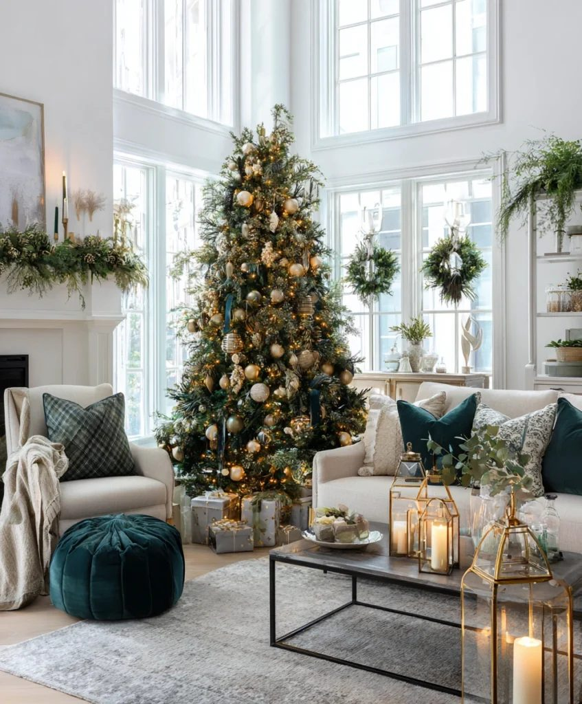

> TIP:QUICK: Let the tree lead — keep cushions and wrapping paper in cream and ivory so the emerald stays the star.

## 2. Burgundy Velvet Christmas Tree

Burgundy is the softer side of the jewel-tone trend, and velvet makes it feel even warmer. Large burgundy bows tucked into the branches read like ribbon on a gift, and they break up the green in a way baubles alone never do. Pair them with blush pink and gold ornaments for a tree that feels romantic rather than heavy.

This look works best on a full, tall tree where the bows have room to breathe. Space them evenly around the tree at different heights, and finish with wrapped gifts in matching burgundy and cream paper underneath.

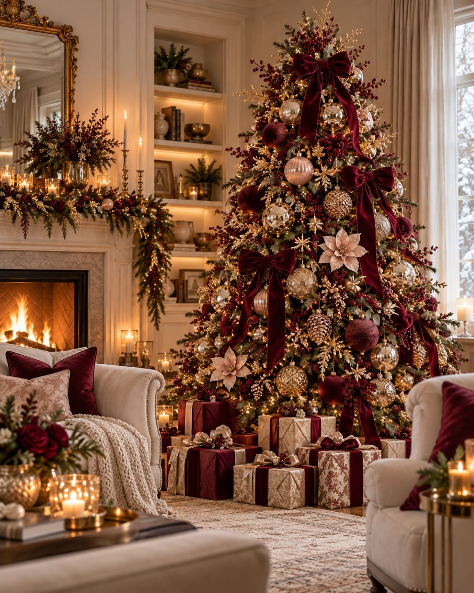

> TIP:CHECK: bows spaced evenly at different heights; blush and gold ornaments to soften the burgundy; matching gift wrap underneath

## 3. Flocked White Christmas Tree

A flocked tree is still the calmest way to do Christmas, and for 2027 the look is simpler than ever: white branches, silver and white ornaments, and warm lights — nothing else competing for attention. It suits bright, minimalist rooms where a traditional green tree would feel too busy.

The trick is to keep the base simple too. A white tree skirt or a plain woven basket lets the snowy branches do the talking, and a small star on top finishes the look without adding another colour.

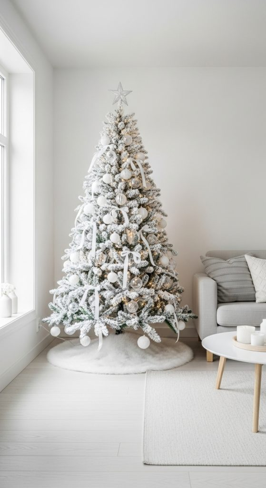

> TIP:GUIDE: Tree: flocked white with warm lights | Ornaments: silver and white only | Base: white skirt or plain woven basket

## 4. Slim Pencil Tree for Small Spaces

A slim pencil tree is the answer for flats and small living rooms. It tucks into a corner, needs almost no floor space, and still holds enough ornaments to feel like a real Christmas tree. Choose one around six feet tall so it reads as a proper tree rather than a tabletop decoration.

Dress it lightly — too many ornaments will overwhelm the narrow shape. Warm white lights, small baubles and a few longer drops of ribbon give it height without bulk, and a basket base hides the stand neatly.

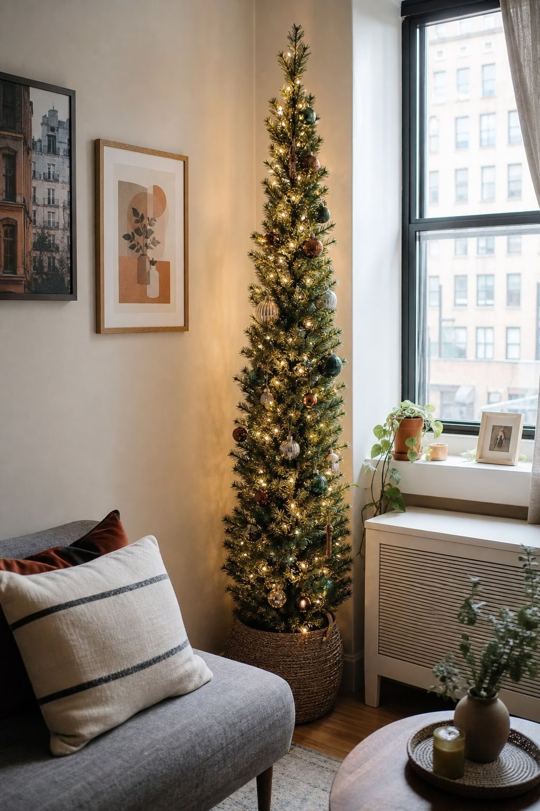

> TIP:QUICK: Dress a pencil tree lightly — small baubles and warm lights, never heavy ornaments that hide the shape.

## 5. Oversized Statement Tree

If you have the ceiling height, go big. An oversized tree with full branches, generous ribbon and layers of red and gold ornaments becomes the whole room's decoration — everything else can stay simple. It is the classic Christmas look, done with confidence rather than clutter.

The key is scale everywhere else too: large wrapped gifts underneath, a wide tree collar or skirt, and garland on the mantel behind it so the tree does not stand alone. Step back often while decorating and check the balance from the doorway.

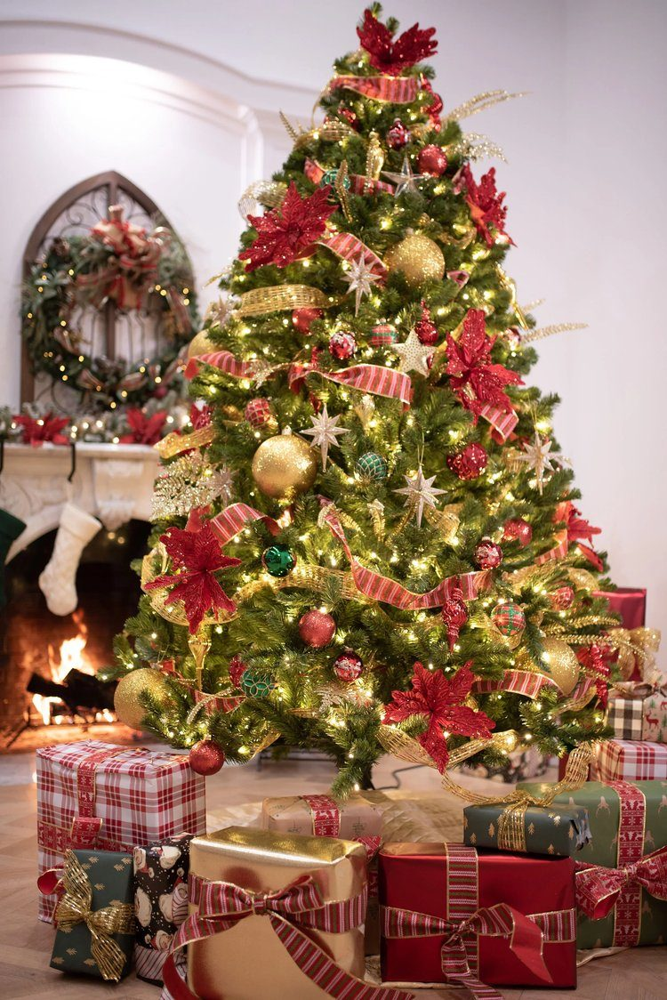

> TIP:CHECK: full branches and generous ribbon; large gifts underneath; garland on the mantel behind so the tree is not alone

## 6. Colour-Blocked Ornaments

Colour blocking is the playful 2027 idea: instead of mixing every colour on every branch, group baubles by colour in bold clusters — a sweep of red here, a sweep of green there, a burst of purple and gold lower down. The result is a tree that looks designed rather than decorated by accident.

Start with your three strongest colours and place the biggest baubles first, in loose diagonal bands. Fill the gaps with smaller baubles in the same colours, and keep the lights warm white so the colours stay true in the evening.

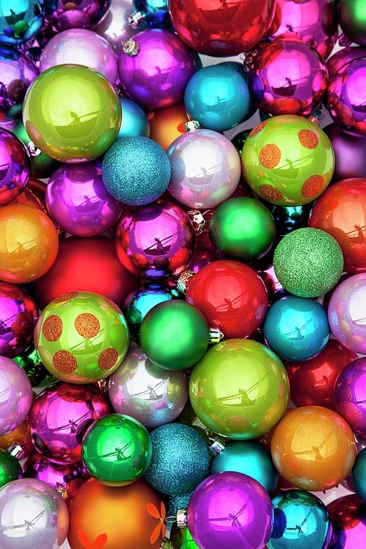

> TIP:GUIDE: Colours: three strong shades only | Placement: biggest baubles first, in diagonal bands | Lights: warm white so colours stay true

## 7. Vintage Glass Ornaments

Vintage glass ornaments bring a gentle, old-fashioned shimmer that new plastic baubles cannot match. Teardrop and icicle shapes in faded red, blue and gold catch the light beautifully, and each one is slightly different, which gives the tree a collected-over-years feeling.

Mix them with plain matte baubles so the glass stands out, and hang the prettiest ones at eye level where they can be seen. Handle them carefully when the tree comes down — wrap each one in tissue and store them in a divided box.

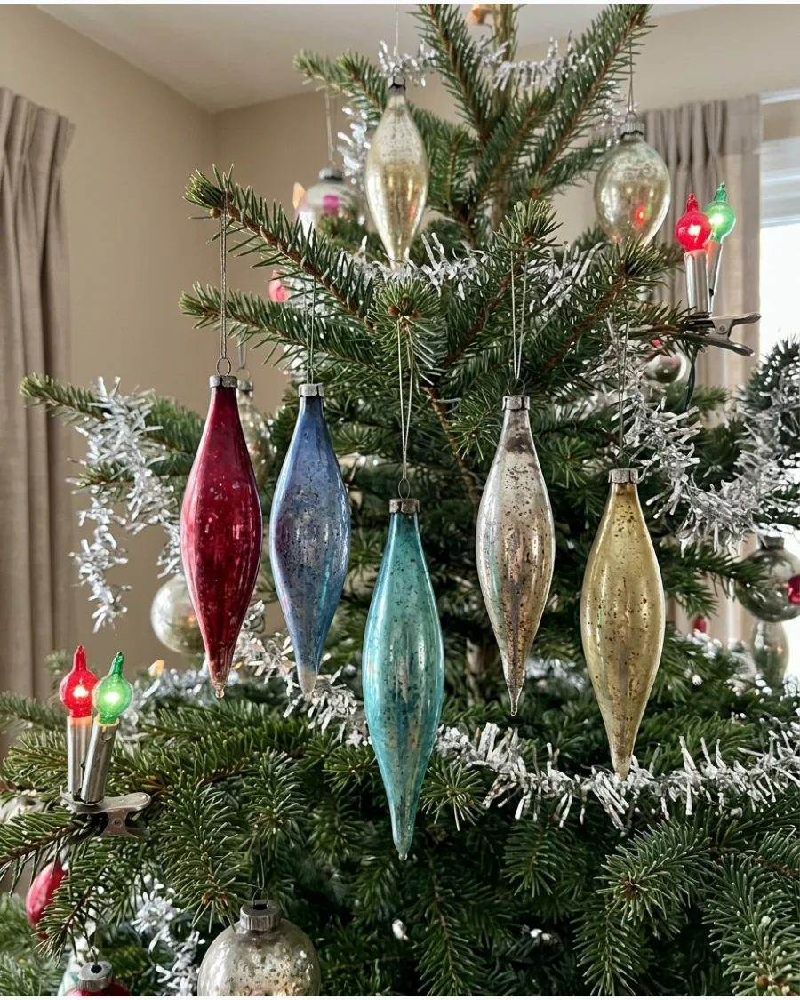

> TIP:QUICK: Hang the prettiest vintage pieces at eye level and mix them with plain matte baubles so the glass stands out.

## 8. Dried Orange Slice Garland

Dried orange slices are the natural garland of 2027: golden, translucent when the light hits them, and lovely with the scent of the season. String them with red berries and small lights along the branches, or drape them across the mantel for a garland that costs almost nothing.

Dry the slices slowly in a low oven until they are firm and slightly curled at the edges, then thread them on twine with a needle. They store well in a paper bag and can be reused for a second Christmas if they stay dry.

> TIP:CHECK: dry slices slowly in a low oven; thread on twine with a needle; store in a paper bag to reuse next year

## 9. Paper Star Lanterns

A glowing paper star in the window is one of the simplest Christmas decorations there is, and it looks wonderful from the street as well as from inside. The folded points throw soft shadows on the walls, and a single warm bulb inside is all the light it needs.

Hang the star at the centre of the window on a clear thread so it seems to float, and keep the windowsill below it clear — a wooden bead garland or a small candle is enough. Paper stars fold flat for storage, so they are easy to keep for next year.

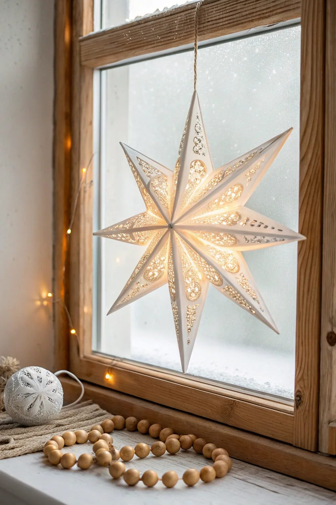

> TIP:GUIDE: Hang: centre of the window on clear thread | Light: one warm bulb inside | Storage: folds flat for next year

## 10. Mantel Garland with Candles

The mantel is where the whole room gathers at Christmas, so give it layers. Start with a thick evergreen garland, weave in warm fairy lights, then add candles in mixed heights — tall tapers at the ends, shorter pillars in the middle. The glow from the candles makes the greenery look alive in the evening.

Keep candles well away from dry greenery and never leave them burning unattended. Battery candles give the same glow with none of the worry, and they can stay on a timer every evening.

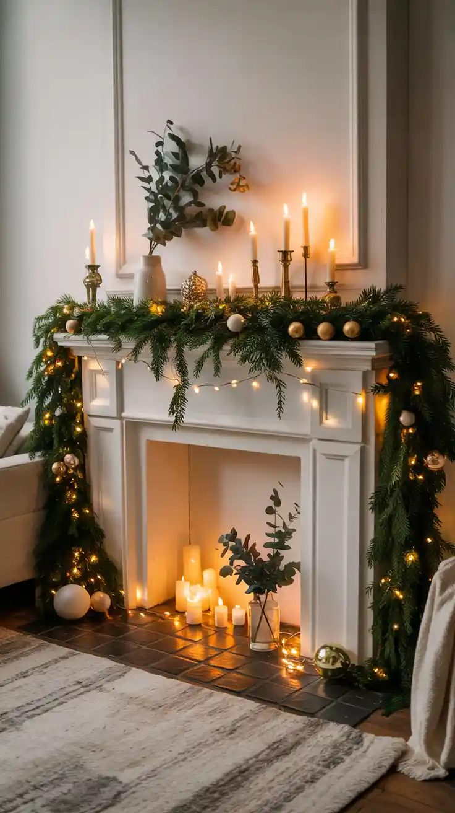

> TIP:QUICK: Layer garland, then lights, then candles in mixed heights — and never leave real candles burning unattended.

## 11. Stockings Hung in a Row

A row of stockings is the most nostalgic part of Christmas decorating, and it looks best when the stockings share a style. Matching knit stockings in red, cream and green, hung evenly along the mantel, give the fireplace a finished look even before the tree goes up.

Hang them with sturdy hooks that hold the weight of small gifts, and space them so each one has room to hang straight. A small name tag or a sprig of greenery tucked into each cuff makes them feel personal without any extra work.

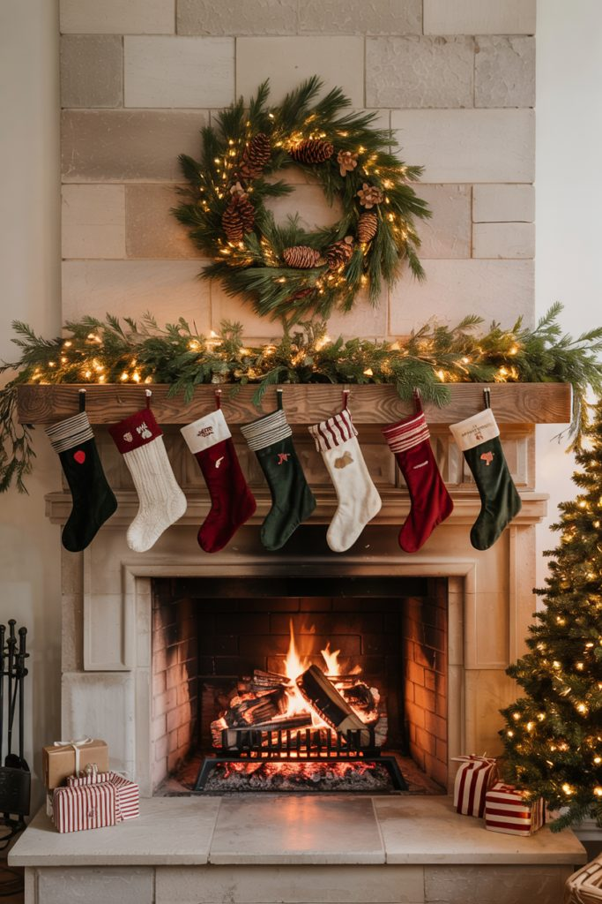

> TIP:CHECK: matching knit stockings; sturdy hooks that hold small gifts; a sprig of greenery in each cuff

## 12. Wreath Over the Mantel Mirror

Hanging a wreath over the mantel mirror doubles its effect: the mirror reflects the greenery and the tree lights, and the whole wall feels deeper and brighter. A full green wreath with a red ribbon is the classic choice, and it needs nothing else on the wall.

Hang the wreath from a ribbon looped over the top of the mirror, or from a small hook behind it. Keep the mantel garland below it in the same greenery so the two pieces read as one arrangement.

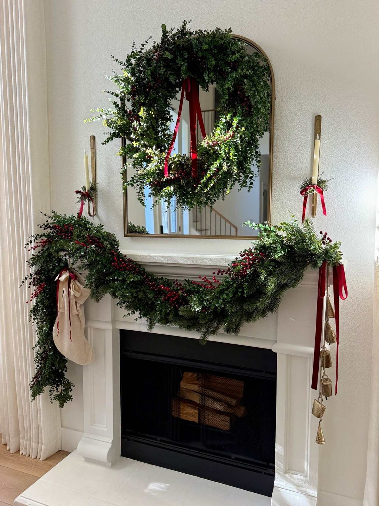

> TIP:GUIDE: Wreath: full green with a red ribbon | Hang: ribbon over the mirror top | Mantel: same greenery below for one arrangement

## 13. Candlelit Christmas Dinner Table

Christmas dinner deserves a table that glows. Cluster candles of different heights down the centre, tuck in sprigs of evergreen and a few pinecones, and let the place settings stay simple — white plates, one sprig of greenery on each napkin, and glasses that catch the candlelight.

Light the candles just before guests sit down, and keep the centrepiece low so everyone can see each other across the table. A table that glows feels festive long before the food arrives.

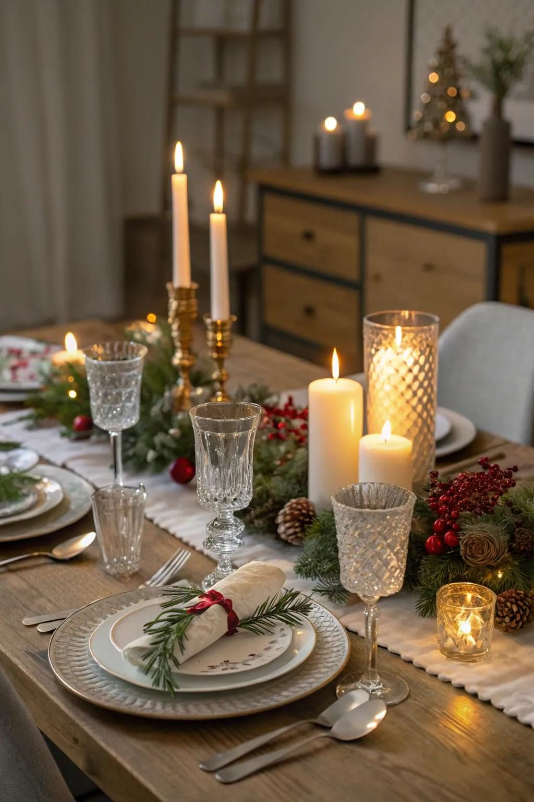

> TIP:QUICK: Keep the centrepiece low so guests can see each other, and light the candles just before everyone sits down.

## 14. Red Plaid Table Runner

A red and black plaid runner is the fastest way to make an ordinary dining table look like Christmas. It adds colour and pattern in one move, and it works with almost any plates — white, cream or even gold. Layer it over a plain tablecloth or straight onto a wooden table.

Finish the table with simple greenery down the centre and a few pinecones, and let the runner do the talking. When the meal is over, the runner shakes out and washes easily, ready for next year.

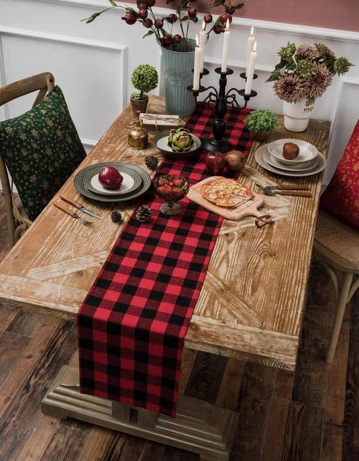

> TIP:CHECK: runner over a plain cloth or bare wood; simple greenery down the centre; plates in white, cream or gold

## 15. Gold Charger Plates

Gold charger plates turn an everyday dinner into an occasion. They sit under the dinner plate and frame it, catching the candlelight and tying the whole table together. Pair them with gold cutlery, white plates and a touch of greenery for a table that feels elegant without being formal.

You do not need a full set of gold everything — the chargers are the statement, so keep the rest quiet. A single gold bauble or a sprig of pine on each plate is all the extra decoration the table needs.

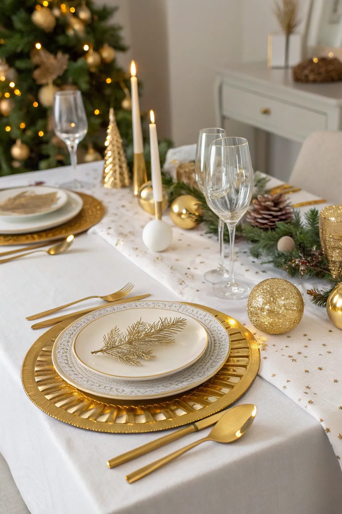

> TIP:GUIDE: Chargers: gold, under white plates | Cutlery: gold to match | Extra: one gold bauble or pine sprig per plate

## 16. Entryway Console with a Wreath

The entryway is the first thing guests see, so give it a small Christmas moment. A console table with a green wreath above it, two small bottle-brush trees and a few candles makes the whole hall feel festive, even if the rest of the house is still being decorated.

Keep it practical: baskets underneath for shoes and scarves, a tray for keys, and nothing fragile at elbow height. The wreath does the decorating; the console still has to work as an entryway.

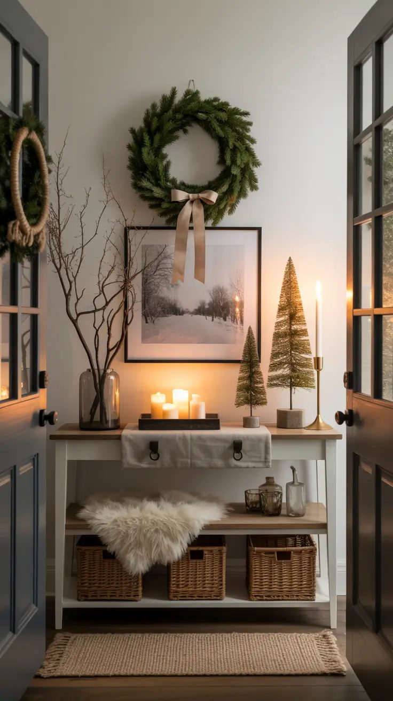

> TIP:QUICK: Let the wreath do the decorating — keep the console practical, with baskets below and nothing fragile at elbow height.

## 17. Oversized Front Door Wreath

An oversized wreath makes the front door impossible to miss. Go bigger than you think — a wreath that covers most of the door reads grand from the street, while a small one gets lost. Red bows, pinecones and berries give it the classic Christmas look.

Hang it with a sturdy over-door hook and check that it clears the door frame when the door opens. If the door is exposed to rain, choose a wreath with weatherproof greenery so it still looks fresh on Christmas Day.

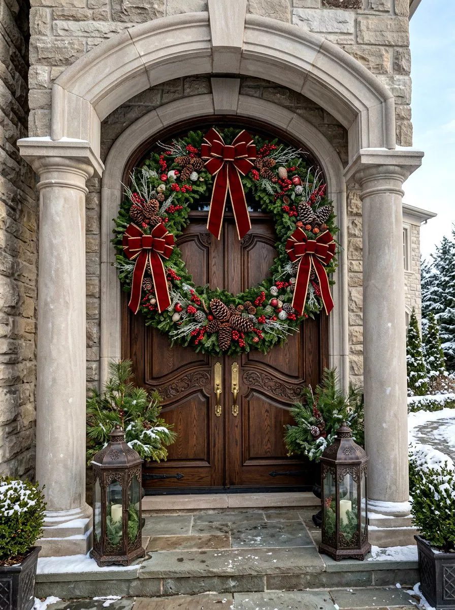

> TIP:CHECK: bigger than you think — it should cover most of the door; sturdy hook; weatherproof greenery if the door is exposed

## 18. Staircase Garland with Lights

A garland along the staircase turns an ordinary hallway into a Christmas scene. Drape thick evergreen garland along the banister, weave in warm fairy lights, and let the ends pool softly at the bottom step. It is one of the most photographed spots in a decorated home.

Fasten the garland with ribbon or cable ties every couple of feet so it does not slip, and keep the handrail clear enough to hold. Battery lights avoid a trailing cord down the stairs.

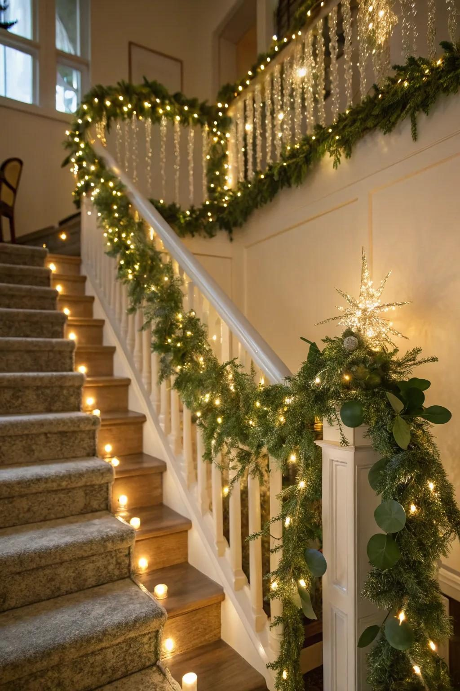

> TIP:GUIDE: Fasten: ribbon or cable ties every couple of feet | Lights: battery powered, no trailing cord | Rail: keep clear enough to hold

## 19. Window Wreath with Candles

A wreath on the window with candles below it is a quiet, old-fashioned Christmas picture. The wreath frames the glass, the candles glow beneath, and from outside the whole window looks like a greeting card. It works on a front window, a kitchen window or a glass door.

Use a suction hook or a ribbon over the top of the window to hang the wreath, and set the candles on a tray with greenery so any drips are caught. Flameless candles are the safest choice here, especially on a wooden sill.

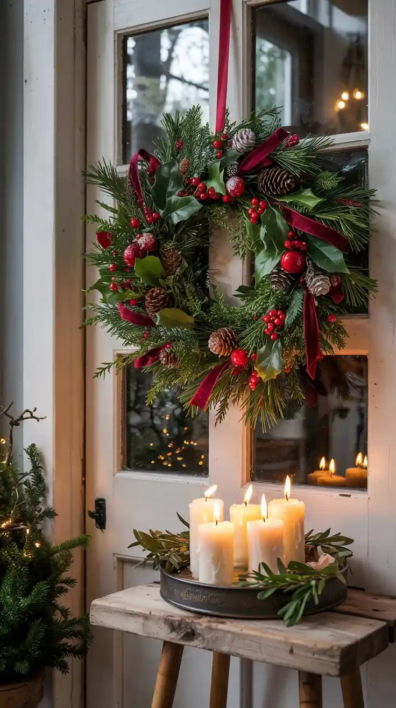

> TIP:QUICK: Set the candles on a tray with greenery underneath, and use flameless candles on a wooden windowsill.

## 20. Fairy Lights in Glass Jars

Fairy lights in glass jars are the easiest glow in the house. Fill a mason jar with a short string of warm lights, add a pinecone and a sprig of evergreen on top, and you have a lantern for the table, the windowsill or the bathroom shelf. They cost little and take minutes.

Cluster two or three jars together for a fuller look, and use battery lights with a timer so they switch on every evening on their own. The jars are also lovely on the Christmas table as extra light between the candles.

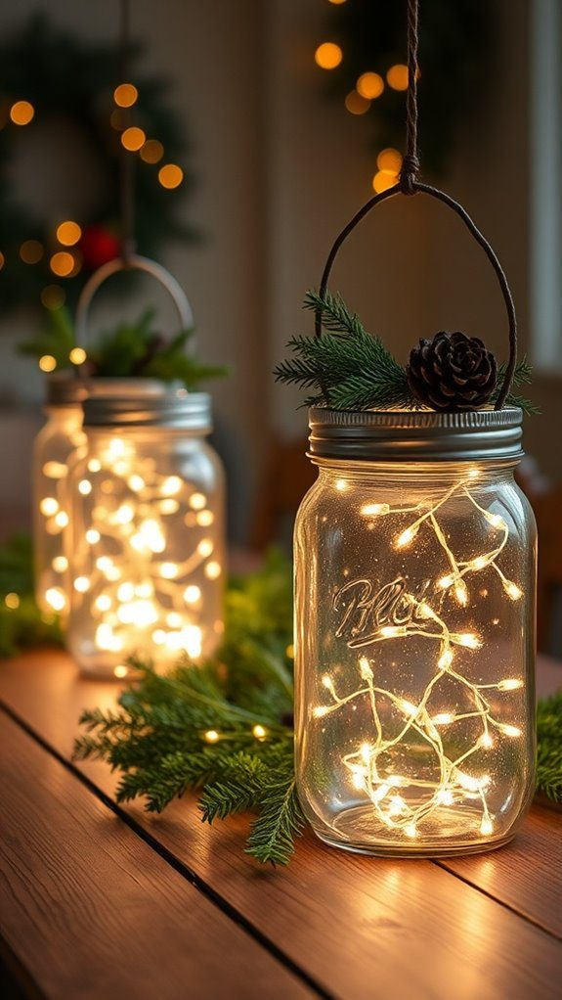

> TIP:CHECK: warm lights in mason jars; a pinecone and evergreen sprig on top; battery lights with a timer for evenings

## 21. Paper Snowflakes on the Window

Paper snowflakes are the cheapest Christmas decoration and one of the most charming. Cut them from white paper in different sizes, hang them at different heights in the window with clear thread, and they catch the light like real snow. Children love making them, and every one comes out different.

Hang the largest flakes at the top and the smallest lower down, so the window reads like a snowfall. A few flakes on a mirror or a glass cabinet door spread the effect through the room.

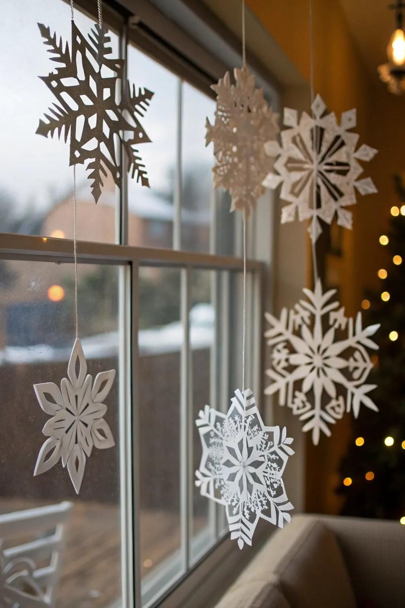

> TIP:GUIDE: Sizes: mix large and small flakes | Hang: largest at the top, smallest lower down | Extra: a few on mirrors and glass doors

## 22. Natural Wooden Ornaments for a Greener Tree

Wooden ornaments are the sustainable star of 2027: stars, angels, reindeer and simple shapes cut from pale wood, hung with twine. They suit a natural tree beautifully, and unlike glitter or plastic they can be used for decades and composted at the end of their life.

Buy them plain and let the family decorate a few with paint or wood-burning, or leave them bare for a Scandinavian look. Mix them with dried orange slices and pinecones, and the whole tree smells and feels like a forest.

> TIP:QUICK: Leave wooden ornaments bare for a Scandinavian look, or let the family paint a few for a personal touch.

## 23. Pinecone Ornaments

Pinecones make wonderful ornaments with almost no work. Tie a loop of twine around the top, add a few red berries, and hang them straight on the tree. They add texture and a woodland feeling, and they cost nothing if you gather them on a walk.

Bake gathered pinecones in a low oven first to dry them out and open the scales, and let them cool completely before decorating. A light dusting of white paint on the tips looks like snow and makes them stand out against the green branches.

> TIP:CHECK: bake gathered pinecones in a low oven first; cool completely; dust the tips with white paint for a snowy look

## 24. Dried Flower Wreath

A dried flower wreath is the softer, longer-lasting alternative to a fresh one. Dried grasses, seed heads, pinecones and a few pale blooms make a wreath that keeps its shape all season and can be stored for next year. It suits front doors, bedroom doors and even a wall above the sofa.

Hang it somewhere sheltered from rain, since dried flowers do not like getting wet. A simple loop of ribbon is all it needs — the wreath itself is the decoration.

> TIP:GUIDE: Materials: dried grasses, seed heads and pinecones | Hang: somewhere sheltered from rain | Finish: a simple ribbon loop

## 25. Kitchen Garland Glow-Up

The kitchen is where everyone gathers in December, so it deserves more than a token decoration. Drape a long evergreen garland with lights across the window above the sink, add a small tree on the counter, and the whole room feels like Christmas while you cook.

Keep the garland clear of the hob and the worktops you need for cooking, and use battery lights so there are no cords near water. A bowl of oranges and a few cinnamon sticks on the counter add scent and colour for free.

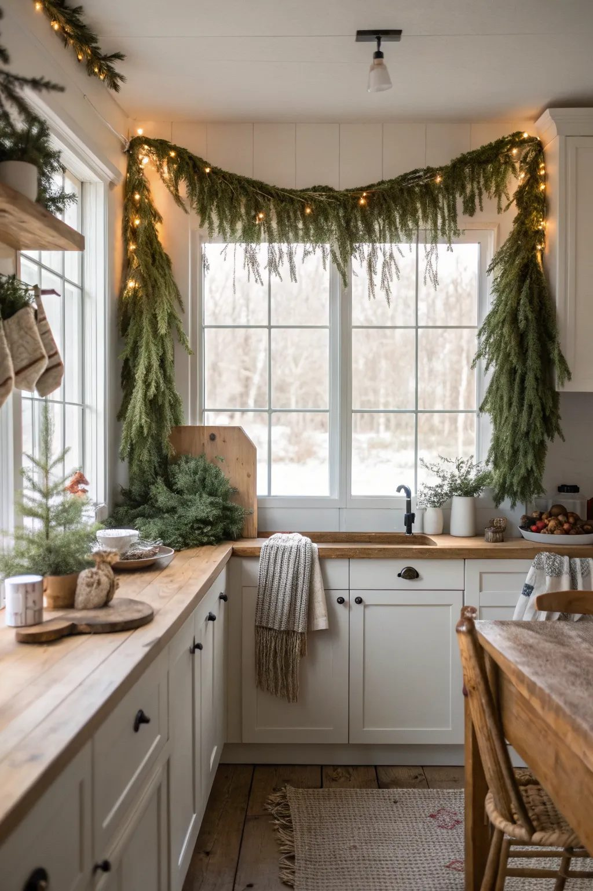

> TIP:QUICK: Keep garland clear of the hob and worktops, and use battery lights so no cords run near water.

## 26. Dreamy Christmas Bedroom

Christmas does not have to stop at the living room. A bedroom with fairy lights along the headboard, small wreaths on the wall and a tiny tree on the dresser feels like a winter retreat, and it is lovely to wake up to on Christmas morning.

Keep the palette soft — cream bedding, warm lights and a little greenery — so the room still feels restful. A red cushion or a plaid throw is enough colour, and the lights should be on a timer so they switch off when you fall asleep.

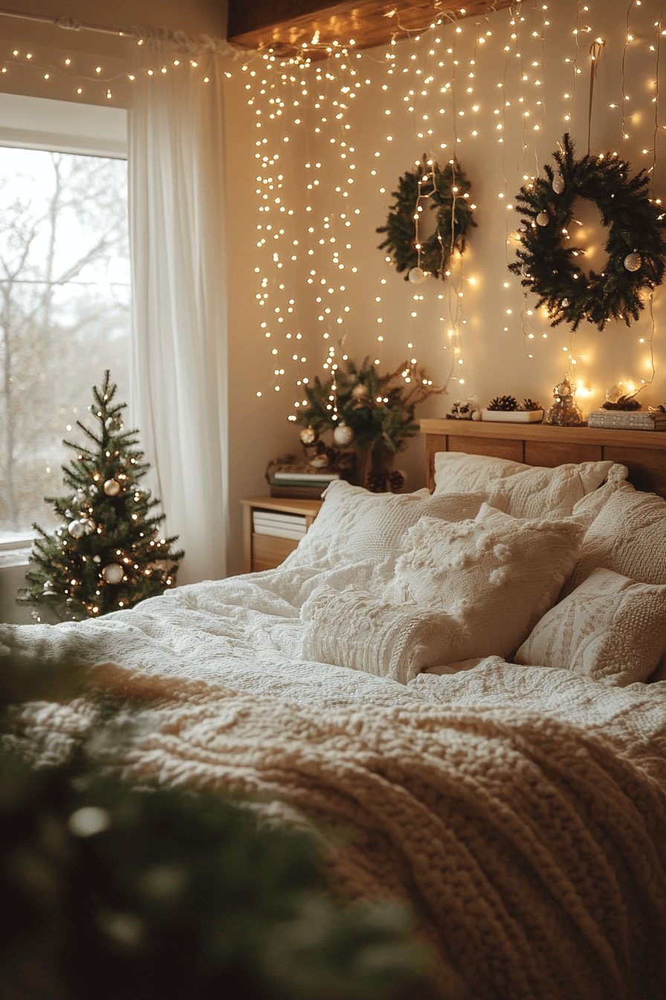

> TIP:CHECK: soft palette of cream and warm lights; a small tree on the dresser; lights on a timer so they switch off at night

## 27. Hanging Advent Calendar

A hanging advent calendar turns the countdown into a decoration. A felt Christmas tree with numbered pockets, hung on the wall where the family passes every day, gives children something to open each morning and gives the wall a festive shape all December.

Fill the pockets with small treats, notes or tiny activities, and let a different family member open one each day. When December ends, the calendar folds away flat and comes out again next year.

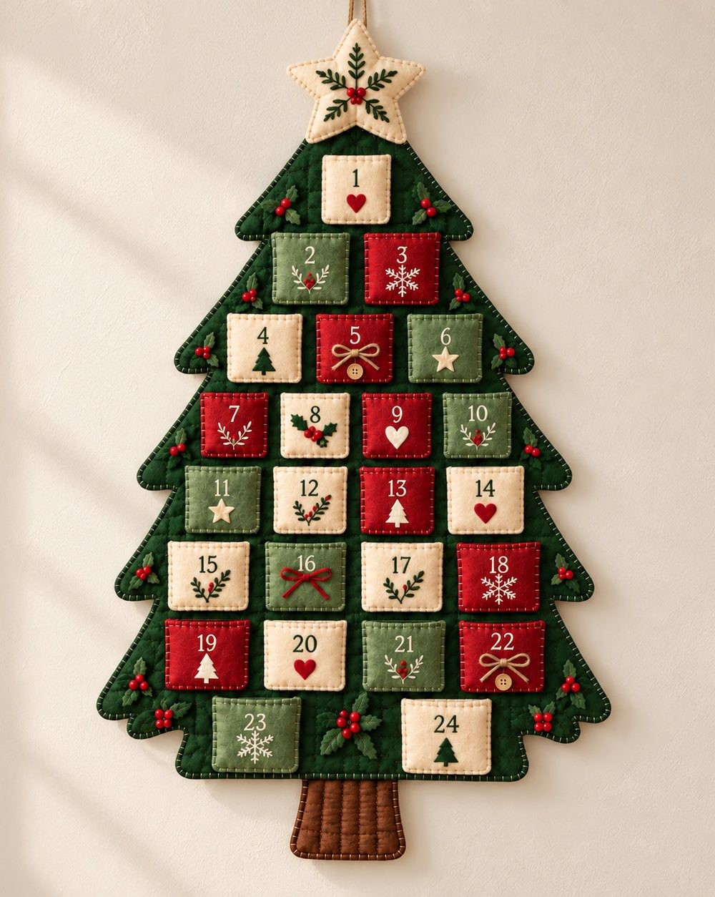

> TIP:GUIDE: Fill: small treats, notes or tiny activities | Open: a different family member each day | Store: folds flat for next year

## 28. Porch Lanterns

Lanterns are the warmest welcome a front porch can offer. Set two large lanterns by the door with candles inside, flank them with small trees or pots of greenery, and hang a wreath above. In the evening the whole entrance glows, and guests feel welcomed before they even knock.

Use flameless candles in the lanterns so the wind cannot blow them out, and choose lanterns heavy enough not to tip over. A doormat in a festive colour finishes the scene.

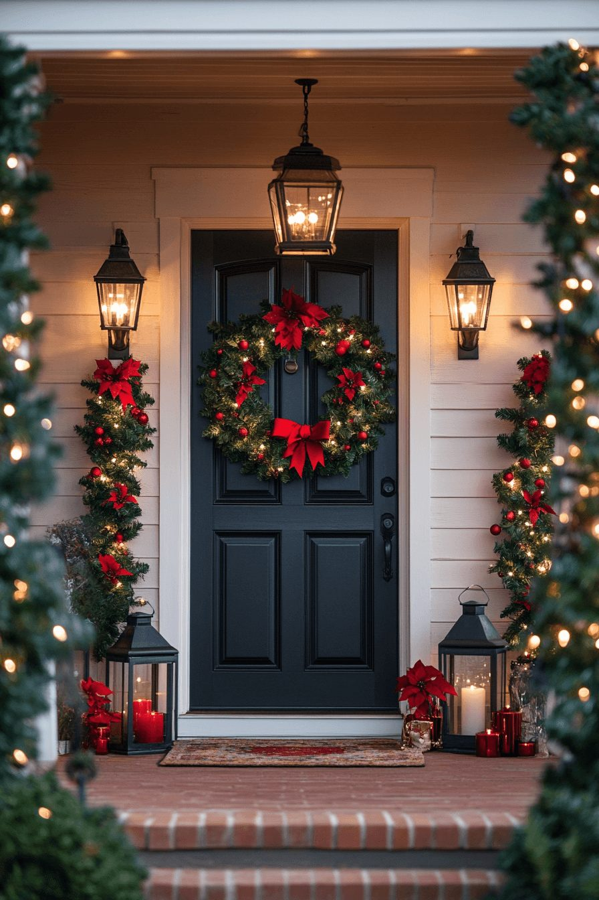

> TIP:QUICK: Use flameless candles in porch lanterns so the wind cannot blow them out, and pick lanterns heavy enough not to tip.

## 29. Cozy Reading Nook by the Fire

A reading nook by the fire is the quiet heart of a Christmas home. An armchair with a soft throw, a small side table for a book and a warm drink, and stockings on the mantel nearby — it is the spot everyone drifts to when the day slows down.

Place the chair at an angle to the fire so it catches the warmth and the light, and keep a basket of books or magazines beside it. A red cushion and a knitted throw are all the Christmas colour the nook needs.

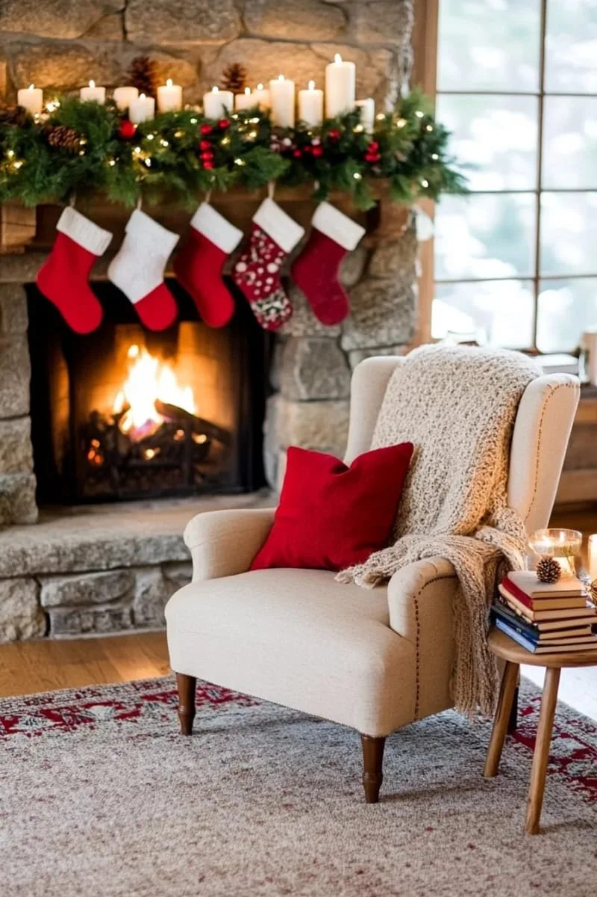

> TIP:CHECK: chair angled to the fire; a basket of books beside it; a red cushion and a knitted throw for colour

## 30. Farmhouse Christmas Village

A Christmas village is the decoration that grows with your family. Small wooden houses with lit windows, arranged on a console table under a frosted wreath, make a tiny winter scene that children love to rearrange. Add a new house each year and the village becomes a tradition.

Arrange the houses at different depths so the scene feels like a real street, and hide a short string of fairy lights behind them so the windows glow. Keep the table clear of anything else — the village is the whole display.

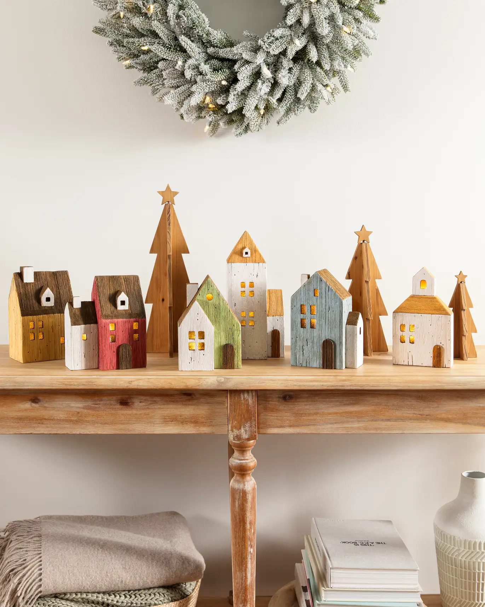

> TIP:GUIDE: Arrange: houses at different depths, like a real street | Light: fairy lights behind so windows glow | Add: one new house each year

## Takeaway

- The 2027 Christmas look is calmer, greener and warmer than the years before it: deep jewel colours on the tree, natural garlands and wooden ornaments, and glow from candles and fairy lights in every room.
- Start with the tree, add one glowing mantel, then carry the same colour through the table, the entryway and the porch.
- If you want the look to last past Christmas, our [30 Cozy Winter Home Ideas](/posts/winter-home/) show how to keep the warmth going into January with the decorations packed away.

## Frequently Asked Questions

### What colours are trending for Christmas 2027?

Deep jewel tones lead the way: emerald green with gold, burgundy with blush, and warm plum with brass. Soft sage and warm white balance the richer shades, so the room still feels calm. Pick one main colour, one metallic, and one soft neutral, then repeat that trio across the tree, mantel and table for a pulled-together look.

### When should I start decorating for Christmas 2027?

Most homes start in late November, with the tree going up the weekend after Thanksgiving in the United States or the first weekend of Advent elsewhere. Starting early spreads the work out and lets you enjoy the decor longer. If you prefer a shorter season, the first week of December still leaves plenty of time to enjoy every room.

### How do I decorate a small home for Christmas?

Choose a slim pencil tree or a tabletop tree, then decorate the surfaces you already use: the mantel, the windowsills and the dining table. One strong focal point beats ten small ones in a tight room. Keep the palette to two colours plus a metallic, and use lights generously — they add festive feeling without taking up any floor space.

### Are real or artificial trees better for 2027?

Both work well, and the choice comes down to your home and habits. A real tree brings scent and tradition but needs watering and drops needles. A good artificial tree can be reused for years, suits allergy-prone households, and holds heavy ornaments well. Whichever you choose, a fresh tree collar or a woven basket finishes the base neatly.

### How can I make my Christmas decor more sustainable?

Reuse what you own first, then add natural pieces: dried orange garlands, pinecone ornaments, wooden decorations and paper snowflakes that compost or store flat. Choose LED lights, which use less energy, and wrap gifts in fabric or recycled paper. A few well-made decorations used year after year beat a box of single-season pieces every time.

### What is the easiest way to decorate a mantel?

Start with a full evergreen garland, then add lights and one row of candles in mixed heights. Hang a wreath or a mirror above it as the centrepiece, and finish with stockings or a few small ornaments tucked into the greenery. Step back and check the balance: the mantel should look full from the doorway, not just from up close.

### How do I light my home for Christmas without clutter?

Layer three kinds of light: warm white fairy lights on the tree, candles or lanterns on tables and mantels, and one statement piece like a paper star in the window. Keep every string on the same warm colour temperature for a calm glow. Hide battery packs behind greenery and switch lights on in the evening for the best effect.

### Can I mix Christmas styles in one home?

Yes, and most homes look better for it. Keep one thread running through every room — the same metallic, the same greenery, or the same two colours — and let each room vary the rest. A rustic kitchen garland can sit beside an elegant gold table when both share warm lights and fresh evergreen.
