# 30 2027 Home Decor Ideas for a Fresh, Modern Home

These 2027 home decor ideas are all about warmth, curves and natural materials — a softer, more personal take on modern style. The cold white minimalism of a few years ago has warmed up into creamy neutrals, wood, stone and linen, while bold colour makes a comeback on velvet sofas, wallpaper and painted walls. Nothing here needs a full renovation: most of these ideas work as a single swap in one room.

Use this list as a starting point for the year ahead. Pick the ideas that fit your home, mix the calm ones with one or two bold ones, and let your rooms grow into 2027 gradually rather than all at once.

## 1. Bold Wallpaper Feature Wall

Bold wallpaper is back in a big way for 2027, and a dark floral feature wall is the most dramatic version. Large blooms in burgundy, blush and gold on a deep background turn a plain living room into a jewel box, especially behind a velvet sofa in a contrasting colour.

One wall is enough — papering all four will shrink the room. Paste-the-wall papers are the easiest to hang and remove, which matters if you like to change your mind.

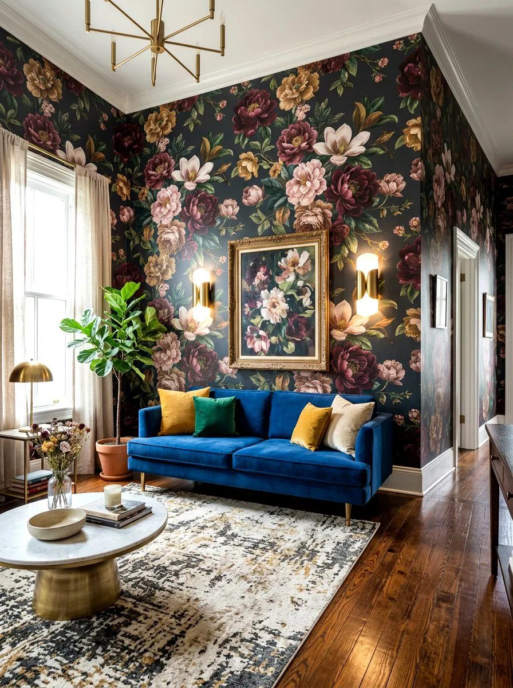

> TIP:QUICK: one wall is enough; paste-the-wall paper is easiest to hang and remove; pair with a contrasting sofa

## 2. Curved Bouclé Sofa

Curves are the shape of 2027, and nothing shows it off better than a curved bouclé sofa. The rounded back softens a boxy room instantly, and the nubby bouclé fabric adds texture that plain upholstery never has. Pair it with a round coffee table to echo the shape.

A curved sofa works best as the room's hero piece, so keep the rest of the furniture simple. Cream and off-white are the easiest colours to live with, and they make a small room feel bigger.

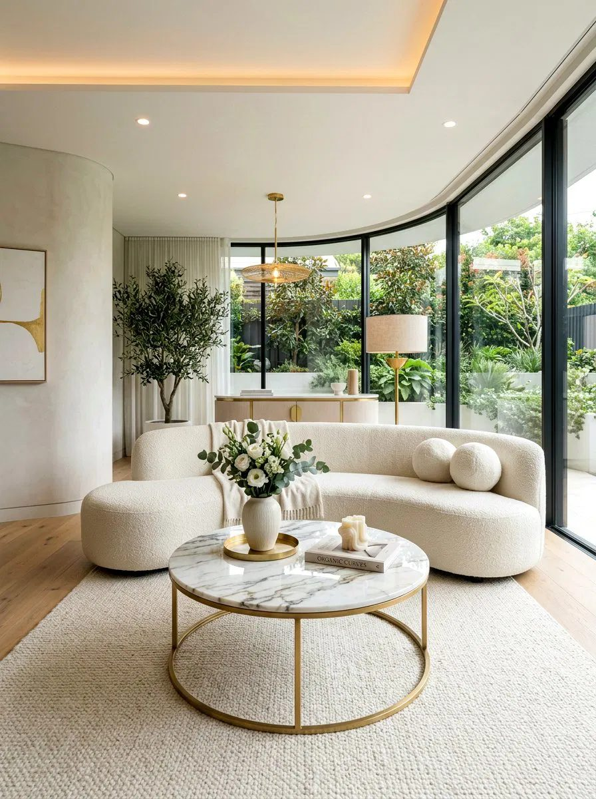

> TIP:CHECK: curved sofa as the hero piece; round coffee table to echo it; keep other furniture simple

## 3. White Bouclé Accent Chair

If a full curved sofa feels like too much, a white bouclé accent chair gives you the same soft, sculptural look in one seat. It tucks into a reading corner, beside a fireplace or at the end of a sofa, and the nubby texture reads as cosy rather than formal.

Bouclé shows marks more than smooth fabric, so keep it away from muddy shoes and pets' favourite spots. A small lumbar pillow in a warm tone stops the white from feeling stark.

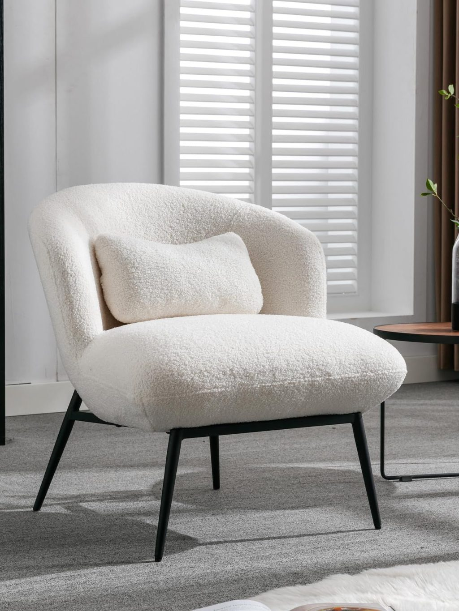

> TIP:GUIDE: Placement: reading corner, fireplace side or sofa end | Cushion: one warm-toned lumbar pillow | Care: keep away from muddy shoes and pets

## 4. Natural Stone Coffee Table

A coffee table cut from a single piece of natural stone is 2027's answer to the plain glass table. Onyx, travertine and marble slabs each have their own veining, so no two tables look alike, and the heavy, organic shape grounds a light, airy room.

Stone is heavy, so decide its spot before delivery and use felt pads underneath. Style it lightly — a book, a small bowl, one vase — because the stone itself is the decoration.

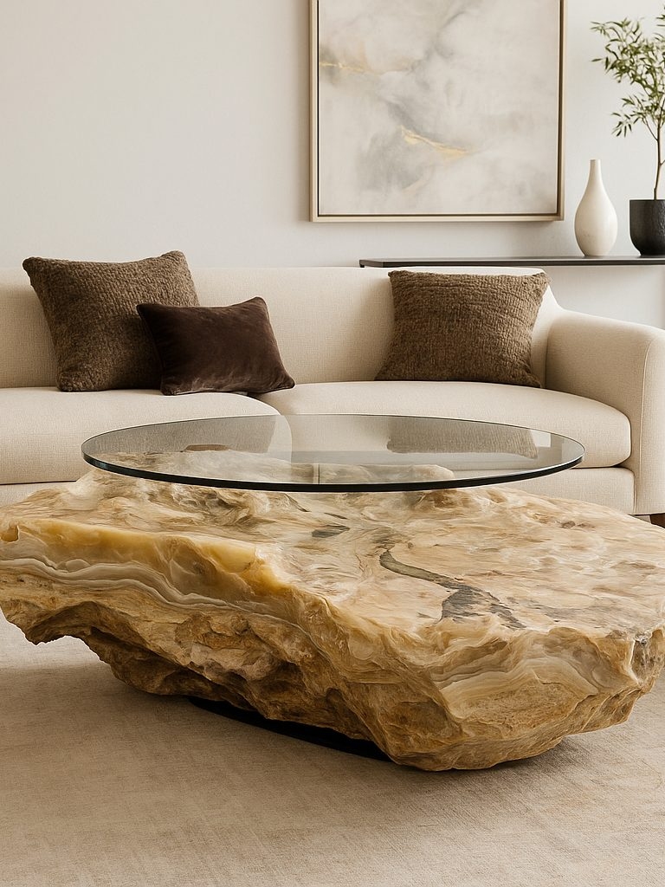

> TIP:QUICK: Decide the spot before delivery — stone is heavy — and use felt pads underneath.

## 5. Terracotta Accent Wall

Terracotta is 2027's warmest colour, and one painted wall is all it takes to change a room. It flatters cream sofas, light wood and woven textures, and it glows beautifully in evening light. The trick is to keep the other walls pale so the terracotta reads as a feature, not a cave.

Test the shade on a large swatch first, because terracotta shifts a lot between daylight and lamplight. A clay or burnt-orange tone suits most rooms better than a bright orange.

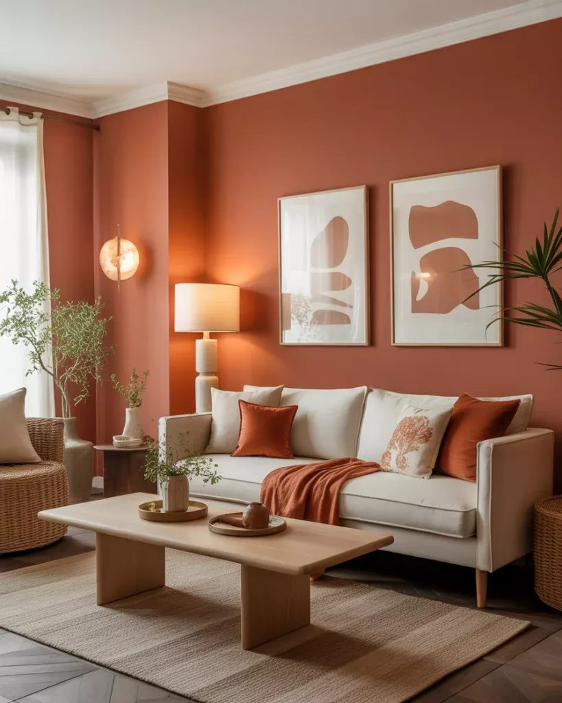

> TIP:CHECK: test a large swatch in daylight and lamplight; keep other walls pale; clay tones beat bright orange

## 6. Sage Green Kitchen Cabinets

Sage green cabinets are the calm, grown-up colour for 2027 kitchens. The soft grey-green works with white countertops, brass hardware and light wood floors, and it hides everyday marks far better than white. It suits shaker doors best, where the colour can sit quietly and let the room's shape lead.

If a full repaint feels risky, try sage on the lower cabinets only and keep the uppers white. The two-tone look is forgiving, and you can always extend the colour later.

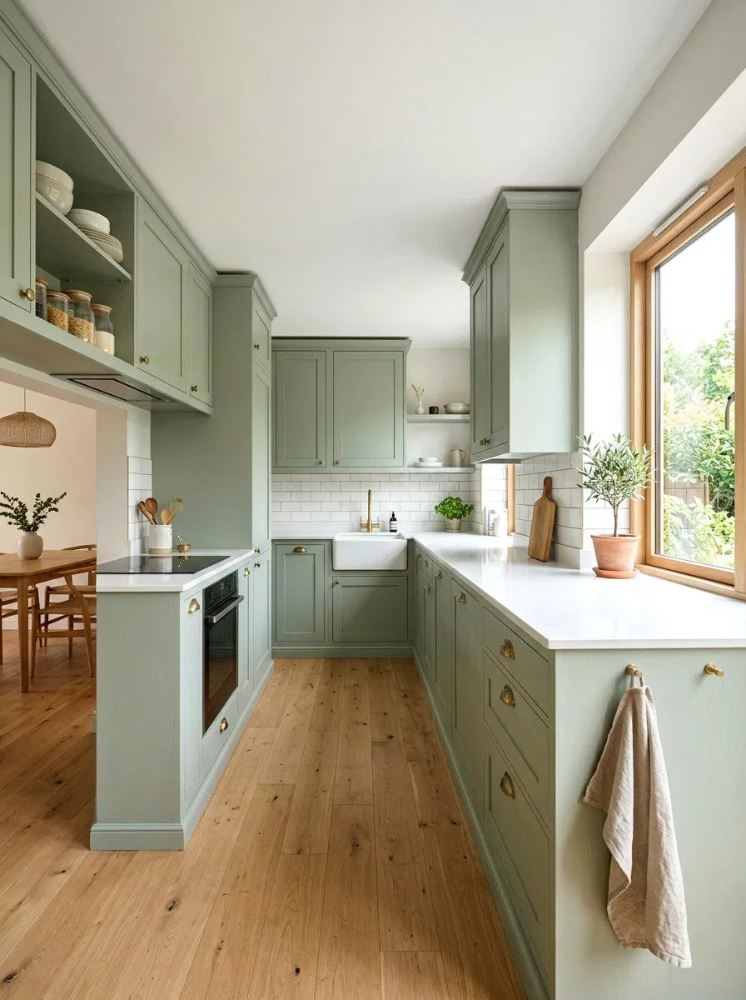

> TIP:GUIDE: Doors: shaker style suits sage best | Hardware: brass or black | Safe start: sage lowers, white uppers

## 7. Fluted Wood Panelling

Fluted wood panelling — narrow vertical slats with a ribbed texture — is 2027's favourite way to add warmth to a plain wall. Behind a bed it acts as a headboard and a feature wall in one, and the vertical lines make a low ceiling feel taller.

Choose a medium wood tone so the grooves read clearly, and keep the bedding pale so the wall stays the star. The panels also hide uneven plaster, which makes them a practical fix as well as a pretty one.

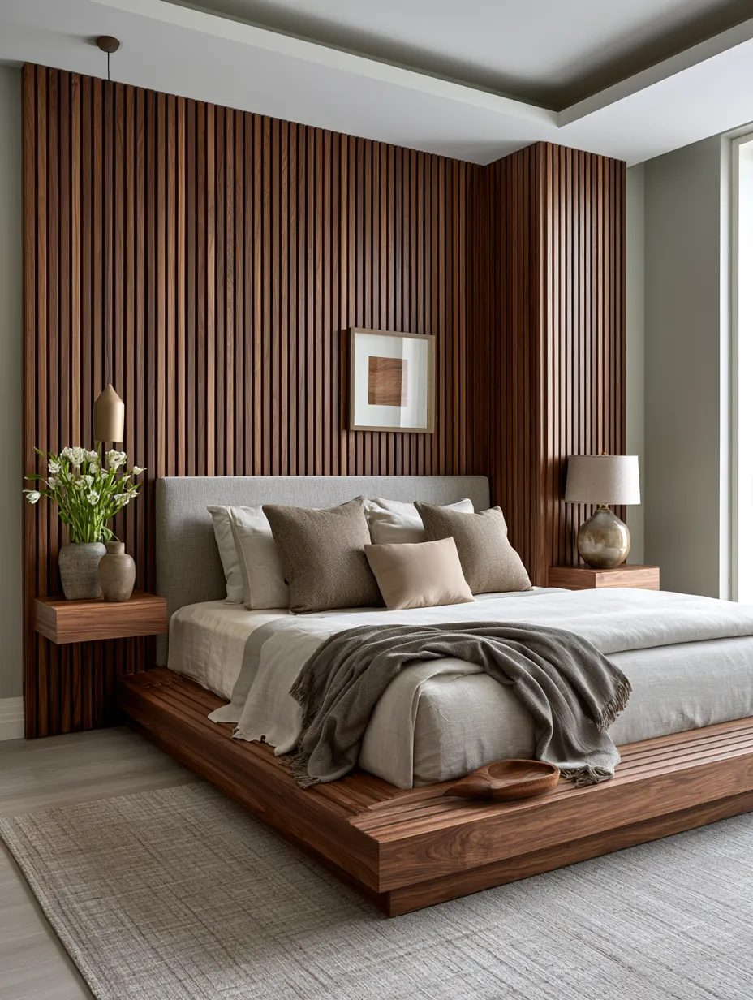

> TIP:QUICK: Keep bedding pale so the fluted wall stays the star of the room.

## 8. Arched Doorways

Arches are back, and an arched doorway is the gentlest way to bring them home. The curve softens the transition between rooms, adds a hint of Mediterranean or farmhouse charm, and makes even a plain hallway feel considered. It works in plaster, wood or a simple painted arch on a flat wall.

If knocking through a wall is too much, paint a wide arch around an existing doorway or mirror the shape with an arched mirror in the same room. The eye reads the curve either way.

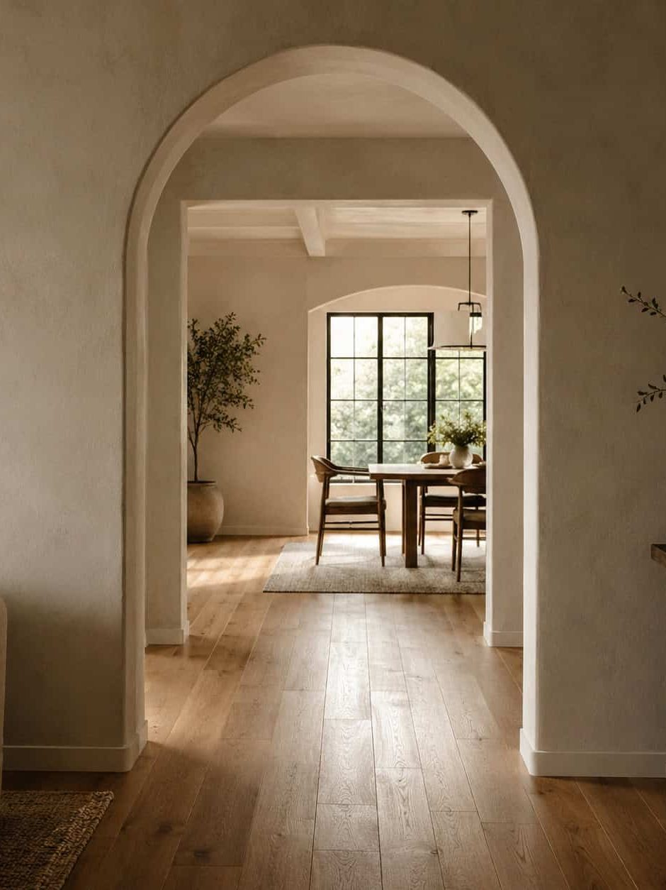

> TIP:CHECK: plaster or wood arch for a real opening; painted arch for a budget version; echo it with an arched mirror

## 9. Statement Pendant Light Cluster

One oversized pendant is good, but a cluster of glass pendants at staggered heights is the 2027 statement. Over a dining table they draw the eye down to the meal, and the warm bulbs make evening dinners feel special even on an ordinary Tuesday.

Hang the lowest bulb about 30 inches above the tabletop so it lights the plates without blocking faces across the table. Dimmer switches are worth the small extra cost — bright for homework, low for dinner.

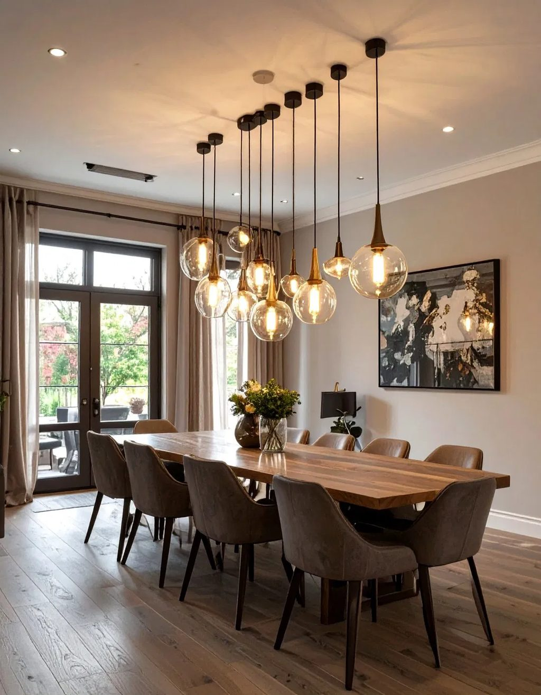

> TIP:GUIDE: Height: lowest bulb about 30 inches above the table | Bulbs: warm white | Switch: add a dimmer

## 10. Sculptural Floor Lamp

A sculptural floor lamp is lighting and art in one piece, and 2027 rooms are full of them. A tall black lamp with a curved neck and a teardrop shade anchors a corner that would otherwise sit empty, and it throws a warm pool of light exactly where you read.

Place it beside the sofa's reading end rather than behind it, so the light falls on the book and not on your shoulder. A lamp with a dimmer lets the same corner work for reading and for quiet evenings.

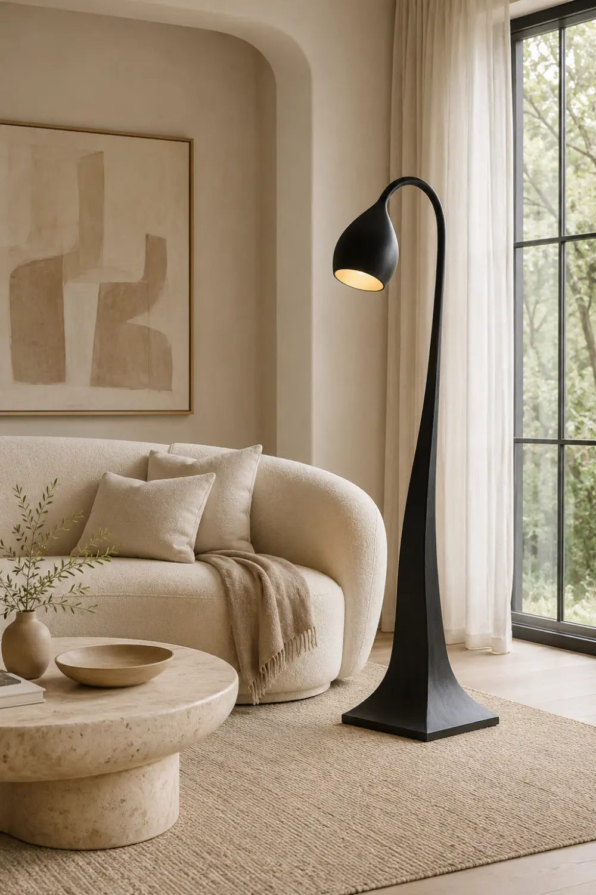

> TIP:QUICK: Put the lamp at the sofa's reading end so the light falls on the book, not your shoulder.

## 11. Rattan and Wicker Furniture

Rattan and wicker bring a light, handmade feel to 2027 living rooms. Rounded rattan armchairs, a woven coffee table and a wicker pendant all add texture without weight, and they sit happily next to linen, wood and plants. The look is relaxed rather than beachy, especially in natural honey tones.

Rattan fades in strong sun, so keep the best pieces a little back from south-facing windows. A cushion in a plain cream or soft pattern keeps the weave comfortable for long sits.

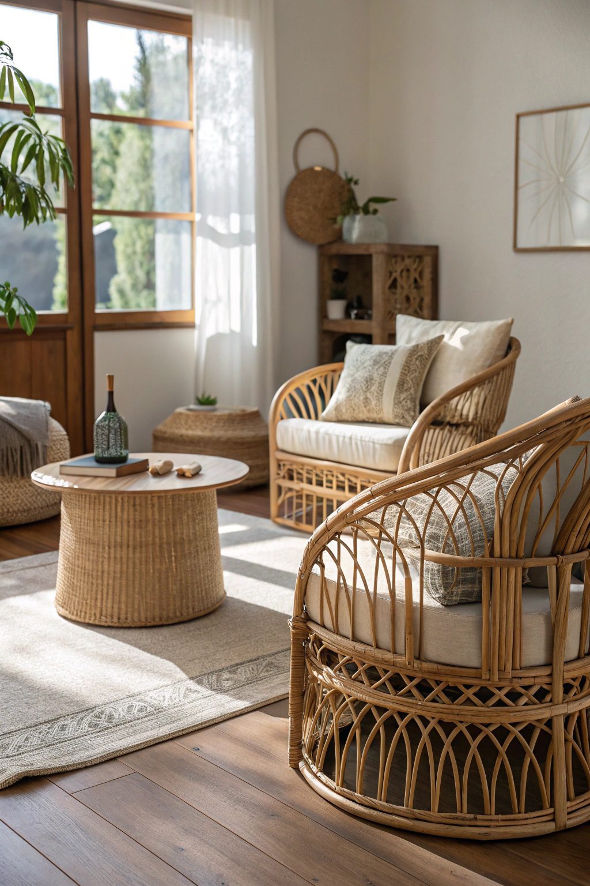

> TIP:CHECK: natural honey tones read relaxed, not beachy; keep out of strong direct sun; add plain cream cushions

## 12. Textured Plaster Walls

Flat painted walls are giving way to textured plaster in 2027 — limewash, trowelled finishes and soft mottled surfaces that catch the light. A plaster wall behind a sofa adds depth no paint colour can match, and it makes even simple furniture look considered.

Limewash is the easiest finish to try, since it goes on like paint and the brush marks are part of the charm. Keep the rest of the room quiet, because the wall is doing the decorating.

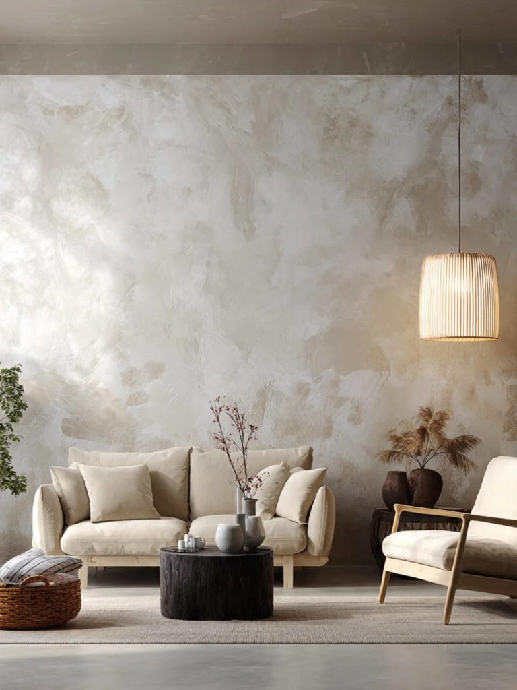

> TIP:GUIDE: Finish: limewash is the easiest first try | Marks: brush strokes are part of the charm | Room: keep the rest quiet

## 13. Bold Colour-Blocked Bedroom

Colour blocking is 2027's boldest bedroom move: two or three saturated colours — mustard, magenta, teal — painted in big blocks on the wall and echoed in the bedding. It feels playful and confident, and it costs little more than a few cans of paint.

Let one colour dominate and use the others as accents, or the room will feel busy. White bedding in the middle calms the whole scheme down and gives your eyes somewhere to rest.

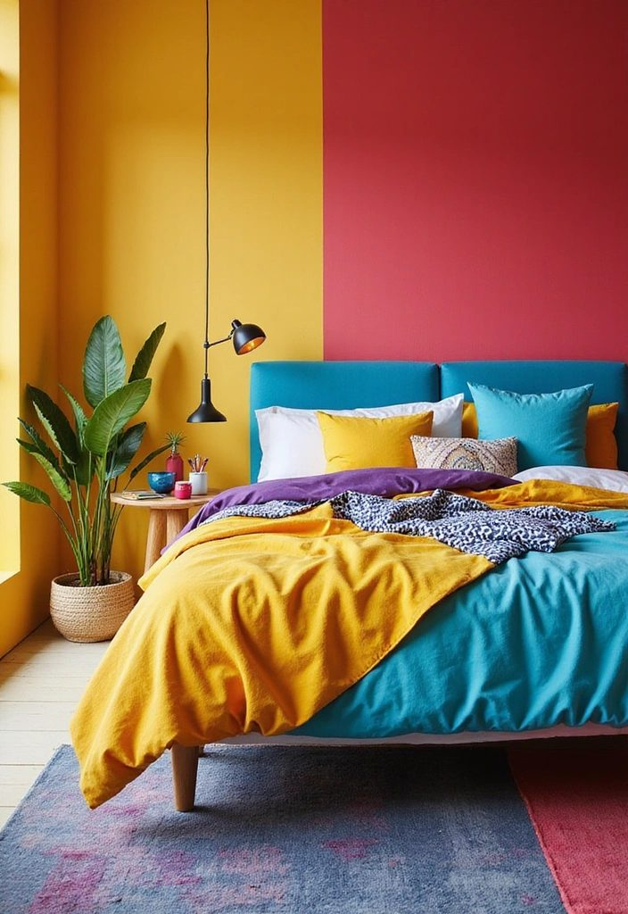

> TIP:QUICK: Let one colour dominate and use the others as accents, with white bedding in the middle.

## 14. Vintage-Inspired Patterned Tiles

Patterned tiles are the kitchen's jewellery in 2027, and vintage-inspired designs — Mediterranean stars, diamonds and florals in teal, mustard and rust — are the ones to watch. A full backsplash makes a white kitchen unforgettable, while a small run behind the cooker gives the same lift for less.

Seal the grout well, since patterned tiles show splashes more than plain ones. Match the rug or a tea towel to one colour in the tile and the whole kitchen will feel planned.

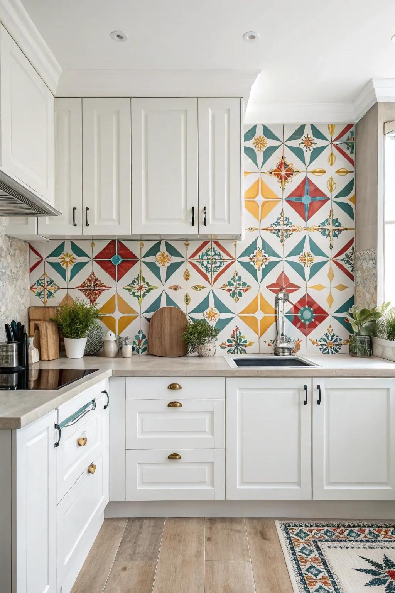

> TIP:CHECK: seal the grout well; match a rug or tea towel to one tile colour; small run behind the cooker works too

## 15. Reclaimed Wood Furniture

Reclaimed wood is 2027's sustainable statement: old beams and barn boards given a second life as coffee tables, accent walls and shelving. Every piece carries its own knots, nail holes and colour variation, so the room gains character no new furniture can fake.

Check that reclaimed pieces are properly cleaned and sealed before they come indoors, and ask where the wood came from if that matters to you. A single reclaimed piece per room is enough — more starts to feel like a theme park.

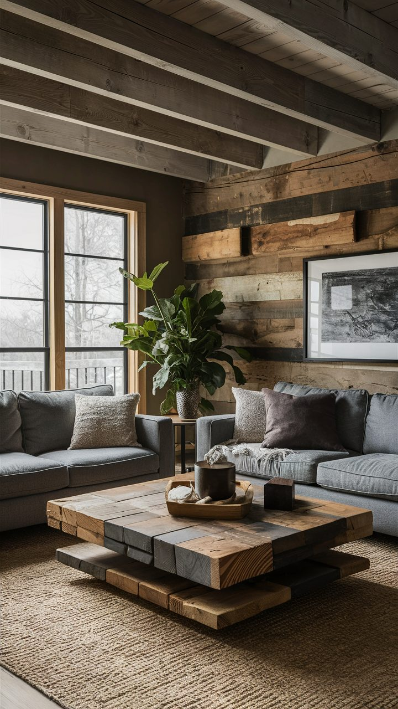

> TIP:GUIDE: Check: cleaned and sealed before use | Ask: where the wood came from | Limit: one reclaimed piece per room

## 16. Indoor Olive Tree

A large potted olive tree is 2027's favourite living plant. Its silvery-green leaves and gnarled trunk bring a Mediterranean calm to a bright room, and it needs far less fuss than a fiddle-leaf fig. A tall tree in a stone or terracotta pot anchors a corner and softens hard furniture lines.

Olive trees want the brightest spot you have — right by a window — and a pot with good drainage. Water when the top soil feels dry, and turn the pot every few weeks so it grows evenly.

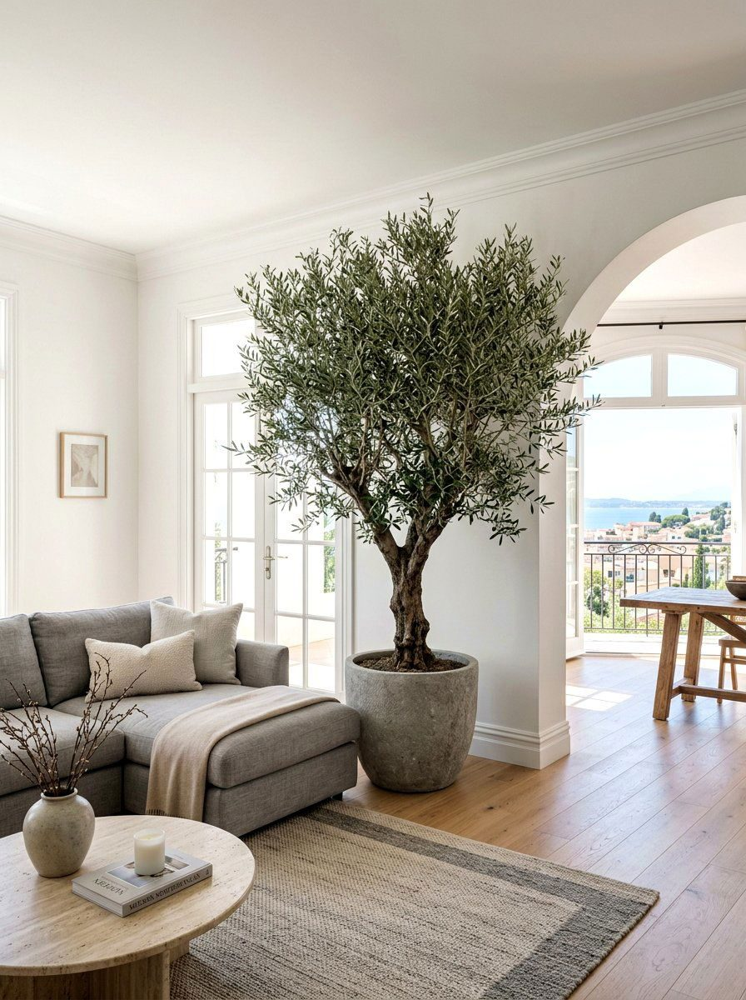

> TIP:QUICK: Give it your brightest window spot and turn the pot every few weeks so it grows evenly.

## 17. Chunky Knit Throws

Chunky knit throws are the cosiest layer of 2027, draped over sofa arms and bed ends in cream, oatmeal and soft grey. The oversized loops add instant texture to a plain sofa, and they invite you to sit down in a way a flat throw never does.

One throw per sofa is plenty — two starts to look messy. Drape it casually rather than folding it neatly, and keep it within reach of your favourite seat.

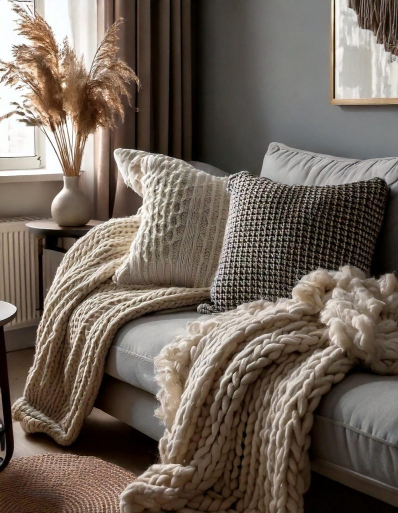

> TIP:CHECK: one throw per sofa is plenty; drape it casually; keep it by your favourite seat

## 18. Dark Moody Home Office

Dark, moody home offices are 2027's answer to working from home: charcoal walls, warm wood built-ins and brass details that make the room feel focused and grown-up. The dark backdrop hides screen glare and makes books and plants stand out.

Good lighting matters more in a dark room, so add a warm desk lamp and a pendant or two. Keep the desk surface clear and let the shelves carry the personality.

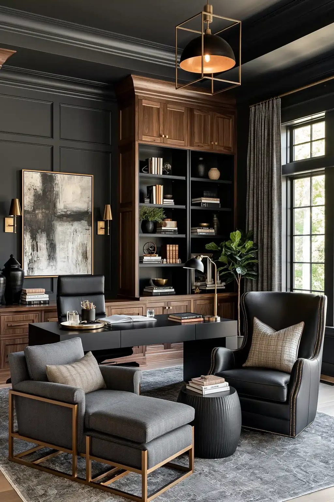

> TIP:GUIDE: Walls: charcoal or deep green | Light: warm desk lamp plus a pendant | Desk: keep the surface clear

## 19. Japandi-Style Bedroom

Japandi — Japanese calm meets Scandinavian warmth — is still going strong in 2027 bedrooms. A low wooden platform bed, beige linen bedding, a paper lantern and a single bonsai create a room that feels like a deep breath. Nothing is ornate, and everything has a place.

Keep the palette to wood, beige and cream, and limit decoration to one or two meaningful objects. The empty space is part of the design, not something to fill.

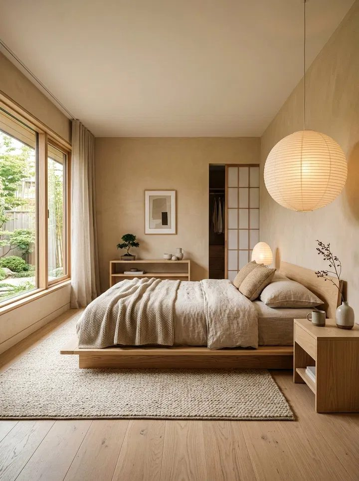

> TIP:QUICK: Limit decoration to one or two meaningful objects — the empty space is part of the design.

## 20. Mixed Metals in the Kitchen

Matching metals are out; mixing them is in. In 2027 kitchens, black cabinets wear brass bar pulls, nickel pendants hang overhead and a stainless faucet joins in — and it works because each metal appears at least twice. The mix feels collected over time rather than bought in one go.

Keep the finishes in the same warmth family where you can — warm brass with warm wood, or cool nickel with cool stone — and let one metal dominate. Two metals is a good start; three is the confident version.

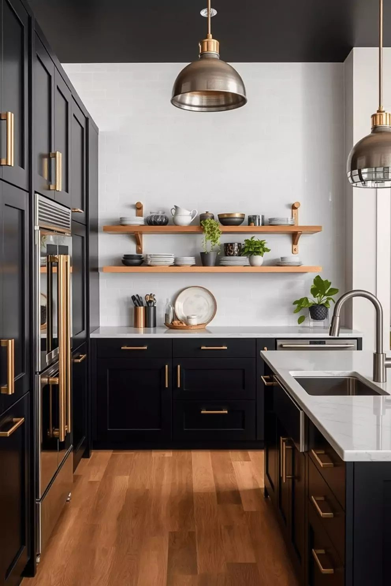

> TIP:CHECK: repeat each metal at least twice; keep finishes in the same warmth family; let one metal dominate

## 21. Marble Slab Backsplash

A full-height marble slab backsplash turns a kitchen wall into a work of art in 2027. The big veined panels run from counter to ceiling behind the range, with no grout lines to break the pattern, and they pair beautifully with white shaker cabinets and brass details.

Book-matched slabs — two panels mirrored along a seam — make the veining symmetrical and dramatic. Seal the stone yearly, since marble stains more easily than tile, and wipe up tomato and citrus splashes promptly.

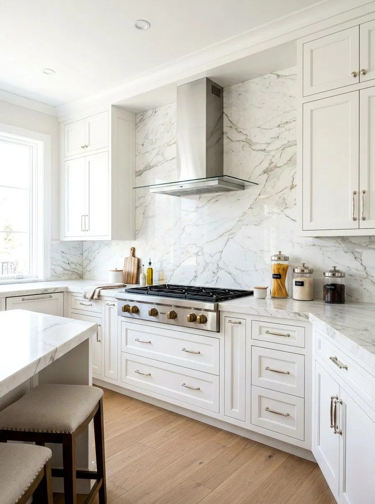

> TIP:GUIDE: Slabs: book-matched pairs mirror the veining | Seal: once a year | Wipe: tomato and citrus splashes promptly

## 22. Open Shelving with Ceramics

Open shelves filled with handmade ceramics are 2027's way of making a kitchen personal. Mugs, bowls and pitchers in earthy glazes, grouped loosely by colour, turn everyday dishes into decoration — and they are always within reach when you need them.

Keep the shelves to things you actually use, or they gather dust and guilt. Group by colour rather than by size, and leave a little breathing room between groups so the display reads as curated, not crowded.

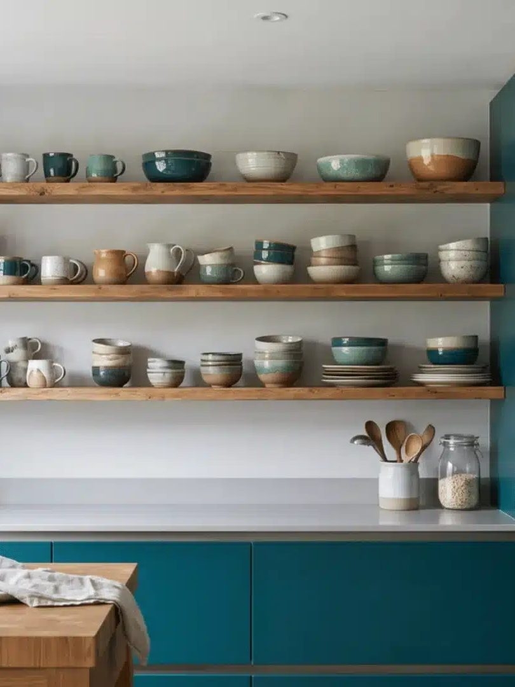

> TIP:QUICK: Group ceramics by colour, not size, and leave breathing room between groups.

## 23. Bold Velvet Sofa

A bold velvet sofa is 2027's confident centrepiece: deep emerald green, burgundy or cobalt, with jewel-tone cushions and a mustard throw. The velvet catches the light differently from every angle, so the colour looks alive, and the rich tone lets the rest of the room stay calm.

Balance a bold sofa with neutral walls and a pale rug, or the room will feel heavy. Velvet marks easily, so brush it with a soft clothes brush now and then to keep the pile even.

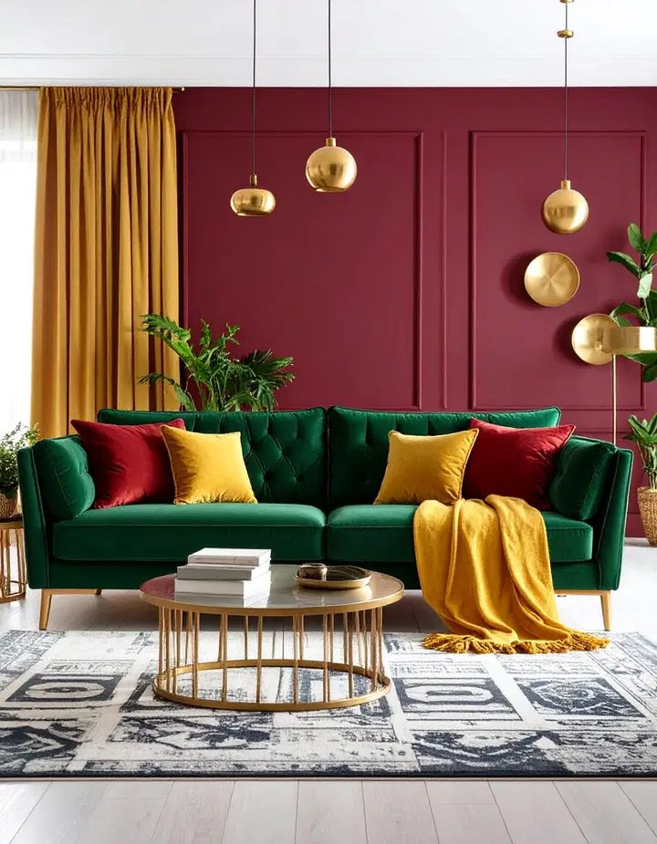

> TIP:CHECK: balance with neutral walls and a pale rug; brush the pile now and then to keep it even

## 24. Sheer Linen Curtains

Sheer linen curtains are 2027's softest window treatment. They filter harsh sunlight into a gentle glow, add movement when a breeze passes, and make a room feel taller because they hang from ceiling to floor. In beige or oatmeal they suit almost any palette.

Hang them high and wide — a few inches above the window frame and past its edges — so the window looks bigger. Linen wrinkles are part of the charm, so skip the iron and let them hang naturally.

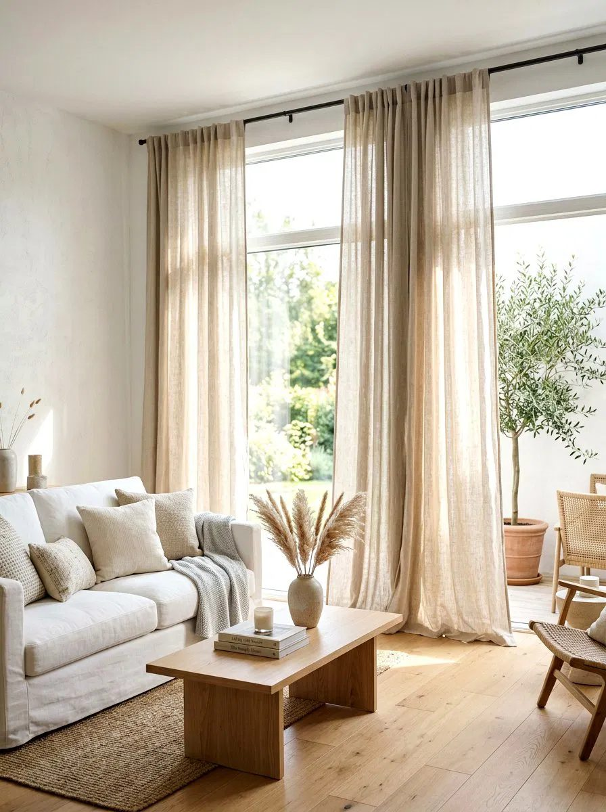

> TIP:GUIDE: Rod: a few inches above the frame, past its edges | Length: ceiling to floor | Iron: skip it, wrinkles are the charm

## 25. Arched Mirror in the Hallway

A tall arched mirror is the easiest way to make a hallway feel bigger and brighter in 2027. It bounces light down the corridor, echoes the arch trend, and gives you a last look before you leave the house. A black frame suits modern halls; a wood frame warms a traditional one.

Hang it so its centre sits at eye level, and place it opposite a window or a light source if you can — a mirror facing a blank wall only doubles the blank wall. A slim console table underneath finishes the look.

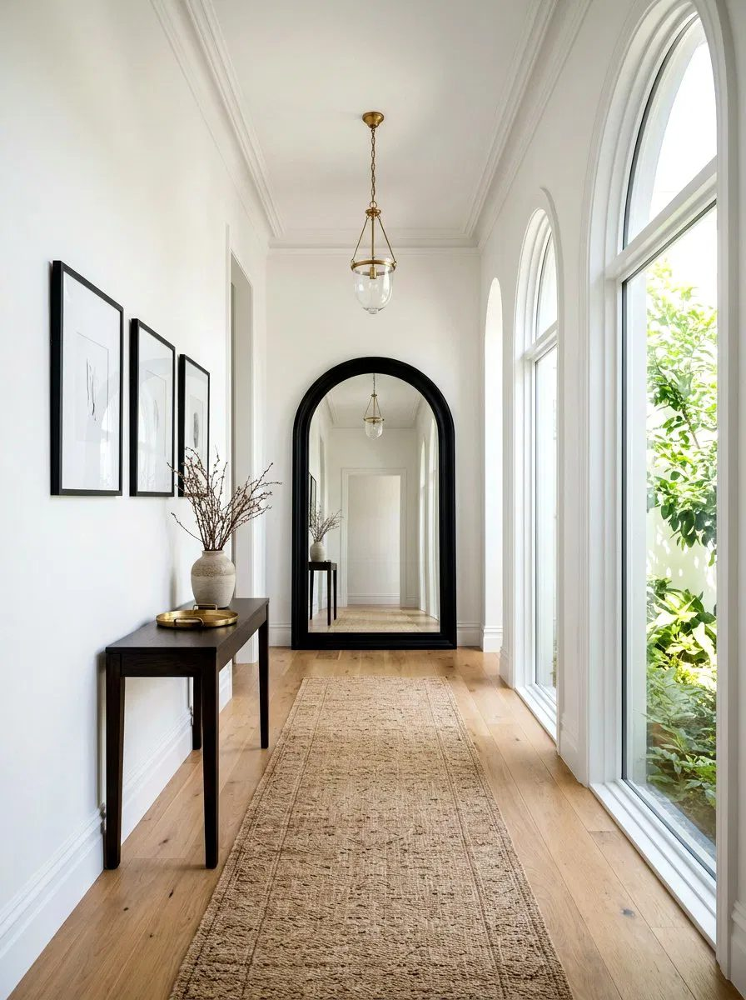

> TIP:QUICK: Place the mirror opposite a window or light source so it doubles the light, not a blank wall.

## 26. Warm Minimalist Living Room

Warm minimalism is the defining look of 2027: the clean lines and uncluttered surfaces of minimalism, now softened with creamy whites, pale wood and earthy cushions. A low cream sectional, a round wooden coffee table and a textured rug are all it takes — the room feels calm without feeling empty.

Keep surfaces mostly clear and let one or two natural materials do the talking. A linen throw, a ceramic bowl and a leafy branch in a vase add life without adding clutter.

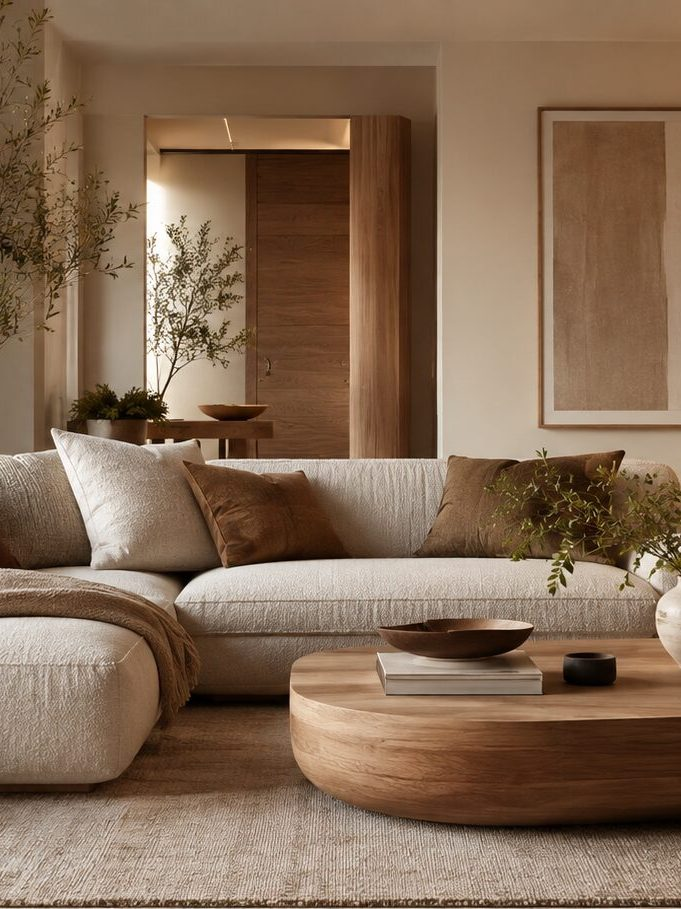

> TIP:CHECK: Keep surfaces mostly clear — one linen throw and one ceramic bowl are enough.

## 27. Multifunctional Furniture

Small homes need furniture that works twice as hard, and 2027 is full of it: coffee tables with lift-up storage, sofas that fold into beds, and ottomans that hide blankets. A storage coffee table keeps remotes, games and chargers out of sight while still holding your cup of tea.

Measure twice before buying, since multifunctional pieces are often deeper than they look. Choose a piece that does the job you actually need — storage for a family room, a bed for a guest room — rather than the cleverest mechanism.

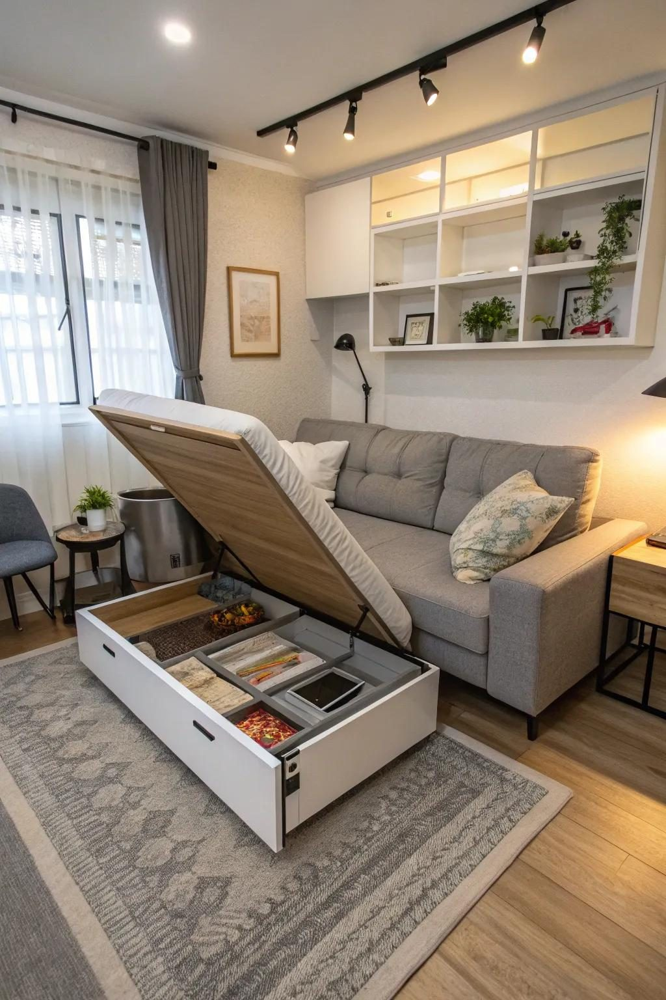

> TIP:GUIDE: Measure: these pieces run deeper than they look | Choose: the job you actually need | Storage: for family rooms, bed for guest rooms

## 28. Warm Wood in the Bathroom

Bathrooms are warming up in 2027 with wood vanities, wood-framed mirrors and timber shelving. Warm oak against white tiles and a freestanding tub turns a cold, clinical room into a spa-like retreat, and the wood ages gracefully in the humidity if it is sealed properly.

Use wood on the vanity and shelves, and keep it away from direct splashes. A teak bath mat and a woven basket for towels extend the warm look without any building work.

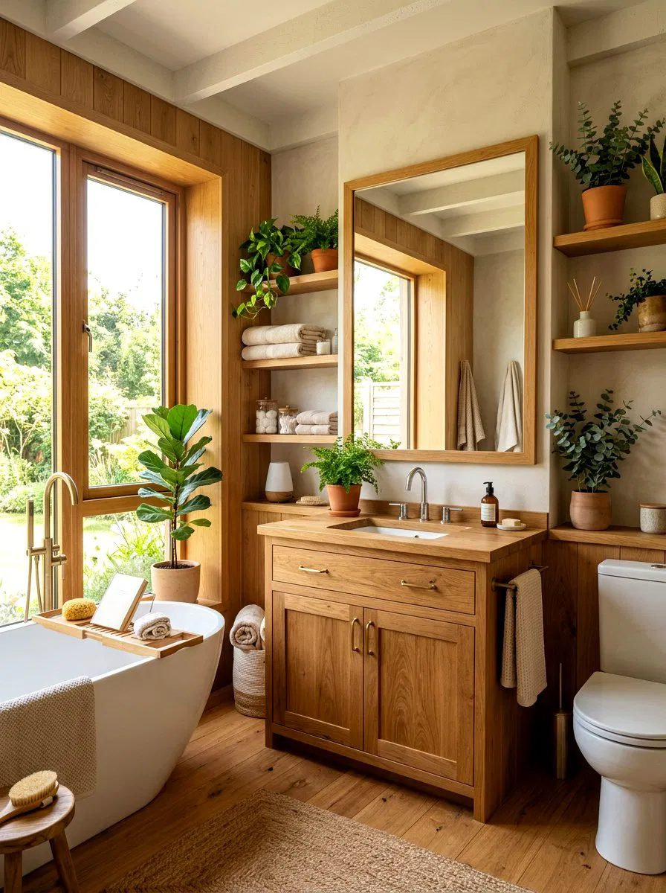

> TIP:QUICK: Use wood on the vanity and shelves, away from direct splashes, and seal it properly.

## 29. Handmade Ceramics on Display

Handmade ceramics are 2027's favourite collectible, and a wooden plate rack is the perfect way to show them off. Plates, cups and bowls in speckled, earthy glazes — each one slightly different — turn a plain wall into a gallery of craft. The irregular shapes are the point: they prove a human hand made them.

Mix sizes and glazes but keep one colour family running through the display so it reads as a collection, not a jumble. Dust the shelves weekly, since open ceramics catch dust fast.

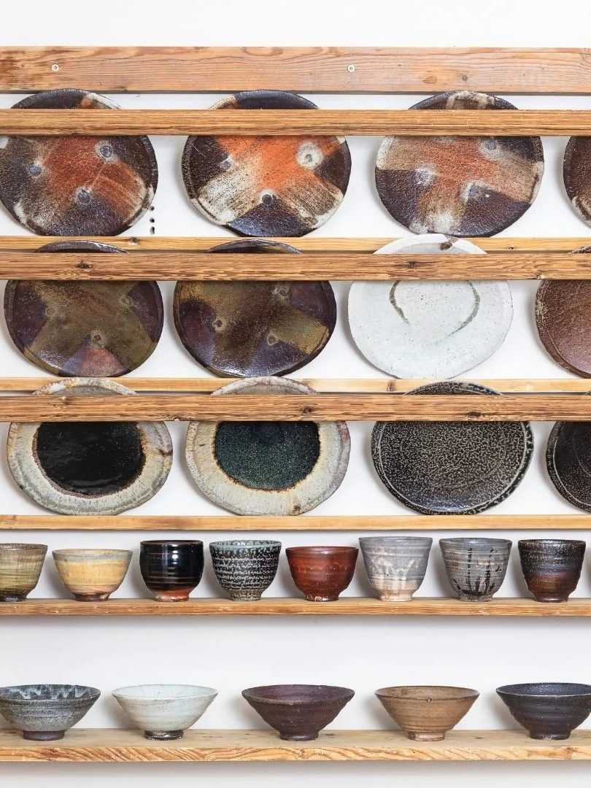

> TIP:CHECK: mix sizes and glazes; keep one colour family through the display; dust weekly

## 30. Cosy Window-Seat Reading Nook

A window seat is the cosiest corner a home can have, and 2027 nooks are built for long reads: deep green velvet cushions, a mustard throw, a stack of books and a garden view. Built-in shelves on either side keep the next book within reach, and a brass lamp makes the nook work after dark.

Add a cushion at least four inches thick, or the seat will feel hard within minutes. A small tray for a cup of tea and a folded blanket nearby are the finishing touches that make the nook get used every day.

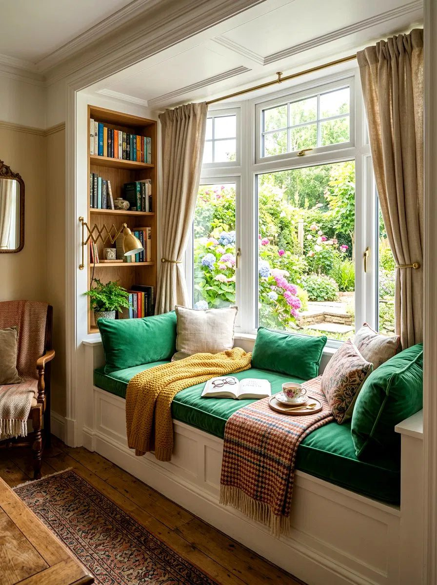

> TIP:GUIDE: Cushion: at least four inches thick | Light: a brass lamp for after dark | Extras: a tray for tea, a blanket nearby

## Takeaway

- Mix calm and bold: warm neutrals and natural textures as the base, with one or two confident moves — a velvet sofa, a terracotta wall, a marble backsplash — on top.
- Start with the idea that solves your biggest frustration, whether that is a dark office, a bare wall or a sofa that has seen better days, and add the rest slowly.
- If you love the warm, layered look, our [30 Modern Farmhouse Ideas for a Fresh, Warm Home](https://www.cozynesthomeideas.com/posts/modern-farmhouse/) and [30 Rustic Home Decor Ideas for a Warm, Natural Home](https://www.cozynesthomeideas.com/posts/rustic-home-decor-ideas/) carry the same feeling into two classic styles, so you can save the ideas that fit your home best. And if you want the full 2027 picture, our [30 Interior Design Trends for 2027](https://www.cozynesthomeideas.com/posts/2027-interior-design-trends/) and [30 Home Decor Trends for 2027](https://www.cozynesthomeideas.com/posts/home-decor-trends-2027/) cover the year's biggest moves in detail.

## Frequently Asked Questions

### What are the biggest home decor trends for 2027?

Warm minimalism leads 2027, with curved furniture, natural textures like bouclé and rattan, and earthy colours such as terracotta and sage green. Bold colour is back too, on velvet sofas and wallpaper feature walls, while sustainable pieces and handmade ceramics add character. The common thread is comfort: rooms that feel calm, personal and lived in.

### How do I make my home feel modern in 2027 without redecorating everything?

Start with one change per room, such as a new lamp, a chunky throw or a bold cushion, and let the rest follow slowly. Swap harsh white paint for a warm neutral, add one curved piece, and layer natural textures. Small updates like these shift the whole mood without a big budget or a full renovation.

### What colours are popular for home decor in 2027?

Earthy, grounded colours lead: terracotta, sage green, warm ochre and deep forest green, balanced by creamy whites and soft beige. Bold jewel tones appear as accents — emerald velvet, burgundy walls, cobalt blue — rather than whole rooms. The result feels rich but calm, with colour used deliberately instead of everywhere at once.

### Is minimalism still in style for 2027?

Yes, but it has warmed up. The cold white boxes of a few years ago are giving way to warm minimalism: the same clean lines and uncluttered rooms, now with wood, stone, linen and soft curves. The goal is a calm room that still feels lived in, not a showroom.

### How can I add curves to my home on a budget?

Look for small curved pieces first: an arched mirror, a round coffee table, a bouclé cushion or a curved lamp. Arched shapes also come cheap as wall decals or a painted arch behind a bed. One or two curves per room is enough to soften sharp corners and make the space feel current.

### What is the easiest sustainable decor change I can make?

Choose secondhand or reclaimed wood furniture, which brings instant character and keeps good timber in use. Add handmade ceramics, natural linen and plants instead of new plastic decor. Buying fewer, better pieces that last is the most sustainable choice of all, and it usually looks better too.

### How do I mix wood, stone and metal in one room?

Pick one dominant material and let the others support it: warm wood floors with a stone coffee table, for example, plus brass or black metal in small doses. Keep the wood tones close together and repeat each metal twice, so nothing looks accidental. A neutral rug ties the mix together.

### When should I start decorating for 2027 trends?

Start now with the timeless pieces — curved furniture, natural textures and warm neutrals never date quickly. Save the boldest colours for cushions, throws and paint, which are easy to change. That way your home feels fresh for 2027 without needing another refresh a year later.
