# 30 Interior Design Trends for 2027

2027 interior design trends are warmer, softer and more personal than the cool grey rooms of a few years ago. Curves replace sharp corners, earthy colours replace stark white, and natural materials like travertine, walnut and rattan take centre stage. This list gathers 30 of the strongest 2027 interior design trends, room by room, so you can see which ones suit your home and your budget.

You do not need to redecorate the whole house to join in. Many of these trends work as a single change — a new lamp, one painted wall, a different coffee table — and the rest of the room can stay exactly as it is. Start with the idea you love most, save the rest for later, and build a home that feels calm, collected and completely yours.

## 1. Colour Drenching

Colour drenching paints the walls, ceiling, trim and sometimes the furniture in a single colour, and 2027 loves it in deep green. Removing the visual breaks between surfaces makes a room feel larger and calmer, not darker, and the effect is especially striking around a fireplace with matching velvet chairs.

Mid-tones work best — a deep green, a dusty blue or a warm brown — with a pale rug or light bedding to lift the room. Keep the art simple and framed in gold or dark wood, and let the colour itself be the decoration.

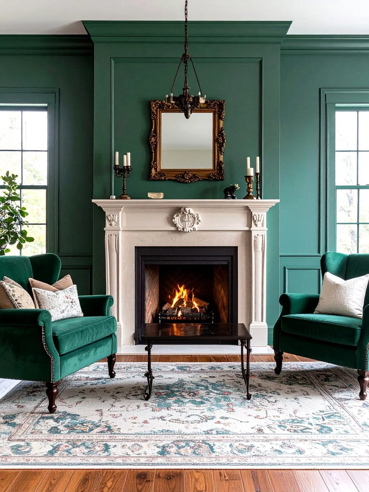

> TIP:GUIDE: Colour: one mid-tone green, blue or warm brown | Lift: pale rug or light bedding | Art: simple, gold or dark wood frames

## 2. Curved Bouclé Sofas

The curved sofa is the shape of 2027. Its soft arc breaks up a boxy room, seats people facing each other, and looks inviting from every angle. Bouclé — the nubby, cloud-like fabric — makes the curve feel even softer, and in cream or oatmeal it suits almost any wall colour.

A curved sofa works best as the room's hero piece, so keep the coffee table round and the rug simple. It needs more floor space than a straight sofa, so measure the arc before you buy, and check that it clears doors and walkways on the way in.

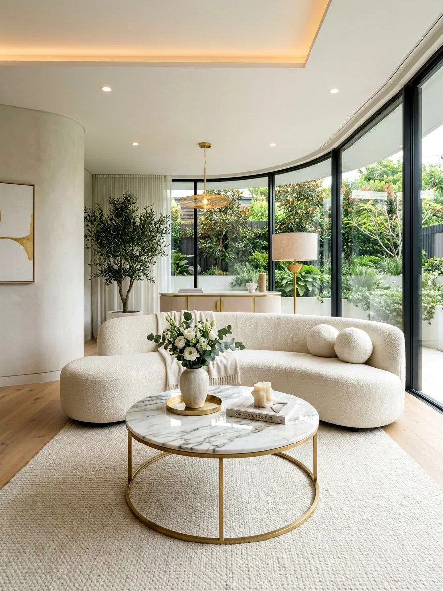

> TIP:CHECK: measure the sofa's arc and the doorways it must pass through; pair it with a round coffee table; keep the rug plain

## 3. Terracotta Accent Walls

Terracotta is the warmest colour of 2027, and one painted wall is all it takes. The burnt-orange tone makes a white sofa glow, suits light wood floors, and pairs beautifully with olive green cushions, black metal shelves and woven baskets. It feels earthy and sun-warmed rather than loud.

Paint the wall behind the sofa or the fireplace, and keep the other walls pale so the colour has room to breathe. Terracotta cushions, a matching pouffe or a clay vase echo the wall without overdoing it, and the shade looks even better in evening lamplight.

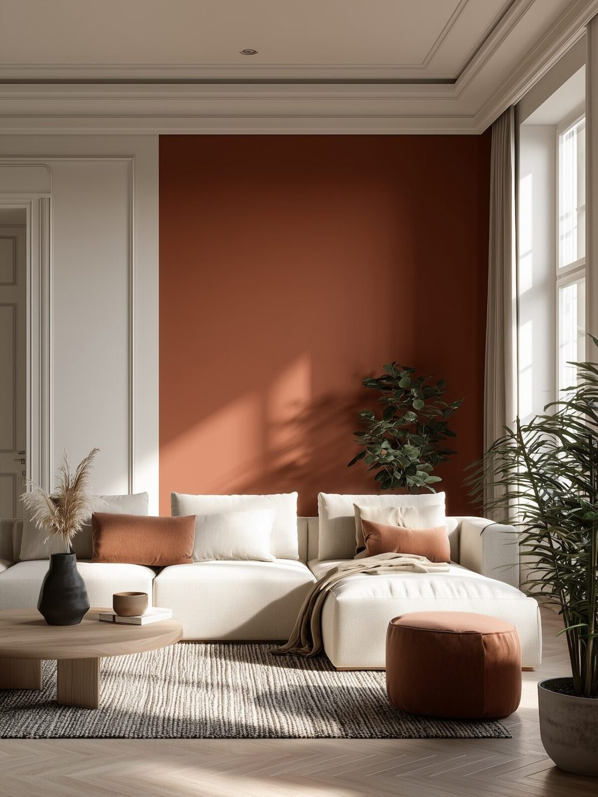

> TIP:GUIDE: Wall: behind the sofa or fireplace | Pair with: white sofa, olive cushions, light wood | Echo: one pouffe or vase, not a full set

## 4. Deep Green Walls

Deep green turns a living room into a cosy, cocooning space, and 2027 pairs it with velvet, brass and botanical art. Forest and emerald greens work on panelled walls, in alcoves or across a whole room, and they make wooden floors and cream upholstery look richer by contrast.

Green walls need good light, so keep curtains light and mirrors generous. A green velvet sofa in the same family as the walls feels layered rather than matched, and brass picture lights or a gold-framed mirror stop the room from feeling too dark.

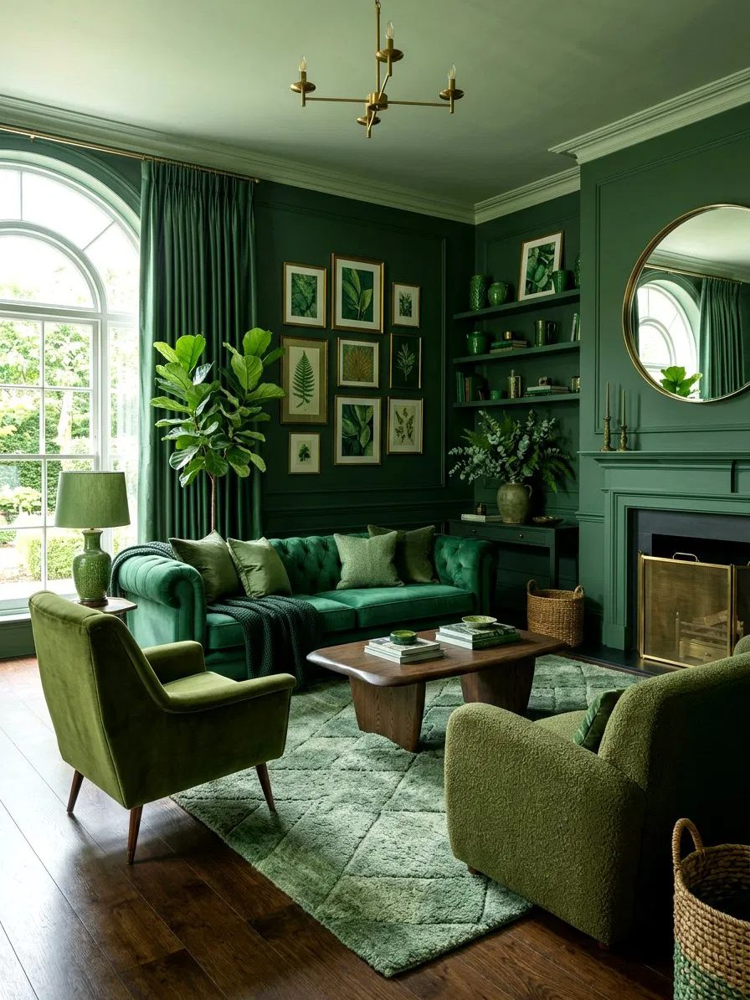

> TIP:QUICK: Pair deep green walls with brass, cream upholstery and light curtains so the room stays bright, not gloomy.

## 5. Bouclé Armchairs

If a full bouclé sofa feels like too much, one bouclé armchair gives you the same softness in a single piece. The rounded, cloud-like shape suits a reading corner, a bedroom or the end of a sofa, and the nubby texture adds warmth to rooms full of smooth surfaces like glass and painted wood.

Choose cream or oatmeal for the easiest match, and give the chair a small side table and a good lamp so it becomes a place to sit, not just a pretty shape. Bouclé marks easily, so keep it away from muddy paws and red wine, and brush it gently to keep the texture fresh.

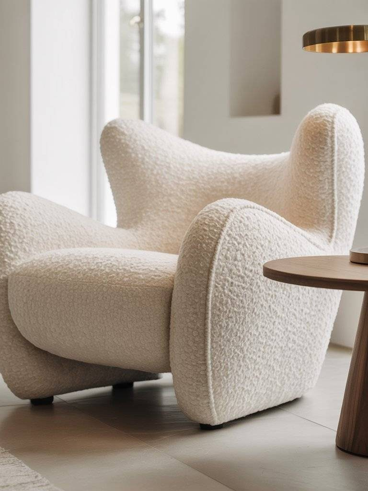

> TIP:CHECK: cream or oatmeal matches most rooms; add a side table and lamp; keep it away from muddy paws and red wine

## 6. Travertine Coffee Tables

Travertine is 2027's favourite stone. Its warm, pitted surface feels ancient and handmade, and a low, blocky coffee table in travertine grounds a living room the way a rug does. It suits cream sofas, dark wood and brass equally well, and it ages gracefully — small marks just add to the patina.

Style it simply: a tray, one candle and a small sculpture or bowl. A heavy stone table does not need much on top, and a clear surface shows off the stone itself. Wipe spills quickly and use coasters under glasses, since the stone is porous.

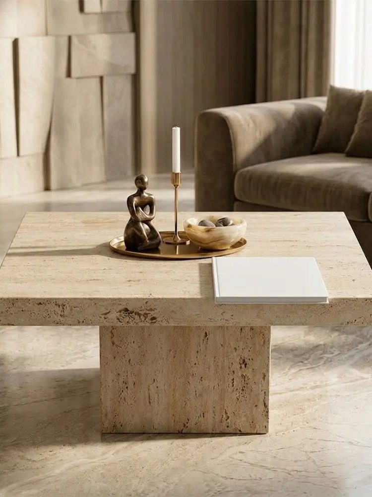

> TIP:GUIDE: Style: one tray, one candle, one object | Care: wipe spills quickly, use coasters | Suits: cream sofas, dark wood, brass

## 7. Dark Walnut Kitchens

Dark walnut kitchens are the grown-up answer to the all-white kitchen. The rich brown wood feels warm and expensive, especially with glass-fronted cabinets, stone worktops and big windows. It suits both modern handleless runs and classic shaker doors, and it hides everyday marks better than pale wood.

Balance the darkness with light worktops, pale floor tiles and good lighting under the wall cabinets. Glass doors break up long runs of wood and show off glasses and dishes, while brass or brushed steel handles keep the look warm rather than heavy.

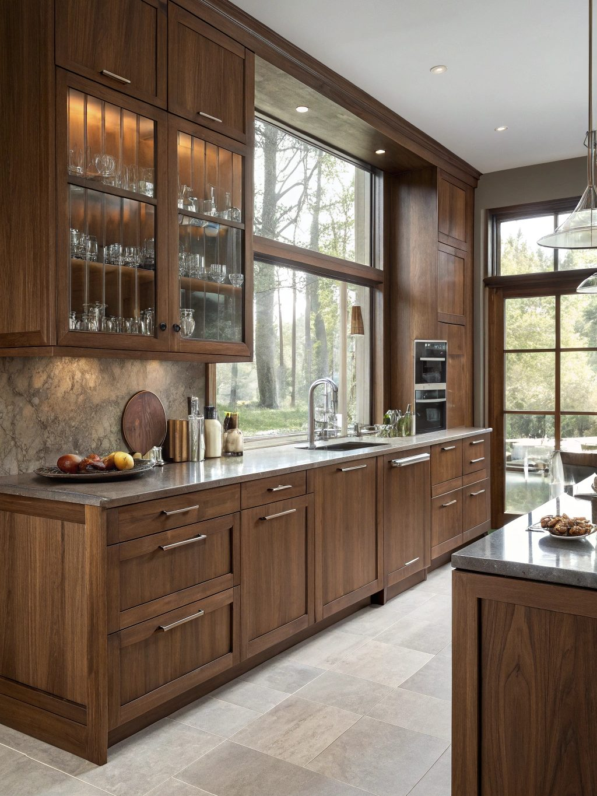

> TIP:QUICK: Balance dark walnut with light worktops, pale floors and under-cabinet lighting so the kitchen never feels heavy.

## 8. Statement Coffered Ceilings

The ceiling is 2027's forgotten surface, and a coffered ceiling turns it into the room's best feature. Deep wooden coffers with white panels add architecture to a plain room, suit a chandelier beautifully, and make a large living room feel structured rather than empty.

Coffered ceilings suit rooms with height — at least a standard tall ceiling — and they look best when the rest of the room stays calm. A traditional rug, a fireplace and classic furniture complete the look, while the ceiling itself does the talking overhead.

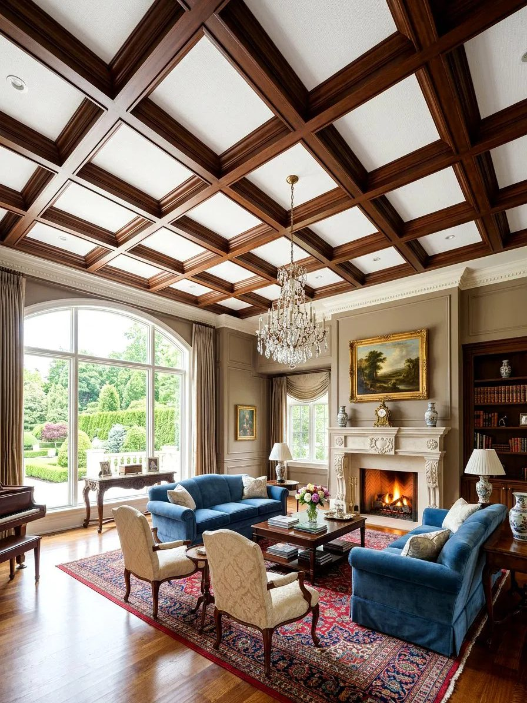

> TIP:CHECK: needs a tall ceiling to work; keep the rest of the room calm; a chandelier suits the coffers best

## 9. Arched Doorways

Arches soften the hard rectangle of a doorway and give a home a gentle, timeless feel. A wide arched opening between a living room and a dining room lets light and conversation flow while still marking the change from one space to another, and it suits both old houses and new builds.

Paint the arch the same colour as the walls for a subtle look, or frame it in wood for more definition. Arched niches, mirrors and cabinet doors echo the shape elsewhere in the room, so the doorway feels like part of a plan rather than a one-off.

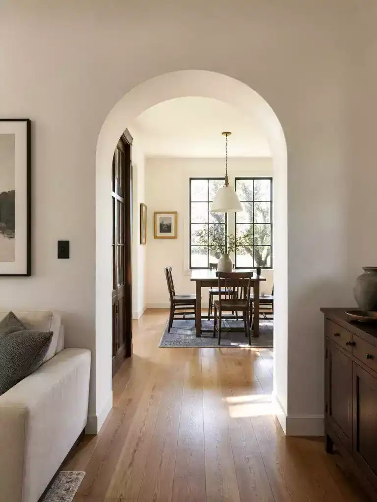

> TIP:GUIDE: Paint: same as the walls for subtle, wood trim for definition | Echo: arched mirrors or niches | Best: between living and dining rooms

## 10. Mixed Metals in the Kitchen

2027 kitchens mix metals instead of matching them. Unlacquered brass taps, black cabinet pulls and a steel oven sit together comfortably, and the mix feels collected over time rather than bought in one go. Brass is the warm anchor; the other metals add contrast and keep it from feeling too precious.

The rule is simple: one dominant metal, one supporting metal, and no more. Brass taps with black handles work, as do brass knobs with a steel range. Keep the mix consistent across the room — taps, handles and light fittings — so it reads as a choice, not an accident.

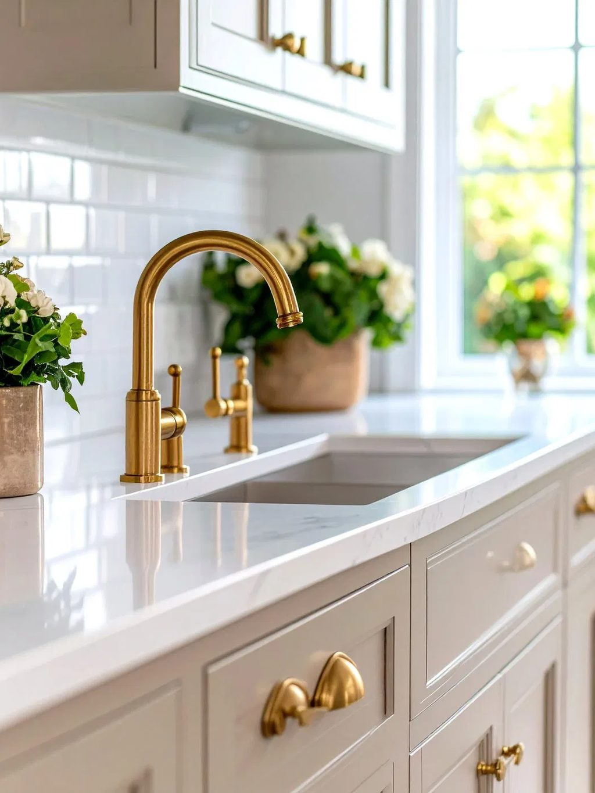

> TIP:QUICK: Pick one dominant metal and one supporting metal — brass taps with black handles is the easiest pairing.

## 11. Vintage and Antique Mix

Mixing vintage and antique pieces into a modern room is 2027's answer to throwaway furniture. A carved chair, an ornate coffee table or a gilded mirror brings craftsmanship and character that new pieces rarely match, and each old piece tells a story the room would otherwise lack.

Let one antique lead per room and keep the rest simple — plain walls, a modern sofa, uncluttered shelves — so the old piece reads as a feature, not clutter. Wood tones do not need to match exactly; a loose, warm family of browns looks more natural than a perfect set.

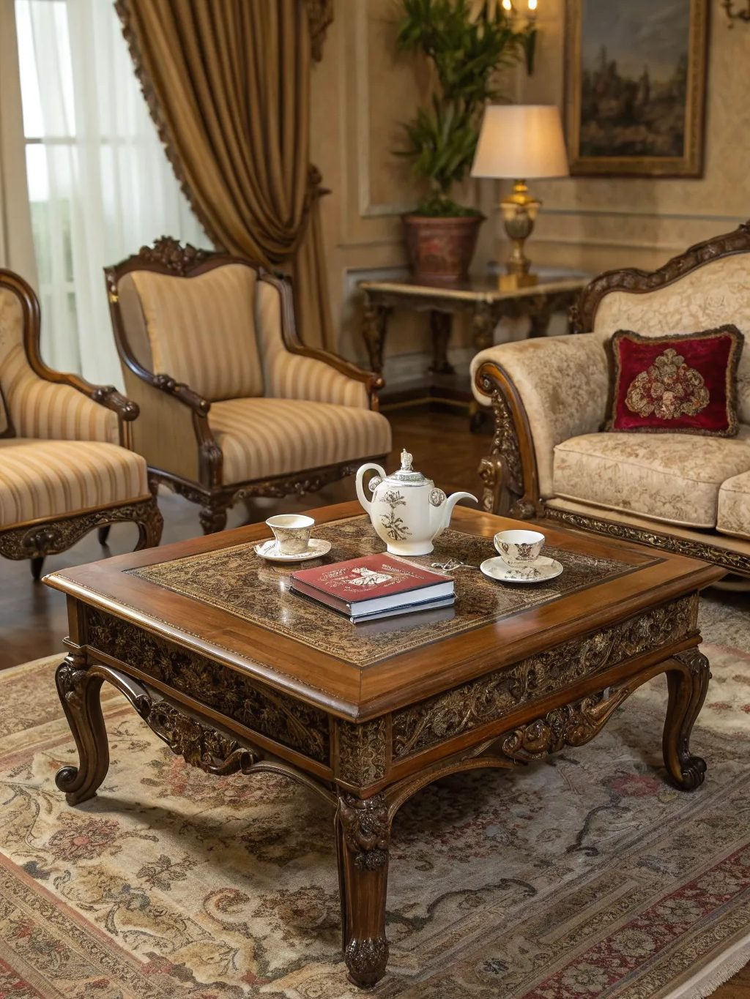

> TIP:CHECK: one antique feature per room; plain walls and a modern sofa around it; wood tones matched loosely, not exactly

## 12. Reclaimed Wood Furniture

Reclaimed wood furniture turns old beams and boards into pieces with a past. A coffee table made from weathered timber has knots, nail marks and colour variation no new wood can fake, and it suits leather sofas, linen cushions and houseplants beautifully. It is also the most sustainable way to buy solid wood.

Check the piece is stable and smooth where hands rest — a good maker sands the top flat and seals it so it is practical, not just pretty. Reclaimed wood suits one statement piece per room; a whole set of it can feel heavy, so mix it with lighter furniture.

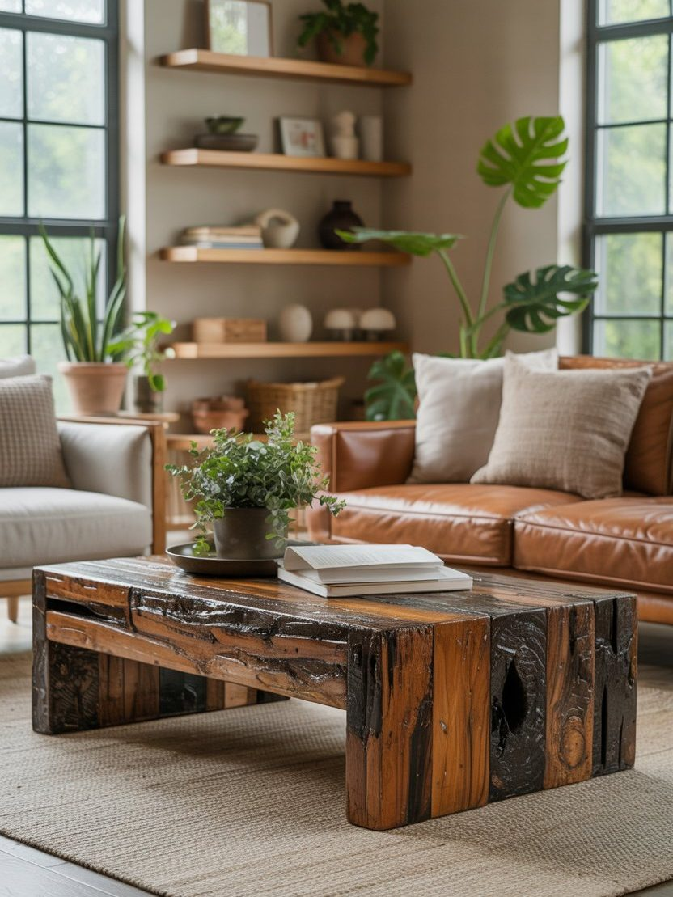

> TIP:GUIDE: Check: top sanded smooth and sealed | Mix: one reclaimed piece per room | Suits: leather sofas, linen cushions, plants

## 13. Layered Lighting

Layered lighting is the single biggest upgrade you can make to a living room. One ceiling light flattens a room; a pendant, a table lamp, lit shelves and a low glow under the TV unit together create warmth, depth and mood. 2027 rooms use all of them, on dimmers, at different heights.

Start with the three layers: general light from above, task light beside the sofa, and accent light on shelves or art. Warm bulbs suit living rooms best, and switching layers on and off through the evening changes the whole feeling of the room without moving a single piece of furniture.

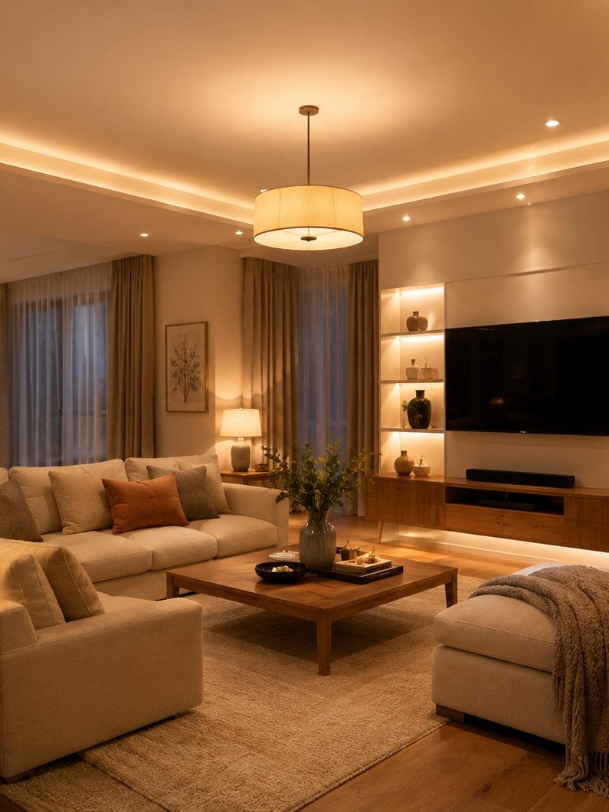

> TIP:QUICK: Use three layers — ceiling light, a lamp by the sofa, and lit shelves — all on dimmers, with warm bulbs.

## 14. Sculptural Floor Lamps

A floor lamp is no longer just a light source in 2027 — it is a sculpture. Tall arc lamps with dome shades, curved stems and mixed metals stand beside the sofa like pieces of art, and they look good switched off as well as on. One bold lamp can carry a whole corner of a room.

Place the lamp where its arc reaches over the sofa or chair, so the light falls where you read. A sculptural lamp suits a plain wall behind it, where its shape shows clearly, and it pairs well with a simple sofa so the two do not compete.

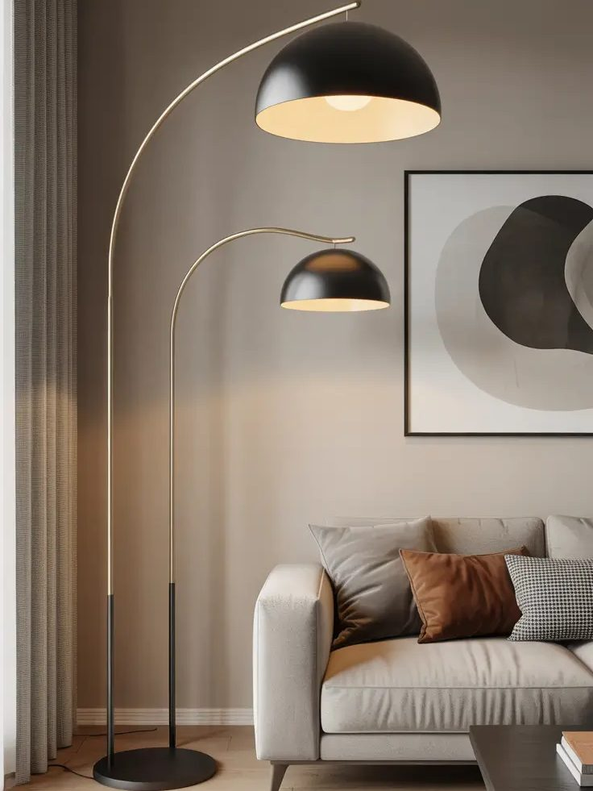

> TIP:CHECK: arc should reach over the sofa; place against a plain wall; keep the sofa simple so the lamp leads

## 15. Biophilic Plant Styling

Biophilic design brings the outdoors in, and 2027 does it with generous, layered planting rather than one lonely succulent. A tall monstera, a hanging fern, trailing plants on shelves and a big leafy plant by the window turn a living room into a green, calming space that feels alive.

Group plants in odd numbers and vary their heights — floor, shelf and hanging — so the greenery reads as a designed layer, not a collection of pots. Match the pots loosely in stone, terracotta or plain ceramic, and give plants the light they need by keeping them near windows.

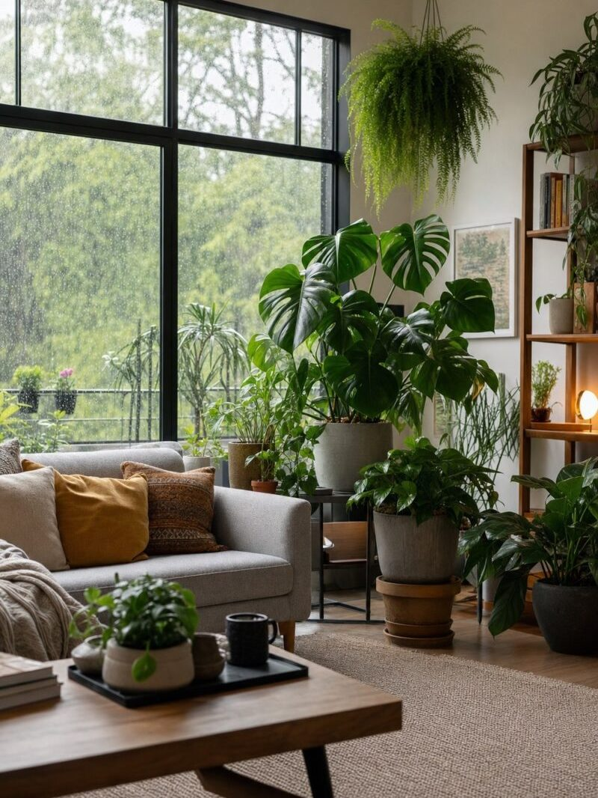

> TIP:GUIDE: Group: odd numbers, three heights | Pots: stone, terracotta or plain ceramic | Place: near windows for light

## 16. Bold Floral Wallpaper

Floral wallpaper is back, bigger and bolder than the small prints of a decade ago. Large roses and trailing leaves across a whole wall turn a living room into a garden room, and the vintage feel pairs beautifully with a pale sofa, a classic lamp and a patterned rug.

Use bold wallpaper on one or two walls and keep the rest plain, so the pattern stays a feature rather than overwhelming the room. A pale sofa in front of it lets the wallpaper lead, and cushions in one colour pulled from the print tie the room together.

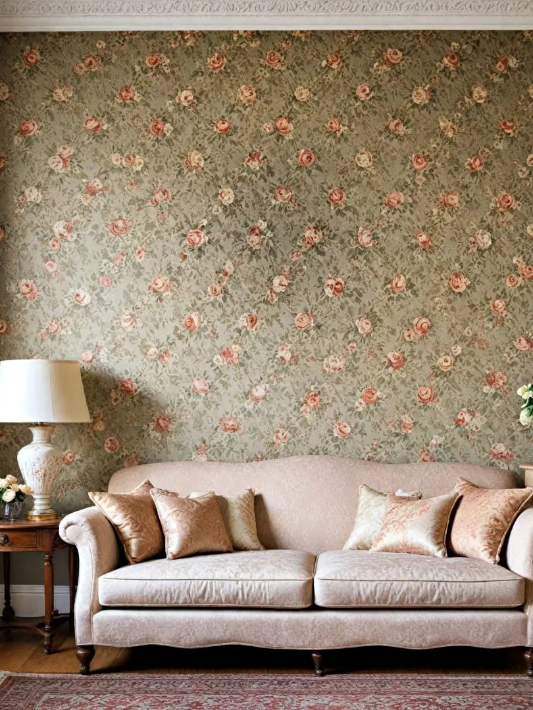

> TIP:QUICK: Paper one or two walls only, keep the sofa pale, and pull one cushion colour from the print.

## 17. Limewash Plaster Walls

Limewash gives walls a soft, cloudy texture that flat paint cannot match. The mineral finish catches light differently across the day, so a bedroom wall feels calm in the morning and warm in the evening. In pale stone, clay or sage tones it is the quietest, most restful wall treatment of 2027.

Limewash suits bedrooms and living rooms best, where its subtle movement can be appreciated up close. Keep bedding and furniture simple — linen, light wood, plain ceramics — so the wall itself is the decoration, and test a sample patch first because the colour deepens as it dries.

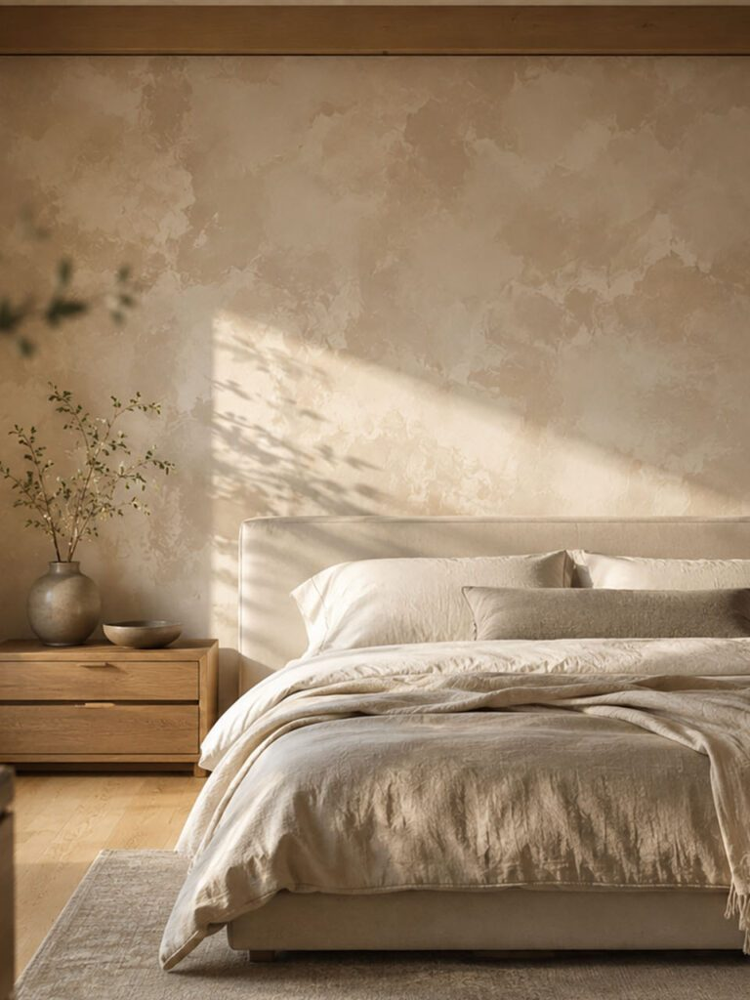

> TIP:CHECK: test a sample patch first, as the colour deepens when dry; keep bedding and furniture simple; best in bedrooms

## 18. Multifunctional Studio Layouts

Small homes in 2027 work harder, and multifunctional furniture is how they do it. A fold-down desk, a coffee table with storage, a sofa that defines the living zone and shelves that double as a room divider let one small room serve as office, living room and dining space without feeling cramped.

Zone the room with a rug under the sofa and keep the work area near the window, where daylight helps. Furniture that folds, stacks or hides away earns its place; anything that only does one job in a small room has to justify the floor space it takes.

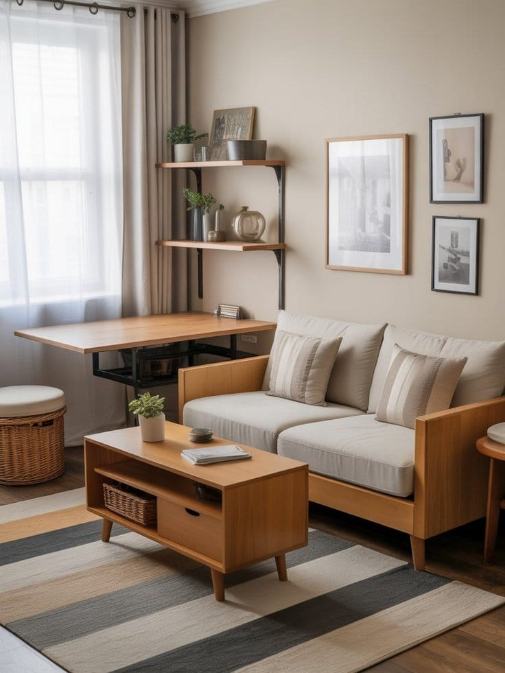

> TIP:GUIDE: Zones: rug under the sofa, desk by the window | Furniture: folds, stacks or hides away | Rule: every piece earns its floor space

## 19. Home Office Nooks

The home office nook turns an unused corner, alcove or cupboard into a proper workspace. A floating desk, a shelf above it, a comfortable chair and a warm lamp are all it takes, and a door or curtain lets you close the office away at the end of the day.

Keep the nook tidy by giving everything a home: a pen pot, a tray for papers, a basket underneath. A small plant and a framed print make it feel like part of the house rather than a desk shoved in a corner, and a good chair matters more than a big desk.

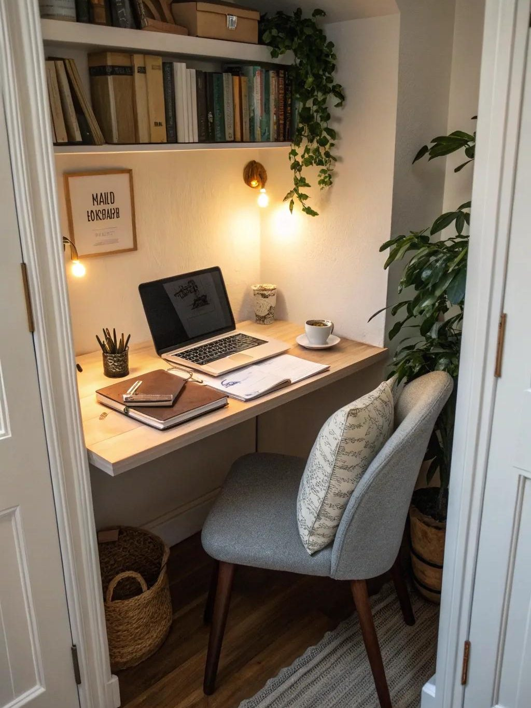

> TIP:QUICK: A floating desk, one shelf, a good chair and a warm lamp turn any alcove into a proper workspace.

## 20. Open-Plan Kitchen Living

Open-plan living stays strong in 2027, but the look has softened. Instead of one vast white space, the kitchen and living room now share warm wood floors, a long island with stools, and a sofa placed to face the cooking area, so the cook stays part of the conversation.

The island is the hinge of the room: cooking on one side, seating on the other. A rug under the sofa and a pendant over the island mark the two zones without walls, and matching wood tones across the kitchen and living furniture tie the whole space together.

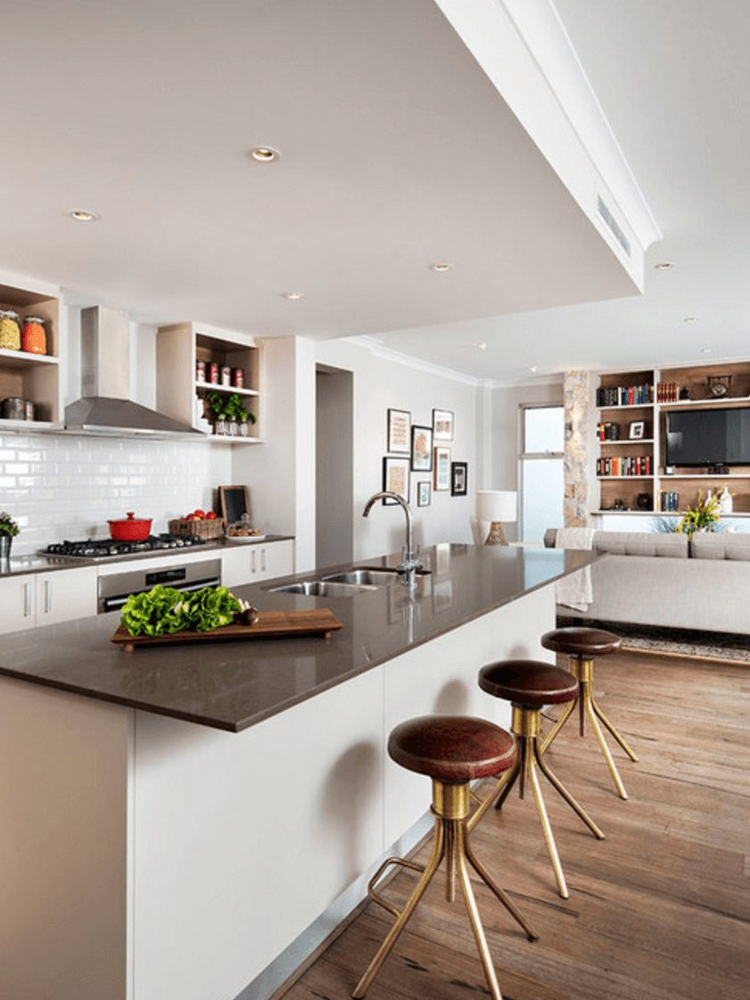

> TIP:CHECK: island as the hinge between zones; rug under the sofa; matching wood tones across kitchen and living areas

## 21. Warm Minimalism in the Living Room

Warm minimalism keeps the clean lines of minimal design and drops the cold, clinical feeling. The palette is cream, beige, oatmeal and light wood, with texture doing the work that colour used to do: a nubby rug, a linen cushion, a woven throw. Nothing is fussy, but nothing feels bare either.

The trick is layering tones rather than matching them exactly. A cream sofa, a slightly darker rug and pale wood floors sit together comfortably because they share the same warm undertone. Add one plant or one dark wooden piece for contrast, and the room stays calm without turning flat.

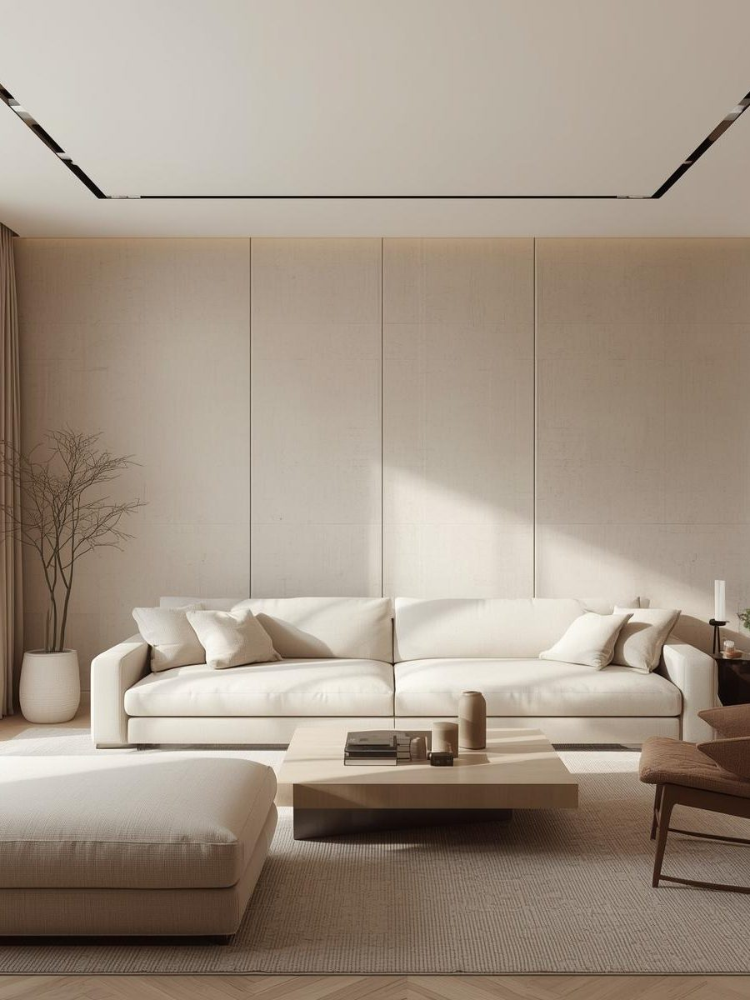

> TIP:QUICK: Keep every tone warm — cream, beige and light wood — and let texture, not colour, do the decorating.

## 22. Quiet Luxury Neutrals

Quiet luxury is the calmest trend of 2027: soft neutrals, beautiful materials and nothing shouting for attention. A cream bouclé sofa, a travertine coffee table, linen cushions and tall sheer curtains create a room that feels expensive because everything in it is well made and well placed, not because anything is flashy.

The look depends on quality over quantity, so choose fewer, better pieces and leave breathing room around them. Texture carries the room — nubby bouclé, rough stone, soft linen — and a single brass detail or a vase of dried grasses is all the decoration it needs.

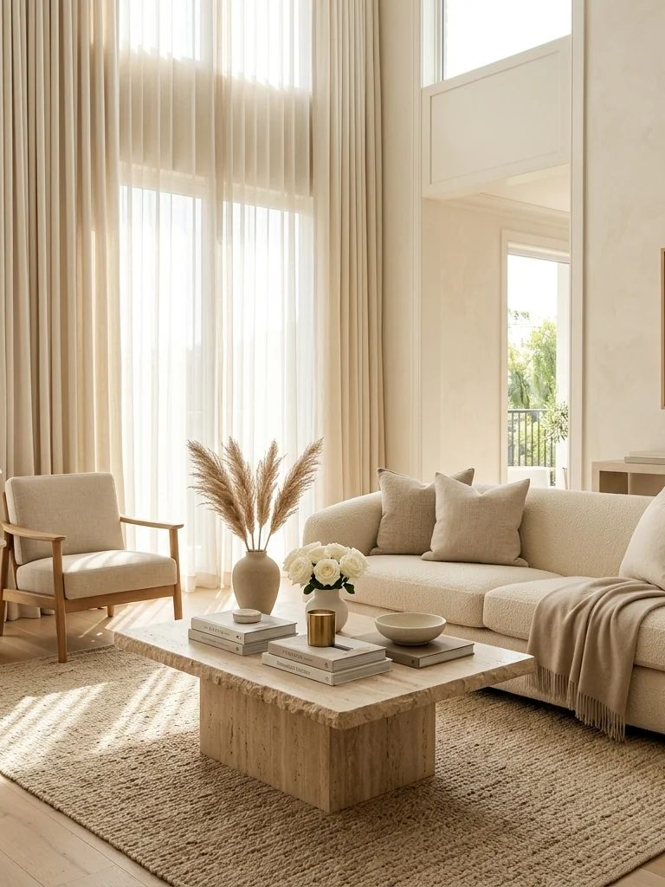

> TIP:QUICK: Fewer, better pieces with room to breathe — texture carries the room, not decoration.

## 23. Gallery Walls

Gallery walls in 2027 mix everything: black-and-white photographs, colourful abstract prints, botanical drawings and a few words, in frames of different sizes and finishes. The eclectic mix feels personal and collected, like a wall built over years rather than bought in one afternoon.

Start with the largest frame in the centre and build outwards, keeping the gaps between frames even — about two inches works well. Lay the arrangement on the floor first to test it, and mix frame colours but keep the art in a loose colour family so the wall holds together.

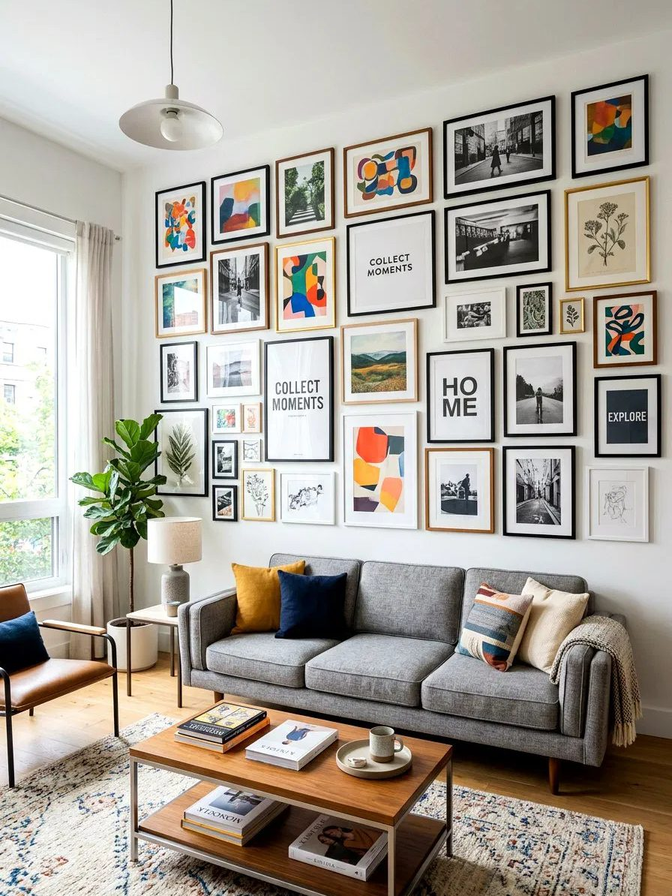

> TIP:CHECK: largest frame in the centre; even gaps of about two inches; test the layout on the floor first

## 24. Rattan and Natural Fibre

Rattan and natural fibre bring a relaxed, sunlit feeling indoors, and 2027 uses them well beyond the conservatory. A woven rattan armchair, a rattan floor lamp and a jute rug turn a bright corner into a calm retreat, especially beside garden windows with plants nearby.

Rattan suits rooms with plenty of daylight and pairs beautifully with white cushions, light wood and green plants. Keep the shapes simple — a curved chair, a plain lamp, a flat rug — so the texture itself is the feature, and avoid mixing too many different weaves in one small space.

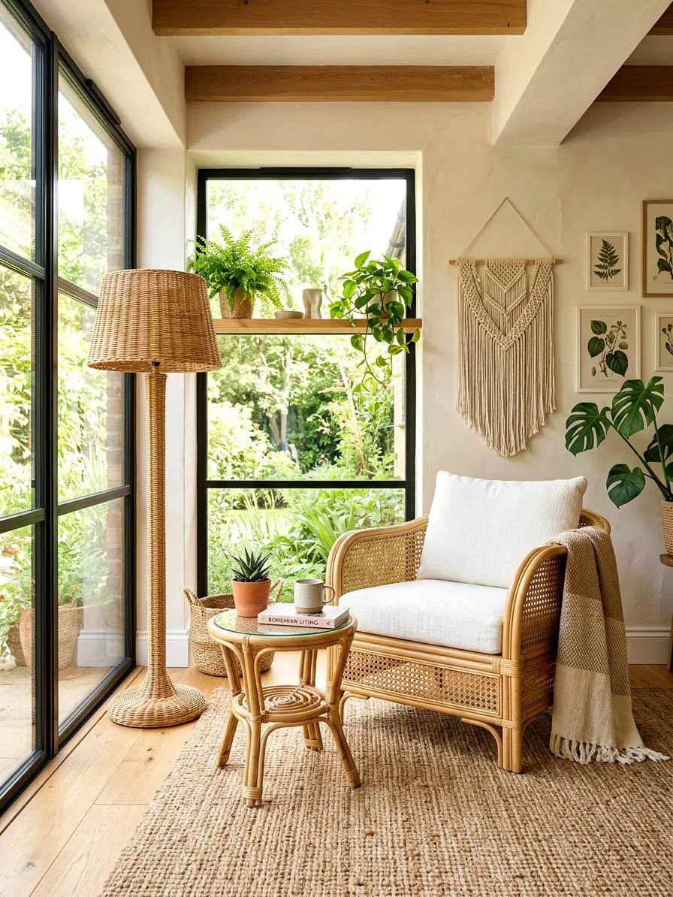

> TIP:GUIDE: Place: bright corner by garden windows | Pair: white cushions, light wood, plants | Shapes: simple curves, one weave at a time

## 25. Fluted Wood Panels

Fluted wood panels — thin vertical slats of wood running up a wall — add rhythm and warmth to hallways, living rooms and bedrooms. The narrow grooves catch light and shadow through the day, so a plain wall gains depth without paint or pattern, and the wood tone warms up white rooms beautifully.

Use fluting on one feature wall, behind a console table or a bed, and keep the furniture in front of it simple so the panel lines show clearly. Pale oak suits calm rooms, while darker walnut fluting makes a stronger statement in a hallway or dining room.

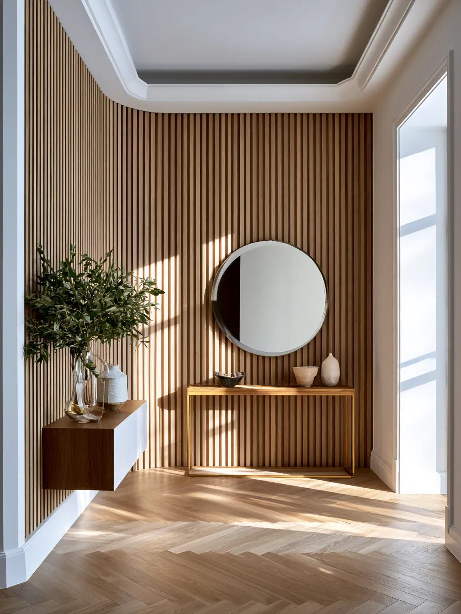

> TIP:QUICK: Use fluting on one feature wall and keep the furniture in front of it simple so the lines show.

## 26. Oversized Artwork

One oversized artwork does the work of a whole gallery wall. A single huge abstract canvas above a sofa anchors the room, sets the colour palette and gives the eye somewhere to rest. In 2027 the art is big, calm and abstract — soft neutrals with one dark or ochre accent — rather than busy or detailed.

The art should be about two-thirds the width of the sofa below it, hung so its centre sits at eye level. Keep the sofa cushions plain and the coffee table simple, so the artwork leads the room and everything else supports it.

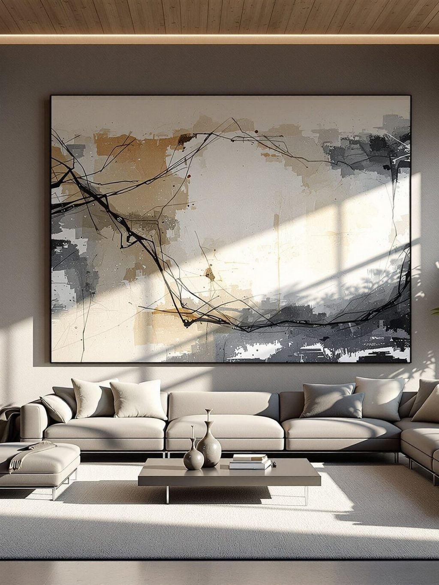

> TIP:CHECK: art about two-thirds the sofa's width; centre at eye level; plain cushions and a simple coffee table

## 27. Cosy Reading Nooks

A reading nook is a small luxury every home deserves, and 2027 builds it from an armchair, a good lamp, a stack of books and a throw. Tucked into a corner by a window, it becomes the most-used seat in the house — a place for morning coffee, evening chapters and quiet minutes.

The lamp matters most: a warm floor lamp with a fabric shade gives the corner its glow. Add a small side table for a mug, an ottoman for tired feet, and a basket of books within reach, and the nook is finished without any building work at all.

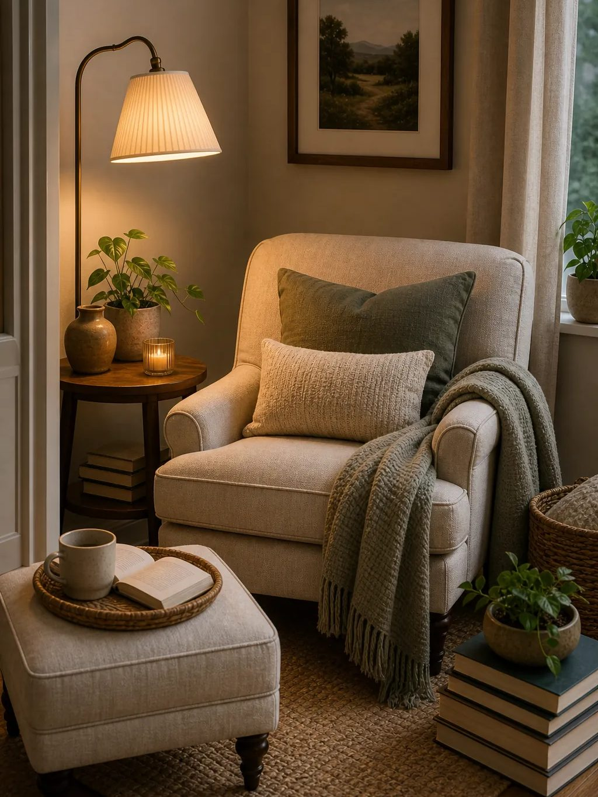

> TIP:GUIDE: Chair: deep and soft | Lamp: warm floor lamp with a fabric shade | Extras: side table, ottoman, basket of books

## 28. Spa-Like Bathrooms

The spa bathroom turns an ordinary bathroom into a calm retreat. A freestanding tub by a big window, stone tiles, light wood, folded white towels and a large plant create the feeling of a hotel spa at home, and the palette stays pale and natural so the room feels clean and restful.

Keep surfaces clear and storage hidden, since clutter breaks the spa feeling faster than anything else. A wooden bath tray, a stone soap dish and one plant are all the decoration needed, and soft, warm lighting makes evening baths feel even better.

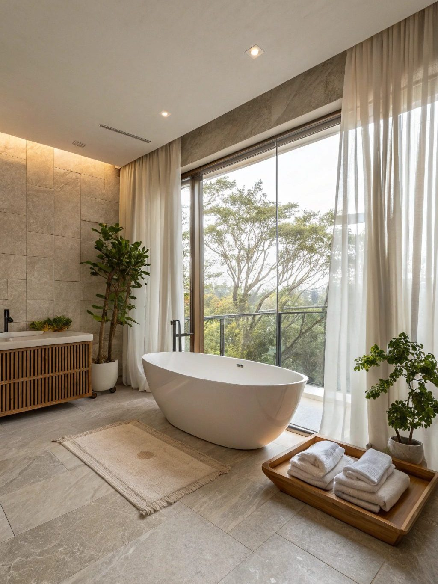

> TIP:QUICK: Clear surfaces, hidden storage, pale stone and one plant — that is the whole spa bathroom recipe.

## 29. Statement Marble Kitchen Islands

The marble kitchen island is 2027's showpiece. A long island with a waterfall edge — the marble running down the sides to the floor — becomes the kitchen's centrepiece, with bar stools on one side and cooking space on the other. Strong grey veining on white marble suits both classic and modern kitchens.

Let the island lead and keep the rest of the kitchen quiet: plain cabinet fronts, simple pendant lights and one vase of flowers. Marble marks and stains more easily than other worktops, so wipe spills quickly and use boards and mats for everyday cooking.

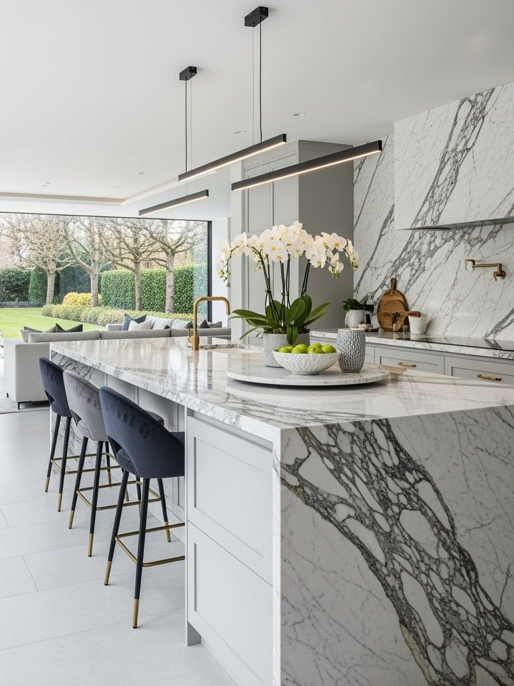

> TIP:CHECK: waterfall edge for the full effect; plain cabinets and simple pendants around it; wipe spills quickly

## 30. Indoor-Outdoor Glass Doors

Large glass sliding doors that open a living room onto the garden are the final trend of 2027, and the most transformative. Black-framed doors frame the garden like a picture, flood the room with daylight, and in summer turn the living room and patio into one big space for eating, reading and gathering.

Inside, keep the furniture low and the floor the same tone as the patio, so the eye travels straight through the glass. A rug near the doors, a couple of outdoor chairs and plants on both sides of the glass blur the line between inside and out even when the doors are closed.

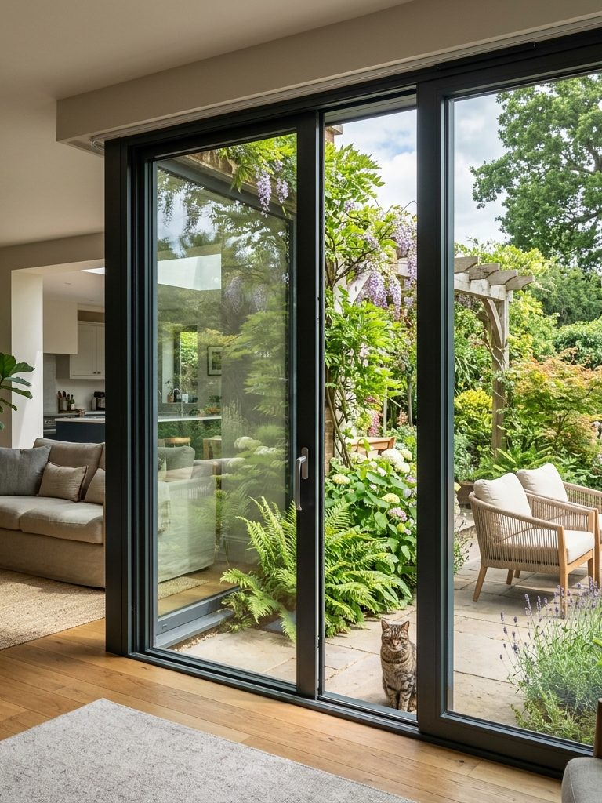

> TIP:GUIDE: Frames: slim black frames | Floors: inside and patio in a similar tone | Blur the line: plants and a rug on both sides

## Takeaway

Pick one trend that fixes something you already notice — a dark corner that needs layered light, a plain wall waiting for art, a kitchen that deserves a warmer wood. Try it in one room first and live with it for a few weeks before you copy it elsewhere. If you want more ideas in the same spirit, our [30 2027 Home Decor Ideas](/posts/2027-home-decor-ideas/) covers the wider decorating picture, and [30 Home Decor Trends for 2027](/posts/home-decor-trends-2027/) looks at the same year through a home-decor lens. Save the ideas you love and build your 2027 home one calm, confident change at a time.

## Frequently Asked Questions

### What are the biggest interior design trends for 2027?

Warm minimalism leads the way, with curved furniture, earthy colours like terracotta and deep green, and natural materials such as travertine, walnut and rattan. Rooms feel softer and more personal, mixing vintage pieces with new ones, layering light instead of relying on one ceiling fitting, and bringing plants and garden views indoors.

### What colours are trending in interior design for 2027?

Earthy, grounded colours dominate: warm terracotta, deep forest green, rich walnut brown and soft clay neutrals. They work best in layers — a painted wall with cushions and throws in the same family — rather than as one loud accent. Pair them with cream, stone and light wood so the room stays bright and calm.

### How can I follow 2027 trends on a small budget?

Start with one change per room and choose the cheapest version of the trend. Paint is the best value — one terracotta or green wall transforms a room for the price of a tin. Swap cushion covers, add a plant, thrift a vintage frame or a rattan basket, and move lamps around to layer the light you already own.

### Are curved sofas and rounded furniture practical?

Yes, if you measure first. A curved sofa softens a boxy room and seats people facing each other, which suits conversation. It needs more floor space than a straight sofa, so check the curve clears walkways and doors. In small rooms, try one rounded chair or a round coffee table instead.

### What is colour drenching and does it work in small rooms?

Colour drenching means painting the walls, ceiling, trim and sometimes the furniture in one colour. It removes visual breaks, so a small room can actually feel larger and calmer, not darker. It works best in a mid-tone green, blue or warm brown, with light bedding or a pale rug to lift it.

### How do I mix vintage pieces with a modern room?

Let one vintage piece lead and keep the rest simple. A carved chair, an old mirror or a worn rug adds character that new furniture cannot fake. Give it breathing room — plain walls, a modern sofa, uncluttered shelves — so it reads as a chosen feature, not clutter. Match its wood tone loosely, not exactly.

### What lighting should I choose for 2027?

Layer three kinds of light: a ceiling or pendant light for general brightness, a floor or table lamp for reading and warmth, and small shelf or picture lights for atmosphere. Warm bulbs suit living rooms and bedrooms best. A sculptural lamp doubles as decor, so choose one you love looking at when it is switched off.

### Which 2027 trends will last beyond the year?

The quiet ones: natural materials, good lighting, comfortable seating and rooms shaped around how you actually live. Terracotta, walnut, rattan and limewash have been around for decades in one form or another. Treat the bolder looks — full colour drenching, oversized art — as the fun experiments, and the calm foundations as the keepers.
