# 30 Afrohemian Living Room Ideas for a Warm, Layered Space

An afrohemian decor living room is where African-inspired pattern meets relaxed bohemian comfort: warm earth tones, mudcloth and kente textiles, woven baskets, carved wood and plenty of plants. Nothing in the style is fussy or formal. The look is built in layers — a patterned rug under a low wooden table, pillows in three different prints on one sofa, a basket wall above it — and every layer adds warmth without adding clutter.

This list gathers 30 real afrohemian living rooms, from bold terracotta walls and gallery walls of masks to quiet neutral sofas dressed with a single mudcloth throw. Steal one idea to warm up the room you have, or combine several for a full restyle. And if you want to carry the same warmth through the rest of the house, our [30 Afrohemian Decor Ideas for a Warm, Layered Home](/posts/afrohemian-decor/) takes the style into bedrooms, dining rooms and entryways.

## 1. A Mustard Wall with Framed Textile Art

A mustard-yellow wall is the fastest way to make a living room feel sun-warmed, and framed African textile art is the perfect thing to hang on it. Here two large framed mudcloth-style panels sit above a rust-orange sofa, with patterned cushions, dried palm fronds in terracotta vases and a low wooden coffee table holding clay bowls. The wall color does the heavy lifting, so the furniture can stay simple.

Keep the wall to one strong color and let the textiles carry the pattern. If mustard feels too bold for the whole room, paint just the sofa wall and keep the rest warm white — the contrast makes the art pop even more.

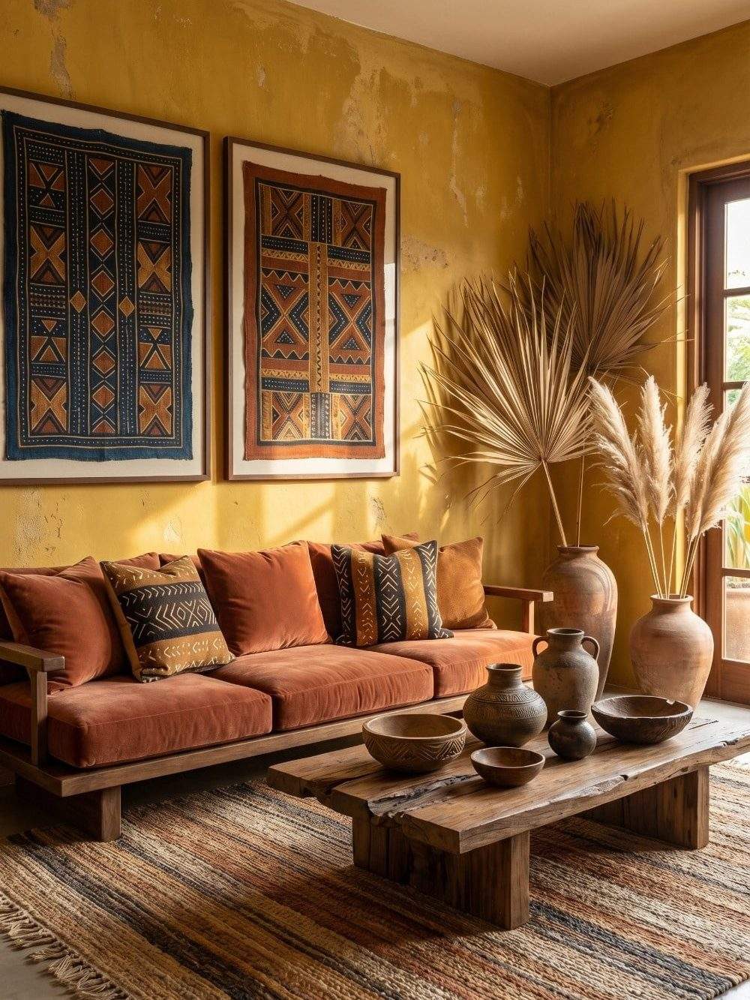

> TIP:QUICK: Paint one wall mustard and hang two large framed textiles — the wall color does the work, so the furniture can stay simple.

## 2. A Green Velvet Sofa Under a Gallery Wall

A deep green velvet sofa is the anchor of this living room, and the gallery wall above it is pure afrohemian: framed indigo mudcloth prints, a small mask, woven discs and a bold orange textile, all hung close together on a terracotta wall. A black-and-white mudcloth ottoman in front of the sofa repeats the patterns at floor level, so the whole room feels composed.

Mix frame sizes and shapes on the gallery wall — square prints, a round basket, one tall piece — and keep the gaps small so it reads as one arrangement. The green sofa cools the warm wall down, which is what stops the room from feeling too hot.

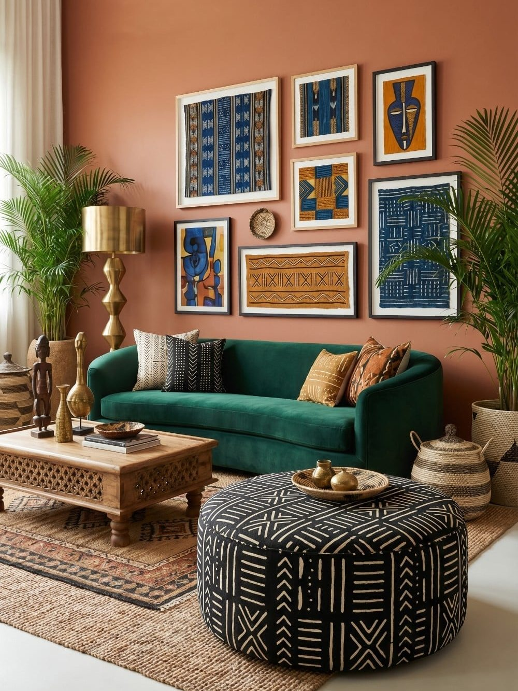

> TIP:CHECK: one deep green anchor piece; five to seven framed textiles and baskets; gaps between frames kept small and even

## 3. Floor Cushions Around a Low Wooden Table

Floor cushions turn a living room into a gathering place. This sunlit room centers on a low rustic coffee table under a big woven pendant light, with leather poufs, patterned floor cushions and a dark sofa with cane sides arranged around it. A jute rug grounds the group, and tall plants in the corners soften the pale yellow walls.

Choose cushions in two or three patterns that share one color — here rust, black and tan — so the mix looks intentional rather than random. Keep the table low and the rug large enough that every cushion sits on it, and the seating circle will feel like a room within the room.

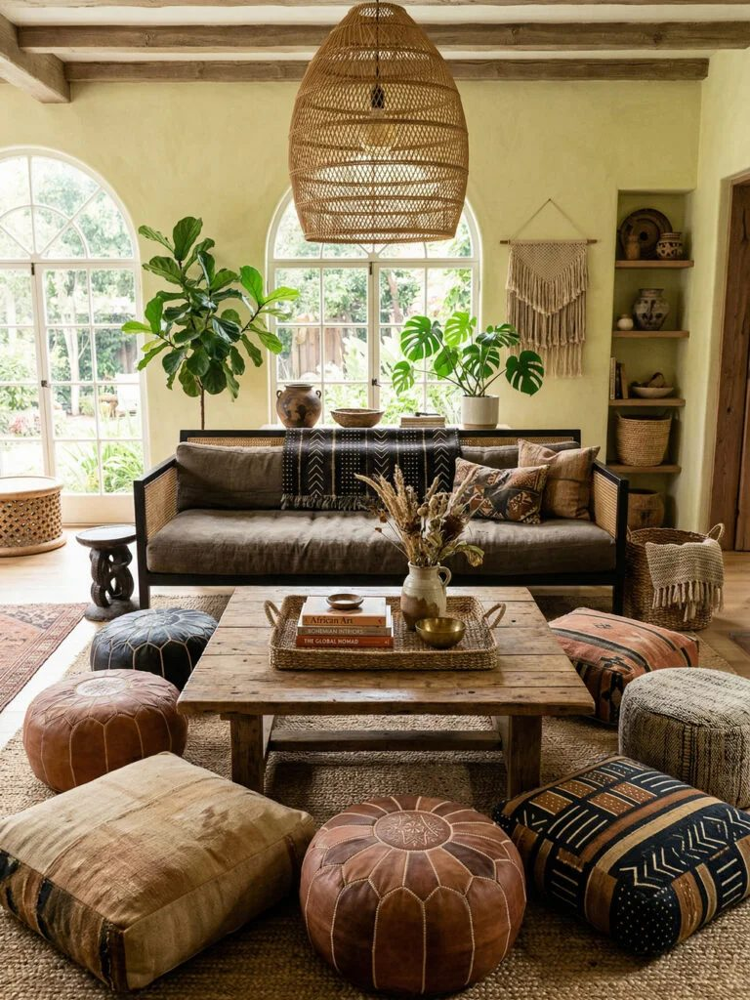

> TIP:GUIDE: Budget: from $60 for three floor cushions and a jute rug | Time: one afternoon to arrange | Skill: beginner

## 4. Warm Earth Tones with a Rustic Coffee Table

Some afrohemian living rooms whisper instead of shout, and this one does it with warm earth tones alone. A thick rustic wooden coffee table holds clay vessels and books, while a dark sofa, patterned floor poufs and woven pendant light fill out the room. The walls stay pale, the textiles stay muted, and the wood grain does the decorating.

Let one natural material lead — here it is the rough wood of the coffee table — and repeat it once or twice in smaller pieces, like a wooden bowl or a carved stool. When the palette is this quiet, texture matters more than color, so mix smooth leather, rough jute and soft wool in the same corner.

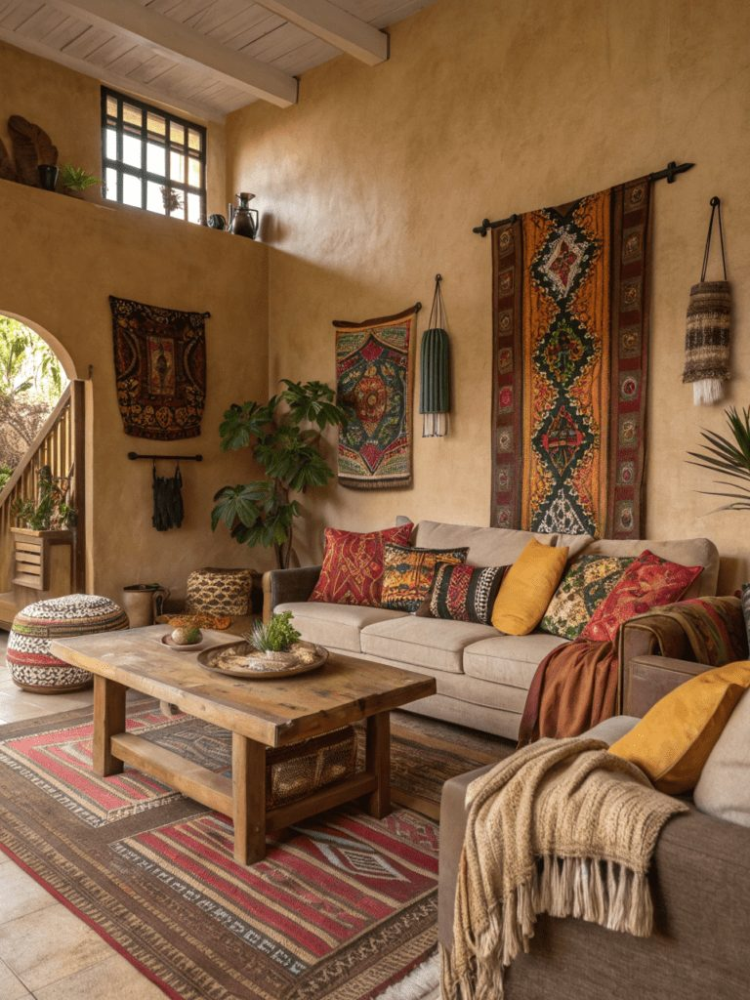

> TIP:QUICK: Let one rough wood piece lead the room and repeat the material once in a smaller object, like a carved bowl.

## 5. A Rust Sofa Under a Woven Basket Wall

A rust-orange sofa and a woven basket wall are a natural pair: the warm sofa picks up the straw tones of the baskets, and the baskets give the wall a texture no paint can match. Here a circle of shallow baskets hangs above the sofa, with a fiddle-leaf fig in the corner, a patterned rug underfoot and a fringed throw draped over the arm.

Hang the baskets in a loose circle or cloud shape rather than a straight grid — the organic arrangement suits the bohemian side of the style. Mix basket sizes and weave patterns, and leave one or two baskets a darker shade so the wall has depth.

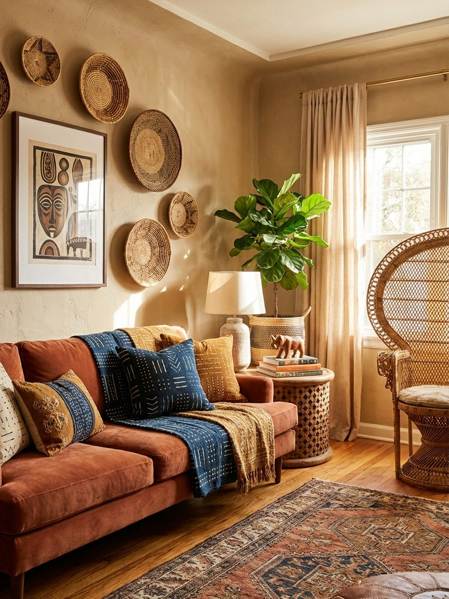

> TIP:CHECK: baskets in three sizes mixed together; one or two darker baskets for depth; hung in a loose circle, not a grid

## 6. A Circular Woven Basket Wall

If one basket wall feels busy, try a tight circular arrangement instead. This calm living room hangs a neat circle of woven baskets and plates above a beige sofa, with a wooden coffee table, a jute rug and a fiddle-leaf fig completing the scene. The circle reads as a single piece of art, so the rest of the room can stay quiet and pale.

Start with the largest basket in the center and work outward, smallest at the edges. Use baskets in the same straw family with only small differences in pattern, and the circle will look collected rather than matched.

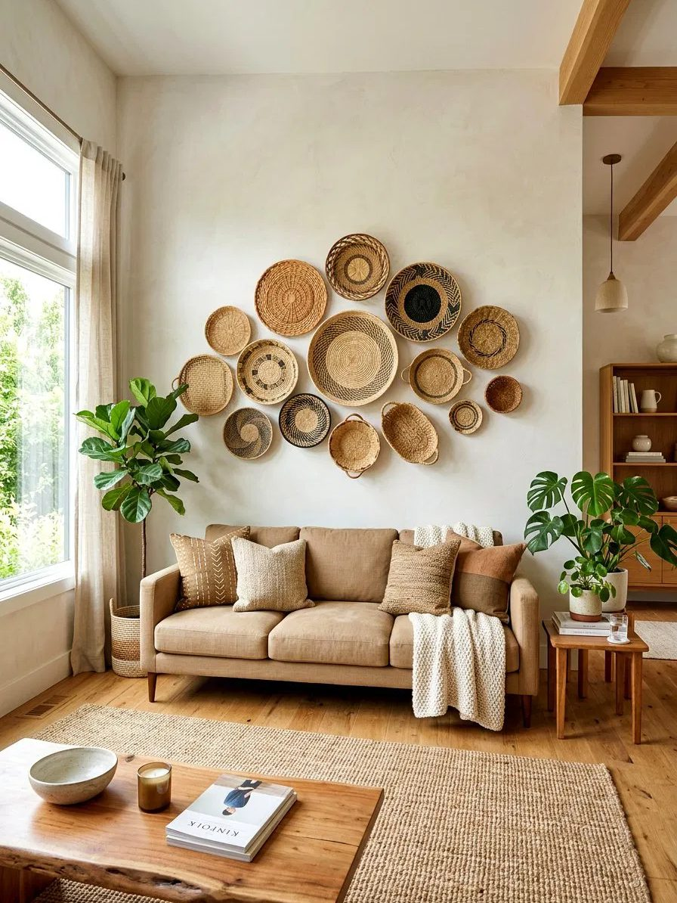

> TIP:GUIDE: Budget: from $40 for a set of woven baskets | Time: one hour to hang | Skill: beginner with a picture hook

## 7. A Basket and Plate Gallery Wall

Woven baskets and painted plates hung together make a gallery wall with more texture than framed prints alone. This bright living room fills the wall above a tan leather sofa with a large, loose arrangement of baskets, plates and shallow bowls in straw, black and cream, while a round wooden coffee table and pampas grass soften the seating below.

Mix at least three materials — woven seagrass, painted ceramic and carved wood — so the wall has something to look at up close as well as from across the room. Hang the biggest piece slightly off-center and build around it, and the arrangement will look gathered over time rather than planned in an afternoon.

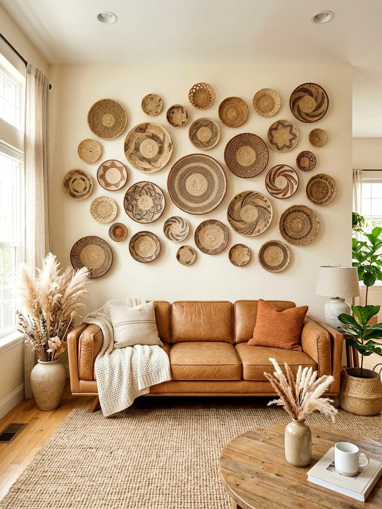

> TIP:QUICK: Mix woven, ceramic and carved pieces on one wall — three materials make the gallery interesting up close and from afar.

## 8. One Oversized Woven Basket as a Focal Point

Sometimes one big piece beats a whole wall of small ones. A single oversized woven basket hangs above this sofa like a sun, its concentric rings echoing the round coffee table and the curved rug below. The rest of the wall stays bare, which makes the basket feel sculptural instead of decorative.

Measure before you buy: the basket should span about two-thirds of the sofa's width to look intentional. Hang it dead center above the sofa, and keep the cushions simple so nothing competes with it.

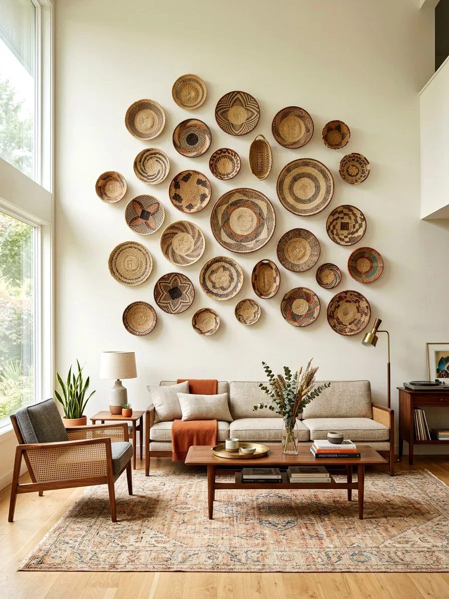

> TIP:CHECK: basket about two-thirds as wide as the sofa; hung dead center; cushions kept simple so nothing competes

## 9. Terracotta Walls with Rattan Pendants

Terracotta walls are the boldest move in the afrohemian living room, and rattan pendants are what keep them from feeling heavy. This room pairs a warm clay-colored wall with two woven pendant lights, a framed gallery wall, a cream sectional and a round rattan coffee table, with pampas grass and woven baskets warming the corners.

If you paint the walls terracotta, keep the biggest furniture pale — cream, rattan or light wood — so the room stays bright. Add plants last: the green against the clay is the color combination that makes the whole room work.

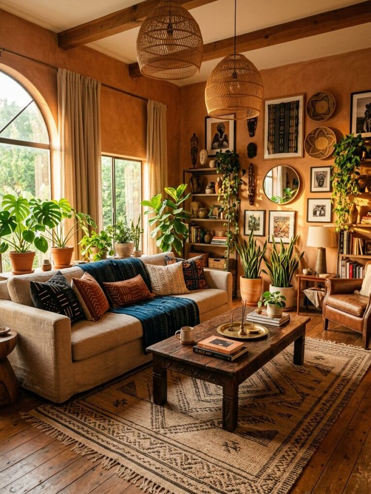

> TIP:GUIDE: Budget: one tin of terracotta paint, under $40 | Time: one weekend to paint | Skill: beginner

## 10. A Blue Sofa Under a Mask and Art Gallery Wall

A blue sofa is the surprise that makes this gallery wall sing. Carved wooden masks, framed mudcloth prints and woven discs hang in a dense arrangement on a mustard wall, while the deep blue sofa below cools the whole composition down. A carved coffee table and a patterned throw at the foot of the sofa repeat the warm tones.

Buy masks and carvings one at a time from makers and markets rather than as a matching set — the small differences in wood and carving are what make a gallery wall feel collected. Hang the tallest mask near the center and let the smaller pieces fill in around it.

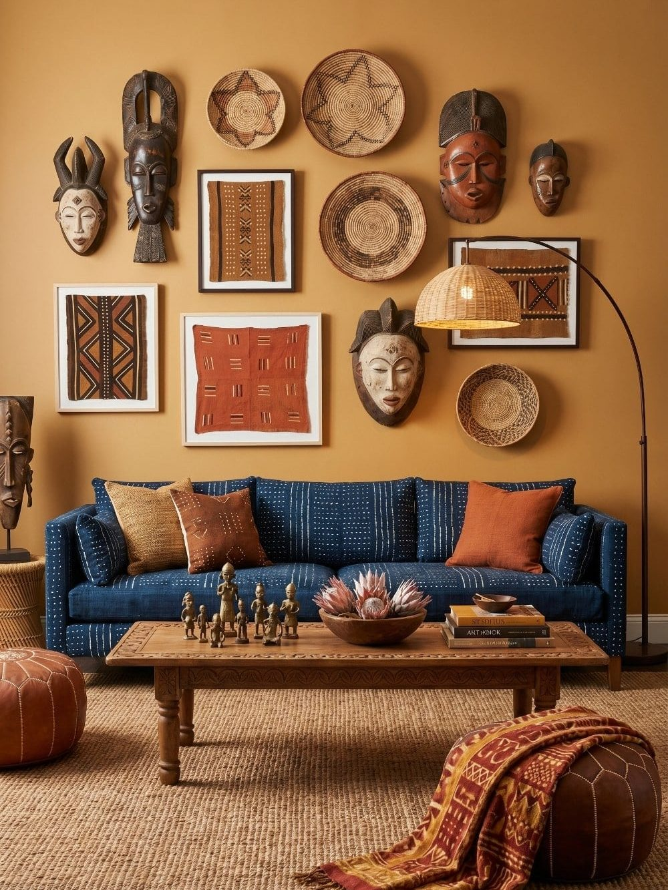

> TIP:QUICK: Hang the tallest mask near the center and build outward — a gallery of collected pieces beats a matching set.

## 11. A Kente Tapestry on a Terracotta Wall

One large kente cloth tapestry can carry a whole living room. Here a bold kente panel in orange, green and gold hangs floor-to-ceiling on a terracotta wall, flanked by carved masks on floating shelves, with a cream sofa and patterned pillows below. The tapestry is the art, the color and the pattern all at once.

Hang the tapestry from a simple wooden rod or a pair of leather loops so the textile itself stays the focus. Keep the sofa and rug neutral — cream, jute, light wood — because a kente panel this strong needs quiet neighbors.

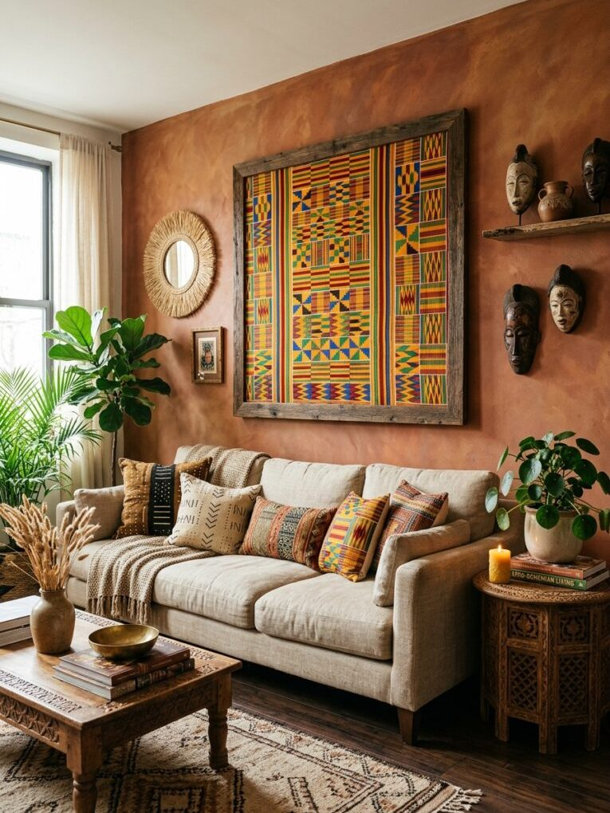

> TIP:CHECK: tapestry hung from a plain wooden rod; sofa and rug kept neutral; one pattern per wall so the kente leads

## 12. A Bold Patterned Sofa in Mustard and Brown

A patterned sofa is the boldest single purchase in the afrohemian living room, and it earns its place by doing the work of five accessories at once. This sofa wears a black, cream and mustard geometric tribal print across every cushion, with a low wooden frame and a pale rug below. The pattern is the art, the color and the texture, so the rest of the room can stay almost empty.

Let a patterned sofa be the only pattern in the room: plain walls, a plain rug, one solid throw. If the print feels too loud on first sight, live with it for a week before adding anything — most patterned sofas calm down once the eye gets used to them, and a second pattern is what tips the room into chaos.

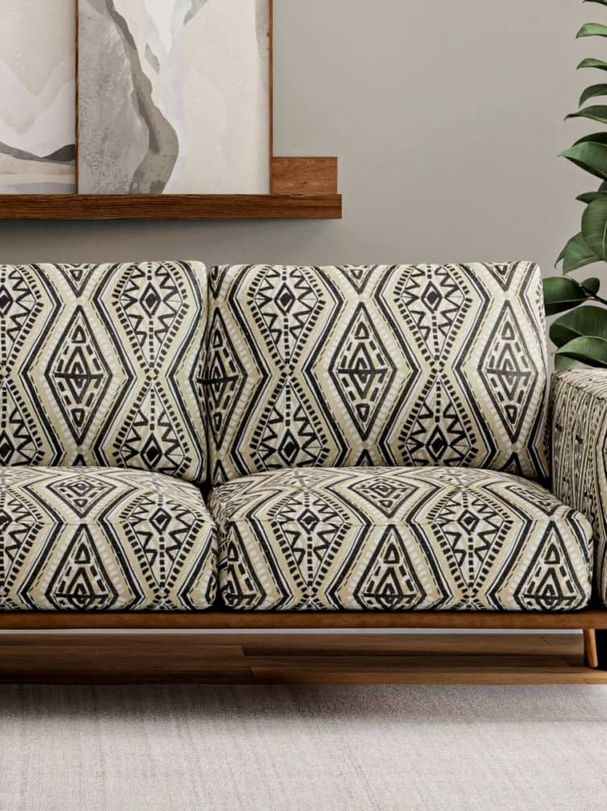

> TIP:GUIDE: Budget: from $300 for a patterned slipcover over a plain sofa | Time: one afternoon to fit | Skill: beginner

## 13. A Navy Sectional with a Round Woven Wall Hanging

A navy sectional gives an afrohemian living room a grounded, evening feel. This room sets a deep blue sectional against a terracotta wall with built-in niches holding masks and pottery, and hangs one large round woven disc above the sofa like a moon. A patterned rug in rust and navy and a wooden coffee table with a woven bowl finish the scheme.

Repeat the navy in three places — sofa, rug and one cushion — so the dark color feels distributed rather than heavy. The round wall hanging softens all the straight lines of the sectional, which is why it works so well above it.

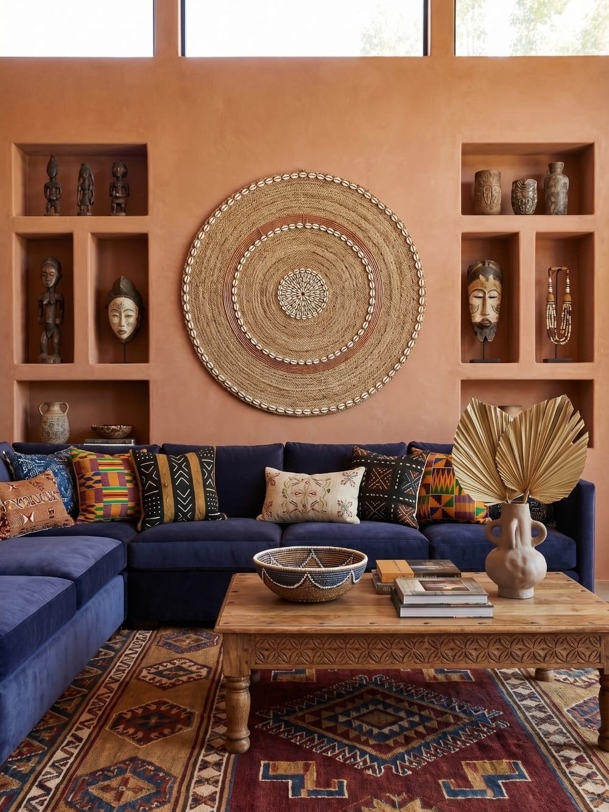

> TIP:QUICK: Repeat the navy in three places — sofa, rug and one cushion — so the dark color feels spread out, not heavy.

## 14. Mudcloth Pillows and a Throw on a Neutral Sofa

The easiest afrohemian living room starts with a sofa you already own. Mudcloth pillows in black, cream and rust, plus a patterned throw folded over one arm, turn a plain neutral sofa into the style's poster piece — no paint, no new furniture, just textiles. The tray on the coffee table with a candle and a small plant keeps the styling calm.

Choose pillows in two mudcloth patterns and one solid color that matches the sofa, and fold the throw over the arm rather than draping it across the back. Three pillows is enough on a two-seater; five on a three-seater, with the largest at the ends.

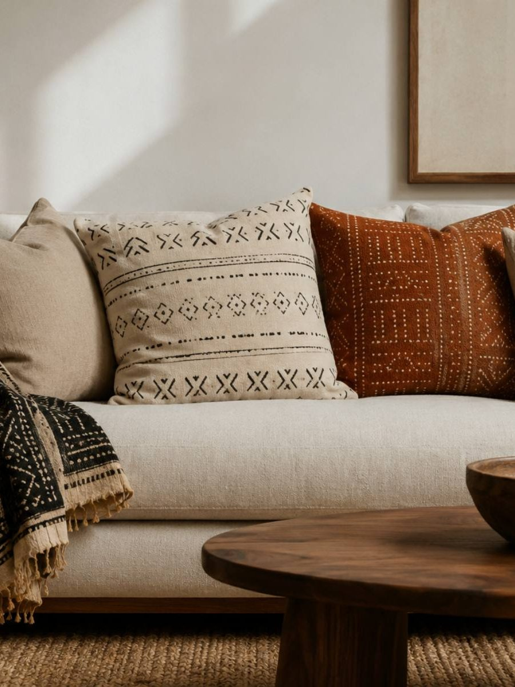

> TIP:CHECK: two mudcloth patterns plus one solid; throw folded over the arm; three pillows on a two-seater, five on a three-seater

## 15. Mudcloth Tapestries Flanking a Cream Sofa

Two tall mudcloth tapestries hung like banners on either side of a cream sofa frame the seating area like curtains. The black-and-white patterns are bold, but because they are the same textile repeated, the wall feels calm rather than busy. A wooden coffee table, terracotta pots and a black-and-white rug keep the palette to three colors.

Hang the tapestries at the same height with the same drop, and keep the sofa cushions to black, white and one warm accent. If the tapestries are long, let them hang to just above the sofa back so they read as part of the furniture, not as wall art.

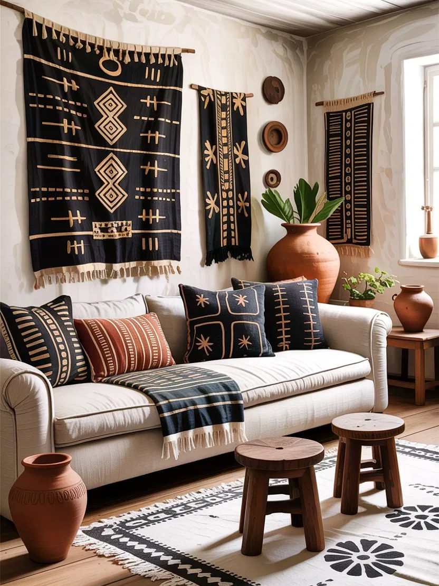

> TIP:GUIDE: Budget: from $30 for two mudcloth-style wall hangings | Time: thirty minutes to hang | Skill: beginner

## 16. A Terracotta Gallery Wall with Rattan Seating

A terracotta gallery wall is where the afrohemian style shows off its collecting habit: woven baskets, framed prints, small masks and carved figures hung close together, with a rattan sofa and a patterned armchair below. The wall is busy, but because everything shares the same warm palette, it reads as one rich surface.

Group the gallery by shape — baskets together, frames together, masks together — inside the larger arrangement, so the eye finds small clusters instead of chaos. Leave one breathing space in the wall, a bare patch the size of a cushion, and the whole thing will feel curated.

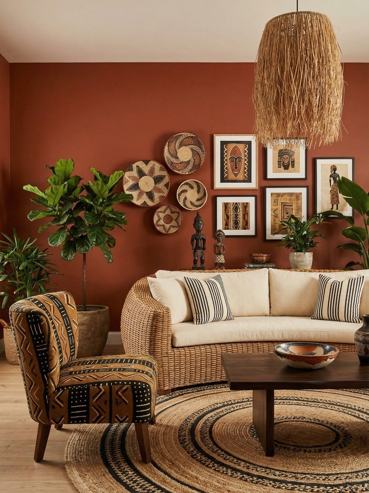

> TIP:QUICK: Group the gallery by shape — baskets together, frames together — and leave one bare patch so the wall can breathe.

## 17. A Wicker Sectional Layered with Plants

A wicker sectional is the bohemian half of afrohemian, and plants are what make it feel alive. This sunlit room layers a wicker sectional with patterned cushions and throws, then fills every corner with fiddle-leaf figs, monstera and hanging planters. Framed portraits and woven wall hangings add the African-inspired layer above the sofa.

Put the biggest plant in the corner behind the sofa's end, where it frames the seating instead of blocking it. Water the plants on the same day each week and wipe the wicker down monthly — dust shows on rattan faster than on fabric.

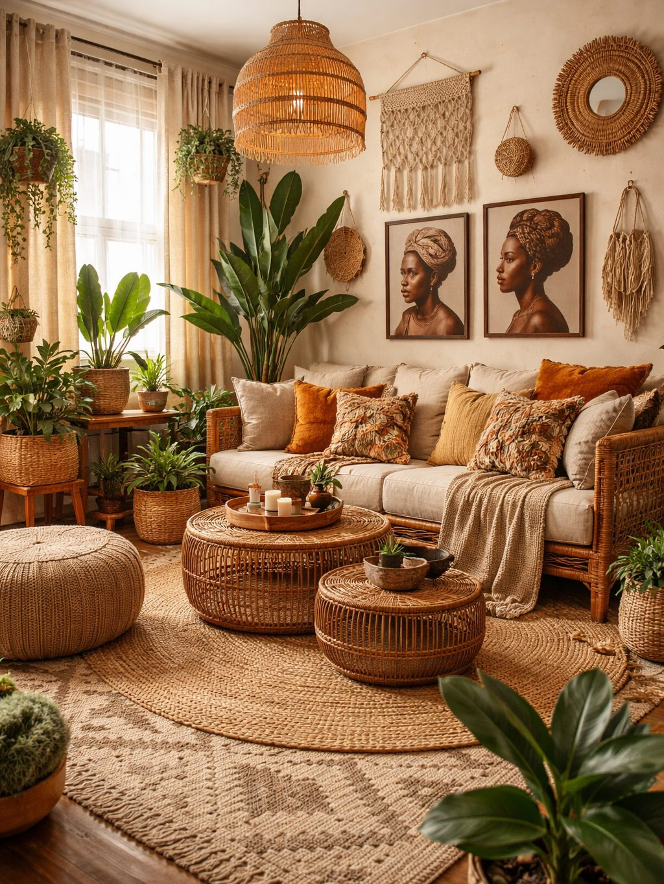

> TIP:CHECK: biggest plant in the corner behind the sofa end; plants watered on the same day weekly; wicker wiped monthly

## 18. A Round Rattan Coffee Table Under a Basket Wall

A round rattan coffee table is the soft center of this bright living room. The basket wall above the sofa is dense and round-edged, the table echoes it in miniature, and rattan armchairs with sheepskin throws complete the circle. A patterned rug in black and cream keeps the floor graphic while everything else stays warm and natural.

Round tables suit small living rooms because there are no corners to walk around, and they make conversation easier — everyone sits the same distance from the middle. Keep the tabletop styling to three objects: a vase, a stack of books and one small bowl.

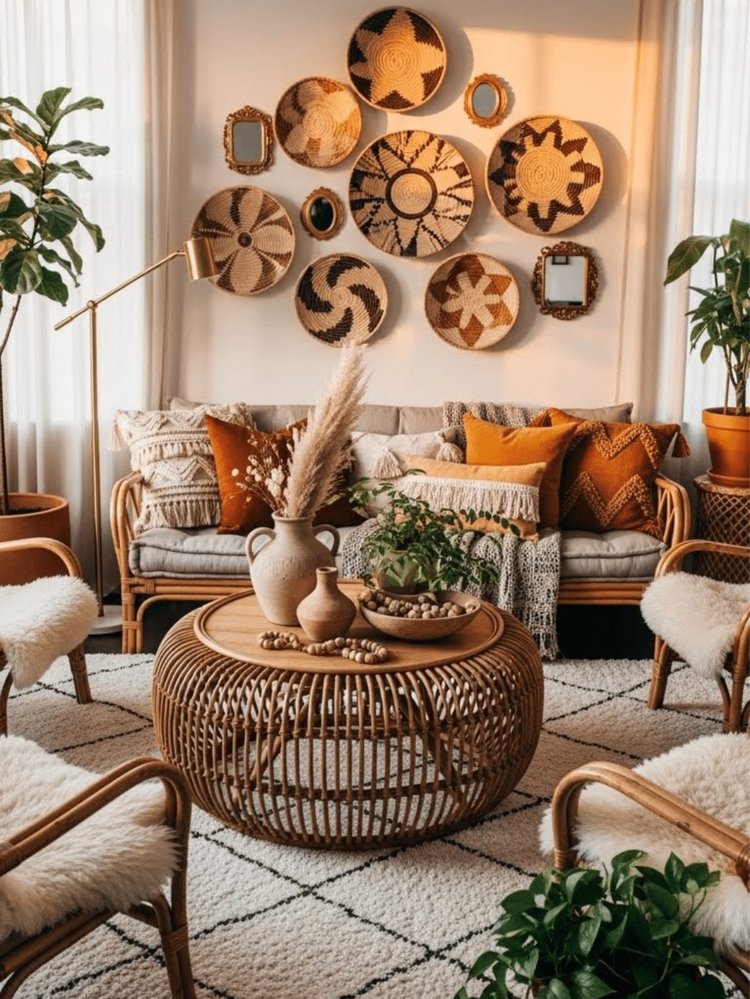

> TIP:GUIDE: Budget: from $80 for a round rattan coffee table | Time: one afternoon to style | Skill: beginner

## 19. Abstract Afro-Boho Art Above a Woven Sofa

One bold abstract print can set the whole room's palette. Here a large artwork in rust, ochre and black hangs above a woven sofa, with a round woven wall disc and a striped ottoman picking up the same shapes below. The rug is a quiet jute, which lets the art and the sofa do all the talking.

Pick the art first, then pull two colors from it for the cushions and one for a throw. If the print is mostly warm, add one cool accent — a teal cushion or a green plant — so the room does not feel like a single temperature.

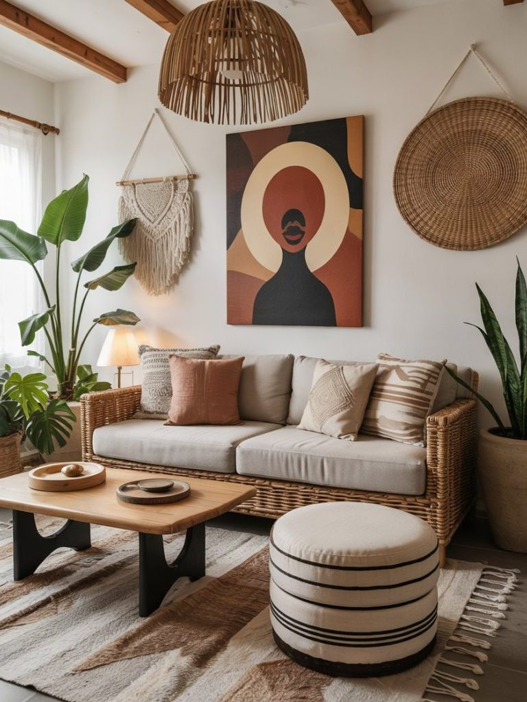

> TIP:QUICK: Pick the art first, then pull two of its colors for the cushions and one for a throw.

## 20. A Fringed Throw with Bold Patterned Pillows

A fringed throw is the afrohemian living room's signature finishing touch. This light sofa wears a stack of pillows in kente, mudcloth and geometric prints, with a bright orange fringed throw folded over one arm and spilling onto the seat. The throw's fringe adds movement, and the orange warms up the whole pale room.

Fold the throw in thirds lengthwise, drape it over the arm, and let the fringe hang free — a folded throw looks styled, a tossed one looks like laundry. One bold throw is enough; two patterned throws on one sofa start to fight each other.

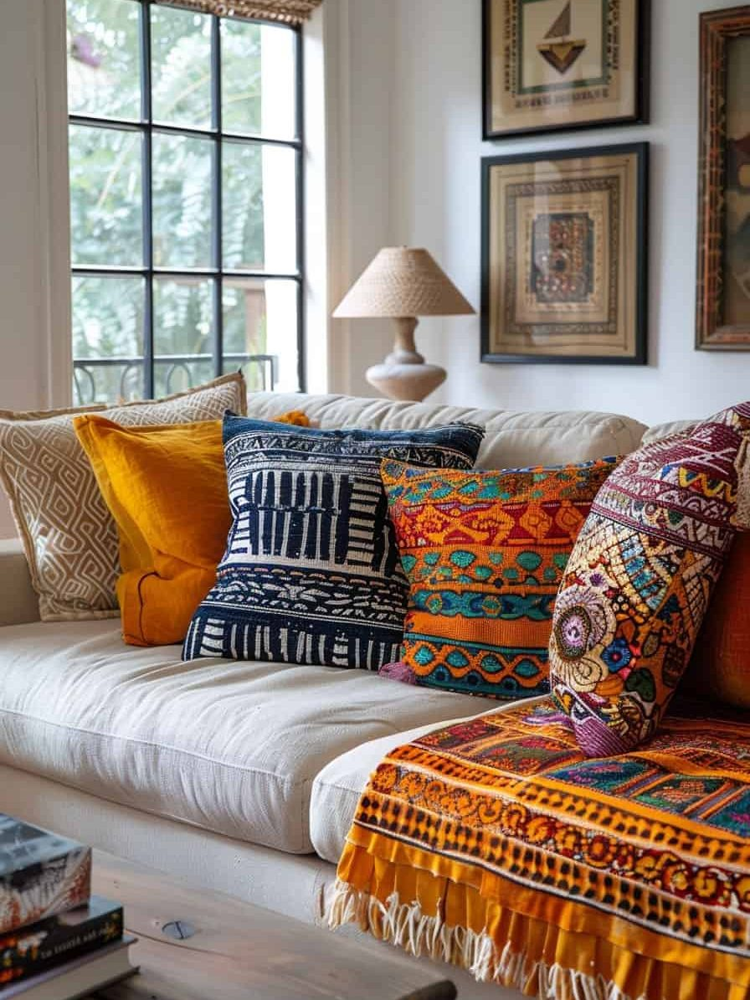

> TIP:CHECK: throw folded in thirds and draped over the arm; fringe left hanging free; one bold throw per sofa, never two

## 21. A Rattan Accent Chair with a Patterned Cushion

One rattan accent chair can pull a whole living room toward afrohemian without changing anything else. This sunlit corner sets a woven rattan chair with a bold geometric cushion against a wall of framed prints and hanging plants, with a jute rug and a low wooden table nearby. The chair is the statement, and everything around it is quiet.

Place the accent chair at an angle to the sofa, not parallel with it, so the seating feels like a conversation rather than a waiting room. One patterned cushion is enough on a chair — a second one crowds the small seat.

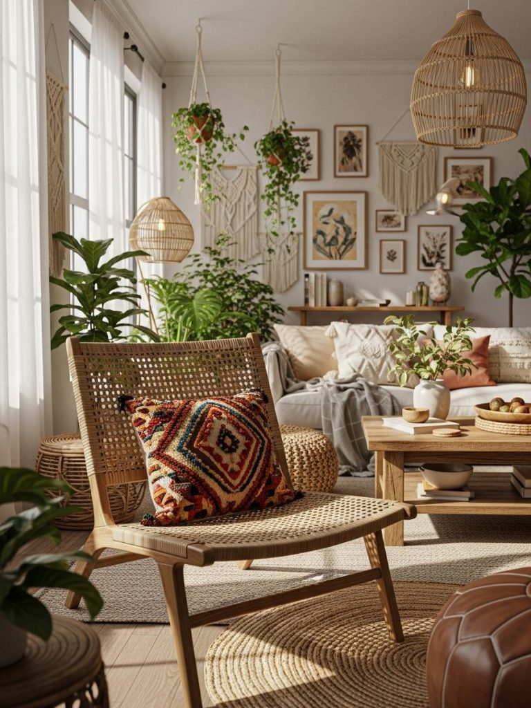

> TIP:GUIDE: Budget: from $70 for a rattan accent chair | Time: one hour to place and style | Skill: beginner

## 22. Macramé Hangings and a Peacock Chair

Macramé wall hangings and a peacock chair are the bohemian layer at its most romantic. This plant-filled room hangs three macramé pieces above a colorful patterned sofa, with a woven peacock chair in the corner, hanging planters from the ceiling and a faded red rug underfoot. The African-inspired prints on the cushions keep the room grounded in the afrohemian style rather than drifting into pure boho.

Hang macramé at different heights so the wall has a rhythm, and keep the peacock chair for reading, not for storage — a chair that holds a pile of clothes stops being a statement piece. One peacock chair per room is the rule; two makes the room a theme park.

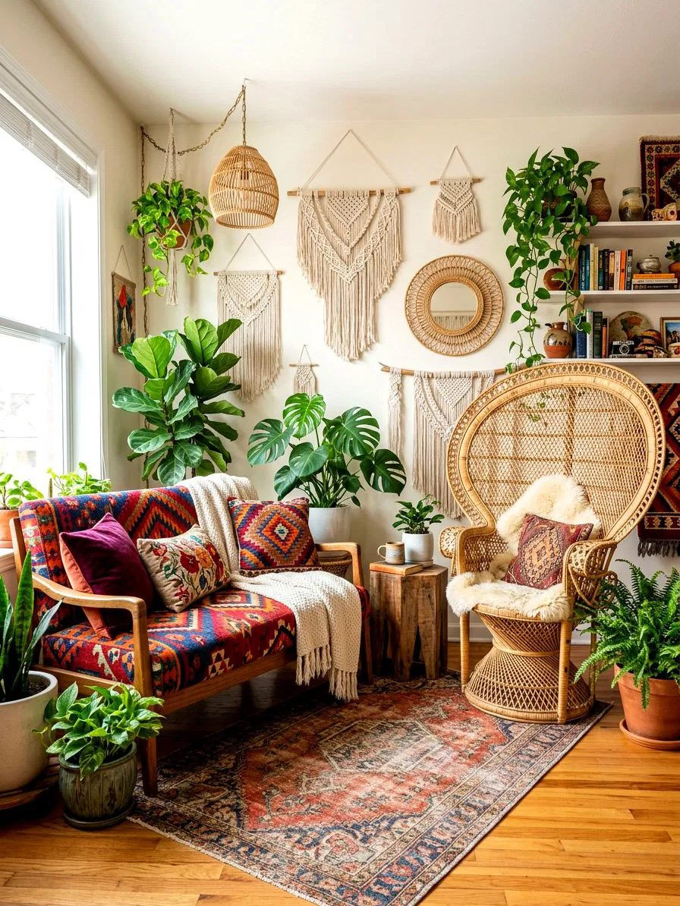

> TIP:QUICK: Hang macramé at different heights for rhythm, and keep the peacock chair clear — it is for sitting, not storage.

## 23. A Sofa-Free Seating Circle of Rattan Chairs

No sofa? No problem. This cozy living room skips the sofa entirely and arranges rattan chairs and a low round coffee table in a circle on layered rugs, with hanging plants and a wooden sideboard behind. The circle seats four comfortably and makes the room feel like a place people actually talk in.

A sofa-free room needs a rug big enough to hold all the chairs, or the circle will drift apart. Add one floor cushion for a fifth seat, and keep a small side table within reach of every chair so nobody has to hold their drink.

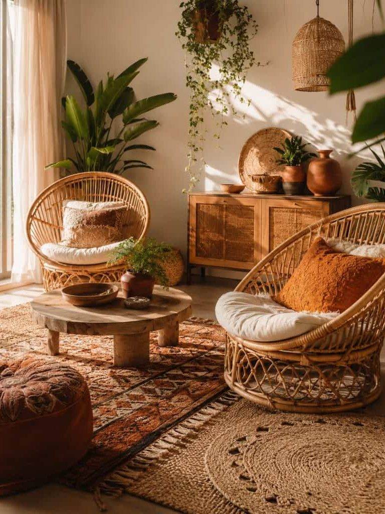

> TIP:CHECK: rug large enough for every chair; one floor cushion for a fifth seat; a side table within reach of each chair

## 24. Rattan Chairs Around a White Coffee Table

Rattan chairs and a white coffee table are a light, airy take on the style. This room pairs two woven chairs and a floor cushion around a simple white table, with a colorful patterned rug, macramé hangings and trailing plants on the wall behind. The white table is the calm center that lets the rug and the textiles be loud.

Keep the coffee table top mostly clear — a small tray with a candle and a plant — because a white surface shows clutter instantly. If the rug is the loudest thing in the room, let the chairs and cushions stay in quiet neutrals.

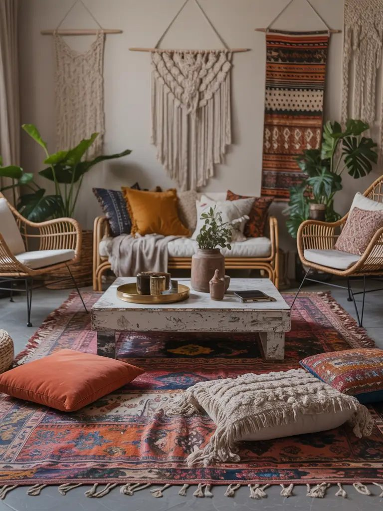

> TIP:GUIDE: Budget: from $50 for a white coffee table | Time: one hour to arrange | Skill: beginner

## 25. Mudcloth Pillow Covers in Earth Tones

Mudcloth pillow covers are the cheapest way into the afrohemian living room, and earth tones are the easiest place to start. These covers in rust, ochre and black with white geometric lines sit on a white sofa against a white plaster wall, and the pattern does all the work. No paint, no new furniture — just four pillow covers and the room has a point of view.

Buy covers, not whole pillows, and swap them seasonally: earth tones for autumn and winter, lighter indigo and cream for spring. Wash them inside out in cold water so the printed patterns last, and keep one solid cushion in the mix so the patterns have somewhere to rest.

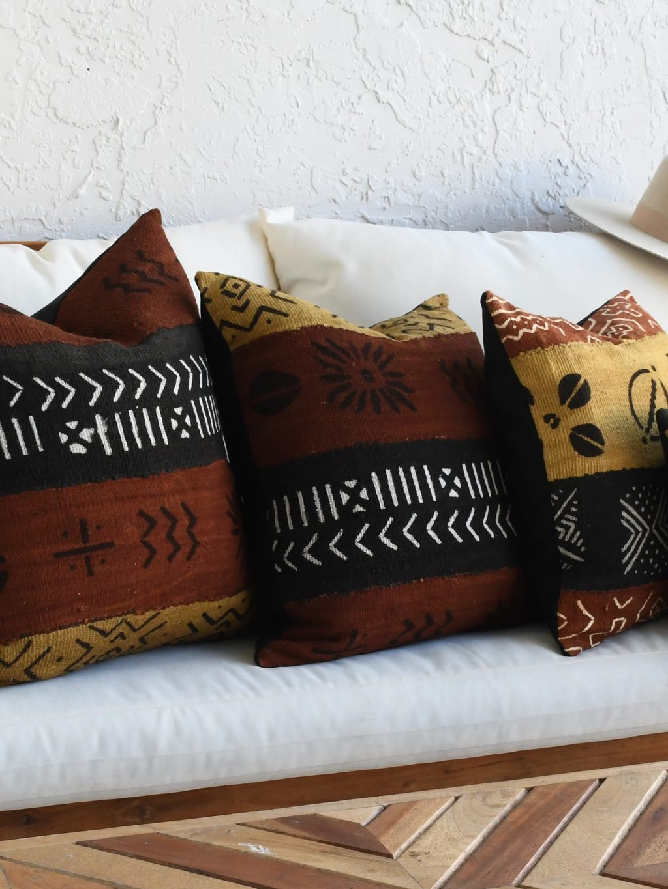

> TIP:QUICK: Buy pillow covers, not whole pillows, and swap them seasonally — earth tones for winter, indigo and cream for spring.

## 26. Bold Black-and-Gold Mudcloth Pillows

Black-and-gold mudcloth pillows are the dramatic end of the style. On a light sofa with a cream throw, the bold geometric pattern in black and gold reads like jewelry — strong, graphic and a little bit glamorous. The gold picks up warm wood tones in the room, so the black never feels cold.

Use bold pillows in odd numbers and keep the rest of the sofa plain: one cream throw, no other patterns. If the black feels too strong, add a single gold or brass object nearby — a vase, a tray, a lamp base — and the pillows will look like they belong.

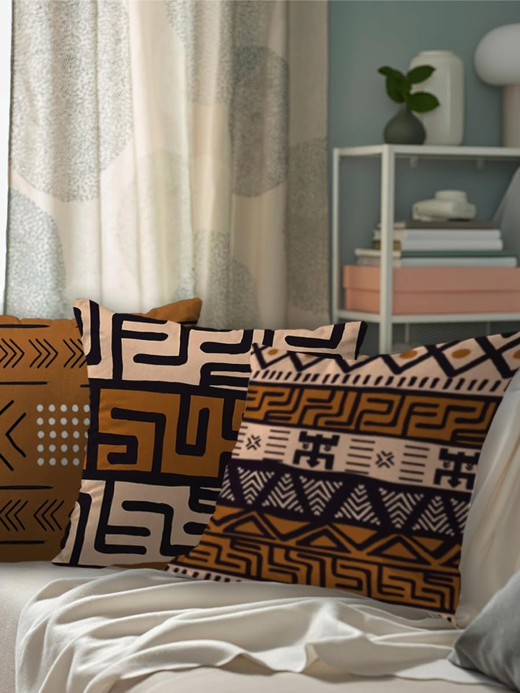

> TIP:CHECK: bold pillows in odd numbers; the rest of the sofa plain; one brass object nearby to warm the black

## 27. A Terracotta Sofa with Lush Indoor Plants

A terracotta sofa is a bold choice that pays off when the room is full of green. This living room pairs a burnt-orange sofa with a jungle of indoor plants — fiddle-leaf figs, monstera and trailing vines — plus a woven tapestry and a patterned red rug. The plants cool the hot sofa down, and the sofa warms the green up.

Give a terracotta sofa neutral neighbors: cream walls, a jute rug, light wood. Then add plants in three sizes — one tall tree, two medium pots and a trailing plant — and the room will feel like a warm garden room instead of a bold color experiment.

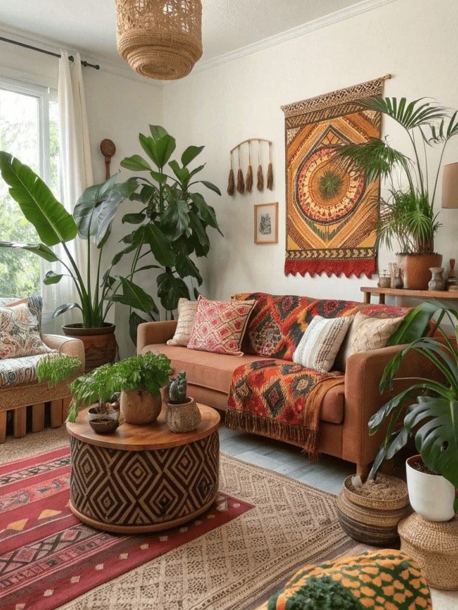

> TIP:GUIDE: Budget: from $30 for three plants in mixed sizes | Time: one afternoon to place | Skill: beginner

## 28. A Plant-Filled Corner with Woven Textures

If the whole room feels too much, start with one plant-filled corner. This bright living room stacks a fiddle-leaf fig, a monstera and snake plants beside a light sofa with mudcloth pillows, with a woven storage basket, a carved stool and framed textile art finishing the corner. The corner is the whole style in miniature: green, woven, patterned, carved.

Cluster plants in odd numbers and vary their heights — tall tree at the back, medium pots in front, one trailing plant on a stool. Put the tallest plant in the corner itself, where it fills the dead space and frames the sofa.

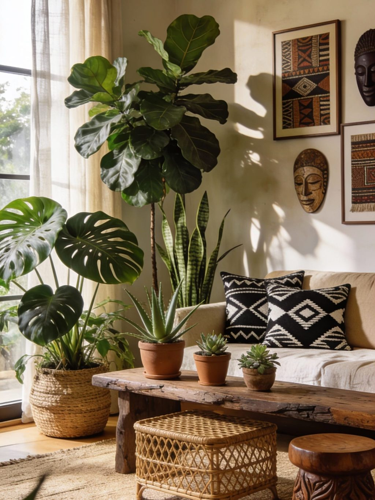

> TIP:QUICK: Cluster plants in odd numbers with varied heights — tall tree at the back, trailing plant on a stool in front.

## 29. Kente Cloth Pillows on a Wooden Armchair

Kente cloth pillows are small, bright and impossible to ignore. This wooden armchair wears three kente pillows in red, green and gold, with a mudcloth-style throw folded over one arm, and the chair itself becomes the room's accent piece. It is the smallest possible afrohemian statement — one chair, three pillows — and it works in any living room.

Keep kente pillows on one chair or one end of the sofa, not scattered across the whole room, so the bright pattern reads as an accent. Pair them with one neutral cushion in cream or tan, and the kente will look intentional rather than loud.

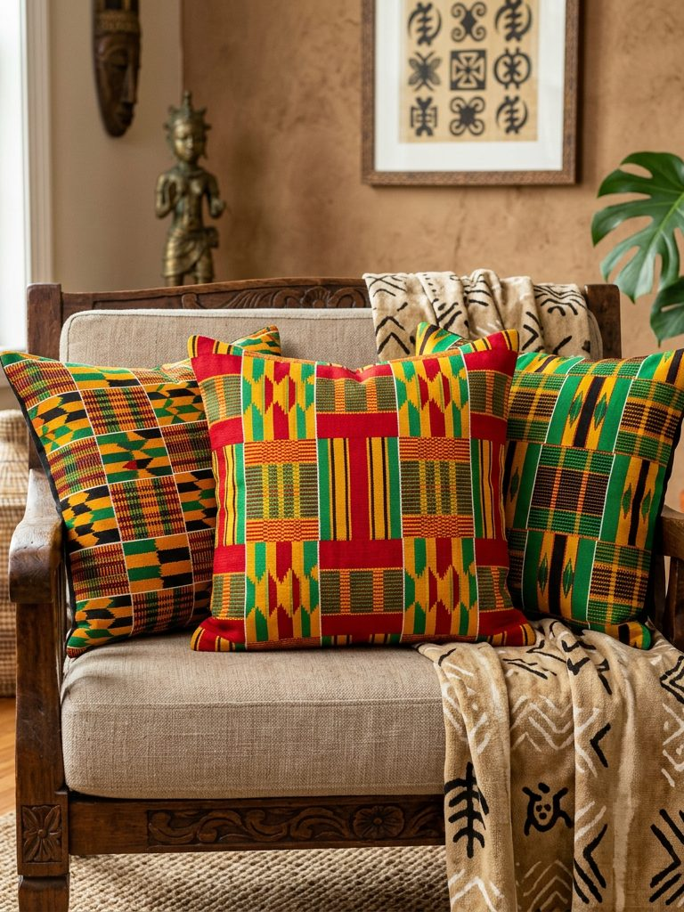

> TIP:CHECK: kente pillows on one chair or one end of the sofa; one neutral cushion beside them; never scattered across the room

## 30. Kente Art and a Mudcloth Ottoman on a White Sofa

The last look is the calmest one on this list, and it proves the style does not need a dark wall to work. A white sofa sits under a single framed kente cloth print, with mudcloth-patterned pillows, a woven tray on the coffee table and a black mudcloth ottoman in front. The room is bright, the textiles are the color, and nothing fights for attention.

End with restraint: one framed textile, two patterned pillows, one patterned ottoman — and everything else plain. If you want more pattern later, add it one piece at a time, living with each addition for a week before the next.

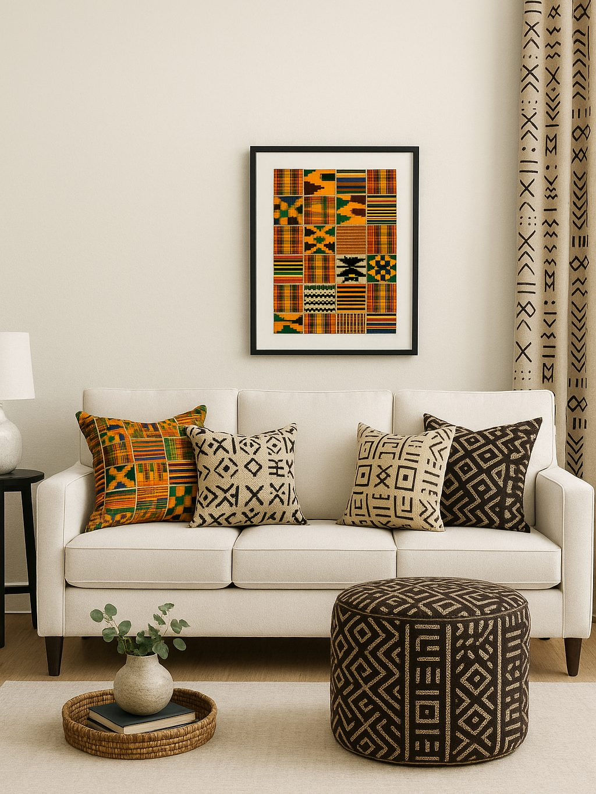

> TIP:GUIDE: Budget: from $20 for one framed kente print | Time: one hour to hang and style | Skill: beginner

## Takeaway

- An afrohemian living room is built the same way every time: one warm wall color or one bold textile first, then layers of pattern, weave and green on top.
- Start with the cheapest layer — mudcloth pillow covers on the sofa you already have — and add one bigger piece a week: a basket wall, a rattan chair, a kente tapestry.
- Stop when the room feels warm and full, not when it feels finished, because this style is meant to keep collecting. To carry the same layered warmth into the bedroom, the dining room and the entryway, see our [30 Afrohemian Decor Ideas for a Warm, Layered Home](/posts/afrohemian-decor/).

## Frequently Asked Questions

### What is afrohemian decor in a living room?

Afrohemian decor blends African-inspired design with relaxed bohemian style. In a living room that means warm earth tones, mudcloth and kente textiles, woven baskets, carved wood, rattan furniture and lots of plants, layered together for a warm, collected look that feels personal rather than decorated.

### What colors work best in an afrohemian living room?

Warm earth tones lead: terracotta, rust, mustard, ochre and clay, balanced with cream, jute and light wood. Black-and-white mudcloth patterns add contrast, and deep green or navy can anchor a sofa. Keep to three main colors plus black and cream, so the patterns stay the star.

### How do I style mudcloth pillows in my living room?

Use mudcloth pillows in odd numbers — three on a two-seater, five on a three-seater — mixing two patterns with one solid color that matches your sofa. Add a folded throw in a matching tone over one arm, and keep the rest of the sofa plain so the patterns have room to breathe.

### Can afrohemian style work in a small living room?

Yes, it suits small rooms well because it is built from textiles and wall decor rather than big furniture. A basket wall, mudcloth pillows and one rattan chair add the whole style without taking floor space, and a round coffee table keeps walkways clear in tight layouts.

### Where should I hang a woven basket wall?

Hang a basket wall above the sofa, where it fills the biggest blank surface in the room. Start with the largest basket near the center, work outward with smaller ones, and keep the whole arrangement about two-thirds as wide as the sofa so it looks intentional and balanced.

### How do I mix patterns without the room looking messy?

Pick one shared color across all your patterns — rust, black or ochre — and vary the scale: one large print, one medium and one small. Keep the sofa and rug mostly plain, repeat each pattern at least twice, and leave one surface bare so the eye has somewhere to rest.

### What plants suit an afrohemian living room?

Large leafy plants suit it best: fiddle-leaf figs, monstera, palms and snake plants in woven baskets or terracotta pots. Cluster them in odd numbers with varied heights, put the tallest in a corner, and add one trailing plant on a stool or shelf for softness.

### Is afrohemian decor expensive to create?

No, it is one of the cheapest styles to start. Mudcloth pillow covers, a woven basket wall and a thrifted rattan chair can transform a living room for under $150. Paint one wall terracotta for under $40, add plants gradually, and collect masks and carvings one at a time.
