# 30 Afrohemian Decor Ideas for a Warm, Layered Home

Afrohemian decor is African-inspired pattern layered over relaxed bohemian comfort — warm terracotta and rust, mudcloth and kente textiles, woven baskets, carved wood and plants in every room. It is a whole-home style, not a single-room look: the same basket wall that warms a living room works above a bed, the same mudcloth that dresses a sofa makes a quilt, and the same terracotta that paints a wall turns a bathroom into a retreat.

This list walks through the whole house — bedrooms, patios, dining rooms, kitchens, bathrooms and entryways — with 30 real rooms to steal from. Start in one room, keep the palette the same everywhere, and the house will feel connected without feeling matched. For a deeper dive into the room where the style shows off most, see our [30 Afrohemian Living Room Ideas for a Warm, Layered Space](/posts/afrohemian-decor-living-room/).

## 1. A Basket Wall Above the Bed

A woven basket wall above the bed is the bedroom version of the afrohemian living room's favorite trick. Here a cluster of shallow baskets and plates hangs over a wooden bed dressed in rust and black patterned bedding, with a woven throw, terracotta pots and a patterned rug pulling the same warm tones through the room. The baskets add texture without weight, which is exactly what a bedroom wall needs.

Hang the baskets in a loose cloud shape rather than a grid, mixing sizes and weave patterns. Keep the bedding's busiest pattern on the throw or the top layer, and let the pillows stay mostly solid, so the wall and the bed do not compete.

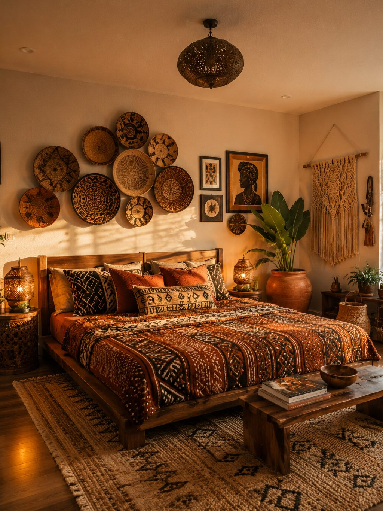

> TIP:QUICK: Hang baskets in a loose cloud, not a grid, and keep the bed's busiest pattern on the throw only.

## 2. A Cane Headboard with Portrait Art

A cane headboard is the calm, natural anchor this bedroom needed, and portrait art is what makes it afrohemian. Large framed portraits of African women hang above the bed, with rust and patterned cushions, a woven bench at the foot and warm wood nightstands on either side. The cane keeps the room light while the art brings the color and the story.

Choose one large portrait or two medium ones rather than a whole gallery — a bedroom wall should feel restful, not like a museum. Pick up one color from the art for the throw or the cushions, and the whole wall will feel composed.

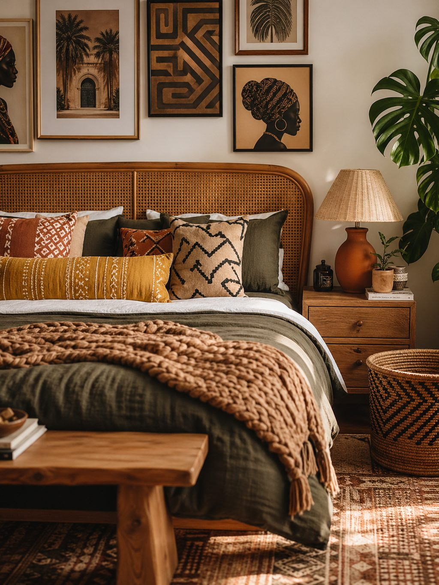

> TIP:CHECK: one large portrait or two medium ones; one color from the art repeated in the throw; cane headboard to keep the room light

## 3. A Mustard Wall with a Woven Disc

A mustard-yellow wall turns a plain bedroom into a sun-warmed retreat, and one large woven disc is all the art it needs. This room pairs the bold wall with a simple bed in rust linen, a patterned cushion and a fringed throw, with terracotta pots and dried grasses on the nightstand. The wall is the decoration; everything else just supports it.

Paint only the wall behind the bed if a whole mustard room feels too much — one bold wall gives you the glow without the glare. Hang the woven disc dead center above the headboard, about two-thirds as wide as the bed, and keep the bedding solid so the wall stays the star.

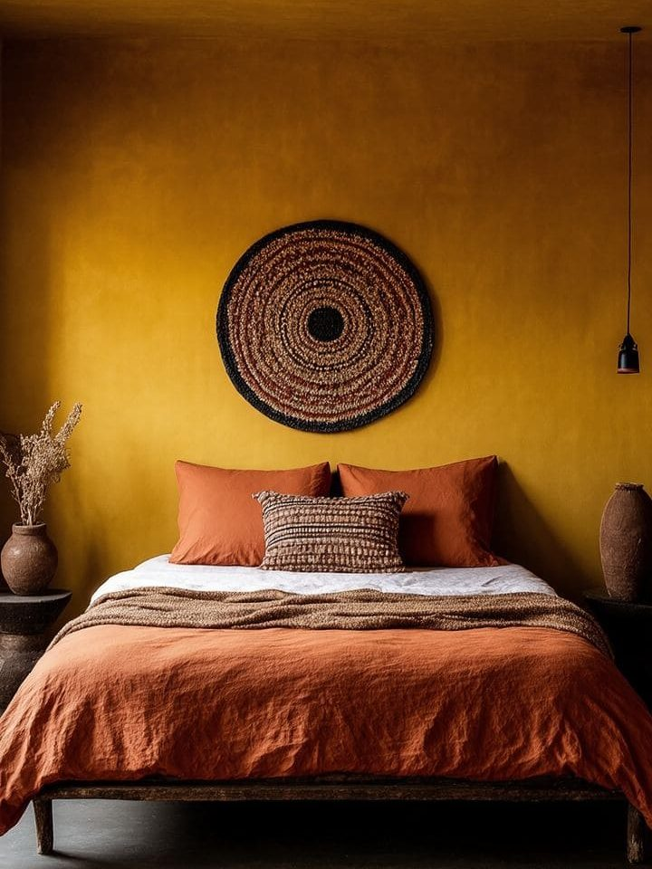

> TIP:GUIDE: Budget: one tin of mustard paint, under $40 | Time: one weekend to paint | Skill: beginner

## 4. A Dark Wall of Layered Textiles

Some bedrooms go bold with a whole wall of layered textiles. This one hangs kente cloths, mudcloth panels and woven hangings across a dark wall above a bed dressed in bright, clashing prints, with a patterned rug and a small painted cabinet beside it. It is the maximalist end of afrohemian — a bedroom that feels like a market stall in the best way.

Layer textiles by hanging the largest piece first and overlapping smaller ones at its edges, like shingles. Keep the bed's base color dark so the bright textiles sit on something quiet, and add one plain element — a solid throw or a plain lampshade — so the eye has somewhere to rest.

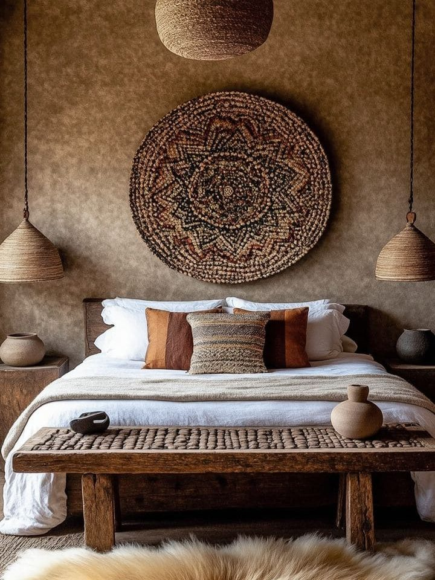

> TIP:QUICK: Hang the largest textile first and overlap smaller ones at its edges, like shingles on a roof.

## 5. An Orange Daybed on a Patterned Rug

Afrohemian style loves the outdoors, and this patio proves it. An orange daybed with patterned cushions sits on a big, colorful rug under a wooden pergola, with potted plants, a woven pouf and string lights overhead. It is a living room without walls, and the rug is what makes it feel like a room instead of a yard.

Choose an outdoor rug in the same warm palette as the house — rust, ochre, deep red — so the patio reads as an extension of the living room. Pick weatherproof cushions in two patterns that share one color, and store them in a deck box when rain is coming.

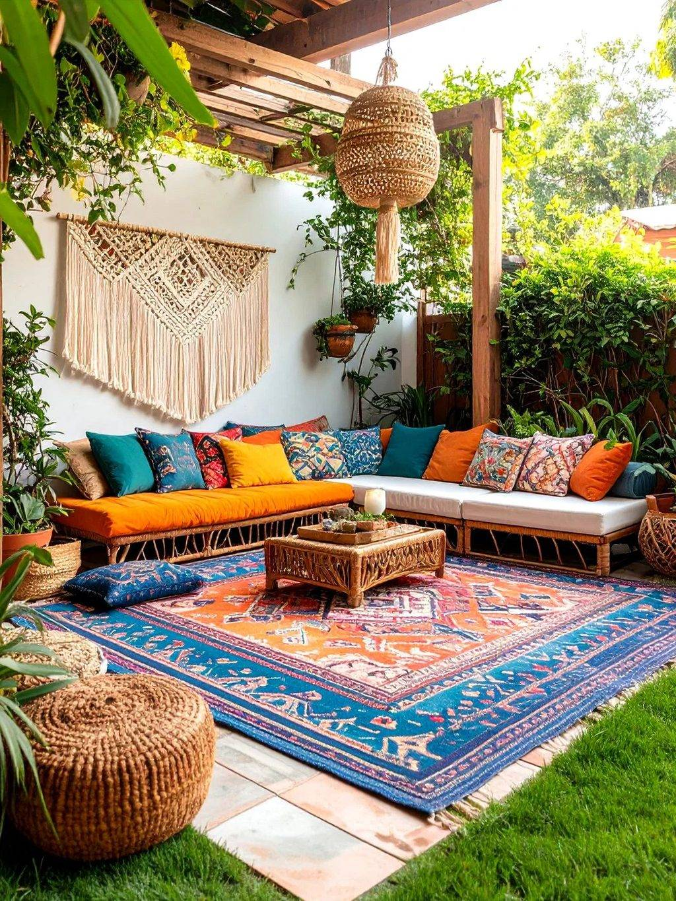

> TIP:CHECK: outdoor rug in the house palette; two cushion patterns sharing one color; a deck box nearby for rainy days

## 6. A Balcony Dressed with a Tapestry

A small balcony becomes an afrohemian retreat with one tapestry and a few cushions. This one hangs a colorful woven tapestry on the brick wall, sets a low bench with orange and pink cushions below it, and fills the corners with ferns and trailing plants. The tapestry blocks the blank wall and adds the pattern the balcony was missing.

Hang the tapestry from a simple rod or a pair of hooks so it can come down in bad weather, and choose a bench cushion in a solid bright color — orange or pink — to anchor the pattern. One potted plant per corner is enough; more turns a balcony into a jungle you cannot sit in.

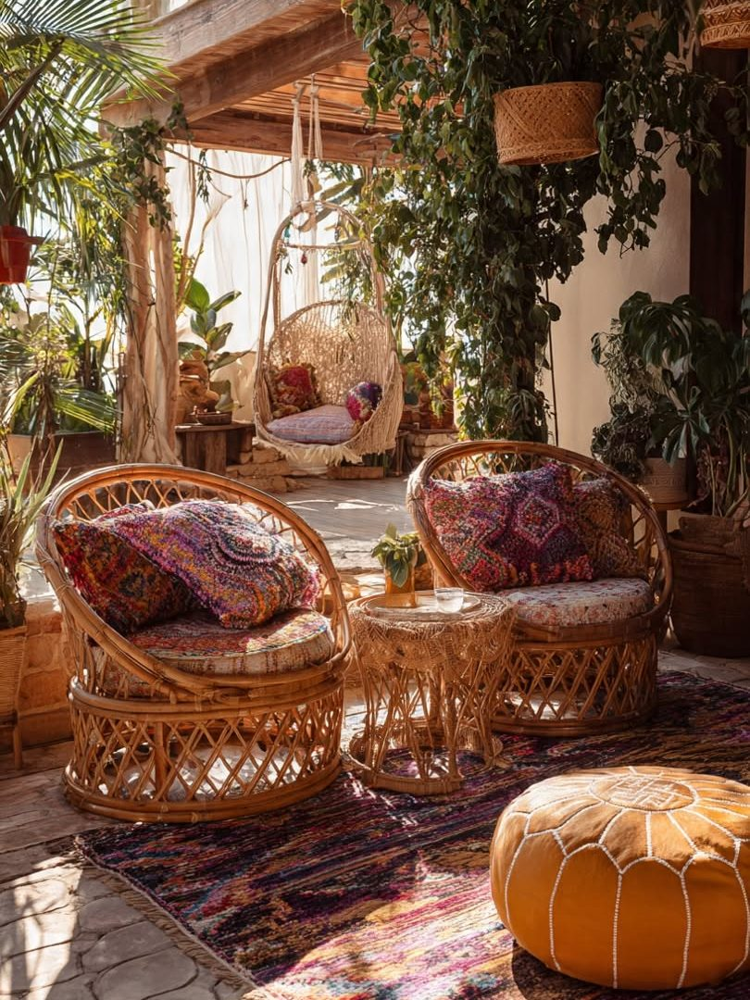

> TIP:GUIDE: Budget: from $25 for a woven tapestry and two cushions | Time: one hour to hang | Skill: beginner

## 7. Orange Cushions on a Balcony Bench

Orange is the color that makes a balcony feel like summer even in spring. This balcony lines a built-in bench with orange cushions and patterned throws, hangs a woven wall piece above it, and fills the railing with trailing plants and purple flowers. The orange against the green is the combination that makes the whole small space glow.

Repeat the orange in three places — cushions, a throw and one pot — so the color feels deliberate. Keep the bench itself neutral wood or white, because a bright bench plus bright cushions is too much color in a small space.

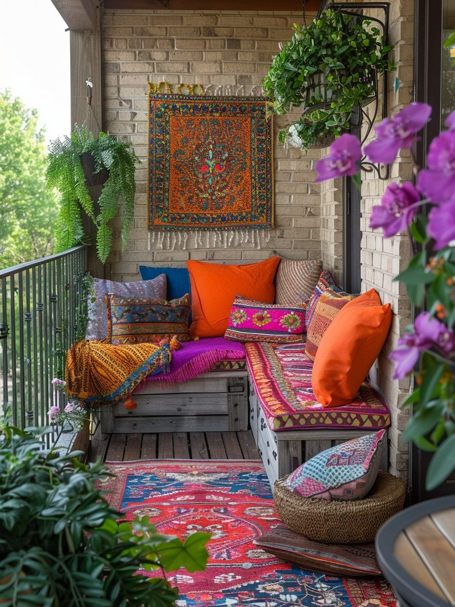

> TIP:QUICK: Repeat the orange in three places — cushions, a throw and one pot — and keep the bench itself neutral.

## 8. Wicker Chairs on a Patterned Deck Rug

A deck becomes an outdoor living room when you treat it like one. Two wicker chairs with patterned cushions face a low wooden table on a bold patterned rug, with hanging planters, a macramé wall hanging and potted plants softening the railings. The rug defines the seating area, and the chairs make it a place to linger.

Pick a rug made for outdoors — polypropylene or recycled plastic — so a rain shower does not ruin it. Arrange the chairs at a slight angle toward each other rather than in a straight line, and add one small side table per chair so every seat has somewhere for a drink.

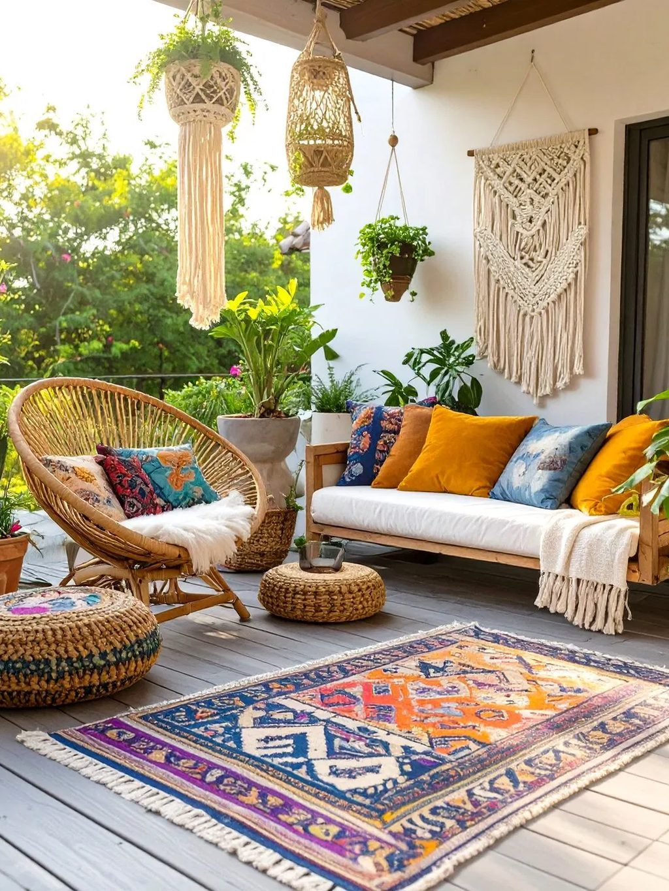

> TIP:CHECK: outdoor-rated rug; chairs angled toward each other; one small side table per chair

## 9. White Sofas on a Bold Patio Rug

White outdoor sofas and a bold patterned rug are the patio's version of the afrohemian living room. This covered patio sets two white sofas and a woven pouf around a low wooden table on a huge red-and-blue rug, with a pergola overhead and a lattice fence behind. The white keeps the space bright, and the rug does all the pattern work.

Keep outdoor sofa cushions white only if the patio is covered — sun and rain will stain them fast otherwise. Choose a rug with the same warm reds and blues as your indoor textiles, and the patio will feel like another room of the house.

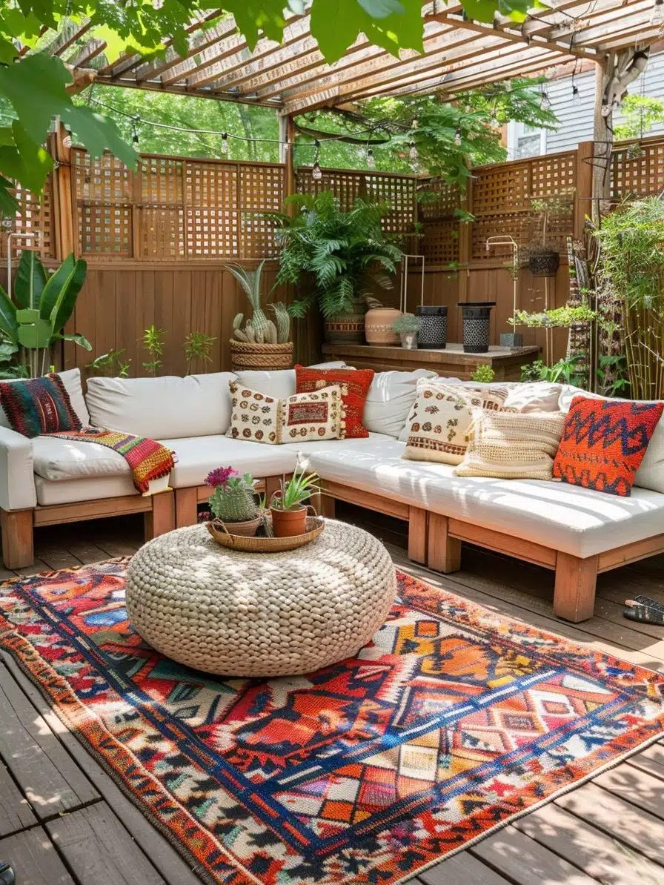

> TIP:GUIDE: Budget: from $80 for a large outdoor rug | Time: one afternoon to arrange | Skill: beginner

## 10. A Woven Wall Hanging Above the Bed

A single large woven wall hanging above the bed is the quietest afrohemian bedroom on this list, and one of the calmest. Cream walls, white bedding, a rust throw and a woven bench at the foot of the bed let the textured hanging do all the talking, with a fiddle-leaf fig in the corner and a round woven disc echoing it on the wall.

Hang the piece centered above the headboard with its bottom edge about six inches above the pillows. If the hanging is pale, add one rust or ochre element — a throw, a cushion — so the room does not wash out in daylight.

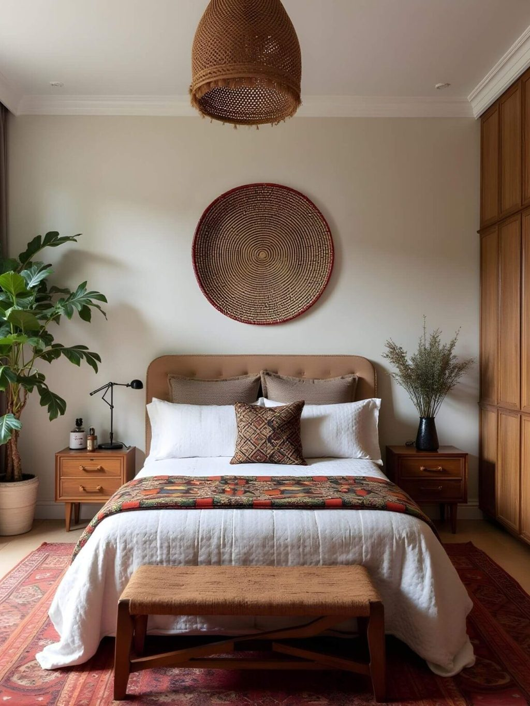

> TIP:QUICK: Hang the piece centered, six inches above the pillows, and add one rust element so a pale room does not wash out.

## 11. Silhouette Portrait Art in the Bedroom

A silhouette portrait is the most graphic piece of art in the afrohemian bedroom. This room hangs a large black-and-white silhouette above a bed dressed in mustard and rust, with a leather ottoman at the foot and warm pendant lights on either side. The portrait is bold, but because it is a single color, the room stays calm around it.

Keep the bedding to two colors that appear in the room already — here mustard and rust — and let the portrait be the only black in the space besides the lamp bases. One strong portrait beats a gallery wall in a bedroom, because a bedroom should help you switch off, not give you more to look at.

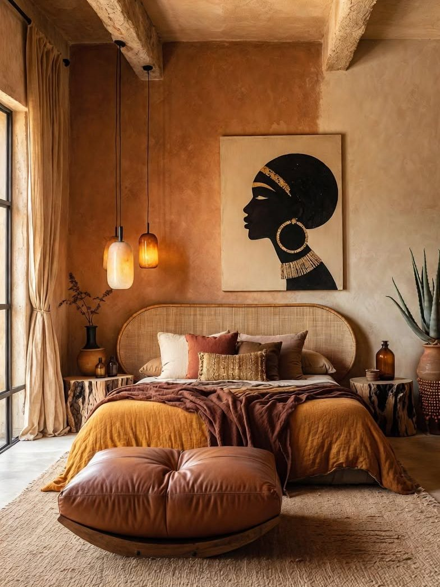

> TIP:CHECK: one strong portrait, not a gallery; bedding in two colors already in the room; black kept to the art and lamp bases

## 12. A Navy Sofa Under a Woven Tapestry

The living room gets its turn here, and the navy sofa is the anchor. A deep blue sofa with orange and yellow cushions sits under a large woven tapestry, with plants, a rustic coffee table and a patterned rug completing the room. The navy cools the warm tapestry down, which is what makes the combination work instead of overheating.

If you want the full living-room version of this style, our [30 Afrohemian Living Room Ideas for a Warm, Layered Space](/posts/afrohemian-decor-living-room/) goes room by room through sofas, basket walls and gallery walls. Here, the lesson is the pairing: one cool anchor color against one warm, patterned textile.

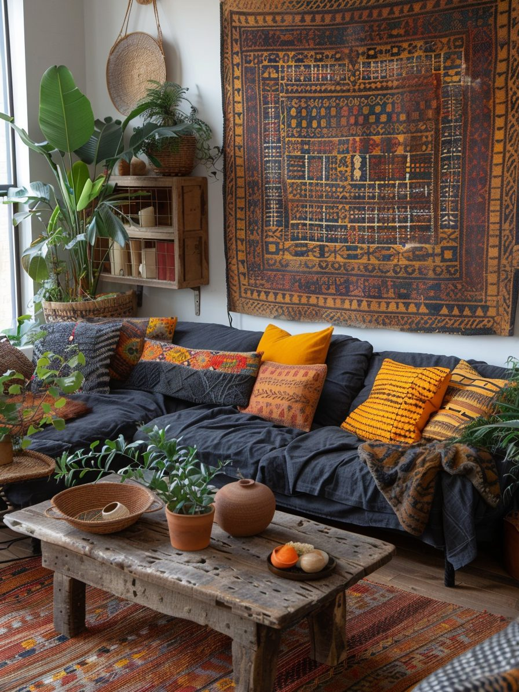

> TIP:GUIDE: Budget: from $100 for a large woven tapestry | Time: one hour to hang | Skill: beginner

## 13. A Rust Sectional Around a Tree-Trunk Table

A rust sectional and a tree-trunk coffee table make a living room that feels carved out of the earth itself. This room sets a deep rust sectional against a terracotta wall, centers a thick slab coffee table on a patterned rug, and hangs a huge woven pendant overhead. The furniture is heavy and low, so the room feels grounded and calm.

Keep the walls and the rug in the same warm family as the sofa — rust, clay, ochre — and add one green plant per corner to stop the warmth from feeling flat. A low, heavy coffee table suits a sectional because everyone can reach it without standing up.

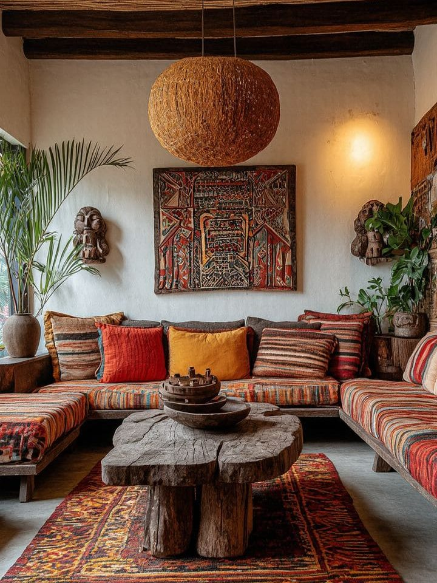

> TIP:QUICK: Match the rug to the sofa's warm family and add one green plant per corner to keep the warmth from going flat.

## 14. A Round Dining Table Under a Basket Wall

A round dining table is the friendliest shape for an afrohemian dining room, and a basket wall above the sideboard makes it feel styled. This room centers a round wooden table with woven chairs on a jute rug, with baskets, masks and framed art on the wall behind and a candlelit centerpiece on the table. The round table means nobody sits at the head, and every seat feels equal.

Choose woven chairs with light cushions so the dining set stays comfortable for long meals, and keep the centerpiece low — candles and a small vase — so people can see each other across the table. A round jute rug under a round table should be at least two feet wider than the table on every side.

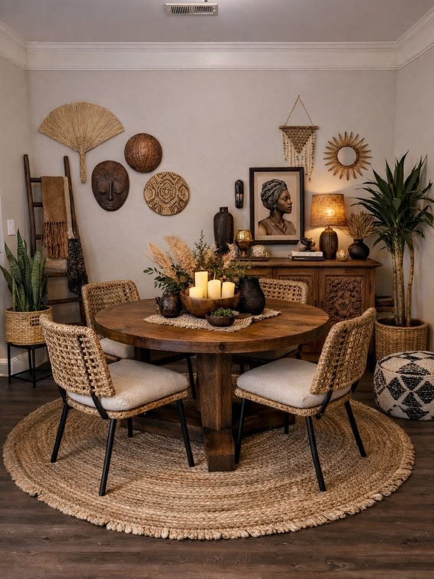

> TIP:CHECK: centerpiece kept low so diners can see each other; rug two feet wider than the table; woven chairs with light cushions

## 15. A Moody Dining Room with Macramé

A moody dining room is afrohemian after dark. This one hangs macramé and a woven pendant over a dark wooden table set for dinner, with tall curtains, plants in the corners and a patterned rug underfoot. The dark walls make the candlelight and the woven textures glow, and the room feels made for long, slow evenings.

Paint the dining room a deep, warm color — charcoal, deep brown or dark terracotta — and keep the table wood dark too, so the room reads as one moody whole. Add plants last: green is the one color that cuts through a dark room and keeps it from feeling like a cave.

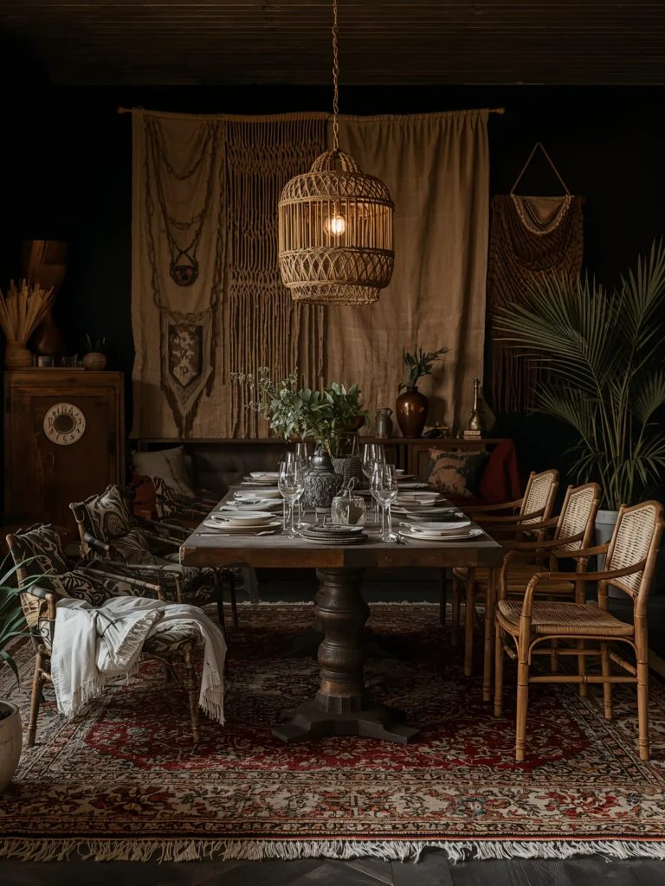

> TIP:GUIDE: Budget: one tin of dark paint, under $40 | Time: one weekend to paint | Skill: beginner

## 16. A Long Dining Table on a Colorful Rug

A long dining table on a colorful rug is the afrohemian dining room at its most generous. This bright room sets a long wooden table with mismatched wooden chairs on a huge red-and-blue patterned rug, with a rattan pendant overhead and plants in every corner. The rug is the tablecloth the room never needs to change.

Size the rug so every chair stays on it even when pulled out — that usually means a rug at least three feet longer and wider than the table. Mix chair styles but keep one thing the same, like the wood tone or the seat height, so the mix looks collected rather than accidental.

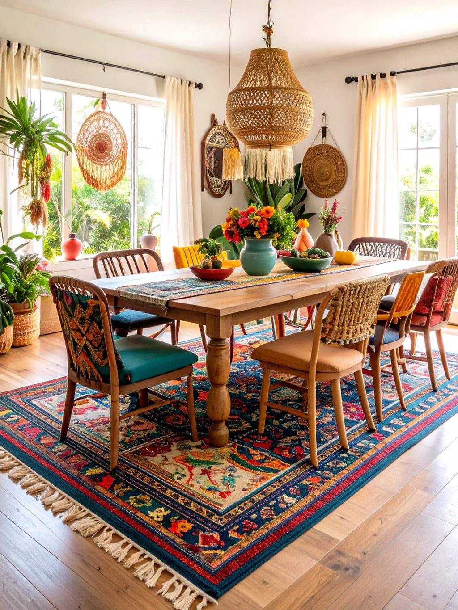

> TIP:QUICK: Size the rug so pulled-out chairs stay on it — three feet longer and wider than the table.

## 17. A Rustic Kitchen in Wood and Clay

An afrohemian kitchen starts with wood and clay. This rustic kitchen runs dark wood cabinets along the wall, fills open shelves with clay pots, woven baskets and wooden bowls, and hangs dried herbs and woven pendants from the beams. There is no tile backsplash to speak of — the texture comes from the materials themselves.

Keep the countertops clear except for one or two beautiful objects, like a clay pot or a wooden bowl, because a rustic kitchen clutters fast. Store everyday dishes behind closed doors and let the open shelves hold only the pieces worth looking at.

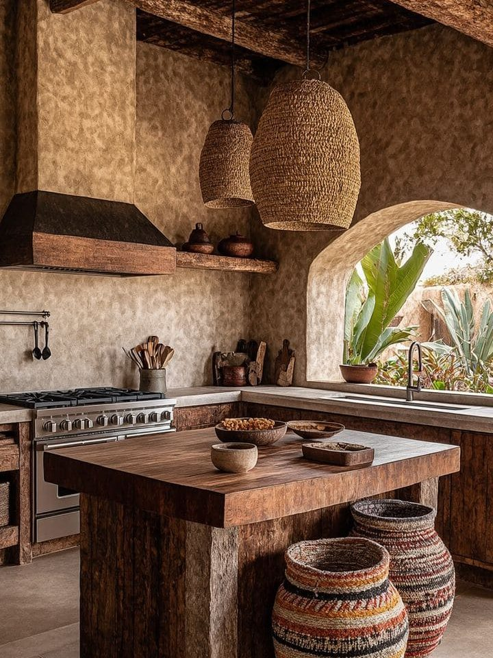

> TIP:CHECK: counters clear except one or two beautiful objects; open shelves for display pieces only; everyday dishes behind doors

## 18. Open Shelves of Pottery and Plates

Open shelves turn a kitchen's dishes into its decoration. This kitchen runs long wooden shelves along a stone wall, stacking pottery, painted plates, woven baskets and clay jars in warm earth tones, with a wooden counter below and a patterned rug underfoot. The shelves are the kitchen's art wall, and they cost nothing if you already own the dishes.

Group shelves by material — pottery together, baskets together, plates together — and leave one shelf half empty so the display can breathe. Put the pieces you use every day on the lowest shelf, where they are easy to reach, and the display pieces up high.

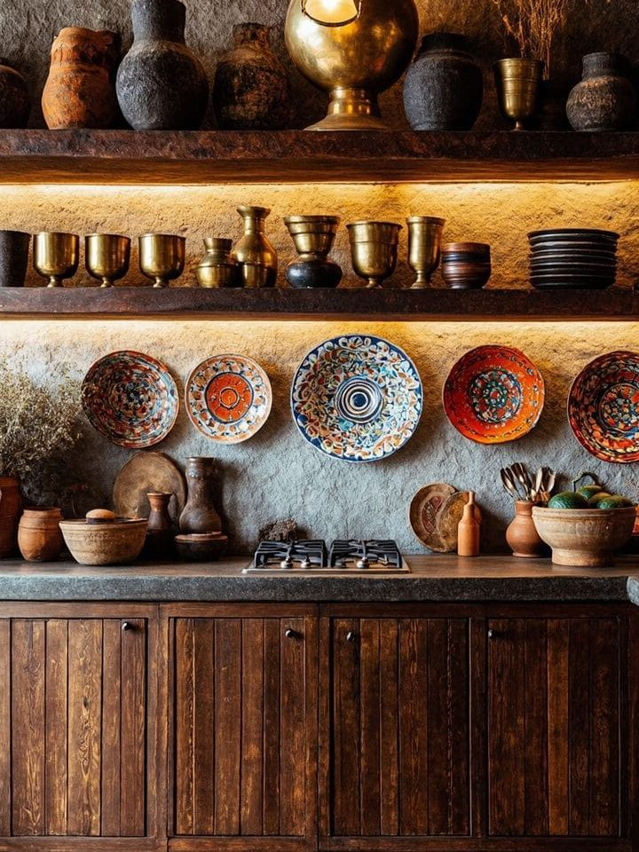

> TIP:GUIDE: Budget: free if you already own the dishes | Time: one afternoon to arrange | Skill: beginner

## 19. An Earthy Kitchen with a Wooden Island

A wooden island is the heart of an afrohemian kitchen. This earthy room centers a thick wooden island with woven baskets tucked underneath, hangs woven pendants above it, and runs clay pots and plants along the counters. The island is where food is prepped, coffee is drunk and guests lean — so it deserves to be the best-looking piece in the room.

Choose an island with open storage underneath for baskets, so the beautiful things stay visible and the ugly things stay in cupboards. Hang the pendants low — about 30 inches above the counter — so their light pools on the work surface instead of glaring into eyes.

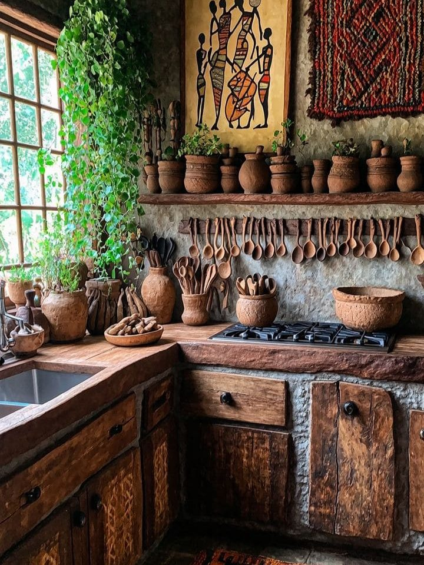

> TIP:QUICK: Hang island pendants about 30 inches above the counter so the light pools on the work surface.

## 20. A Mudcloth Tapestry Above the Bed

Black-and-white mudcloth is the most graphic textile in the afrohemian bedroom. This room hangs a large mudcloth tapestry above a wooden bed, dresses the bed in white with a mudcloth throw folded across the foot, and lays a black-and-white patterned rug below. The palette is just two colors, and the pattern does all the work.

Keep a black-and-white bedroom warm with wood — a wooden bed frame, a wooden nightstand, a woven basket — or the two-tone scheme can feel cold. One mudcloth piece per wall is enough; two large black-and-white patterns on the same wall start to vibrate.

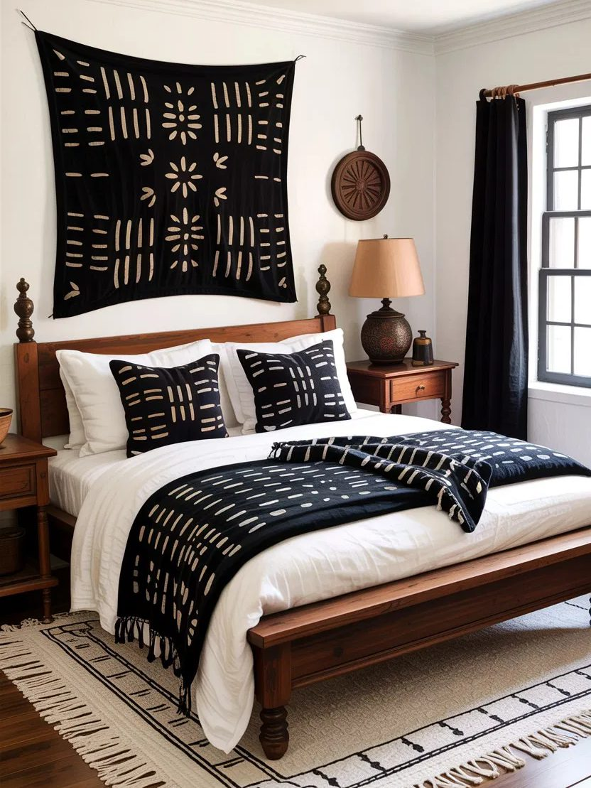

> TIP:CHECK: one mudcloth piece per wall; wood furniture to warm the two-tone palette; throw folded across the foot, not the pillows

## 21. A Black-and-White Mudcloth Quilt

A mudcloth quilt is the bedroom's coziest afrohemian layer. This close-up shows a bed dressed in a black-and-white quilt with bold geometric motifs, layered over a woven throw and rust cushions, with the pattern big enough to read from the doorway. A quilt this graphic turns the bed into the room's artwork, so the walls can stay plain.

Fold the quilt back at the top third of the bed so the pattern shows and the pillows sit on plain bedding. If the quilt is the only pattern in the room, add one small repeat — a cushion in the same print, or a runner at the foot — so it looks intentional rather than accidental.

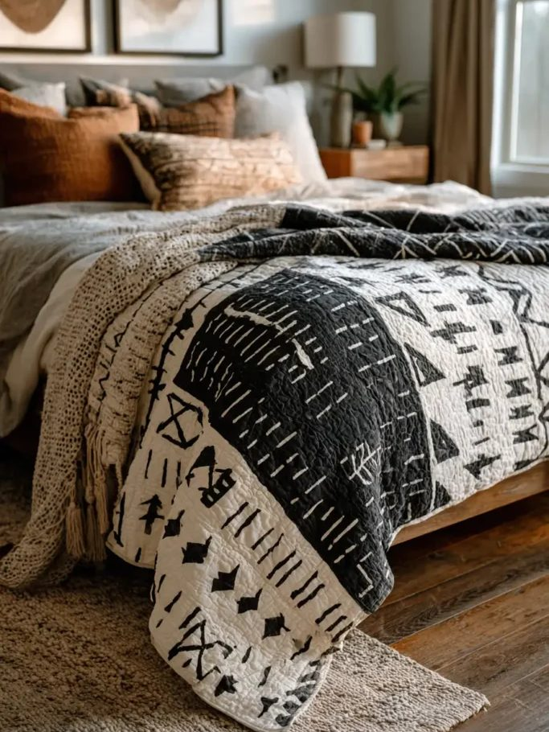

> TIP:GUIDE: Budget: from $60 for a mudcloth-style quilt | Time: ten minutes to make the bed | Skill: beginner

## 22. A Burnt Orange Bedroom Wall with Masks

A burnt orange wall with carved masks is the bedroom at its most dramatic. This room paints the wall behind the bed a deep orange, hangs two tall carved masks and a round metal wall disc above the headboard, and dresses the bed in rust and patterned cushions with a black-and-white chair nearby. The wall is the headboard, the art and the color all at once.

Hang masks in pairs or threes, never alone — one mask on a big wall looks lost, while a group reads as a collection. Keep the bedding to rust, cream and one pattern, because the orange wall already supplies all the color the room needs.

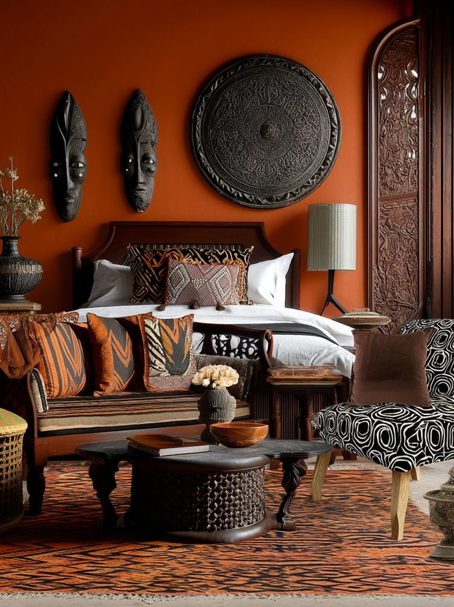

> TIP:QUICK: Hang masks in pairs or threes — one mask alone on a big wall looks lost.

## 23. A Tapestry Wall in the Guest Bedroom

A guest bedroom earns its welcome with a tapestry wall. This one hangs a large patterned tapestry above the bed, adds a rust throw and patterned cushions, and keeps a wooden trunk at the foot for spare blankets. Guests get a room that feels considered rather than spare, and the tapestry costs less than a painted accent wall.

Choose a tapestry in the same palette as the rest of the house so the guest room feels connected, not themed. Leave the trunk half empty so guests have somewhere to put their own things — a full trunk is decoration, an empty one is hospitality.

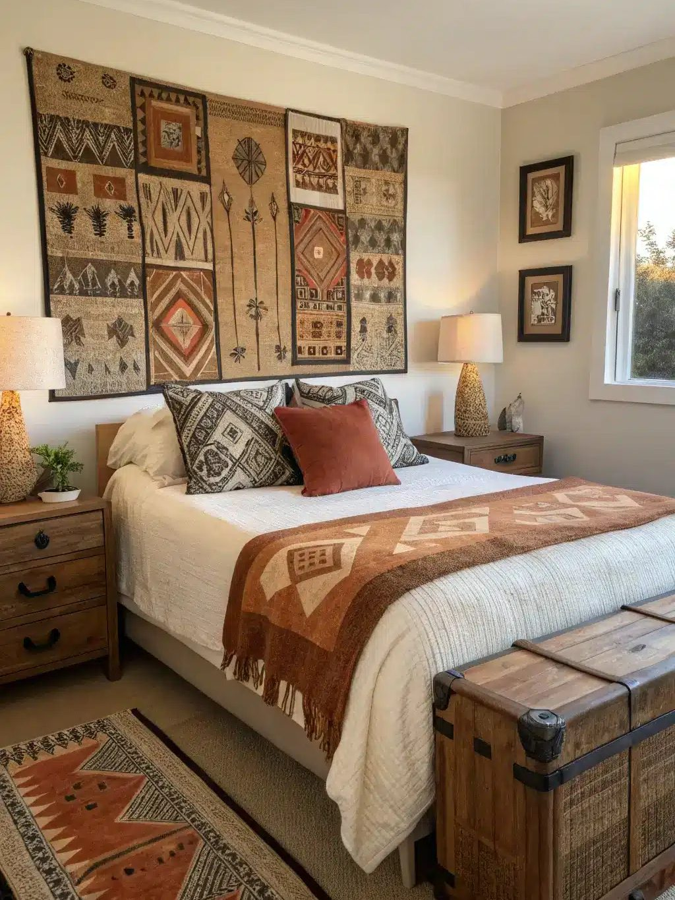

> TIP:CHECK: tapestry in the house palette; trunk at the foot left half empty; one spare blanket per guest

## 24. Masks and a Mudcloth Runner Above the Bed

Masks and a mudcloth runner make a white bedroom feel collected rather than plain. This room hangs five carved masks of different heights above a white bed, with a long mudcloth runner below them, patterned cushions on the bed and small carved figures on the nightstands. The white walls are the gallery, and the masks are the exhibition.

Hang the masks at slightly different heights with the tallest near the center, and keep the runner below them the same width as the bed so the two pieces read as one arrangement. If the masks are dark wood, repeat the dark tone once more in the room — a nightstand, a lamp base — so they do not float.

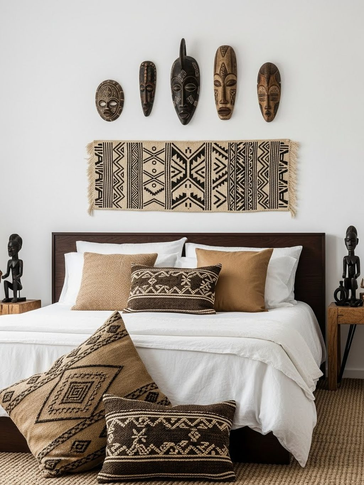

> TIP:GUIDE: Budget: from $20 per carved mask | Time: one hour to hang | Skill: beginner

## 25. A Terracotta Bathroom with a Vessel Sink

Terracotta turns a small bathroom into a warm retreat. This one paints the walls clay orange, sets a wooden vanity with a copper vessel sink under a colorful abstract painting, and lays a patterned rug on the floor with a woven basket beside the vanity. The room is tiny, but the color makes it feel like a destination.

In a small bathroom, paint every wall the same warm color — half-painted walls chop a small room in two. Choose a vessel sink in a warm metal, copper or brass, so the basin itself becomes part of the palette, and keep the towels white for contrast.

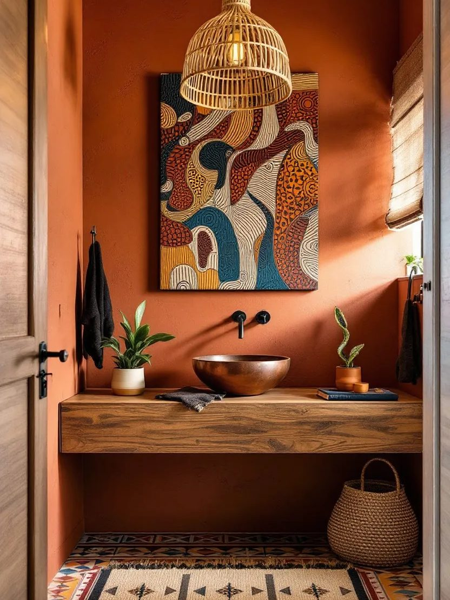

> TIP:QUICK: Paint every wall the same warm color in a small bathroom — half-painted walls chop the room in two.

## 26. A Terracotta Vanity with a Round Mirror

A round mirror is the softest shape in a terracotta bathroom. This one hangs a large round mirror above a wooden vanity with a white vessel sink, with woven pendant lights on either side, plants in the corners and a patterned rug underfoot. The circle breaks up all the straight lines of the vanity and the tiles.

Hang the mirror so its center sits at eye level — about 60 inches from the floor — and keep the pendants at the same height on both sides. A round mirror suits a rectangular vanity best, because the contrast of shapes is what makes the wall interesting.

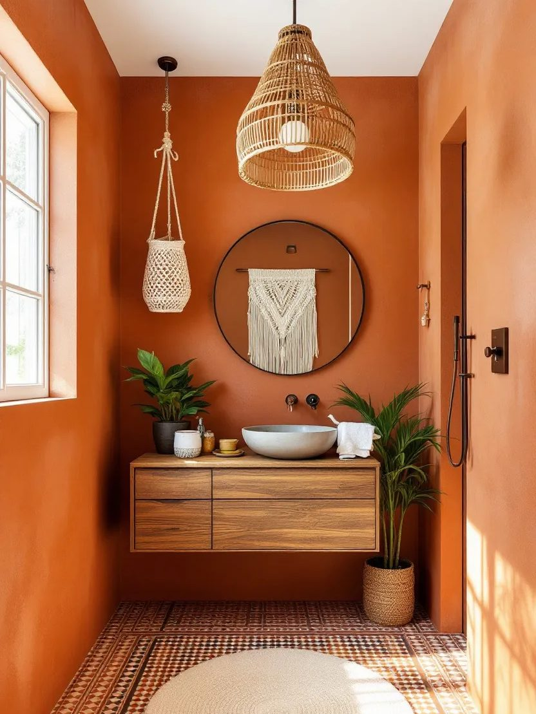

> TIP:CHECK: mirror center at eye level, about 60 inches up; pendants matched in height; one round mirror per vanity

## 27. A Terracotta Bathroom with Woven Baskets

Woven baskets are the afrohemian bathroom's storage solution. This terracotta bathroom sets a wooden vanity with woven basket drawers under a white vessel sink, hangs a round mirror above it, and fills the corners with plants and a woven laundry basket. Everything that needs hiding hides in a basket, and everything that shows is beautiful.

Choose baskets that fit the vanity openings exactly, and line them so damp towels do not stain the weave. Keep one basket for clean towels and one for laundry, and label them inside the rim if the household shares the bathroom.

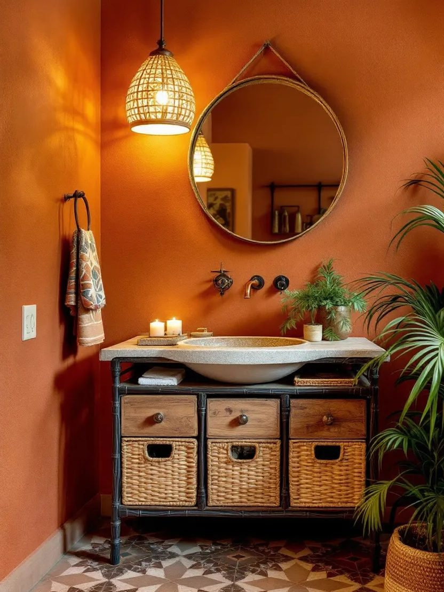

> TIP:GUIDE: Budget: from $30 for a set of woven baskets | Time: one hour to measure and fit | Skill: beginner

## 28. Brass Fixtures in a Warm Bathroom

Brass fixtures are the jewelry of an afrohemian bathroom. This one pairs a wooden vanity with a terracotta vessel sink, brass taps and a brass pendant light, against textured walls with a round mirror and a patterned floor. The brass warms the whole room up, and it ages beautifully — a little patina only makes it look more collected.

Match your brass pieces — taps, light, mirror frame — in the same finish, brushed or polished, so they read as a set. Keep the walls warm and the towels white, and the brass will glow against both.

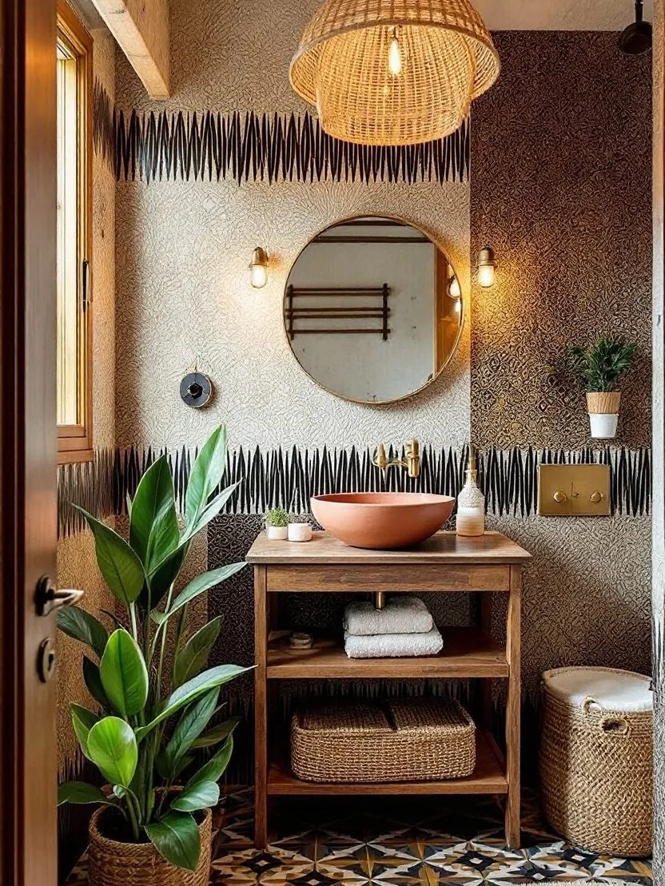

> TIP:QUICK: Match all brass pieces in one finish — brushed or polished — so taps, light and mirror read as a set.

## 29. A Patterned Runner in the Entryway

An entryway sets the tone for the whole house, and a patterned runner does it in one move. This bright entryway lays a bold geometric runner down the hall, sets a wooden console with a round mirror and patterned cushions on a bench, and fills the corners with tall plants. The runner pulls the eye straight into the house, and the pattern says what kind of home this is.

Choose a runner that leaves at least four inches of floor showing on each side, so the pattern reads as a rug rather than wall-to-wall carpet. Pick the runner first, then pull one of its colors for the bench cushions, and the entryway will feel designed rather than decorated.

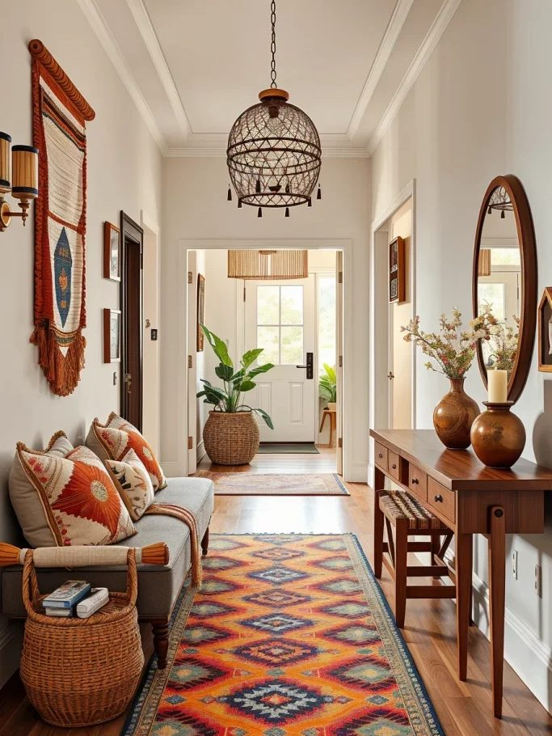

> TIP:CHECK: runner four inches narrower than the hall on each side; one runner color repeated in the bench cushions; mirror at eye level

## 30. Plants and a Console in the Entryway

Plants make an entryway feel alive the moment you walk in. This one sets a wooden console with a round mirror between two tall potted plants, lays a black-and-white mudcloth runner down the hall, and adds a patterned bench cushion for a place to sit and take shoes off. The plants frame the mirror, the mirror doubles the light, and the runner ties it all together.

Put the tallest plant in the corner where it cannot be knocked over, and choose a pot in terracotta or woven seagrass so the plant itself becomes part of the palette. A bench by the door is the most useful piece of entryway furniture there is — it is where shoes come off and bags get set down.

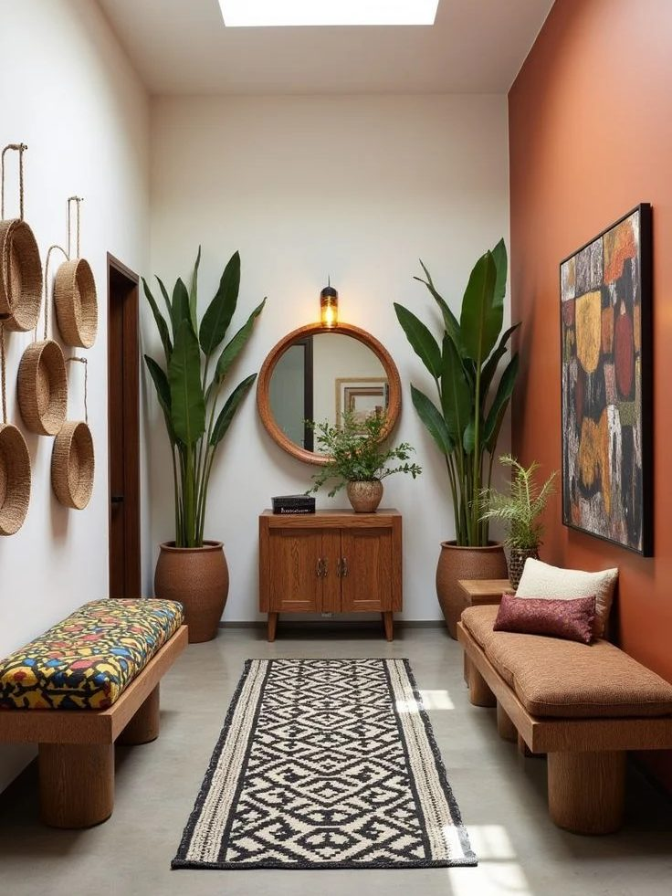

> TIP:GUIDE: Budget: from $40 for two tall plants in woven pots | Time: one hour to arrange | Skill: beginner

## Takeaway

- Afrohemian decor works across the whole home because it is a palette and a set of materials, not a shopping list: terracotta and rust, mudcloth and kente, woven baskets, carved wood and plants.
- Start with the room you use most — the bedroom is the easiest, because bedding and one wall hanging do most of the work — then repeat the same three colors in the next room.
- For the living room in full detail, see our [30 Afrohemian Living Room Ideas for a Warm, Layered Space](/posts/afrohemian-decor-living-room/), and stop collecting when the house feels warm and full, not when it feels finished.

## Frequently Asked Questions

### What is afrohemian decor?

Afrohemian decor blends African-inspired design with relaxed bohemian style: warm earth tones like terracotta and rust, mudcloth and kente textiles, woven baskets, carved wood, rattan furniture and lots of plants. It is layered and collected rather than matched, so every room can look personal while sharing the same palette.

### What colors define afrohemian decor?

Warm earth tones lead — terracotta, rust, mustard, ochre and clay — balanced with cream, jute and light wood. Black-and-white mudcloth patterns add contrast, and deep green or navy can anchor a sofa or a wall. Keep to three main colors plus black and cream, and the style stays warm without getting chaotic.

### How do I start afrohemian decor on a budget?

Start with textiles: mudcloth pillow covers, a woven basket wall and one tapestry can transform a room for under $150. Paint one wall terracotta for under $40, add plants gradually, and collect masks and carvings one at a time from markets instead of buying a matching set.

### Can afrohemian decor work in a small home?

Yes, it suits small homes well because it is built from textiles and wall decor rather than big furniture. A basket wall, mudcloth bedding and one rattan chair add the whole style without taking floor space, and a round mirror and light walls keep small rooms feeling open.

### How do I mix African patterns without clashing?

Pick one shared color across all your patterns — rust, black or ochre — and vary the scale: one large print, one medium and one small. Repeat each pattern at least twice in the room, keep the biggest surfaces mostly plain, and leave one surface bare so the eye can rest.

### What is the difference between afrohemian and boho decor?

Boho is a general relaxed, layered style with global influences, while afrohemian is specifically rooted in African design — mudcloth, kente, carved masks, woven baskets and earth tones from the continent. Afrohemian keeps boho's relaxed layering but gives it a clear cultural anchor and a warmer, earthier palette.

### Which rooms suit afrohemian decor best?

Every room suits it, because it is a palette rather than a room style. Bedrooms take to mudcloth bedding and basket walls, bathrooms glow in terracotta, kitchens suit open shelves of pottery, and patios love patterned rugs and woven chairs. Start in the bedroom, where bedding does most of the work.

### Where can I buy afrohemian decor pieces?

Look for mudcloth and kente textiles, woven baskets and carved masks at artisan markets, fair-trade shops and independent makers, where pieces are handmade and each one is slightly different. Thrift shops are good for rattan furniture and brass, and many online sellers offer mudcloth pillow covers and tapestries in the classic patterns.
