# 30 Bathroom Decor Ideas for 2027

Bathroom decor ideas 2027 are all about warmth, texture and calm. The cold, all-white bathroom is giving way to handmade-look tiles, warm wood, soft curves and spa touches that make the smallest room in the house feel like a retreat. These 30 ideas cover the big moves — tiles, tubs and vanities — and the small ones that change how the room feels every morning.

You do not need a full renovation to try most of them. A new mirror, a coat of sage paint on the vanity, a bath tray or a bold wallpaper in the powder room can carry the whole 2027 look on their own. Start with the idea that fixes your biggest frustration, then layer in one or two more.

## 1. Emerald Zellige Tile Shower Wall

Glossy emerald zellige tiles are the statement wall of 2027 bathrooms. Their uneven glaze catches the light differently on every tile, so a whole shower wall shimmers instead of sitting flat, and the deep green turns an ordinary shower into the focal point of the room. Paired with brass fixtures and a warm terracotta floor, the look feels rich without feeling dark.

Keep the rest of the room quiet so the tile can lead. Pale walls, a simple vanity and one warm wood accent are enough — the green does the decorating. Handmade-look tiles vary from piece to piece, so order a little extra and mix tiles from several boxes as you lay them.

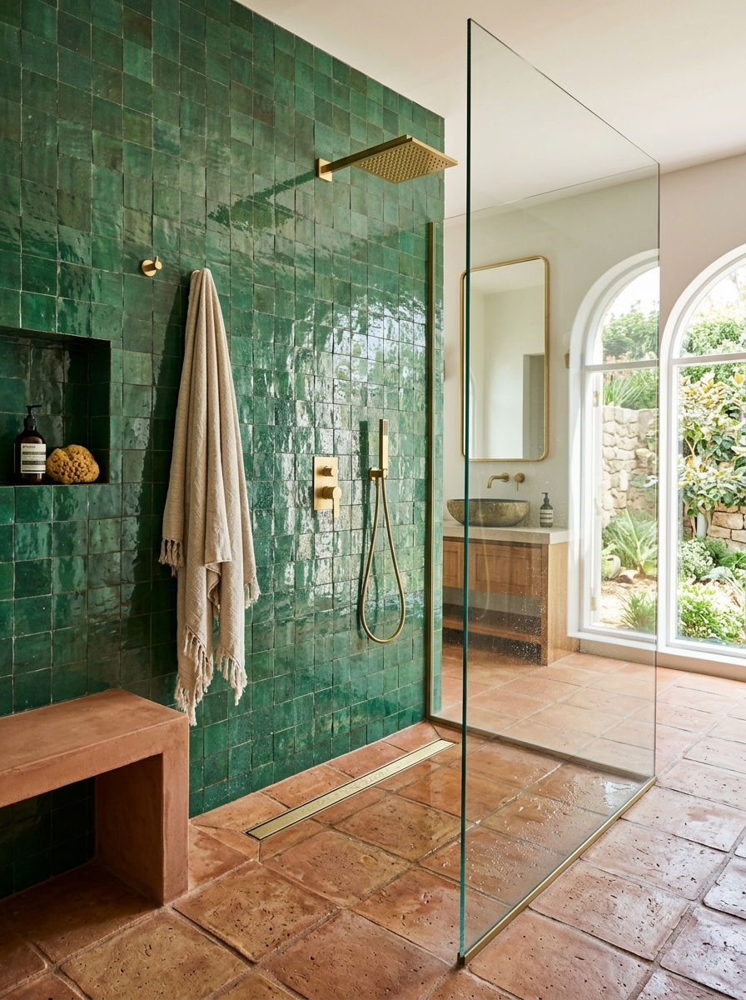

> TIP:QUICK: Mix tiles from several boxes as you lay them — handmade-look tiles vary, and mixing keeps the colour even.

## 2. Fluted Wood Vanity

A fluted wood vanity brings texture to a room that is usually all smooth surfaces. The vertical grooves on the drawer fronts catch shadows and light, and the warm timber softens stone floors and pale plaster walls. It is one of the easiest ways to make a new bathroom feel crafted rather than fitted.

Choose a mid-tone wood rather than a very pale or very dark one so the fluting stays visible. A white stone top and a single black faucet keep the vanity feeling modern, while a small vase of eucalyptus on the counter adds the only decoration it needs.

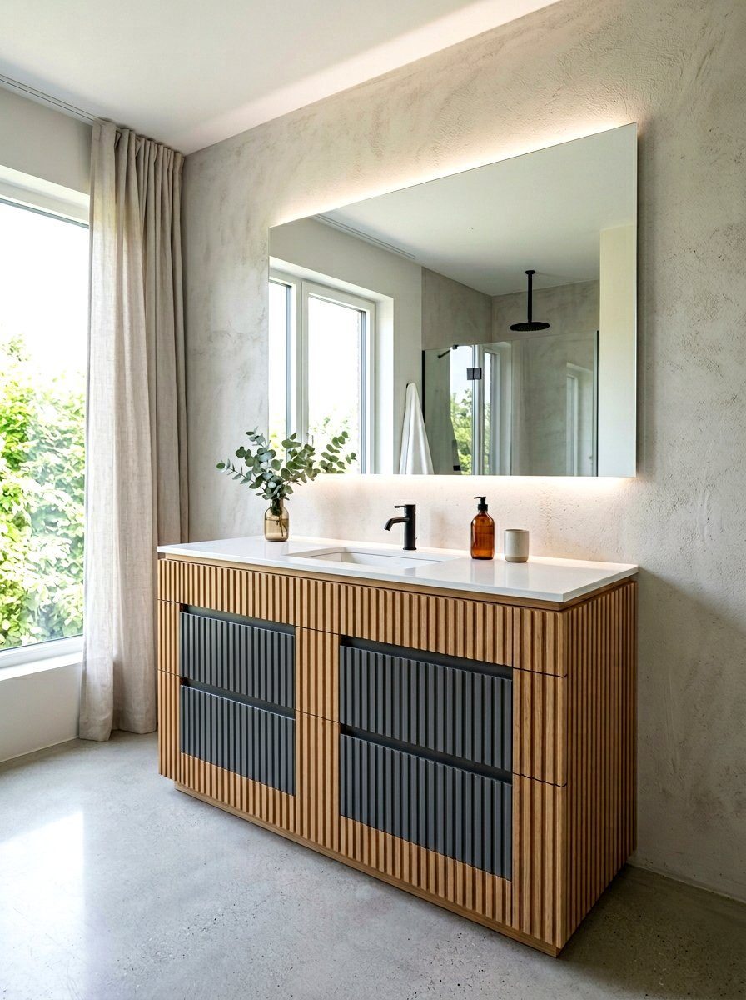

> TIP:CHECK: mid-tone wood so the fluting stays visible; white stone top; one black faucet to keep it modern

## 3. Arched Backlit Mirror

The arch is the defining shape of 2027 bathrooms, and a backlit arched mirror is the simplest place to use it. The curved top softens all the straight lines of tiles and cabinets, and the halo of light behind the glass gives a gentle glow for morning routines without harsh overhead lighting.

Hang the mirror so its centre sits at eye level and leave a few inches of wall showing around the arch so the shape reads clearly. A floating vanity underneath keeps the floor visible and makes the whole wall feel lighter and taller.

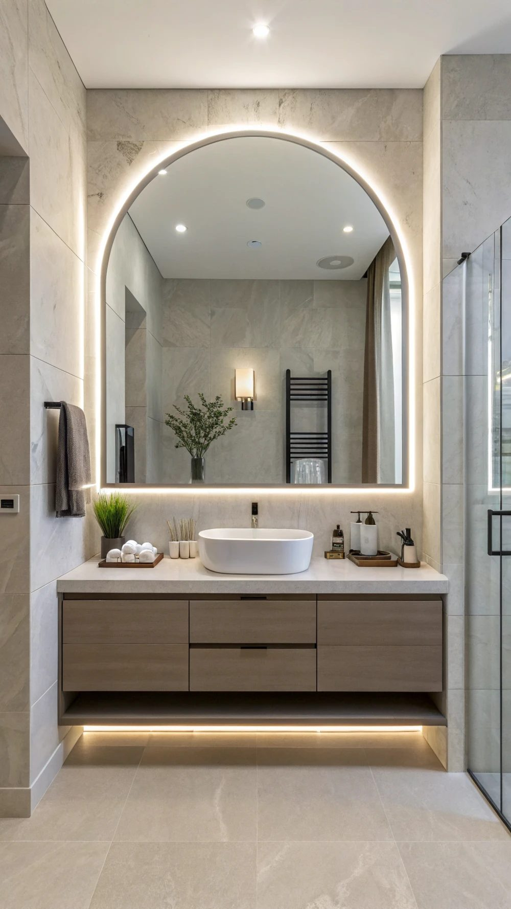

> TIP:GUIDE: Centre: at eye level | Clearance: a few inches of wall around the arch | Pairing: floating vanity underneath

## 4. Freestanding Stone Bathtub

A freestanding stone tub is the centrepiece of a spa-style bathroom. Its solid, sculpted shape and matte mineral surface feel calm and substantial, and it turns bath time into the main event rather than an afterthought. Set against a stone tile wall with a tall window nearby, it needs almost no other decoration.

Because a stone tub is heavy, check the floor can carry it before you fall in love with one, and leave enough space around it to walk and clean. A folded waffle towel over the rim and a small wooden stool beside it are all the styling it needs.

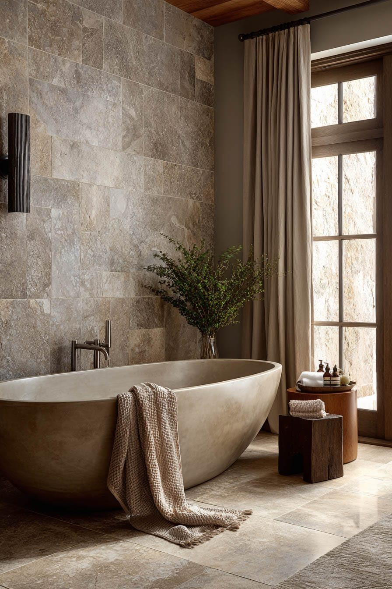

> TIP:QUICK: Check the floor can carry a stone tub before ordering — and leave room to walk and clean around it.

## 5. Terracotta Tile Shower

Terracotta tiles bring sun-baked warmth into the shower, and in 2027 they are moving from floors onto the walls too. Small square tiles in burnt orange and rust tones make the shower feel like a Mediterranean courtyard, especially with black fixtures and a light wood vanity beside them.

Carry the same tile onto the shower floor in a smaller size for grip, and keep the grout a warm mid-tone so it blends rather than drawing a grid over the colour. A round mirror and one potted plant stop the warm tones from feeling heavy.

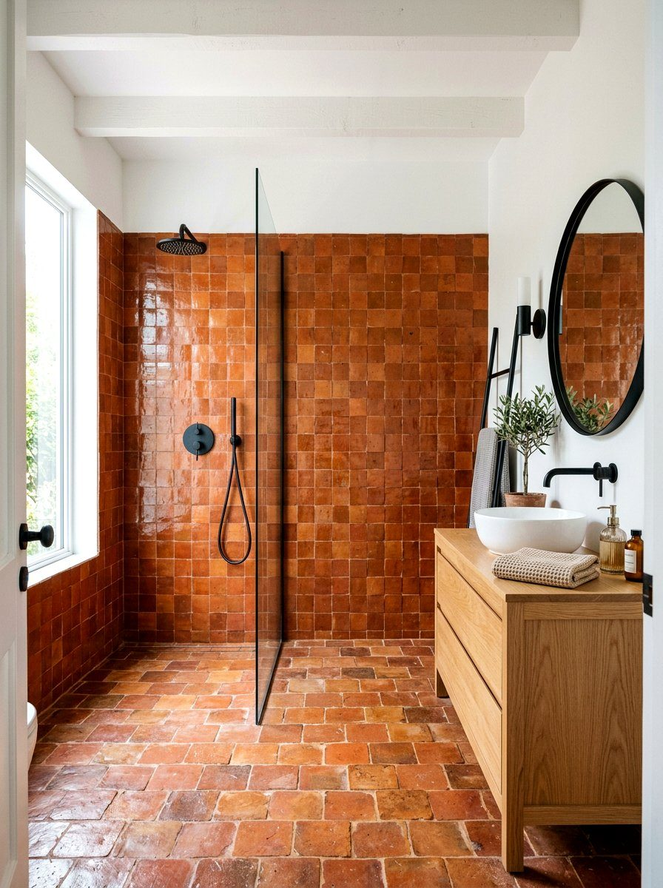

> TIP:CHECK: same tile on the floor in a smaller size for grip; warm mid-tone grout; one plant to lighten the warmth

## 6. Marble Vanity with Brass Fixtures

Marble and brass is the classic luxury pairing, and for 2027 it comes with softer edges: veined white marble, warm gold taps and a large framed mirror instead of cold chrome and sharp corners. The combination suits traditional homes and makes a small bathroom feel grand.

Let the marble be the star and keep the cabinetry pale with slim brass trim rather than competing patterns. Fresh flowers or a leafy branch in a tall vase add life to the stone, and a folded white hand towel on a brass ring finishes the look.

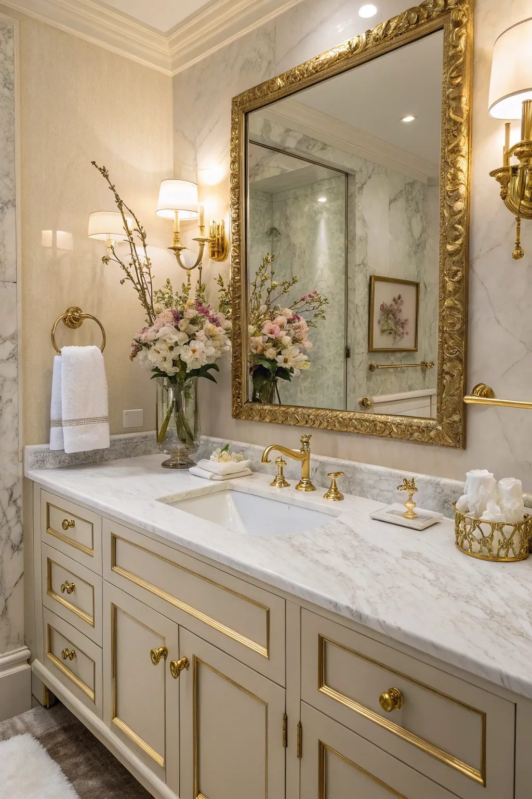

> TIP:GUIDE: Star: the veined marble | Cabinetry: pale with slim brass trim | Finish: fresh flowers and a folded white towel

## 7. Frameless Wet Room Shower

A frameless wet room does away with the shower tray and the step, so the whole bathroom floor becomes one continuous surface. Glass panels keep the water in while the eye travels straight across the room, which makes even a modest bathroom feel twice as large. A wall-hung bench and a linear drain complete the clean, hotel-like look.

Good drainage is everything here: the floor must slope gently toward the drain and the whole area needs proper waterproofing underneath. A built-in lit niche keeps bottles off the floor and adds a warm glow to the stone tiles.

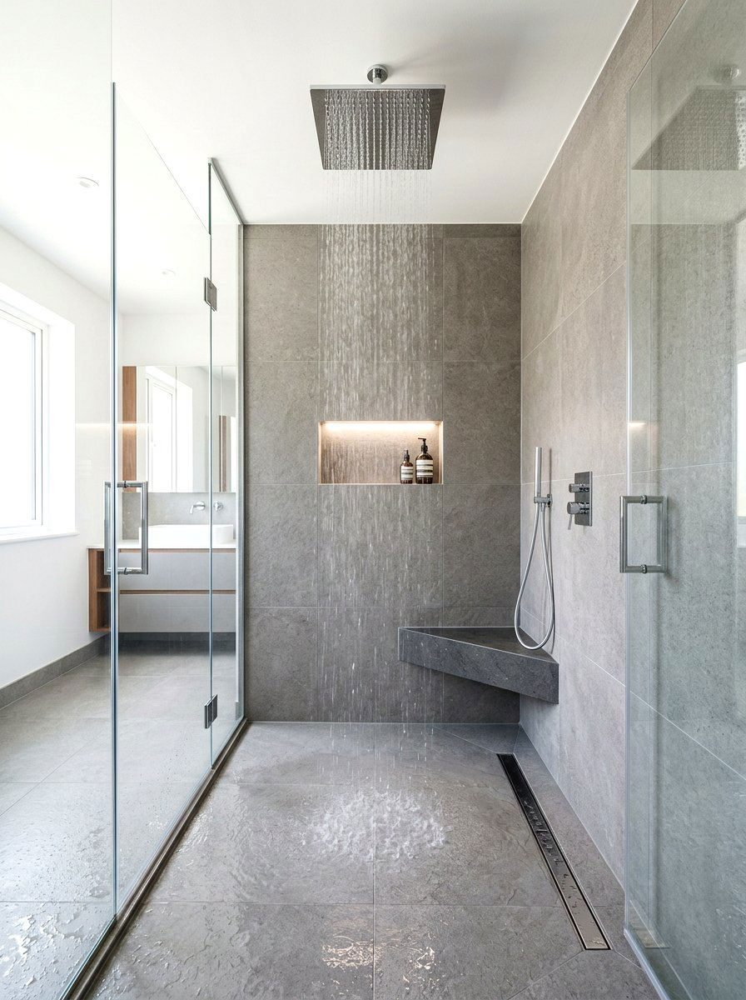

> TIP:QUICK: The floor must slope gently to a linear drain — get the waterproofing and falls right before any tiling.

## 8. Curved Wood Vanity

Straight lines are softening in 2027, and a curved wood vanity is the gentlest way to join in. Its bowed front and rounded basin break up a room full of rectangles, and the pale timber keeps it feeling light. Wall-hung and floating, it also frees up floor space in a tight bathroom.

A curved vanity suits a single round mirror above it, which echoes the shape. Keep the countertop clear apart from a small tray with soap and a hand cream — clutter hides the curve, which is the whole point of choosing it.

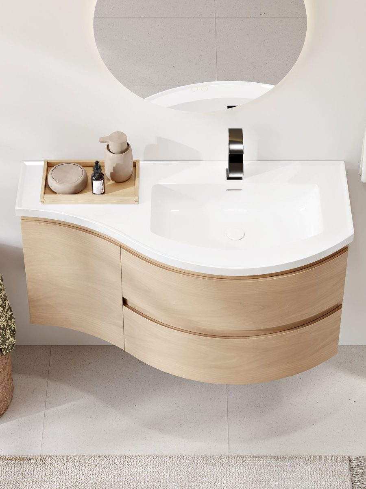

> TIP:CHECK: round mirror above to echo the curve; wall-hung to free floor space; keep the top nearly clear

## 9. Spa Plants Around the Tub

Plants are the cheapest spa upgrade there is. A cluster of leafy greens around the tub softens hard tiles, cleans up the air of the room visually, and turns an ordinary soak into something that feels like a garden bathhouse. Ferns, palms and trailing pothos all love the humidity a bathroom provides.

Choose plants that tolerate low light and damp air, and give them a home that drains — a pot inside a basket, or a small wooden stool that keeps them off wet surfaces. A few candles on the tub edge at night complete the spa mood.

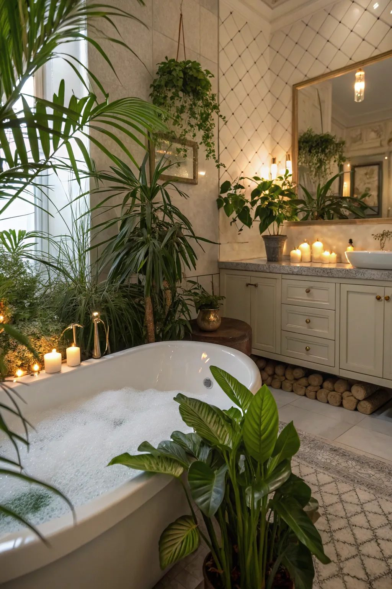

> TIP:GUIDE: Plants: ferns, palms and pothos love humidity | Drainage: pot inside a basket or on a stool | Mood: candles on the tub edge

## 10. Backlit LED Mirror

A backlit LED mirror replaces harsh ceiling light with a soft halo around your reflection, which is kinder at 6 a.m. and far more flattering for getting ready. In 2027 the look is a slim rectangular mirror with warm light, set into a stone or plaster wall with a floating vanity below.

Look for a mirror with adjustable warmth so you can switch from bright daylight tones in the morning to a warm glow in the evening. Keep the wall around it plain — the light itself is the decoration, and busy tiles would fight it.

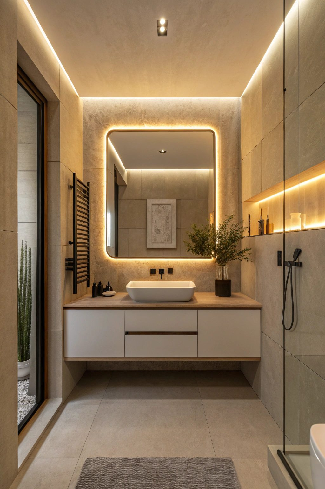

> TIP:QUICK: Pick a mirror with adjustable warmth — bright in the morning, warm and low in the evening.

## 11. Terrazzo Floor

Terrazzo is back, and the 2027 version is softer and more colourful than the grey slabs of the past. A speckled floor in cream with flecks of rust, sage and slate grounds the whole bathroom and hides water spots and dust far better than a plain tile. It pairs beautifully with a wood vanity and a round mirror.

Because the floor is busy, keep the walls calm — plain plaster or large pale tiles. A terrazzo floor also works well with underfloor heating, which makes the speckled surface warm underfoot on cold mornings.

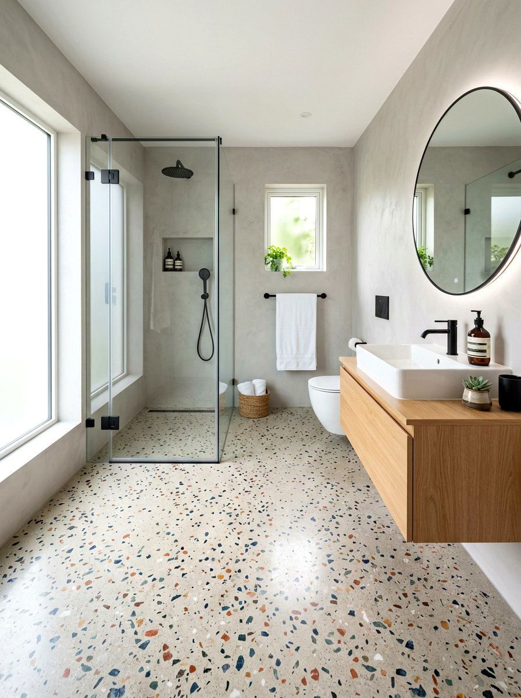

> TIP:CHECK: busy floor, calm walls; wood vanity to warm it up; pairs well with underfloor heating

## 12. Dark Moody Bathroom

Dark bathrooms are having a moment in 2027, and the trick is texture, not just colour. Black textured tiles, a charcoal ceiling and candlelight make a small bathroom feel like a cocoon, while a white freestanding tub in the middle keeps it from feeling closed in. The contrast is the whole design.

Balance the dark walls with warm light — wall sconces or candles rather than a single cold ceiling bulb — and one pale element, like the tub or a light rug. Dark grout and dark fixtures keep the look seamless instead of spotty.

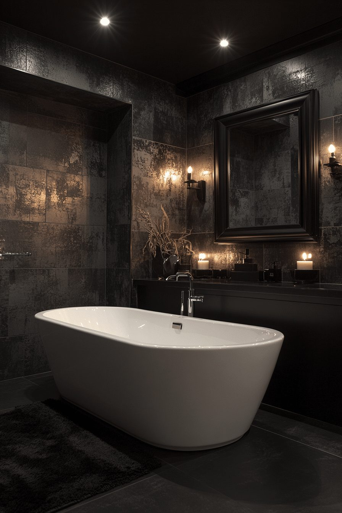

> TIP:GUIDE: Walls: black textured tile | Light: warm sconces or candles, never one cold bulb | Contrast: one pale piece, like the tub

## 13. Japandi Bathroom in Wood and Stone

Japandi style — Japanese calm meets Scandinavian warmth — is made for bathrooms. Pale wood panelling, rough stone walls, a low freestanding tub and almost no clutter create a room that feels like a quiet retreat. Every object earns its place, and nothing shouts.

Keep the palette to three materials: light wood, grey stone and white ceramic. A woven basket for rolled towels, a small wooden stool and one olive branch in a vase are enough decoration. The discipline is the design, so resist adding more.

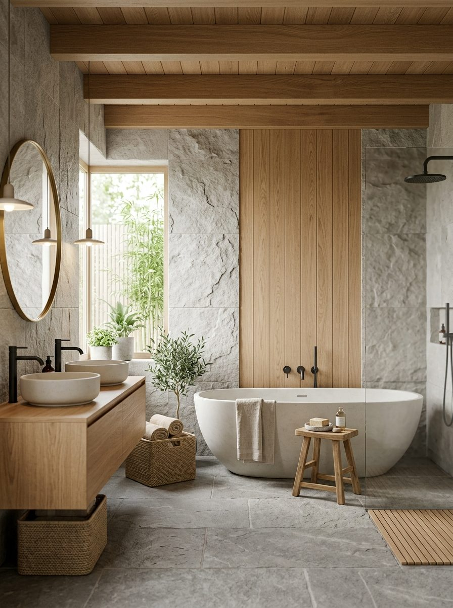

> TIP:QUICK: Three materials only — light wood, grey stone, white ceramic — and let the empty space do the work.

## 14. Floating Double Vanity

A floating double vanity is the practical star of a shared bathroom in 2027. Two sinks, two mirrors and a long wood-fronted cabinet give each person their own zone, while the gap underneath keeps the floor visible and the room feeling open. Twin backlit mirrors make the wall glow.

Give each side its own small tray for daily items so the shared counter stays clear, and choose wall-mounted taps to free up counter space. A plant on one end and a folded towel on each side keep it looking styled rather than crowded.

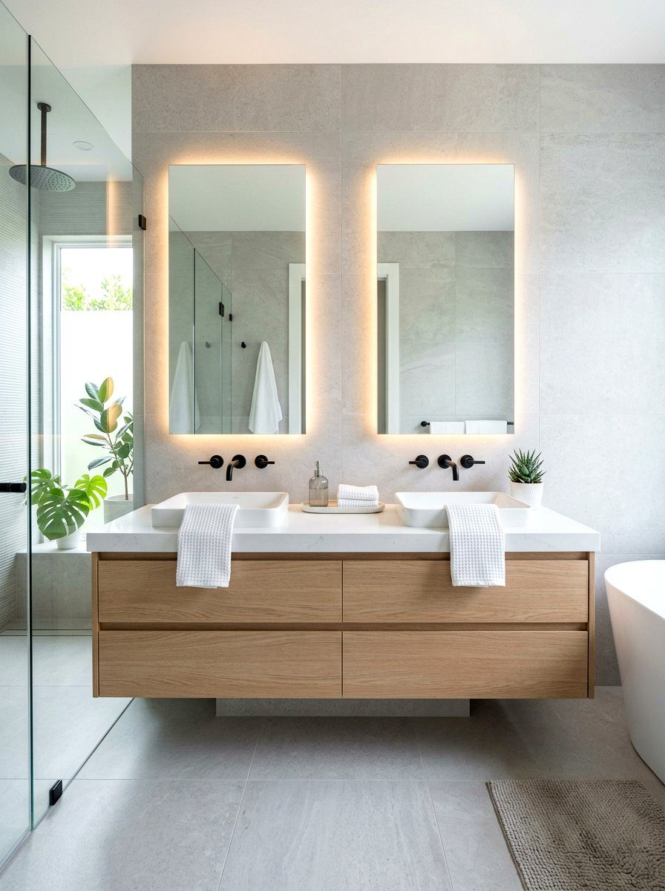

> TIP:CHECK: one tray per side for daily items; wall-mounted taps free the counter; a plant on one end only

## 15. Woven Pendant Light

A woven pendant light over the vanity is the jewellery of a 2027 bathroom. Its basket-weave shade throws patterned shadows on the ceiling and adds a natural, handmade texture that balances all the tile and stone. It works best hung low over a wood vanity, where its warm glow flatters both the room and the mirror.

Hang it high enough to clear the mirror and low enough to feel intentional — roughly above head height when standing at the sink. One statement pendant beats a row of small ones, and a dimmer lets you soften it for evening baths.

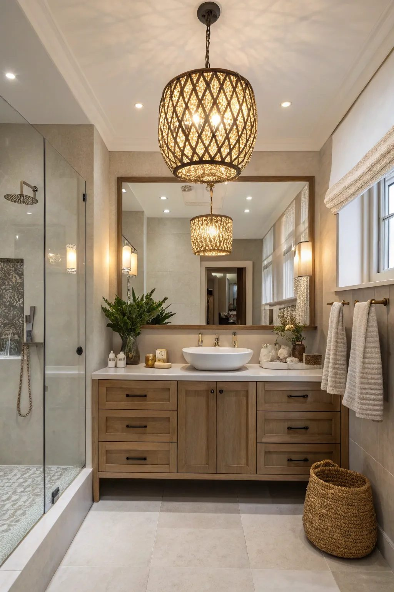

> TIP:GUIDE: Height: above head height at the sink | Count: one statement pendant, not a row | Control: put it on a dimmer

## 16. Ceiling Rainfall Shower

A ceiling-mounted rainfall shower turns a daily wash into a spa ritual. The wide head pours water straight down in a soft, even curtain, and set into a stone-tiled shower with a lit niche, it feels more like standing under warm rain than under a tap. It is the single upgrade most people notice first.

Fit a thermostatic mixer so the temperature stays steady, and add a handheld shower on a rail for rinsing and cleaning. A large head needs good water pressure, so check your supply before choosing the widest size.

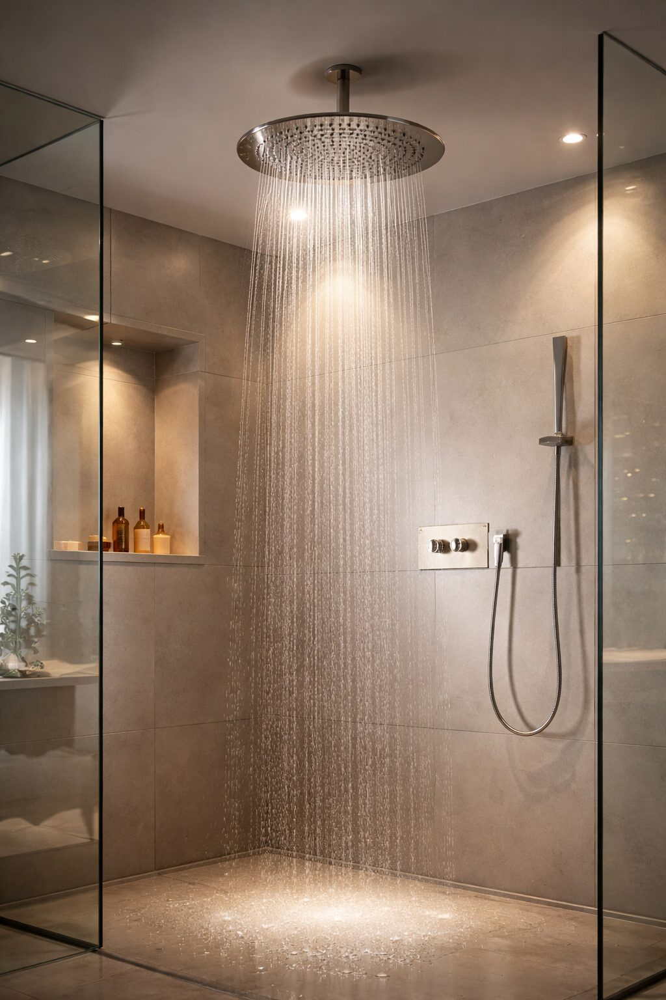

> TIP:QUICK: Fit a thermostatic mixer and a handheld on a rail — and check water pressure before picking the widest head.

## 17. Tiled Shower Niche Shelves

Built-in shower niches are replacing caddies and corner racks in 2027. A tall, tiled recess with two or three shelves keeps shampoo, soap and a small plant neatly in the wall instead of cluttering the shower floor, and a mosaic tile backing turns storage into a feature.

Line the niche with the same tile as the shower walls for a seamless look, or a contrasting mosaic for a focal point. Slope each shelf very slightly forward so water drains out, and keep the tallest bottles on the bottom shelf.

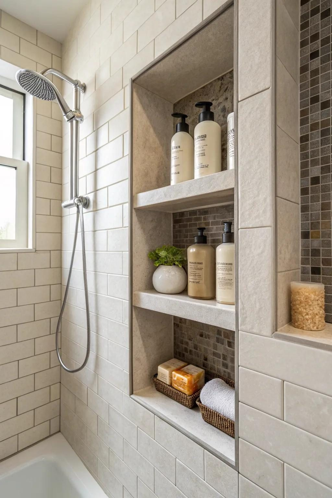

> TIP:CHECK: slope each shelf slightly forward so water drains; tallest bottles on the bottom shelf; one small plant

## 18. Black Clawfoot Tub

A black clawfoot tub is the dramatic twist on a classic shape. The glossy black exterior and silver feet look striking against white marble floors and tall arched windows, and the deep, curved basin is made for long soaks. A wooden bath tray across the top keeps a book and a candle within reach.

Let the tub own the room: keep the walls pale and the floor simple so the black shape stands out. Chrome or brushed nickel fittings suit it better than gold, which can make the look feel busy.

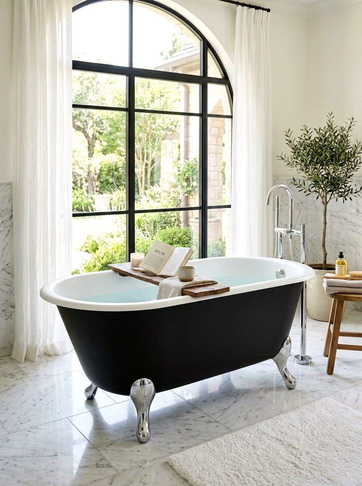

> TIP:GUIDE: Walls: pale so the black tub stands out | Fittings: chrome or brushed nickel | Styling: a wooden bath tray across the top

## 19. Sage Green Vanity

Sage green is the calm colour of 2027 bathrooms — soft, leafy and easy to live with. Painted vanity cabinets in sage, with brass handles and a white stone top, bring colour into the room without shouting, and they pair beautifully with mint subway tiles and light wood floors.

Repeat the green once more in the room — a sage bath mat, a potted eucalyptus, or green glass bottles — so the vanity feels planned rather than random. White walls and a gold-framed mirror keep the whole look fresh.

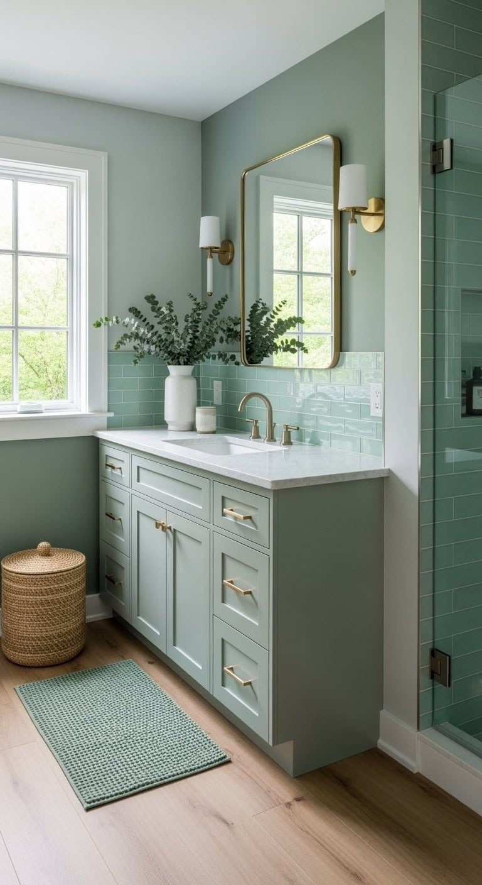

> TIP:QUICK: Repeat the sage once more — a bath mat, a plant or green bottles — so the vanity feels planned.

## 20. Matte Black Faucet

Matte black faucets are the small change with the biggest visual payoff. One black tap against a white basin and a grey concrete-look wall reads instantly modern, and the soft matte finish hides water spots far better than polished chrome. It is the fastest way to update a tired vanity without replacing it.

Match the faucet to one other black detail — a mirror frame, a towel ring or the shower fittings — so it looks deliberate. Keep the rest of the fittings simple, since the black tap is already the focal point of the sink area.

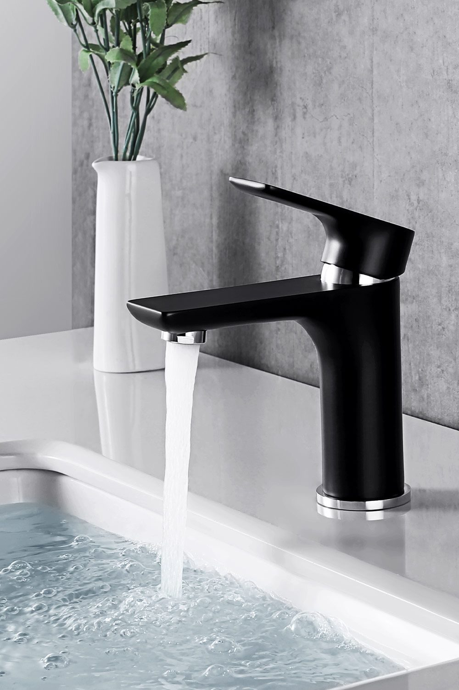

> TIP:CHECK: match the tap to one other black detail; matte hides water spots better than chrome; keep other fittings simple

## 21. Large-Format Stone Tiles

Large-format stone tiles are the quiet luxury of 2027: fewer grout lines, calmer walls and a seamless look that makes a bathroom feel bigger. Big grey stone slabs run floor to ceiling behind the tub, with a slim window above them for daylight, and the whole wall reads as one piece of stone.

Use a levelled installation with minimal grout joints, and seal natural stone so water and soap do not stain it. Brass wall-mounted taps against the grey stone add just enough warmth to stop the room feeling cold.

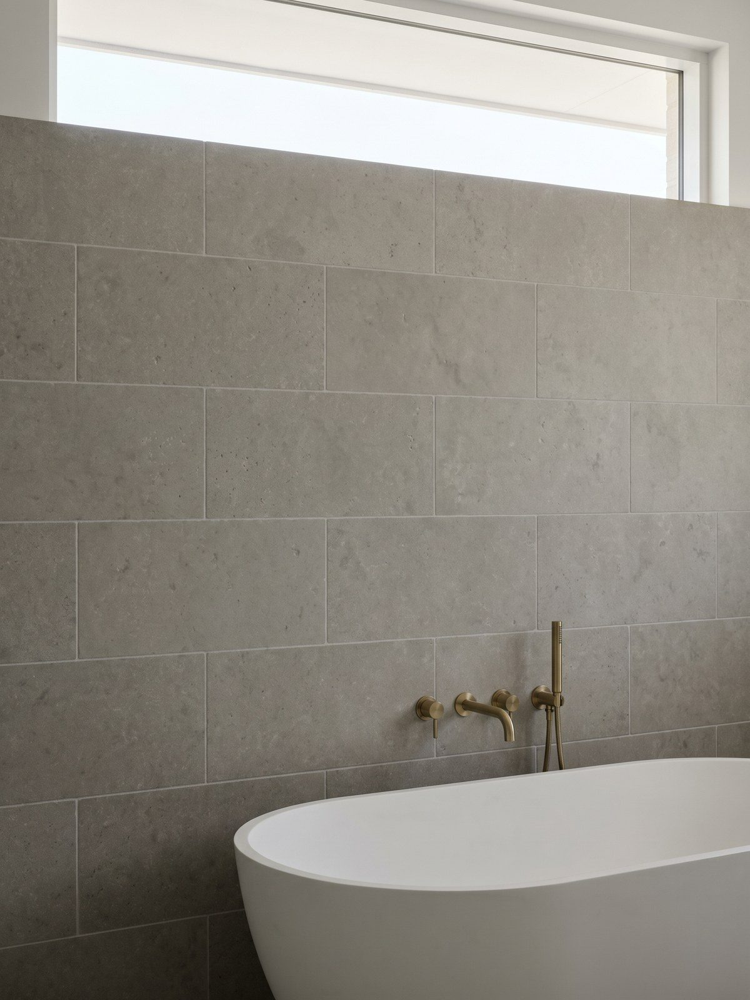

> TIP:GUIDE: Joints: minimal grout lines, levelled install | Care: seal natural stone against water and soap | Warmth: brass taps against grey stone

## 22. Bathroom Skylight

A skylight is the best daylight a bathroom can get. Set above the tub, it pours sun onto the water and the wood floor while keeping the room completely private — no overlooked windows, no frosted glass. In 2027, big roof windows over freestanding tubs are the dream-bathroom shot.

If you are adding one, an opening skylight also vents steam, which keeps mirrors clear and mould at bay. Pair it with light wood floors and a garden view at the far end, and the room feels like an outdoor bathhouse.

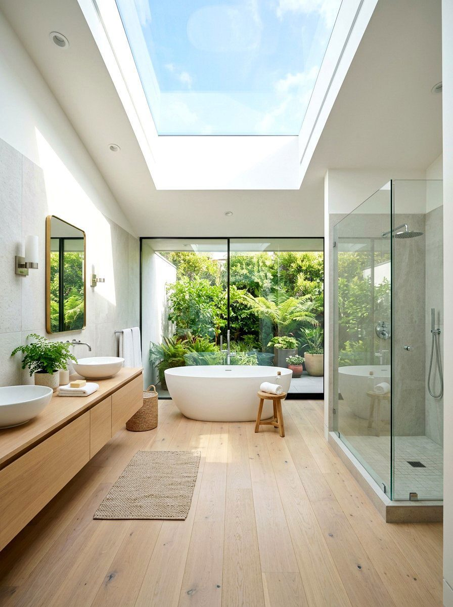

> TIP:QUICK: Choose an opening skylight — it vents steam, keeps mirrors clear and helps prevent mould.

## 23. Open Shelving for Towels

Open shelving turns towel storage into decoration. A tall wood unit stacked with folded towels in warm colours, woven baskets and a fern on top keeps everything within reach and makes the bathroom feel like a boutique hotel. It suits family bathrooms best, where everyone needs their own stack.

Roll or fold towels in matching colour groups so the shelves look styled rather than stuffed, and keep the top shelf for display — a plant, a candle, a jar of bath salts. Baskets on the lower shelves hide the less pretty essentials.

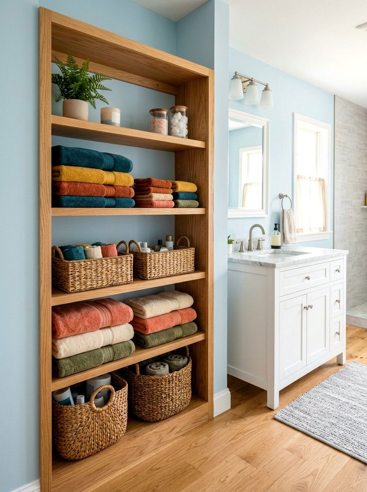

> TIP:CHECK: fold towels in matching colour groups; top shelf for display; baskets below hide the less pretty essentials

## 24. Wooden Bath Tray with Candles

A wooden bath tray is the smallest spa upgrade on this list and one of the most loved. Laid across a bubble bath, it holds a candle, a small bowl of bath salts and a sponge within reach, while a second candle on a stool beside the tub adds a warm glow. It turns a quick bath into an evening ritual.

Choose a tray wide enough to span your tub with a little overlap, and in a wood that tolerates steam, like teak or bamboo. Wipe it dry after each bath and store it upright so it does not warp.

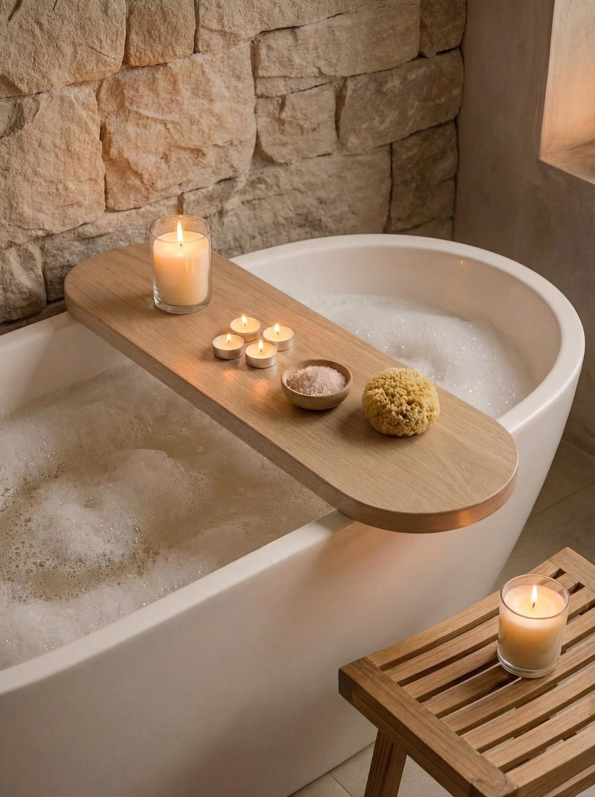

> TIP:GUIDE: Wood: teak or bamboo, which tolerate steam | Fit: spans the tub with a little overlap | Care: wipe dry and store upright

## 25. Oval Freestanding Tub by the Window

An oval freestanding tub set in front of tall arched windows is the centrepiece of the 2027 dream bathroom. Its soft, egg-like shape has no hard corners, and with fluted glass for privacy it can sit in full daylight without feeling exposed. A folded towel over the rim is the only styling it needs.

Keep the floor around it pale and plain so the tub shape reads clearly, and place the tap behind the tub rather than on the wall so nothing breaks the window view. Sheer curtains soften the light without hiding it.

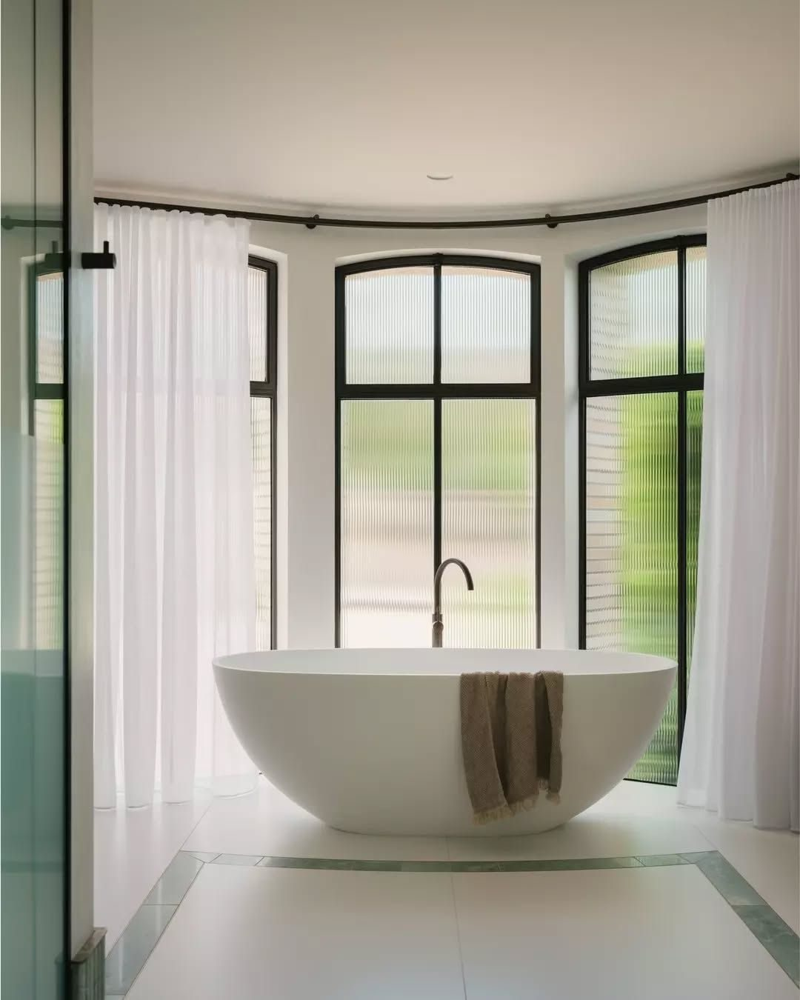

> TIP:QUICK: Put the tap behind the tub, not on the wall, so nothing breaks the window view.

## 26. Checkerboard Floor

The black and white checkerboard floor is back for 2027, and it suits classic bathrooms perfectly. Large squares in glossy black and white run under a black vanity and a clawfoot tub, while white subway tiles on the walls keep the pattern from overwhelming the room. It is bold, timeless and easy to clean.

Lay the squares on the diagonal in a small room to make the floor feel wider, or straight in a large one for a calmer look. A black grout line would blur the pattern, so use white grout on the white squares and dark grout on the black ones, or a mid-grey throughout.

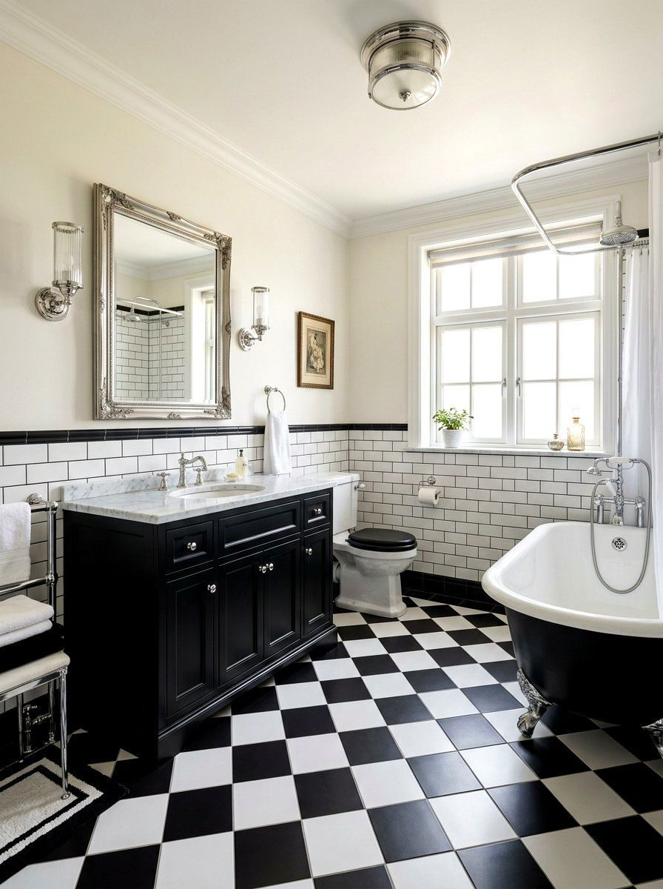

> TIP:CHECK: diagonal in a small room to widen it; straight in a large one; mid-grey grout keeps the pattern crisp

## 27. Wood Slat Accent Wall

A wood slat accent wall brings instant warmth to a tiled bathroom. Vertical oak slats run floor to ceiling behind the tub, lit from above so the grooves glow, and the natural timber softens stone floors and white ceramics. It is the feature wall for people who find plain tile too cold.

Seal the wood well for a wet room, and keep the slats away from direct splashes — behind the tub is ideal, inside the shower is not. A dark wood stool and rolled towels beside the tub pick up the timber tone.

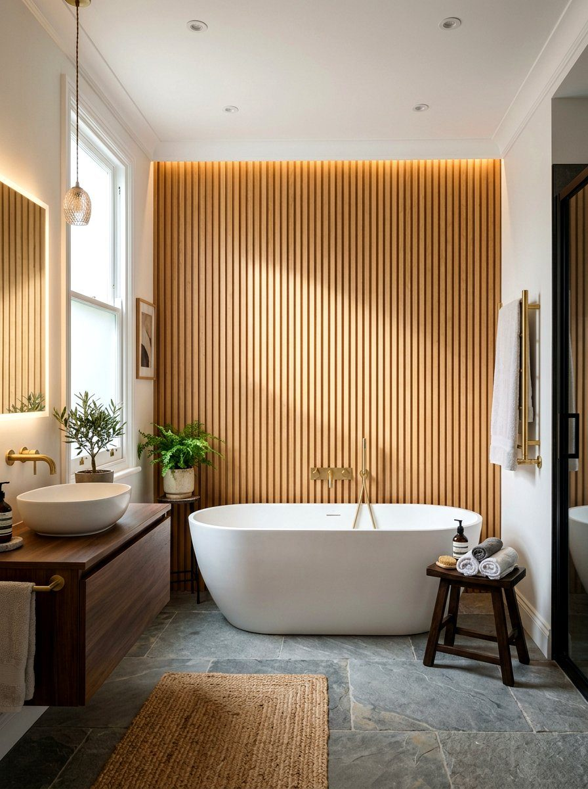

> TIP:GUIDE: Placement: behind the tub, never inside the shower | Finish: seal the wood well for steam | Echo: dark wood stool and rolled towels

## 28. Stone Vessel Sink

A stone vessel sink is a small boulder turned into a basin. Its rough, natural bowl sits on a wood vanity like a piece of sculpture, and no two are alike — the veining and colour of the stone make each sink one of a kind. Paired with a tall chrome tap and folded linen towels, it brings the outdoors into the bathroom.

Because the bowl sits above the counter, check the height: the rim should sit at a comfortable level for washing hands, which usually means a lower vanity underneath. Seal the stone regularly so soap and toothpaste do not mark it.

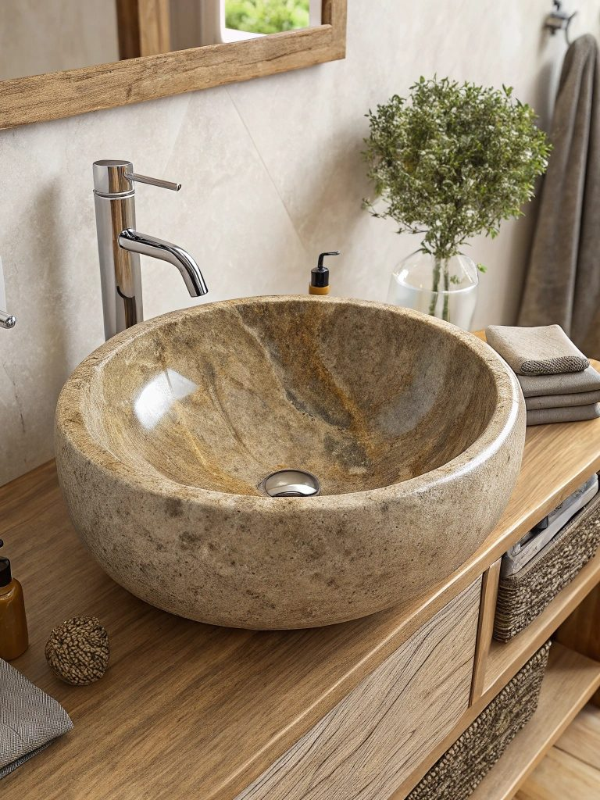

> TIP:QUICK: The rim should sit at a comfortable hand-washing height — use a lower vanity underneath the bowl.

## 29. Slim Heated Towel Rail

A slim heated towel rail is the quiet luxury every 2027 bathroom wants. Mounted flat on the tiled wall, its grey horizontal bars warm towels between uses and gently heat the room, so stepping out of the shower feels cosy instead of chilly. It takes up almost no space and needs no floor area at all.

Fit it near the shower or bath so the towel is within reach, and put it on a timer so it warms up before your morning shower and switches off after. A rail in a colour that matches the tiles disappears into the wall; a contrasting one becomes a feature.

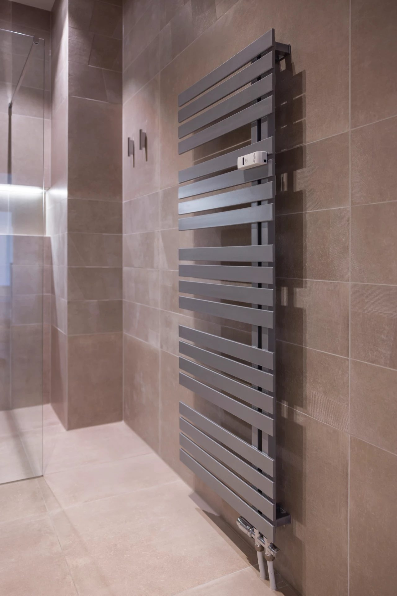

> TIP:CHECK: fit it near the shower; put it on a timer for mornings; match the tiles to blend in, or contrast to feature it

## 30. Bold Floral Wallpaper

Bold floral wallpaper is the bravest move in 2027 bathrooms, and the powder room is the perfect place to try it. Big red peonies and green leaves cover every wall, while a white toilet and a marble sink with brass fittings keep the room grounded. It is a small room, so the pattern wraps you up instead of overwhelming you.

Use a wallpaper made for humid rooms and ventilate well, or keep the bold print to the powder room rather than a steamy family bathroom. A simple white-framed mirror and plain white towels let the pattern be the star.

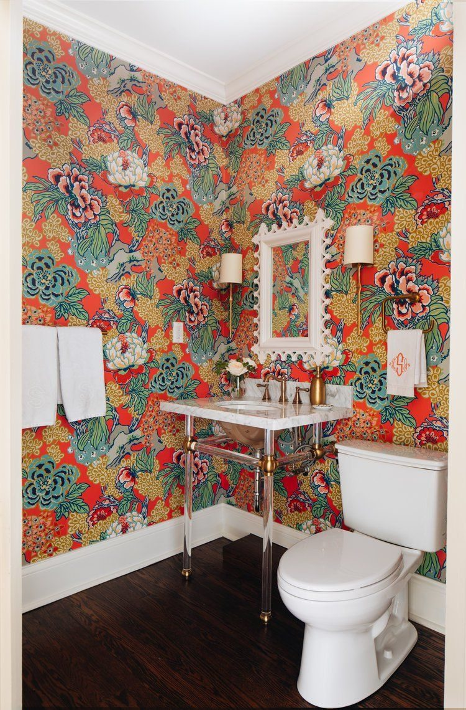

> TIP:GUIDE: Room: powder room first, not a steamy family bathroom | Paper: made for humid rooms | Balance: plain white towels and a simple mirror

## Takeaway

- The 2027 bathroom is warm, textured and calm: handmade tiles, soft curves, wood against stone, and a spa touch or two.
- Start with one big move — a tiled wall, a new mirror or a freestanding tub — then add the small comforts that make mornings better.
- If you want more ideas for the same room, our [30 Bathroom Decor Ideas for a Calm, Spa-Like Retreat](/posts/bathroom-decor-ideas/) covers the classic spa look, and our [30 Bathroom Decor Ideas for Small Spaces](/posts/bathroom-decor-ideas-small-spaces/) shows how to fit the same ideas into a compact bathroom. Save the ideas you love and build your bathroom one calm layer at a time.

## Frequently Asked Questions

### What are the biggest bathroom decor trends for 2027?

The biggest 2027 trends are handmade-look zellige tiles, warm wood vanities, arched mirrors, freestanding stone tubs and spa touches like plants and rainfall showers. Colour is warming up too, with terracotta, sage green and deep emerald replacing cold grey. Curves are softening straight lines, and textured surfaces matter more than glossy perfection.

### How can I update my bathroom for 2027 without a full renovation?

Swap the mirror for an arched or backlit one, paint the vanity sage green, change the faucet to matte black, and add a bath tray, plants and towels. A bold wallpaper in the powder room or a woven pendant light can carry the whole 2027 look. These swaps cost far less than new tiles or a new tub.

### What colours are popular for bathrooms in 2027?

Warm, nature-inspired colours lead the way: sage green, terracotta, deep emerald and warm cream, with black used as an accent rather than a main colour. Marble whites and pale wood keep the palette light, while brass fixtures add warmth. The overall feeling is calm and earthy, not stark or clinical.

### Are freestanding bathtubs still popular in 2027?

Yes, freestanding tubs are still the centrepiece of 2027 bathrooms, especially oval and stone designs placed by a window or against a feature wall. They suit larger bathrooms best, since they need space around them for cleaning and access. In a small bathroom, a curved built-in tub gives a similar soft look.

### What is the best tile for a 2027 bathroom?

Zellige tiles are the standout choice, with their glossy, uneven glaze and handmade feel, in emerald, terracotta or cream. Large-format stone tiles suit calm, seamless walls, while terrazzo floors add colour and pattern underfoot. Whichever you choose, fewer grout lines and a warm grout colour keep the look current.

### How do I make a small bathroom feel bigger in 2027?

Use a frameless glass shower, a floating vanity and a large mirror to keep sightlines open, and choose large-format tiles with minimal grout. Pale walls, one statement tile wall and good lighting also help. Avoid bulky cabinets and dark colours on every surface, since they close the room in quickly.

### Is wallpaper safe to use in a bathroom?

Wallpaper works well in powder rooms and well-ventilated bathrooms, especially types made for humid rooms. Avoid it inside the shower or in a steamy family bathroom without good extraction, since moisture can lift the edges. A bold floral print in a small powder room is the safest and most striking place to try it.

### How do I add a spa feel to my bathroom on a budget?

Add plants that love humidity, a wooden bath tray with candles, rolled white towels in a basket, and a eucalyptus bundle in the shower. Soft, warm lighting from a backlit mirror or a dimmer makes the biggest difference. These small touches cost little but change how the room feels every single day.
