# 30 Bathroom Decor Ideas for Apartments

These 30 bathroom decor ideas for apartments prove a rental bathroom can feel like yours without losing the deposit. Every idea here is renter-friendly — no drilling, no permanent changes, nothing your landlord would object to — and most of them take an afternoon and a small budget.

Apartment bathrooms are usually small, plain and white, which is actually a good starting point: a pale box takes color and warmth well. The trick is to add storage that hangs, sticks or rolls instead of screwing in, and to let one bold piece — a shower curtain, a wallpaper wall, a patterned floor — do the decorating while everything else stays calm.

If you want the same calm, spa-like feeling in a bigger bathroom, our [30 Bathroom Decor Ideas for a Calm, Spa-Like Retreat](/posts/bathroom-decor-ideas/) covers the full-size version — the two lists pair well, since the apartment ideas here are the renter-friendly versions of the same looks.

## 1. Peel-and-Stick Tile Backsplash Behind the Vanity

A peel-and-stick tile backsplash is the fastest way to give a plain rental vanity some personality. These blue-and-white patterned tiles go straight over the existing wall — no grout, no tools, no mess — and they peel off cleanly when you move out. The pattern does all the work: even a basic white sink and a black faucet suddenly look deliberate.

Measure the strip behind the sink first and buy one extra sheet for cuts around outlets. Press each tile firmly from the center out so no air bubbles sit under the pattern, and wipe splashes dry so the edges never lift.

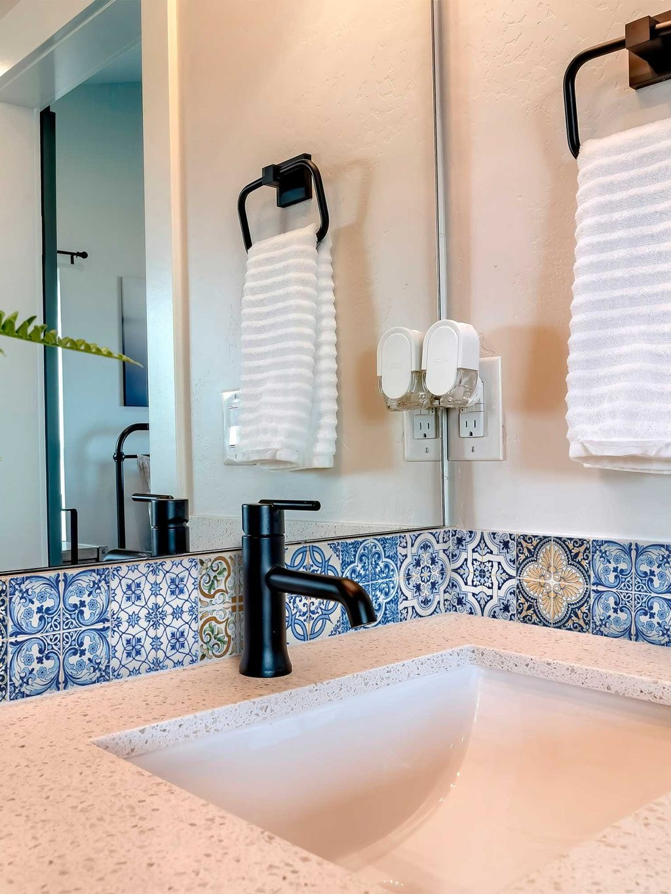

> TIP:QUICK: Buy one extra sheet — cuts around outlets and faucets eat more tile than you expect.

## 2. A Tension-Pole Shelf Over the Bathtub

A tension-pole shelf presses between the tub edge and the ceiling, so it adds four shelves of storage without a single hole in the tile. This one holds folded towels, bottles and a bath sponge right where you use them, and the slim metal pole disappears against a grey tiled wall.

Twist the pole until it is snug, then give it a firm tug — if it moves, tighten it again before you load it. Keep the heaviest bottles on the lowest shelf so the unit stays stable.

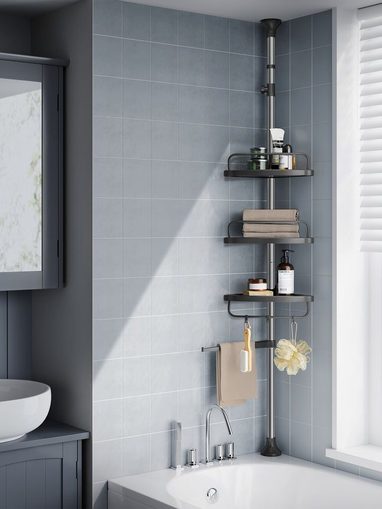

> TIP:CHECK: Pole snug against floor and ceiling; heaviest bottles on the lowest shelf; nothing hanging past the tub edge

## 3. Removable Wallpaper on One Accent Wall

One wall of removable wallpaper turns a white box of a bathroom into a room with a point of view. This bold floral print sits behind a pedestal sink, with a round mirror and white towels keeping the rest of the room quiet. Peel-and-stick paper goes up in an afternoon and comes down without taking paint with it.

Start on the wall you see first when you walk in, and stop at the corners — one wall is a statement, four walls is a jungle. Smooth each strip from the middle outward and trim the edges with a sharp knife.

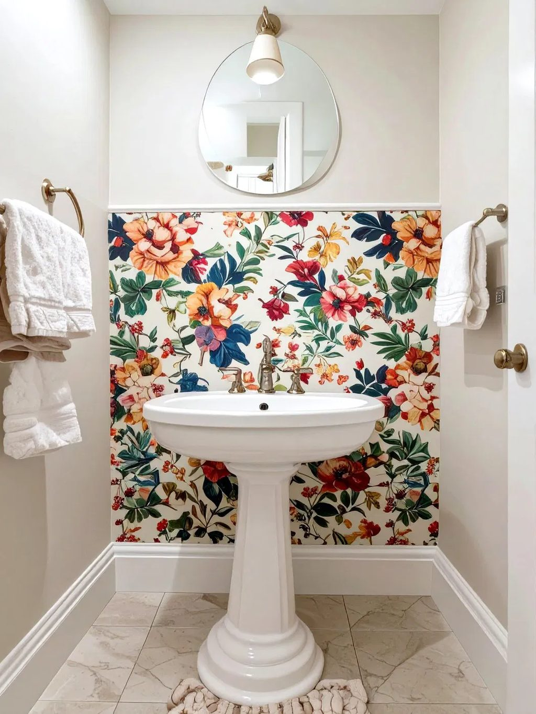

> TIP:GUIDE: Budget: $30–$60 per wall | Time: one afternoon | Skill: beginner

## 4. An Over-the-Door Towel Rack

The back of the bathroom door is free storage most apartments waste. This white ladder-style rack hooks over the top of the door and holds two bath towels, a hand towel and a bath brush — no screws, no adhesive, and it moves with you to the next place.

Check the gap above your door first: the hooks need about a quarter inch of clearance. Hang the towel you use daily at chest height and the spares lower down, and keep the rack on the inside of the door so the hallway never sees it.

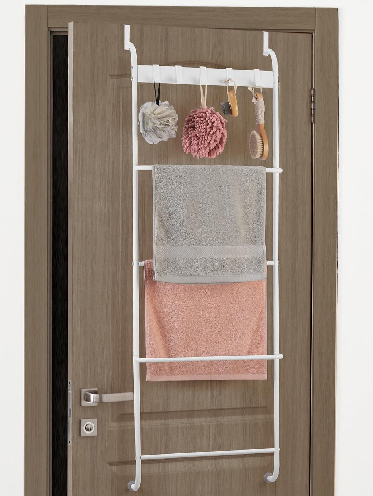

> TIP:QUICK: Hang it on the inside of the door — the hallway never sees it and the towels stay out of the way.

## 5. A Slim Rolling Cart Beside the Vanity

The gap between the vanity and the wall is usually six inches of wasted space — exactly the width of a slim rolling cart. This three-tier cart slides into that gap and holds shampoo, soap, cleaning supplies and rolled towels, with a handle on top so you can pull the whole thing out to clean behind it.

Measure the gap before you buy, and leave half an inch of clearance so the cart rolls freely. Put the daily bottles on top, the cleaning supplies at the bottom, and never overload the top shelf or it tips when you pull it out.

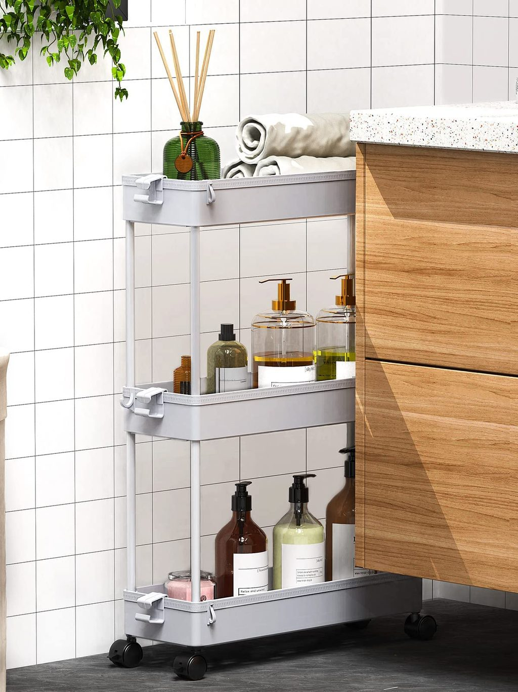

> TIP:CHECK: Gap measured with half an inch to spare; daily bottles on top; cleaning supplies at the bottom

## 6. Adhesive Hooks and a Towel Ring, No Drilling

Adhesive hooks are the renter's best friend in the bathroom: a towel ring that sticks to the tile in seconds, holds a full hand towel, and comes off with a hair dryer when you move. This one sits on a dark marble-look wall, and the white ring and towel are the only bright notes in the corner.

Clean the tile with rubbing alcohol first and let it dry completely — adhesive sticks to clean tile, not to soap film. Press and hold for a full minute, then wait a day before you hang anything heavy on it.

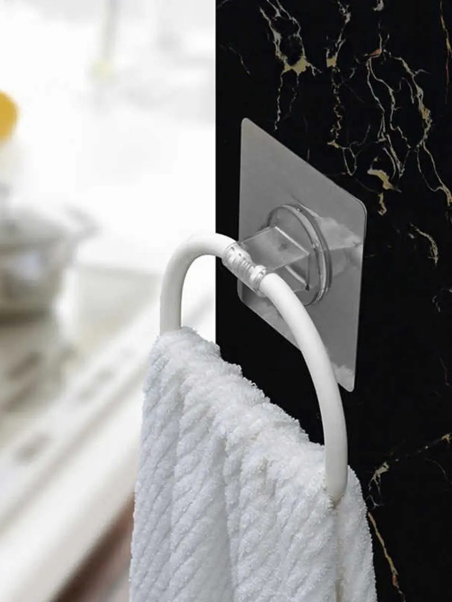

> TIP:GUIDE: Budget: under $15 | Time: 10 minutes | Skill: beginner

## 7. A Big Round Mirror to Open Up the Room

A big round mirror is the cheapest way to make a small apartment bathroom feel twice as big. This one hangs over a floating wood vanity, bouncing the window light across the whole room and softening all the straight lines of the tile and the cabinet. The round shape is the whole trick — it makes the wall feel finished with nothing else on it.

Hang it so the center sits at eye level and make it wider than the sink below it. A thin dark frame keeps it calm; a brass frame ties it to the faucet.

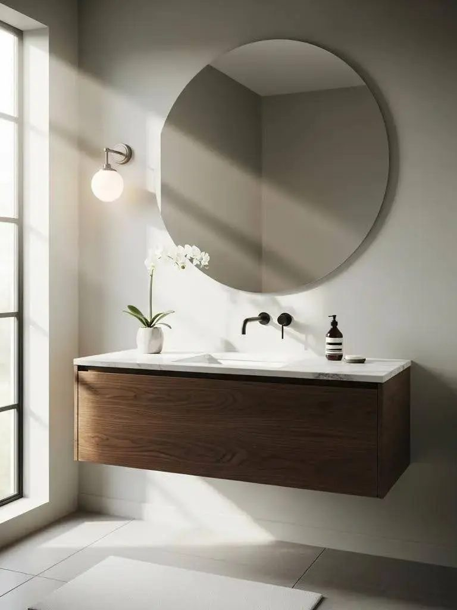

> TIP:QUICK: Pick a mirror wider than the sink — a small mirror over a wide vanity makes the room look smaller, not bigger.

## 8. Floating Shelves for Vertical Storage

When the floor is full, go up. Three short wooden shelves on a bare wall hold rolled towels, a succulent and the bottles you reach for every morning, and they take up no floor space at all. The wood warms up white tile, and the open shelves force you to keep only the pretty things out.

If your lease bans drilling, use heavy-duty adhesive shelf brackets rated for the weight, and keep the shelves shallow — about eight inches deep is enough. Put the daily items at hand height and the spares higher up.

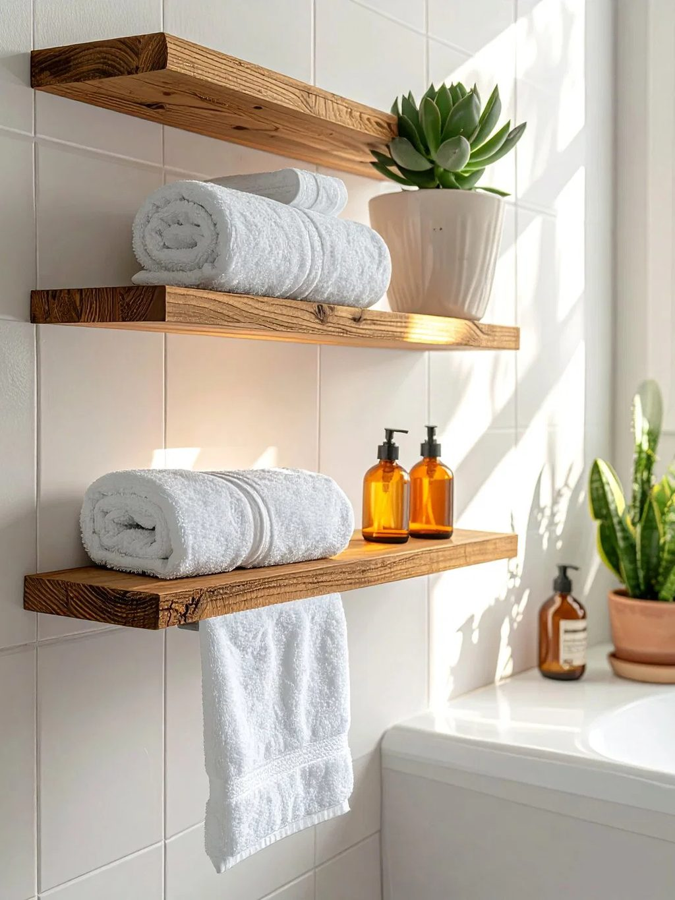

> TIP:CHECK: Shelves about eight inches deep; adhesive brackets rated for the load; daily items at hand height

## 9. A Shower Caddy That Hangs from the Shower Head

A caddy that hooks over the shower head needs no screws, no suction cups and no shelf space — it just hangs there, holding everything at arm's reach. This two-tier one carries shampoo, conditioner and body wash on the top shelf and the big bottles below, with a hook for a razor and a sponge.

Hang it from the shower arm, not the head itself, and keep the heaviest bottles on the bottom tier so it never swings. Rinse it once a week so soap scum never builds up in the corners.

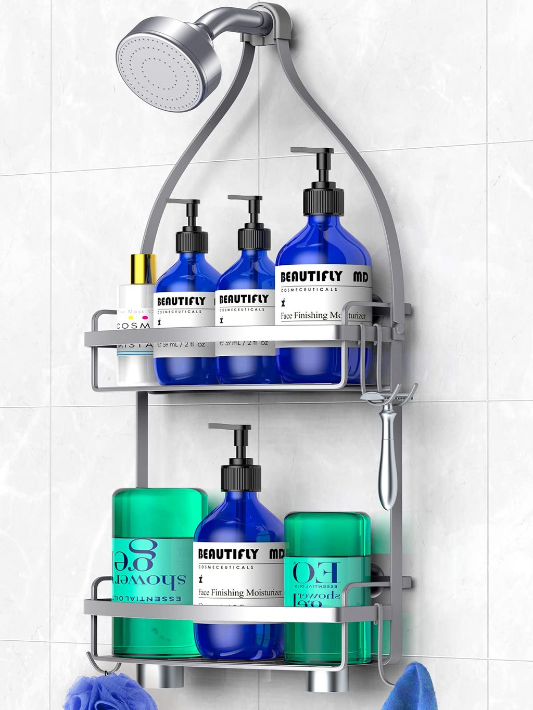

> TIP:GUIDE: Budget: $15–$30 | Time: 2 minutes | Skill: beginner

## 10. Stacked Baskets Under the Sink

Under the sink is the messiest cabinet in any apartment bathroom — pipes in the middle, bottles everywhere. Three stacked wicker baskets turn it into a drawer system: towels in one, toiletries in the next, cleaning supplies in the third. Pull a basket out like a drawer and everything is in reach.

Measure around the pipes before you buy, and choose baskets with handles so they slide out easily. Keep the basket you open daily on top and the refills at the bottom.

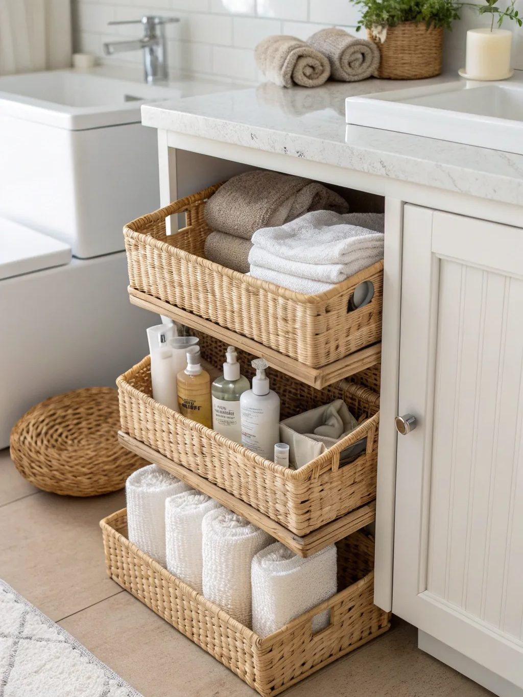

> TIP:QUICK: Measure around the pipes first — a basket that doesn't clear the trap is just a decoration.

## 11. A Vanity Tray That Corrals the Clutter

A tray is the smallest organizing trick that actually works. This oval ceramic tray holds a matching soap dispenser and a toothbrush cup on a marble counter, and suddenly the counter looks designed instead of assembled. Everything you touch daily sits in one tidy rectangle, and the rest of the counter stays clear.

Pick a tray that fits the counter with room to spare — about two-thirds of the counter width is right. Wipe it down once a week so water rings never set in.

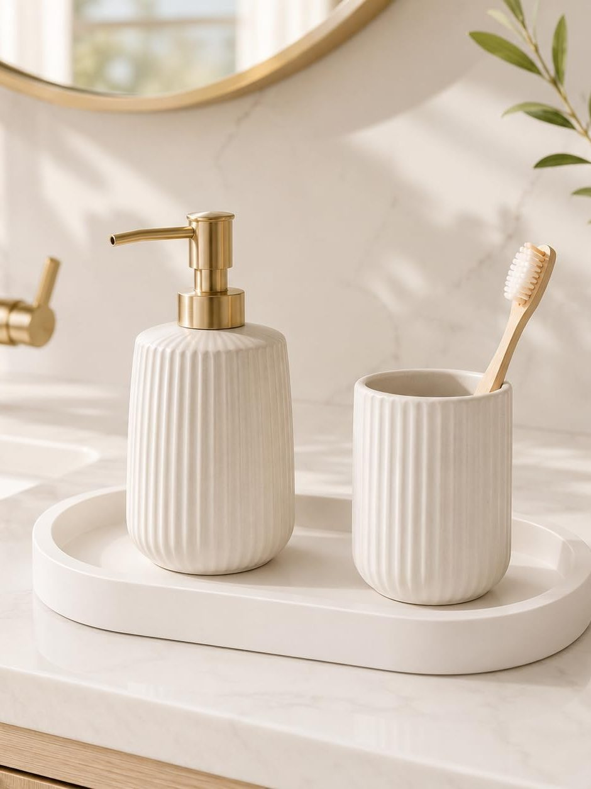

> TIP:CHECK: Tray about two-thirds of the counter width; daily items only; wipe it down weekly

## 12. A Wall-Mounted Drying Rack That Folds Away

Apartment bathrooms rarely have anywhere to dry a hand-washed sweater or a damp towel. This wall-mounted rack pulls out when you need it and folds flat against the wall when you don't, holding three towels on its bars. It is the drying rack for people who have no room for a drying rack.

Mount it on the wall opposite the shower so drips fall on tile, not on the floorboards. Use the adhesive or no-drill mounts if your lease bans screws, and never load it past its rated weight.

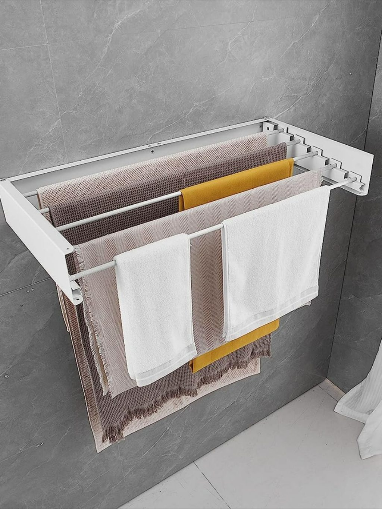

> TIP:GUIDE: Budget: $25–$45 | Time: 30 minutes | Skill: beginner

## 13. Peel-and-Stick Floor Tiles for a Whole New Floor

If your rental bathroom floor is stained, cracked or just ugly, peel-and-stick floor tiles cover it in an afternoon. This teal-and-white pattern turns a plain floor into the room's feature, and the tiles peel up when you move out. They are waterproof, wipe clean, and cost a fraction of real tile.

Clean the floor thoroughly and let it dry before you start — the tiles stick to clean vinyl, not to grime. Lay them from the center of the room outward, and press each one firmly so the edges never lift.

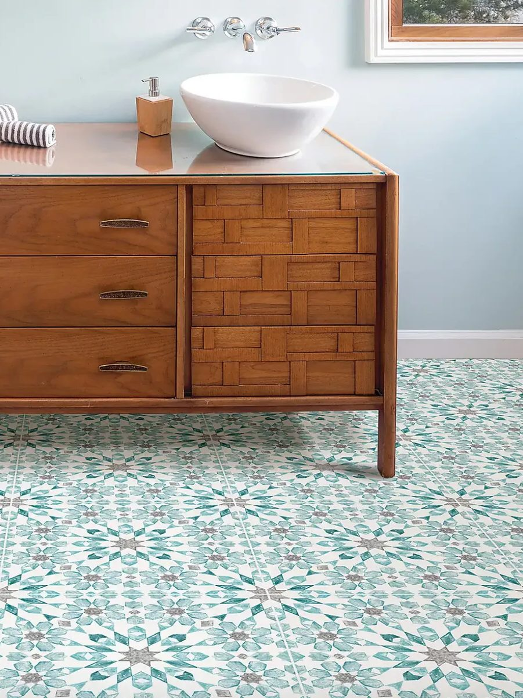

> TIP:QUICK: Start from the center of the room, not the wall — the pattern stays straight and the cut edges hide at the sides.

## 14. A Fabric Skirt Under the Sink

A pedestal sink has nowhere to hide the cleaning supplies — unless you give it a skirt. This soft beige curtain hangs from a tension rod under the sink, hiding bottles and spare rolls behind fabric that looks like it belongs there. It costs almost nothing and takes ten minutes to hang.

Use a washable fabric and a tension rod that fits snugly between the walls. Hem the skirt so it just kisses the floor, and keep a small basket behind it so the hidden supplies stay organized.

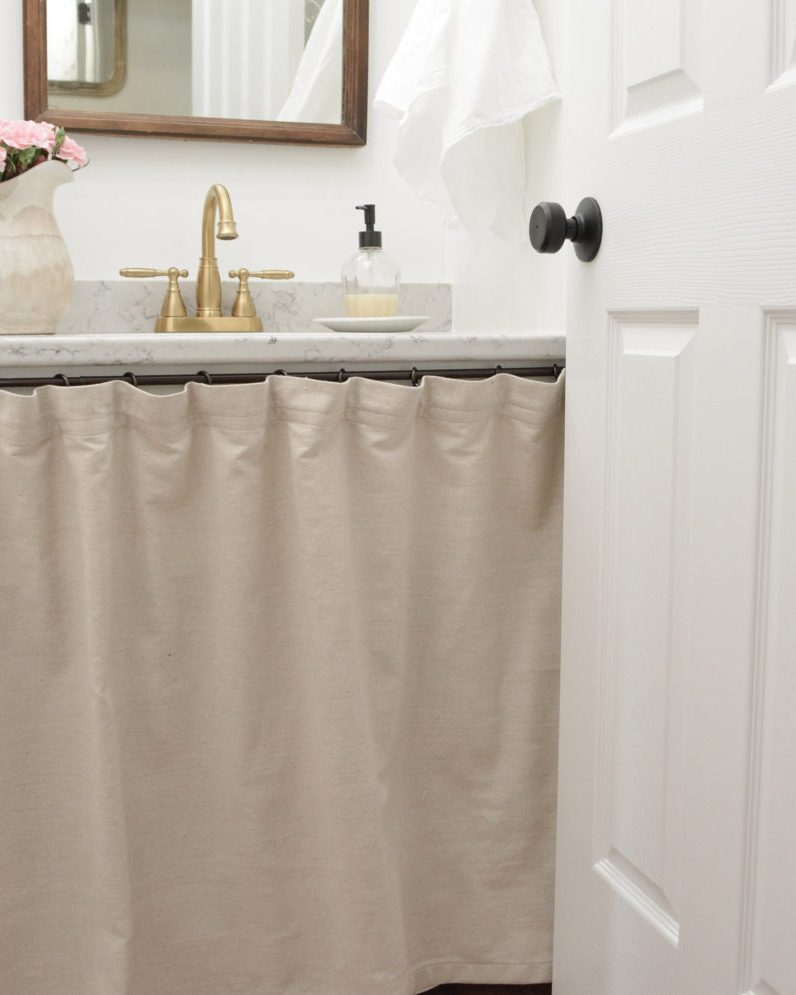

> TIP:CHECK: Washable fabric; tension rod snug between the walls; hem just kisses the floor

## 15. A Tall Narrow Tower for the Awkward Corner

Every apartment bathroom has one awkward corner — too narrow for a cabinet, too big to waste. A tall, narrow storage tower fits exactly there, with open shelves for towels and baskets and closed shelves below for the things you don't want to see. This white one stands between the window and the tiled wall, holding rolled towels, a basket and bottles.

Measure the corner twice, including the baseboard, and anchor the tower to the wall with adhesive strips if you can't drill. Put the prettiest things at eye level and the spares higher up.

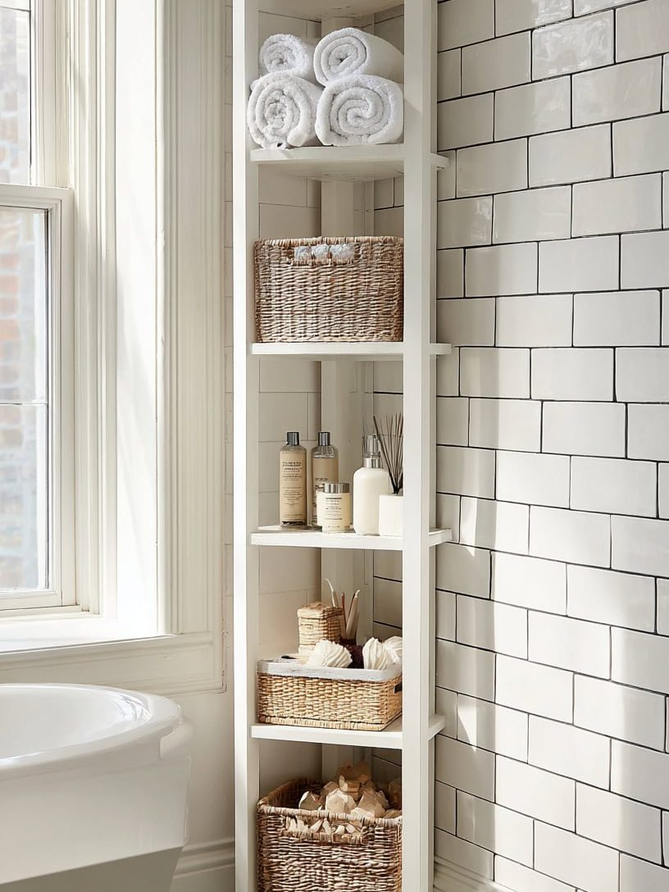

> TIP:GUIDE: Budget: $40–$80 | Time: 30 minutes to assemble | Skill: beginner

## 16. Matching White Towels, Rolled and Stacked

Matching white towels are the fastest way to make a rental bathroom look intentional. A stack of thick white towels on a wooden shelf, with a basket of rolled spares beside them, reads as a spa — even when the room itself is a plain white box with a grey tiled floor.

Buy one set in the same white, not a mix of near-whites that clash. Wash them with a little white vinegar in the rinse and they stay bright instead of going grey.

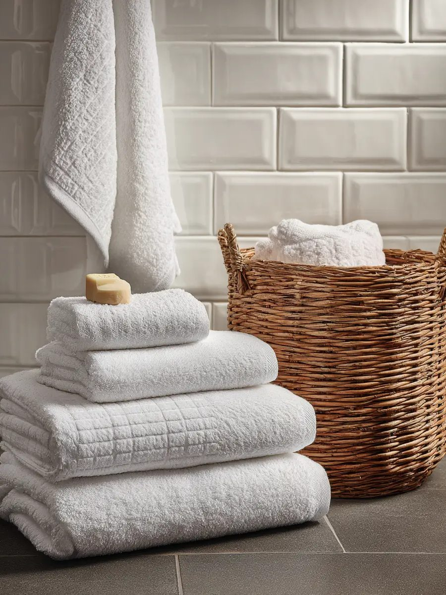

> TIP:QUICK: Buy one set in the same white — mixed near-whites clash and look accidental.

## 17. A Trailing Pothos That Loves the Steam

Pothos is the easiest apartment bathroom plant there is — it loves steam, forgives forgotten watering, and trails beautifully from a macrame hanger. This one hangs beside the mirror, its vines dropping past the sink, and the green is the only strong color in an otherwise white room.

Hang it high enough that the vines clear the faucet, and let them grow long before you trim them. A plain pot keeps the look calm; the plant is the decoration.

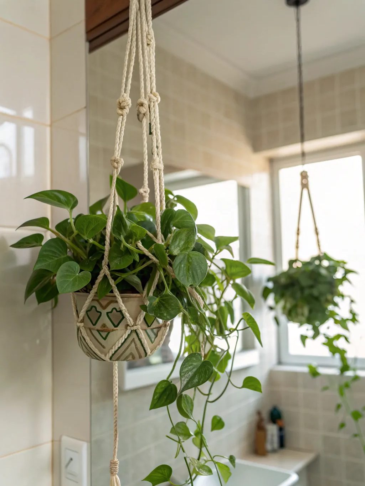

> TIP:CHECK: Hang above faucet height; let vines grow long before trimming; plain pot, the plant is the decor

## 18. Layered Rugs and Mats for a Softer Floor

Cold tile is the least friendly part of a rental bathroom, and a layered rug fixes it in minutes. A large patterned rug underfoot with a smaller bath mat on top softens the floor, warms the room, and hides a stained tile or two. This one sits beside a freestanding tub, with fairy lights and candles turning the corner into a retreat.

Put a non-slip pad under the rug and choose a washable one — bathroom rugs need a wash every couple of weeks. Keep the rug away from the shower spray so it never stays damp.

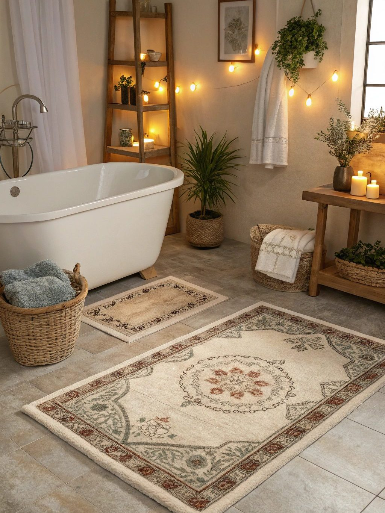

> TIP:GUIDE: Budget: $30–$70 | Time: 10 minutes | Skill: beginner

## 19. Battery-Powered Sconces by the Mirror

Good light makes a small bathroom feel like a good bathroom, and battery sconces give you that light without an electrician or a landlord's permission. These two Edison-style sconces flank the mirror with warm bulbs, so the light falls on your face instead of down from a harsh ceiling fixture.

Stick them on with the included adhesive mounts and use warm bulbs around 2700 Kelvin. Rechargeable ones beat battery ones — charge them while you sleep and they are ready for the morning.

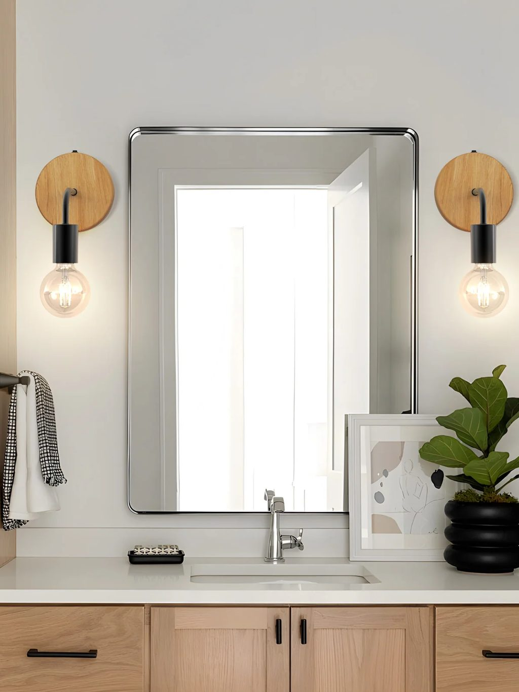

> TIP:QUICK: Use warm bulbs around 2700 Kelvin — cool white light in a small bathroom feels like an office.

## 20. Suction-Cup Shelves in the Shower

Suction-cup shelves are the no-drill answer to a shower with nowhere to put the shampoo. This clear corner shelf sticks to smooth tile with two big suction cups, holds three bottles, and comes off cleanly when you move. The clear acrylic nearly disappears against marble-look tile, so the bottles look like they float.

They only stick to smooth, glossy tile — not to textured or matte tile. Press each cup firmly, wait a day before loading it, and re-press the cups once a month so they never let go mid-shower.

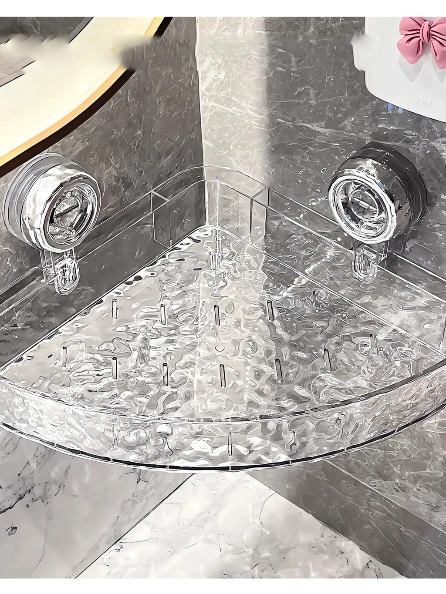

> TIP:CHECK: Smooth glossy tile only; press firmly and wait a day; re-press the cups monthly

## 21. A Bold Shower Curtain as the Room's Art

In a small apartment bathroom, the shower curtain is the biggest surface in the room — treat it like art. This bold, colorful pattern of circles and dots turns a plain white bathroom into a cheerful one, and it costs less than a single framed print. When the curtain is this strong, everything else can stay quiet.

Buy the curtain long enough to just kiss the floor, and use a washable liner behind it. A patterned curtain hides water spots and soap splashes far better than a plain white one.

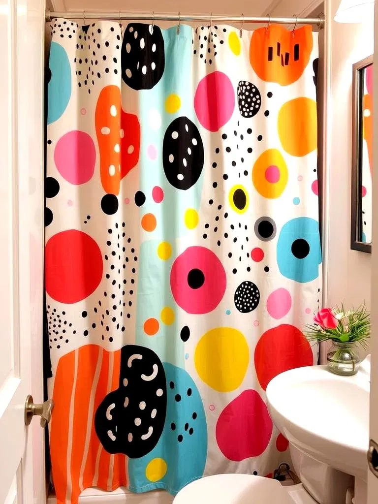

> TIP:GUIDE: Budget: $20–$40 | Time: 10 minutes | Skill: beginner

## 22. A Slim Hamper That Slides Into the Gap

A laundry hamper is the bulkiest thing in a small bathroom — unless it is built for the gap. This tall, slim black hamper is barely wider than a hand span, slides between the vanity and the tub, and holds a full load with its lid keeping the smell in. It looks like a piece of furniture, not a laundry bin.

Measure the gap before you buy, and pick a hamper with a removable washable liner so the basket itself stays clean. One tall slim hamper beats two small ones — it holds more and takes up less floor.

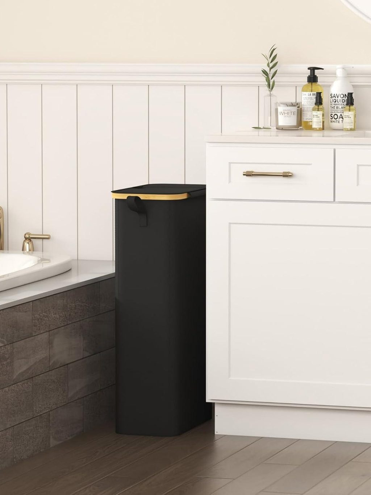

> TIP:QUICK: Measure the gap first and buy the hamper to fit it — a hamper that sticks out an inch blocks the whole walkway.

## 23. A Wall-Mounted Toothbrush Holder

Toothbrushes on the counter collect water, clutter the sink and fall over. A wall-mounted holder keeps them upright, draining and out of the way — this one holds toothbrushes, toothpaste and a soap dish in one small unit stuck to the marble-look tile. The counter stays clear for everything else.

Stick it at a height everyone in the household can reach, and rinse the cup weekly so toothpaste never builds up. Adhesive mounts hold it fine; just clean the tile with rubbing alcohol first.

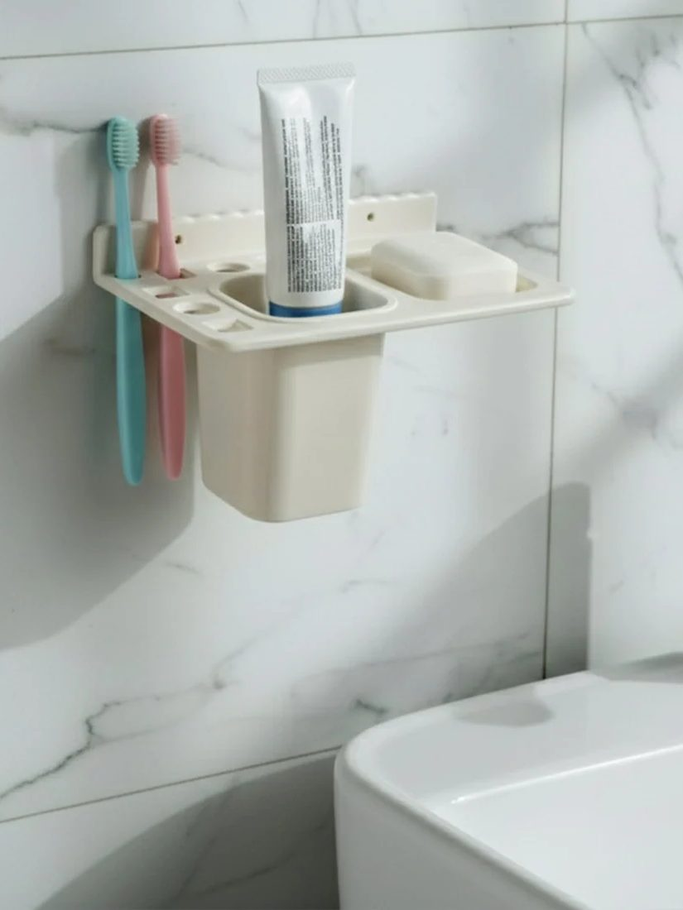

> TIP:CHECK: Within everyone's reach; adhesive on clean, dry tile; rinse the cup weekly

## 24. A Small Wooden Stool That Does Triple Duty

A small wooden stool is the hardest-working piece in an apartment bathroom. This one sits beside the tub holding a reed diffuser and a plant on top, with toilet paper and rolled towels on the lower shelf — but it is also a seat, a step for the high shelf, and a place to set a book while you soak.

Choose a stool with a lower shelf so it holds twice as much, and pick sealed wood that can handle steam. Keep it close enough to reach from the tub, but not so close that it gets splashed.

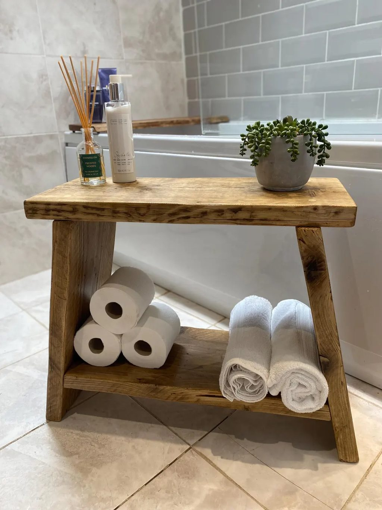

> TIP:GUIDE: Budget: $25–$50 | Time: none, it just stands there | Skill: beginner

## 25. A Full-Length Mirror on the Door

Apartment bathrooms rarely have a full-length mirror, and a door mirror fixes that without a single screw. This tall black-framed mirror leans against the bathroom door, reflecting the whole room and making it feel bigger, and it moves with you when the lease ends.

Lean it at a slight angle so it doesn't slide, or hang it from over-the-door hooks if the floor is slippery. Check your outfit in it, not just your face — that is the point of a full-length mirror.

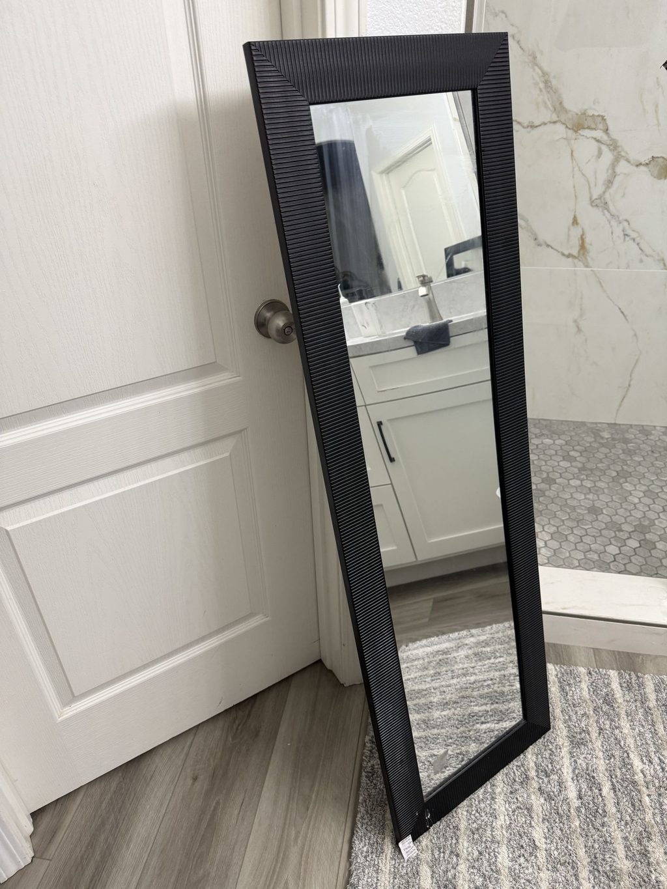

> TIP:QUICK: Lean it at a slight angle so it can't slide — a mirror flat against the wall on a slick floor will creep.

## 26. Eucalyptus in a Vase on the Vanity

A vase of eucalyptus is the simplest greenery an apartment bathroom can have — no soil, no watering schedule, just stems in water on the vanity. This ribbed glass vase holds a tall bunch beside a brass faucet, and the silvery-green leaves soften all the white tile and chrome. It lasts for weeks and smells faintly wonderful.

Change the water every few days so the stems stay fresh, and trim the ends at an angle when you refresh it. Dried eucalyptus works too, and it lasts for months.

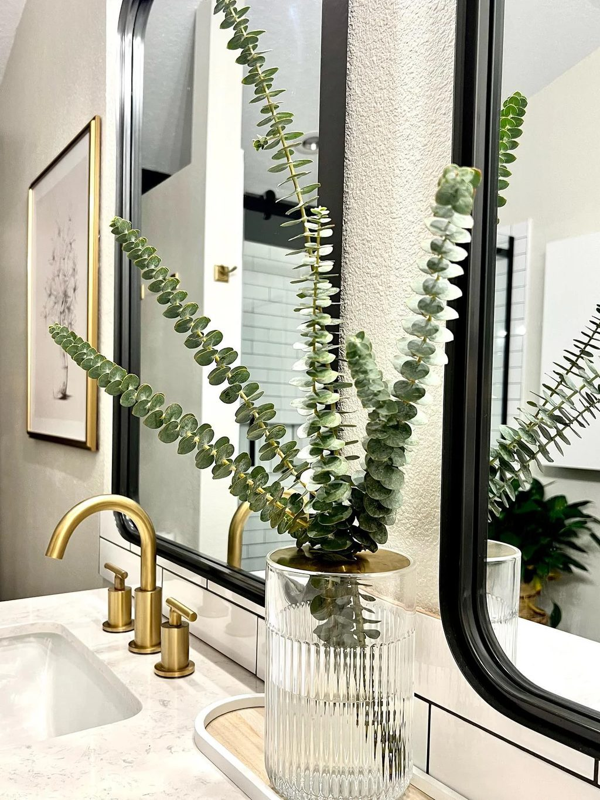

> TIP:CHECK: Fresh water every few days; trim stem ends at an angle; dried stems last for months

## 27. A Tiered Tray on the Counter

A tiered tray turns a crowded counter into a display. This three-tier metal stand holds skincare bottles on the top shelf, creams in the middle and folded cloths at the bottom, all in the footprint of a single plate. Everything is visible, nothing is buried, and the counter underneath stays clear.

Keep the tray to the side of the sink, not in front of it, so splashes never reach the bottles. Put the daily products on the top tier and the weekly ones lower down.

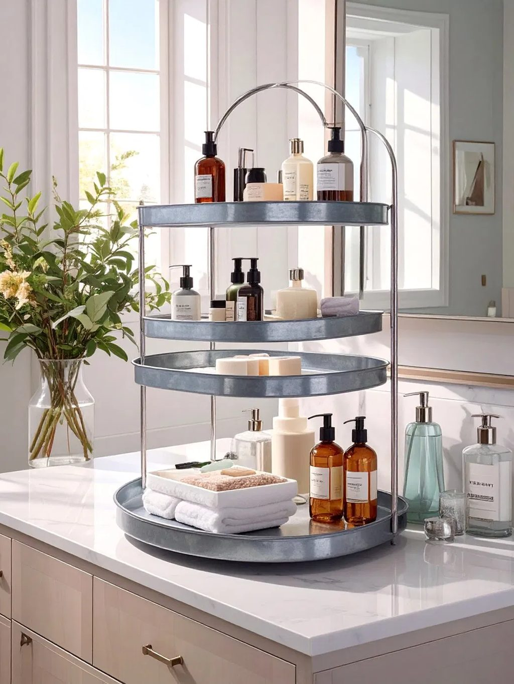

> TIP:GUIDE: Budget: $20–$40 | Time: 5 minutes | Skill: beginner

## 28. A Woven Basket for Spare Toilet Paper

Spare toilet paper rolls stacked on the tank look like a storage problem. A woven basket beside the toilet turns them into decor — this one holds rolled towels and a spare roll under a wooden vanity, with a plant and candles nearby. The basket is the system: when it is empty, you know to buy more.

Pick a basket with handles so you can carry the whole stock to the closet at refill time. Keep one roll on the holder and the rest in the basket, never loose on the floor.

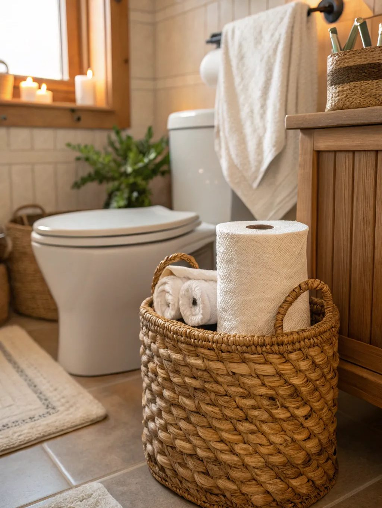

> TIP:QUICK: One roll on the holder, the rest in the basket — loose rolls on the floor are how bathrooms look messy.

## 29. A Patterned Runner Rug Down the Middle

A long, narrow bathroom is hard to decorate — there is only one wall worth looking at. A patterned runner rug down the middle of the floor fixes that: this pink-and-blue medallion runner draws the eye along the room, warms the tile underfoot, and makes the whole space feel designed rather than leftover.

Choose a low-pile, washable runner and put a non-slip pad under it. Measure the floor first — the runner should stop a few inches short of the tub and the door swing.

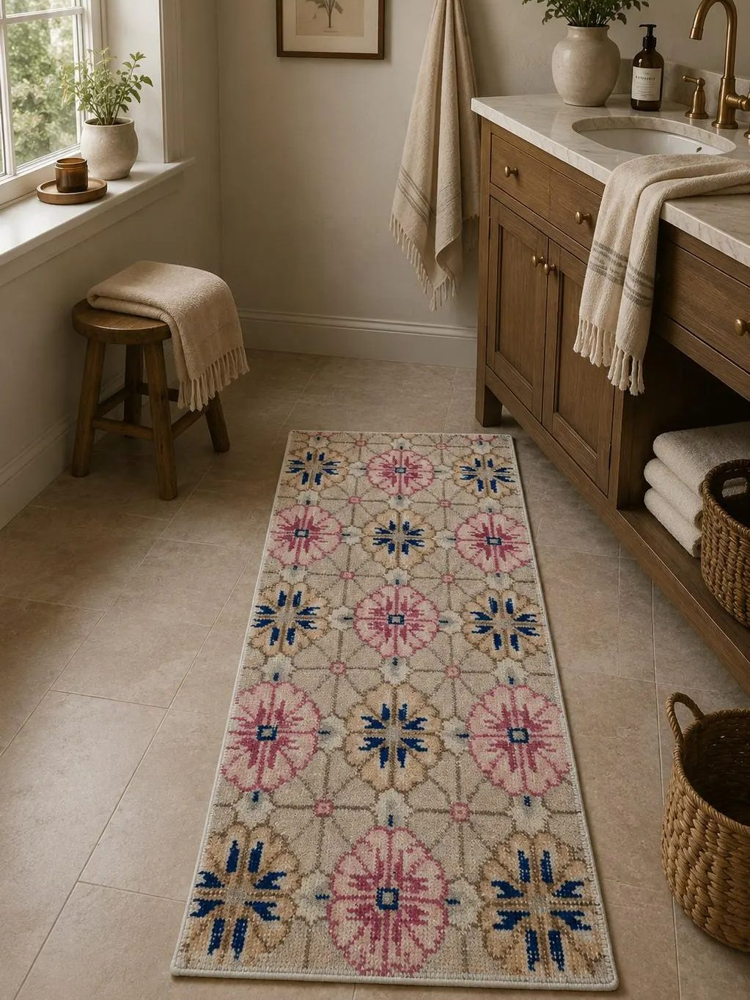

> TIP:CHECK: Low-pile and washable; non-slip pad underneath; stops short of the tub and the door swing

## 30. One Renter-Friendly Palette: White, Wood, One Accent

The calmest apartment bathrooms are not decorated — they are edited. This one holds the whole room to three notes: white counters and walls, light wood on the vanity and shelves, and woven baskets for warmth. Folded white towels, a small plant and a framed print are the only decoration, and the room feels like a sanctuary instead of a rental.

Pick your three colors before you buy anything, and let every new piece match one of them. When everything in the room belongs to the same palette, even the smallest bathroom feels considered and calm — and when you move, the whole look moves with you.

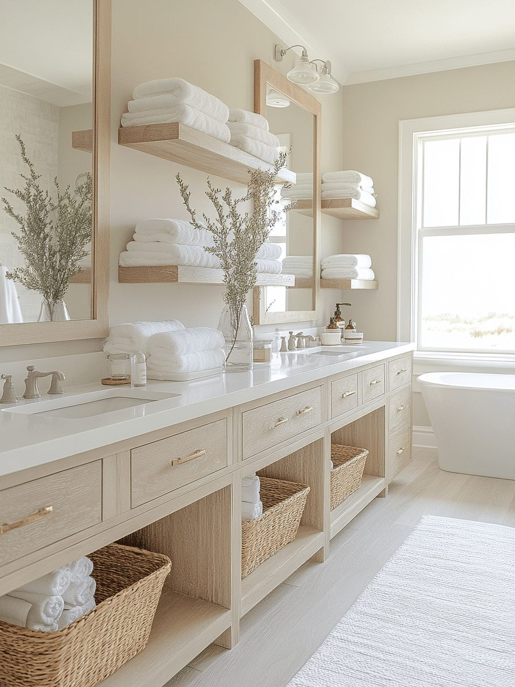

> TIP:GUIDE: Budget: $0, it is a rule not a purchase | Time: one look around the room | Skill: beginner

## Takeaway

A rental bathroom doesn't need a renovation — it needs a handful of pieces that hang, stick or roll instead of screwing in. Start with the biggest surface: a bold shower curtain or one wallpapered wall changes the whole room in an afternoon. Then add the storage that fits your gaps — a slim cart, a tension-pole shelf, baskets under the sink — and let matching towels and one plant do the rest. If you want the same calm feeling at full size, our [30 Bathroom Decor Ideas for a Calm, Spa-Like Retreat](/posts/bathroom-decor-ideas/) is the place to look next — and if your rented bathroom is also a small one, our [30 Bathroom Decor Ideas for Small Spaces](/posts/bathroom-decor-ideas-small-spaces/) covers the same tricks sized for tiny rooms. When you move, almost everything on this list moves with you.

## Frequently Asked Questions

### How do I decorate a rental bathroom without losing my deposit?

Stick to changes you can undo: peel-and-stick tile and wallpaper, tension rods, over-the-door racks, adhesive hooks and suction-cup shelves. Avoid drilling, painting or replacing fixtures. Keep the original fittings, photograph the bathroom when you move in, and remove every addition before you leave — the room should look exactly as you found it.

### What is the best storage for a tiny apartment bathroom?

Go vertical and use the gaps: a tension-pole shelf over the tub, floating shelves on a bare wall, a slim rolling cart beside the vanity and stacked baskets under the sink. Over-the-door racks and suction-cup shower shelves add storage without a single hole, and a tiered tray keeps the counter clear.

### Can I use peel-and-stick tiles in a rental bathroom?

Yes — that is what they are made for. Peel-and-stick backsplash and floor tiles are waterproof, wipe clean and peel off without damaging the wall or floor underneath. Clean the surface first, press each tile firmly from the center out, and keep them away from constant standing water so the edges never lift.

### How do I make a small apartment bathroom feel bigger?

Hang a large round mirror over the vanity to bounce light around, keep the palette pale with one warm accent, and clear the floor — rolling carts and wall storage beat bulky cabinets. A bold shower curtain draws the eye to the back wall, and matching towels stop the room from looking cluttered.

### What plants survive in an apartment bathroom?

Pothos, ferns, spider plants and peace lilies all love bathroom humidity and low-to-medium light. A pothos trailing from a hanging pot is the easiest start — it forgives forgotten watering and grows fast in steam. Keep plants in pots with drainage, and water less than you think, since the steam does part of the job.

### How do I hide clutter in a bathroom with no storage?

Give everything a container: baskets under the sink, a tray on the counter, a fabric skirt hiding the pipes and a hamper for the laundry. Match the containers so the shelves read as decor, not a pile. Keep daily items at hand height, spare stock higher up, and nothing loose on the floor.

### Are adhesive hooks and shelves strong enough for a bathroom?

Yes, if you pick the right ones and install them properly. Clean the tile with rubbing alcohol, let it dry, press the mount firmly for a full minute and wait a day before loading it. They only work on smooth, glossy tile — not textured or matte — and you should re-press suction cups once a month.

### What is the cheapest way to refresh an apartment bathroom?

Start with what you see most: a bold new shower curtain, matching towels and a plant. Add a peel-and-stick backsplash behind the sink and a tray on the counter, and roll the towels in a basket. For under fifty dollars the room looks redone — paint, new fixtures and new tile can wait for a home you own.
