# 30 Bathroom Decor Ideas for Small Spaces

A small bathroom does not need a renovation to feel bigger — it needs smarter choices. These are the 30 bathroom decor ideas small spaces actually need — furniture that floats, mirrors that double the light, and storage that climbs the walls instead of eating the floor. Every idea here fits a tight footprint, and most of them take a weekend or less.

The thread running through all of them is simple: show more floor, keep the surfaces calm, and give everything a home. If you want the softer, spa-like side of small-bathroom decorating too, our [30 Bathroom Decor Ideas for a Calm, Spa-Like Retreat](/posts/bathroom-decor-ideas/) pairs beautifully with this list — same small room, a calmer mood.

## 1. A Floating Vanity That Frees the Floor

A wall-mounted vanity is the single biggest space trick in a small bathroom. With no cabinet touching the floor, you see the tile run underneath it, and your eye reads the room as larger than it is. This one pairs a white floating cabinet with a vessel sink, an open shelf below for rolled towels, and a large mirror above.

Keep the vanity shallow — around sixteen to eighteen inches deep is plenty for a small room — and leave the space beneath it genuinely empty. That open strip of floor is doing the work, so do not fill it with baskets and bottles.

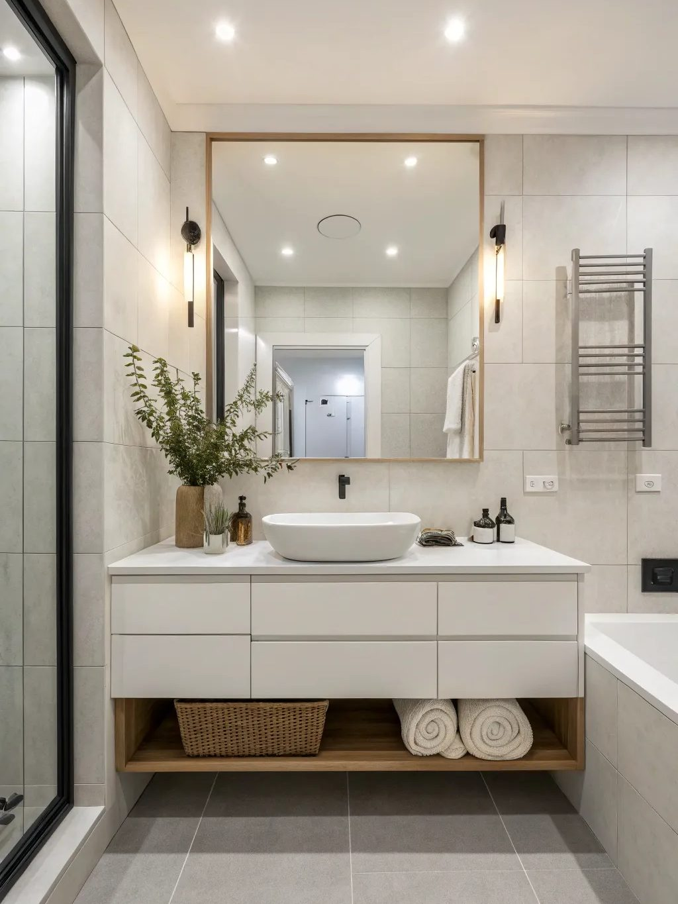

> TIP:QUICK: Choose a vanity no deeper than 18 inches — the floor you can see underneath it is what makes the room feel bigger.

## 2. An Oversized Mirror That Doubles the Room

One mirror, as large as the wall allows, is worth more than any decoration in a small bathroom. It bounces the window light across the room and reflects the opposite wall, so the space reads as twice its size. This oversized mirror spans the whole vanity wall, framed in slim black, with the window and the room doubled in the glass.

Hang it so it reaches almost to the ceiling and down close to the backsplash. A mirror that stops short looks like a picture; a mirror that fills the wall looks like a window.

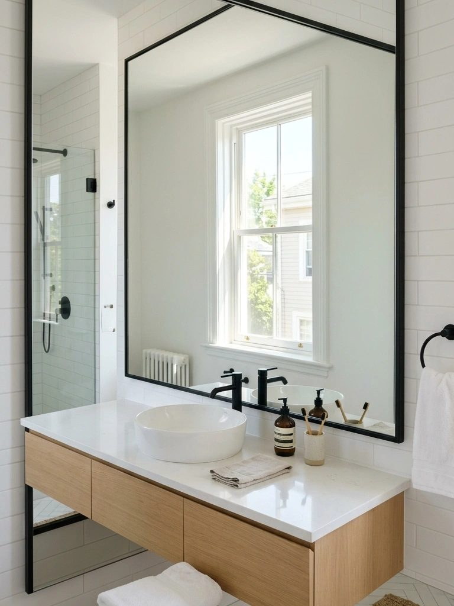

> TIP:CHECK: Mirror spans the full vanity width; top edge near the ceiling; no frame wider than an inch

## 3. A Corner Sink for the Dead Corner

Corners are the most wasted inches in a small bathroom, and a corner sink puts one of them to work. A triangular basin tucks into the junction of two walls, leaving the middle of the room clear for moving around. This white ceramic corner sink sits against dark tile, with a small faucet and nothing else competing for attention.

A corner sink works best in a powder room or a second bathroom where one person uses it at a time. Pair it with a small round mirror above and a single hook for a hand towel, and the corner becomes a complete little wash station.

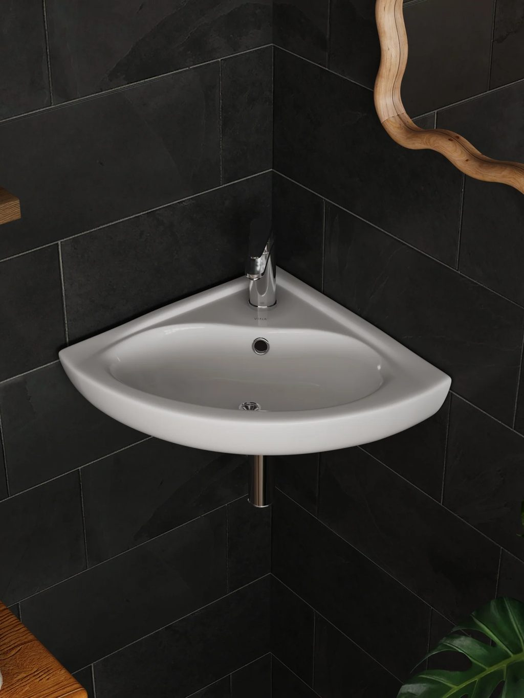

> TIP:GUIDE: Best for: powder rooms | Sink size: 14–18 inches wide | Mirror: small and round

## 4. A Wall-Mounted Faucet That Clears the Counter

Moving the faucet onto the wall frees the whole back edge of the counter — in a small bathroom, that is often a third of your usable surface. This matte black wall-mounted faucet arcs over a white vessel sink on a slim wood shelf, with the counter holding only a soap dispenser and a small plant.

Wall-mounted faucets need the plumbing in the wall, so they are easiest during a refresh that already opens the wall up. If the wall is staying shut, a short single-hole deck faucet is the next best thing for keeping the counter clear.

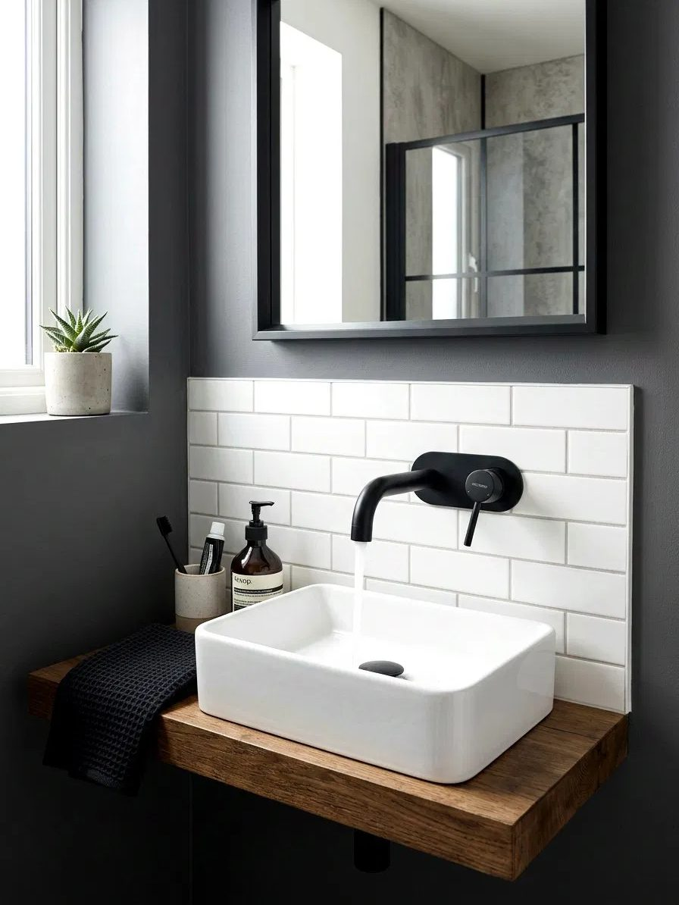

> TIP:QUICK: A wall-mounted faucet gives you back the whole rear edge of the counter — keep it clear and the vanity looks twice as wide.

## 5. A Slim Cabinet Over the Toilet

The wall above the toilet is free real estate in every small bathroom. A slim cabinet that straddles the tank turns it into closed storage for towels, toilet paper and spares — without taking a single inch of floor. This white cabinet frames the toilet neatly, with a shelf on top for a tray and glasses, and a tall side cupboard for the bulky stuff.

Measure the tank before you buy: the cabinet legs must clear it with room to lift the lid. Keep the cabinet no deeper than eight inches so it never looms over anyone sitting down.

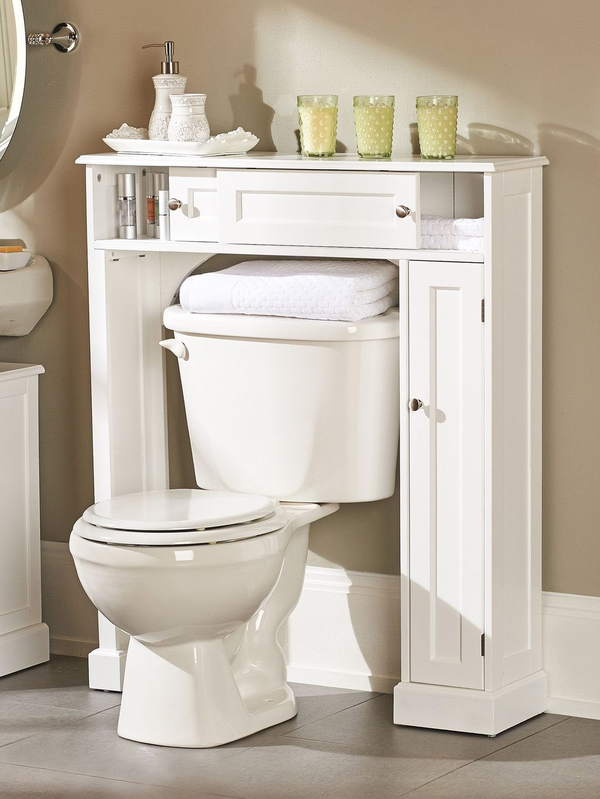

> TIP:CHECK: Legs clear the tank lid; depth under 8 inches; heaviest items on the lowest shelf

## 6. A Glass Shower Screen Instead of a Curtain

A shower curtain cuts a small bathroom in half visually. A clear glass screen keeps the shower open to the room, so your eye travels the full length of the wall and the bathroom feels like one space. This frameless glass enclosure sits against white tile, with the shower fittings visible through the glass and the floor running unbroken beneath it.

Keep the glass spotless and the shower tidy, because everything behind it is now on display. A daily squeegee takes thirty seconds and stops water spots from dulling the effect.

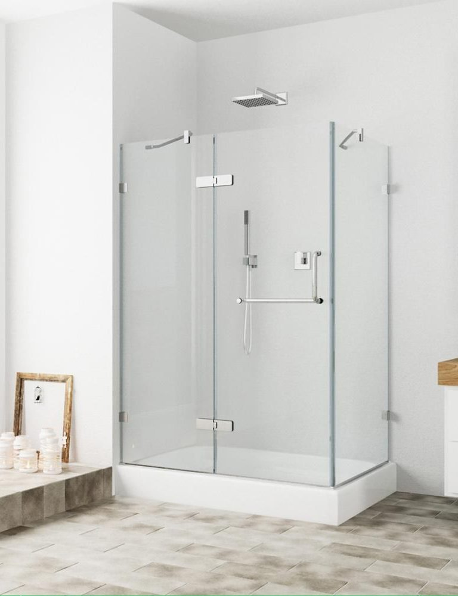

> TIP:GUIDE: Budget: $150–$400 for a fixed panel | Time: an afternoon to fit | Skill: confident DIY or a glazier

## 7. A Corner Caddy That Holds the Shower

Shower bottles on the floor are the fastest way to make a small shower feel cramped. A tall corner caddy uses the one spot nobody stands in, stacking four shelves of bottles up the wall. This tension-pole caddy holds shampoo, conditioner, body wash and a sponge, with every bottle upright and within reach.

Tension poles need a firm ceiling to press against, so check yours is solid before you buy. If the ceiling is soft or sloped, wall-mounted corner shelves with adhesive mounts do the same job without the pole.

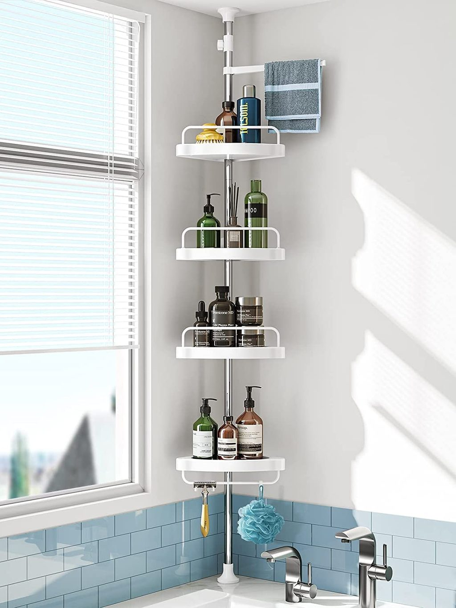

> TIP:QUICK: Put the bottles you use daily on the middle shelves — top and bottom are for the spares you reach for weekly.

## 8. A Pocket Door That Gives Back the Swing

A standard bathroom door needs about nine square feet of clear floor just to swing open. A pocket door slides into the wall instead, and that floor comes back to you — enough for a hamper, a stool, or simply room to turn around. This white sliding door glides on a black rail, opening onto a small bathroom with the vanity and toilet both easy to reach.

Pocket doors need a hollow wall to slide into, so they suit a renovation better than a quick swap. If the wall cannot take one, a barn-style sliding door on an outside rail gives you most of the same saving.

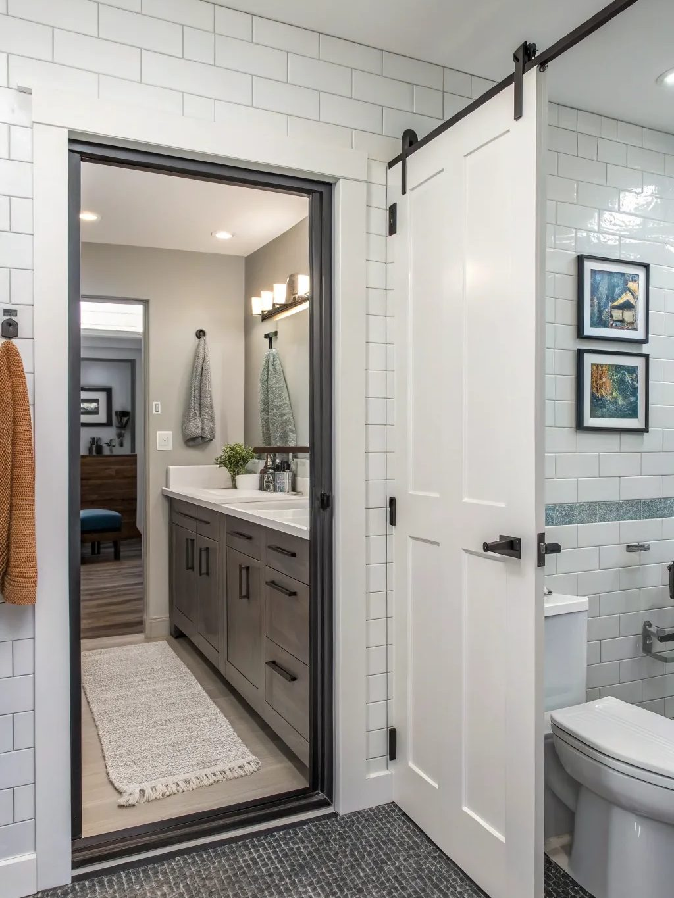

> TIP:CHECK: Wall hollow enough for the pocket; rail rated for the door weight; lock that works from both sides

## 9. One Pale Paint Color, Walls and Ceiling

Painting the walls and ceiling the same pale color erases the line where one ends and the other begins, and the room feels taller and wider. This bright bathroom is white from floor to ceiling, with the window light bouncing off every surface and only a patterned towel and a wooden stool adding warmth.

Pick a warm white rather than a stark one — small bathrooms go cold fast under cool white paint. One color everywhere also hides the awkward corners and pipe boxes that a two-tone scheme would outline.

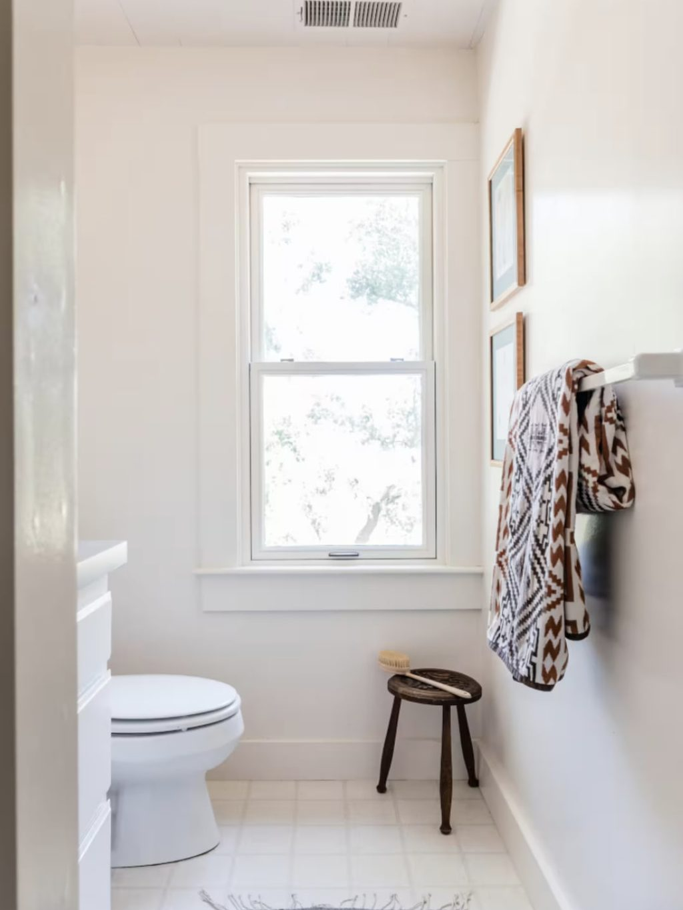

> TIP:GUIDE: Paint: warm white, eggshell finish | Ceiling: same color, flat finish | Trim: same white, satin

## 10. Large-Format Tiles with Fewer Grout Lines

Small tiles mean a grid of grout lines that chops a small floor into dozens of pieces. Large-format tiles do the opposite: fewer lines, bigger expanses of one surface, and a floor that reads as a single calm plane. This bathroom runs big beige marble-look tiles across the floor and up the walls, with a glass shower and a wood vanity floating above them.

Use the same tile on the floor and at least one wall and the room gains a continuous look. Keep the grout color close to the tile so the few lines that remain all but disappear.

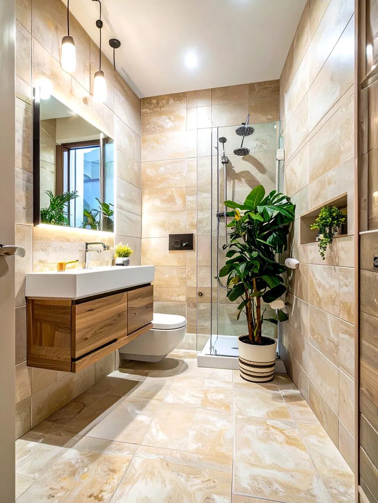

> TIP:QUICK: Match the grout to the tile color — the lines vanish and the floor reads as one unbroken surface.

## 11. A Slim Rolling Cart in the Gap

Every small bathroom has a gap — between the vanity and the toilet, or the toilet and the wall — too narrow for furniture and too wide to waste. A slim rolling cart, about six inches wide, slides into exactly that gap with three tiers of storage. This white cart holds toiletries and towels beside the vanity, and rolls out when you need something from the back.

Measure the gap before you order, and leave half an inch of clearance on each side so the cart rolls freely. Put the daily items on the top tier and the refills below, and the cart earns its narrow footprint every morning.

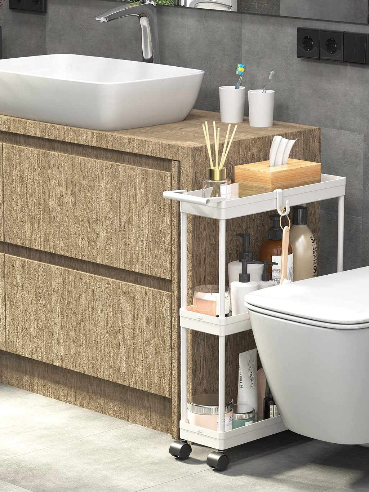

> TIP:CHECK: Gap measured first; half an inch clearance each side; daily items on the top tier

## 12. A Wall-Hung Toilet with a Hidden Tank

A wall-hung toilet floats like the vanity: no pedestal, no tank against the wall, just the bowl — and the floor runs clear beneath it. The tank hides inside the wall, the flush plate sits flush on the tile, and the whole fixture takes up less visual room than a standard toilet. This one hangs on pale grey tile with a small niche and plants softening the wall.

The hidden tank needs a sturdy in-wall frame, so this is a renovation job, not a swap. The payoff is real, though: the floor beneath the bowl is easy to mop, and the room looks several inches longer.

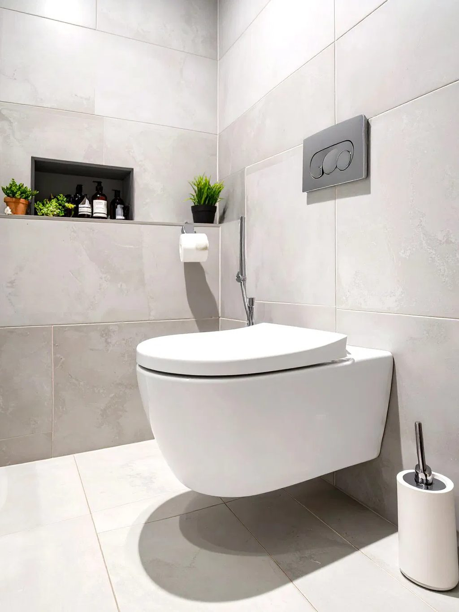

> TIP:GUIDE: Budget: $400–$900 plus fitting | Time: part of a renovation | Skill: hire a plumber

## 13. A Medicine Cabinet That Hides the Clutter

A mirrored medicine cabinet is two fixtures in one: the mirror you need and the storage you have no room for. This white cabinet has a mirror in the middle and open shelves on both sides, with bottles and jars arranged like a display and a towel bar underneath. The clutter that used to cover the counter now lives behind the mirror.

Recess the cabinet into the wall if you can — it sits flush and steals no space from the room. Surface-mounted is fine too, but keep it shallow, no deeper than five inches, so it never crowds the sink.

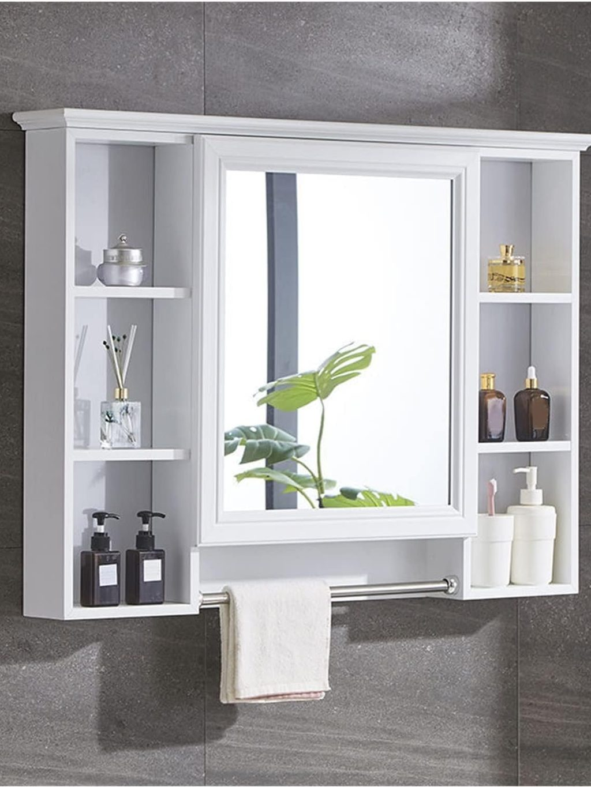

> TIP:QUICK: Recess the cabinet into the wall when you can — a flush mirror steals zero inches from the room.

## 14. Hooks Instead of a Towel Bar

A towel bar needs a long clear run of wall; hooks need almost none. Three hooks in a row hold three towels in the space one bar would take, and each towel hangs folded so it dries faster. These matte black hooks hold thick grey towels on a white tiled wall, with each towel given its own hook and its own air.

Space the hooks about eight inches apart so the towels do not overlap and stay damp. Put the hook you use most at shoulder height, and the spares a little higher where they stay out of the way.

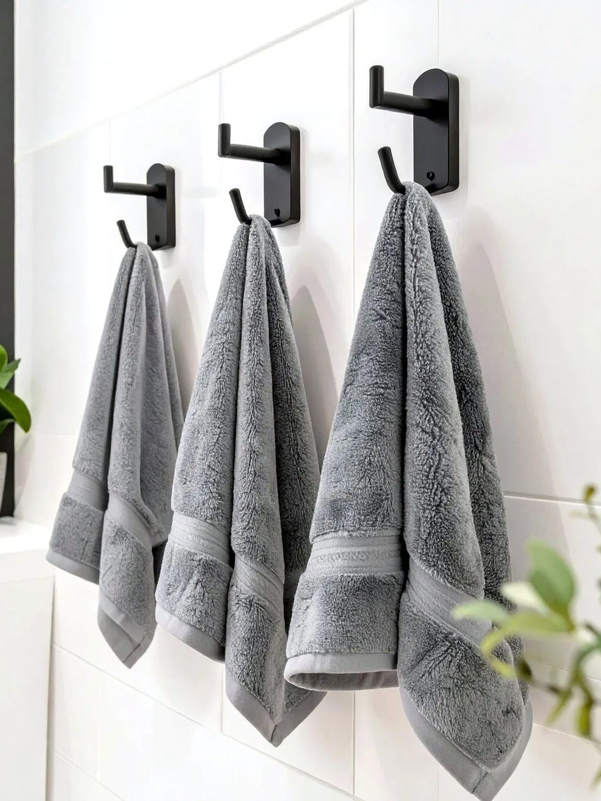

> TIP:CHECK: Hooks eight inches apart; own hook per towel; most-used hook at shoulder height

## 15. A Fold-Down Shelf for a Tiny Vanity

When there is no room for a vanity at all, a fold-down shelf is the answer. It mounts to the wall, folds flat when you are done, and gives you a counter exactly when you need one. This light wood shelf folds down under a round mirror, holding rolled towels, a soap dispenser and a toothbrush cup, with a small plant on top.

Mount it into a stud or with heavy-duty wall anchors — a shelf that holds toiletries and leans on daily takes real weight. Fold it up after the morning rush and the wall is bare again.

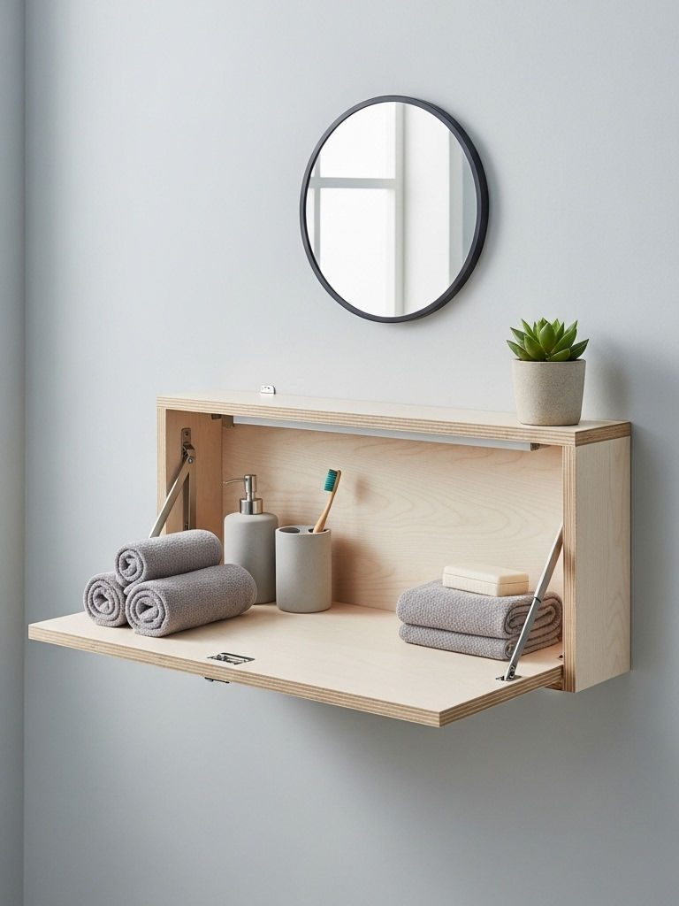

> TIP:GUIDE: Budget: $30–$80 | Time: 30 minutes to mount | Skill: beginner with wall anchors

## 16. A Tall, Narrow Storage Tower

When the floor is full, go up. A tall, narrow tower — twelve inches wide and six feet tall — holds towels, toilet paper and toiletries in the footprint of a floor tile. This white tower stands beside a dark vanity with its doors open, showing folded towels, rolled washcloths and baskets stacked shelf by shelf.

Anchor it to the wall so it can never tip, especially in a house with children. Keep the daily towels at hand height, the spares up top, and the heavy bottles down low where they cannot fall far.

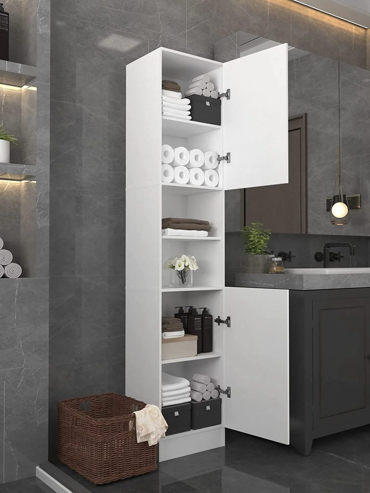

> TIP:QUICK: Anchor any tower taller than four feet to the wall — a full tower is heavier than it looks.

## 17. Dividers and Clear Bins Under the Sink

The cabinet under the sink is usually a dark jumble where things go to be forgotten. Dividers and clear bins turn it into a system: baskets around the pipes, pull-out drawers for the small stuff, and every bottle visible at a glance. This under-sink cabinet holds woven baskets, clear drawers and folded towels, with toilet paper stacked neatly to one side.

Measure around the pipes before you buy anything — the bins must fit the odd shapes the plumbing leaves behind. Label nothing; the clear bins are the labels, and you can see what is running low without opening a thing.

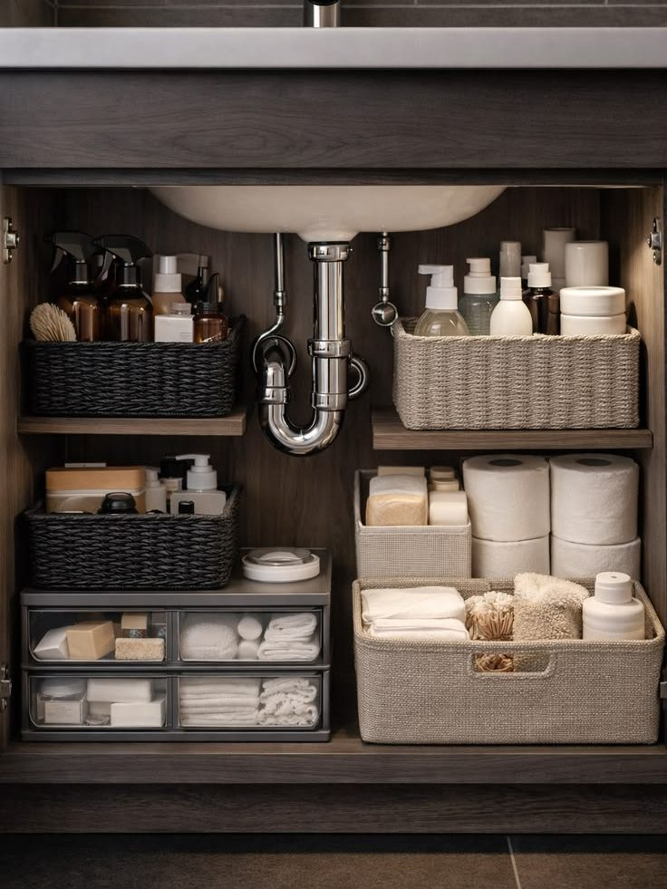

> TIP:CHECK: Bins measured around the pipes; clear bins so stock is visible; one basket per category

## 18. Frosted Window Film for Light and Privacy

A small bathroom window needs privacy, but a curtain steals the light the room cannot spare. Frosted window film gives you both: the glass turns opaque, the daylight still pours in, and there is nothing to wash or replace. This four-pane window above the tub is fully frosted, glowing softly while the room stays bright and private.

Apply the film to clean, dry glass with a spray bottle and a squeegee, and trim it a hair smaller than the pane so the edges never peel. Static-cling film is the renter-friendly pick — it peels off cleanly when you move.

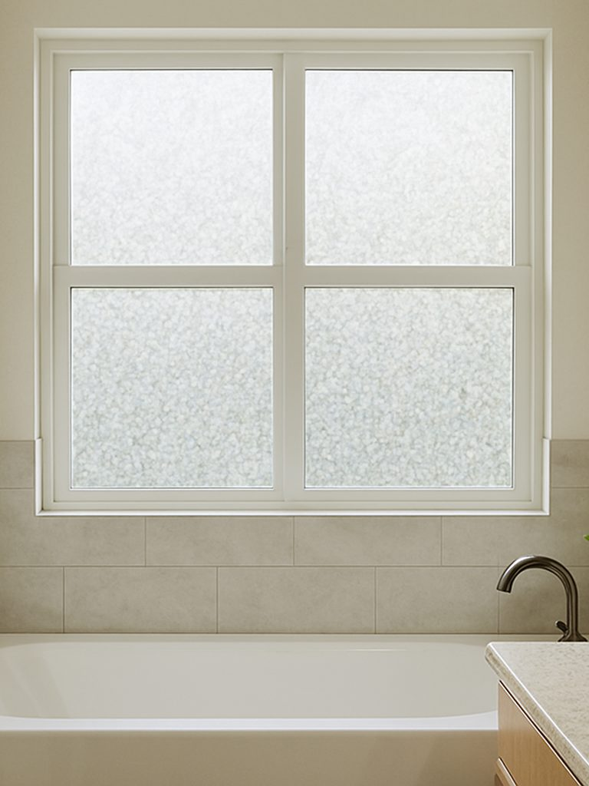

> TIP:GUIDE: Budget: under $20 | Time: 30 minutes | Skill: beginner, static-cling peels off clean

## 19. A Small Patterned Floor That Steals the Show

In a small bathroom, one bold surface is enough — and the floor is the best place for it. A patterned tile floor gives the room its personality in a single glance, while the walls stay pale and quiet. This narrow bathroom runs blue and white patterned tiles across the floor and halfway up the walls, with a white sink and toilet letting the pattern do all the talking.

Keep the pattern small in scale so it suits the room — big motifs overwhelm a tiny floor. One patterned surface is the rule: if the floor is busy, the walls, towels and shower curtain stay plain.

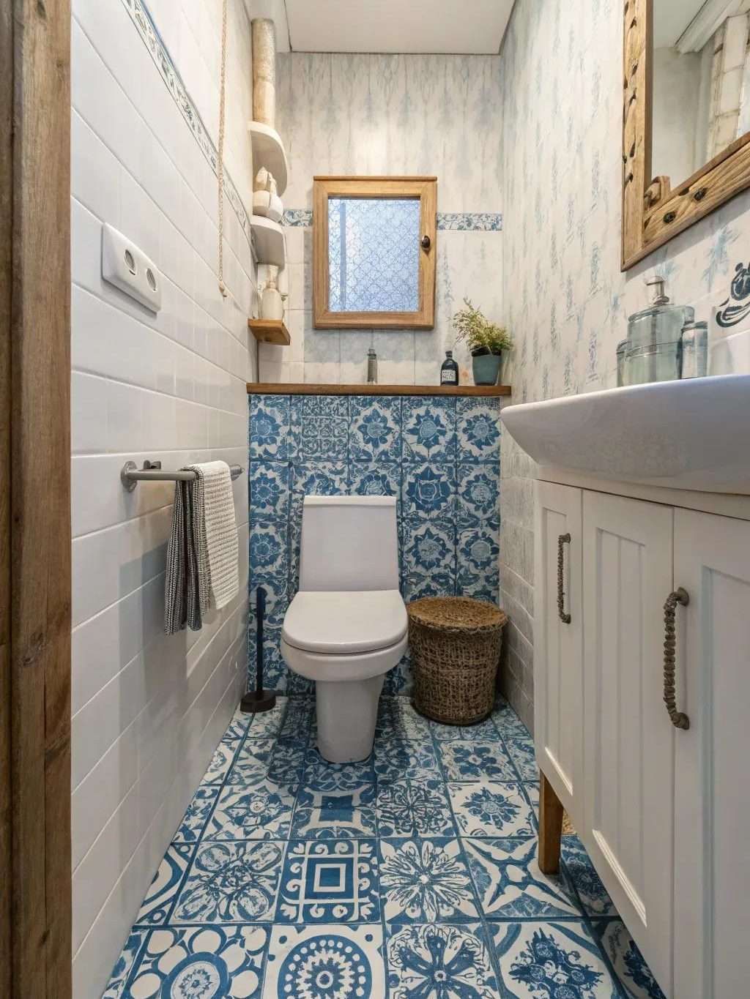

> TIP:QUICK: One patterned surface per room — if the floor is bold, keep the walls, towels and curtain plain.

## 20. A High Shelf Above the Door

The strip of wall above the door is the most overlooked storage in a small bathroom. A shelf up there holds spare towels, baskets and the things you reach for weekly, completely out of the way. This bathroom has woven baskets above the door and a tall open cabinet beside it, so the storage climbs the walls while the floor stays clear.

Keep what you store up there light — towels and toilet paper, never bottles or jars. A small step stool (see idea 28) is what makes the shelf usable instead of decorative.

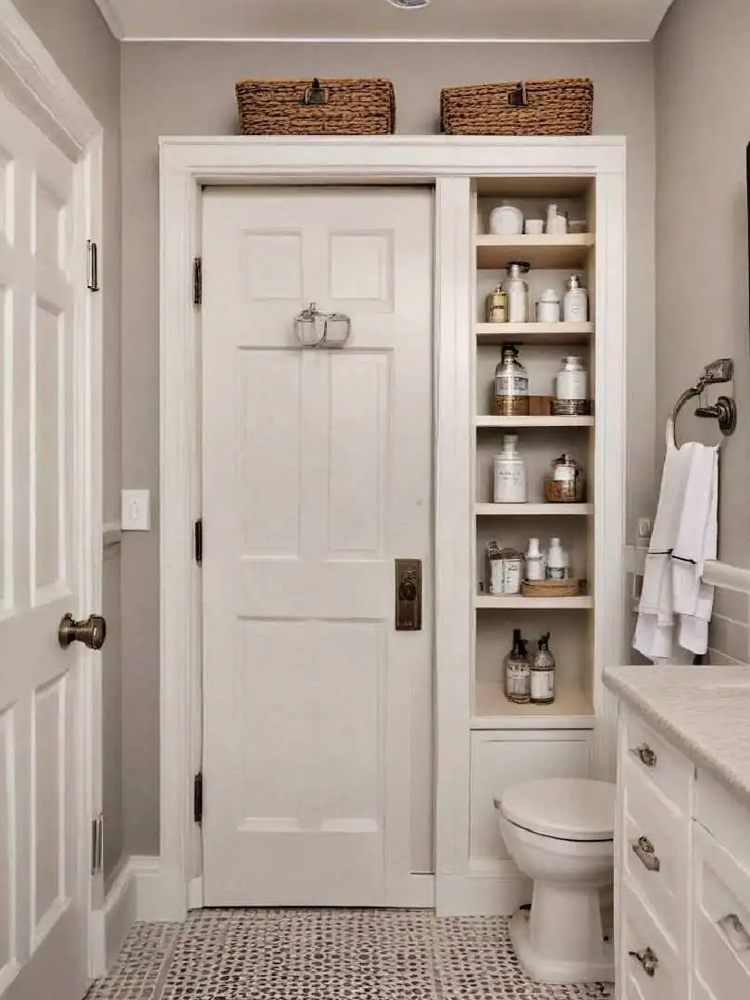

> TIP:CHECK: Light items only up high; shelf anchored into studs; step stool kept nearby

## 21. A Curved Shower Rod That Adds Elbow Room

A curved shower rod bows outward by a few inches, and those inches are exactly the elbow room a small shower lacks. The curtain hangs further from your shoulders, the shower feels wider, and the water still stays inside the tub. This chrome curved rod holds a cream curtain over a white tub, with the bow giving the whole shower a little more air.

Measure the tub before you buy — curved rods come in fixed lengths, and the bow must clear the wall on both ends. Pair it with a light-colored curtain so the extra space also looks brighter.

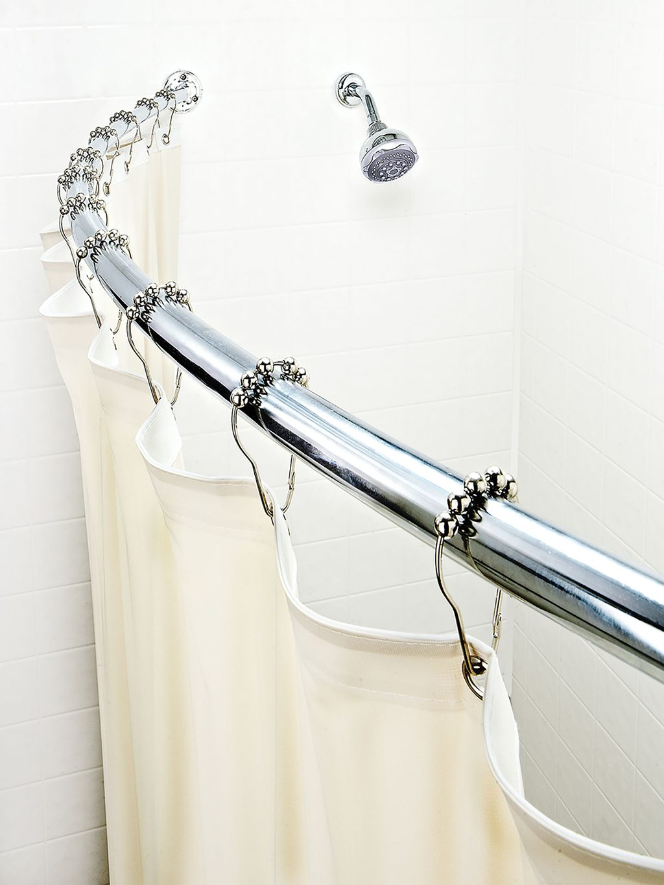

> TIP:GUIDE: Budget: $25–$60 | Time: 20 minutes | Skill: beginner, two screws per end

## 22. One Warm Metal, Repeated Everywhere

A small room with three different metals looks unfinished; a small room with one warm metal looks designed. Pick brass or brushed gold and repeat it on the faucet, the mirror frame, the towel hooks and the cabinet pulls, and the whole bathroom gains a single jewelry tone. This bathroom runs brass through the faucet, the mirror, the shower fittings and the vanity legs.

Keep the finish the same across every piece — brushed with brushed, polished with polished — so the repetition reads as deliberate. One warm metal also warms up white tile, which is the coldest surface in a small bathroom.

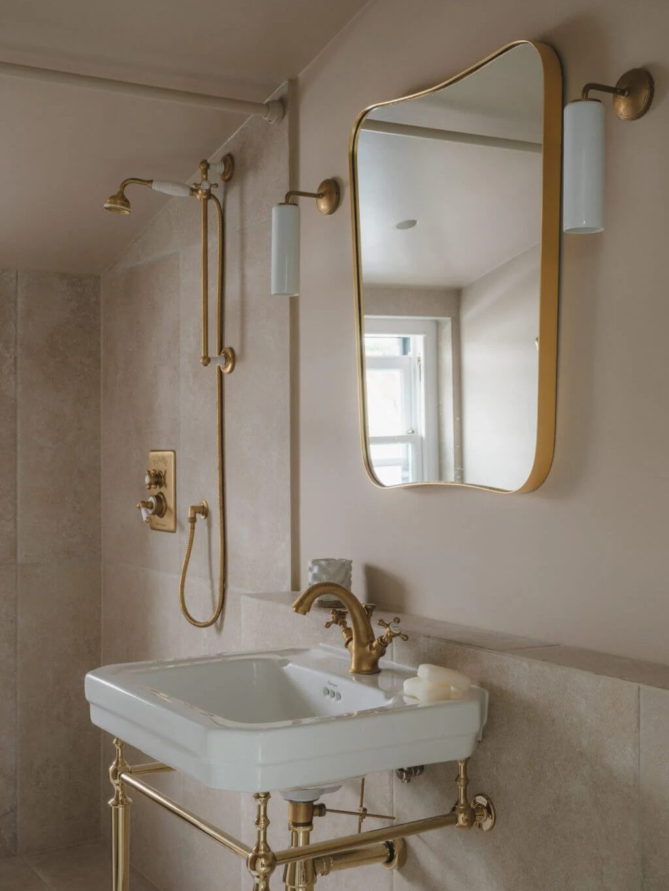

> TIP:QUICK: One metal, one finish, everywhere — faucet, mirror frame, hooks and pulls all in the same warm tone.

## 23. A Slim Vertical Light Bar Beside the Mirror

Overhead light alone makes a small bathroom feel like a corridor. A slim vertical light bar beside the mirror puts the light at face height, where it flatters and where you actually need it — and its thin profile takes almost no wall. This tall LED bar glows warmly next to a large mirror, with the light washing down the tiled wall.

Choose a warm bulb around 2700 Kelvin and put the bar on a dimmer if you can. One bar beside the mirror is enough in a tiny room; two, one on each side, is the full grooming setup.

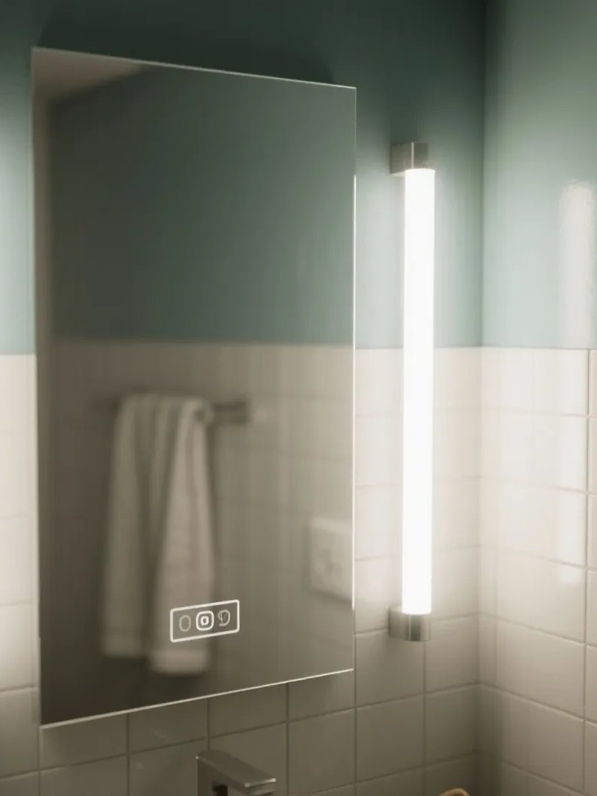

> TIP:CHECK: Warm 2700K light; bar at face height; dimmer if you can wire one in

## 24. A Hanging Planter That Uses the Ceiling

Counter space is precious in a small bathroom, so put the plant where nothing else can go: hanging from the ceiling. A macrame planter with a trailing plant fills the empty air above the tub, thrives on the steam, and adds the one soft, living note a tiled room needs. This one hangs by the window, its vines trailing past the shower curtain.

Hang it where it will not drip on anyone — over the tub or beside the window, never over the toilet or the vanity. A pot with a saucer or a liner catches the drips, and a plant that likes humidity does the rest.

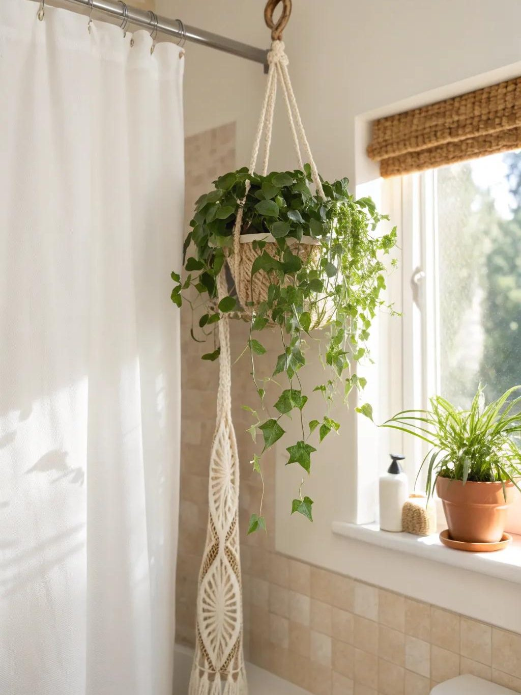

> TIP:GUIDE: Best plants: pothos, spider plant | Pot: with saucer or liner | Hang: over the tub, never the vanity

## 25. A Narrow Runner That Fits the Floor

A full-size bath mat crowds a small bathroom; a narrow runner fits it. A runner two feet wide runs the length of the floor between the vanity and the tub, warming the cold tile underfoot without covering the floor you worked to show. This patterned runner lies on dark hexagonal tile, its reds and creams picking up the vanity wood.

Measure the open floor before you buy — the runner should stop a few inches short of every fixture so it never bunches. A washable runner with a non-slip backing is the practical pick for a room that gets wet daily.

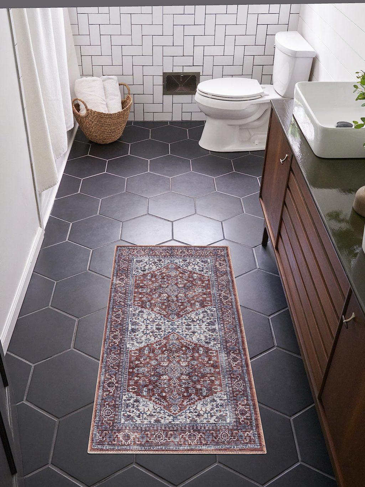

> TIP:QUICK: Measure the open floor first — the runner should stop a few inches short of every fixture so it lies flat.

## 26. A Folding Drying Rack on the Wall

Wet towels draped over the shower door make a small bathroom look messy within minutes. A folding drying rack mounts to the wall, flips out when you need it, and folds flat against the tile when you do not. This slim metal rack extends from the wall beside the vanity, holding nothing right now — and that is the point: it disappears when the towels are dry.

Mount it near the shower but not inside the spray, so damp towels dry in the airflow. Fold it away every morning and the wall is bare, which is exactly what a small room needs most of the day.

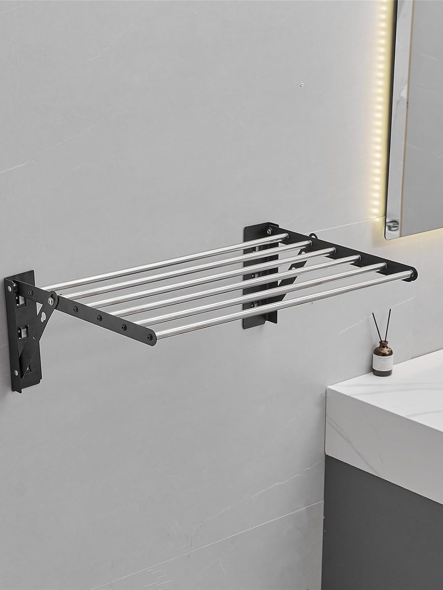

> TIP:CHECK: Mounted near the shower, out of the spray; folds flat when empty; anchored into a stud

## 27. A Monochrome Palette in One Soft Color

When every surface in a small bathroom belongs to one color family, the room stops looking pieced together and starts looking designed. This grey monochrome bathroom runs the same soft tone across the vanity, the floor, the walls and the towels, with a backlit mirror and a plant as the only contrast. Nothing fights, so the room feels calm and larger.

Pick your color first — warm grey, soft sage, pale blue — and let every new piece match one of its shades. The rule is forgiving: three shades of one color count as one palette, and they give the room depth without clutter.

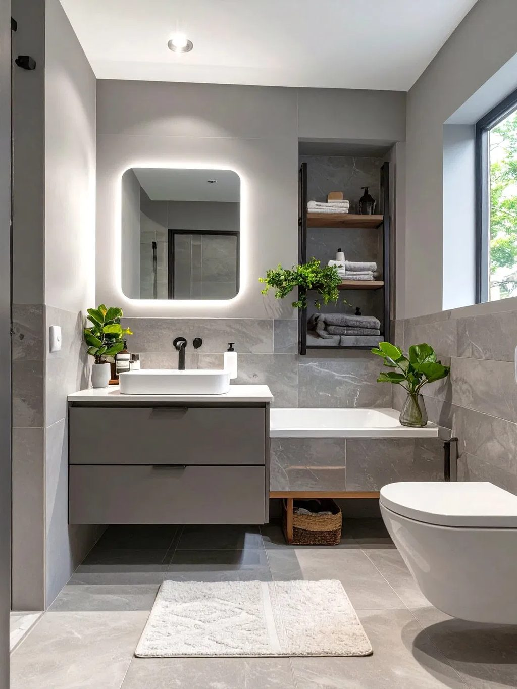

> TIP:GUIDE: Palette: one color, three shades | Contrast: one mirror, one plant | Avoid: a second accent color

## 28. A Compact Step Stool That Doubles as Storage

A small bathroom has high shelves and short people, and a step stool bridges the gap. A compact two-step stool tucks beside the toilet, reaches the top shelf when you need it, and doubles as a seat or a side table the rest of the day. This white stool stands next to the toilet in front of the shower, light enough to move with one hand.

Choose a stool with a flat top step wide enough to stand on safely, and non-slip feet so it never slides on tile. If it has an open frame, slide a basket of spare toilet paper underneath and it stores something too.

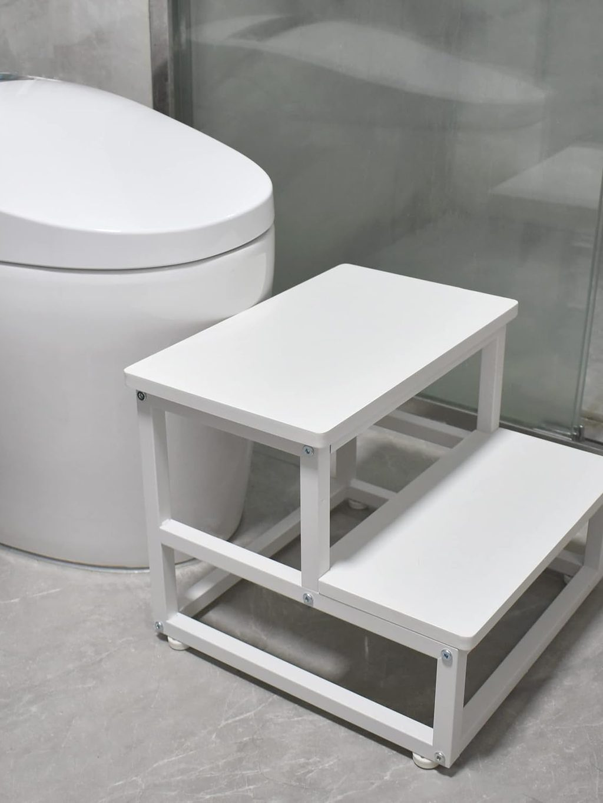

> TIP:QUICK: Non-slip feet are non-negotiable — a stool that slides on wet tile is worse than no stool at all.

## 29. Matching Towels in One Color, Folded the Same Way

Nothing calms a small bathroom faster than matching towels. Same color, same size, folded the same way, stacked in neat rows — and suddenly the open shelves look intentional instead of crowded. These wooden shelves hold white and sage towels folded into identical stacks, with candles and a small plant between them.

Buy the towels as a set in one color, and fold them all the same way — thirds, then in half — so every stack lines up. Two colors at most: one main towel color and one accent for the hand towels.

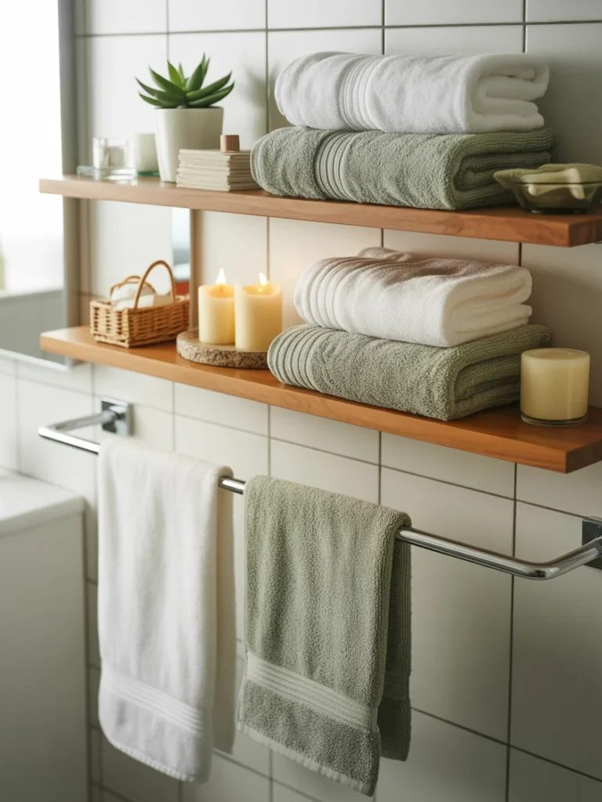

> TIP:CHECK: One main towel color; all folded the same way; stacks lined up, never mixed heights

## 30. Keep the Counter Clear: One In, One Out

The last idea costs nothing and matters most. A small bathroom counter holds about five things before it looks crowded, so every new bottle that arrives means an old one leaves. This minimal white vanity holds only a soap dispenser, a small plant and a folded hand towel — everything else lives in the cabinet, the caddy, or the tower.

Make it a household rule, not a one-time tidy: one in, one out, for every bottle, jar and gadget. The counter stays clear, the room stays calm, and every other idea on this list looks twice as good.

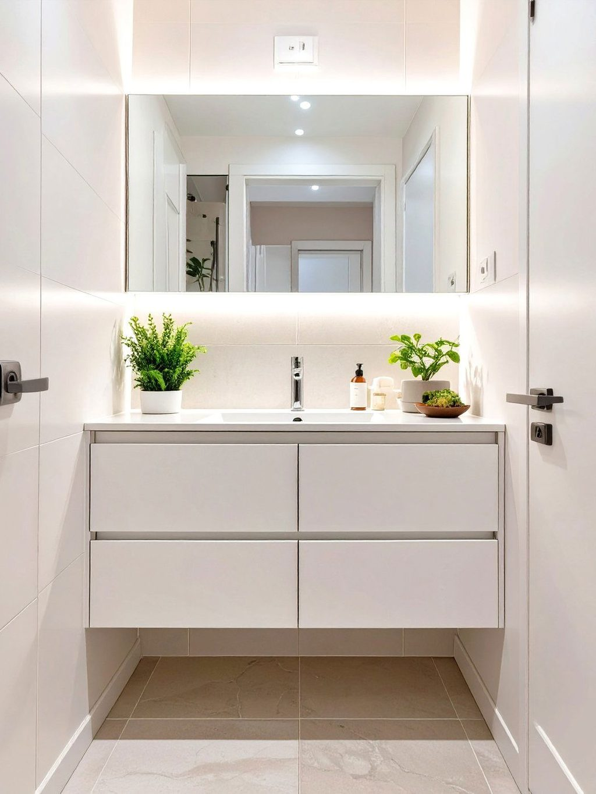

> TIP:GUIDE: Rule: one in, one out | Counter limit: five items | Reset: two minutes every evening

## Takeaway

A small bathroom gets bigger by subtraction and by height: float the vanity, hang the mirror large, move storage up the walls, and keep the floor in sight. Start with the cheapest wins — the hooks, the frosted film, the matching towels, the one-in-one-out rule — and the room will already feel different by the weekend. Then save the bigger moves, the pocket door and the wall-hung toilet, for the next refresh. If you want the same small room with a softer, spa-like mood, our [30 Bathroom Decor Ideas for a Calm, Spa-Like Retreat](/posts/bathroom-decor-ideas/) is the companion list to this one, and if you rent, our [30 Bathroom Decor Ideas for Apartments](/posts/bathroom-decor-ideas-apartment/) covers the renter-friendly, no-drill versions of these tricks.

## Frequently Asked Questions

### How do I make a very small bathroom look bigger?

Show more floor and bounce more light: a floating vanity, a wall-hung toilet, one oversized mirror, and pale paint on walls and ceiling. Keep the counter clear and the palette to one or two colors. Glass shower screens and large-format tiles also help, because fewer visual breaks make the room read as one open space.

### What is the best storage for a small bathroom?

Go vertical before you go wide: a tall narrow tower, shelves over the toilet, a high shelf above the door, and a medicine cabinet behind the mirror. Under the sink, use clear bins and dividers around the pipes. A slim rolling cart fills the gap beside the vanity, and hooks replace a towel bar.

### What color should I paint a small bathroom?

A warm white or a very pale version of one color — soft sage, pale blue, warm grey — works best, on the walls and the ceiling together. Pale colors reflect the most light, and painting the ceiling the same color erases the line that makes the room feel short. Avoid stark white, which can feel cold.

### Can I fit a bathtub in a small bathroom?

Yes, if the layout allows it: a compact tub around five feet long fits most small full bathrooms, and a shower-over-tub setup saves the most space. A curved shower rod adds elbow room inside it. If the room is under about 35 square feet, a walk-in shower with a glass screen is usually the more comfortable choice.

### How do I keep a small bathroom from feeling cluttered?

Give everything a home and keep the counter to five items or fewer. Use closed storage for the visual noise — a cabinet over the toilet, a medicine cabinet, baskets under the sink — and matching towels folded the same way. The one-in-one-out rule stops new bottles from piling up faster than old ones leave.

### What is the best mirror for a small bathroom?

The largest one that fits the vanity wall, ideally spanning its full width and reaching near the ceiling. A frameless or slim-framed mirror maximizes the glass, and a mirrored medicine cabinet adds storage behind it. Add a slim vertical light bar beside it so the light falls at face height.

### How do I add plants to a small bathroom without losing space?

Hang them or put them high: a macrame planter from the ceiling, a small pot on a high shelf, or a trailing plant beside the mirror. Pothos, spider plants and ferns all love bathroom humidity and need little light. Keep plants off the counter and the vanity, where every inch is already spoken for.

### Do I need a renovation to improve a small bathroom?

No — most of the ideas here need no renovation. Hooks, frosted window film, matching towels, a rolling cart, a corner caddy and a folding shelf are all afternoon jobs. The bigger moves — a pocket door, a wall-hung toilet, a glass shower screen — are worth saving for the next refresh, once the cheap wins are already working.
