# 30 Bedroom Decor Ideas for 2027

Bedroom decor ideas for 2027 lean warm, calm and personal: earthy colour, soft layered textures, sculptural lighting and furniture that works harder in small spaces. The cold, all-grey bedroom is fading out, and in its place come terracotta walls, bouclé chairs, rattan headboards and ceilings painted in soft colour. This list gathers 30 forward-looking ideas you can mix and match, whether you are refreshing one corner or redoing the whole room.

Start with the pieces you touch every day — the bedding, the lighting and the storage — and let the colour follow. A single change, like a painted ceiling or a new headboard, can shift the whole mood of a bedroom without a full renovation, and most of the ideas below work in rented rooms as well as owned ones.

## 1. Warm Earth-Tone Palette

Terracotta, clay, peach and rust are the defining bedroom colours of 2027, and they work because they feel warm without feeling loud. Paint one wall in a soft terracotta, or keep the walls pale and bring the colour in through bedding, cushions and a woven rug. The trick is layering several tones from the same family — peach walls, rust bedding, a clay-coloured throw — so the room feels collected rather than matched.

Warm earth tones suit wood furniture beautifully, especially light oak and pale pine, and they make morning light feel softer. Add woven baskets and a plant or two to keep the palette from feeling flat, and keep metals warm — brass and wood tones rather than chrome.

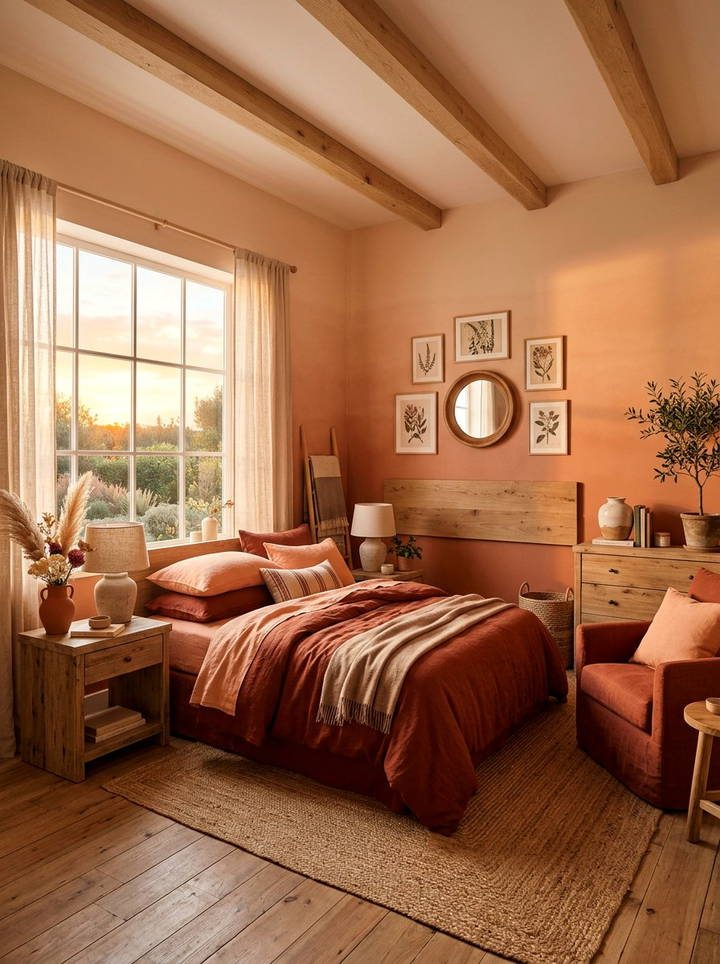

> TIP:QUICK: Pick three tones from one earthy family — wall, bedding, throw — and repeat nothing else.

## 2. Layered Neutral Linen Bedding

Layered linen bedding is the easiest way to make a bedroom feel calm and expensive at the same time. Start with washed linen sheets in cream or oatmeal, add a light duvet, then fold a chunky knit throw across the foot of the bed. The slight wrinkles in linen are part of the look, so there is no need to iron anything.

Mix textures rather than colours: smooth linen, a nubby bouclé cushion, a cable-knit throw and a soft cotton coverlet. The layers also let you adjust through the night — pull the throw up when it gets cool, push it down when it warms up.

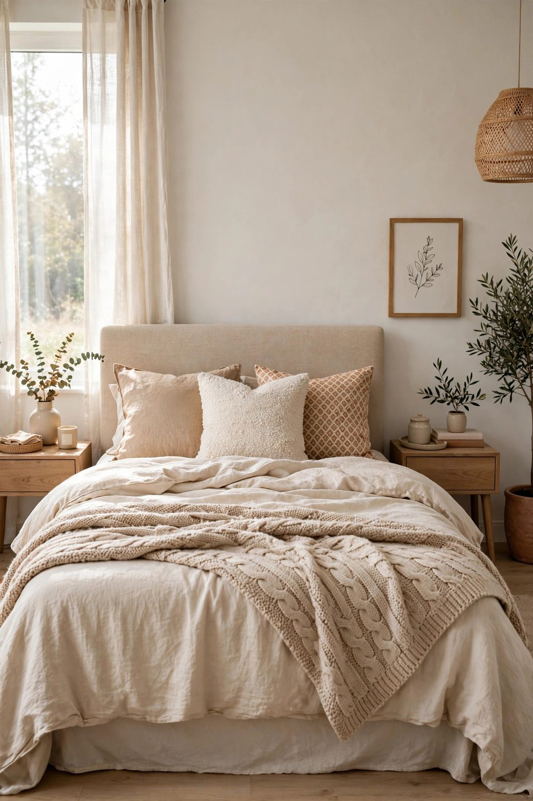

> TIP:CHECK: washed linen sheets; one knit throw at the foot; three textures minimum; no ironing needed

## 3. Oversized Upholstered Headboard

A headboard that runs almost to the ceiling turns the bed into the room's architecture. Channel-tufted panels in a warm beige or greige fabric give a soft, tailored look, and the height makes even a small bedroom feel grand. It also hides a plain wall completely, which is useful in a rental where you cannot paint.

Choose a fabric that can be spot-cleaned, since the headboard sits right behind your pillows. A neutral colour keeps it flexible — change the bedding and cushions with the seasons and the headboard still works.

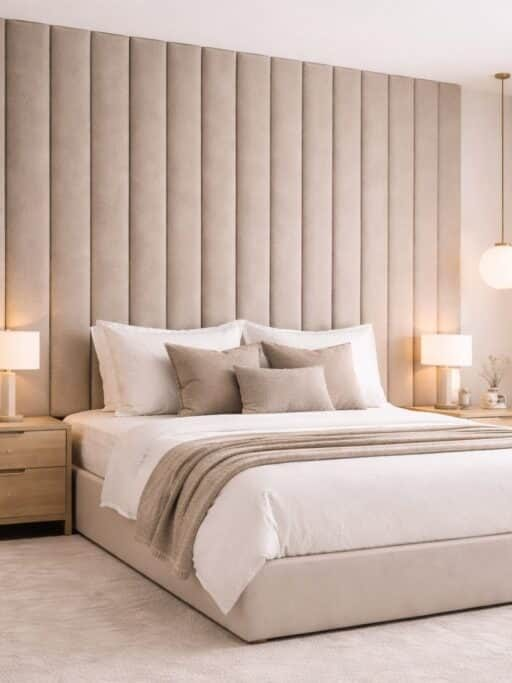

> TIP:GUIDE: Height: near the ceiling for drama | Fabric: spot-cleanable, neutral tone | Pairing: change bedding seasonally

## 4. Sculptural Pendant Light

One sculptural pendant over the bed replaces a plain ceiling light and becomes the room's jewellery. Petal-shaped, cloud-like or woven designs cast soft shadows and warm light, and they look just as good switched off as switched on. Hang it low enough to feel intentional — roughly above head height when you sit up in bed — but high enough that you never bump it.

Keep the rest of the lighting simple when the pendant is the star: small bedside lamps or sconces for reading, and nothing else competing overhead. A dimmer switch makes the pendant work for both bright mornings and slow evenings.

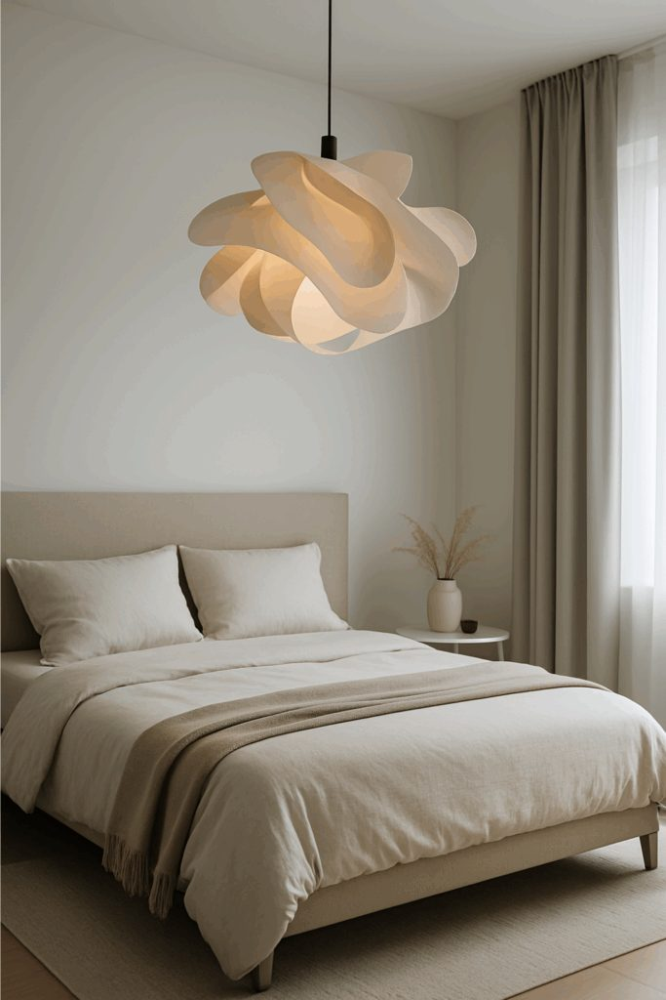

> TIP:QUICK: Hang the pendant low enough to feel deliberate, high enough to never bump it — then add a dimmer.

## 5. Bouclé Accent Chair in the Corner

A bouclé accent chair turns an empty bedroom corner into a reading spot, a dressing corner or simply a soft place to land. The nubby cream fabric is the texture of the moment, and a rounded, low-slung shape makes the chair feel like a cloud. Add one rust or olive cushion and a folded throw for colour.

Place the chair near the window if you can, with a small side table for a book and a cup of tea. A floor lamp behind it gives you evening reading light without taking up bedside space.

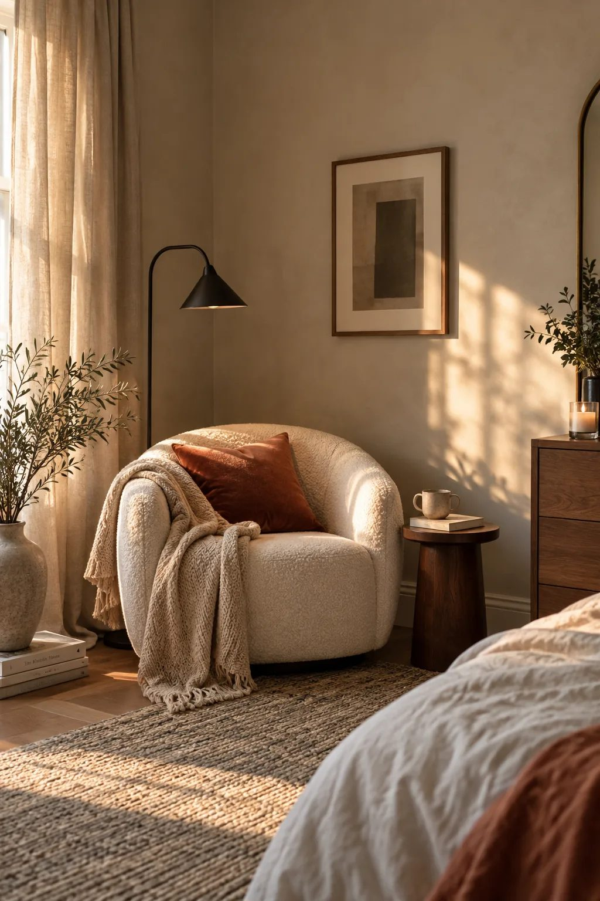

> TIP:CHECK: rounded low shape; one coloured cushion; small side table beside it; floor lamp behind for reading

## 6. Dark Moody Green Accent Wall

Deep green is the moody colour of 2027, and a panelled accent wall behind the bed is the boldest way to use it. The dark green makes white bedding glow and gives brass lamps and wooden furniture a rich backdrop. It works best on the wall you face when you wake up, so the colour is the first thing you see.

Balance the darkness with plenty of light elsewhere: pale bedding, a light rug and a lamp on each nightstand. If a full dark wall feels like too much, paint just the headboard wall and keep the other three walls warm white.

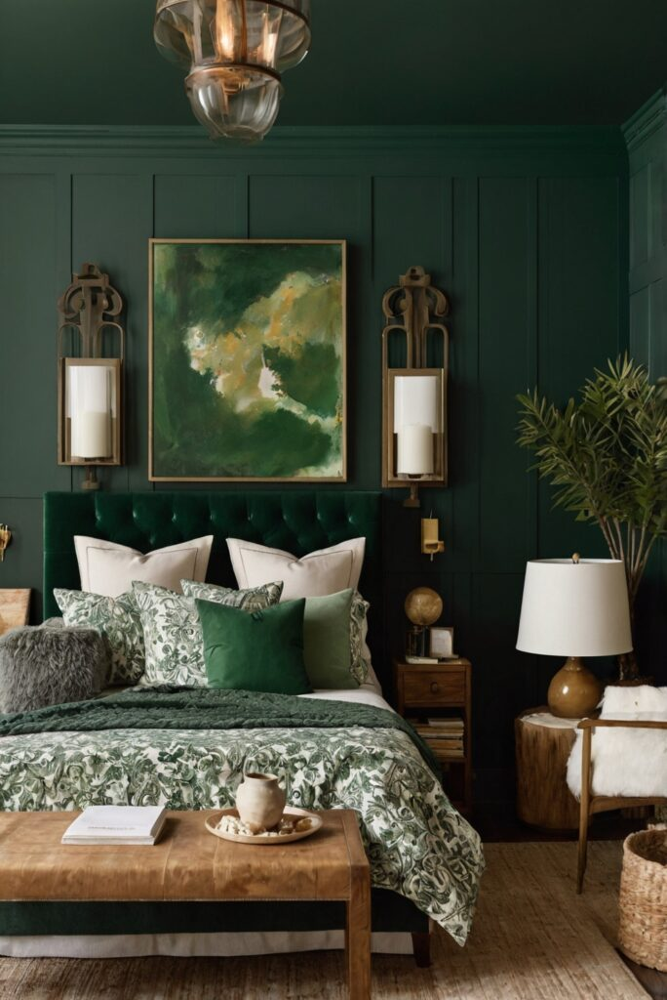

> TIP:GUIDE: Wall: headboard wall only | Balance: pale bedding and a light rug | Metals: warm brass, not chrome

## 7. Sheer Linen Curtains

Sheer linen curtains soften a bedroom window without blocking the light, and they are the single best upgrade for a room that feels harsh in the morning. The fabric filters sunlight into a warm glow, gives you privacy during the day, and moves gently with the air. Hang them from a rod set high and wide so the window looks taller than it is.

Choose a natural off-white or pale oatmeal linen — bright white can look stark against warm walls. Let the curtains pool just slightly on the floor for a relaxed look, or hem them to skim the floor for a tidier one.

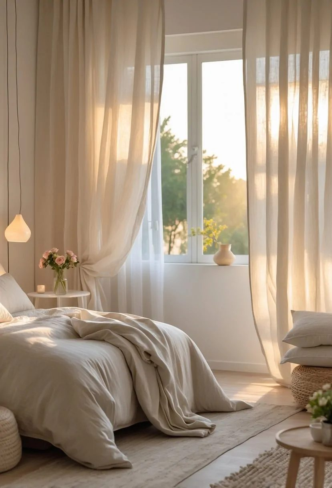

> TIP:QUICK: Hang the rod high and wide so the window looks taller, and let linen sheers filter the light.

## 8. Floor-to-Ceiling Built-In Wardrobe Wall

A full wall of built-in wardrobes is the smartest storage move for a bedroom in 2027, because it swallows clutter and leaves the rest of the room calm. Mix closed doors with a few drawers at the bottom, and choose two finishes — white panels with warm oak sides, for example — so the wall reads as furniture rather than a flat block.

Add a strip of warm light along the top of the wardrobes for a soft evening glow, and keep the handles slim and long in a warm metal. If a full built-in is out of reach, a row of matching tall wardrobes pushed tight together gives a similar effect.

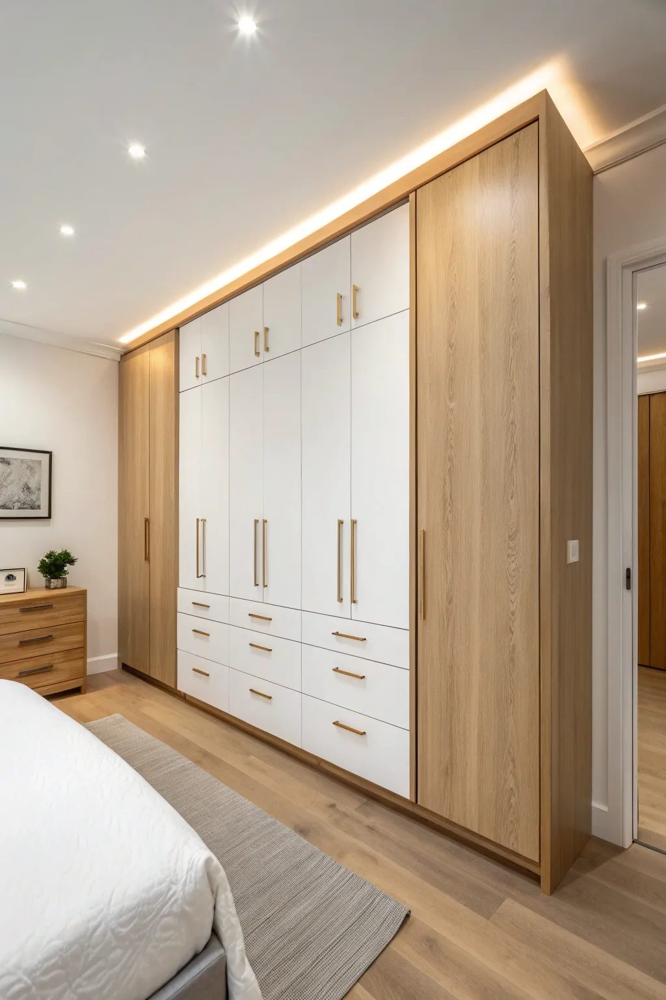

> TIP:CHECK: two finishes, white and warm wood; slim long handles; warm light strip along the top

## 9. Window Reading Nook

A built-in window seat with bookshelves on either side is the cosiest corner a bedroom can have. The cushion, a few striped pillows and a wall lamp make it a proper reading spot, while the drawers underneath hide extra bedding or out-of-season clothes. It also frames the view, so the window becomes a feature instead of just a hole in the wall.

If you cannot build one in, a low bench with a thick cushion and a pair of tall bookshelves flanking the window gives you most of the same feeling. Keep the cushion in a hard-wearing fabric, since it will be sat on every day.

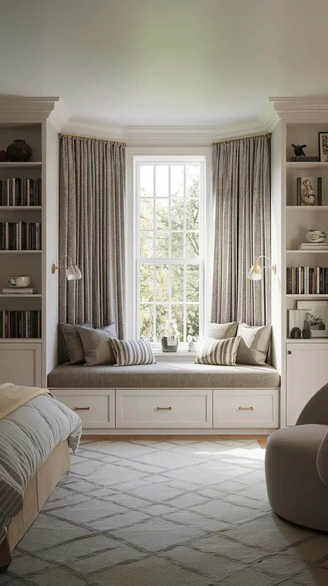

> TIP:GUIDE: Seat: thick cushion, hard-wearing fabric | Storage: drawers underneath | Light: one wall lamp each side

## 10. Mixed-Texture Throw Pillows

A pile of throw pillows in different textures — bouclé, velvet, linen, nubby wool — makes a bed look inviting without any colour risk. Keep the palette to two or three close tones, like taupe, cream and warm grey, and let the textures do the talking. A lumbar pillow in front ties the group together.

The rule of thumb is odd numbers and varied sizes: two large squares at the back, two medium in the middle, one lumbar in front. Take them off at night and stack them on a chair — a basket by the bed works just as well.

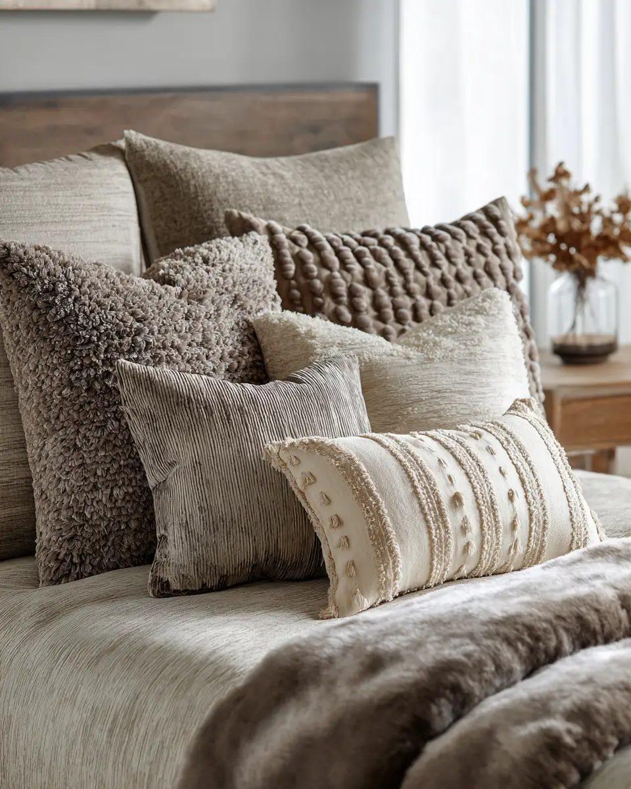

> TIP:QUICK: Keep two or three close tones and let the textures vary — bouclé, velvet, linen, wool.

## 11. Wood Slat Feature Wall

Vertical wood slats behind the bed add warmth and rhythm to a plain wall, and they are one of the defining bedroom looks of 2027. The narrow oak slats catch the light differently through the day, so the wall never looks flat, and they pair naturally with a low platform bed and grey linen bedding. Two slim pendant lights hanging in front of the slats complete the look.

Slat panels are sold ready-made in most home stores, or you can fix thin battens to the wall yourself for a weekend project. Leave a small gap between the slats so the wall colour shows through and the wood reads as a feature, not a fence.

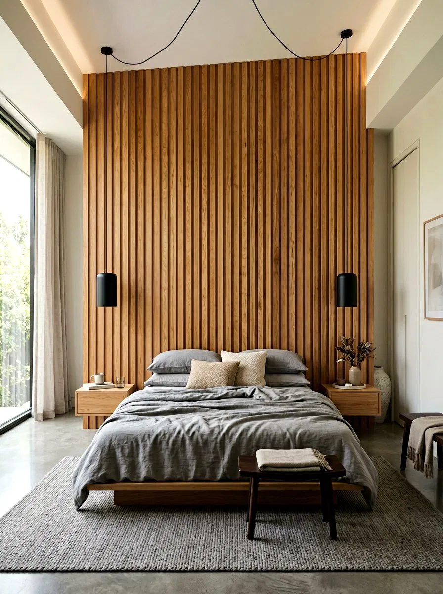

> TIP:CHECK: narrow oak slats; small gaps showing the wall; two slim pendants in front

## 12. Vintage Rug Under the Bed

A vintage-style rug under the bed grounds the whole room and adds pattern without repainting anything. A faded red Persian-style rug with a dark wood bed is a classic pairing: the rug brings colour and history, while plain white bedding keeps it from feeling busy. Let the rug extend at least a foot beyond the sides and foot of the bed so it frames the bed properly.

Choose a low-pile rug so the bedroom door clears it, and a washable one if you have pets or small children. A rug pad underneath stops it sliding on wood floors and adds a little softness underfoot.

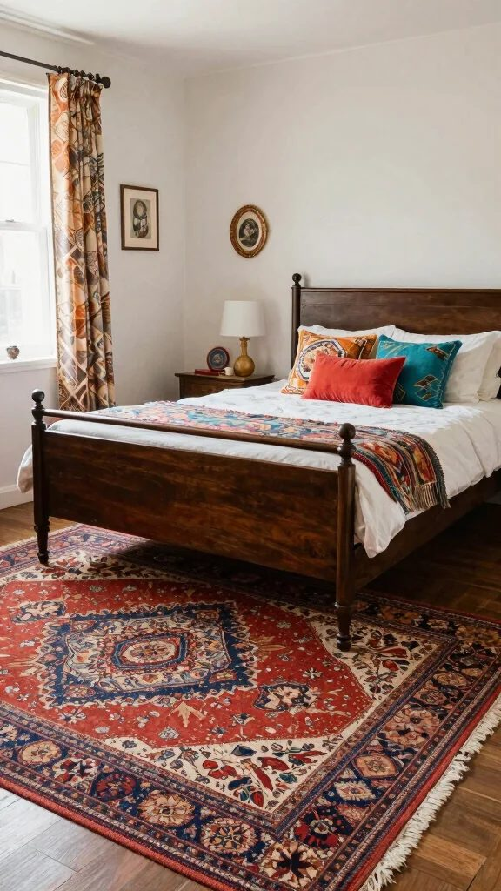

> TIP:GUIDE: Size: at least a foot beyond bed sides | Pile: low, door clears it | Underneath: rug pad to stop sliding

## 13. Floating Nightstands

Floating nightstands mounted on the wall free up floor space and make a small bedroom feel bigger, because you can see the floor running underneath them. A single drawer plus an open shelf below holds a book, a phone and a glass of water, and the clean line suits modern and Scandinavian rooms alike.

Mount them at mattress height so reaching for a lamp or a book feels natural, and leave the wall above them clear for a lamp or a small piece of art. A warm wood finish keeps the floating box from looking cold against a white wall.

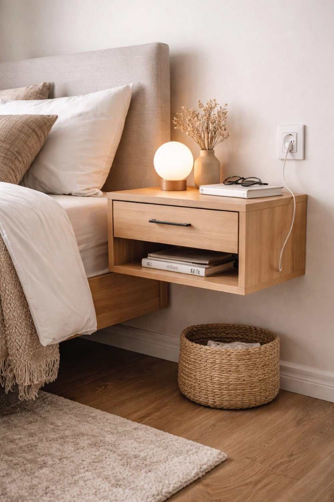

> TIP:QUICK: Mount floating nightstands at mattress height so a lamp and a book are always within easy reach.

## 14. Oversized Arched Statement Mirror

An oversized arched mirror leaning against the wall does three jobs at once: it bounces light around the room, it makes the bedroom look bigger, and it gives you a full-length check before you leave. The arch shape is softer than a rectangle and suits the curved furniture trend of 2027. A slim black frame keeps it modern; a brass frame warms it up.

Lean it at a slight angle rather than hanging it flat, and place it opposite or beside a window so it catches daylight. Keep the floor in front of it clear — a mirror crowded with furniture loses its effect.

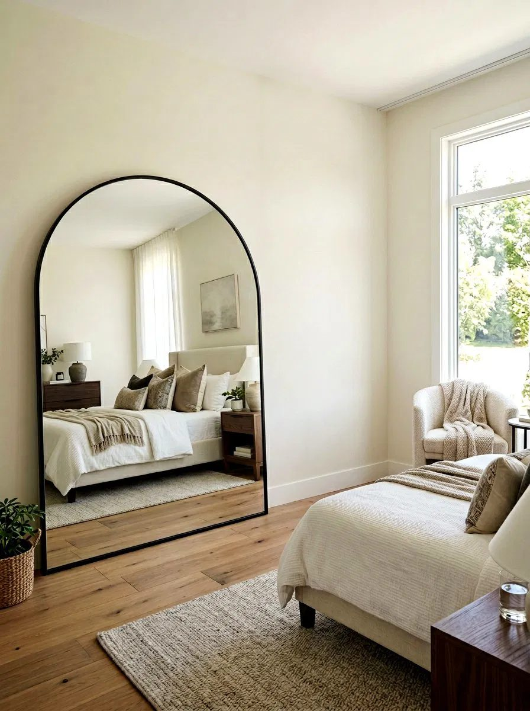

> TIP:CHECK: lean, don't hang; place near a window to catch light; keep the floor in front clear

## 15. Indoor Plants by the Bed

A large monstera or olive tree beside the bed brings life into the bedroom and softens all the straight lines of the furniture. Plants also make the room feel fresher, and a big leafy plant in a plain white pot is one of the cheapest statement pieces you can buy. Put the big plant on a small wooden stand so it sits at bed height.

Choose plants that suit your light: monstera and fiddle-leaf figs love bright windows, while snake plants and pothos cope with darker corners. Water on a schedule and wipe the leaves now and then so they stay glossy.

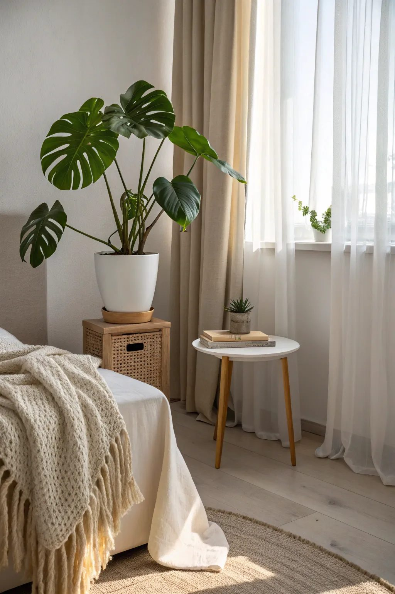

> TIP:GUIDE: Big plant: monstera or olive on a stand | Low light: snake plant or pothos | Care: water weekly, wipe leaves

## 16. Low Minimalist Platform Bed

A low platform bed with a wide wooden base is the calm centre of a minimalist bedroom. Without a tall headboard or a bulky frame, the bed feels grounded and the room feels bigger, and the long wooden base doubles as a shelf for a book or a glass of water. Grey or cream linen bedding keeps the look soft rather than stark.

This style suits rooms with low ceilings and small spaces, where a tall bed would dominate. Keep the nightstands low and simple too, and let one plant or one framed print be the only decoration on the walls.

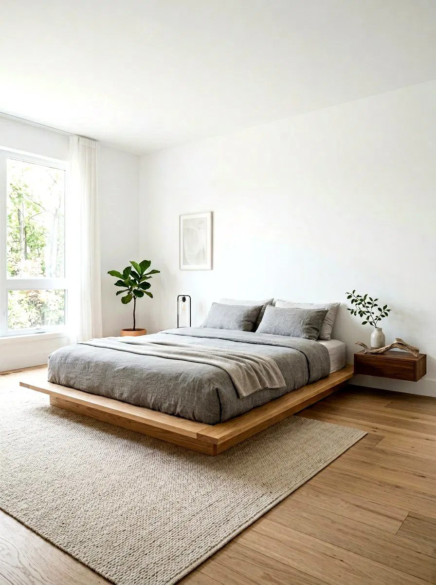

> TIP:QUICK: A low platform bed suits small rooms and low ceilings — keep nightstands low to match.

## 17. Floor-Length Velvet Curtains

Floor-length velvet curtains in a deep colour — emerald, rust or navy — bring instant drama and softness to a bedroom. The heavy fabric blocks draughts, muffles sound and makes the room feel cocooned, which is exactly what a bedroom should feel like. Let them puddle slightly on the floor for a luxurious look.

Hang velvet curtains from a ceiling-height rod and let them span the full wall, not just the window, for the grandest effect. Match one cushion or throw to the curtain colour so the room feels planned rather than accidental.

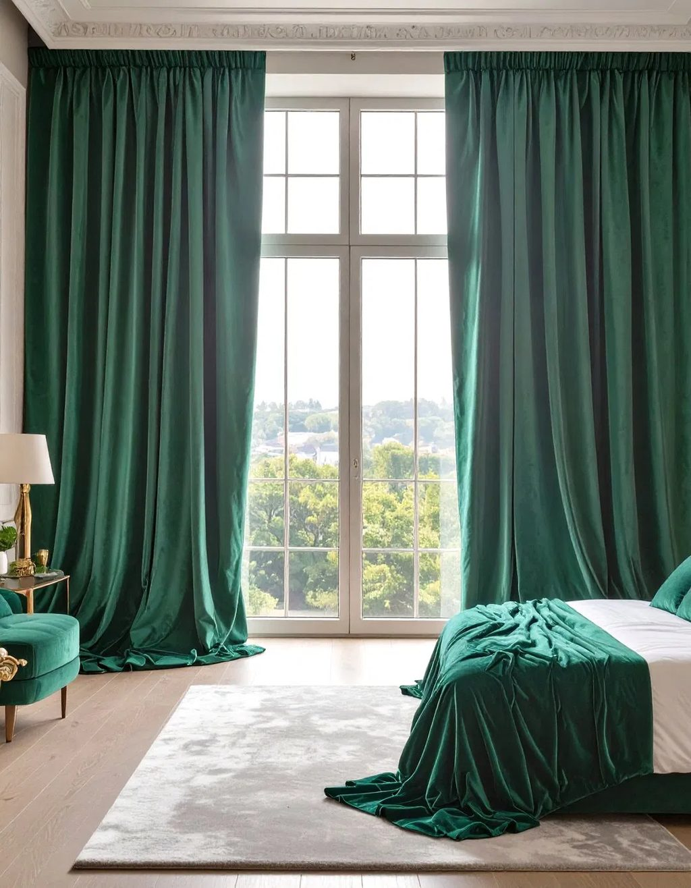

> TIP:CHECK: ceiling-height rod; full wall width; one cushion matching the curtain colour

## 18. Gallery Wall Above the Bed

A gallery wall above the bed turns a blank wall into a personal art collection. Mix gilt frames, black frames and plain wood, and mix portraits, landscapes and abstract prints so the wall feels collected over time rather than bought in one go. Start with the largest frame in the centre and build outward, keeping the gaps even.

Plan the layout on the floor first with paper templates, and hang the centre of the whole arrangement at eye level when you stand beside the bed. A green velvet headboard underneath makes the frames pop, but the gallery works with any bed.

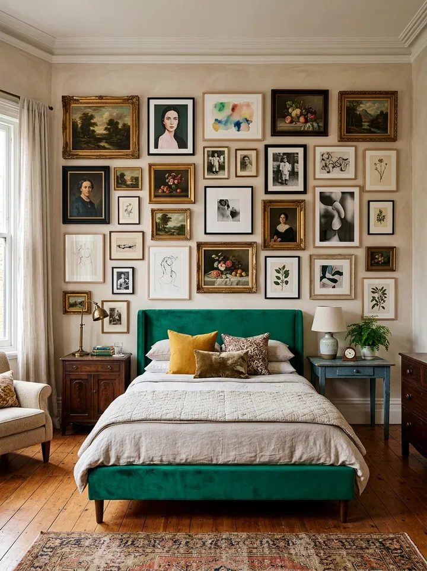

> TIP:GUIDE: Layout: plan on the floor with paper templates | Centre: largest frame first | Height: centre at standing eye level

## 19. Warm Bedside Lamp Glow

A warm glowing bedside lamp is the difference between a bedroom that feels like a showroom and one that feels like home. An amber glass lamp with a pleated shade casts a soft golden pool of light that flatters everything in the room, and it is the perfect reading light for the last half hour before sleep. Keep the bulb warm white, never cool daylight, in the bedroom.

Put the lamp on a small wooden nightstand with a book and a clock, and keep the rest of the bedside clear. One good lamp beats two bright ones — the bedroom should wind you down, not wake you up.

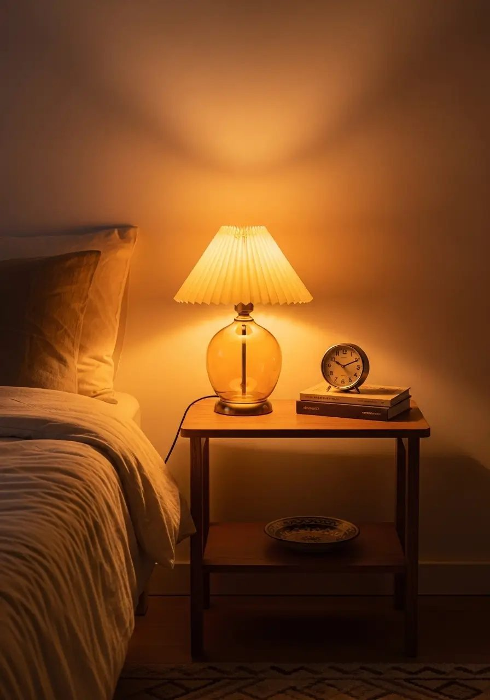

> TIP:QUICK: Choose a warm white bulb for the bedside lamp — cool daylight belongs anywhere but the bedroom.

## 20. Woven Rattan Headboard

A woven rattan cane headboard brings natural texture and a relaxed, holiday feeling into the bedroom, and it is one of the most popular headboard styles heading into 2027. The arched cane panels look light against a white wall, and they pair beautifully with white bedding, wooden nightstands and a rattan pendant light or two.

Rattan suits warm, bright rooms best, and it looks better as it ages — the cane darkens slightly and the texture deepens. Keep the rest of the room simple so the headboard stays the feature: plain bedding, one patterned cushion, and a plant on the nightstand.

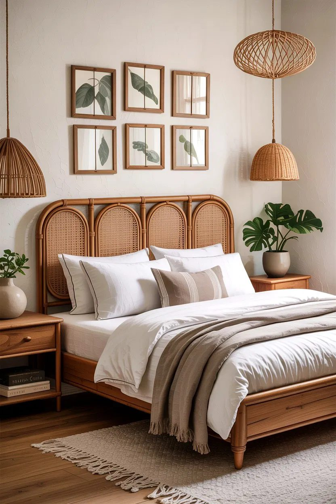

> TIP:CHECK: arched cane panels; white bedding to let it shine; one rattan pendant to echo it

## 21. Chunky Knit Throw Layers

A chunky knit throw draped over the foot of the bed is the cosiest layer a bedroom can have, and the oversized stitches are a texture trend that keeps growing into 2027. A cream or oatmeal throw over white bedding adds warmth you can see from the door, and it is the first thing you reach for on a cold evening. Drape it loosely rather than folding it flat — the folds are the point.

Chunky wool throws are warm but heavy, so a cotton-blend version is a better pick if you get hot at night. Wash it gently and dry it flat so the big stitches keep their shape.

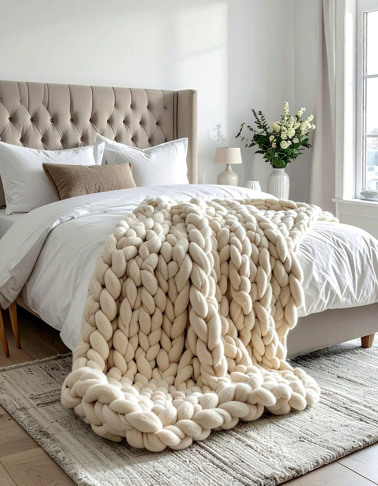

> TIP:GUIDE: Colour: cream or oatmeal over white bedding | Drape: loose folds, never flat | Wash: gentle, dry flat

## 22. Painted Accent Ceiling

Painting the ceiling is the most surprising bedroom idea of 2027, because almost nobody looks up — until the ceiling is sky blue. A soft blue ceiling makes a white bedroom feel airy and finished, like the room was designed from every angle. It works especially well with light wood furniture and white bedding, where the colour can be the room's one bold move.

Choose a pale, dusty shade rather than a bright one, so the ceiling feels calm at night, and paint the coving and ceiling rose the same colour so it reads as intentional. Keep the walls plain white or warm white to let the ceiling lead.

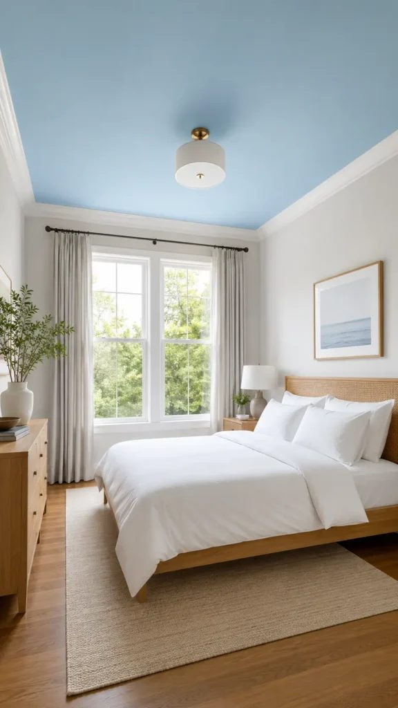

> TIP:QUICK: Pick a pale dusty shade for the ceiling and paint the coving the same colour so it looks deliberate.

## 23. Hidden Under-Bed Storage Drawers

Under-bed storage drawers are the quiet heroes of a tidy bedroom: they hold out-of-season clothes, spare bedding and shoes without a single visible box. A wooden bed frame with deep drawers on smooth runners keeps everything hidden and easy to reach, and the drawers look like part of the furniture rather than an add-on.

Roll clothes instead of folding them flat so you can see everything at a glance, and use small dividers or boxes inside the drawers to stop things sliding around. Measure the clearance under your bed before buying — drawers need a few inches more than the frame height suggests.

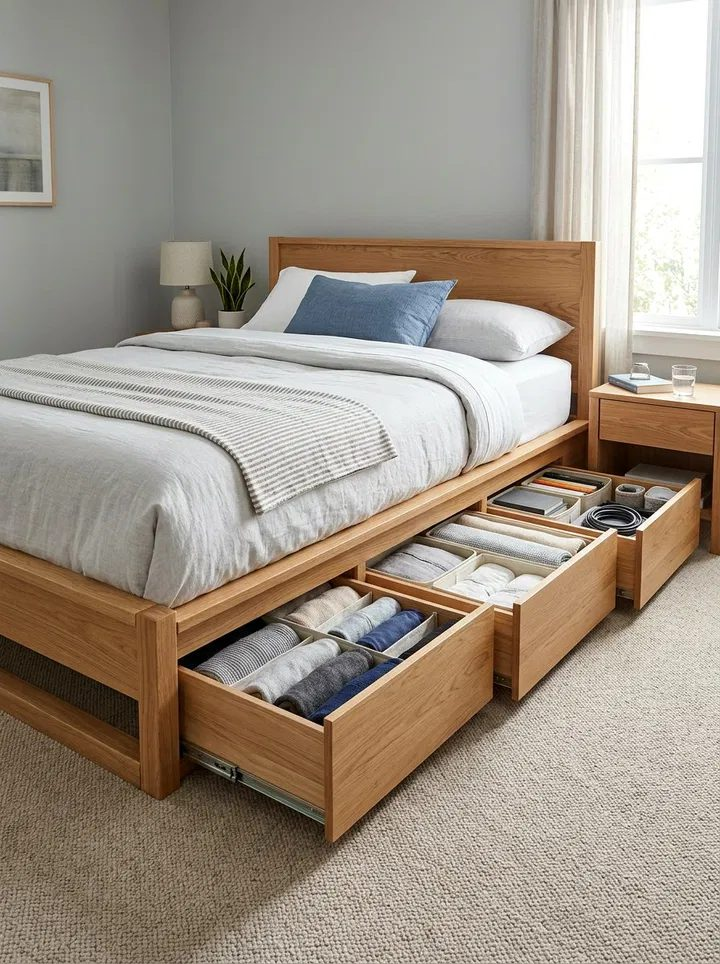

> TIP:CHECK: deep drawers on smooth runners; roll clothes to see them all; measure clearance first

## 24. Bedside Wall Sconces

Wall sconces beside the bed free up the nightstand completely — no lamp base, no cord, just a pool of light exactly where you read. Black, white and brass finishes all work, so pick the one that matches your other metal details, and choose a shade that directs light down onto your book rather than into your eyes. A swing-arm sconce is the most flexible, since you can pull it closer or push it away.

Mount sconces at about shoulder height when you sit up in bed, and put them on separate switches so each side of the bed has its own light. They are also a good fix for a narrow nightstand that cannot fit a lamp.

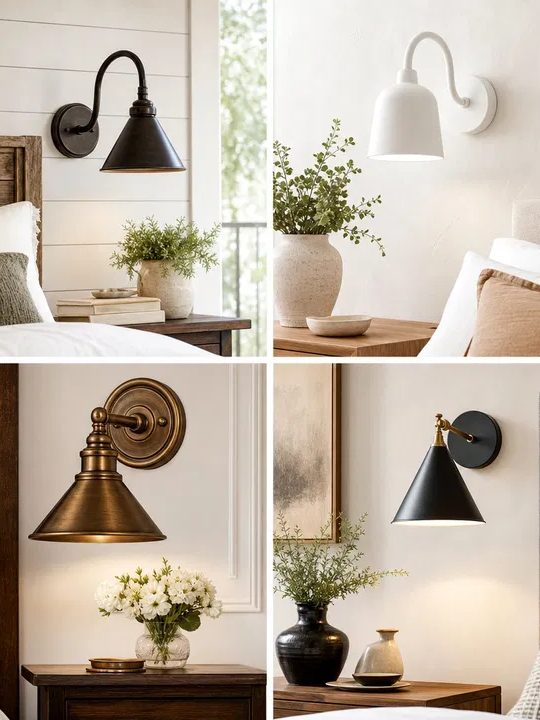

> TIP:GUIDE: Height: shoulder height sitting up | Switch: separate per side | Style: swing-arm for flexibility

## 25. Bold Patterned Duvet

A bold patterned duvet is the fastest way to give a plain bedroom a personality. A bright geometric or tribal print in many colours turns the bed into the room's artwork, so the rest of the room can stay simple: white walls, plain nightstands, one mirror. The trick is letting the duvet be the only loud thing in the room.

If a full multi-colour print feels like too much, pick a duvet with one strong colour repeated through the pattern and match one cushion to it. Wash it inside out to keep the colours bright, and keep a plain spare set for the weeks you want calm.

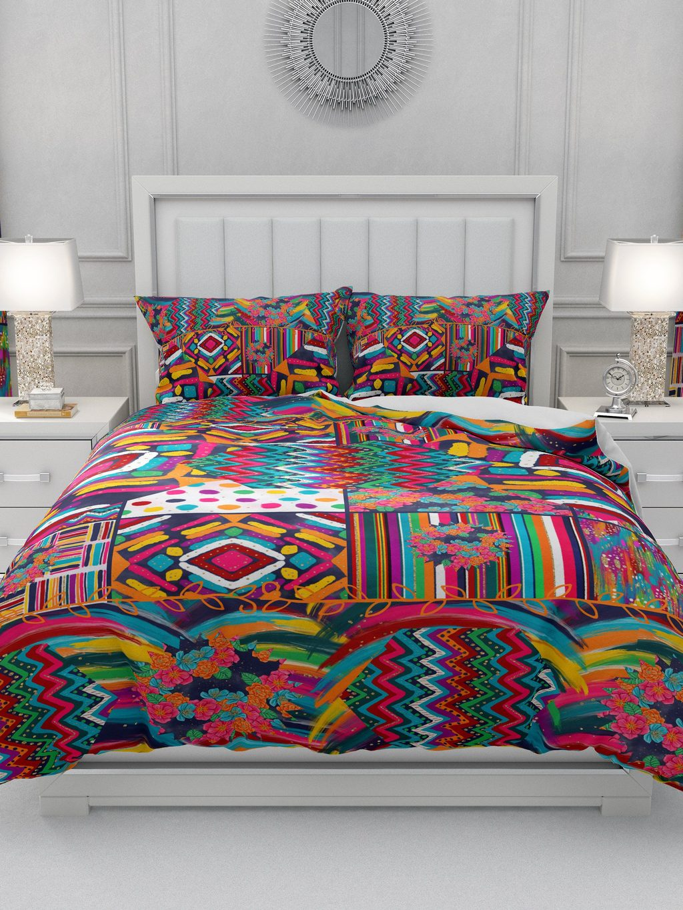

> TIP:QUICK: Let a bold duvet be the room's only loud thing — keep walls, nightstands and lamps plain.

## 26. Japandi-Inspired Calm

Japandi style — Japanese minimalism mixed with Scandinavian warmth — is the calmest bedroom look of 2027. A low wooden platform bed, light linen bedding, a shoji-style screen and one bonsai on a bench are all it takes: no clutter, no bright colour, just wood, linen and empty space. The style works because every object in the room has a job and a place.

Keep surfaces almost empty, choose natural materials only, and let the window and the garden outside be the decoration. A single framed abstract print on the wall is enough art — the calm is the point, and adding more breaks it.

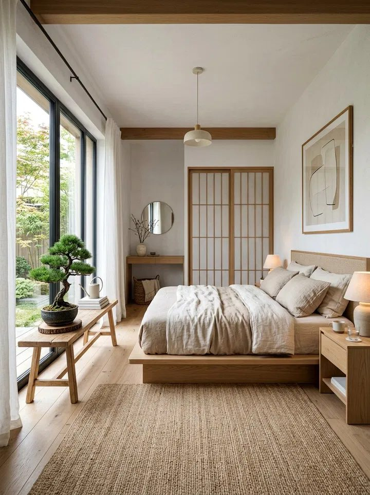

> TIP:CHECK: low wooden bed; linen bedding; one bonsai; surfaces almost empty

## 27. Arched Headboard

The arch is the shape of 2027, and an arched upholstered headboard brings it to the bedroom in the grandest way. A tall, softly curved headboard in beige fabric with wood side panels frames the bed like a doorway, and it suits both modern rooms and softer, traditional ones. A rust or caramel lumbar pillow in front picks up the wood tones.

Arched headboards look best when they are the tallest thing in the room, so keep the art and lamps lower than the top of the arch. Wall-mounted globe lights on the wood panels save nightstand space and echo the curve.

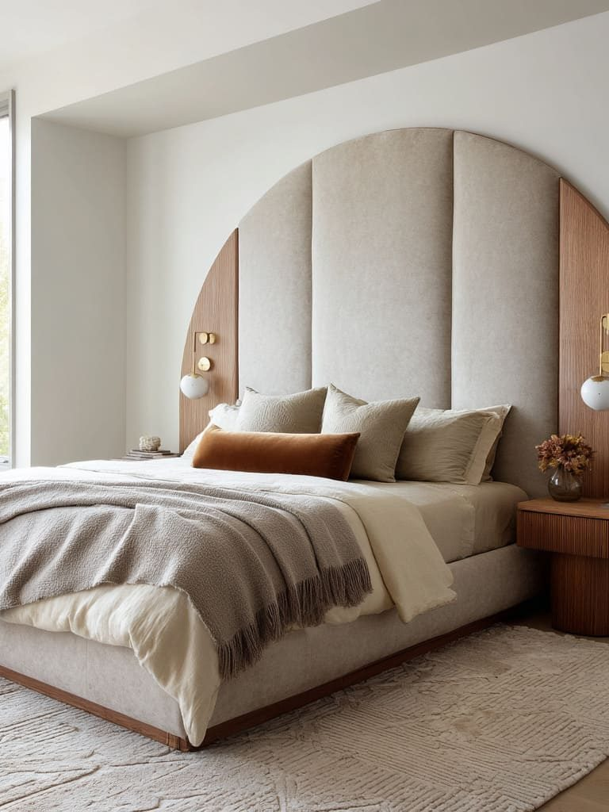

> TIP:GUIDE: Shape: tall soft arch, tallest in the room | Pillow: rust or caramel lumbar | Lights: wall globes on the panels

## 28. Warm Oak Bedroom Furniture

Warm oak furniture — bed frame, nightstands, even a dresser — gives a bedroom a steady, natural base that never dates. The honey tones of oak warm up white walls and grey bedding, and the visible grain adds texture without any pattern. A matching set in the same oak keeps the room calm; mixing oak with painted white pieces keeps it from feeling too matchy.

Oak darkens a little with age and sunlight, so it only gets better over time. Keep it clean with a soft cloth and avoid harsh sprays, and let the wood be the room's main texture while bedding and curtains stay plain.

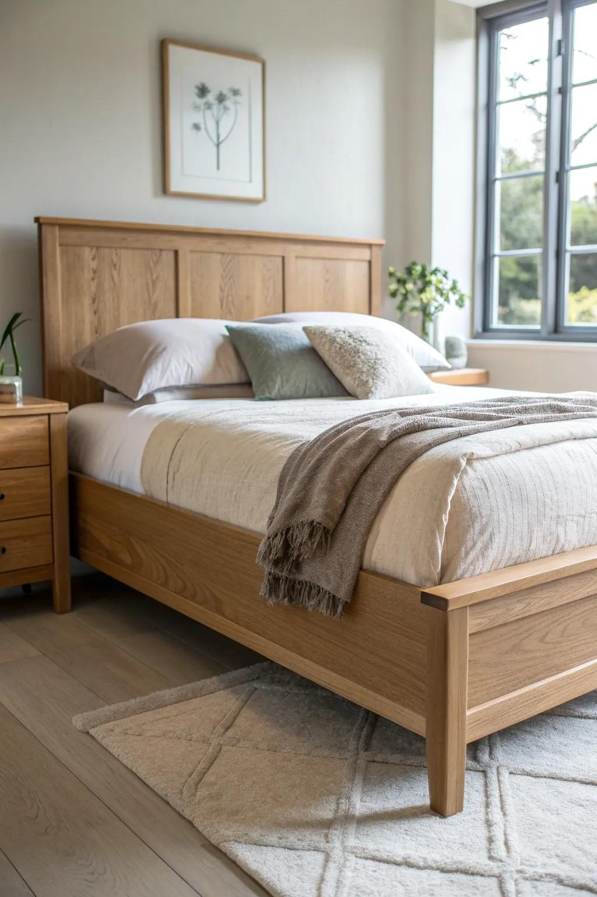

> TIP:QUICK: Let warm oak be the room's main texture and keep bedding and curtains plain so it shines.

## 29. Layered Sheer and Blackout Curtains

Layering sheer curtains with blackout curtains gives you the best of both: soft daylight during the day and a properly dark room at night. The sheer layer filters the sun and gives privacy, while the heavier blackout layer slides shut for sleep. Black outers with white sheers make a striking contrast, or keep both layers in the same tone for a softer look.

Hang both layers from one double rod, with the sheer closest to the glass. Choose blackout curtains that reach the floor and overlap the window frame slightly, so no light leaks in at the edges.

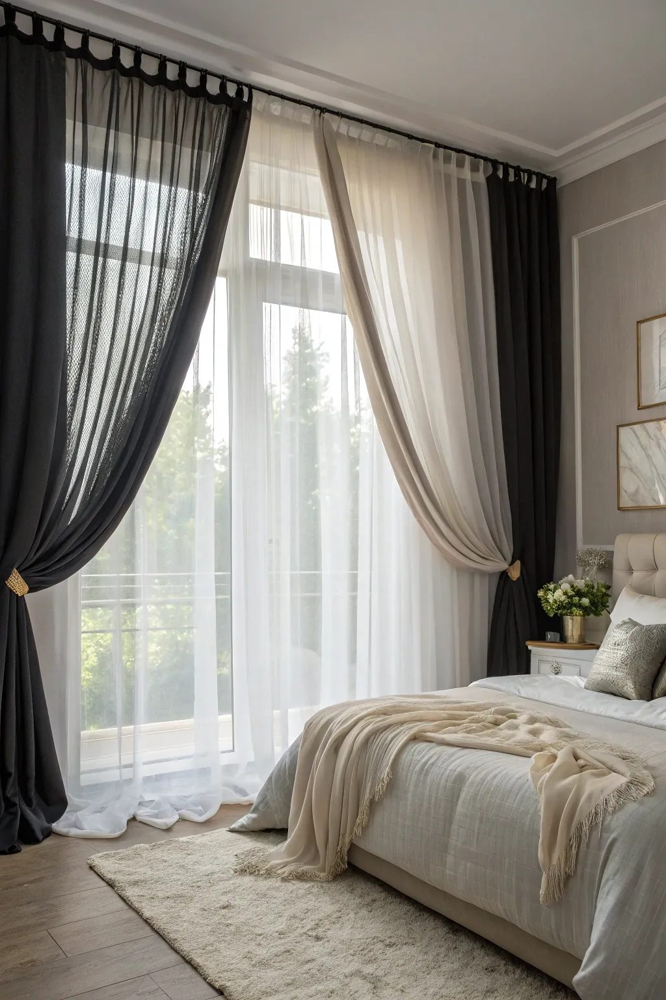

> TIP:CHECK: double rod; sheer closest to glass; blackout overlapping the frame to stop light leaks

## 30. Curved Furniture and Rounded Silhouettes

Curved furniture is the defining silhouette of 2027: a rounded headboard, a curved dresser, a round rug and even a curved ceiling line make a bedroom feel soft and cocooning. Curves are kinder than sharp corners in a room you wake up in, and they make a bedroom feel designed rather than assembled. One or two curved pieces are enough — a curved bed and a curved dresser, with everything else straight.

Keep the palette pale and warm — cream, light wood, soft green — so the curves read as calm rather than busy. A round rug under the bed echoes the shapes and ties the whole room together.

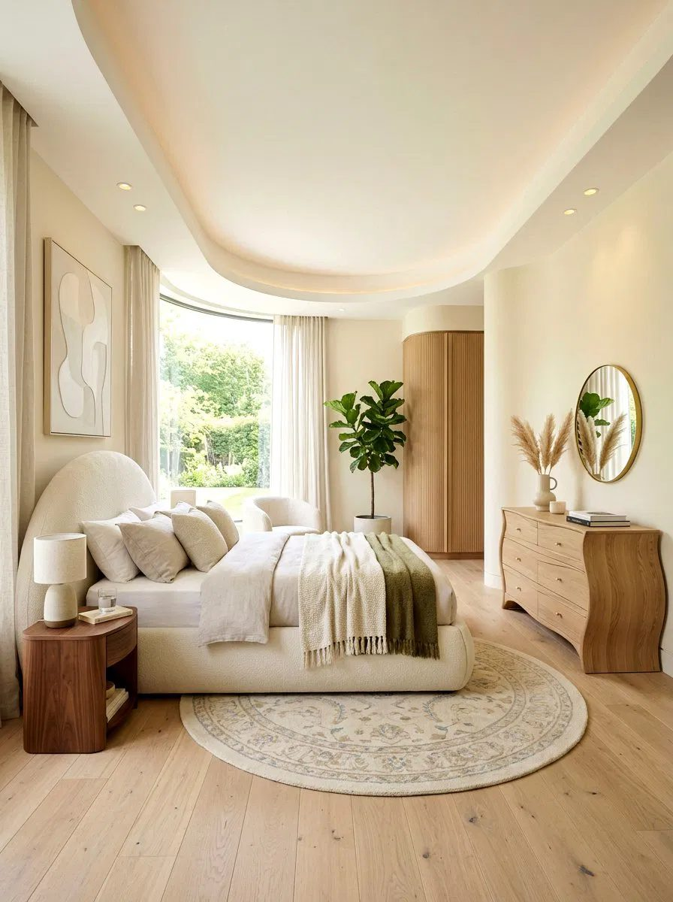

> TIP:GUIDE: Curves: one or two pieces, not everything | Palette: pale cream and light wood | Anchor: a round rug under the bed

## Takeaway

- A 2027 bedroom is warm, layered and a little bit brave: one bold move — a terracotta wall, a painted ceiling, an arched headboard — plus soft layers everywhere else.
- Start with the change you will notice every morning, whether that is the bedding, the light or the storage, and add one idea at a time until the room feels like yours.
- If you love calm, pale rooms, our [30 Neutral Bedroom Ideas](/posts/neutral-bedroom/) show how to keep a bedroom soft without it feeling bare, and if storage is your priority, our [30 Bookshelf Decor Ideas for Bedrooms](/posts/bookshelf-decor-ideas-for-bedrooms/) will help you fit books and display pieces around the bed without clutter.

## Frequently Asked Questions

### What are the biggest bedroom decor trends for 2027?

Warm earth tones like terracotta and clay lead the way, alongside curved furniture, sculptural lighting, rattan and bouclé textures, and painted accent ceilings. Bedrooms are moving away from cold grey minimalism toward layered, personal rooms with natural materials, soft shapes and one bold colour or feature that makes the space feel individual.

### How can I update my bedroom for 2027 without a full renovation?

Start with the pieces you see and touch most: swap in layered linen bedding, add a chunky throw and mixed-texture pillows, change the bedside lamp to a warm glow, and hang sheer curtains. One statement change, such as a new headboard or a painted ceiling, can transform the room for the cost of a single weekend.

### What colours work best in a bedroom in 2027?

Warm, restful colours lead: terracotta, clay, peach, deep green and soft blue, all paired with warm neutrals like cream, oatmeal and light oak. Pick one main colour for the wall or bedding, one supporting tone for cushions and throws, and keep metals warm with brass or wood finishes rather than chrome.

### How do I make a small bedroom feel bigger in 2027?

Use floating nightstands, a low platform bed and a large mirror to open up the floor and bounce light around. Keep the palette pale, hang curtains high and wide, and hide clutter in built-in wardrobes or under-bed drawers so surfaces stay clear and the room feels calm rather than crowded.

### Is a dark accent wall a good idea in a bedroom?

Yes, if you balance it well. A deep green or charcoal wall behind the bed adds drama and makes white bedding glow, but keep the other walls pale, add a lamp on each nightstand and use a light rug. If you are unsure, paint just the headboard wall and live with it for a month first.

### What lighting works best in a bedroom for 2027?

Layered lighting works best: one sculptural pendant or ceiling light for general brightness, warm bedside lamps or wall sconces for reading, and a dimmer so you can lower the light in the evening. Stick to warm white bulbs throughout, since cool daylight bulbs make a bedroom feel like an office.

### How do I mix textures in a bedroom without it looking messy?

Keep the colour palette to two or three close tones and let the textures vary instead — linen, bouclé, velvet, rattan, wool and wood in the same warm family. Repeat each texture at least twice in the room, for example bouclé on the chair and a cushion, so the mix looks deliberate rather than random.

### What is Japandi bedroom style and is it still popular in 2027?

Japandi blends Japanese minimalism with Scandinavian warmth: low wooden beds, linen bedding, natural materials and almost-empty surfaces. It stays popular in 2027 because it suits small rooms and calm mornings, and it works best when every object has a purpose, with the window and the view doing most of the decorating.
