# 30 Bookshelf Decor Ideas for Bedrooms for a Collected, Personal Retreat

The best bookshelf decor ideas for bedrooms start with the books you actually read at night and end with shelves that make the room feel like yours. A bedroom bookcase is different from a living-room one: it holds the novel on your nightstand, the picture books your kids reach for at bedtime, and the few objects that mean something to you. This list gathers 30 real bedroom shelves, from floating shelves above the bed to a whole closet turned into a library, so you can steal one idea or restyle the whole room.

The rule that holds every bedroom shelf together is simple: keep the books you are reading right now within arm's reach of the bed, and let the rest of the shelves hold the books and objects that help you unwind. If you love this layered, collected warmth in the living room too, our [30 Bookshelf Decor Ideas for a Collected, Lived-In Look](/posts/bookshelf-decor-ideas/) shows the same styling at a bigger scale, and [30 Neutral Bedroom Ideas for a Calm, Timeless Retreat](/posts/neutral-bedroom/) is the quiet, pale-toned cousin of this list.

## 1. Floating Shelves Above the Bed

Two long floating shelves above the bed turn the wall you stare at every morning into a small library. Here pale oak shelves hold rows of books, small potted plants, framed botanical prints and stacked books used as decor, with a gallery of framed art below and matching nightstands on either side. The shelves span the width of the bed, so the whole wall feels composed rather than decorated.

Mount floating shelves into studs, because books are heavy — a loaded shelf can weigh as much as a small child. Keep the heaviest books on the lowest shelf and the lightest decor up top, and leave a little gap at each end so the shelves look fitted, not crowded.

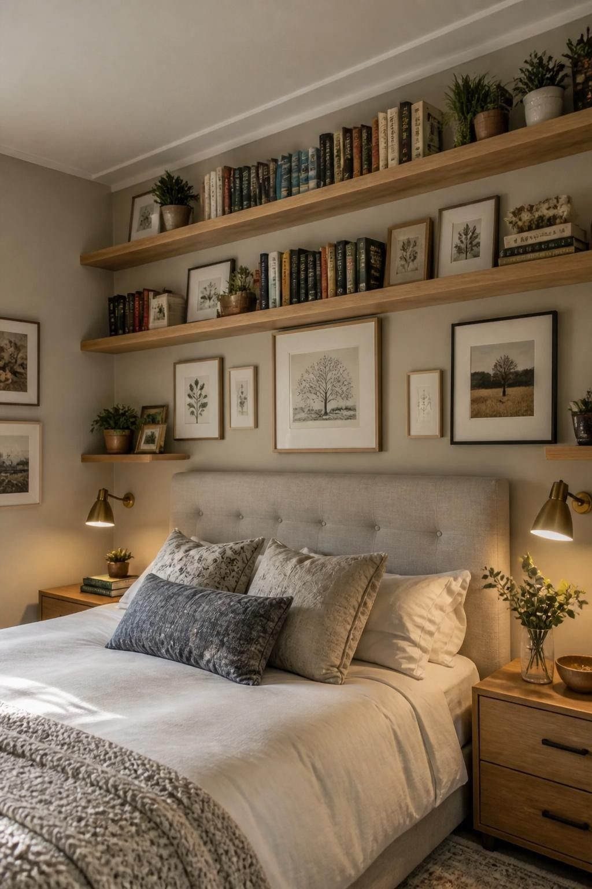

> TIP:QUICK: Mount floating shelves into wall studs, not drywall anchors — a shelf full of books is heavier than it looks.

## 2. A Bookshelf Headboard

A headboard that is also a bookcase puts your whole reading life within reach of your pillow. This built-in wooden headboard runs floor to ceiling around the bed, its cubbies packed with books and a few small objects, with warm under-shelf lights glowing over the pillows. You can pull a book down without getting up, and the shelves make the bed feel like the center of a small library.

Keep the shelves at pillow height for the books you are reading now, and the higher cubbies for the books you love but have finished. Leave one cubby empty for the book you are in the middle of, so it always has a home.

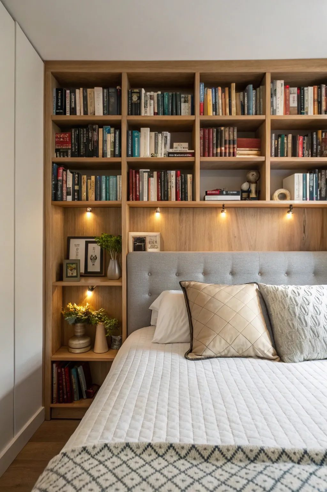

> TIP:CHECK: books you are reading now at pillow height; finished favorites up high; one empty cubby for the book in progress

## 3. A Small Bookcase as a Nightstand

A narrow bookcase beside the bed does the job of a nightstand and holds far more books. This small white bookcase stands next to a neatly made bed, its shelves packed with paperbacks and a few framed photos, with a lamp glowing on top. It is a mini-library you can reach without sitting up, and it costs less than most nightstands.

Choose a bookcase no wider than your bed is tall at the mattress, so it reads as bedside furniture rather than a storage unit. Keep the top shelf for the lamp, your phone and a glass of water, and the lower shelves for books.

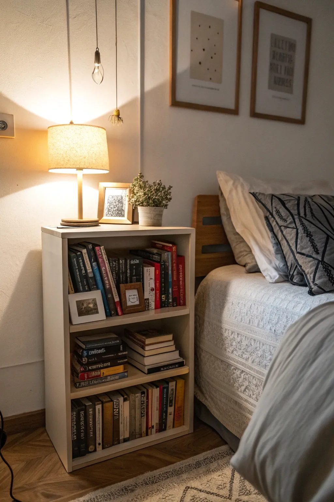

> TIP:GUIDE: Budget: from $40 for a narrow ready-made case | Time: one hour to assemble and style | Skill: beginner

## 4. A Bedside Stack of Books

A stack of books on the nightstand is the smallest bookshelf a bedroom can have — and the most honest one. Here three vintage hardcovers with gold-tooled spines lie flat on a wooden bedside table, warm lamplight falling across them, with white pillows and a brown throw just behind. The stack says what the room is for: reading, then sleep.

Keep the stack to three or four books, largest at the bottom, and put the one you are reading on top so it is always the first thing your hand finds. A stack that grows past five books stops looking styled and starts looking like a pile waiting to be shelved.

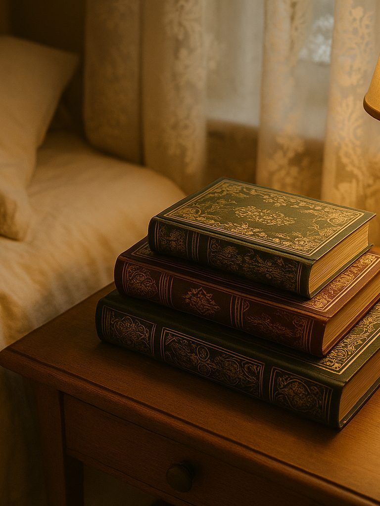

> TIP:QUICK: Three or four books, largest at the bottom, the one you are reading on top — past five, it is a pile, not a stack.

## 5. A Window Seat with Bookshelves

A window seat between two bookshelves is the bedroom reading nook that gets used every single day. This bright built-in wraps a wide window in floor-to-ceiling shelves, with a cushioned seat, striped pillows and a throw in the middle, and a second bed just beyond it. Morning light falls on the books, and the seat is deep enough to curl up in with a blanket.

Build the seat at least 18 inches deep so an adult can sit cross-legged on it, and keep the shelves beside it for the books you reread. Store spare blankets in the baskets under the seat, so the nook is ready for a cold morning without a trip to the linen closet.

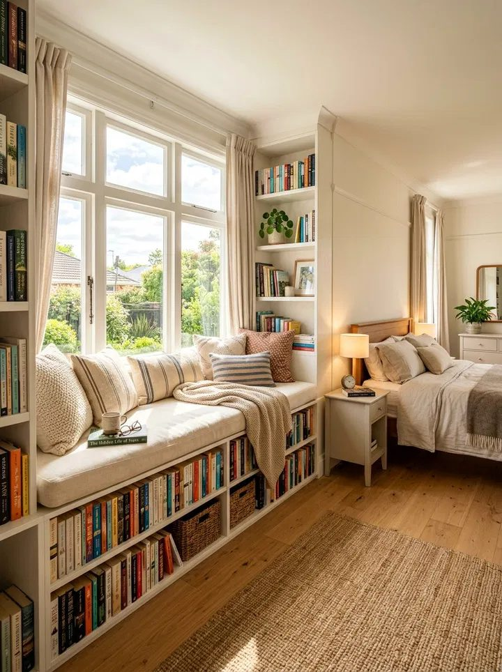

> TIP:CHECK: seat at least 18 inches deep; rereads on the shelves beside it; spare blankets in baskets under the seat

## 6. Built-In Shelves Flanking the Bed

Built-ins flanking the bed turn the whole wall into a library and the bed into its centerpiece. This modern bedroom runs warm wood shelving the full height of the wall on both sides of the bed, with books, plants, framed art and a few sculptures filling the cubbies, and a window at the far end. The room feels like a retreat because the books surround you on three sides.

Paint or stain the built-ins to match the bed frame so the wall reads as one piece of furniture. Keep the shelves nearest the pillows for books and a small lamp, and the far shelves for display, so nothing you need is ever out of reach in the dark.

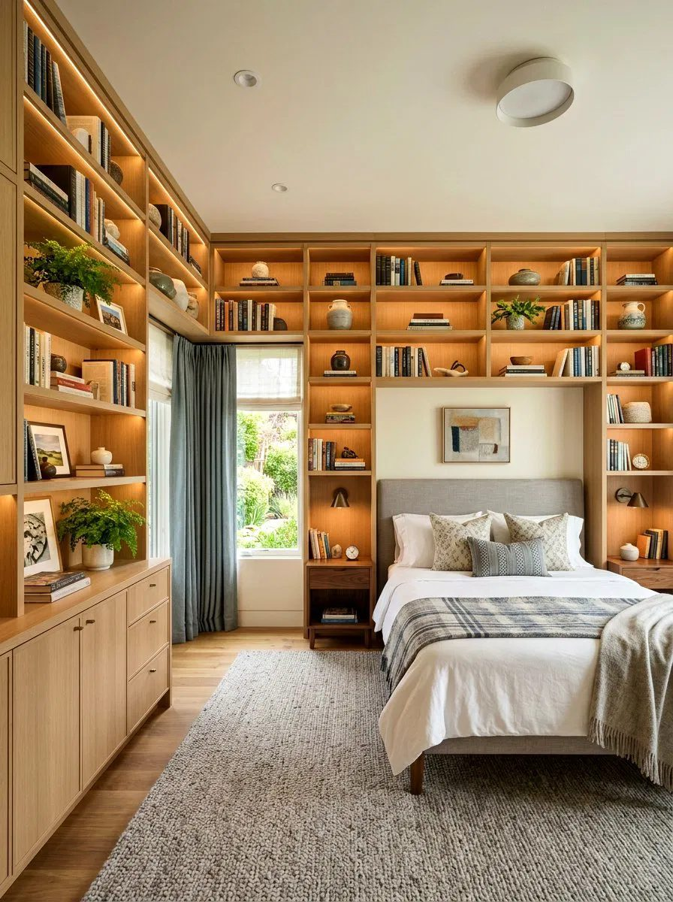

> TIP:GUIDE: Budget: from $300 for ready-made units fitted together | Time: one weekend to fit and style | Skill: beginner with a drill

## 7. A Tall Narrow Bookcase for a Small Bedroom

A tall, narrow bookcase is the small bedroom's best friend: it holds a hundred books on a single square foot of floor. This light wood eight-tier unit stands in the corner beside a bed, packed with books and a few small objects, with a wall lamp and a tiny shelf holding the bedtime essentials. It uses the wall's height, which is the one dimension a small bedroom usually has to spare.

Anchor a tall narrow bookcase to the wall — it is top-heavy once loaded, and a bedroom is where people reach for books half asleep. Put the heaviest books on the bottom two shelves and the lightest decor at the top, and it will stand steady for years.

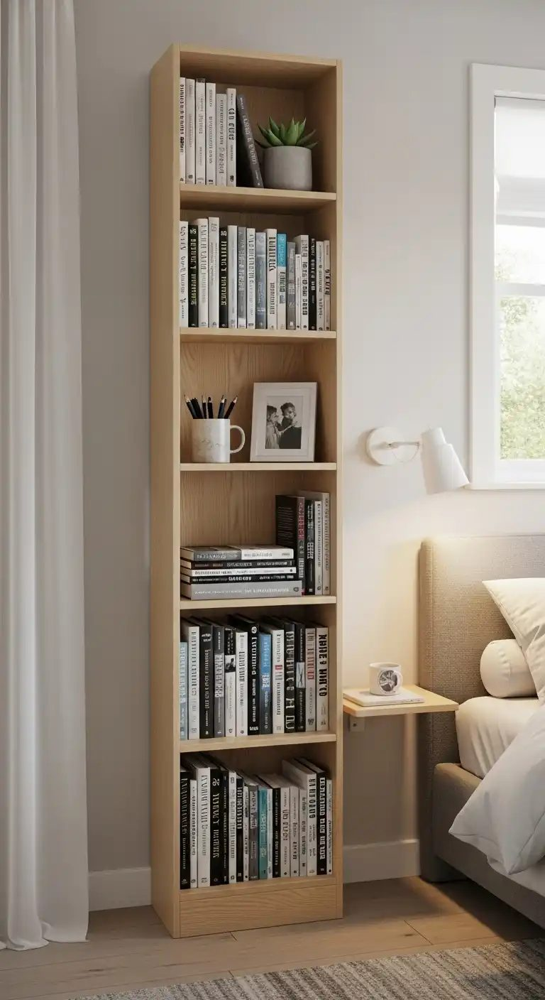

> TIP:QUICK: Anchor any bookcase taller than four feet to the wall — a loaded narrow case is top-heavy.

## 8. A Kids' Bedroom Book Nook

Children choose books by their covers, so a kids' book nook should show them. This corner mounts white picture ledges on two walls, displaying colorful picture books face-out — Thomas, Peter Rabbit, and a whole row of bright covers — with a soft blue rug and a cushion below. A child can see every cover, pull one down, and settle on the rug to read it.

Keep the ledges at your child's chest height so they can reach every book, and rotate the front-facing books every couple of weeks so the nook feels new. Store the rest of the collection spine-out on a taller shelf nearby, and let the ledges hold only the current favorites.

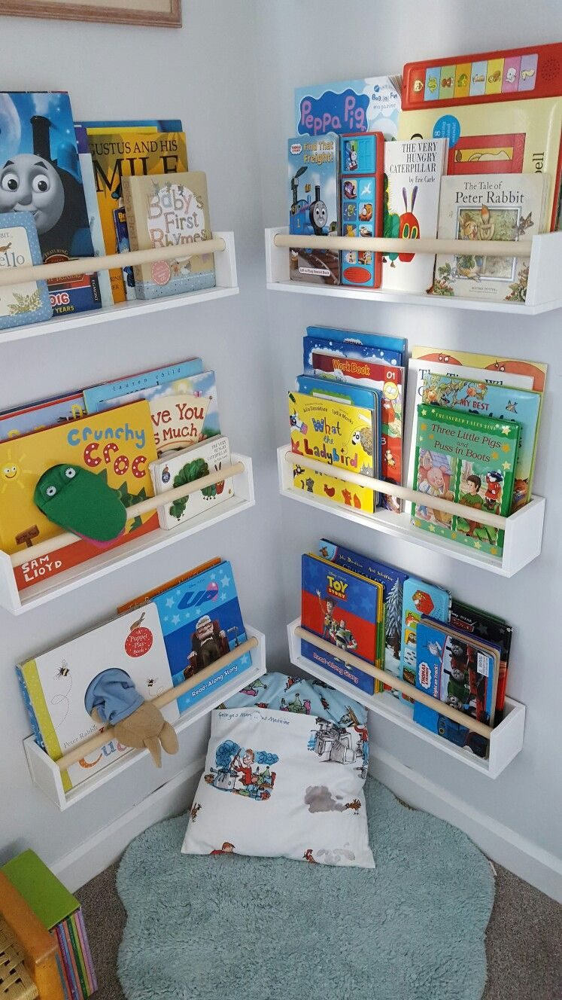

> TIP:CHECK: ledges at your child's chest height; front-facing books rotated every two weeks; the rest of the collection spine-out nearby

## 9. A Teen Bookcase with Fairy Lights

Fairy lights turn a plain bookcase into the coziest corner of a teenager's bedroom. This tall white bookcase stands beside a bed, its shelves packed with books, a glowing mushroom lamp and small plants, while warm string lights and artificial ivy wind around the frame and a pink plush sits on top. The lights make the books glow after dark, which is exactly when a teenager reads.

Use battery fairy lights with a timer so they switch themselves off after bedtime, and keep the lights on the outside edges of the case so they frame the books instead of hiding them. One strand is enough — two starts to look like a Christmas tree.

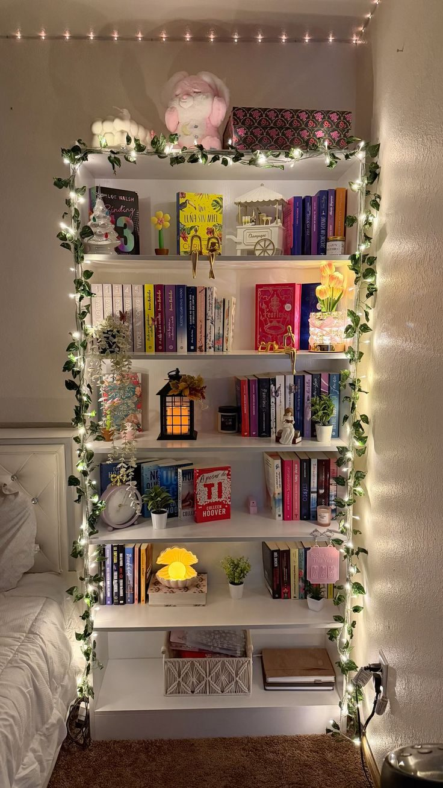

> TIP:GUIDE: Budget: under $15 for battery fairy lights with a timer | Time: twenty minutes to wind and style | Skill: beginner

## 10. Books on the Dresser Top

The dresser top is a bookshelf hiding in plain sight. This white dresser holds a stack of hardcovers on a tray, a brass lamp, a small vase and a framed photo, with a second stack and a decorative bowl on the dresser behind it. The books make the dresser feel used and loved rather than staged, and they are right where you get dressed in the morning.

Keep one stack on a tray so you can lift the whole group to dust underneath, and put the books you reach for most on top. A dresser-top stack works best with hardcovers — paperbacks slump, and a slumped stack is the first thing that makes a bedroom look untidy.

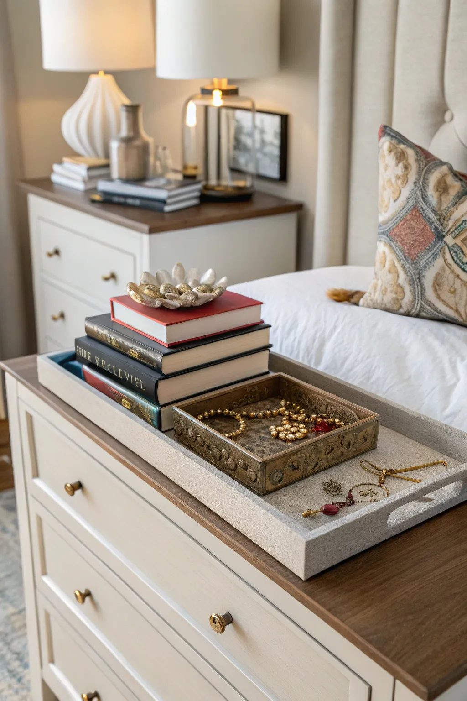

> TIP:QUICK: Put the dresser-top stack on a tray — lift the whole group to dust underneath in one move.

## 11. A Guest Bedroom Bookcase

A bookcase in the guest bedroom tells visitors they are welcome to stay a while. This corner sets a tall white bookcase beside the bed, packed with novels, travel books and a few local guides, with a lamp glowing on top and a chair nearby. Guests who cannot sleep will find something to read, and guests who can will still notice the thought.

Stock a guest bookcase with short reads — short stories, poetry, a local guidebook and a couple of novels — because nobody finishes a 600-page epic in one night. Add a small card on the top shelf saying the books are there to borrow, so guests know they are meant to be read, not admired.

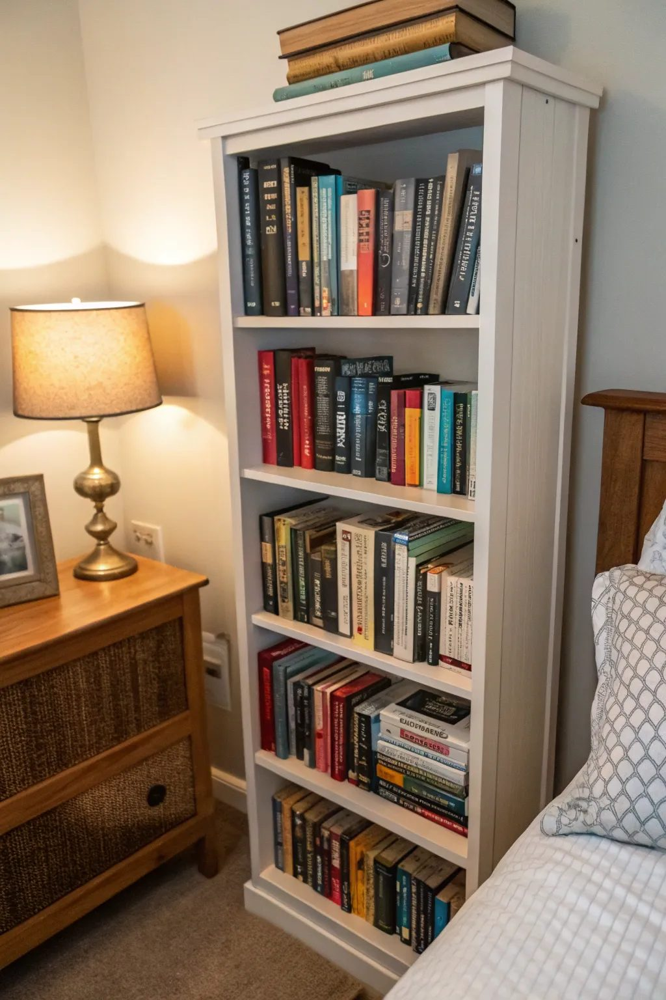

> TIP:CHECK: short stories and poetry, not long novels; a local guidebook; a small card saying the books are there to borrow

## 12. A Bookshelf Beside the Wardrobe

A bookshelf beside the wardrobe fills the awkward gap between storage and bed and turns it into the room's library wall. This bedroom runs a tall open bookcase along the wall next to a grey wardrobe, its shelves packed with books and a few objects, with a bed dressed in a plaid quilt just beside it. The wardrobe handles the clothes, the bookcase handles the personality.

Keep the bookcase and the wardrobe the same height if you can, so the wall reads as one fitted run. If the heights differ, put a plant or a stack of books on top of the shorter one to bridge the gap, and the eye will forgive the rest.

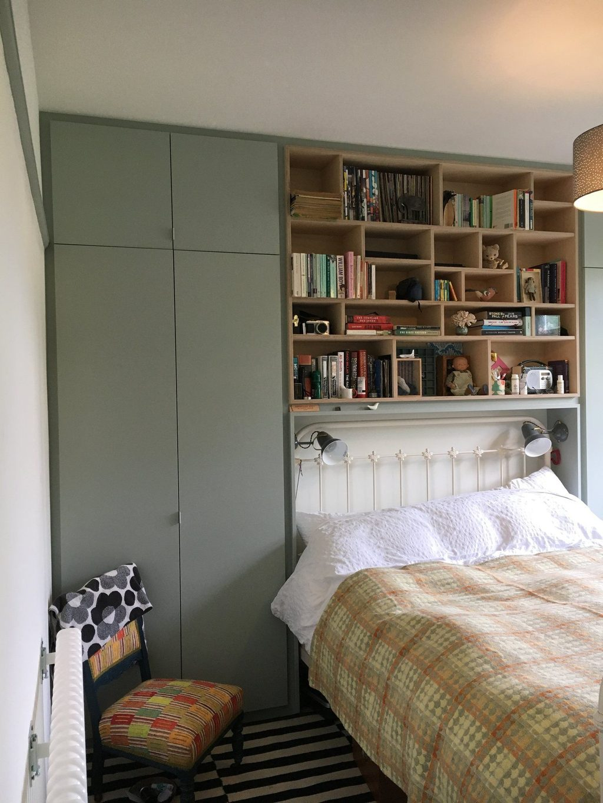

> TIP:GUIDE: Budget: free if you already own both pieces | Time: one hour to arrange | Skill: beginner

## 13. Under-Bed Book Crates on Wheels

Wooden crates on wheels under the bed are the cheapest book storage a bedroom can have, and the most charming. This bed hides three crates on casters underneath, each one filled with upright books sorted by genre, with labels on the ends and a woven basket beside the bed. Pull a crate out like a drawer, take a book, and roll it back — no bending, no dust, no wasted space.

Label the end of each crate so you can find a genre without pulling all three out, and screw the casters on properly — a crate that tips when it rolls will spill books across the floor at midnight. Keep the crates shallow enough to clear the bed frame by an inch on each side.

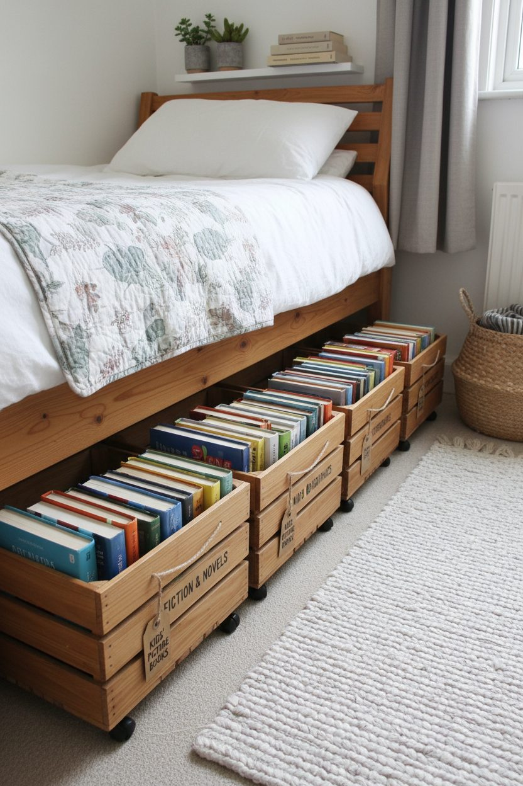

> TIP:QUICK: Label the end of each crate by genre so you only ever pull out the one you need.

## 14. Picture Ledges Above the Bed

Picture ledges above the bed display books like a gallery shows art — spines out, covers facing the room. This bedroom mounts several pale wood ledges over the headboard, holding colorful books, framed prints and small plants in a neat grid, with a patterned rug and two nightstands below. The ledges are shallow, so the books stay the decoration and the wall stays light.

Ledges suit thin books and paperbacks best; heavy hardcovers belong on a deeper shelf. Overlap a small framed print in front of the books on one ledge, and the whole wall reads as a composed gallery rather than storage.

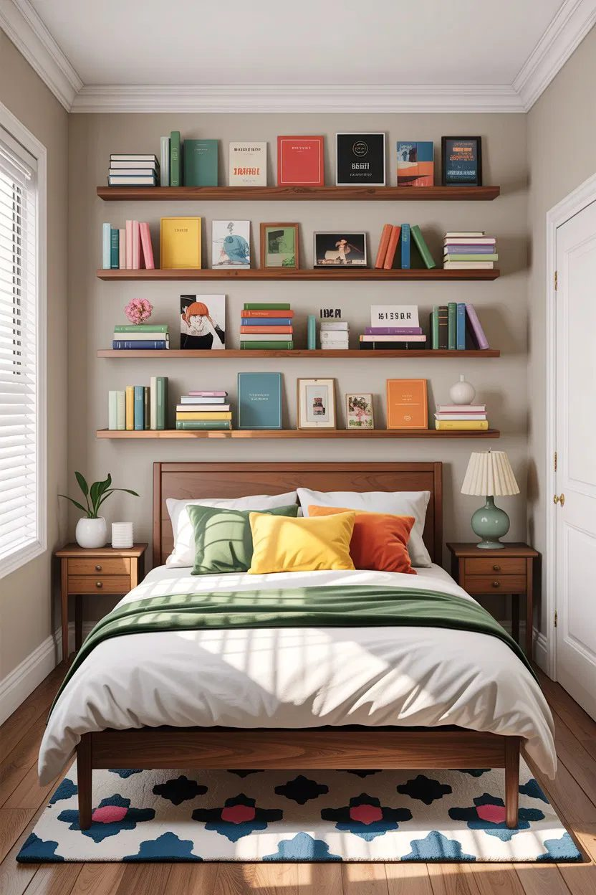

> TIP:CHECK: thin books and paperbacks only; heavy hardcovers on a deeper shelf; one framed print overlapped in front per ledge

## 15. A Walk-In Closet Turned Library

A walk-in closet you barely use can become the bedroom's private library. This narrow closet is lined floor to ceiling with dark wood bookshelves, packed with books on every wall, with drawers below, hanging clothes at the far end and a patterned rug down the middle. It is quiet, enclosed and lit like a bookshop — the best reading room a house can hide.

Keep a small rug and a reading light in the closet library, because a bare closet feels like storage no matter how many books it holds. Leave the hanging rail at the far end for the clothes you reach for daily, and let the books take the walls you see first when you walk in.

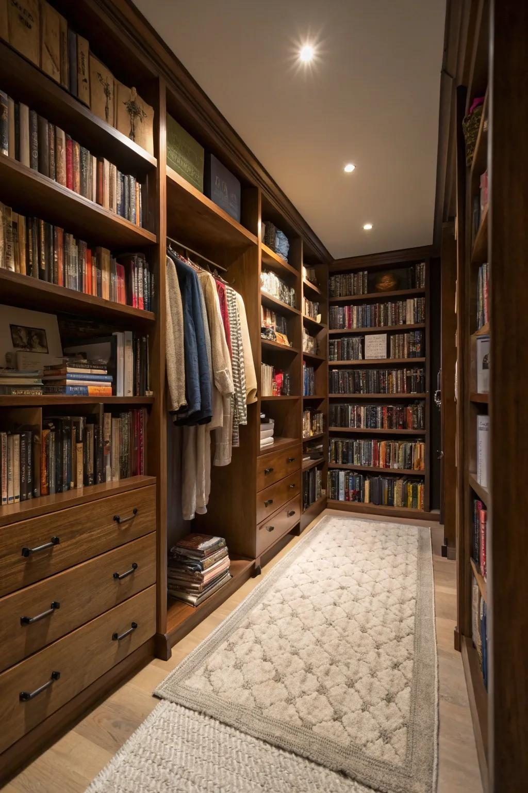

> TIP:GUIDE: Budget: from $150 for ready-made shelving units | Time: one weekend to fit | Skill: beginner with a drill

## 16. A Bedroom Desk with Shelves Above

Shelves above a bedroom desk put reference books within arm's reach and keep the work surface clear. This study corner runs light wood built-ins along the wall over a desk, with books, boxes and plants on the open shelves and a laptop and chair below, a bed just to the side. The room works as an office by day and a bedroom by night, and the shelves are what makes both halves work.

Keep the shelf directly above the desk for the books you actually use, and the higher shelves for display. Leave the desk surface mostly clear — a lamp, a plant and the current project — so the shelves carry the storage and the desk stays a place to work.

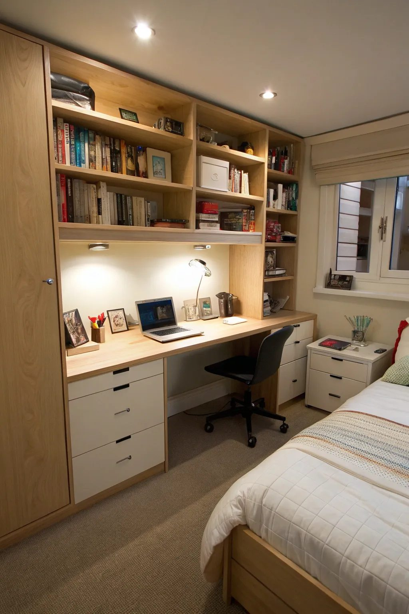

> TIP:QUICK: Keep the shelf above the desk for books you use daily and the high shelves for display only.

## 17. Neutral Cream-and-Wood Bedroom Shelves

Cream and wood is the calmest palette a bedroom bookshelf can wear. This tall beige built-in stands beside a bed dressed in white linen, its shelves holding books, white vases, a small plant and a woven basket in pale, quiet tones. Nothing shouts, and the shapes do all the talking — the room feels restful because the shelves are restful.

Pick your neutral and then cheat a little — cream, ivory and pale grey all count as one color, and one warm wood tone keeps it from feeling cold. If you do not own enough books in the palette, turn some spines to the wall or wrap a few in plain paper.

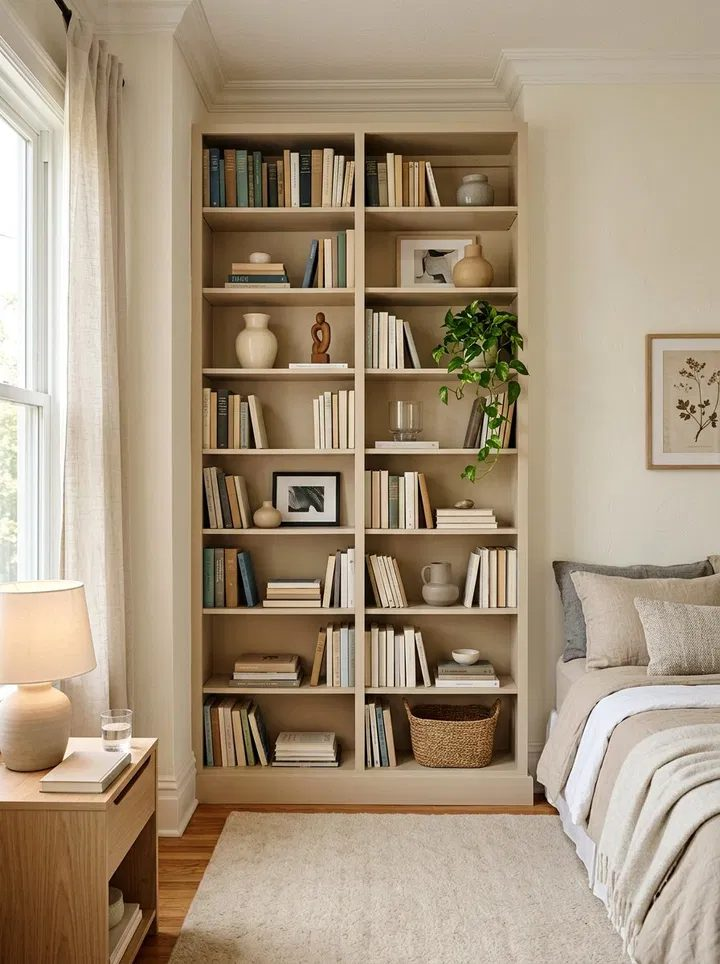

> TIP:CHECK: cream, ivory and pale grey count as one color; one warm wood tone to keep it from feeling cold; odd spines wrapped in plain paper

## 18. A Dark, Moody Bedroom Library

Dark shelves make a bedroom feel like a library even when it is just one wall. This room lines its walls floor to ceiling with black bookcases, sets a brass lamp and a plaid armchair in front of them, and lets warm light pool over the bed. The dark paint makes the book spines glow and the chair look like an invitation to stay up too late reading.

Paint only the wall the shelves stand against if you are nervous — one dark wall is enough to get the mood, and the rest of the room stays light. Add a warm lamp at reading height, because dark walls swallow daylight, and keep the rug light so the floor does not disappear too.

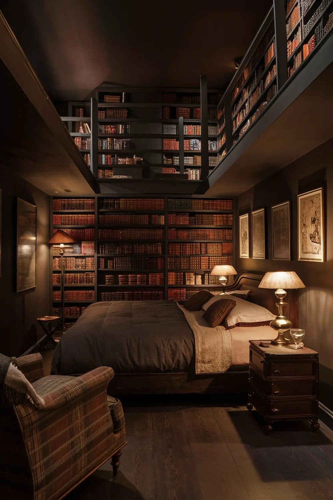

> TIP:GUIDE: Budget: one tin of paint, under $40 | Time: one weekend to paint | Skill: beginner

## 19. A Boho Bedroom Bookshelf with Macramé

Vines and macramé turn a plain bookcase into a boho bedroom's centerpiece. This tall bookshelf stands beside a bed dressed in a teal duvet, its shelves overflowing with books and lush green vines, a woven macramé wall hanging above it and a patterned rug below. The green against the wood grain is what makes the whole corner feel alive rather than stored.

Choose a plant that forgives neglect — pothos trails fast and survives a missed watering. Put the pot on the top shelf so the vines have the longest drop, and trim them when they start brushing the books below.

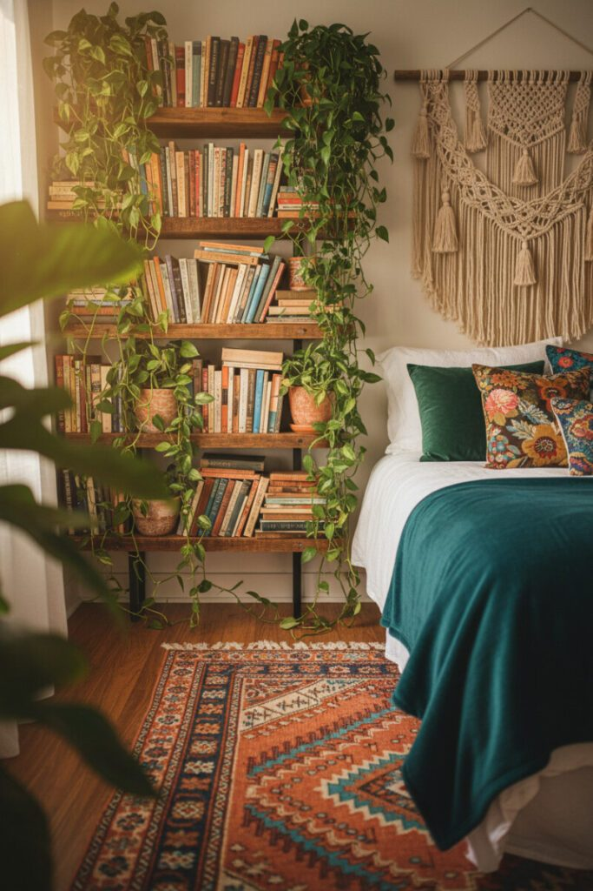

> TIP:QUICK: Put the pothos on the top shelf so the vines have the longest drop, and trim before they cover the spines.

## 20. A Rustic Wooden Bookcase in a Farmhouse Bedroom

A reclaimed-wood bookcase is the farmhouse bedroom's natural companion. This tall rustic unit stands beside a bed dressed in cream linen and a knit throw, its shelves holding old books, a lantern, framed photos and woven baskets, with dark ceiling beams and a patterned rug finishing the room. The wood's wear and nail holes are left visible — it looks handmade because it is.

Mix old books with one or two new ones so the shelf feels read, not staged as a prop. A lantern on the middle shelf and a basket on the bottom keep the rustic look practical: light when you need it, storage where it belongs.

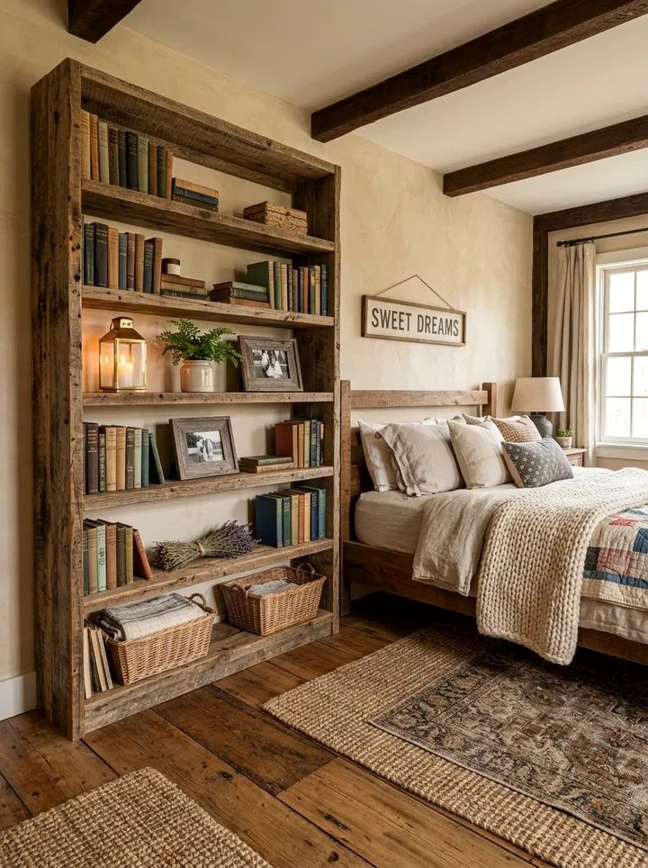

> TIP:CHECK: old books mixed with a few new ones; a lantern on the middle shelf; a basket on the bottom shelf for storage

## 21. Woven Baskets for Blankets Under the Shelves

Baskets are the prettiest way to hide the things a bedroom shelf should not show. This wooden shelving unit keeps its lower shelves for matching woven baskets filled with folded blankets and towels, while the books and a candle live up top where they can be seen. The baskets hold the spare bedding and winter throws — everything that would break the calm.

Match the baskets exactly, same weave and same size, so the bottom of the unit reads as one solid base. Keep one basket empty so there is always somewhere to toss the next stray throw, and label the inside of each basket if you share the house.

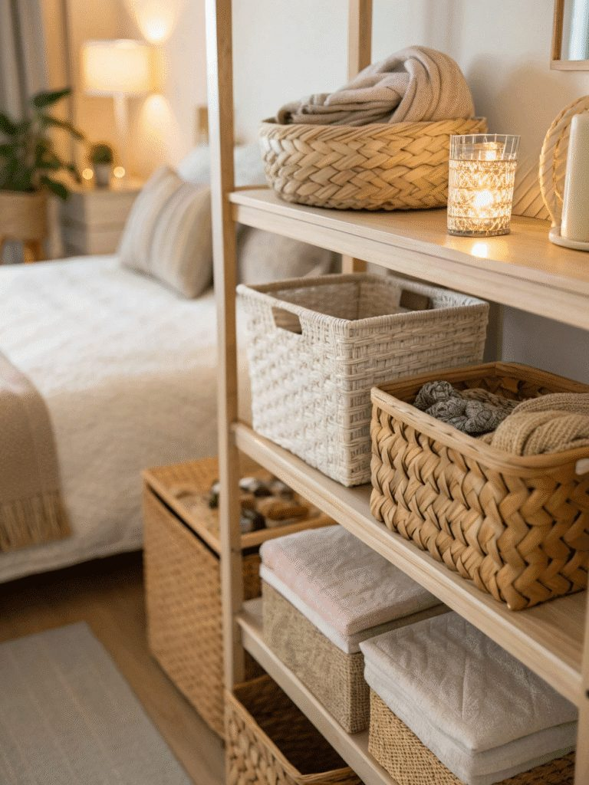

> TIP:GUIDE: Budget: under $80 for a set of six matching baskets | Time: one afternoon to measure and buy | Skill: beginner

## 22. A Bedtime Book Basket by the Bed

A basket of books beside the bed is the bedtime routine, made visible. This woven basket sits on the floor next to a child's bed, overflowing with colorful picture books — the ones for tonight already on top — with a stuffed bunny tucked in beside them. A child can pull one out, hand it to you, and put it back without help, which is the whole point of the basket.

Keep the basket to tonight's three or four books plus a couple of spares, and refill it from the main shelf each morning. A basket that holds the whole library stops being a bedtime basket and becomes a storage bin nobody opens.

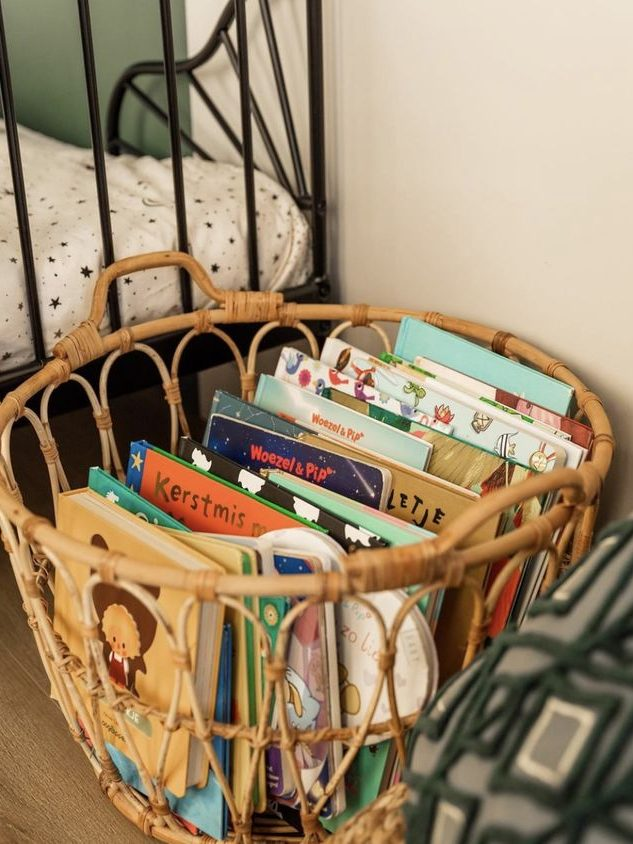

> TIP:QUICK: Tonight's three or four books on top, refilled from the main shelf each morning — a full basket never gets opened.

## 23. A Shared Bedroom with One Bookshelf Between Two Beds

One tall bookcase between two twin beds gives each child their own side of the same room. This shared bedroom sets a white bookcase in the middle, its shelves packed with books, plants and small baskets, with a pink bed on one side and a blue bed on the other. The bookcase is the divider, the library and the neutral ground all at once.

Give each child the two shelves nearest their own bed, and keep the middle shelves shared — the books you read aloud belong to both of them. A bookcase divider works best when it is open on both sides, so light still passes through and neither bed feels boxed in.

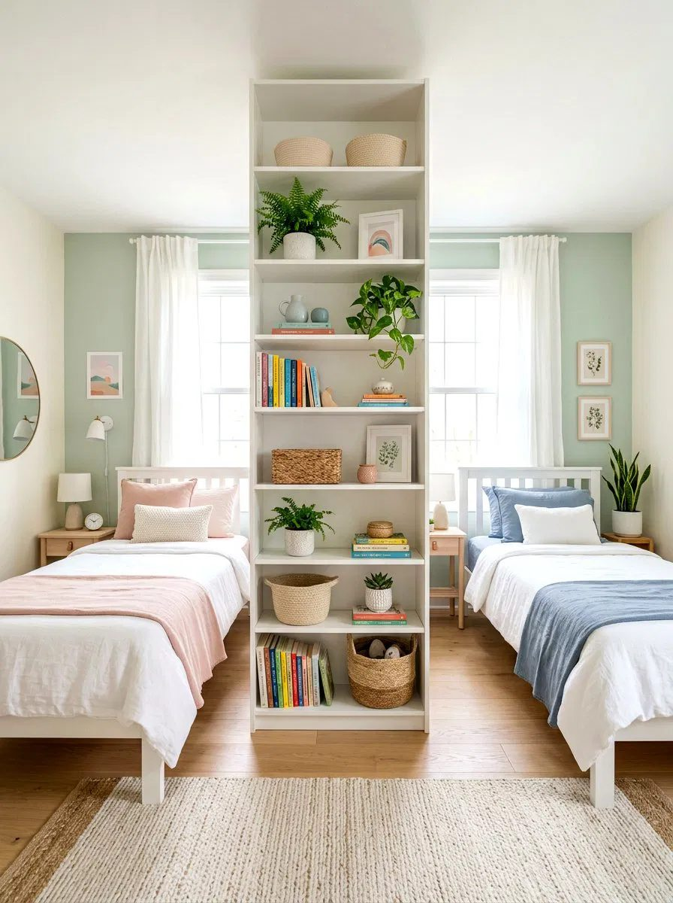

> TIP:CHECK: two shelves each, nearest their own bed; middle shelves shared; open on both sides so light passes through

## 24. A Vintage Bookcase with a Brass Lamp

Old books and brass make a bedroom shelf feel like it has a history. This sunlit bedroom pairs a green brass lamp with a stack of hardcovers on a wooden nightstand, a low bookcase under the window behind it, and framed maps and prints on the walls. The brass glows against the cream linen, and the books look read rather than arranged.

Hunt for vintage books by the foot at thrift shops and flea markets — you are buying spines, so condition matters less than color. Mix in one real brass piece, a lamp or a candlestick, and polish it; dull brass reads as clutter, polished brass reads as a collection.

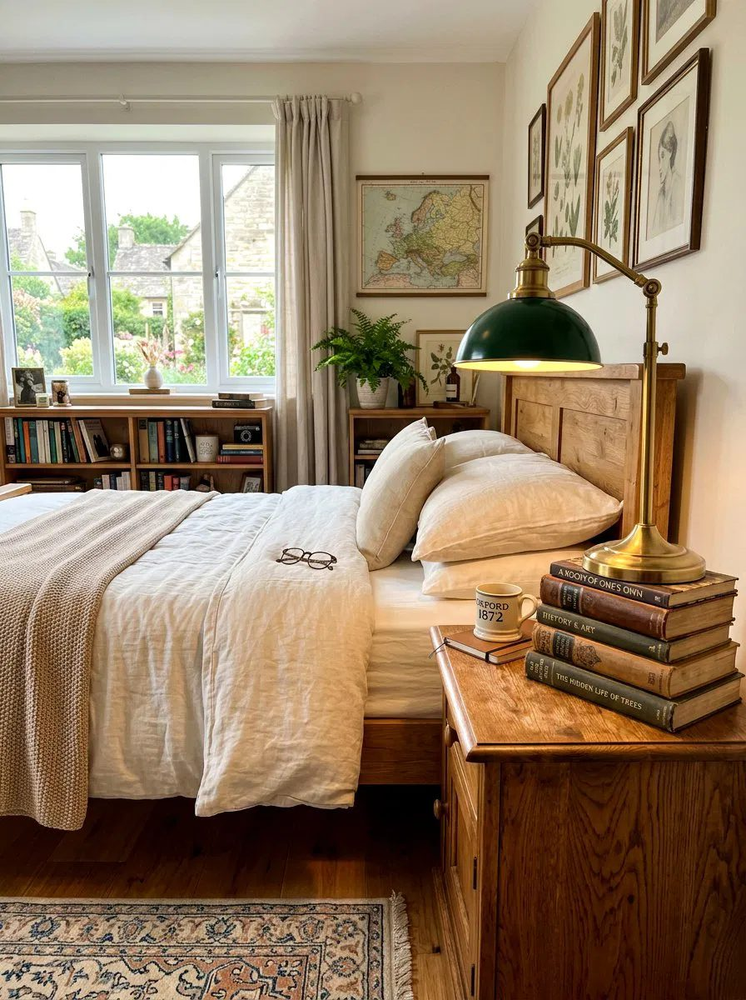

> TIP:GUIDE: Budget: under $30 for thrifted books and one brass piece | Time: one afternoon of hunting | Skill: beginner

## 25. A Minimalist Bedroom Shelf with a Few Favorites

A bedroom shelf does not have to be full to look finished. This calm bedroom runs pale wood shelves above the bed holding just a few books per shelf — a small stack here, a leaning row there — with most of the shelves left empty, a plant and a single vase breaking the lines. The empty space is the design, and the books look chosen rather than stored.

The rule is one group per shelf and nothing else: a stack of three books, or a row of five, with the rest of the shelf bare. If the emptiness makes you nervous, add one small object and stop there — the moment you add a second object, the minimalism is gone.

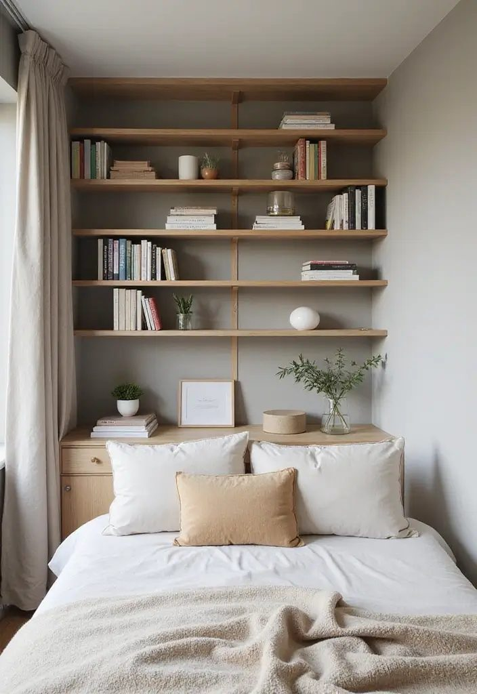

> TIP:QUICK: One group per shelf and nothing else — the moment you add a second object, the minimalism is gone.

## 26. Shelves with Framed Photos and Books

Framed photos on the same shelves as your books make a bedroom feel like your room, not a showroom. This wall mounts five white floating shelves beside a door, displaying books, trophies, framed family photos and small decorative objects in a neat grid, with the bed just to the side. The photos are the decoration here, and the books are the reason to stop and look.

Mix one framed photo per shelf with the books, and keep the frames the same color so the wall reads as one collection. Put the photos you look at most at eye level, and the books you reread on the shelf below them, so the two always sit together.

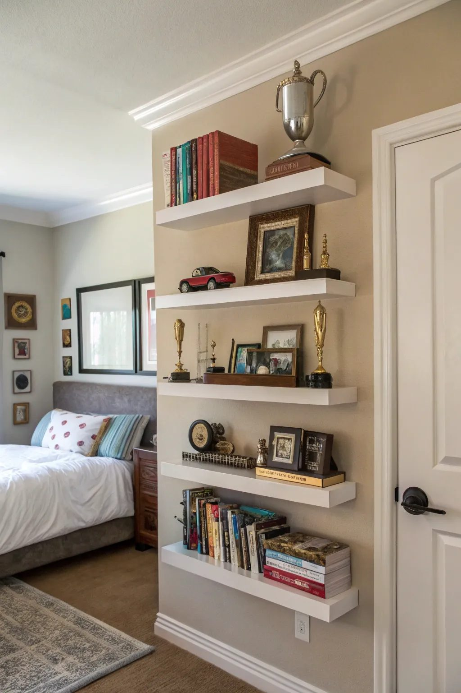

> TIP:CHECK: one framed photo per shelf; frames all the same color; favorite photos at eye level, rereads on the shelf below

## 27. Candles and Warm Light on Bedroom Shelves

Warm light turns a bookcase into the bedroom's evening glow. This room at dusk keeps its shelves lit with fairy lights and a candle on a tray beside a mug and an open book on the bed, the brown bedding catching the warm light and the bookcase glowing in the corner. The shelves look expensive after dark even when the books are ordinary.

Use battery candles on bedroom shelves if you read in bed — a real flame and a pillow are a bad combination. Put the lights on a timer so they fade out after bedtime, and keep one real candle on a tray on the bedside table, where you can see it and blow it out.

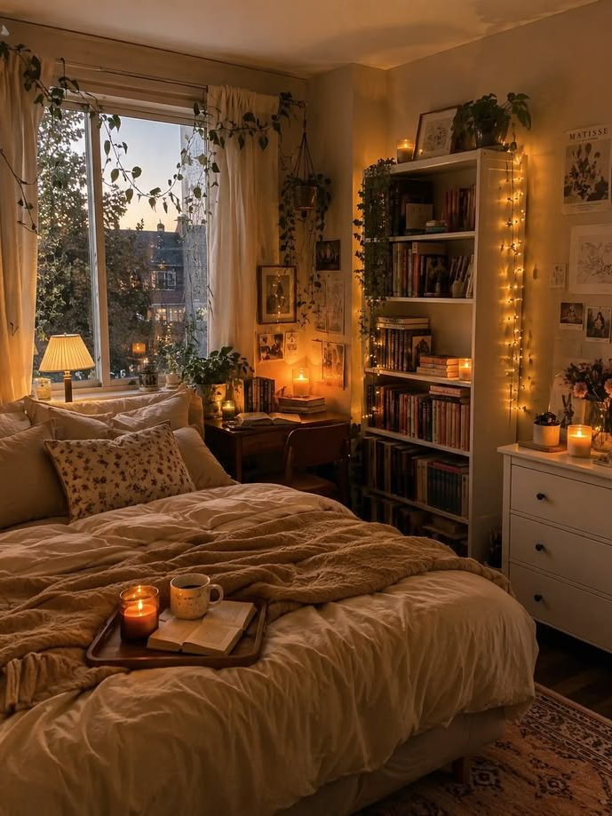

> TIP:GUIDE: Budget: under $20 for battery candles and a timer | Time: twenty minutes to set up | Skill: beginner

## 28. A Bed Nook Wrapped in Bookshelves

A bed tucked between two walls of bookshelves is the coziest sleep a book lover can have. This bedroom builds floor-to-ceiling wooden shelves around a low bed dressed in cream linen and a rust-colored throw, with pillows piled high and a small side table holding a lamp and a book. The shelves wrap the bed on three sides, so falling asleep feels like closing a book.

Keep the shelves beside the bed for the books you read at night, and the shelves at the foot for the ones you have finished. Leave the shelf nearest your pillow half empty — a full shelf an inch from your face feels like a wall, while a half-empty one feels like a nook.

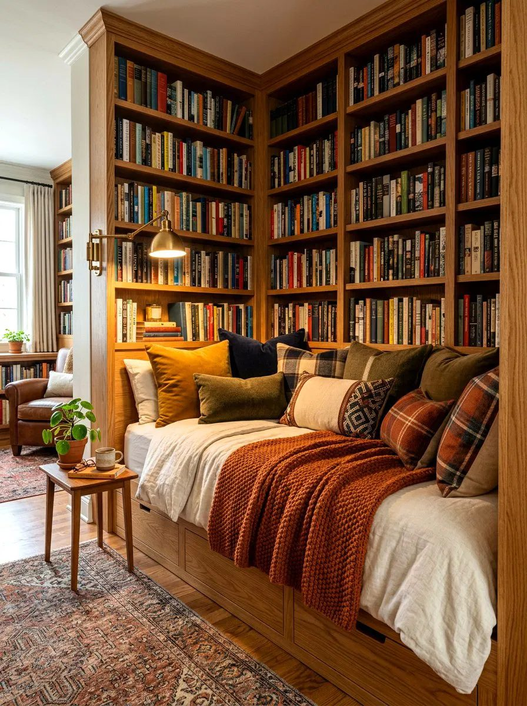

> TIP:QUICK: Keep the shelf nearest your pillow half empty — a full shelf an inch from your face feels like a wall.

## 29. A Loft Bed Built into a Bookshelf Wall

A loft bed built into a bookshelf wall turns a small bedroom into a two-story library. This attic-style room lifts the bed up a ladder into a wooden frame, with floor-to-ceiling shelves on every wall below, a leather armchair and a reading lamp underneath. The bed is the top bunk of a library, and the floor below is the reading room.

Anchor a loft bed to the wall and the shelves, never freestanding, and keep a lamp and a book on the small shelf beside the mattress so the reader upstairs is never in the dark. Put the books you reach for at night on the shelves nearest the ladder, so the climb down is only ever for a fresh book.

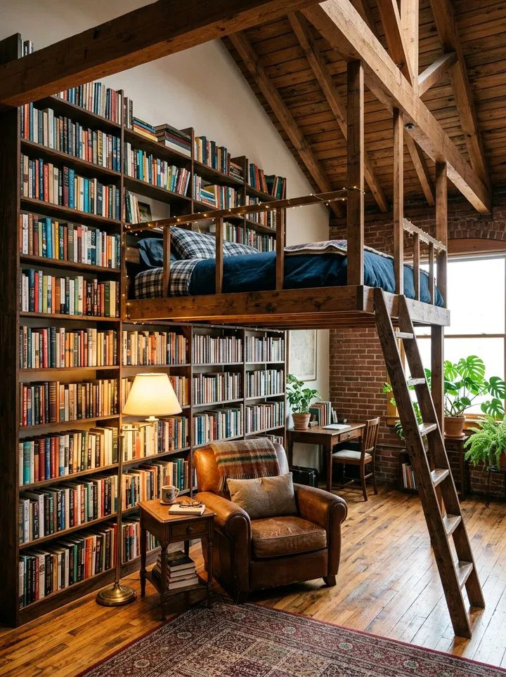

> TIP:CHECK: loft bed anchored to wall and shelves; a lamp and a book on the shelf by the mattress; night reads on the shelves nearest the ladder

## 30. Bookshelves Framing a Bedroom Window

Bookshelves built around a window frame the view and the books at the same time. This bright bedroom runs floor-to-ceiling wooden shelves along the whole wall, wrapping a large black-framed window in the middle, with a bed dressed in grey linen below and a white armchair in the corner. Daylight falls across the spines all morning, and the window becomes the middle of the library instead of a gap in it.

Keep the shelves beside the window for the books you love looking at — colorful spines, art books, the ones with beautiful covers — because the daylight will show them off. Put a plant on the window sill and one on the top shelf, and the green will tie the whole wall together.

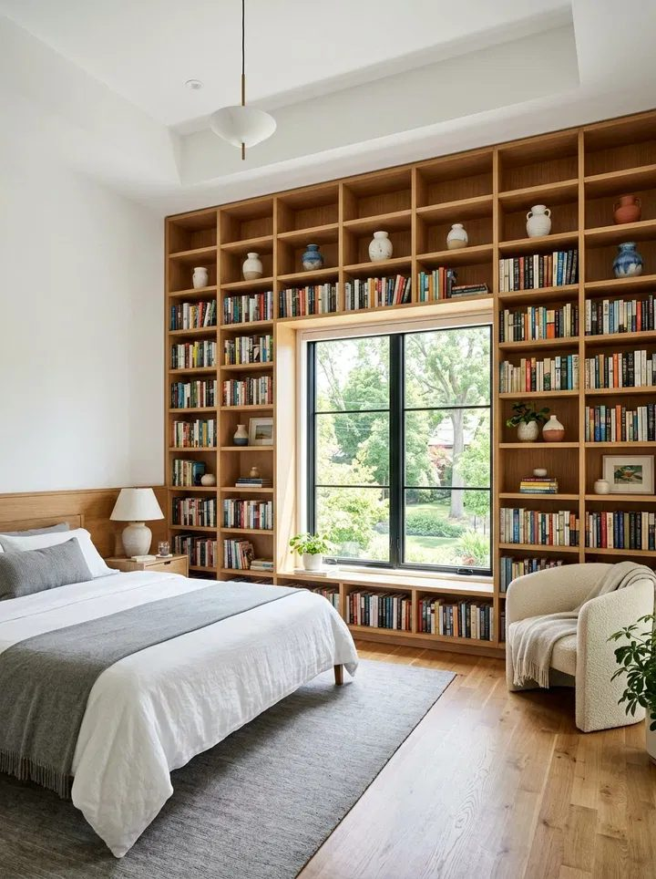

> TIP:GUIDE: Budget: from $250 for ready-made units fitted around the window | Time: one weekend to fit and style | Skill: beginner with a drill

## Takeaway

- A bedroom bookshelf is not bought, it is built one layer at a time.
- Start with the books you are reading right now beside the bed, add one plant, one basket and one personal object, then step back and leave the empty space alone.
- Restyle one shelf a week and the whole bedroom will feel gathered within a month.
- If you want the same collected warmth in the rest of the house, our [30 Bookshelf Decor Ideas for a Collected, Lived-In Look](/posts/bookshelf-decor-ideas/) shows how these shelves sit inside a bigger scheme, and [30 Neutral Bedroom Ideas for a Calm, Timeless Retreat](/posts/neutral-bedroom/) keeps the same calm going across the whole bedroom.

## Frequently Asked Questions

### How do I add a bookshelf to a small bedroom?

Use the wall's height instead of its floor space: a tall narrow bookcase, floating shelves above the bed, or picture ledges all hold a surprising number of books on a single square foot of floor. Anchor any tall unit to the wall, keep the heaviest books low, and leave one shelf partly empty so the room still feels calm.

### Where should a bookshelf go in a bedroom?

Put it where you read: beside the bed, above the headboard, or around a window seat. A bookcase also works as a divider between two beds in a shared room, or along the wall opposite the bed where it reads as a feature. Avoid blocking windows, radiators, or the path to the door.

### How do I style bedroom shelves without them looking cluttered?

Group objects in odd numbers, repeat one material three times, and leave at least one shelf partly empty so the eye can rest. Put books upright in rows, add one horizontal stack per shelf as a break, and remove one object from every shelf before you call it done.

### What books belong on a bedroom bookshelf?

The books you actually read at night: the novel in progress, a few favorites you reread, poetry or short stories for slow evenings, and picture books within a child's reach. Keep reference books and work manuals on the desk shelves instead, so the bedroom shelves stay restful and personal.

### Can I put a bookshelf right next to my bed?

Yes, a bookcase makes an excellent nightstand and keeps your current reads within arm's reach. Choose a unit no wider than the mattress is high, keep the top shelf for a lamp and a glass of water, and anchor it to the wall if it is taller than four feet.

### How do I keep bedroom bookshelves dust-free?

Dust the shelves once a week with a dry microfiber cloth, working top to bottom so dust falls onto the floor, not onto the shelf below. Keep books upright and snug so dust cannot settle between them, and run a vacuum with a brush attachment along the shelf edges once a month.

### What is the best bookshelf for a kids' bedroom?

A low, sturdy bookcase with front-facing ledges is best, because children choose books by their covers. Keep the shelves at your child's chest height, anchor the unit to the wall before the climbing stage starts, and rotate the front-facing books every couple of weeks so the shelf feels new.

### How do I light bookshelves in a bedroom?

Warm light is the rule: battery fairy lights or LED strips at 2700 Kelvin under each shelf, a small lamp at reading height beside the bed, and candles only on a tray where you can see them. Put the lights on a timer so they fade out after bedtime.
