# 30 Cabbage Crush Decor Ideas for a Fresh Home

Cabbage crush decor is the fresh, leafy green look that makes a whole home feel like a garden — soft cabbage green on walls, botanical prints, leaf-patterned textiles and green ceramics, all in shades between sage and emerald. It is a decorating idea, not a vegetable: the color of a cabbage leaf, used the way a garden uses green, to make rooms feel alive and calm at the same time.

This list gathers 30 cabbage crush decor ideas, all decorating projects and styling ideas, from a green accent wall to a leafy wreath on the door. If you want the wider style overview with its kitchen and dining-room focus, our [30 Cabbage Crush Ideas for a Fresh, Garden-Inspired Home](https://www.cozynesthomeideas.com/posts/cabbage-crush/) is the companion piece — this list is the hands-on version: concrete things to paint, hang, sew and style in every room of the house.

## 1. A Sage Green Accent Wall in the Living Room

One sage green wall is the easiest way to bring cabbage crush into a living room. This room paints a panelled wall in soft sage, sets a grey sofa against it, and lets plants and a pale abstract print do the rest. The green is calm enough to live with every day, and the panelling gives a plain wall the architecture of a much older house.

Paint the wall your sofa sits against, so the green is what you see when you walk in and what frames you when you sit down. Keep the sofa and rug pale — cream, grey or warm white — so the green stays the star, and add one plant in each corner to echo the wall color in real green.

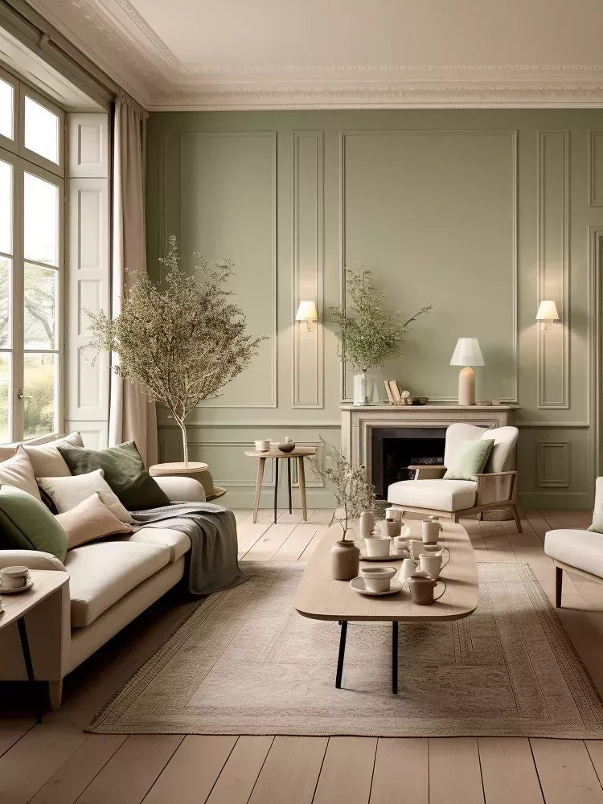

> TIP:QUICK: Paint the wall behind the sofa, not the wall with the television — the green should frame people, not a screen.

## 2. A Botanical Print Gallery Wall

A gallery wall of botanical prints is the cheapest cabbage crush idea on this list, and one of the prettiest. This living room hangs a dozen framed fern and leaf prints in a neat grid above a green sofa, with a jute rug and a potted fig below. The prints are the garden, framed and hung where you see them every morning.

Use matching frames in one finish — natural wood or white — and keep the gaps between them even, about two inches. Mix leaf shapes but keep the prints the same size, so the wall reads as one collection rather than a dozen separate pictures.

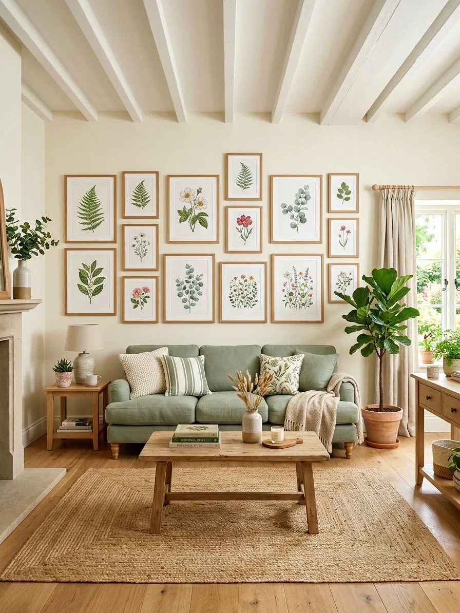

> TIP:CHECK: matching frames in one finish; two-inch gaps kept even; prints the same size, leaf shapes mixed

## 3. A Green Velvet Armchair

A green velvet armchair is the fastest way to bring cabbage crush into a living room without painting anything. This deep emerald chair sits against dark green panelled walls with a floor lamp and a small side table, and the velvet catches the light so the green changes as you move around the room. One chair is enough — it becomes the seat everyone wants.

Choose velvet in a deep green — emerald or forest — rather than a pale one, because an armchair gets used every day and dark velvet hides the wear. Keep the rest of the seating pale, so the green chair reads as the room's jewel rather than one green thing among many.

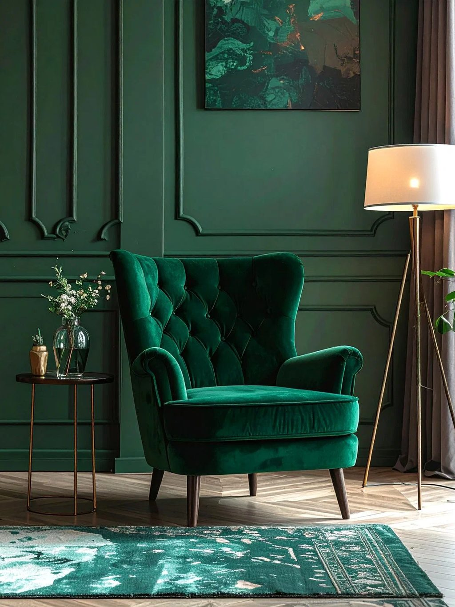

> TIP:GUIDE: Budget: from $150 for a velvet accent chair | Time: one afternoon to place and style | Skill: beginner

## 4. Sage Green Linen Curtains

Sage green linen curtains soften a whole living room the moment they go up. This bright room hangs floor-length sage curtains on either side of a wide window, with a pale sofa, a light wood coffee table and a vase of greenery below. The linen filters the daylight green, so the whole room glows softly even on a grey day.

Hang the curtains high — a few inches below the ceiling — and let them pool just slightly on the floor, so the window looks taller than it is. Choose a washed linen rather than a shiny fabric, because the matte texture is what makes sage green look like a garden color instead of a curtain color.

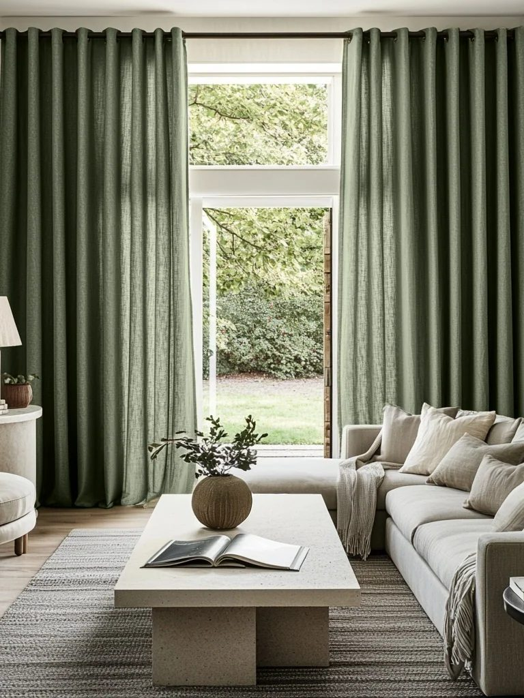

> TIP:QUICK: Hang linen curtains a few inches below the ceiling and let them just kiss the floor — the window looks taller at once.

## 5. Green Ceramic Vases on the Mantel

Green ceramic vases turn a plain mantel into a cabbage crush vignette. This white mantel holds a tall green-and-white floral ginger jar, brass candlesticks, a small potted succulent and a framed print, with the green jar doing all the color work. The mantel is the room's focal point, so one strong green piece there colors the whole room.

Group the vases in odd numbers — one tall jar and one small pot — and keep everything else on the mantel pale or brass. A mantel with three green things looks collected; a mantel with six looks like a shop shelf.

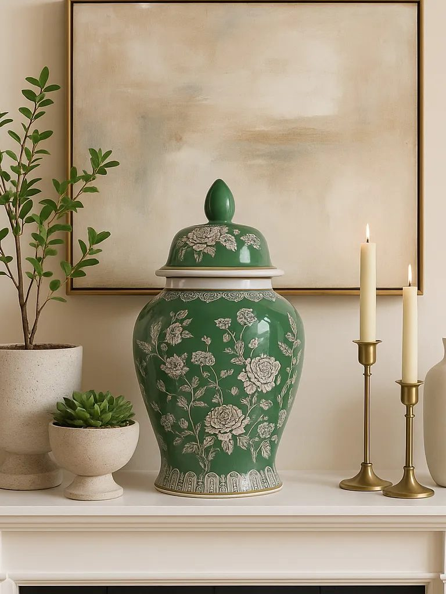

> TIP:CHECK: one tall green jar as the anchor; one small pot beside it; everything else on the mantel pale or brass

## 6. Botanical Leaf Throw Pillows

Botanical leaf pillows are cabbage crush you can change with the seasons. This cream sofa wears a row of pillows printed with monstera, palm and fern leaves in greens from pale sage to deep forest, plus one solid green cushion and a green throw. The pillows carry the whole color scheme, and the sofa underneath can stay plain cream for years.

Mix one large leaf print, one small leaf print and one solid green pillow per sofa, and keep the pillow covers in the same fabric — linen or cotton — so the set feels designed. Swap the covers in spring and the sofa feels new without buying a single piece of furniture.

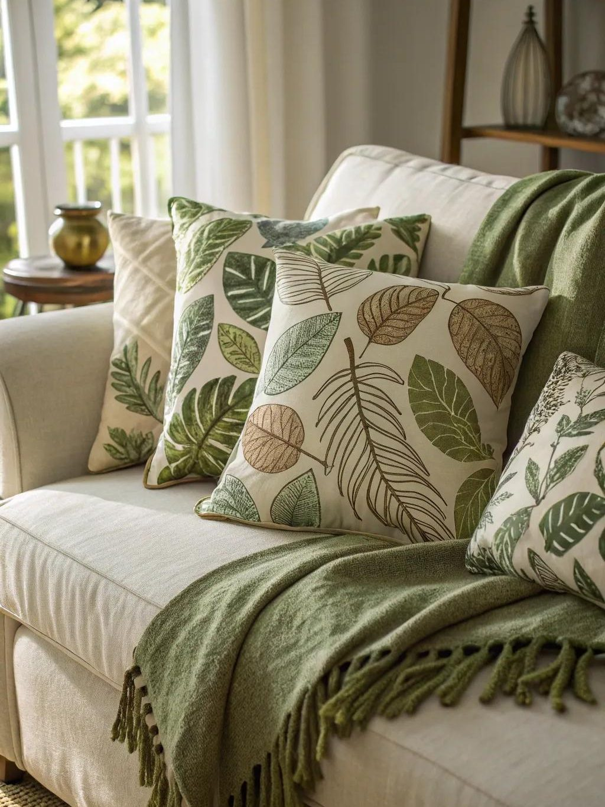

> TIP:GUIDE: Budget: from $12 per botanical pillow cover | Time: twenty minutes to swap covers | Skill: beginner

## 7. A Leaf-Green Throw Blanket

A leaf-green throw blanket is the smallest cabbage crush move that still changes a room. This sofa is dressed with a soft green knit throw draped over one arm, with cream cushions and a green pillow beside it, in a living room full of warm wood. The throw is the green you touch every evening, and it makes the whole sofa feel like part of the garden palette.

Drape the throw over one arm or across the back, never folded in a neat square on the seat — a throw that looks used is a throw that gets used. Choose a knit or waffle texture in a mid green, because a flat green fabric reads as a blanket while a textured one reads as decor.

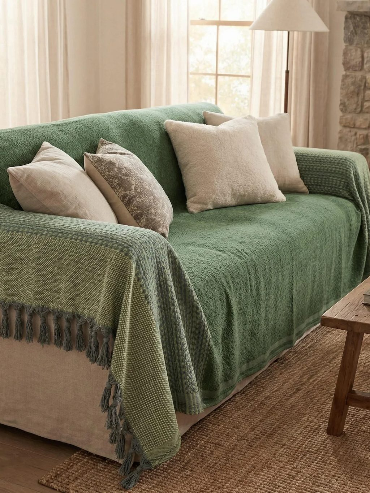

> TIP:QUICK: Drape the throw over one arm, never folded square on the seat — a throw that looks used is a throw that gets used.

## 8. Botanical Wallpaper in the Powder Room

A powder room is the best place in the house for bold botanical wallpaper, because it is small enough to paper in an afternoon and guests see it every visit. This one wraps the walls in dense green botanical print, sets a white pedestal sink against it, and hangs a small mirror and a brass sconce above. The wallpaper is the whole decoration — nothing else in the room needs to try.

Paper all four walls in a powder room rather than one accent wall, because a tiny room can take a big pattern without feeling busy. Keep the sink, mirror and fittings white or brass, and choose a wipeable vinyl paper, since a bathroom is the dampest room in the house.

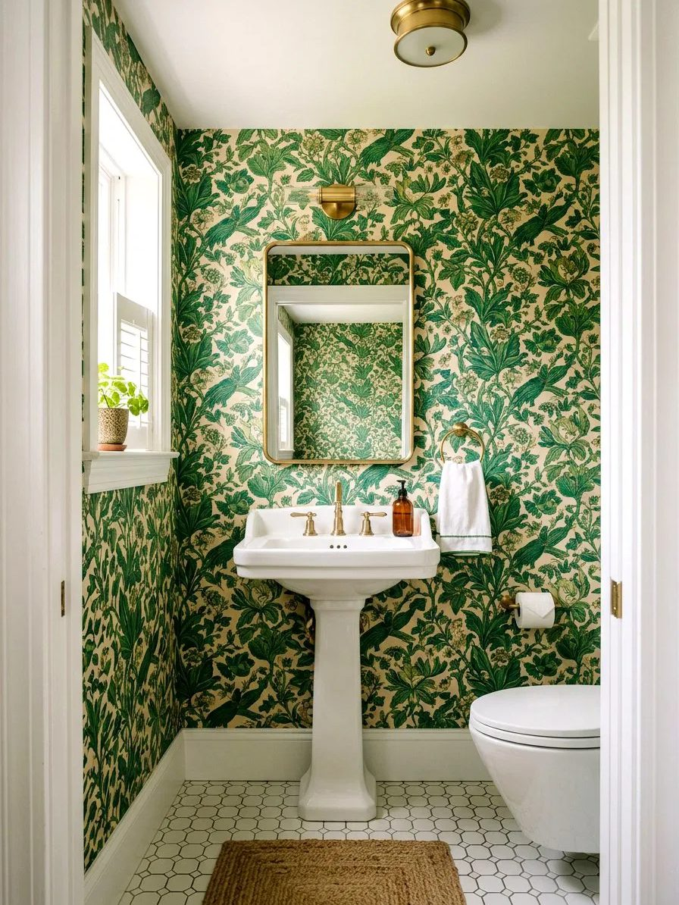

> TIP:CHECK: all four walls papered in a tiny room; sink and fittings white or brass; wipeable vinyl paper only

## 9. A Green Console Table in the Entryway

A green console table makes the entryway the first cabbage crush moment a guest sees. This sage green half-moon table stands by the stairs with woven baskets below, a vase of pink flowers and a stack of books on top. It is narrow enough for a hallway, and the green tells visitors the whole house will be this fresh.

Style the top in three layers — a vase, a stack of books, one small object — and keep the baskets below for shoes, scarves and dog leads. A console table with nothing under it wastes the hallway's only storage, and a console with clutter on top wastes its only decoration.

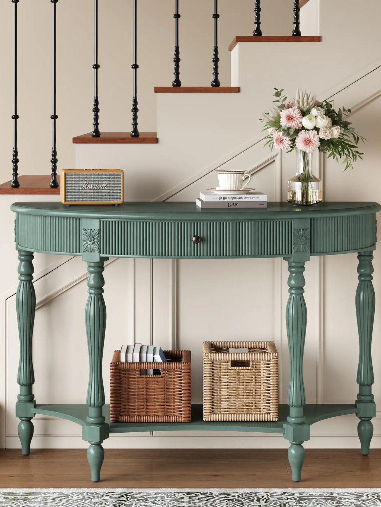

> TIP:GUIDE: Budget: from $80 for a painted console table | Time: one hour to style | Skill: beginner

## 10. A Cabbage-Green Front Door

A cabbage-green front door is the outside of the house joining the trend. This sage green door with brass hardware sits in a stone porch with potted plants and a coir doormat, and the soft green looks fresh against both brick and white siding. It is the cheapest curb appeal a house can buy, and it photographs beautifully in every season.

Paint the door a soft sage rather than a dark forest green, because a front door is seen in harsh daylight and pale greens glow while dark ones go flat. Add one potted plant on each side of the step, and the green of the door will have a living echo before anyone knocks.

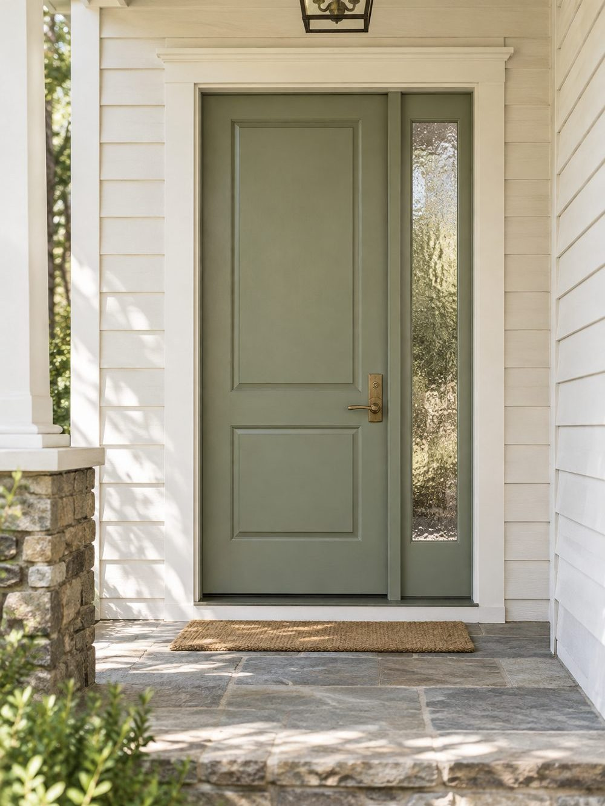

> TIP:QUICK: Choose soft sage for a front door, not dark forest — pale greens glow in daylight while dark ones go flat.

## 11. A Green Tray Centerpiece on the Coffee Table

A green tray turns a coffee table into a cabbage crush vignette you can lift away in one move. This round wooden table holds a deep green tray with a potted plant, a green pillar candle and a patterned candle holder, with green cushions on the sofa behind it. The tray keeps the small things corralled, so the table never looks cluttered even when it is in daily use.

Keep the tray to three objects — a plant, a candle and one small decorative piece — and leave the rest of the table empty. A tray that holds everything on the table is not a centerpiece, it is a storage box, and the table loses the breathing room that makes it look styled.

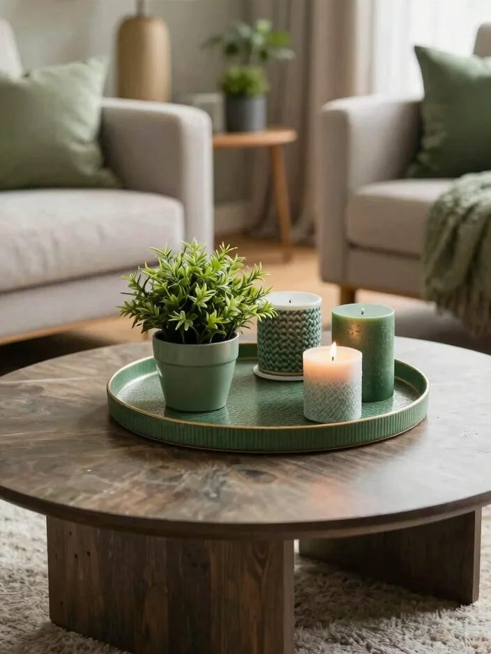

> TIP:CHECK: three objects on the tray — a plant, a candle, one decorative piece; the rest of the table left empty

## 12. Green Built-In Bookshelves

Dark green built-in bookshelves turn a whole living-room wall into a library with a garden palette. This wall runs deep green shelving floor to ceiling beside a white sofa, its shelves holding books, terracotta pots, trailing plants and framed prints, with an orange armchair breaking up the green. The shelves are the decoration, so the room needs almost nothing else on the walls.

Paint the built-ins the same green as the wall behind them, so the shelving reads as architecture rather than furniture. Style the shelves with books in two out of every three cubbies and plants or objects in the third, and the wall will feel like a library, not a bookshop.

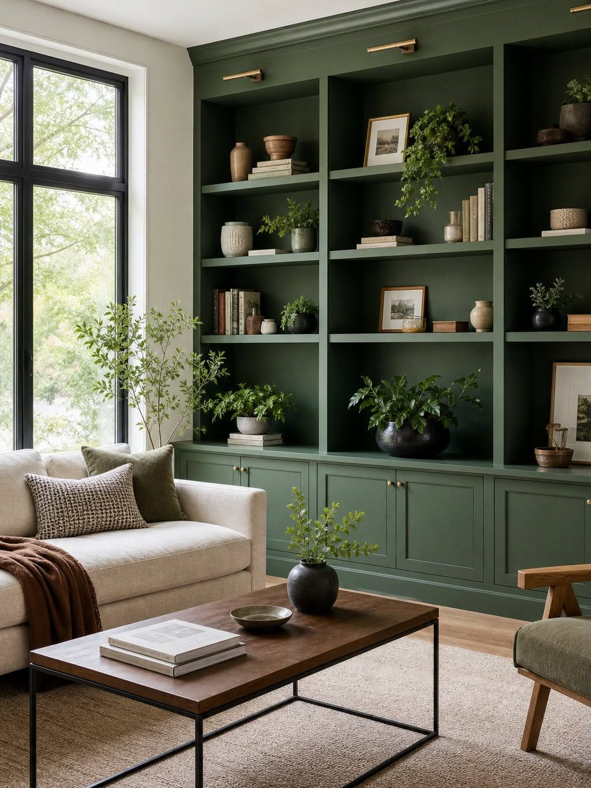

> TIP:GUIDE: Budget: from $300 for ready-made units painted green | Time: one weekend to fit and style | Skill: beginner with a drill

## 13. Sage Green Bedding

Sage green bedding is the bedroom version of cabbage crush, and the one you sleep in every night. This bed is dressed in washed sage linen with white pillows, a sage throw and a small botanical print on the wall, in a pale room with wooden nightstands. The green is soft enough to fall asleep in, and it makes white pillows and wooden furniture look warmer by contrast.

Layer two greens on the bed — a pale sage duvet and a slightly deeper green throw or pillow — so the bedding has depth instead of one flat color. Keep the walls pale and the nightstands wood, and the bedroom will feel like a garden room even with the curtains closed.

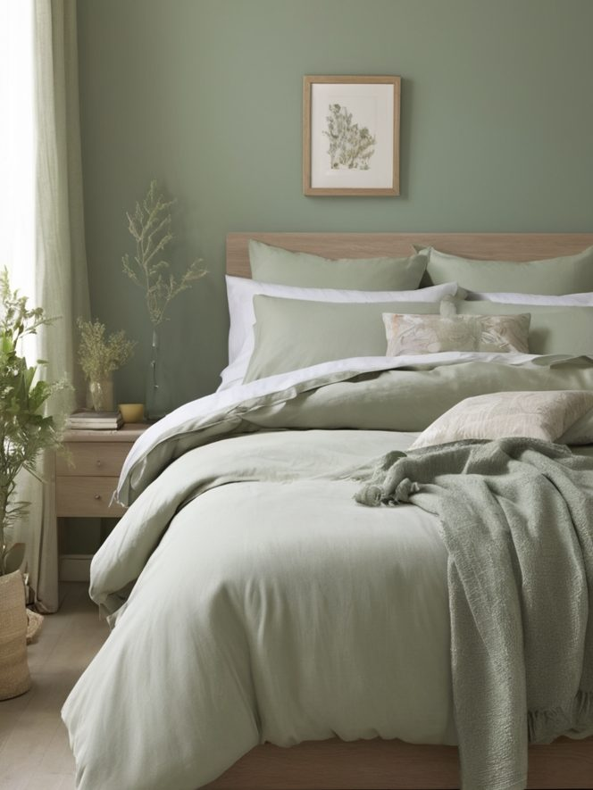

> TIP:QUICK: Layer two greens on the bed — a pale sage duvet and one deeper green throw — so the bedding has depth.

## 14. Botanical Prints Above the Bed

A grid of botanical prints above the bed is the bedroom's answer to a gallery wall. This bedroom hangs ten framed leaf and fern prints in two neat rows over a white bed with a green throw, flanked by wooden nightstands and brass lamps. The prints are calm enough for a room you sleep in, and they make the bed feel like the center of a small botanical collection.

Hang the grid so its bottom edge sits about six inches above the headboard, and keep the whole grid no wider than the bed itself. Use matching frames in one finish, and the wall will read as one artwork rather than ten small pictures competing with each other.

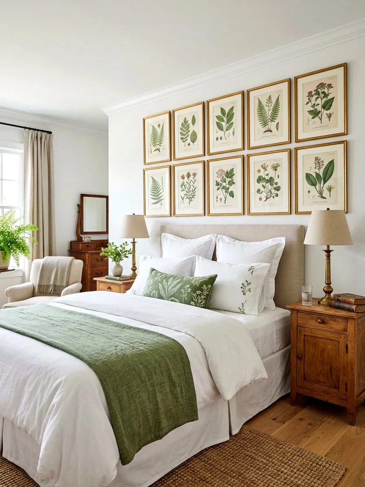

> TIP:CHECK: grid bottom six inches above the headboard; grid no wider than the bed; matching frames in one finish

## 15. A Green Ceramic Table Lamp

A green ceramic lamp puts cabbage crush on the bedside table, where you see it first thing and last thing every day. This mint green lamp with a white shade sits on a white bedside table beside a small vase of white flowers and a stack of books, in a pale bedroom. The lamp is small, but its green base is the one color note in an otherwise neutral room, and the eye goes straight to it.

Match the lamp base to the bedding or the curtains in one shade of green, so the small green note repeats somewhere bigger in the room. Keep the shade white or cream, because a green shade turns the light green too, and reading in green light gets tiring fast.

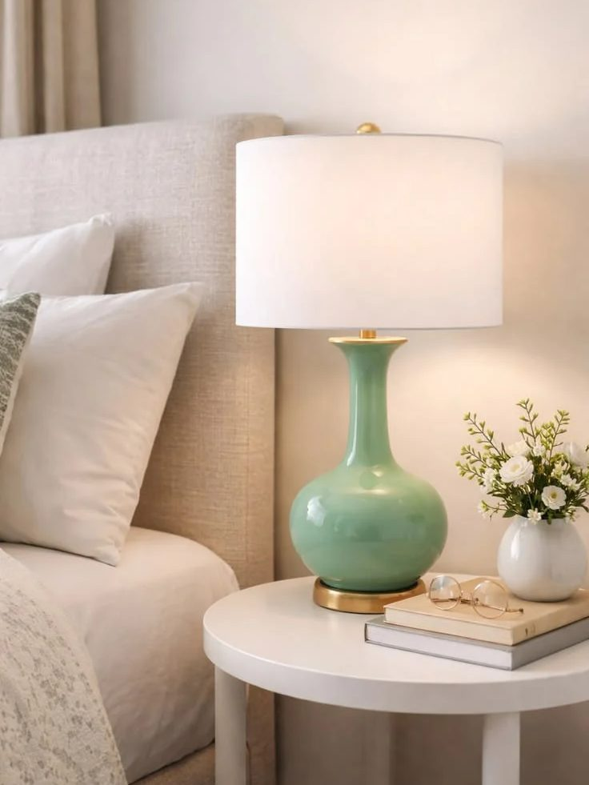

> TIP:GUIDE: Budget: from $25 for a ceramic table lamp | Time: five minutes to place | Skill: beginner

## 16. A Green Leaf Rug

A green leaf rug anchors a living room in the garden palette from the floor up. This room lays a large deep green rug printed with oversized pale leaves under a cream sofa, with a light wood coffee table and leafy plants in the corners. The rug is the biggest green surface in the room, so it sets the color scheme and everything else just echoes it.

Choose a rug big enough that the front legs of the sofa and the chairs all sit on it — a rug that only the coffee table touches looks like a mat, not a rug. Keep the rug's green one shade deeper than the walls, so the floor grounds the room instead of competing with it.

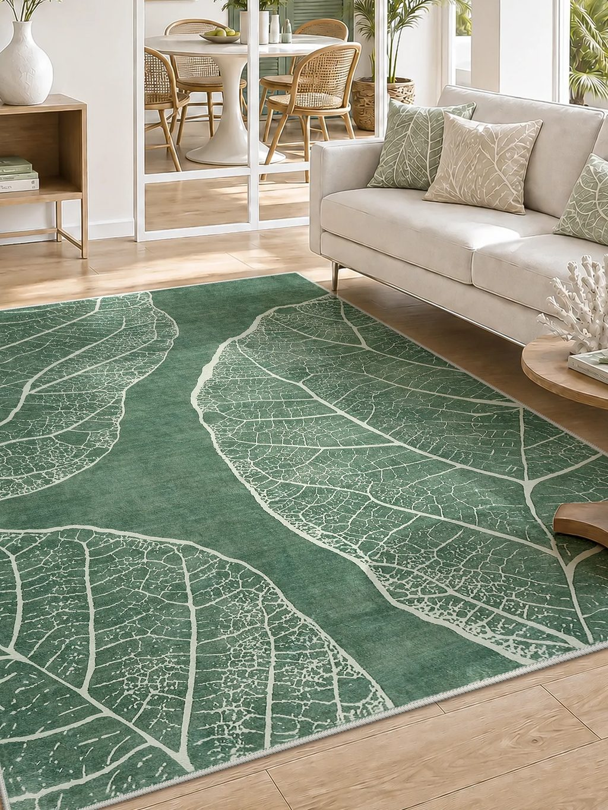

> TIP:QUICK: Buy the rug big enough for the sofa's front legs to sit on it — a rug only the coffee table touches looks like a mat.

## 17. A Garden-Inspired Reading Nook

A garden-inspired reading nook is cabbage crush at its coziest: one green chair, one lamp, and plants everywhere. This corner tucks a dark green velvet armchair between tall bookshelves, with a plaid throw, a basket of books, a glowing table lamp and potted plants on every surface. It is the smallest room in the house, and the one that gets used the most.

Build the nook around a chair you already love, then add the green — a throw, a cushion, a plant on the side table — rather than buying a whole new set. Keep a basket of books beside the chair and a lamp at reading height, and the nook will be finished before you have spent anything at all.

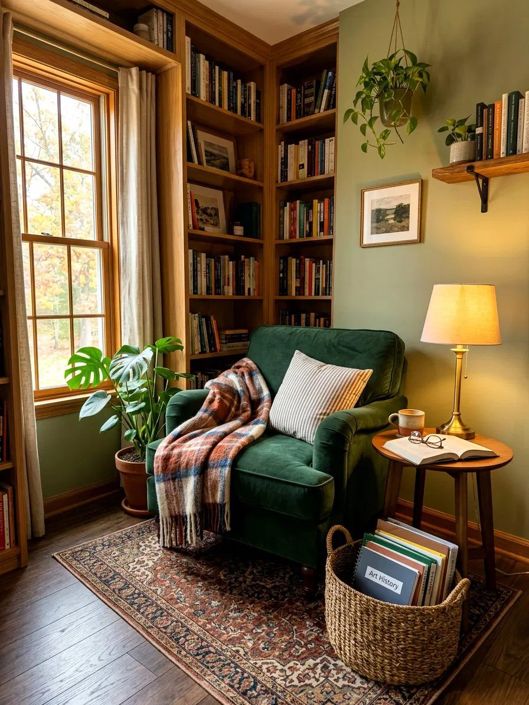

> TIP:CHECK: a chair you already love; green in the throw and cushion; a basket of books and a lamp at reading height

## 18. Dark Green Bathroom Towels

Dark green towels are the fastest cabbage crush update a bathroom can have. This bathroom hangs deep green towels on a black rail, with matching green tumblers and soap dispensers on the counter, white tiles and a small plant on the sill. The towels are the color, the accessories repeat it, and the white tiles keep the small room bright.

Buy the towels in a set — bath, hand and face — in one shade of green, and keep the bath mat cream or white so the floor stays light. Dark towels show soap marks more than pale ones, so wash them with a little white vinegar in the rinse and they will stay deep green for years.

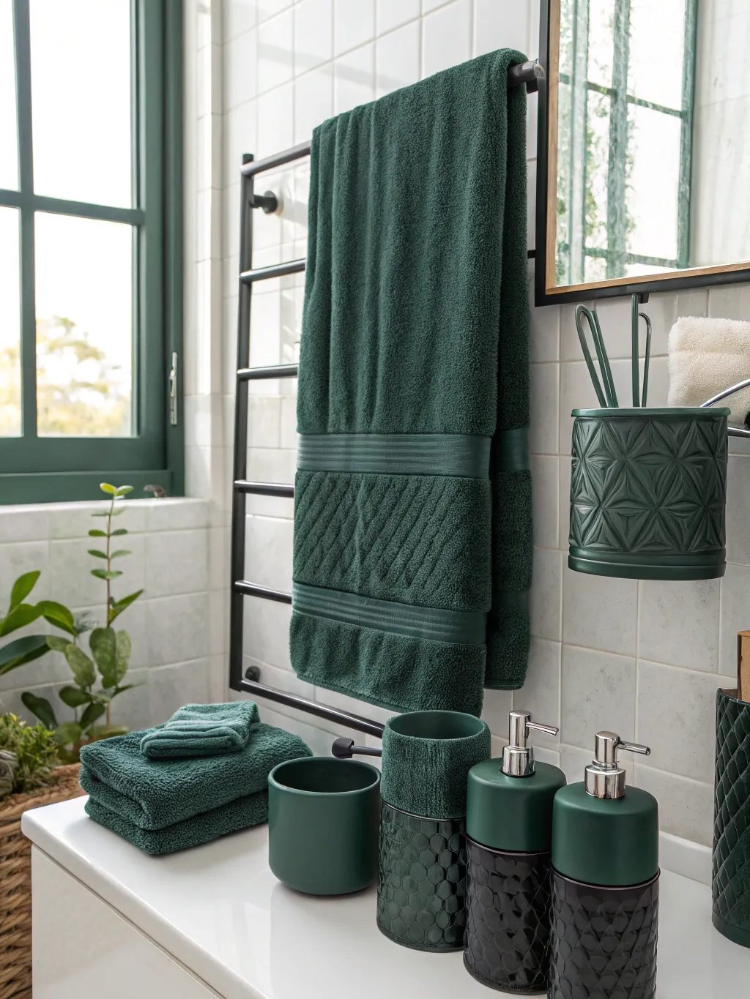

> TIP:GUIDE: Budget: from $30 for a matching green towel set | Time: ten minutes to swap | Skill: beginner

## 19. A Green Leaf Wreath on the Door

A green leaf wreath is cabbage crush hanging on the front door, and it works in every season. This lush wreath of mixed green leaves and eucalyptus hangs on a grey door with a brass knocker, full and round, with no flowers and no ribbon to date it. It says garden before anyone steps inside, and it costs less than a painted wall.

Choose a faux wreath made from mixed greens — eucalyptus, fern and olive leaves together — because a single-leaf wreath looks flat from the street. Hang it at eye level on a simple hook, and keep the door hardware brass or black so the green is the only color competing for attention.

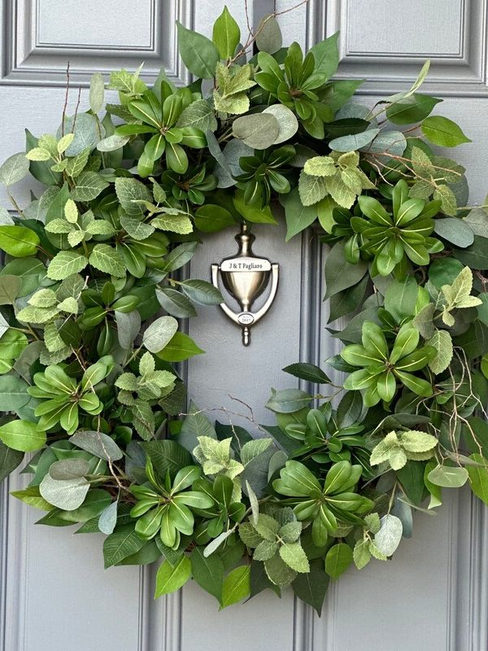

> TIP:QUICK: Pick a mixed-greens wreath — eucalyptus, fern and olive together — because one leaf type looks flat from the street.

## 20. Green Planters on the Windowsill

Green planters on a windowsill put real plants in cabbage crush pots, so the green is alive. This sunny sill lines up three ribbed green ceramic pots holding leafy houseplants, with trailing vines above and a wooden shelf below. The pots repeat the green of the plants, which makes even a small collection look deliberate and designed.

Use pots in one shade of green but three different heights, so the sill has a rhythm instead of a row. Keep a saucer under each pot, water the plants weekly, and rotate them a quarter turn every month so they grow evenly toward the light.

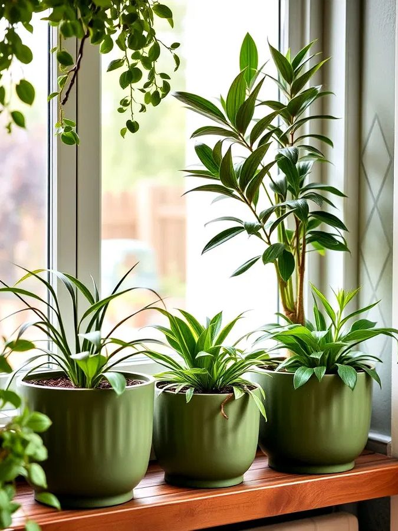

> TIP:CHECK: pots in one shade of green; three different heights; a saucer under each pot and a quarter turn monthly

## 21. Dark Botanical Wallpaper Behind the Bed

Dark botanical wallpaper behind the bed turns the bedroom wall into a midnight garden. This room papers the headboard wall in oversized white flowers and green leaves on a dark ground, sets a wooden bed with sage cushions against it, and keeps the nightstands light wood. The wallpaper is the headboard's backdrop, so the bed looks framed even without a tall headboard.

Paper only the wall behind the bed, and keep the other three walls pale — a whole dark bedroom is a commitment, but one dark wall is a statement. Add warm bedside lamps, because dark wallpaper swallows daylight, and the room needs its own glow after sunset.

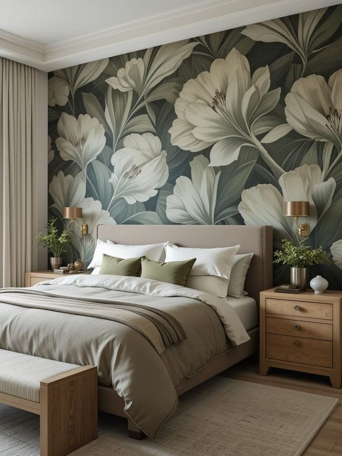

> TIP:GUIDE: Budget: from $60 for one wall of botanical wallpaper | Time: one afternoon to hang | Skill: beginner with paste

## 22. A Green Velvet Ottoman

A green velvet ottoman is the low, soft piece that ties a cabbage crush living room together. This tufted emerald ottoman sits on a fluffy white rug beside a green sofa, big enough to put your feet up or set a tray on, and soft enough to pull up as an extra seat. It is the piece guests end up sitting on, which is exactly what an ottoman is for.

Choose a tufted ottoman in the same green as the armchair or sofa, so the seating reads as a set, and keep it low — no higher than the seat of the sofa — so it works as a footrest and a coffee table at once. A tray on top turns it into a table in seconds.

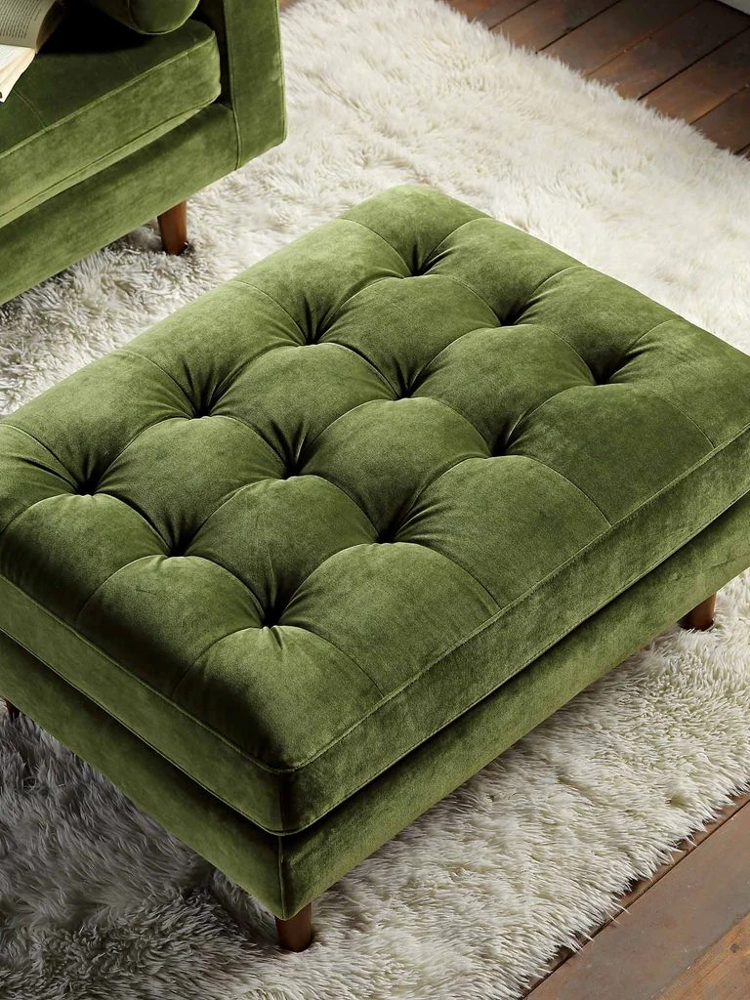

> TIP:QUICK: Keep the ottoman no higher than the sofa seat — low enough for feet, and a tray on top turns it into a table.

## 23. A Window Seat with Green Cushions

A window seat with green cushions is the spot in the house everyone fights over. This bay window runs a long green cushion along the seat, with green and striped pillows at each end, a basket and a throw below, and the garden outside doing the rest of the decorating. The green cushion ties the seat to the garden view, so inside and outside feel like one room.

Make the cushion in a washable outdoor fabric even indoors, because a window seat gets sun, rain on the glass and muddy paws, and washable fabric is the only kind that survives it. Add storage drawers under the seat for blankets and board games, so the nook is always ready for an afternoon in it.

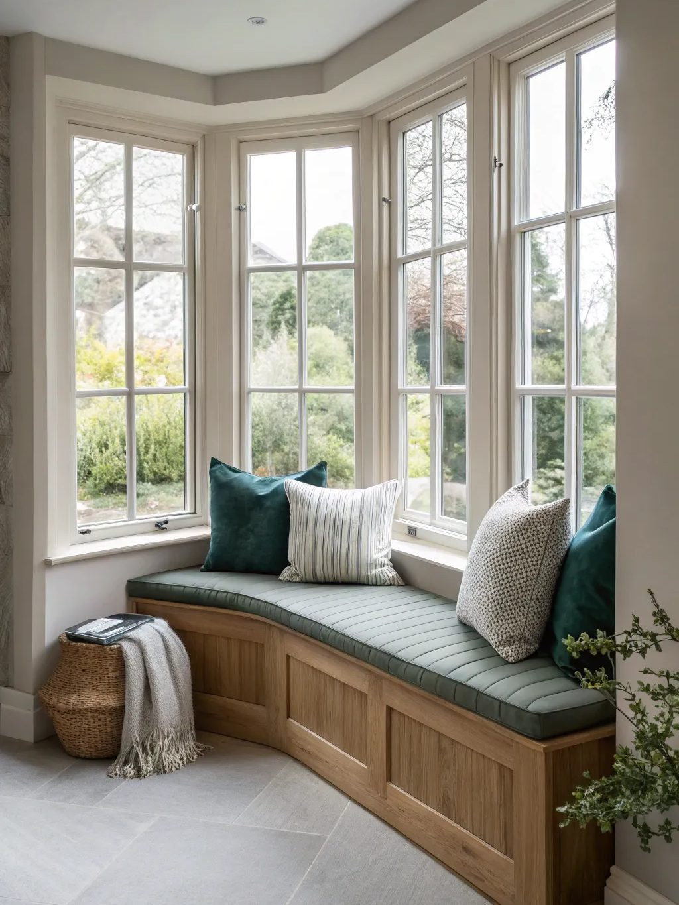

> TIP:CHECK: washable fabric for the cushion; storage drawers underneath; a throw and a basket within reach

## 24. A Green Garden Table Setting

A green garden table setting is cabbage crush at its most generous — a whole table dressed in leafy green. This setting layers green botanical plates on woven placemats, sets green glasses and gold cutlery beside them, and runs a garland of greenery and white flowers down the center. Every place looks like a garden, and the table needs no other decoration at all.

Repeat one element at every setting — the same placemat, the same green glass, the same napkin fold — so the table reads as designed rather than assembled. Keep the centerpiece low, under six inches tall, so guests can see each other across it, and use flameless candles if the greenery is dry.

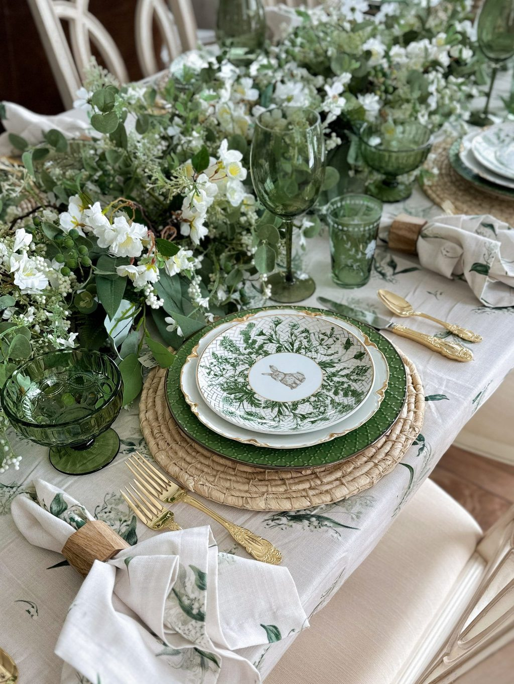

> TIP:GUIDE: Budget: from $40 for woven placemats and green glasses | Time: thirty minutes to lay | Skill: beginner

## 25. Green Outdoor Cushions on the Patio

Green outdoor cushions bring cabbage crush outside, where the color belongs. This patio sofa wears olive green cushions against a wall of leafy greenery, with a white throw and a wicker frame, and the green of the cushions matches the garden behind it. The patio stops looking like furniture left outside and starts looking like another room of the house.

Buy outdoor cushions in a fade-resistant fabric, because green is the first color the sun bleaches, and store them in a deck box when it rains. Keep the cushions to two shades of green — one olive, one deep — and let the plants supply every other shade.

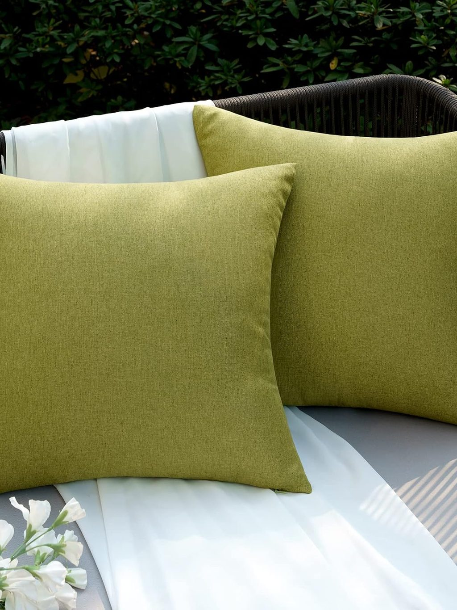

> TIP:QUICK: Buy fade-resistant outdoor fabric — green is the first color the sun bleaches — and store cushions in a deck box.

## 26. A Sage Green Dresser

A sage green dresser is cabbage crush as furniture, and it anchors a whole bedroom. This wide sage dresser with brass knobs stands beside a wooden bed, its top styled with a lamp, books and a vase of white flowers, under a gold-framed mirror. The dresser is big enough to hold the room's color scheme on its own, so the walls can stay pale.

Paint a secondhand dresser rather than buying new — sage green covers scratches and mismatched wood beautifully, and a painted dresser looks intentional where a plain one looks tired. Swap the knobs for brass last, because brass against sage is the detail that makes the whole piece look expensive.

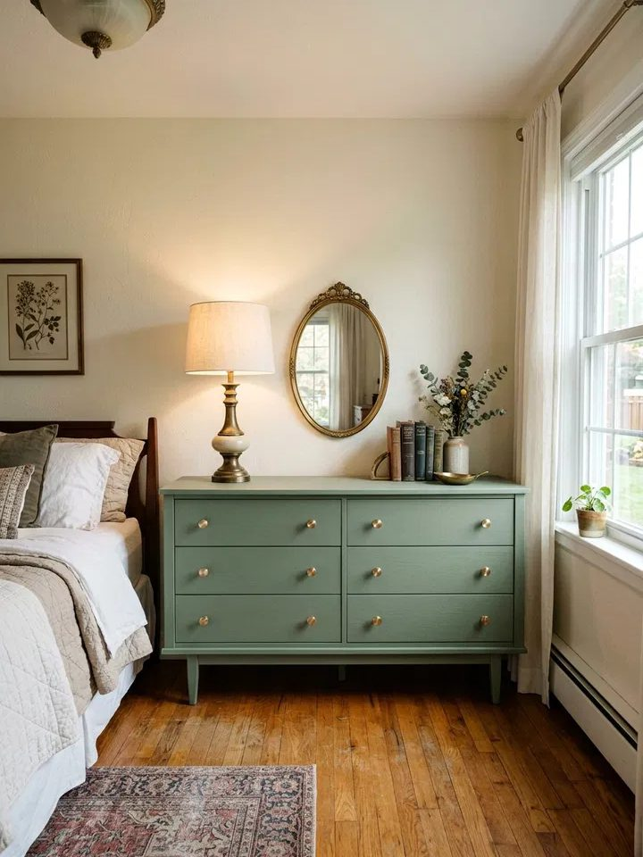

> TIP:CHECK: a secondhand dresser painted sage; brass knobs swapped last; lamp, books and one vase on top

## 27. A Green-Framed Arched Mirror

A green-framed arched mirror is the piece that makes a pale living room feel designed. This tall arched mirror with a thin green frame leans against a cream wall, reflecting a green cabinet, a sunflower print and the whole room back at itself. The mirror doubles the light and the green, so a room with one green cabinet suddenly looks like it has two.

Lean a tall mirror rather than hanging it if the wall is plaster — a leaning mirror needs no anchors and can move with the room. Place it opposite a window or a green piece of furniture, so it reflects something worth doubling, and keep the frame thin so the mirror reads as elegant rather than heavy.

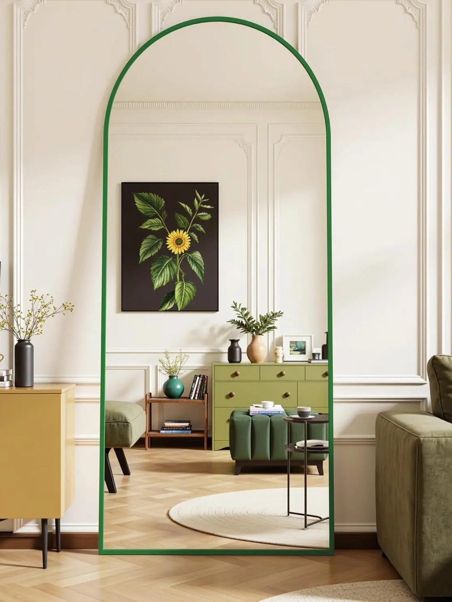

> TIP:GUIDE: Budget: from $90 for a tall arched mirror | Time: ten minutes to lean and style | Skill: beginner

## 28. A Green Leaf Garland on the Mantel

A green leaf garland draped over the mantel is cabbage crush that takes five minutes and changes the whole fireplace. This mantel wears a lush garland of mixed greenery swagged across the front, with lanterns and candles below and a black arched window mirror above. The garland softens the straight lines of the fireplace, and the green against the white mantel is the freshest contrast in the room.

Drape the garland so it dips in the middle and rises at the ends, and let a few strands trail down each side — a garland laid flat across the top looks like a hedge, while a swagged one looks like a garden. Use a faux garland indoors, because a real one dries out above a fireplace within days.

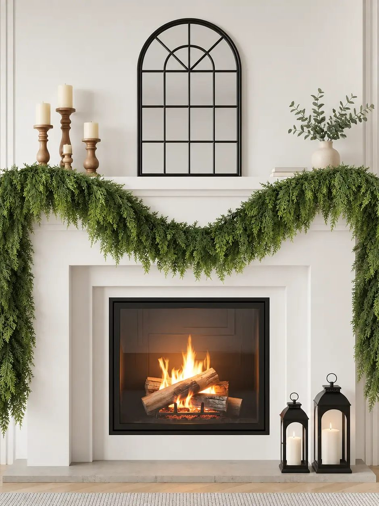

> TIP:QUICK: Swag the garland so it dips in the middle and trails at the sides — laid flat, it looks like a hedge.

## 29. Dark Green Candles on the Coffee Table

Dark green candles are cabbage crush in its smallest, warmest form. This wooden coffee table groups three deep green pillar candles of different heights, with a grey sofa, a green throw and a small plant behind them. The candles are the green you light every evening, and their glow makes the whole corner feel like a garden at dusk.

Group candles in threes at different heights — tall, medium and short — on a tray or directly on the table, and keep them together rather than scattered around the room. One group of three reads as a centerpiece; three singles read as three forgotten candles.

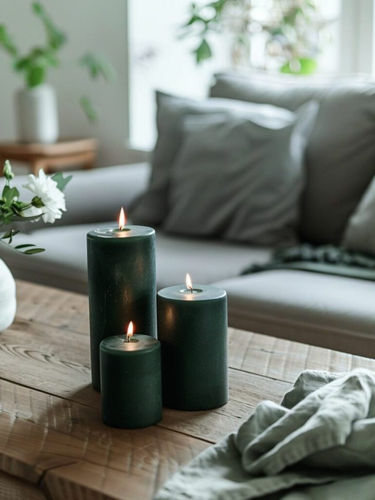

> TIP:CHECK: three candles at different heights; grouped together on a tray; lit only when you are in the room

## 30. A Botanical Shower Curtain

A botanical shower curtain is the bathroom's big green gesture for the price of a curtain. This bathroom hangs a white curtain printed with oversized green leaves and trailing vines, with white tiles, a vessel sink and a potted plant on the sill. The curtain is the largest pattern in the room, so it sets the color scheme and the towels and plants just echo it.

Choose a curtain with large leaves on a white ground rather than a dense dark print, because a bathroom is small and a dark curtain closes it in. Hang the curtain high, close to the ceiling, and keep the towels in one green pulled from the print, so the whole room reads as one garden palette.

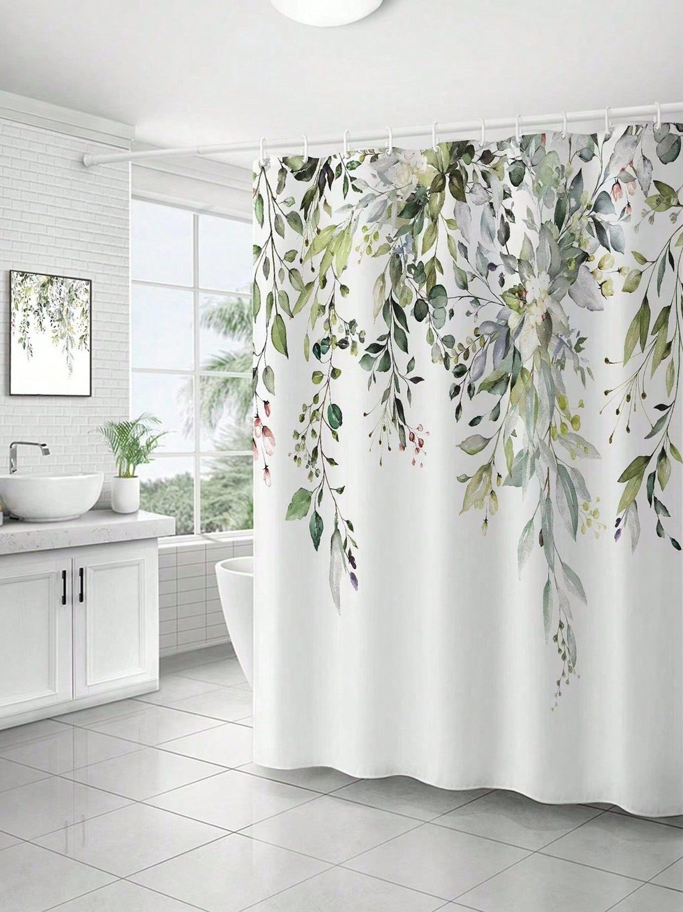

> TIP:GUIDE: Budget: from $20 for a botanical shower curtain | Time: ten minutes to hang | Skill: beginner

## Takeaway

Cabbage crush decor works because it is a color with a feeling: fresh, leafy, garden-grown. Start with the smallest move — a throw, a wreath, a set of green towels — and add green one layer at a time until the room feels like a garden room. The safest first step is the one you can undo in an afternoon: pillows, a curtain or a tray, not new furniture. Pick the green you love living with, not the green that photographs best, and the room will still feel fresh next year. For the wider style story behind this look, our [30 Cabbage Crush Ideas for a Fresh, Garden-Inspired Home](https://www.cozynesthomeideas.com/posts/cabbage-crush/) covers the kitchens and dining rooms this list deliberately left out.

## Frequently Asked Questions

### What is cabbage crush decor?

Cabbage crush decor is a fresh green decorating style named for the color of a cabbage leaf — soft, leafy green between sage and emerald. It covers green walls and furniture, botanical prints and wallpaper, leaf-patterned textiles, green ceramics and garden-inspired vignettes, all in fresh shades of green used across the home.

### What colors go with cabbage crush green?

Cream, white and warm wood are the safest partners, because they let the green stay fresh. Brass and gold warm it up, black adds contrast in small doses, and blush or terracotta can accent it. Avoid pairing it with cool grey, which makes the green look dull and muddy instead of leafy.

### Is cabbage crush decor the same as sage green decor?

They are close cousins, not twins. Sage is a muted, grey-green, while cabbage crush is fresher and leafier, closer to the green of a cabbage leaf or a young fern. In practice the two mix well — sage walls with cabbage-green cushions and plants read as one garden palette.

### Can I use cabbage crush decor in a small room?

Yes, it suits small rooms well if you keep the green to one wall or a few textiles and leave the rest pale. A botanical gallery wall, a green throw or a leaf-print curtain adds the garden feel without any paint, and a light floor keeps the room feeling open and bright.

### What is the best green paint for a cabbage crush wall?

For a fresh cabbage crush look, try a soft sage or a mid leaf green in a matt or eggshell finish, which hides wall marks better than gloss. Test a large swatch on the wall first and look at it in morning and evening light, because green shifts more than any other color through the day.

### How do I add cabbage crush decor without painting?

Start with textiles and small pieces: botanical throw pillows, a green throw blanket, a leaf-print rug or a green ceramic vase on the mantel. Plants in green pots, a leafy wreath on the door and dark green towels all add the look, and every one of them can move rooms or come down in minutes.

### Does botanical wallpaper work in a bathroom?

Yes, if you choose a wipeable vinyl wallpaper and use it as a single accent wall or in a small powder room, not the whole bathroom. Keep the sink and fittings white or brass so the paper is the only pattern, and seal the edges well so steam and splashes cannot get behind it.

### How do I keep a green room from feeling dark?

Balance the green with one big pale surface — a white ceiling, a cream sofa or a light wood floor — and keep the curtains sheer enough to let daylight in. Add warm lighting at 2700 Kelvin, brass details for reflection, and a few real plants, which make any green room feel brighter and more alive.
