# 30 Cabbage Crush Ideas for a Fresh, Garden-Inspired Home

Cabbage crush is the fresh green taking over kitchens and dining rooms: a soft, leafy cabbage green that sits between sage and emerald, and makes a room feel like a garden even in winter. It is a color trend, not a vegetable — the look is green cabinetry, botanical prints, leafy textures and table settings that bring the garden indoors, all in shades of fresh green.

This list gathers 30 cabbage crush ideas, all decor and none of it food: sage green kitchens, botanical wallpaper, emerald dining rooms and green table settings that turn everyday meals into garden occasions. Start with one green wall or one set of cabbage leaf plates, and the whole kitchen will start to feel fresher.

## 1. Green Panelled Walls in the Dining Room

Green panelled walls give a dining room the feel of a country house. This room runs sage green panelling up the walls, sets a round table with green velvet chairs in the middle, and hangs a brass chandelier above it, with tall windows letting in garden light. The panelling adds architecture to a plain room, and the green makes it feel fresh rather than formal.

Paint the panelling and the wall above it the same green, so the wall reads as one surface rather than two. Keep the chairs and the rug in the same green family, and let the chandelier be the one warm metal in the room.

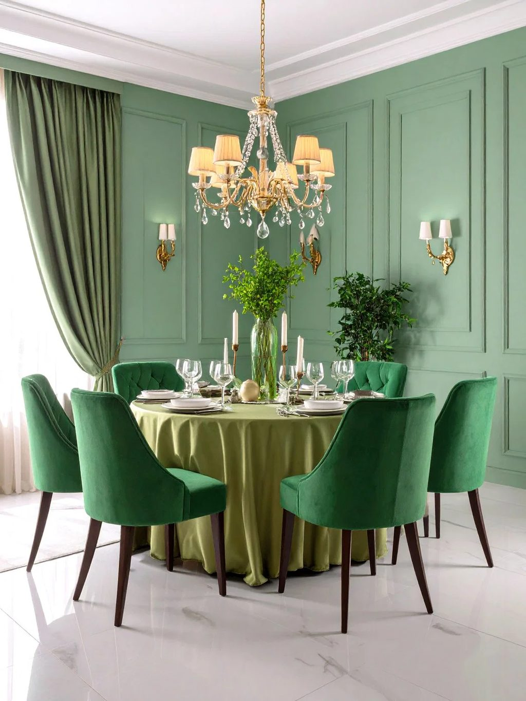

> TIP:QUICK: Paint the panelling and the wall above it the same green so the wall reads as one surface.

## 2. Sage Green Cabinets with Glass Fronts

Glass-front cabinets make a sage green kitchen feel like a garden room. This kitchen runs sage cabinets with glass doors along the wall, a white farmhouse sink below the window, and wooden shelves holding dishes and cutting boards. The glass lets the white dishes show through, which lightens the green and makes the whole wall feel open.

Keep the dishes inside glass cabinets mostly white or cream, so the green frames them instead of competing with them. If the glass shows clutter, add one shelf of matching bowls and keep the rest behind solid doors.

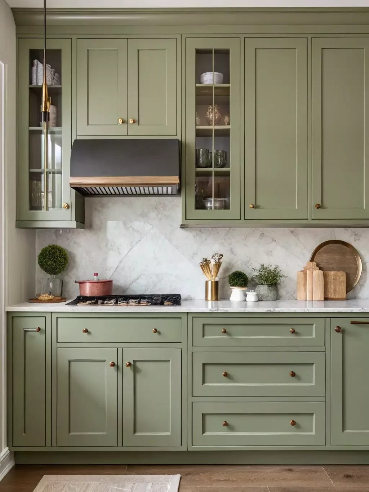

> TIP:CHECK: dishes inside glass cabinets mostly white; one shelf of matching bowls; the rest behind solid doors

## 3. A Dining Room in Dark Botanical Wallpaper

Dark botanical wallpaper is the boldest cabbage crush move, and the dining room is the best place for it. This room wraps a wooden dining table in deep green wallpaper covered in leaves and flowers, with a brass lantern chandelier overhead and red velvet chairs below. The wallpaper is the garden, and the room just frames it.

Wallpaper one wall — the wall behind the sideboard or the table — if a whole room feels too dark, and keep the table wood warm and the chairs in one strong color. A dark botanical wall needs warm light, so choose a chandelier with a warm bulb, around 2700 Kelvin.

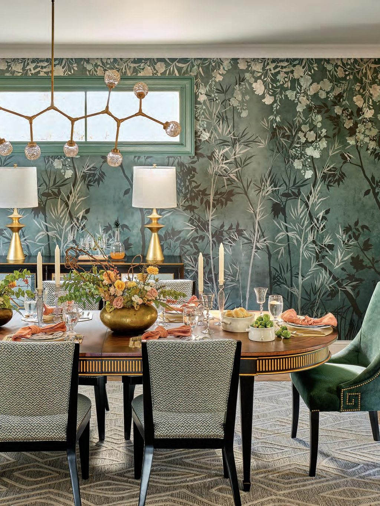

> TIP:GUIDE: Budget: from $60 for one wall of botanical wallpaper | Time: one afternoon to hang | Skill: beginner with paste

## 4. Green Floral Wallpaper with a Chandelier

Green floral wallpaper and a crystal chandelier make a dining room feel like a garden party that never ends. This room pairs a soft green floral paper with a dark wood table, green velvet chairs and a crystal chandelier, with fresh flowers on the table echoing the wallpaper. The chandelier's sparkle keeps the floral from feeling old-fashioned.

Pick a wallpaper with a cream or pale background if the room is small — a dark background shrinks a dining room, while a pale one opens it up. Repeat one flower color from the paper in the chair fabric or the napkins, and the room will feel designed rather than decorated.

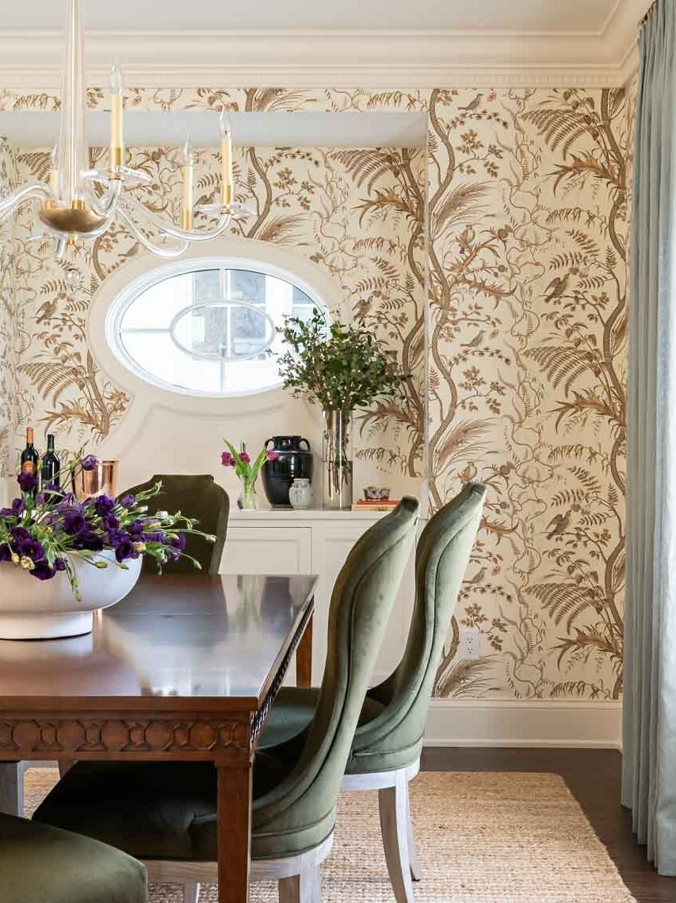

> TIP:QUICK: Pick a pale-background floral for a small dining room — a dark background shrinks the space.

## 5. A Botanical Tile Backsplash

A botanical tile backsplash brings the garden into the kitchen at eye level, right where you cook. This sage green kitchen runs a leaf-patterned tile behind the counters, with glass-front cabinets above, a wooden cutting board and terracotta pots on the counter. The tile is the decoration, so the cabinets can stay a quiet sage.

Choose a tile with the leaf pattern in the same green family as the cabinets, one shade lighter or darker, so the backsplash and the cabinets feel related. Keep the counters mostly clear — one cutting board, one pot — because a patterned backsplash plus a cluttered counter is too much to look at.

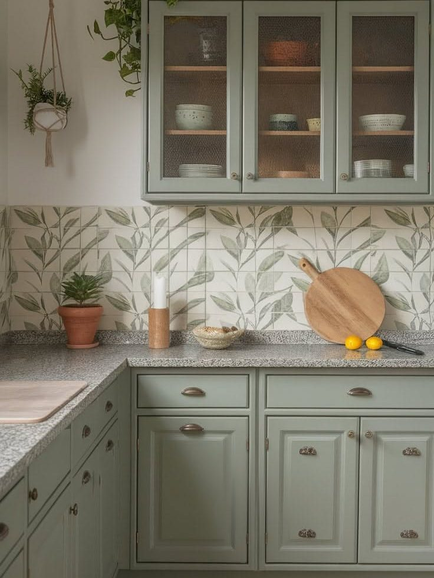

> TIP:CHECK: tile in the same green family as the cabinets; counters mostly clear; one cutting board and one pot on show

## 6. A Gallery Wall of Botanical Prints

A gallery wall of botanical prints is the cheapest cabbage crush idea on this list, and one of the prettiest. This light green kitchen hangs six framed fern and leaf prints in two neat rows above the counter, with wooden shelves, potted herbs and a light wood floor below. The prints are the garden, framed and hung where you see them every morning.

Use matching frames in one finish — black, natural wood or white — and keep the gaps between them even, about two inches. Mix leaf shapes but keep the prints the same size, so the wall reads as one collection rather than six separate pictures.

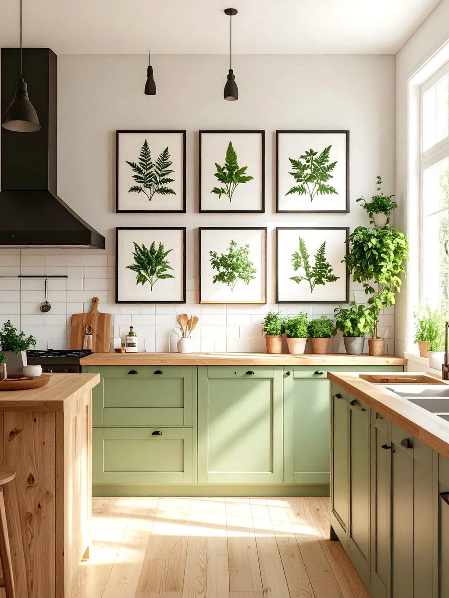

> TIP:GUIDE: Budget: from $30 for six framed botanical prints | Time: one hour to hang | Skill: beginner

## 7. Sage Cabinets with a Botanical Shelf

A shelf of botanical prints and plants above the counter is a small move with a big payoff. This sage green kitchen keeps the cabinets quiet and lets a single open shelf carry the garden: framed leaf prints, trailing plants and terracotta pots, with a light countertop below. The shelf is the only decorated surface in the room, which is why it works.

Keep the shelf to one row of objects — prints at the back, plants in front — and leave a gap at each end so it looks fitted, not crowded. Water the trailing plants weekly and trim them when they start brushing the counter.

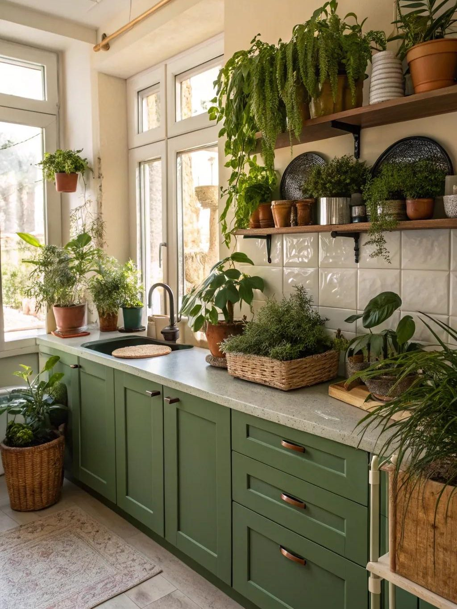

> TIP:QUICK: Keep the shelf to one row — prints at the back, plants in front — with a gap at each end.

## 8. Dark Green Cabinets with Botanical Prints

Dark green cabinets and framed botanical prints are the moody end of cabbage crush. This kitchen pairs deep green cabinets with a wall of framed monstera and palm prints, potted plants along the counter and a wooden table with stools nearby. The dark cabinets make the green prints glow, and the plants keep the room from feeling like a cave.

If the kitchen is small, paint only the lower cabinets dark and keep the uppers white or pale sage — the room will feel grounded without losing light. Add plants in three sizes on the counter, and the green-on-green will feel layered rather than flat.

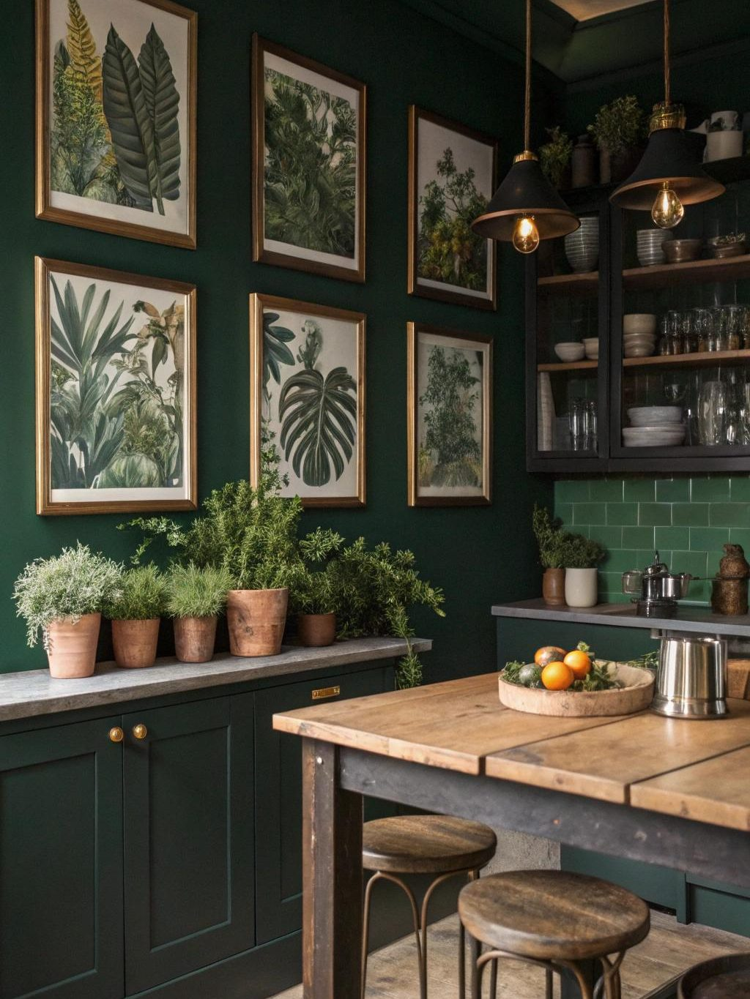

> TIP:CHECK: lower cabinets dark, uppers pale in a small kitchen; plants in three sizes on the counter; prints framed alike

## 9. Green Velvet Dining Chairs

Green velvet dining chairs are the fastest way to bring cabbage crush into a dining room. This room sets emerald velvet chairs around a round wooden table under a brass chandelier, with a patterned rug below and plants in the corners. The velvet catches the light, so the green changes as you move around the room, and the chairs become the decoration.

Choose velvet in a deep green — emerald or forest — rather than a pale one, because dining chairs get marked and dark velvet hides it. Keep the table wood warm and the rug patterned in green and cream, so the chairs sit on something that repeats their color.

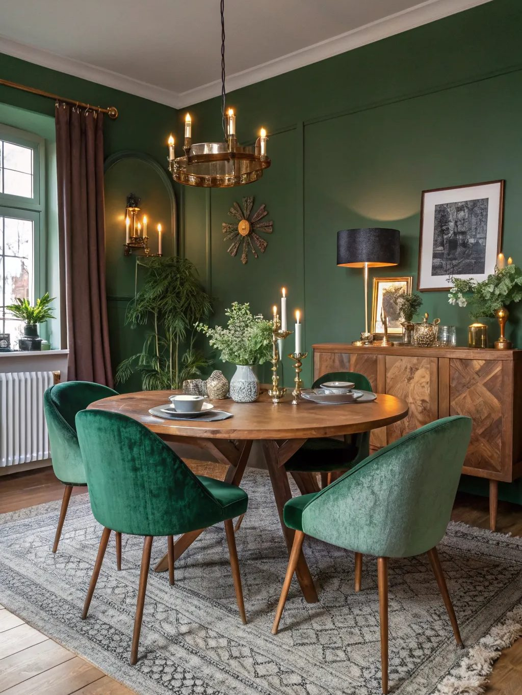

> TIP:GUIDE: Budget: from $60 per velvet dining chair | Time: one afternoon to swap chairs | Skill: beginner

## 10. A Monochrome Green Dining Room

A monochrome green dining room is cabbage crush turned all the way up. This room paints the walls, the chairs and the tablecloth in shades of the same green, with a brass chandelier and a patterned rug breaking it up. It is bold, but because everything is one color family, the room feels calm rather than loud.

Work in three shades — a dark green for the walls, a mid green for the chairs and a pale green for the table linen — so the room has depth. Add one warm metal, brass or gold, in the chandelier and the cutlery, and the green will glow instead of going flat.

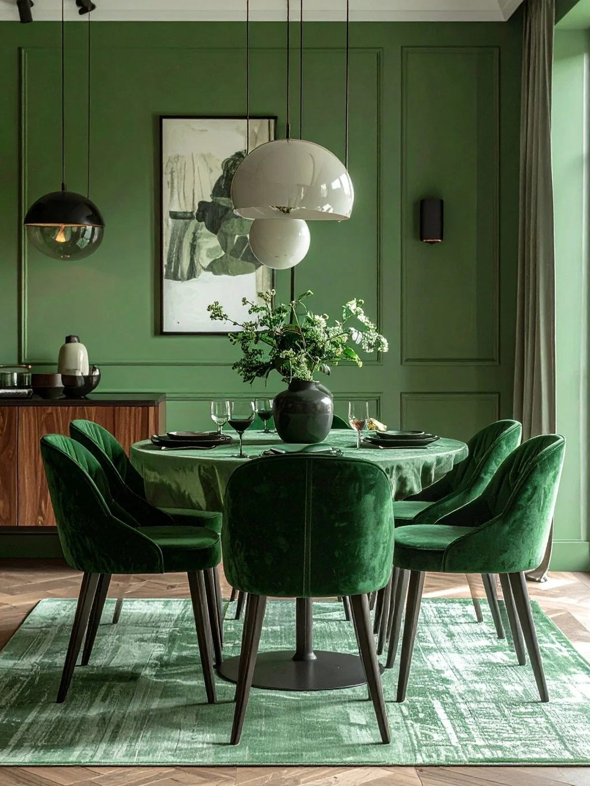

> TIP:QUICK: Work in three shades of green — dark walls, mid chairs, pale linen — and add one warm metal for glow.

## 11. A Jade Green Dining Room with a Chandelier

Jade green walls and a crystal chandelier make a dining room feel like a jewel box. This room paints the walls a rich jade, sets a long wooden table with green velvet chairs below a sparkling chandelier, and adds a patterned rug and fresh flowers on the table. The chandelier's light bounces off the green walls, so the whole room glows at dinner time.

Keep the ceiling white in a jade room — a green ceiling closes the room in, while a white one lifts it. If the walls feel too strong in daylight, add sheer curtains to soften the light before you consider repainting.

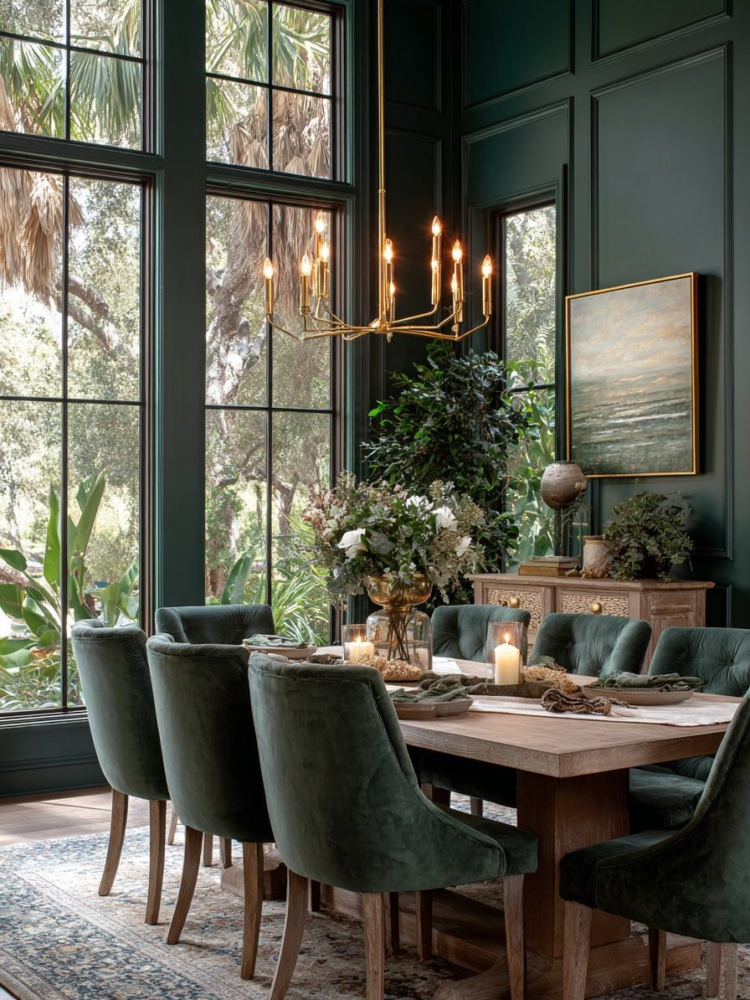

> TIP:CHECK: ceiling kept white; sheer curtains to soften daylight; chandelier with a warm bulb for evening glow

## 12. A Classic Olive Green Dining Room

Olive green is the classic, grown-up version of cabbage crush. This formal dining room pairs olive walls and upholstered chairs with a large wooden table, a crystal chandelier and framed art, with fresh flowers as the only bright accent. The olive is quiet and warm, and the room feels like it has always been this way.

Use olive on the walls and keep the furniture wood and cream, so the room reads as traditional rather than trendy. One large framed landscape or botanical print on the main wall is enough art — olive walls do not need a gallery.

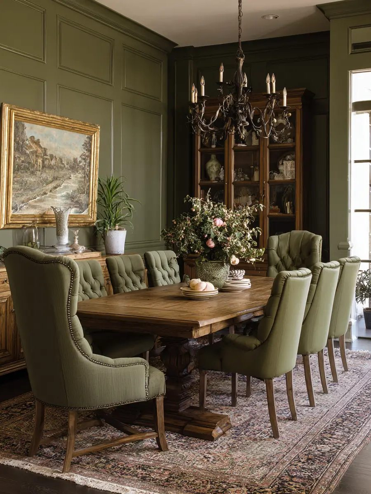

> TIP:GUIDE: Budget: one tin of olive paint, under $40 | Time: one weekend to paint | Skill: beginner

## 13. Sage Green Cabinets with Open Shelves

Sage green cabinets are the gentlest way into the cabbage crush look. This kitchen pairs soft sage cabinets with white subway tile, open wooden shelves holding white dishes and clay pots, and potted herbs on every surface. The green is calm enough to live with every day, and the open shelves keep the room feeling light.

Paint the lower cabinets sage and leave the uppers white if a full green kitchen feels too much — the two-tone split is the most forgiving version of the trend. Add herbs on the windowsill last: the real green against the painted green is what makes the room feel alive.

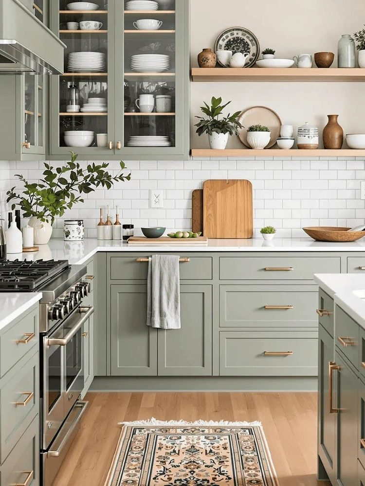

> TIP:QUICK: Paint the lower cabinets sage and leave the uppers white — the two-tone split is the most forgiving green kitchen.

## 14. An Emerald Green Feature Wall

One emerald green wall is all a dining room needs to join the cabbage crush trend. This room paints a single wall deep emerald, sets a wooden table with mismatched wooden chairs against it, and adds a patterned rug and a vase of fresh flowers. The rest of the walls stay white, so the green hits like a piece of art.

Choose the wall the table sits against for the feature color, so the green is what you see while you eat. Keep the chairs wood rather than upholstered green — one green wall plus green chairs is too much of one color in a small room.

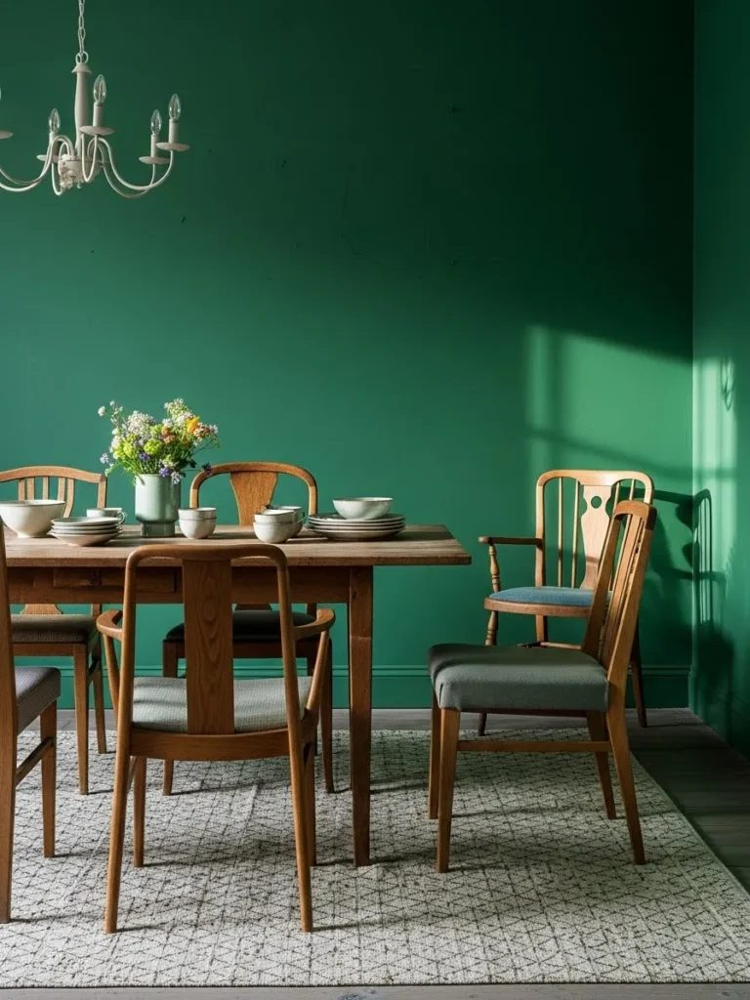

> TIP:CHECK: feature wall behind the table; chairs kept wood, not green; the rest of the walls white

## 15. Jade Green Paint with a Mirror

Jade green paint and a large mirror are a classic dining room pairing. This room paints the walls jade, hangs a gold-framed mirror above the sideboard, and sets a long wooden table with black chairs below a crystal chandelier. The mirror doubles the light and the chandelier, so the dark walls never feel heavy.

Hang the mirror opposite a window if you can, so it catches daylight and throws it back across the room. Keep the mirror's frame warm metal — gold or brass — to match the chandelier, and the two will tie the room together.

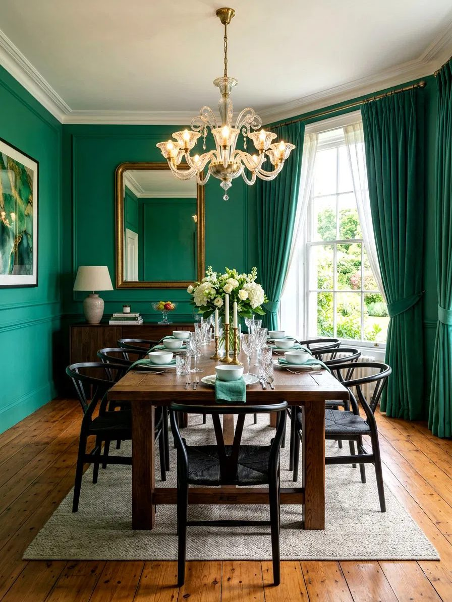

> TIP:GUIDE: Budget: from $50 for a large gold-framed mirror | Time: one hour to hang | Skill: beginner with a wall anchor

## 16. Dark Botanical Wallpaper in the Kitchen

Dark botanical wallpaper turns a kitchen wall into a garden at midnight. This kitchen papers one wall in a dense green botanical print, keeps the cabinets white and the counters pale, and sets a basket of lemons and a blue-and-white mug on the counter as the only color accents. The dark paper makes the white cabinets look brighter by contrast.

Paper the wall you face while you cook, so you see the garden while you work, and keep the rest of the kitchen pale. Use a wipeable wallpaper in a kitchen — steam and splashes will ruin a paper one within a year.

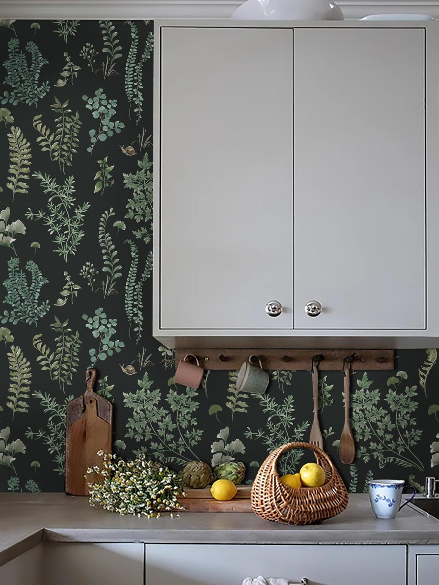

> TIP:QUICK: Paper the wall you face while cooking, and choose a wipeable paper — steam ruins a paper one fast.

## 17. A Botanical Accent Wall with Soft Blue Cabinets

A botanical accent wall works even when the cabinets are not green. This kitchen pairs soft blue cabinets with a bold botanical wallpaper in green, cream and rust, with wooden shelves, terracotta pots and a stainless steel range hood. The wallpaper supplies the garden, and the blue cabinets keep the room cool and calm.

Pick a wallpaper with one color that matches the cabinets — here the soft blue in the leaves — so the wall and the cabinets feel related. Keep the counters pale and the shelves wooden, and the room will feel collected rather than clashed.

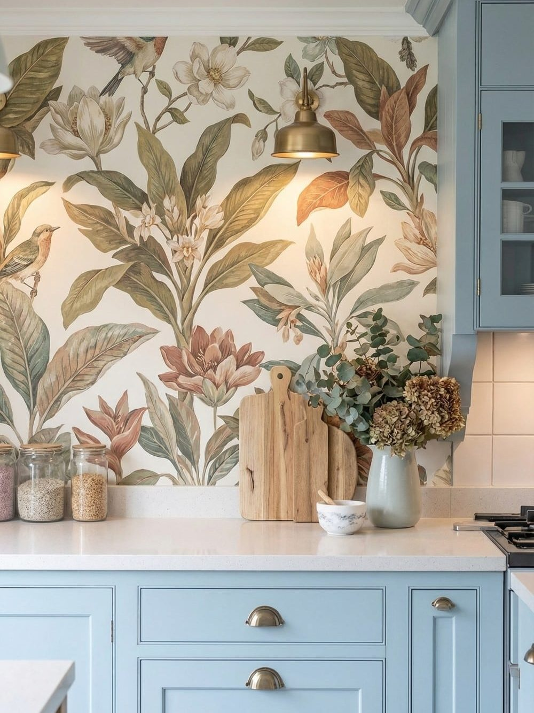

> TIP:CHECK: wallpaper with one color matching the cabinets; counters pale; shelves wooden to tie it together

## 18. A Green Leaf Backsplash on White Cabinets

A green leaf backsplash is the lightest way to bring cabbage crush into a white kitchen. This kitchen keeps the cabinets white, runs a leafy green wallpaper as the backsplash, and adds a wooden countertop and a glass kettle. The white makes the green leaves pop, and the room stays bright enough for a small kitchen.

Use the wallpaper as a backsplash only behind the counter, not up to the ceiling, so it reads as a deliberate band of pattern. Seal it well — a clear, wipeable sealant over the paper — or choose a vinyl wallpaper made for kitchens.

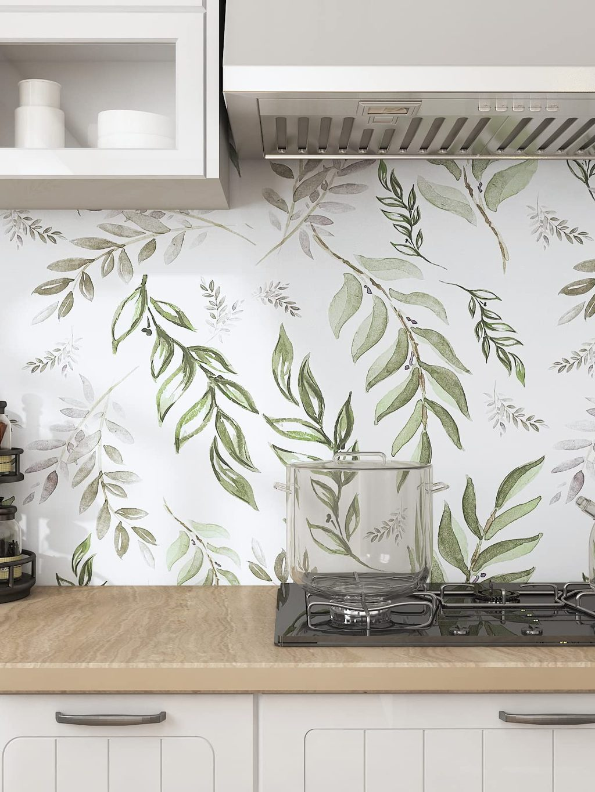

> TIP:GUIDE: Budget: from $40 for a roll of wipeable botanical wallpaper | Time: one afternoon to hang | Skill: beginner

## 19. Green Cabbage Leaf Plates

Green cabbage leaf plates are the literal heart of the cabbage crush table. This place setting layers a cabbage leaf plate over a green placemat, with gold cutlery, a white napkin tied with a herb sprig and a green glass beside it. The plates are the decoration — no centerpiece needed when every place setting looks like a garden.

Use cabbage leaf plates as the charger or the main plate, not both, and keep the rest of the setting simple: white napkins, gold or wood cutlery, one green glass. Mix them with plain green plates if you do not own a full set — two cabbage plates per table still make the point.

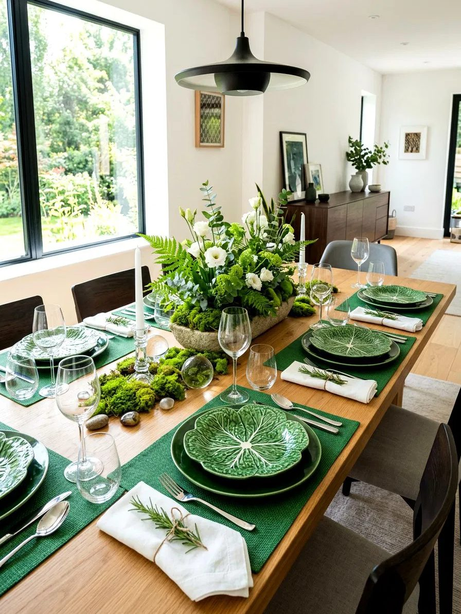

> TIP:QUICK: Use cabbage plates as the charger or the main plate, not both, and keep the napkins plain white.

## 20. An Emerald Table Setting on Dark Wood

An emerald table setting on dark wood is the moody version of the garden table. This setting layers emerald placemats and decorative plates on a dark wooden table, with green glasses, gold cutlery and a small vase of flowers. The dark wood makes the emerald glow, and the gold keeps it from feeling cold.

Layer in threes: placemat, dinner plate, decorative plate — and keep the glasses to one green and one clear per setting, so the table does not get busy. A single small vase per two settings is enough flowers; more turns the table into a garden bed.

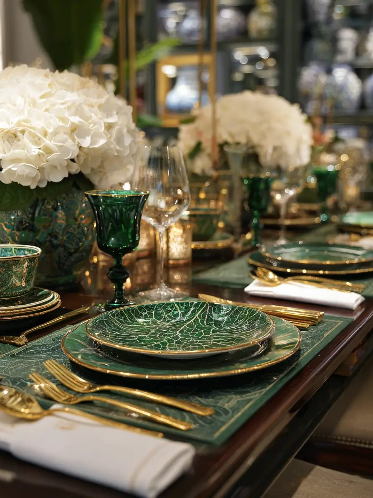

> TIP:CHECK: three layers per setting — placemat, plate, decorative plate; one green glass and one clear; one small vase per two settings

## 21. A Fern Leaf Table Runner

A fern leaf table runner is the easiest garden table there is. This long wooden table runs a white runner printed with green ferns down its center, with white plates, green napkins and gold cutlery on either side. The runner is the only pattern on the table, so it reads as a garden path running through the meal.

Choose a runner that hangs about twelve inches over each end of the table, and keep the plates plain white so the ferns stay the star. Add one small green sprig on each napkin, and the table will look styled without any arranging at all.

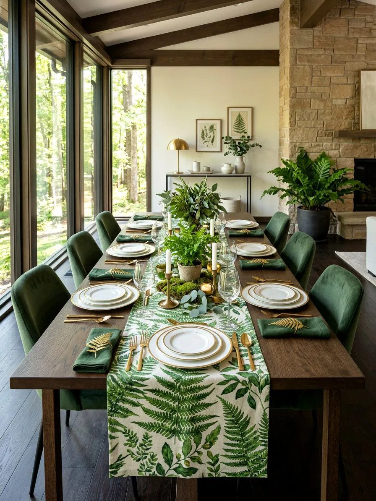

> TIP:GUIDE: Budget: from $20 for a fern print table runner | Time: five minutes to lay | Skill: beginner

## 22. Green Plates with Fresh Herb Sprigs

Green plates with a fresh herb sprig on each napkin make an everyday dinner feel like a garden lunch. This table sets green plates on woven placemats, folds white napkins with a sprig of rosemary or fern on each one, and runs a garland of greenery down the center with candles in green glasses. The herbs are the garnish and the decoration at once.

Use one herb sprig per napkin, all the same herb, so the table looks intentional. Keep the garland low — under six inches tall — so guests can see each other across it, and use flameless candles if the greenery is dry.

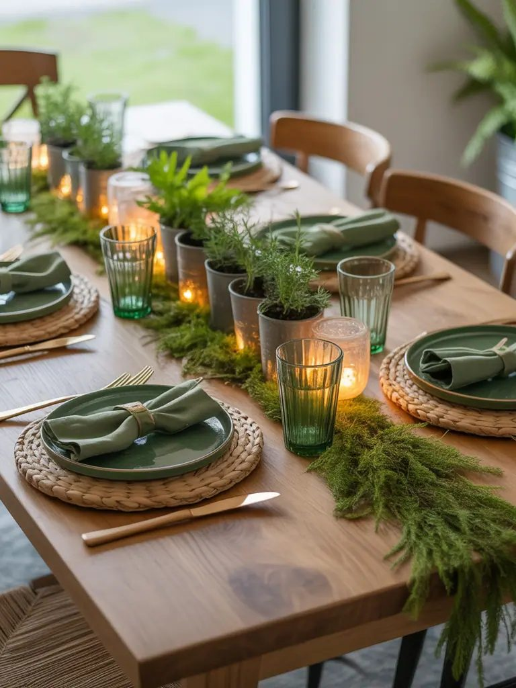

> TIP:QUICK: One herb sprig per napkin, all the same herb, and keep the center garland under six inches tall.

## 23. A Leafy Tablescape from Above

Seen from above, a leafy tablescape is a garden in miniature. This overhead view shows a white table dressed with green leaf placemats, white plates, gold cutlery and small glass vases holding a single fern frond each, with candles scattered between the settings. The repetition — the same leaf, the same vase, the same candle — is what makes it look designed.

Repeat one element at every setting: the same placemat, the same vase, the same sprig. Keep the tablecloth white and the cutlery gold, and the green will read as fresh rather than busy, even with a dozen leaves on the table.

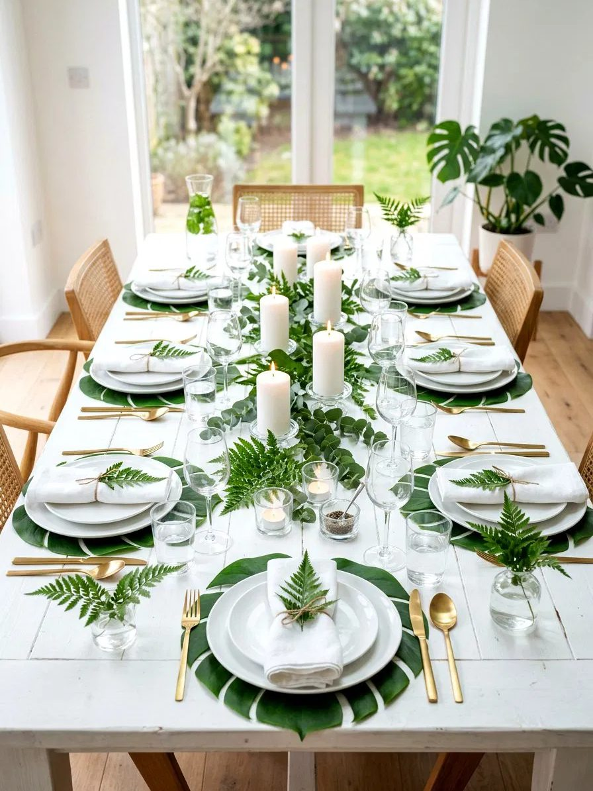

> TIP:CHECK: the same placemat, vase and sprig at every setting; white tablecloth; gold cutlery throughout

## 24. A Green Leaf Runner with Glassware

A green leaf runner with elegant glassware is the dressiest table on this list. This setting runs a leaf-patterned runner down a white-clothed table, with patterned plates, crystal glasses, gold cutlery and a eucalyptus garland down the center. The runner is formal, the eucalyptus is relaxed, and the two together keep the table from feeling stiff.

Lay the runner over a white tablecloth, not a bare table, so the pattern has a quiet background. Keep the garland to one type of greenery — eucalyptus alone — and let the glasses be the sparkle, not more flowers.

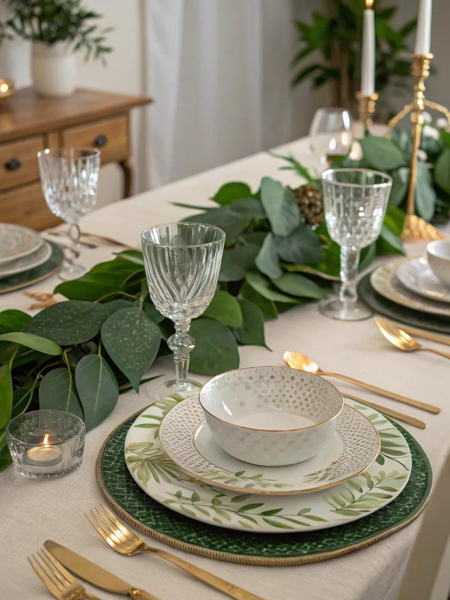

> TIP:GUIDE: Budget: from $25 for a leaf print runner and a eucalyptus garland | Time: twenty minutes to lay | Skill: beginner

## 25. Dark Green Cabinets with Black Counters

Dark green cabinets with black countertops are the dramatic end of the cabbage crush kitchen. This modern kitchen runs deep green cabinets along two walls, tops them with black stone, and lays a patterned rug down the middle of the wood floor. The dark-on-dark is bold, but the wood floor and the rug keep it warm.

Balance dark cabinets and dark counters with a pale floor or a pale backsplash — one light surface is enough to keep the kitchen from feeling like a cave. Add brass or gold hardware, and the green will read as rich rather than flat.

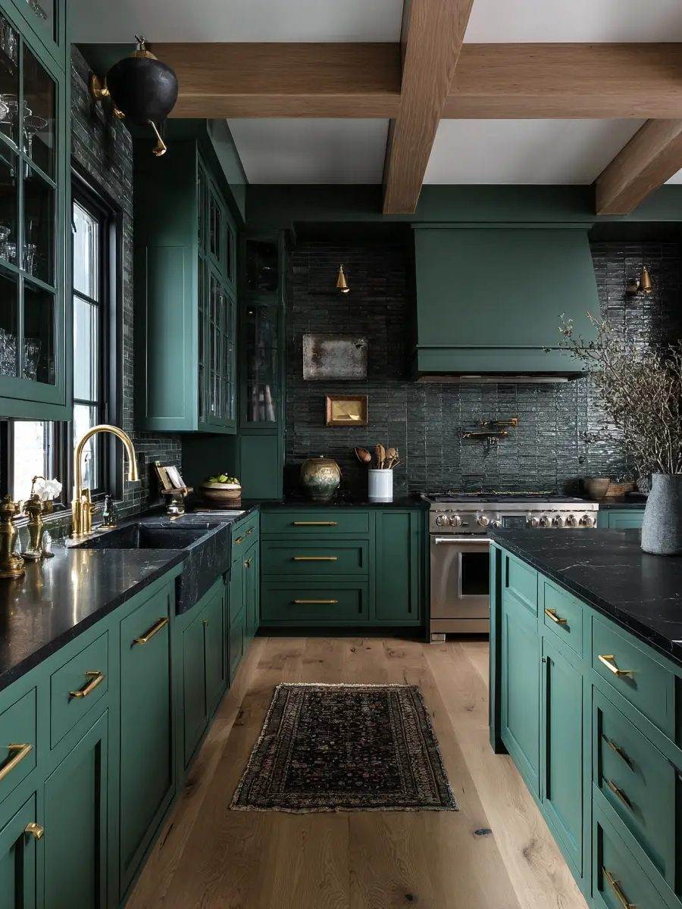

> TIP:QUICK: Balance dark cabinets and dark counters with one pale surface — a light floor or a pale backsplash.

## 26. A Forest Green Shaker Kitchen

A forest green shaker kitchen is the timeless version of the trend. This kitchen pairs deep green shaker cabinets with a stainless steel range hood, a marble backsplash and a patterned rug, with plants on the windowsill and a wooden island nearby. Shaker cabinets never date, and the green makes them feel current rather than classic.

Keep the hardware simple — brass cup pulls or plain knobs — because shaker doors are already detailed enough. Add one patterned rug in green and cream, and the floor will repeat the cabinet color without another painted surface.

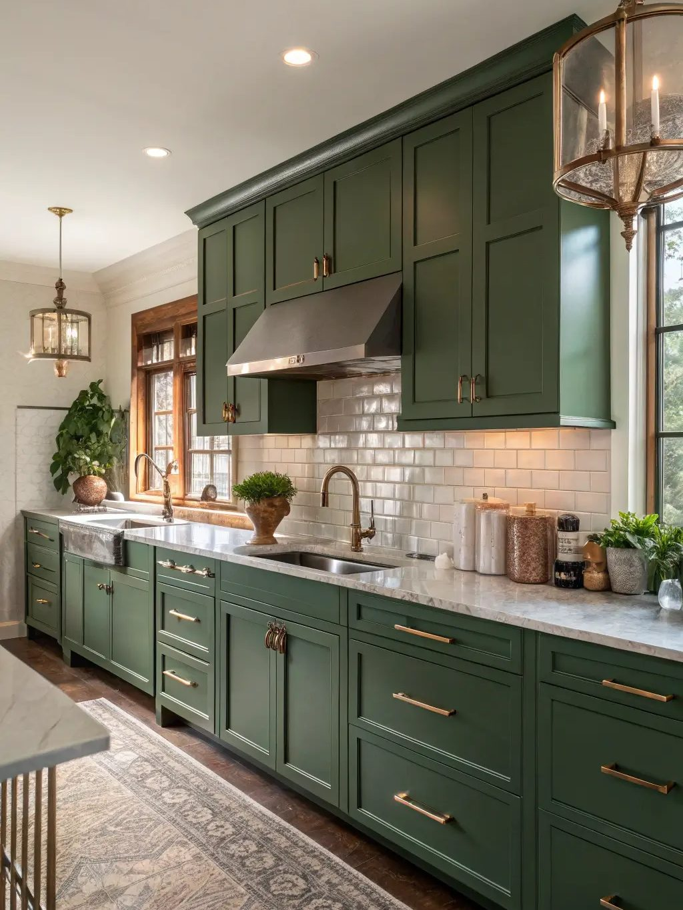

> TIP:CHECK: simple brass hardware; one patterned rug in green and cream; plants on the windowsill for live green

## 27. Dark Green Cabinets with a Big Island

Dark green cabinets and a big island make a kitchen that can handle a crowd. This modern kitchen runs deep green cabinets along the walls, centers a large island with stools, and hangs brass pendants above it, with a marble backsplash and a patterned rug underfoot. The island is where everyone gathers, so it gets the best light in the room.

Give the island a different countertop from the perimeter — white marble on the island, dark stone on the walls — so it reads as furniture rather than more cabinetry. Hang three pendants over a long island, two over a short one, and keep them at the same height.

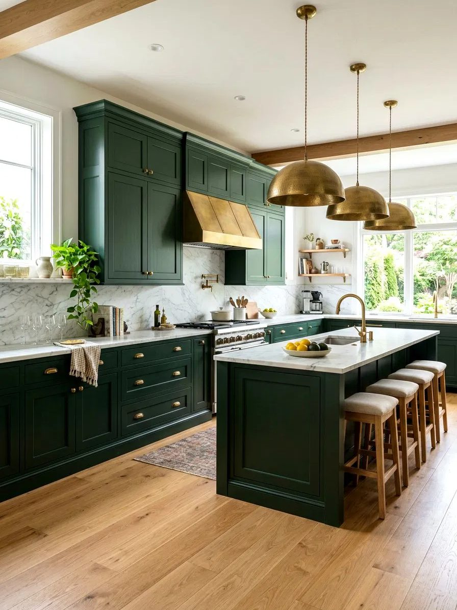

> TIP:GUIDE: Budget: from $100 for three brass pendant lights | Time: one afternoon to hang | Skill: beginner with a drill

## 28. Forest Green Cabinets with Brass Accents

Forest green cabinets with brass accents are the most polished cabbage crush kitchen. This kitchen pairs deep green cabinets with brass cup pulls, a brass range hood and brass pendant lights, against a white marble backsplash and a dark wood floor. The brass warms the green up, and the marble keeps the room bright.

Match all the brass in one finish — polished or brushed — so the hardware, the hood and the lights read as a set. Keep the backsplash white marble or white tile, because a green kitchen needs one big pale surface to breathe.

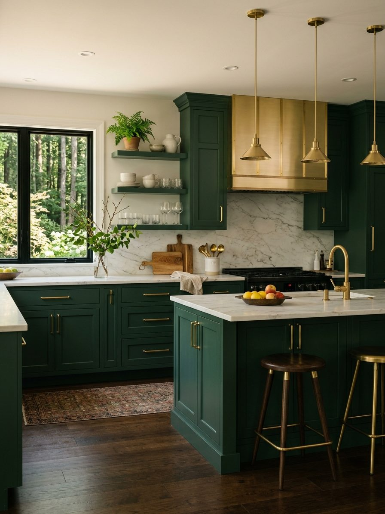

> TIP:QUICK: Match all brass in one finish — polished or brushed — so hardware, hood and lights read as a set.

## 29. Emerald Green Cabinets with an Arched Window

An emerald green kitchen with an arched window is the prettiest room on this list. This kitchen runs emerald cabinets along two walls, sets a white farmhouse sink under a tall arched window, and adds black countertops, brass hardware and a potted plant on the sill. The arch softens all the straight lines of the cabinets, and the window pours light onto the green.

Keep the window dressing minimal — a sheer curtain or nothing at all — so the arch itself stays visible. Put one plant on the sill and one on the counter, and the real green will echo the painted green all day long.

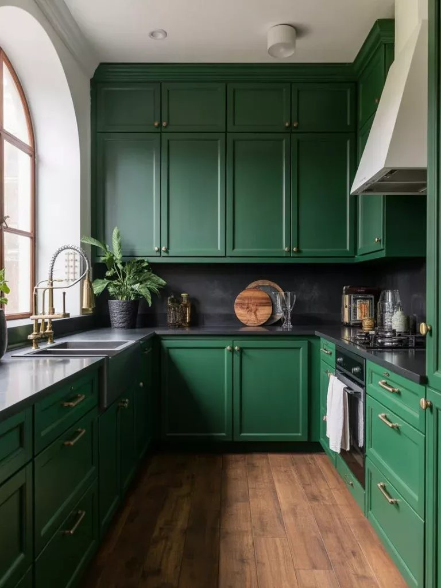

> TIP:CHECK: window dressing minimal or none; one plant on the sill, one on the counter; brass hardware throughout

## 30. A Garden-View Dining Room

A garden-view dining room is cabbage crush without a single painted wall. This bright room sets a wooden table with woven chairs in front of floor-to-ceiling glass doors, with the real garden outside doing all the decorating — green lawn, leafy trees and potted plants on the terrace. The table is set simply, because the view is the centerpiece.

Keep the furniture pale — light wood, cream cushions, white plates — so nothing competes with the green outside. Add potted plants on the terrace just beyond the glass, and the garden will feel like part of the room even when the doors are closed.

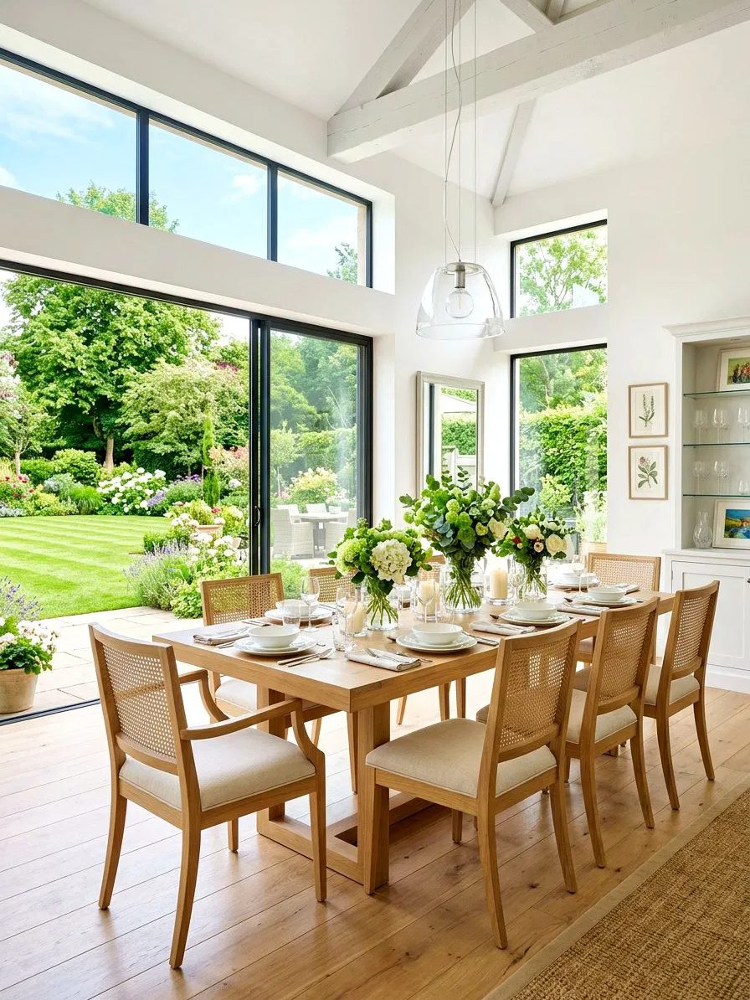

> TIP:GUIDE: Budget: from $30 for two potted plants on the terrace | Time: one hour to place | Skill: beginner

## Takeaway

- Cabbage crush works because it is a color with a feeling: fresh, leafy, garden-grown.
- Start small — a set of cabbage leaf plates, a gallery of botanical prints, one sage wall — and add green one layer at a time until the kitchen or dining room feels like a garden room.
- The safest first step is the one you can undo in an afternoon: paint, plates or a runner, not new cabinets.
- Pick the green you love living with, not the green that photographs best, and the room will still feel fresh next year.

## Frequently Asked Questions

### What is cabbage crush in home decor?

Cabbage crush is a fresh green color trend for kitchens and dining rooms — a soft leafy green between sage and emerald, named for the color of a cabbage leaf. In decor it means green cabinetry, botanical wallpaper and prints, leafy textures and garden-inspired table settings, all in fresh shades of green.

### What colors go with cabbage green?

Cream, white and warm wood are the safest partners, because they let the green stay fresh. Brass and gold warm it up, black adds contrast in small doses, and blush or terracotta can accent it. Avoid pairing it with cool grey, which makes the green look dull and muddy.

### Is sage green the same as cabbage crush?

They are close cousins, not twins. Sage is a muted, grey-green, while cabbage crush is fresher and leafier, closer to the green of a cabbage leaf or a young fern. In practice the two mix well — sage cabinets with cabbage-green accents read as one garden palette.

### Can I use cabbage crush in a small kitchen?

Yes, it suits small kitchens well if you keep the green to the lower cabinets and leave the uppers white or pale. A botanical backsplash or a gallery of leaf prints adds the garden feel without any paint, and a light floor keeps the room feeling open.

### What is the best green paint for kitchen cabinets?

For a fresh cabbage crush look, try a soft sage or a mid leaf green in a satin finish, which wipes clean and resists kitchen grease. Test a large swatch on the cabinet door first and look at it in morning and evening light, because green shifts more than any other color through the day.

### How do I style a green dining table?

Layer green in threes: a placemat, a plate and a napkin in different shades of green, with white plates and gold cutlery to keep it fresh. Add one sprig of greenery per setting and a low garland down the center, and keep the centerpiece under six inches tall so guests can see each other.

### Does botanical wallpaper work in a kitchen?

Yes, if you choose a wipeable vinyl wallpaper and use it as a backsplash or a single accent wall, not the whole room. Keep the cabinets and counters pale so the paper is the only pattern, and seal the edges well so steam and splashes cannot get behind it.

### How do I keep a green kitchen from feeling dark?

Balance the green with one big pale surface — a white countertop, a marble backsplash or a light wood floor — and keep the ceiling white. Add warm lighting at 2700 Kelvin, brass hardware for reflection, and a few real plants, which make any green room feel brighter and more alive.
