# 30 Christmas Island Centerpiece Ideas for a Festive Kitchen

A christmas island centerpiece is what turns a kitchen island from a worktop into the heart of the Christmas kitchen. The island is where everyone gathers, where the cookies cool and where the cocoa gets poured, so the centerpiece on it should be beautiful, low enough to talk over, and easy to move when it is time to cook. These 30 christmas island centerpiece ideas are all built for islands — not dining tables — with garland runners, tiered trays, lanterns and mini trees that fit a working kitchen.

The rule for an island is simple: keep the centerpiece in the middle third, keep it below eye level when you are sitting on a stool, and build it on a tray or runner so the whole thing lifts off in one move. If you want the rest of the kitchen to match, our [30 Christmas Kitchen Ideas](/posts/christmas-kitchen/) dresses the cabinets, windows and shelves, and our [30 Christmas Table Decor Ideas](/posts/christmas-table/) carries the same look over to the dining table.

## 1. Garland Runner with Cookies and Candles

A garland runner with cookies and candles is the island centerpiece that does everything at once. A lit evergreen garland runs down the wood island with red berries and pinecones, candles glow in glass hurricanes, and a two-tier stand holds the Christmas cookies.

Build the runner first, then set the cookie stand on it — the stand hides the middle of the garland and gives the runner a purpose. Keep the candles at the ends, away from the cookies, and the island is ready for a whole afternoon of baking.

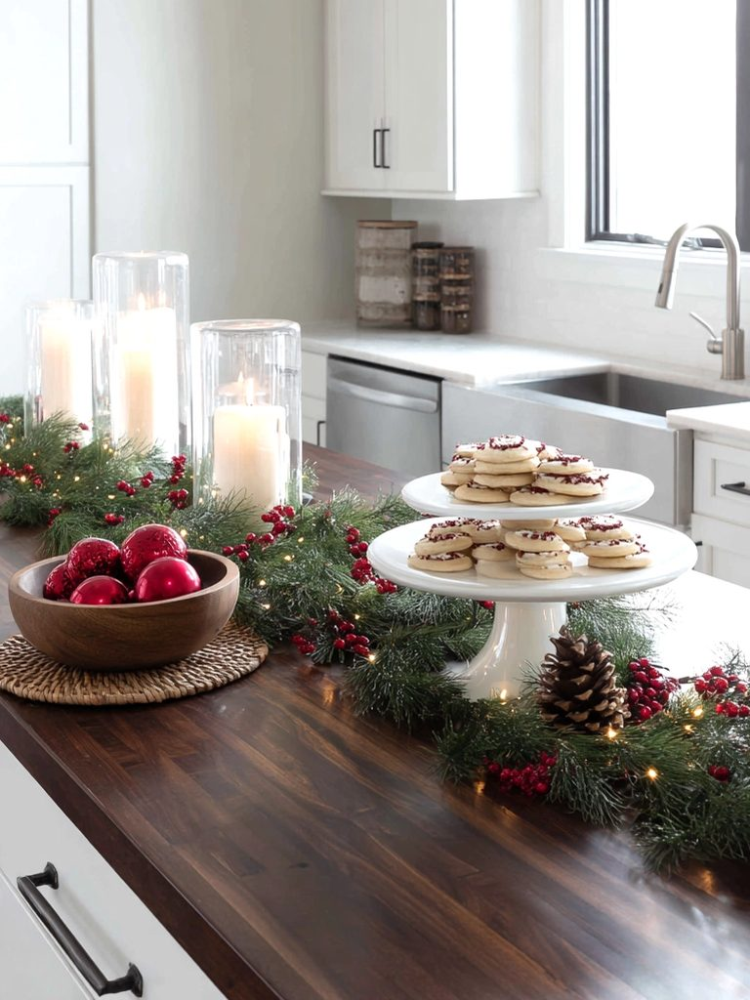

> TIP:QUICK: Build the runner first, then set the cookie stand on it — the stand hides the middle and gives the runner a purpose.

## 2. Plaid Runner with an Ornament Bowl

A plaid runner with an ornament bowl is the fastest island centerpiece on this list. A red plaid runner runs down the island, a white bowl of red and gold ornaments sits in the middle, and a small pine tree in a rope pot stands at one end.

The bowl is the trick: fill it with ornaments you already own and it looks like a decoration you bought. The plaid runner underneath ties the whole island to the rest of the kitchen's Christmas colors.

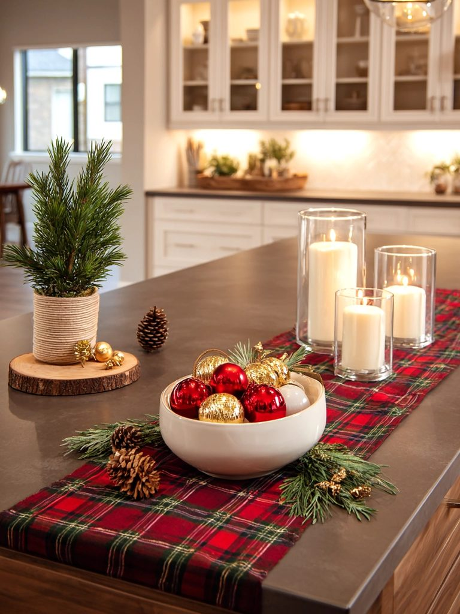

> TIP:CHECK: a bowl of ornaments you already own; a plaid runner to tie the island to the kitchen; a small pine at one end

## 3. Tiered Tray with Ornaments and Pinecones

A tiered tray with ornaments and pinecones packs a whole Christmas scene into one square foot of island. Red and gold ornaments, pinecones and a little Santa sit on two wooden tiers, with greenery and a plaid runner underneath.

Tiered trays are the best centerpiece for a small island because they go up instead of out. Fill the bottom tier with the big pieces and the top with the small ones, and leave one corner of each tier empty so the tray breathes.

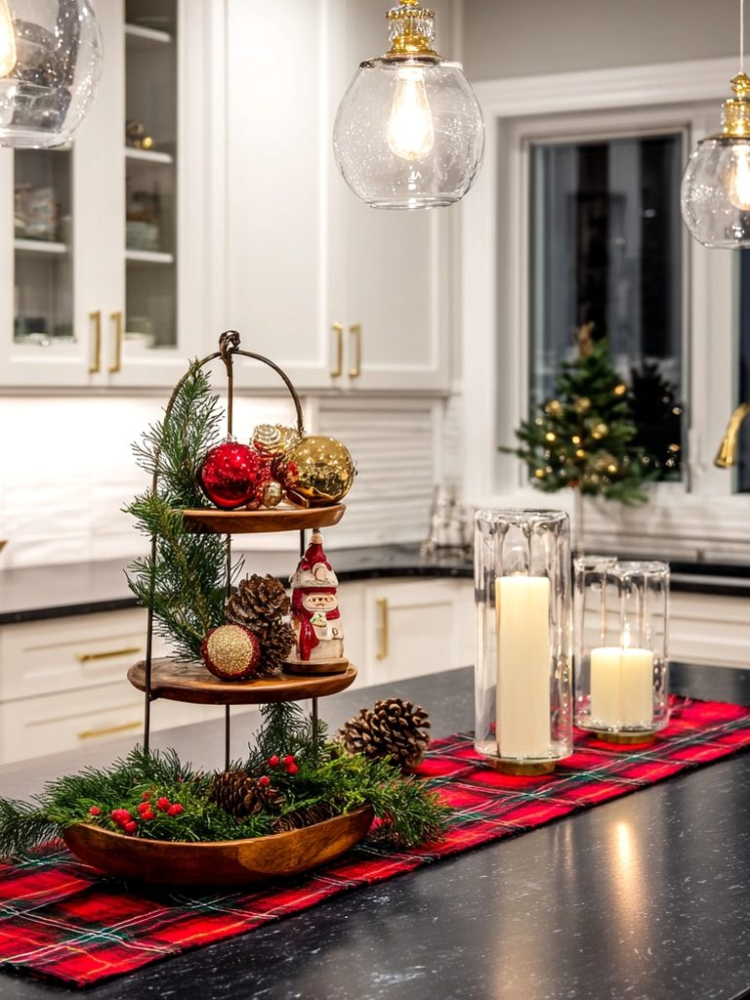

> TIP:GUIDE: Budget: $20–$40 for a two-tier tray and ornaments | Time: twenty minutes to fill | Skill: beginner

## 4. Garland-Draped Island with Place Settings

A garland-draped island with place settings turns the island into the breakfast bar and the Christmas display at once. Garland with red ornaments drapes along the island's edge, mugs and plates wait on the counter, and plaid stool cushions finish the look.

Drape the garland along the front edge of the island, not the top, so the worktop stays clear for cooking. The place settings sit on the counter behind the garland, so the island works as a table and a display together.

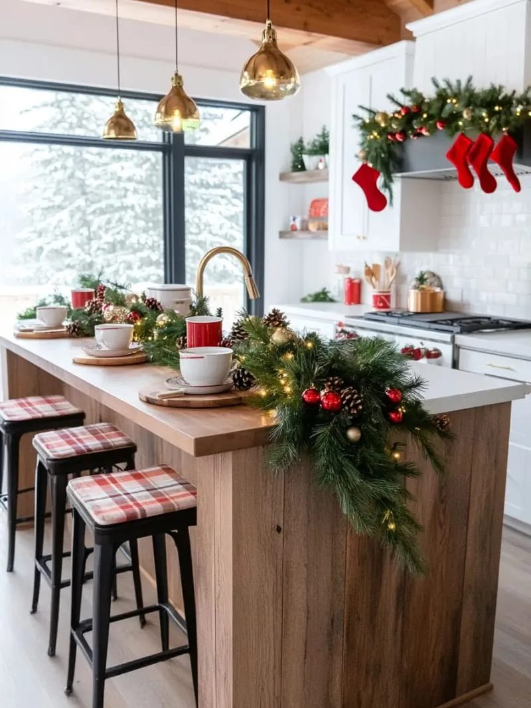

> TIP:QUICK: Drape the garland along the front edge, not the top — the worktop stays clear for cooking.

## 5. Red Candles in a Berry Wreath

Red candles in a berry wreath make a centerpiece that glows from the middle of the island. Three red pillars stand in a wreath of berries, pine and gold ornaments on a marble island, with a silver vase of greenery behind them.

A wreath with candles inside it is a ready-made centerpiece: the wreath is the base, the candles are the height, and nothing else is needed. Use battery pillars if the island is where children reach for snacks.

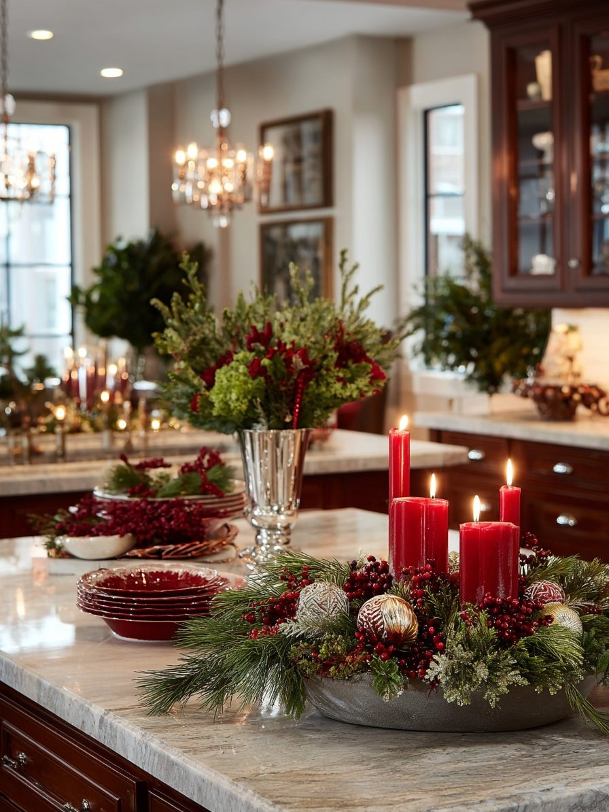

> TIP:CHECK: a wreath is a ready-made centerpiece; the wreath is the base and the candles are the height; battery pillars if children reach the island

## 6. Garland Runner with a Cookie Stand

A garland runner with a cookie stand is the baker's island centerpiece. A lit garland runs down the wood island with a bowl of ornaments, candles in glass hurricanes, and a three-tier stand of cookies at the far end.

Put the cookie stand at the far end of the island, away from the sink, so the cookies stay dry and the stand is the first thing you see when you walk in. The garland runner connects the stand to the rest of the island.

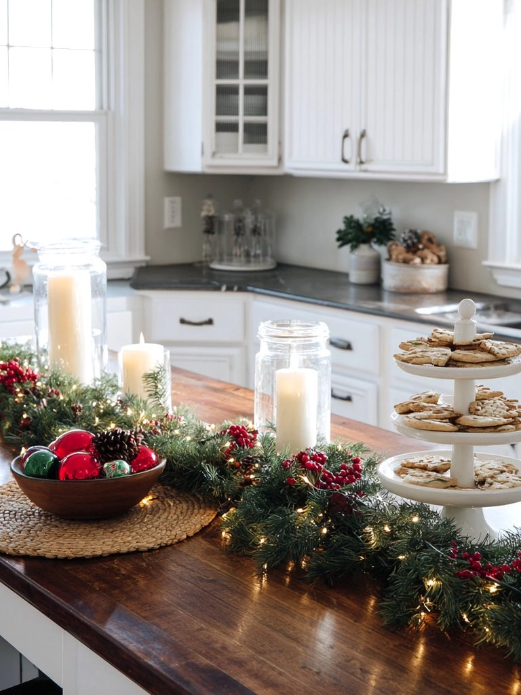

> TIP:GUIDE: Budget: under $30 for the garland, candles and stand | Time: twenty minutes to arrange | Skill: beginner

## 7. Gold Candles and Pinecones

Gold candles and pinecones on a white island are Christmas in its most elegant form. Cream pillar candles and gold baubles sit in a garland of evergreen and pinecones running down the island, with a bowl of cranberries at the end.

Gold and cream need the green of the garland to keep them from looking washed out. Keep the candles to one side of the runner and the baubles to the other, so the garland has a clear rhythm down the island.

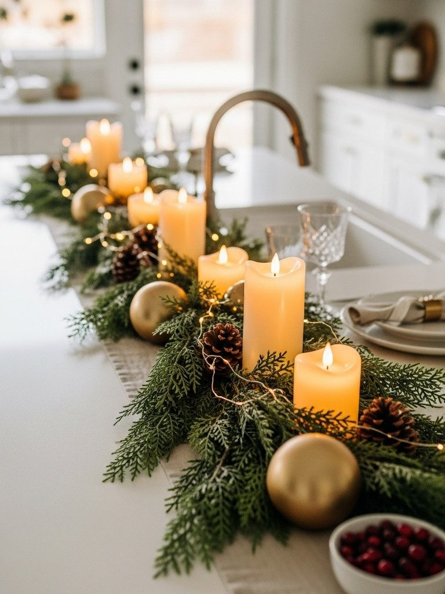

> TIP:QUICK: Gold and cream need the green of the garland — without it, the whole centerpiece washes out.

## 8. White and Silver Garland Runner

A white and silver garland runner is the calmest island centerpiece here. Green garland with white and silver baubles runs down a white marble island, with white candles and a white pitcher of greenery at the far end.

White and silver suit a modern kitchen best, and they make a small island look bigger because nothing on it is dark. Add one green element — the garland itself — and the whole island stays bright.

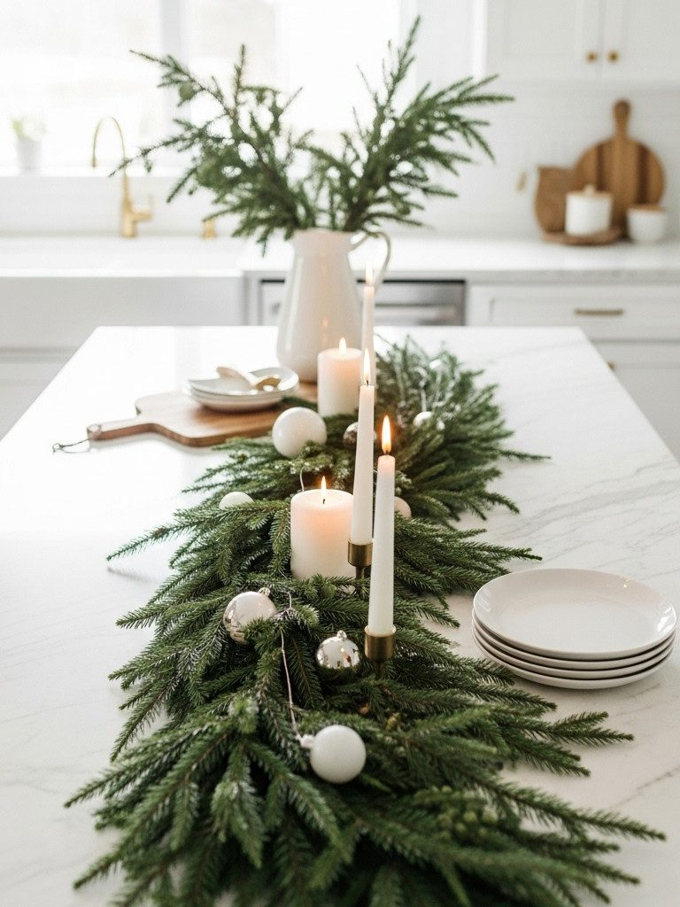

> TIP:CHECK: white and silver make a small island look bigger; the garland is the one green element; one white pitcher at the far end

## 9. Orange Slices and Holly Garland

Orange slices and holly make the most fragrant island centerpiece on this list. Dried orange slices, holly, cinnamon sticks and red berries fill a garland running down the island, with candles glowing between the greenery.

Dry the orange slices in a low oven the day before, and they will keep for the whole season. The cinnamon sticks are tied in bundles with string, which is both the decoration and the way they stay together.

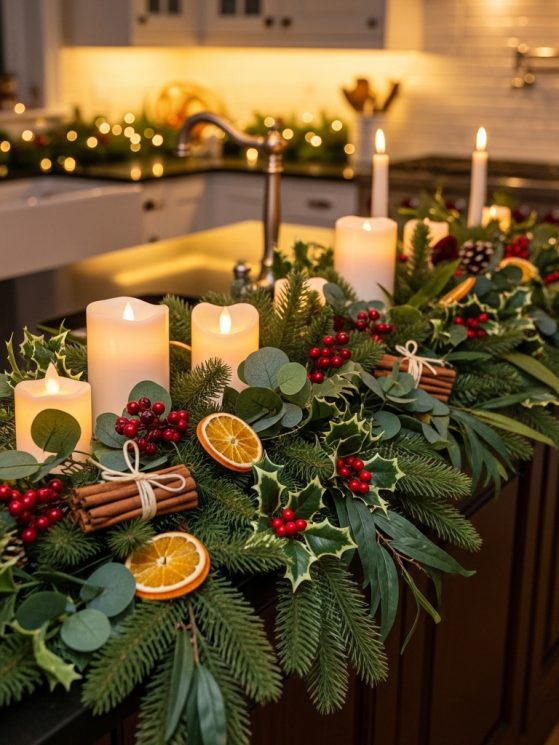

> TIP:GUIDE: Budget: under $15 for oranges, cinnamon and holly | Time: one hour to dry and arrange | Skill: beginner

## 10. Candle Wreath on a White Island

A candle wreath on a white island is the simplest centerpiece here: a ring of greenery and candles sitting in the middle of the island, glowing, with nothing else around it. The white island, the green wreath and the warm light do all the work.

A wreath centerpiece needs a clear island around it, so push everything else to the edges or into cupboards. One wreath, in the middle, with the island clear — that is the whole idea, and it works because it is so calm.

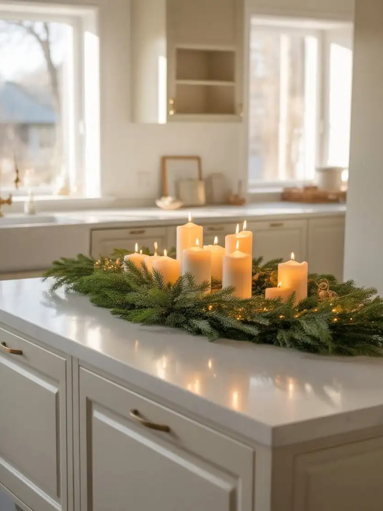

> TIP:QUICK: One wreath, in the middle, island clear — the calm is the whole idea.

## 11. Red Ornament Bowl and Cookie Stand

A red ornament bowl and a cookie stand make the island look like a bakery at Christmas. A garland runner with red berries runs down the wood island, a wooden bowl of red ornaments sits in the middle, and a tiered stand of cookies waits at the end.

The wooden bowl is the anchor: it is big, warm and matte, and it stops the shiny ornaments from looking like a shop display. Put the cookie stand at the end nearest the door, so guests see the cookies first.

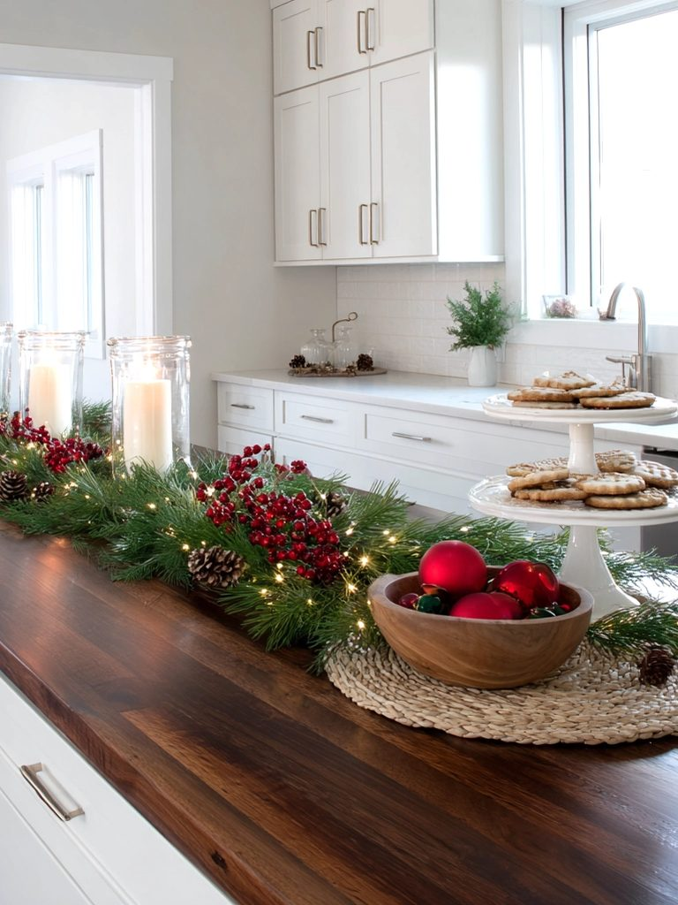

> TIP:CHECK: a matte wooden bowl anchors the shiny ornaments; the cookie stand goes nearest the door; guests see the cookies first

## 12. Berry Arrangement on a Wood Slice

A berry arrangement on a wood slice is the smallest centerpiece on this list, and the most striking. A black vase of red berries and frosted evergreen stands on a wood slice, with a few loose berries scattered on the island around it.

Small centerpieces suit a narrow island best, where a runner would hang over the edges. One vase, one slice, a few scattered berries — and the island still has room to work.

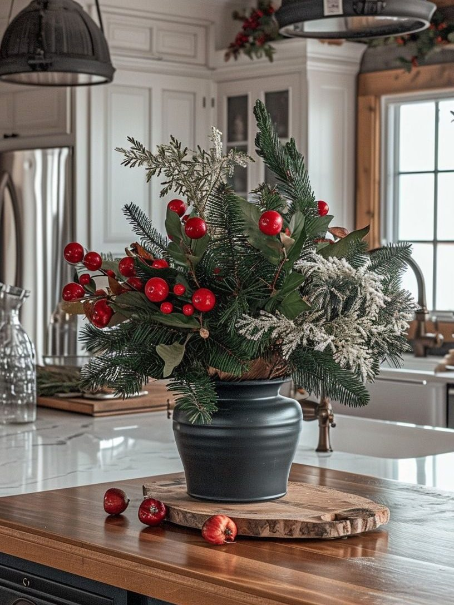

> TIP:GUIDE: Budget: $15–$25 for the vase, berries and wood slice | Time: ten minutes to arrange | Skill: beginner

## 13. Wooden Tray with Candles and Pinecones

A wooden tray with candles and pinecones is the centerpiece that moves. A long wooden tray holds candles, pinecones and greenery on a marble island, with a Christmas tree glowing behind it and the kitchen warm around it.

A tray is the most practical island centerpiece: when it is time to cook, lift the whole tray off in one move. Choose a tray with handles, and keep everything on it below the height of the island's pendant lights.

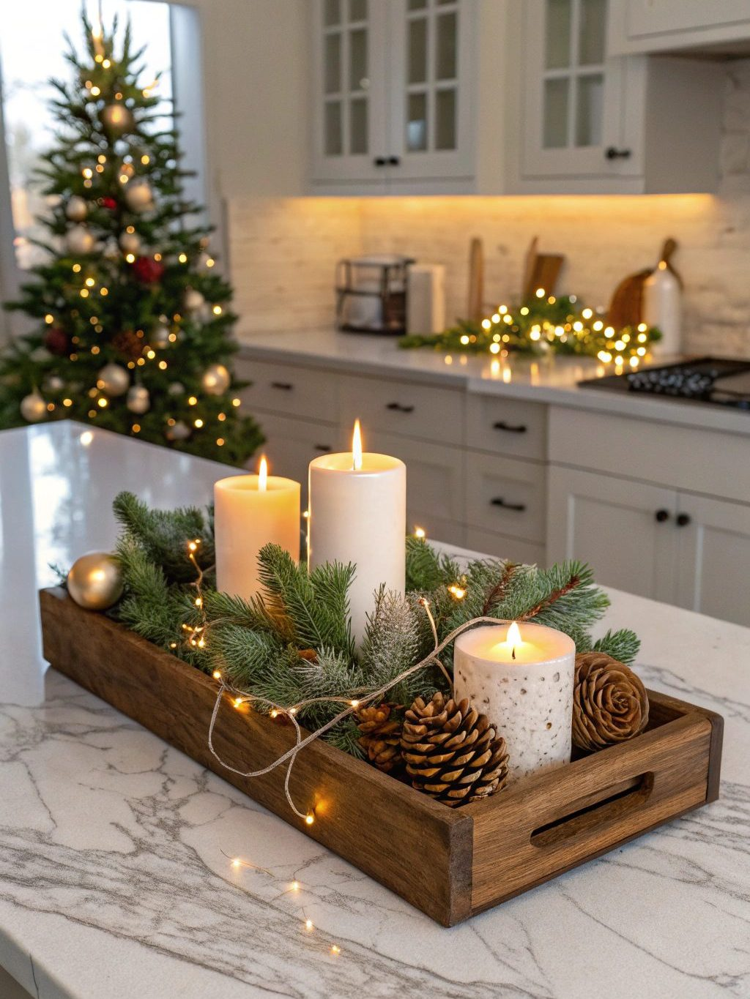

> TIP:QUICK: Choose a tray with handles — when it is time to cook, the whole centerpiece lifts off in one move.

## 14. Bottlebrush Trees and Gold Reindeer

Bottlebrush trees and gold reindeer on a wooden tray are the most charming centerpiece here. Little snowy trees, gold deer, pinecones and candles fill a wooden tray on the island, with the kitchen glowing behind it.

Bottlebrush trees come in every size, so use three heights and put the tallest in the middle. The gold reindeer are the jewelry of the tray — two are enough, and they should face the room, not each other.

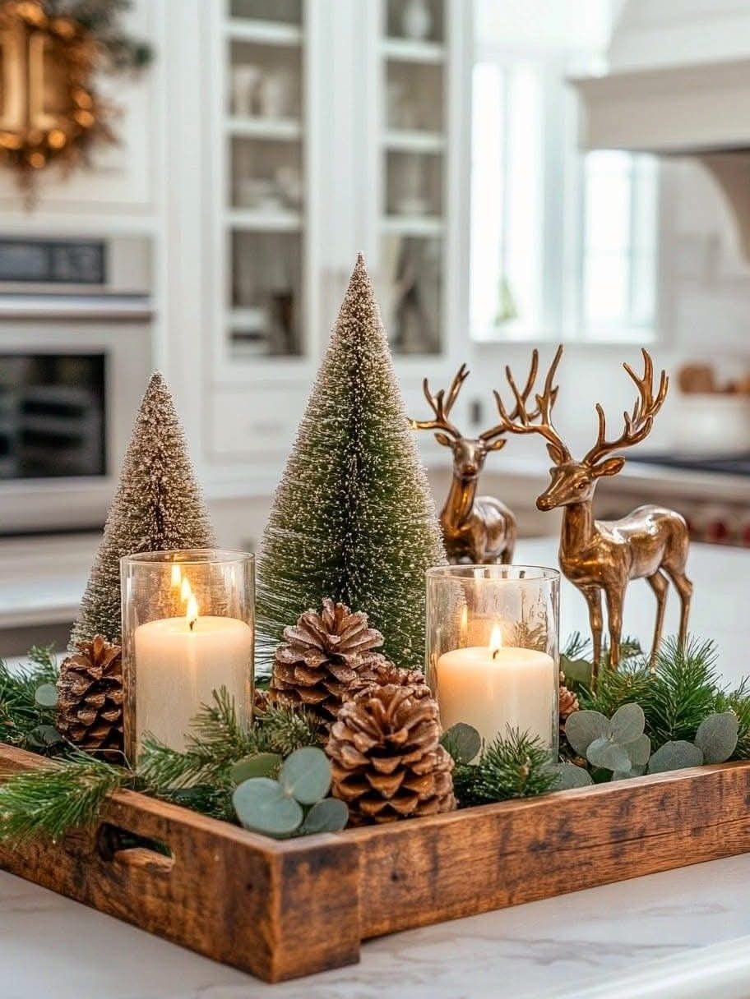

> TIP:CHECK: three heights of bottlebrush trees, tallest in the middle; two gold reindeer facing the room; pinecones fill the gaps

## 15. Mason Jar Lantern with a Red Bow

A mason jar lantern with a red bow is the farmhouse island centerpiece. A lit jar lantern with a big red bow sits on a gold tray surrounded by pinecones, with snowflakes scattered on the island around it.

The red bow is doing the Christmas work here, so make it big — as wide as the jar itself. Battery fairy lights inside the jar give a warm glow that a single candle cannot match.

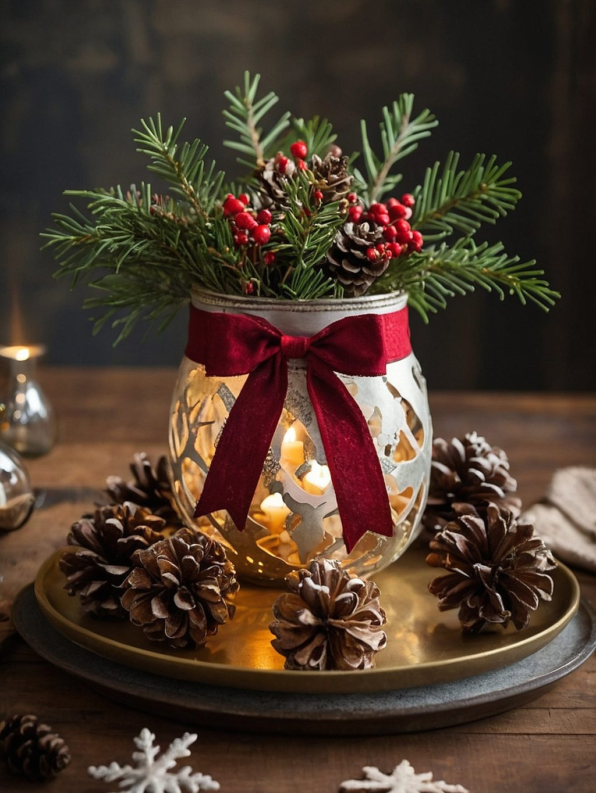

> TIP:GUIDE: Budget: under $20 for the jar, bow and tray | Time: fifteen minutes to assemble | Skill: beginner

## 16. Rustic Lantern on a Wood Slice

A rustic lantern on a wood slice is the centerpiece for a farmhouse kitchen. A weathered wood lantern with a candle inside stands on a bark-edged wood slice, with pinecones and red berries scattered around it on the island.

The wood slice is the base that makes the lantern look placed rather than just set down. Keep the slice a little bigger than the lantern on every side, and the pinecones will fill the gap naturally.

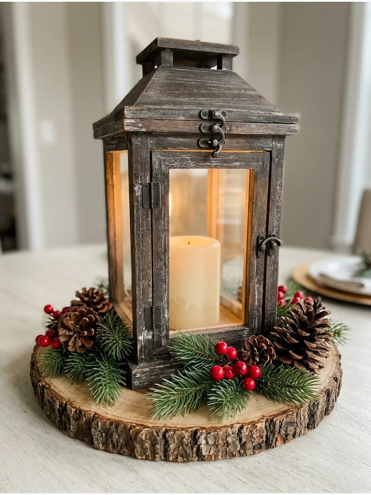

> TIP:QUICK: Keep the wood slice bigger than the lantern on every side — the pinecones fill the gap naturally.

## 17. Festive Kitchen with a Tree by the Island

A festive kitchen with a tree by the island is the whole-room idea. The island holds a tray of treats and a cake stand, a big Christmas tree stands beside it covered in red ornaments, and the kitchen feels like a Christmas morning.

This is the centerpiece to copy if your island sits beside the tree: the tree is the decoration, and the island just needs a tray of treats to join in. Keep the island clear except for the tray, so the tree stays the star.

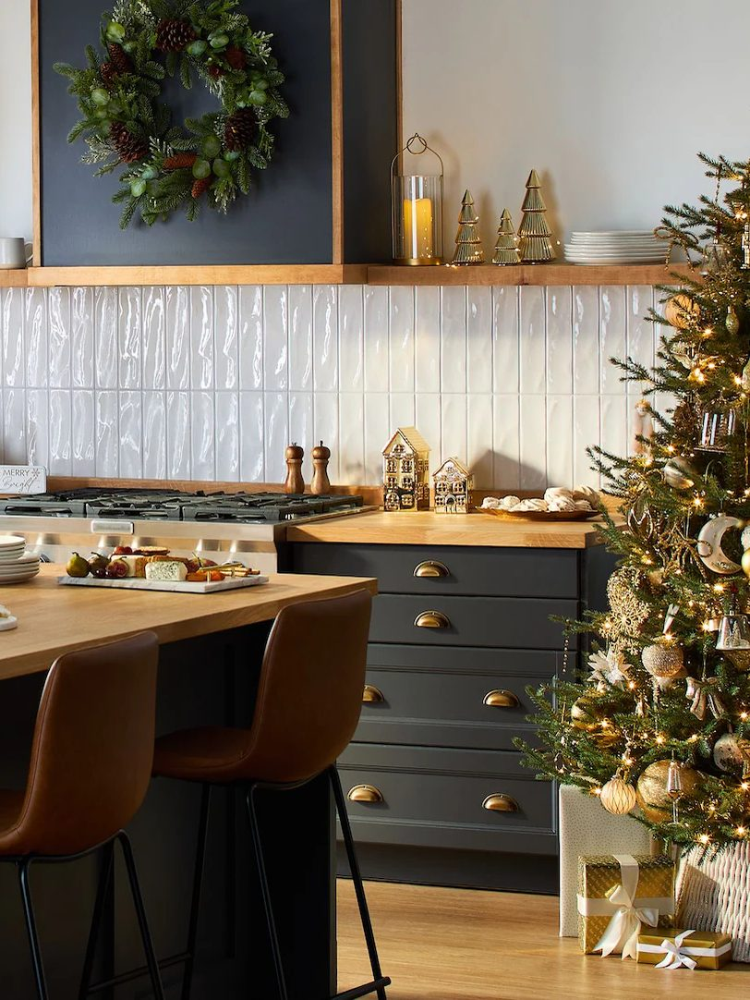

> TIP:CHECK: the tree is the decoration; the island just needs a tray of treats to join in; keep the rest of the island clear

## 18. Mini Trees in Woven Baskets

Mini trees in woven baskets are the sweetest island centerpiece for a small kitchen. Two little Christmas trees in baskets stand on the island under the pendant lights, with a window and a garden behind them.

Woven baskets hide the pots and make the trees look like they grew there. Two trees of different heights look better than a matching pair, and a few gold baubles are all the decoration they need.

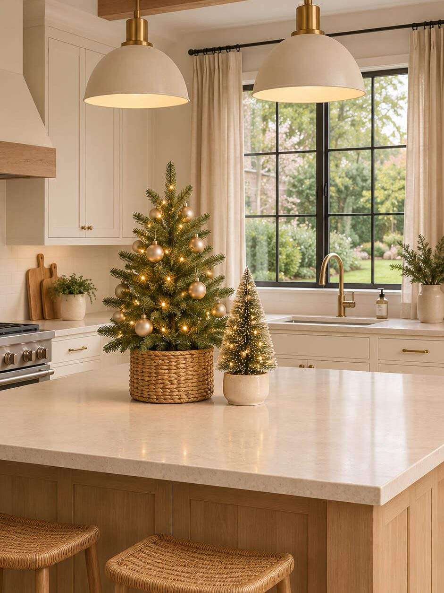

> TIP:GUIDE: Budget: $15–$30 for two mini trees and baskets | Time: ten minutes to style | Skill: beginner

## 19. White Candles in a Wooden Bowl

White candles in a wooden bowl are the minimalist island centerpiece. Three white pillars stand in a wooden bowl with a little greenery, on a white island, with a Christmas tree glowing softly in the background.

Minimalist works when the bowl is beautiful, because the bowl is the whole centerpiece. Choose a turned wood bowl with a warm grain, and keep the candles white so the wood is the only color.

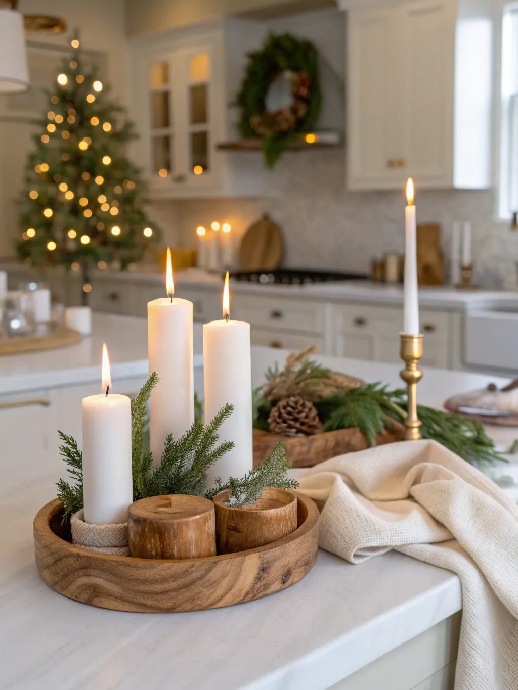

> TIP:QUICK: Choose a turned wood bowl with warm grain — the bowl is the whole centerpiece.

## 20. Wood-Slice Tray with a Village Scene

A wood-slice tray with a village scene is the island centerpiece children love most. Mini trees, silver reindeer and a little white house stand on a bark-edged wood slice, with the kitchen glowing behind them.

Build the village on the slice so it lifts off in one piece when the island is needed. Put the house in the middle and the trees around it, and sprinkle a little fake snow at the front edge.

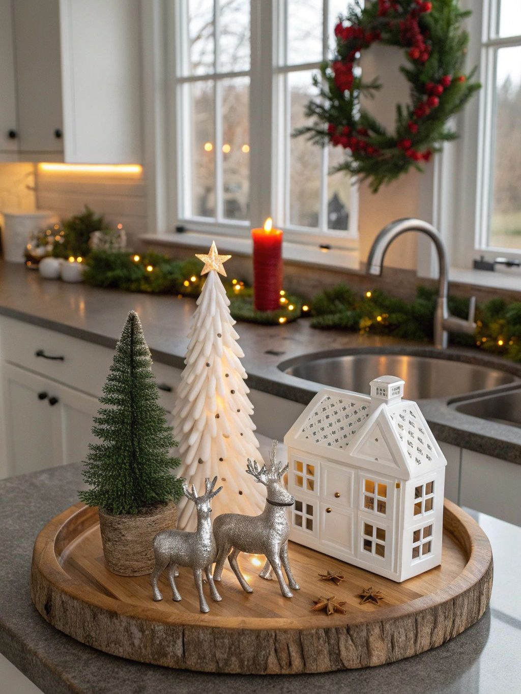

> TIP:CHECK: build the village on the slice so it lifts off in one piece; the house in the middle; trees around it

## 21. Tiered Tray of Red and Gold Ornaments

A tiered tray of red and gold ornaments is the most glamorous island centerpiece here. A gold two-tier stand holds red and gold baubles, a glittery gold tree and pinecones, with bottlebrush trees at the base.

Gold tiered trays suit a white kitchen best, where the gold can shine against the cabinets. Fill the top tier with the smallest ornaments and the bottom with the biggest, so the tray looks like a Christmas tree itself.

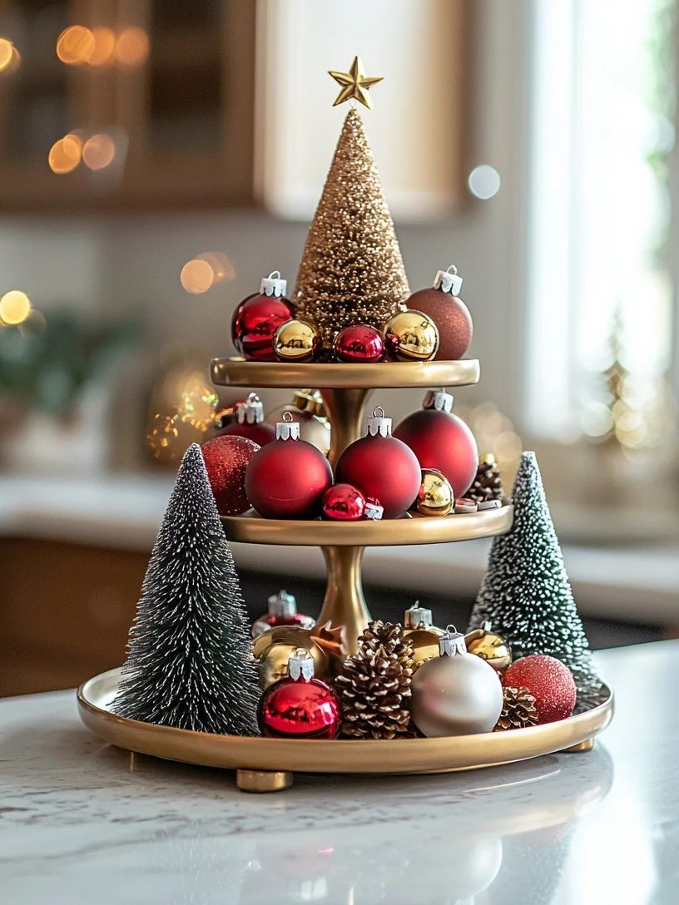

> TIP:GUIDE: Budget: $25–$45 for a gold tiered tray and ornaments | Time: twenty minutes to fill | Skill: beginner

## 22. Bottlebrush Trees in an Ornament Bowl

Bottlebrush trees in an ornament bowl are the centerpiece for a small island. Little snowy trees stand in a bowl of gold and white ornaments on a red placemat, with a tiered tray of ornaments behind them.

A bowl of trees is the smallest Christmas scene you can build, and it fits on any island. The red placemat underneath is the trick — it gives the white and gold a background to sit on.

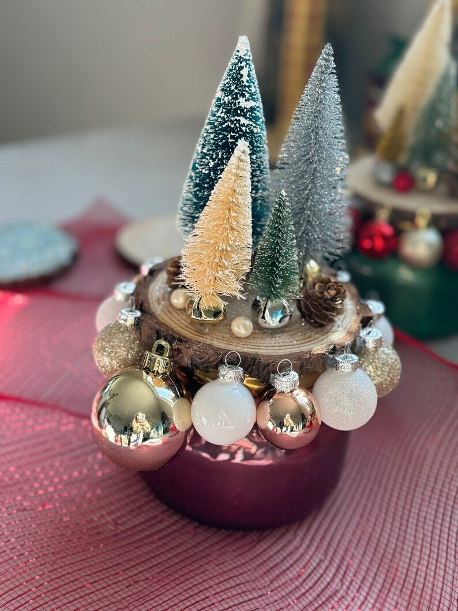

> TIP:QUICK: The red placemat underneath is the trick — it gives white and gold a background to sit on.

## 23. A Row of Mini Christmas Trees

A row of mini Christmas trees is the simplest island centerpiece of all: five or six little trees with gold stars, standing in a row on the island with the kitchen lights glowing behind them.

A row works when the trees are the same size but decorated differently — one with a red bow, one with gold baubles, one plain. Space them a hand's width apart so each tree can be seen.

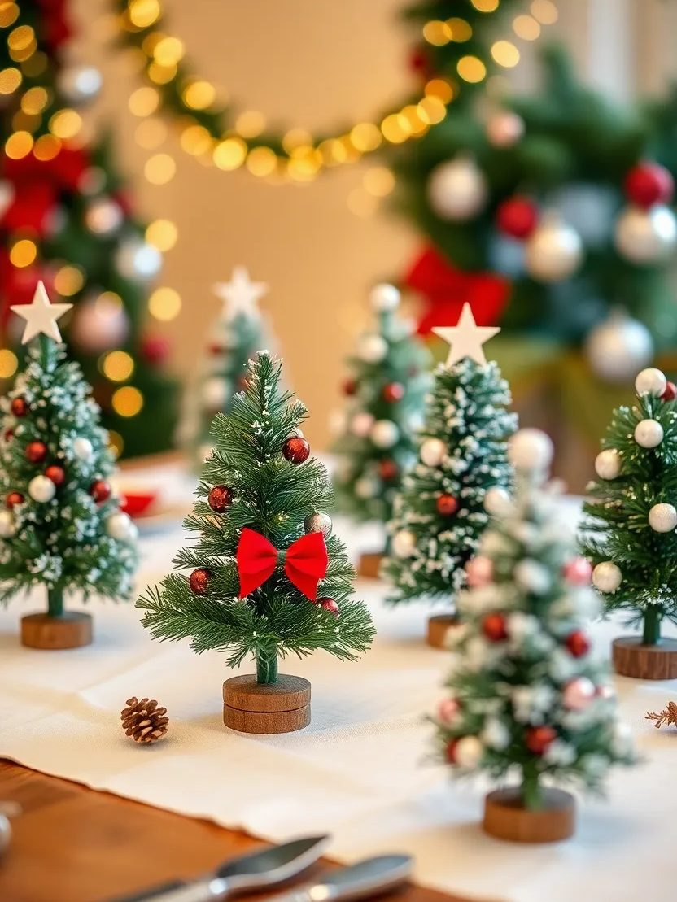

> TIP:CHECK: same size trees, decorated differently; a hand's width apart; each tree can be seen

## 24. Mini Tree and Candles on a Wood Tray

A mini tree and candles on a wood tray is the cozy island centerpiece. A little pine tree, candles in glass hurricanes and greenery sit on a wood tray on a marble island, with the kitchen glowing behind them.

A wood tray with a tree and candles is the centerpiece that works from November to January — nothing on it says Christmas except the tree, and the tree can be swapped for a plant in spring.

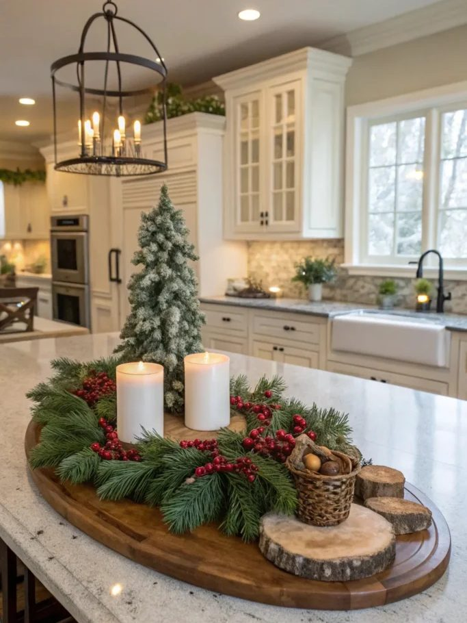

> TIP:GUIDE: Budget: $20–$35 for the tray, tree and candles | Time: fifteen minutes to arrange | Skill: beginner

## 25. Flocked Trees and Candles in a Tray

Flocked trees and candles in a tray are the snowy island centerpiece. White-flocked trees and pillar candles stand in a rustic tray on a marble island, with greenery and pinecones around them.

Flocked trees shed, so keep the tray on a runner or a placemat that catches the flocking. The white of the flocking against the dark wood tray is the contrast that makes this centerpiece work.

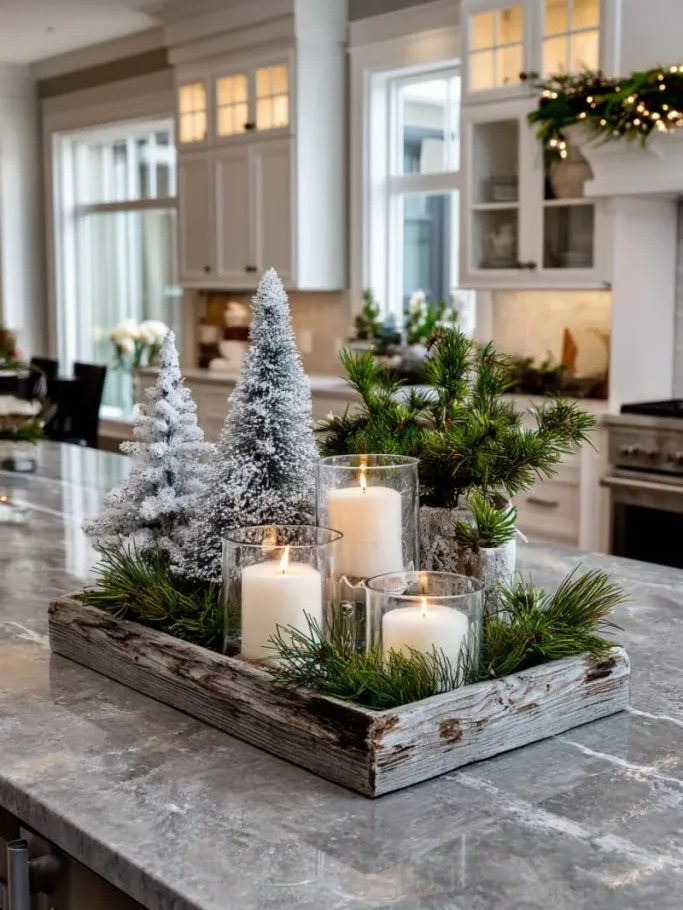

> TIP:QUICK: Keep the tray on a runner — flocked trees shed, and the runner catches it.

## 26. Rustic Lantern and Pinecones

A rustic lantern and pinecones make the woodland island centerpiece. A rusted lantern with a candle stands in a ring of pinecones and greenery, with more pinecones and a second lantern behind it.

Pinecones are the decoration here, so use a lot of them — at least eight around the lantern. Mix big and small cones, and tuck a few sprigs of greenery between them so the ring looks full.

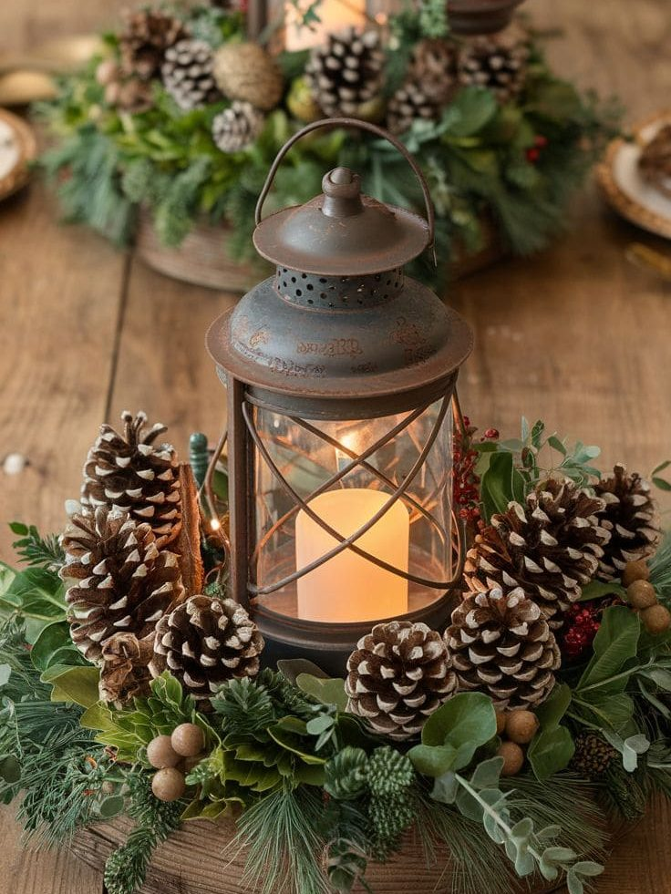

> TIP:CHECK: at least eight pinecones around the lantern; big and small mixed; greenery tucked between them

## 27. Island with Wreath-Topped Chairs

An island with wreath-topped chairs is the whole-kitchen idea. Wreaths with red bows hang on the backs of the island chairs, a Christmas tree stands beside the island, and the kitchen feels dressed from every angle.

Wreaths on chair backs are the easiest way to decorate an island without touching the worktop at all. Hang them from ribbon looped over the chair, and keep them small so they do not catch on clothes.

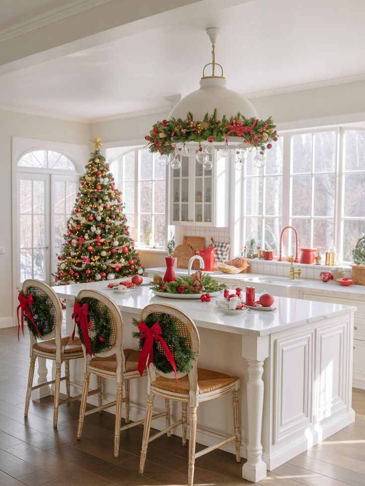

> TIP:GUIDE: Budget: $20–$40 for small wreaths and ribbon | Time: twenty minutes to hang | Skill: beginner

## 28. Island with a Cake Stand and Tree

An island with a cake stand and a tree is the party-ready island. A cake stand of red treats sits on the white island, a big Christmas tree stands beside it, and the stools wait for guests.

This is the island to copy the day guests arrive: the cake stand is the centerpiece, and everything else is already in place. Keep the island clear except for the stand, so there is room for plates and glasses.

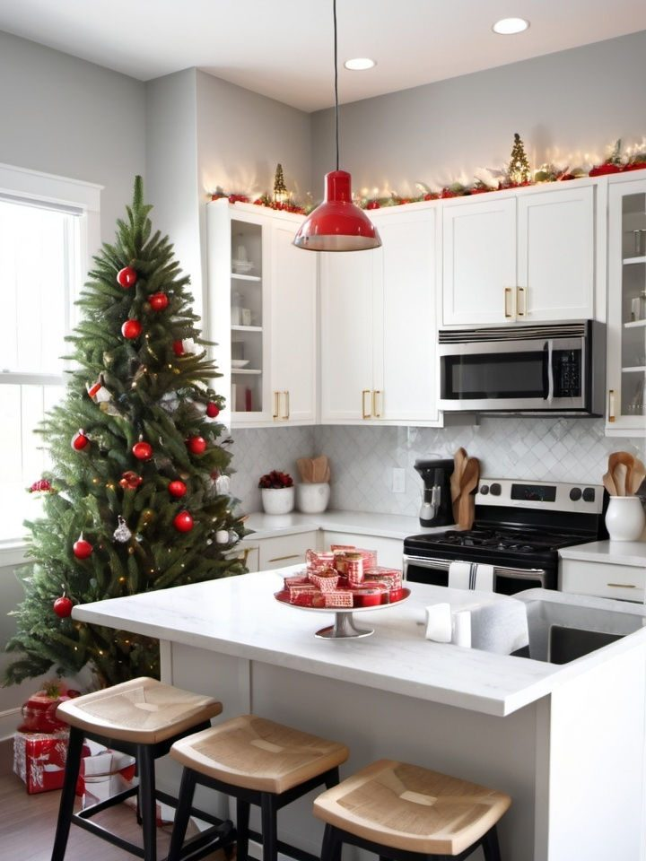

> TIP:QUICK: The cake stand is the centerpiece on party day — keep the island clear except for the stand.

## 29. Pink Candles in a Frosted Wreath

Pink candles in a frosted wreath are the softest island centerpiece here. Pink pillars stand in a frosted wreath with pinecones on a pink island, with garland and a gold stove behind them.

Pink is the unexpected Christmas color, and it works best in a kitchen that already has warm tones. The frosted wreath keeps the pink from looking too sweet, and the pinecones ground it.

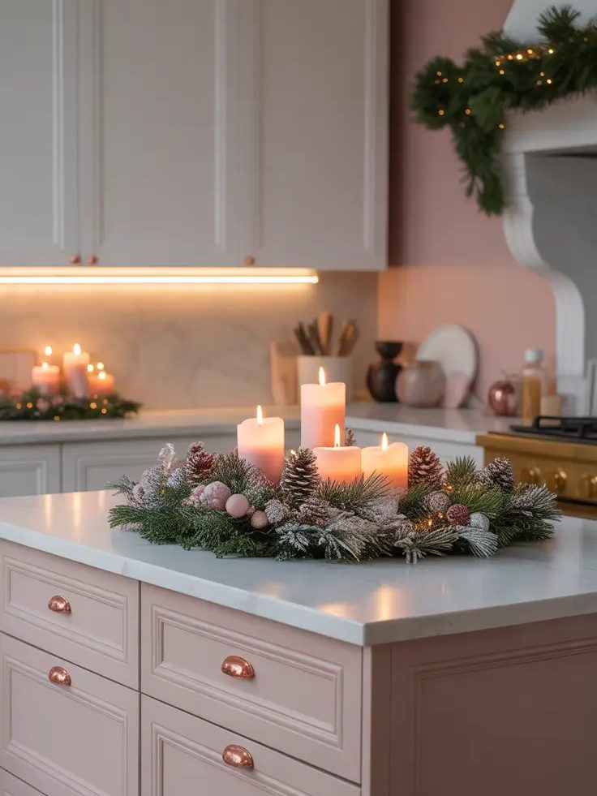

> TIP:CHECK: pink works best in a kitchen with warm tones; the frosted wreath keeps it from looking too sweet; pinecones ground the pink

## 30. Rustic Island with Purple Candles

A rustic island with purple candles is the moodiest centerpiece on this list. Purple and pink candles stand in a berry garland on a wood island, with a wreath hanging on the island's side and a farmhouse kitchen around it.

Purple candles are the bold choice, so keep everything else on the island natural — wood, berries, greenery. The wreath on the side of the island is the extra touch that makes the whole kitchen feel dressed.

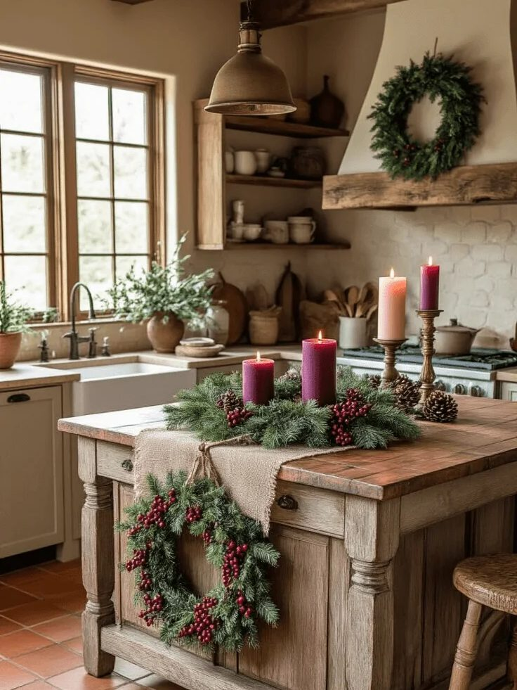

> TIP:GUIDE: Budget: $20–$35 for the candles, garland and wreath | Time: thirty minutes to style | Skill: beginner

## Takeaway

- Start with a tray or a runner — that is the whole secret of an island centerpiece.
- The tray keeps the island usable, the runner gives it length, and whatever sits on top can be as simple as three candles or as full as a tiered tray of ornaments.
- Keep the centerpiece below eye level from a stool, keep it in the middle third of the island, and lift the whole thing off in one move when it is time to cook.
- If you want the cabinets and shelves to match, our [30 Christmas Kitchen Ideas](/posts/christmas-kitchen/) finishes the room, and our [30 Christmas Table Decor Ideas](/posts/christmas-table/) takes the same look to the dining table.

## Frequently Asked Questions

### What makes a good Christmas island centerpiece?

A good island centerpiece is low enough to talk over, sits in the middle third of the island, and lifts off in one move when it is time to cook. Build it on a tray or runner, keep it below eye level from a stool, and leave clear worktop on both sides.

### How big should a centerpiece be for a kitchen island?

It should cover about one third of the island's length and never more than half its width. On a six-foot island that means a two-foot runner or tray. Measure the island first, then choose the tray, so the centerpiece fits with room to spare.

### Can I use real candles on a kitchen island?

Yes, if the candles sit in glass hurricanes or lanterns, away from garlands and paper, and are never left burning unattended. Battery candles are the safer choice on an island where food is prepared, and they look convincing inside a lantern or hurricane.

### How do I keep an island centerpiece out of the way while cooking?

Build it on a tray with handles or a runner, so the whole centerpiece lifts off in one move. Keep it in the middle third of the island and leave the ends clear for chopping and serving, or move it to the dining table while you cook.

### What is the easiest Christmas island centerpiece?

A bowl of ornaments on a plaid runner is the easiest: a runner, a bowl, and ornaments you already own, arranged in five minutes. A candle wreath is almost as easy — a wreath in the middle of the island with candles inside it needs nothing else.

### Should an island centerpiece match the dining table?

It should share a color or a material with the dining table — the same garland, the same candles, or the same ornaments — without being identical. Matching exactly looks staged, while one shared element ties the kitchen and dining room together.

### How do I decorate a small kitchen island for Christmas?

Use one small centerpiece, like a single vase of berries or a small tray with a mini tree, and keep the rest of the island clear. A narrow runner works better than a wide tray on a small island, and vertical pieces like a mini tree use no worktop at all.

### When should I put up my Christmas island centerpiece?

Put the garland, trays and ornaments up in late November or early December, and add fresh greenery, berries and candles the week before Christmas. Fresh pieces fade fastest, so save them for last, and take the whole centerpiece down in early January.
