# 30 Christmas Laundry Room Decor Ideas for a Cheerful Space

The laundry room is usually the last room to get any Christmas attention, and that is exactly why these christmas laundry room decor ideas work so well — a little festivity goes a long way in a small, hardworking space. You do not need a big budget or a full makeover. A wreath on the door, a mini tree on a shelf and a red rug underfoot can turn wash day into something you actually look forward to.

The trick is decorating around the work, not on top of it. Keep the folding counter clear, the machine tops free and the walkway open, and put the cheer on the walls, the door, the shelves and the floor. These 30 ideas show how — from rustic farmhouse rooms to bright modern ones — so you can steal the ones that fit your space.

## 1. Wreath on the Laundry Room Door

A wreath on the door is the single fastest Christmas upgrade a laundry room can get. It greets you every time you walk in with a load, it costs almost nothing, and it needs no shelf space at all. A full green wreath with a big red bow reads classic against a white door, and it sets the tone for everything else in the room.

Hang it with a removable over-the-door hook so the door itself stays undamaged, and keep the wreath slim enough that the door still swings freely. Faux greenery holds up best here, since a laundry room runs warm and steamy.

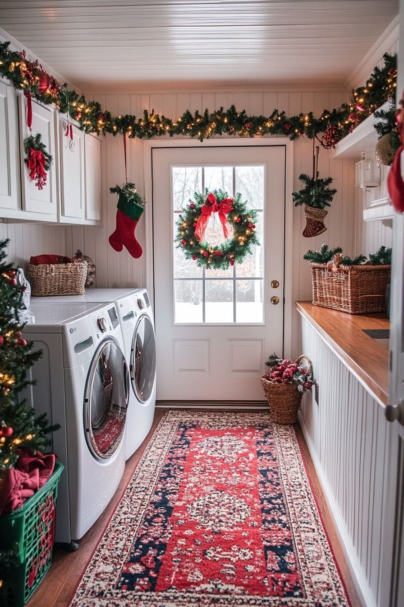

> TIP:QUICK: Hang the wreath with an over-the-door hook — no nails, and the door still swings freely.

## 2. Fairy Lights Around the Door

Fairy lights turn a plain laundry room door into the warmest spot in the house. Draped around the door frame with a wreath in the middle, they glow softly in the evening and make the room feel cozy instead of purely practical. Battery-operated strings are the simplest choice, since they need no outlet near the machines.

Keep the lights clear of the door's moving edges and away from any water, and pick warm white over cool white for a softer, more festive glow. A timer plug or a battery pack with a built-in timer means they switch themselves off.

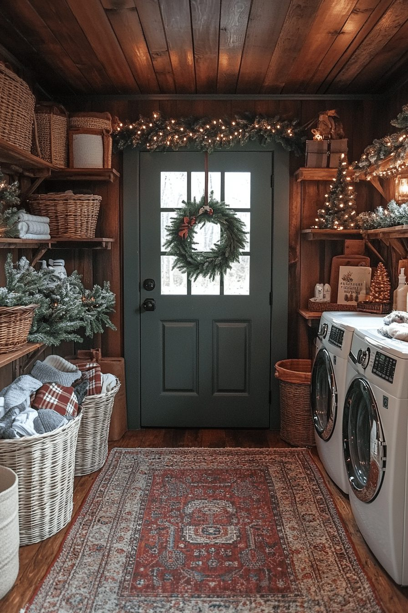

> TIP:CHECK: battery-operated warm white lights; clear of the door edges; timer so they switch off themselves

## 3. Poinsettias on the Shelves

Red poinsettias are the classic Christmas flower, and a row of them along a laundry room shelf brings instant color to a room that is usually all white and grey. Faux poinsettias are the practical pick here — real ones drop leaves in warm, steamy rooms, while good faux ones look the same all season and store flat in January.

Tuck them between folded towels and baskets so they look like part of the room rather than a display. A few sprigs of greenery at their base hides the pot and ties them into any garland nearby.

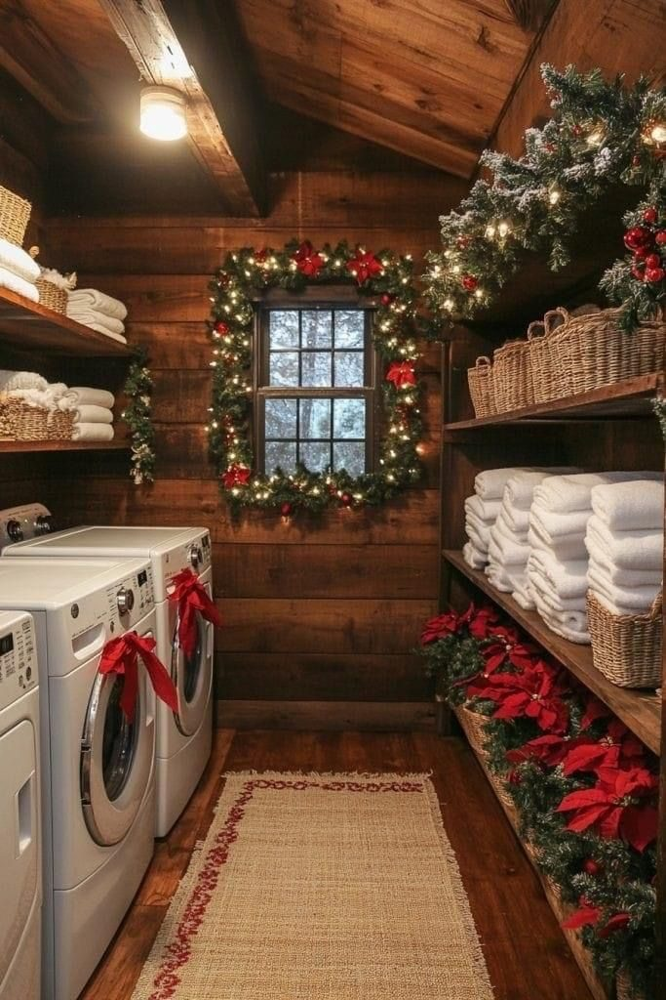

> TIP:GUIDE: Plant: faux poinsettias, not real ones | Place: between towels and baskets | Base: greenery sprigs to hide the pot

## 4. A Lit Mini Tree in the Corner

A small lit tree tucked into the corner of a laundry room shelf does the work of a full-size tree in a fraction of the space. It adds height, light and color to a corner that is usually empty, and it pairs beautifully with a wreath on the wall beside it. Choose a tree no taller than the shelf it sits on, so it never crowds the ceiling.

Battery-operated lights keep the cord out of the way, and a small basket or pot as a base hides the stand. Flocked tips or a few red baubles are all the decoration it needs.

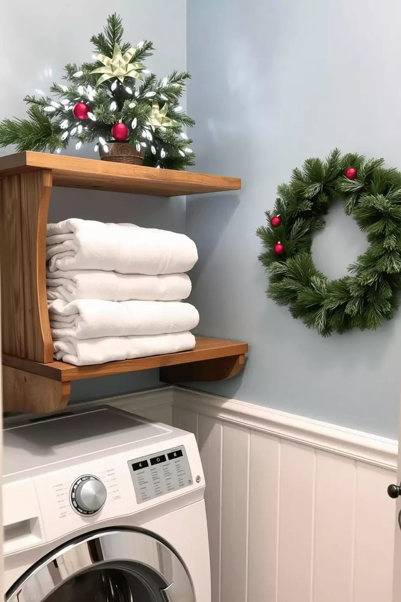

> TIP:QUICK: Keep the tree shorter than the shelf above it, and use battery lights so no cord crosses the worktop.

## 5. A Mini Christmas Village on the Shelf

A tiny village of white houses and flocked bottle-brush trees turns an open laundry shelf into a little winter scene. It is one of the prettiest ways to decorate above the machines, because the pieces are small, light and easy to move when you need the shelf for supplies. A framed holiday print behind them gives the whole display a backdrop.

Group the houses in odd numbers and vary their heights so the scene looks natural rather than lined up. A sprinkle of faux snow or a folded white towel underneath reads as ground, and the whole setup packs away in one box.

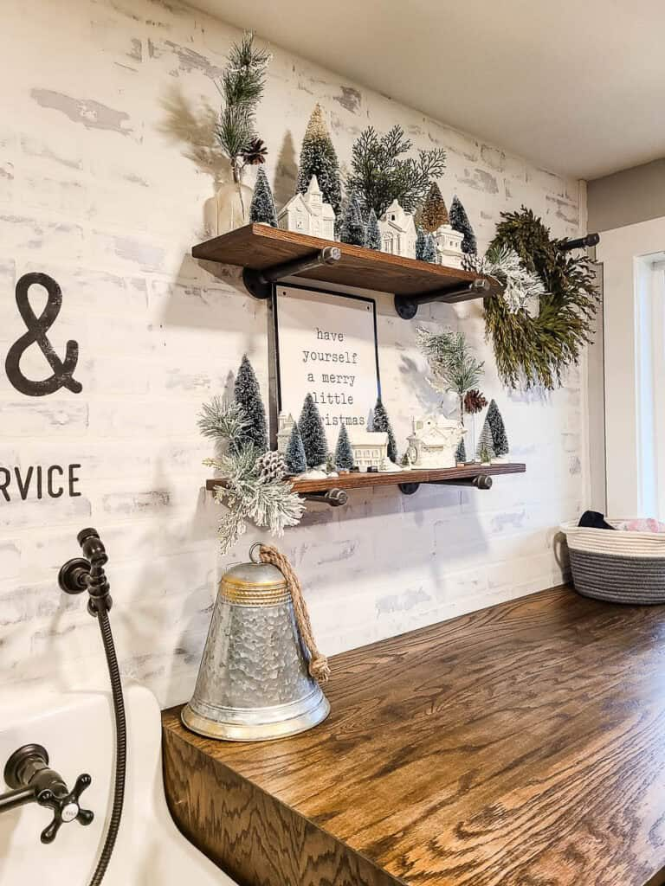

> TIP:CHECK: houses in odd numbers; vary the heights; a white towel underneath reads as snow

## 6. Wreaths on the Cabinet Doors

Hanging a small wreath on each cabinet door spreads the Christmas feeling across the whole wall instead of concentrating it in one spot. Two matching wreaths with red signs in their centers look deliberately styled, and the greenery softens plain white cabinets beautifully. Add a garland along the top of the cabinets to tie the whole wall together.

Use small removable hooks or ribbon looped over the door tops, and keep the wreaths light so the doors still open smoothly. This is also one of the easiest ideas to copy in a rental, since nothing is fixed to the wall.

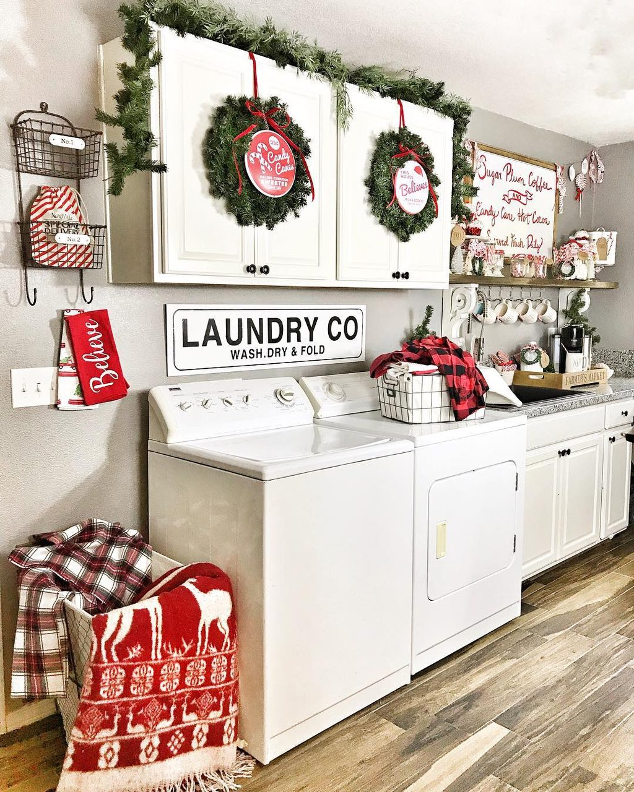

> TIP:GUIDE: Hooks: small removable hooks or ribbon over the door tops | Weight: light, so doors still open | Top: garland along the cabinet tops to tie it together

## 7. A Vintage Laundry Sign

A vintage-style laundry sign does double duty: it labels the room and decorates it. A big "Laundry Co. Wash, Dry, & Fold" sign over the shelves gives the wall a focal point, and a smaller seasonal print — mistletoe, a snowman, a holiday greeting — layered in front of it adds the Christmas touch without a second sign.

Keep the sign's colors in the room's palette so it feels intentional rather than random. Black lettering on white or cream suits almost any laundry room, and a wooden frame warms it up.

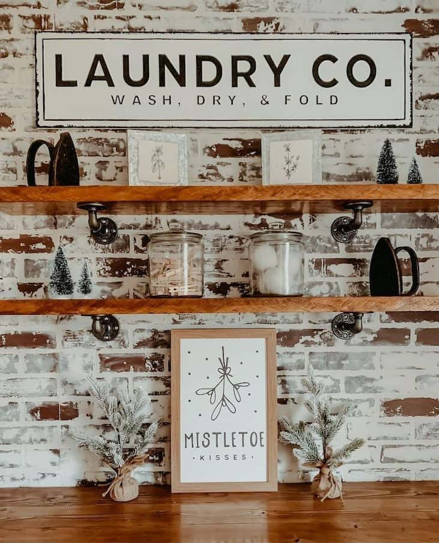

> TIP:QUICK: One big laundry sign plus one small seasonal print layered in front beats two big signs.

## 8. Red Gingham Towels

Swapping everyday towels for red gingham ones is the lowest-effort Christmas decorating move there is, and it works because towels are already part of the room. Draped over a basket or folded on the counter, the red and white checks add instant festivity, and they are genuinely useful — they dry hands and dishes all season long.

Pair them with a dark vintage-style sign and a flocked mini tree for a look that feels collected rather than thrown together. When January comes, the towels just go back into the linen cupboard.

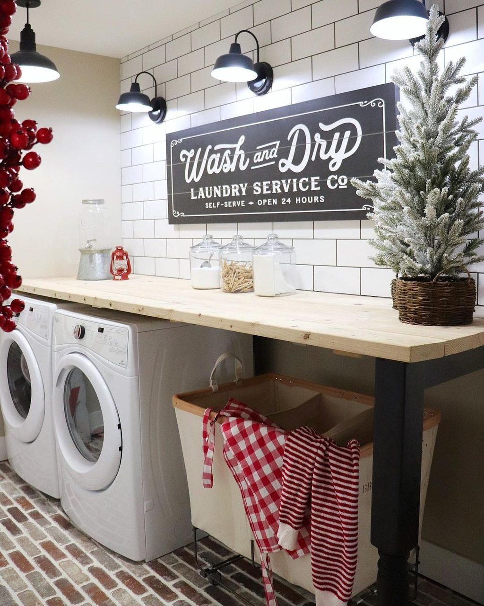

> TIP:CHECK: red gingham towels on the basket; dark sign above; flocked mini tree beside — then stop

## 9. Woven Baskets with Pinecones

Woven baskets are already laundry room staples, so dressing them for Christmas is almost free. Fill the top baskets with pinecones and small sprigs of greenery, and drape a red plaid blanket over the basket on the floor. The natural textures — wicker, pine, wool — make the room feel warm and rustic without any glitter or plastic.

Keep the pinecones on the upper shelves and the soft blankets low, where they are easy to grab. A plaid runner on the floor picks up the blanket's colors and pulls the whole room together.

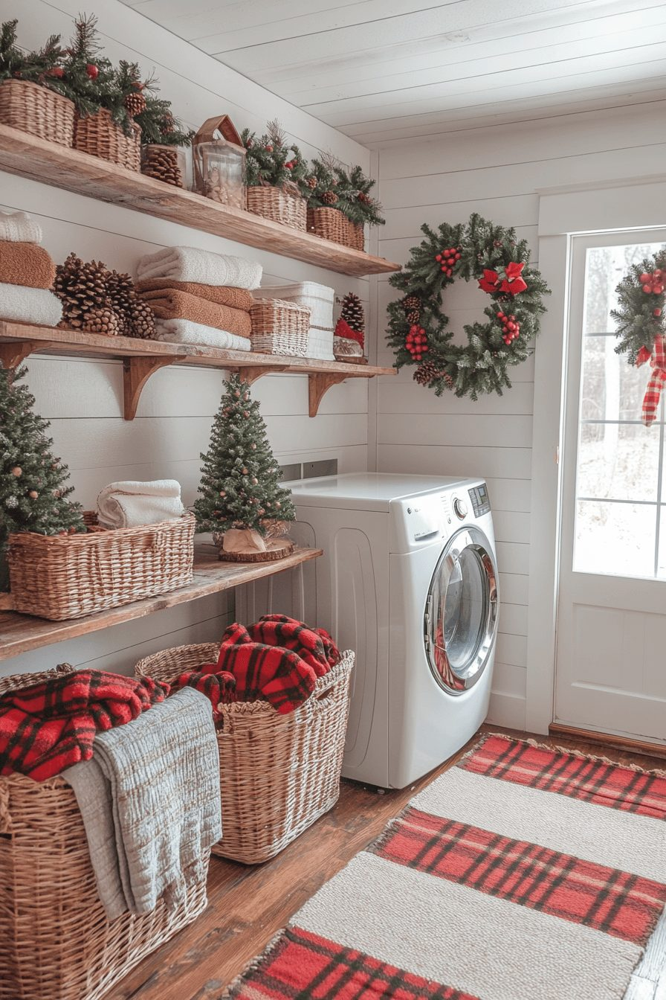

> TIP:GUIDE: Top shelves: baskets with pinecones and greenery | Floor: plaid blanket over the basket | Floor: plaid runner to match

## 10. Pine Garland with Pinecones

A thick pine garland with pinecones, hung along the top of a door or across a wall, brings the smell and look of a real Christmas tree into the laundry room. It frames the room the way a picture frame frames a photo, and it looks wonderful next to wicker baskets and wooden shelves. Faux garland is the safer choice near steam, and it can be reused year after year.

Fluff the garland out fully before you hang it — a flat garland looks thin and sad. Tuck a few pinecones into the branches rather than gluing them, so you can change the look next year.

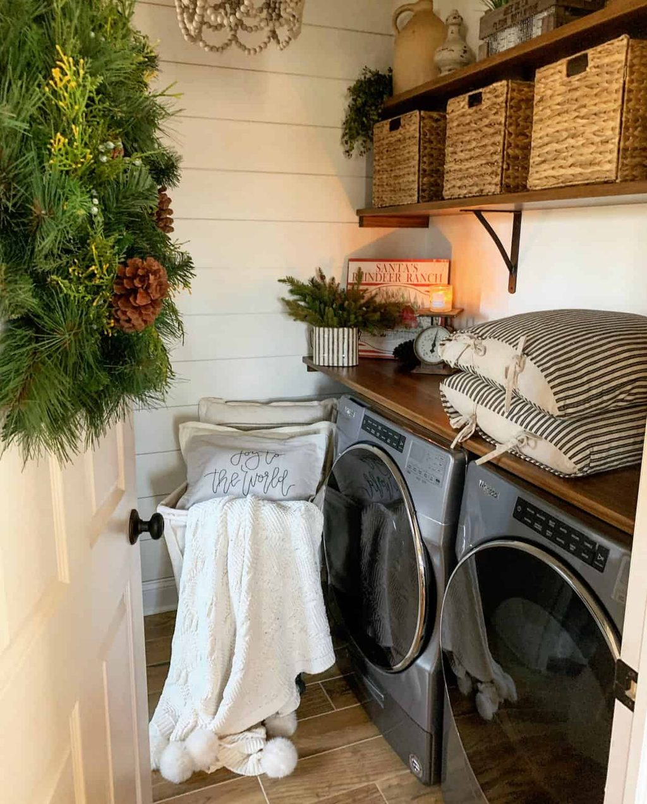

> TIP:QUICK: Fluff the garland out fully before hanging — a flat garland looks thin and tired.

## 11. A Red Lantern on the Counter

A red lantern on the counter is a small piece of decor with a big presence. It adds a bold pop of color to a white room, it can hold a battery candle for a soft glow in the evening, and it takes up no more space than a jar of detergent. Set it beside a framed winter print and a plaid blanket for a counter display that looks styled in minutes.

Keep the counter around it clear so the lantern reads as a feature, not clutter. A lantern with a handle is easy to move aside on heavy wash days, which matters more than it sounds.

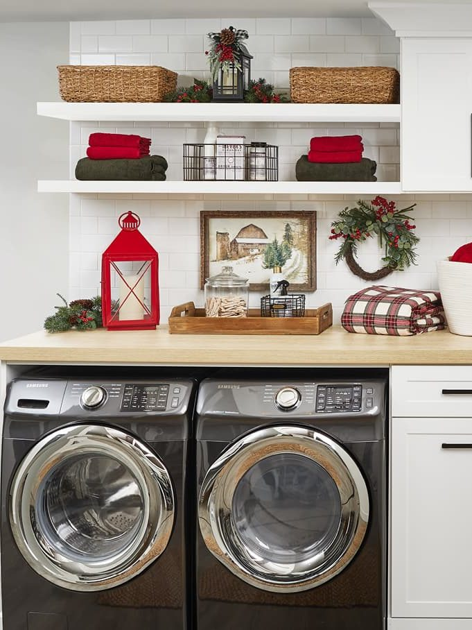

> TIP:CHECK: red lantern on the counter; battery candle inside; framed winter print beside it

## 12. A Buffalo Check Rug

A buffalo check rug is the fastest way to change a laundry room floor for Christmas. The big black and white checks are bold enough to anchor the room, yet neutral enough to work with any other decor you add. It also hides the wear and tear that laundry room floors collect, and it feels soft underfoot on cold mornings.

Choose a washable rug, since laundry rooms see splashes and dropped detergent. A runner shape suits a galley-style room, while a larger rug works in front of side-by-side machines.

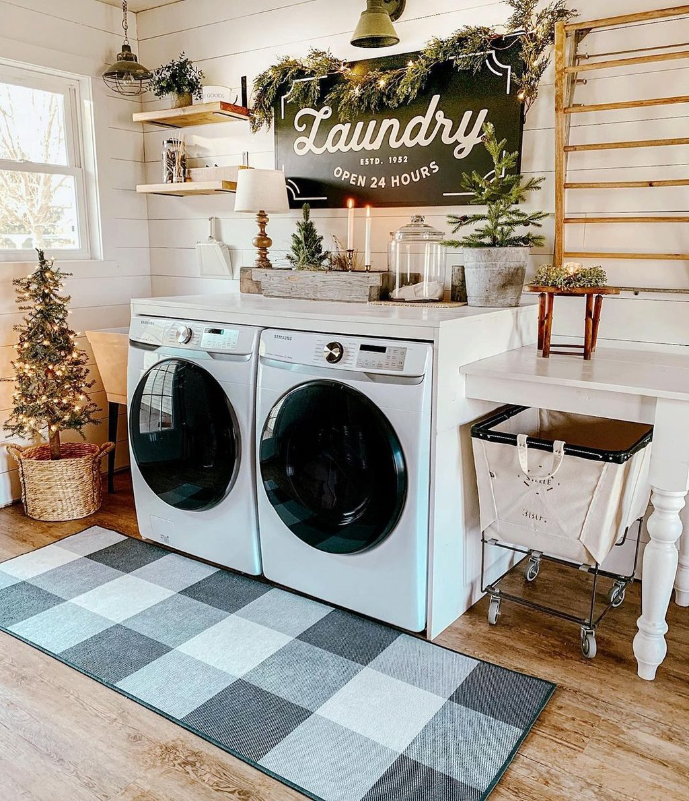

> TIP:GUIDE: Rug: washable buffalo check | Shape: runner for a galley room, larger rug for side-by-side machines | Care: shake out weekly, wash monthly

## 13. A Red Plaid Throw

A red plaid throw draped over a laundry basket or a metal tub softens the hardest-working corner of the room. It adds warmth and pattern exactly where the room is most utilitarian, and it is easy to wash when it picks up lint. Pair it with a poinsettia and a small tree, and a plain corner suddenly looks like a Christmas card.

Fold the throw loosely rather than perfectly — a casual drape looks cozier and more lived-in. Keep one end tucked into the basket so it does not slide onto the floor.

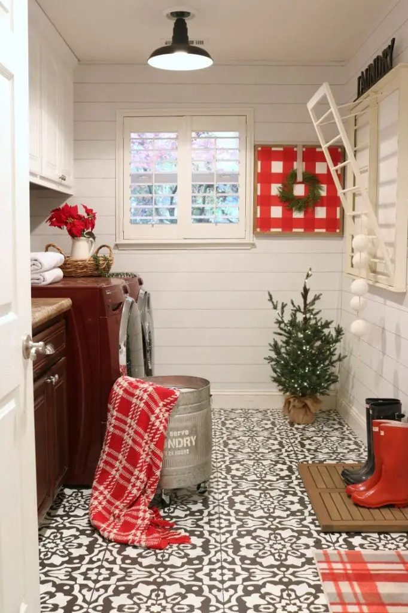

> TIP:QUICK: Drape the throw loosely and tuck one end into the basket so it never slides to the floor.

## 14. A Plaid Throw on the Folding Bench

If your laundry room has a bench or a folding nook, a plaid throw and a cushion turn it from a waiting spot into the coziest seat in the house. The bench is where clean laundry gets folded, so decorating it means the Christmas feeling is right where you spend the most time. A basket and a small plant on the shelf above finish the scene.

Keep the bench top mostly clear — one cushion and one folded throw are enough. Anything more gets in the way of the folding, and a bench piled with decor is a bench nobody uses.

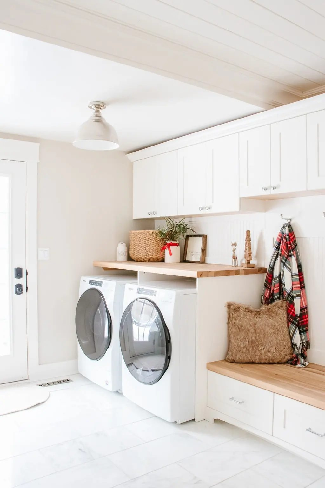

> TIP:CHECK: one cushion and one folded throw on the bench; basket and plant on the shelf; bench top stays clear

## 15. Green Cabinets Dressed for Christmas

Deep green cabinets are a gift at Christmas, because they already look festive before you add a single decoration. A wreath with a red bow on the door, a garland along the cabinet tops and a red patterned rug are all it takes — the green does the rest. The contrast of red against green is the classic Christmas palette, and it looks especially good with warm white lights.

Keep the counter decor minimal so the cabinets stay the star. A few woven baskets with greenery and a small lit tree on the counter are plenty.

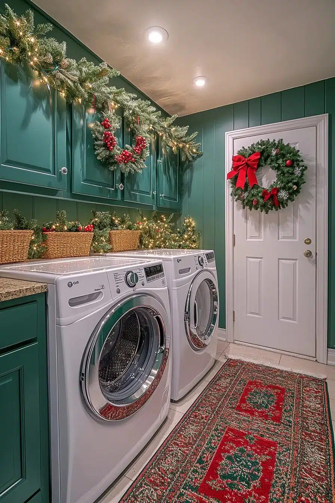

> TIP:GUIDE: Cabinets: deep green, already festive | Door: wreath with a red bow | Floor: red patterned rug

## 16. A Rustic Attic Laundry Christmas

A sloped-ceiling attic laundry room suits a rustic Christmas better than any other room in the house. Wood beams, a wooden door with a wreath, a red rug and baskets of greenery make the small space feel like a cabin, and the low ceiling keeps the garland and lights close and cozy. The trick is letting the wood lead and adding only red and green accents.

Use the shelves under the slope for baskets and folded towels, and keep the floor clear except for the rug. A small tree in a basket by the door adds height without crowding the slope.

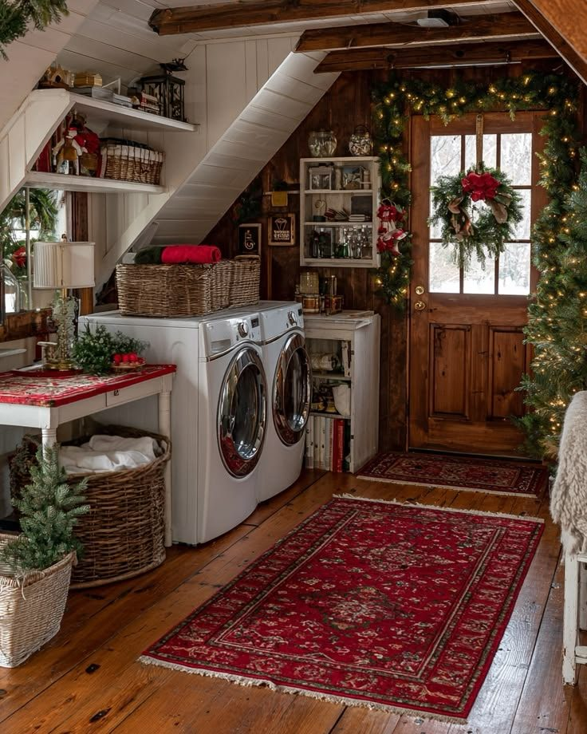

> TIP:QUICK: Let the wood lead — add only red and green accents, and keep the floor clear except for the rug.

## 17. Red Storage Bins

Red storage bins are Christmas decor that earns its keep all year. Swapping plain bins for red ones — or slipping red liners into the ones you own — adds a strong block of festive color to the shelves and under the counter, while still holding exactly what they held before. A stocking hung nearby and a garland with lights above tie them into the season.

Label the bins if they hold different things, so the color stays decorative and the room stays organized. Washable fabric bins are the most practical choice in a laundry room.

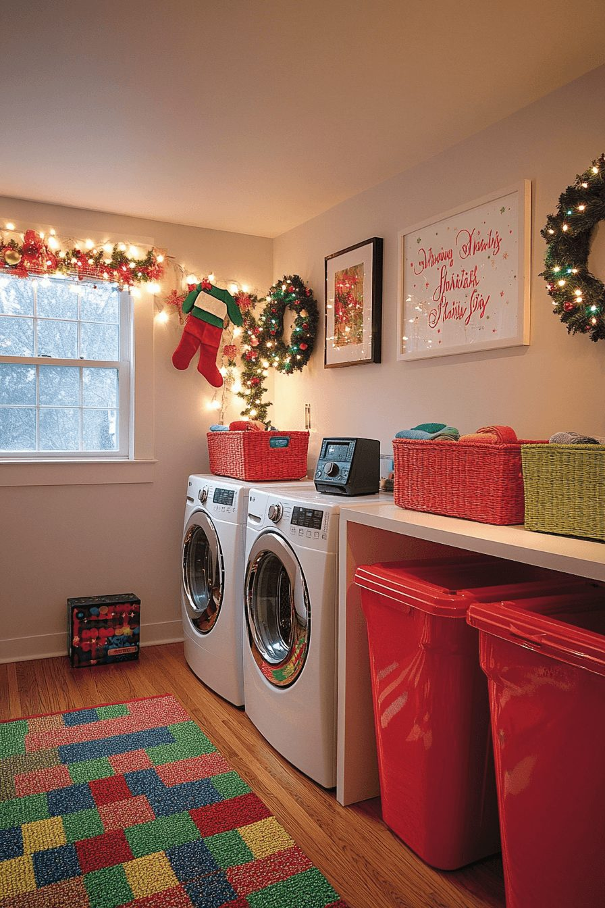

> TIP:CHECK: red bins on the shelves and under the counter; stocking nearby; garland with lights above

## 18. Garland Over the Window

A garland draped over the top of the laundry room window frames the daylight and makes the whole room feel dressed up. Hang it high so it never blocks the light, and let a few ribbons or ornaments dangle from it for movement. A wreath on the door beside it and a red rug below complete a room that feels festive from every angle.

Choose a garland that matches the one on the door or the shelves, so the room reads as one plan rather than three separate ideas. Faux greenery with a few red berries is enough — the window does the rest.

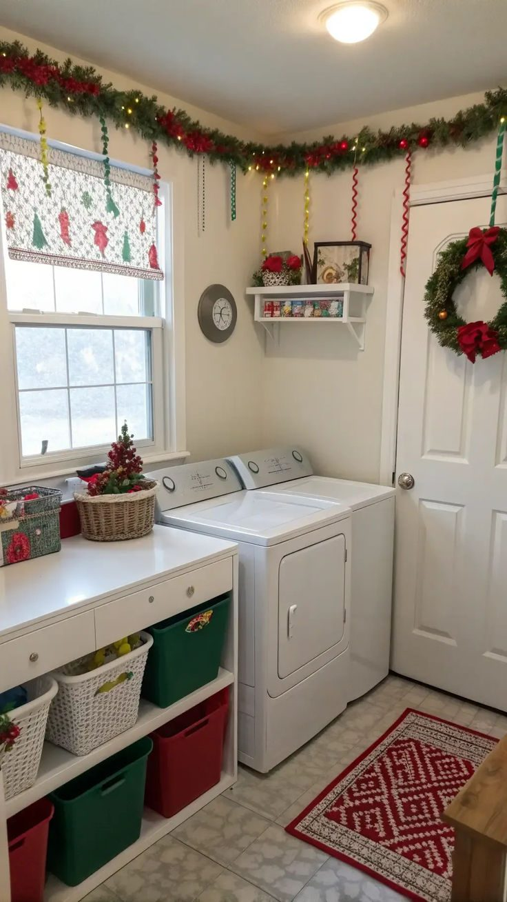

> TIP:GUIDE: Hang: high, so it never blocks the light | Match: same garland as the door or shelves | Add: ribbons or ornaments dangling for movement

## 19. Stockings on Wall Hooks

Stockings hung on wall hooks are the most charming use of a laundry room's hardware. The hooks are already there for aprons and bags, so a row of red and white stockings turns a plain wall into a Christmas display with zero new holes. A wreath in the window beside them and red boots by the door add to the story.

Keep the stockings flat and light so they hang neatly, and leave one hook free for the things you actually use every day. This idea works especially well in a mudroom-style laundry room with a bench and a sink.

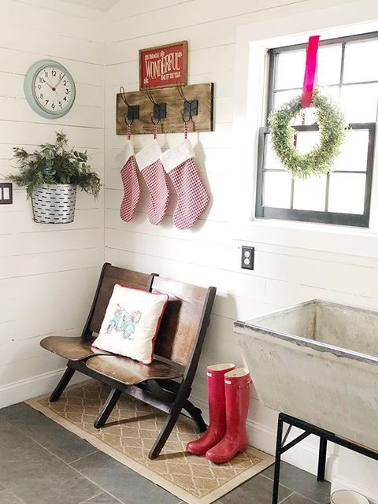

> TIP:QUICK: Hang stockings on the hooks you already have — no new holes, and leave one hook free for daily use.

## 20. A Pegboard with a Lit Tree

A pegboard above the machines is one of the most useful things in a laundry room, and at Christmas it becomes a display board too. Hang gold bead garland in swags across the pegs, add a small lit tree on the shelf below, and the whole wall glows. The pegboard keeps scissors, brushes and clothespins in reach, so the decor never gets in the way of the work.

Keep the garland to the upper half of the board so the tools below stay easy to grab. A battery-operated tree avoids another cord near the machines.

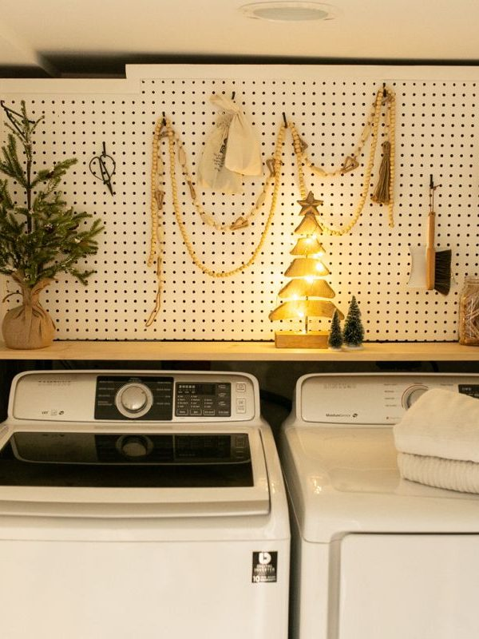

> TIP:CHECK: gold garland on the upper half only; lit tree on the shelf below; tools stay easy to grab

## 21. A Snowman on the Shelf

A snowman figure on the shelf above the machines is pure cheer. It is big enough to notice from the doorway, small enough to sit beside the baskets and jars, and it makes the whole room feel playful rather than serious. Pair it with a Santa figure, a poinsettia and a woven basket, and the shelf looks like a little Christmas scene.

Place the snowman where it will not get knocked by lids or doors opening below it. A felt or fabric snowman is the safest choice in a room where things get moved around a lot.

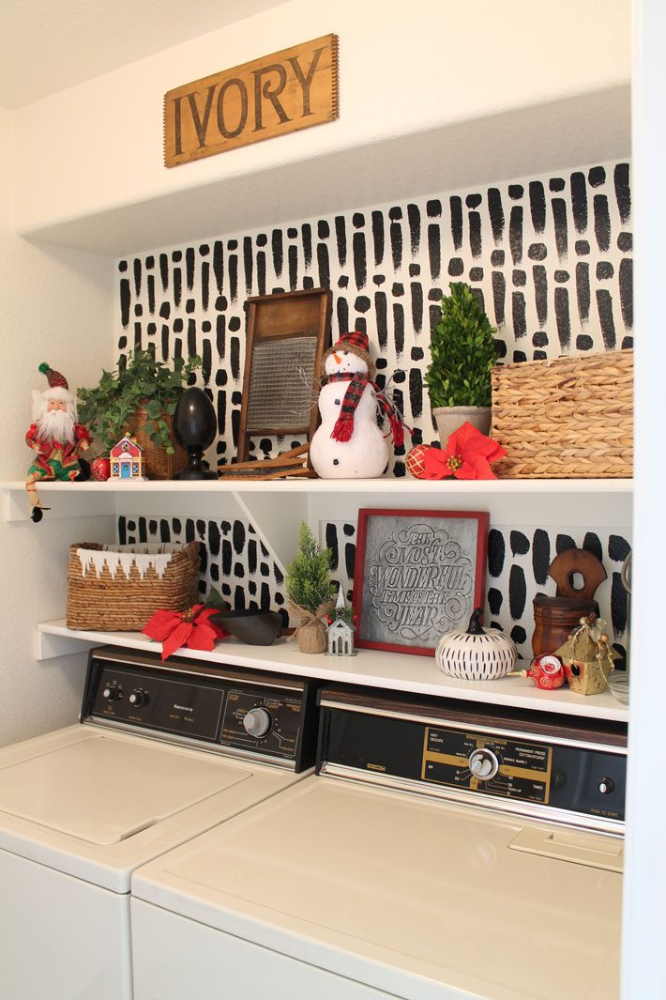

> TIP:GUIDE: Figure: felt or fabric snowman, not ceramic | Place: clear of lids and doors below | Pair: Santa, poinsettia and a woven basket

## 22. A Christmas Gnome on the Shelf

A small Christmas gnome tucked between the snowman and the mini tree is the detail guests always spot first. Gnomes are having a moment in holiday decor, and their soft hats and long beards add a handmade, cozy feeling to a shelf of baskets and jars. One gnome is a charm; three start to look like a collection, so keep it to one or two.

Set the gnome slightly forward on the shelf so it is not hidden behind taller pieces. A tiny sign or a "Merry Christmas" tag beside it finishes the vignette without adding clutter.

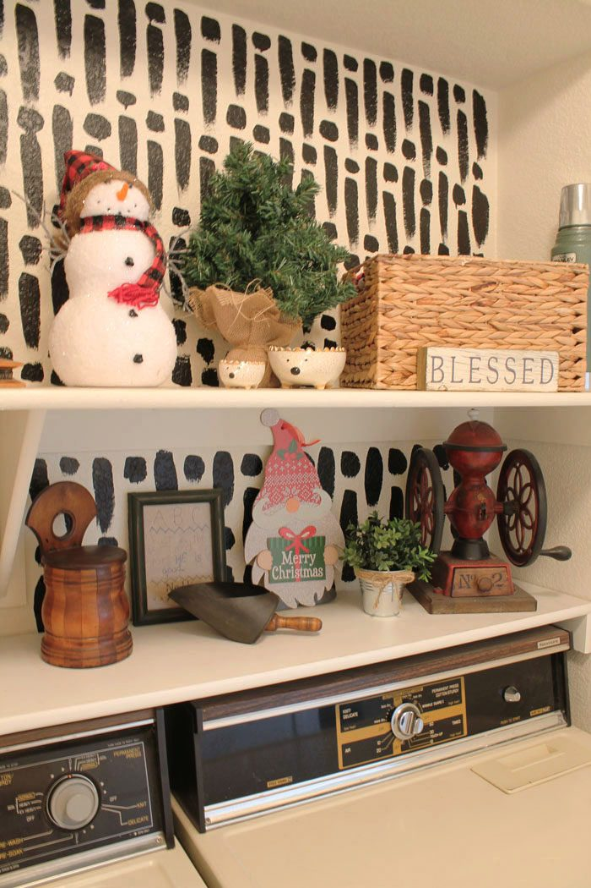

> TIP:QUICK: One gnome is a charm — set it slightly forward on the shelf so taller pieces never hide it.

## 23. A Santa Sign on the Door

A Santa sign hung on the laundry room door is a friendly, old-fashioned touch. It works especially well on a plain white door, where the round sign and its red lettering become the room's focal point. The hooks above the door are already there for coats, so the sign hangs without any new hardware at all.

Keep the rest of the room simple when the sign is this bold — a few shelf decorations and a woven rug are enough. If the sign is double-sided, you can flip it around after Christmas for a plain look.

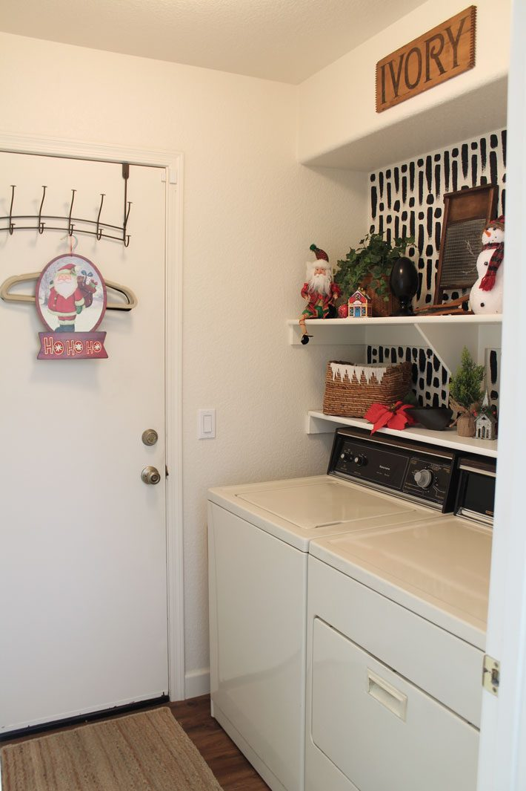

> TIP:CHECK: round Santa sign on the door; hooks already there, no new hardware; keep the rest of the room simple

## 24. A Vintage Christmas Poster

A framed vintage Christmas poster above the machines turns a blank wall into the room's centerpiece. A classic "White Christmas" style print with red figures and a black and white checkered backdrop feels nostalgic, and a lit garland draped beneath it adds warmth and light. It is the kind of decor that looks expensive but costs very little.

Frame the poster simply — a dark frame suits the vintage look — and hang it high enough that steam from the machines never reaches it. The counter below stays clear for folding, so the poster does the decorating on its own.

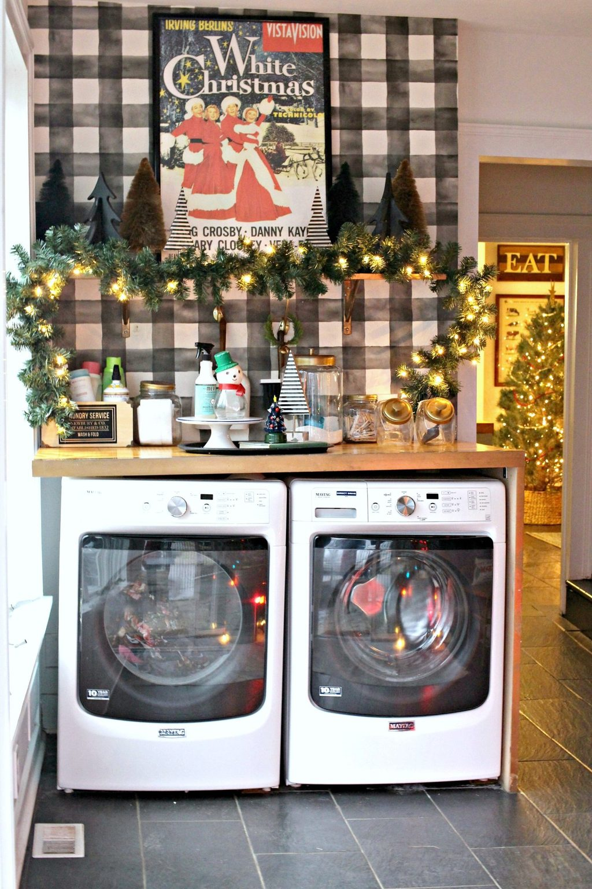

> TIP:GUIDE: Frame: simple and dark, suits the vintage look | Hang: high, clear of steam | Counter: stays clear for folding

## 25. Mini Wreaths on Wooden Cabinets

Wooden cabinets get their own Christmas treatment with a small wreath on each door. The dark wood and the green wreaths are a natural pairing, and a tiny gold ornament in the center of each wreath adds a glint of light. A red and white valance below the cabinets — especially one with snowmen or trees — finishes a look that feels straight out of a country cottage.

Keep the wreaths small and flat so the cabinet doors still open easily, and match the valance colors to the wreaths. This idea suits older wooden cabinets beautifully, since the wood grain already adds warmth.

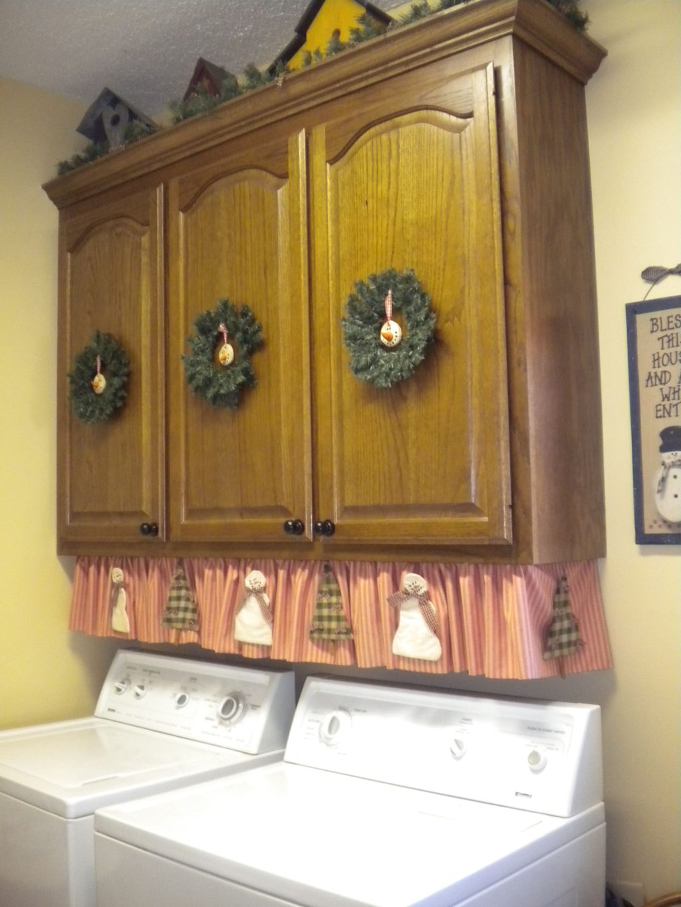

> TIP:QUICK: Keep the wreaths small and flat so the cabinet doors still open easily.

## 26. A Fully Dressed Rustic Laundry Room

Some rooms go all in, and a rustic laundry room can carry it. Garland with lights framing the door, a wreath in the window, baskets of plaid blankets, a small tree in the corner and a patterned rug — together they make the room feel like a cabin at Christmas. The secret is sticking to one palette: wood, white, red and green, with nothing else competing.

Work from the door outward, so the biggest pieces go up first and the small ones fill the gaps. And keep one surface — the top of the machines or the folding counter — completely clear, so the room still works as a laundry room.

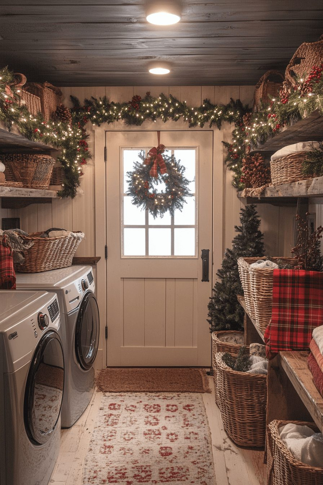

> TIP:CHECK: one palette only — wood, white, red and green; biggest pieces first; one surface stays completely clear

## 27. Mini Trees on the Folding Counter

A pair of mini trees on the folding counter — one tall, one short — brings the Christmas feeling right to the work surface without blocking it. They sit at the back of the counter, behind the jars and baskets, so the front stays free for folding. A vintage laundry sign above them and a "Happy Holidays" sign on the shelf complete a display that looks curated rather than crowded.

Choose trees in pots or baskets that will not tip over when the machines vibrate. Faux trees with a little faux snow on the tips look best against white cabinets.

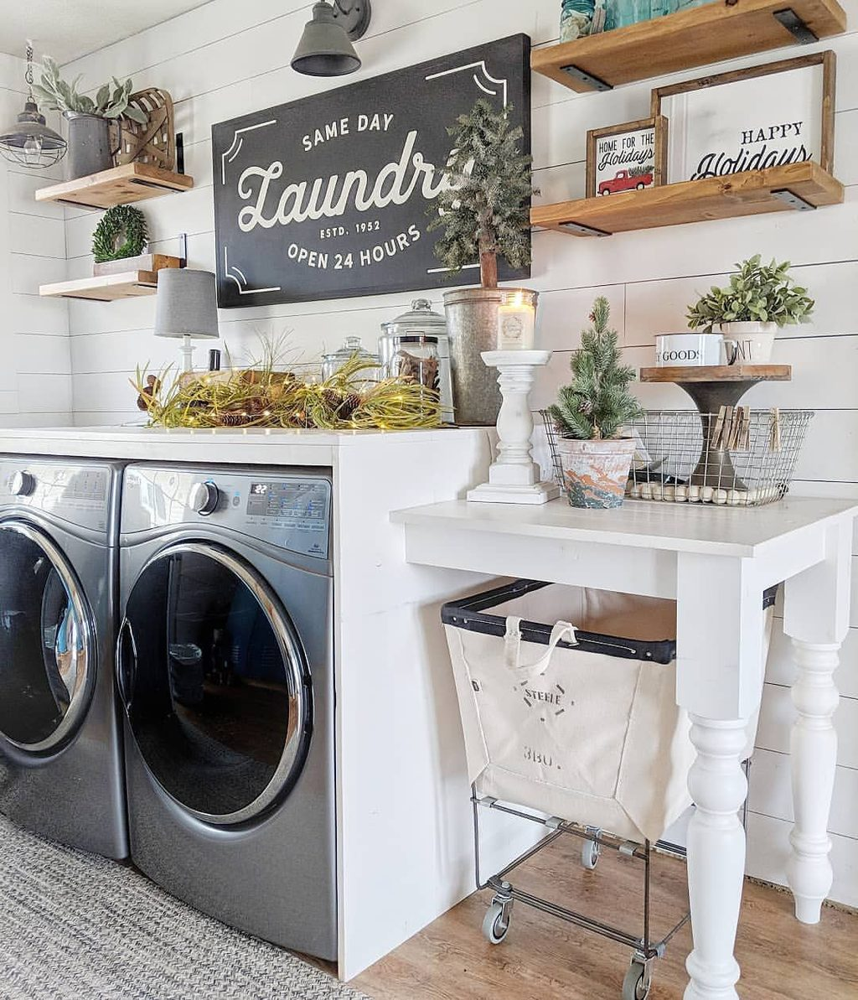

> TIP:GUIDE: Trees: one tall, one short, at the back of the counter | Pots: baskets or pots that will not tip | Front: stays free for folding

## 28. Wrapped Gifts on the Shelf

A wrapped gift or two on the top shelf is the most unexpected Christmas touch in a laundry room, and it works because it looks like the room is in on the secret. Brown paper with a star pattern, tied with twine and a sprig of greenery, suits a farmhouse shelf perfectly, and a wooden tree decoration beside it keeps the display from looking like a parcel that got lost.

Keep the gifts decorative — empty boxes wrapped for show — so nothing valuable is ever at risk near steam and splashes. They pack flat in January and come out again next year.

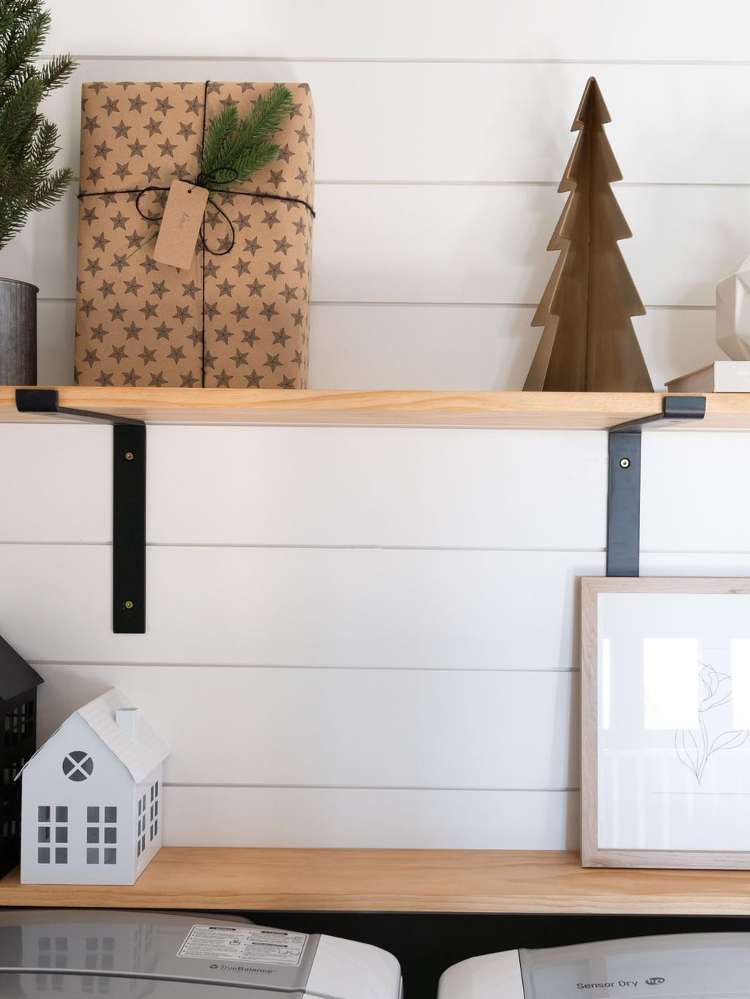

> TIP:QUICK: Wrap empty boxes for show — nothing valuable should sit near steam and splashes.

## 29. Glass Jars with Holiday Fillers

Glass jars are laundry room essentials, and filling a few with holiday touches turns storage into decor. White wool dryer balls, a string of wooden beads or a few pinecones in a jar look pretty on the shelf and stay useful all season. Group the jars with woven baskets and mini trees so the shelf reads as a display, not a cupboard.

Keep the jars you actually use within easy reach, and put the purely decorative ones higher up. Clear glass shows the fillers best, and wooden lids add warmth against white shelves.

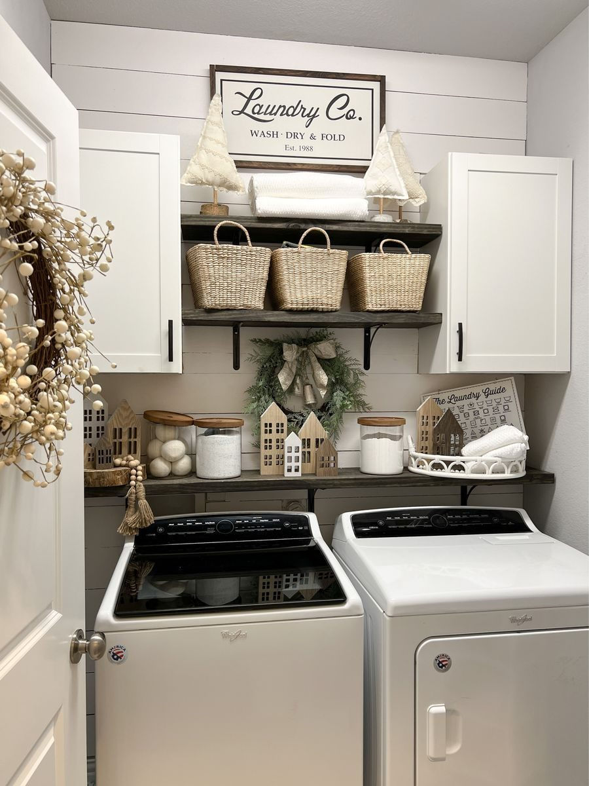

> TIP:CHECK: everyday jars within reach; decorative jars higher up; clear glass shows the fillers best

## 30. A Wicker Basket for Supplies

A big wicker basket on the counter holds detergent, clothespins and dryer sheets while looking far better than a row of plastic bottles. At Christmas, a sprig of greenery tucked into the basket's rim and a mini tree beside it turn a storage solution into a decoration. It is the kind of idea that stays put after the holidays, too — just remove the greenery.

Choose a basket with a flat base that sits steady on the counter, and keep it near the machines so supplies are always in reach. A basket that is too tall blocks the shelf above it, so measure before you buy.

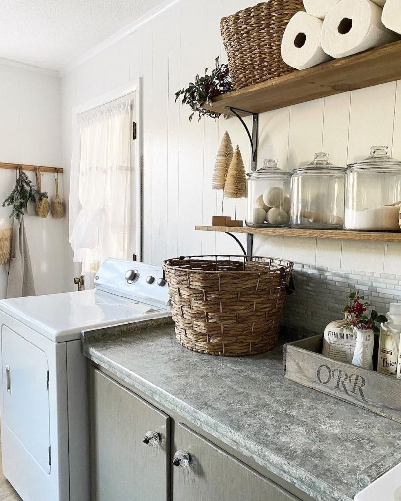

> TIP:GUIDE: Basket: flat base, sits steady on the counter | Height: must clear the shelf above | Trim: a sprig of greenery in the rim

## Takeaway

A cheerful Christmas laundry room is not about buying a lot of new things — it is about putting a few festive touches exactly where your eye already goes: the door, the shelves, the counter and the floor. Start with a wreath and a rug, add one mini tree and one sign, and the room will feel finished. If you want to carry the same warmth into the rest of the house, our [30 Christmas Kitchen Ideas for a Warm, Festive Heart of the Home](/posts/christmas-kitchen/) and [30 Winter Home Ideas for a Cozy, Snowy Season](/posts/winter-home/) show how to keep the whole home feeling festive all season — and every idea here is easy to save for next year.

## Frequently Asked Questions

### How do I decorate a laundry room for Christmas without cluttering it?

Pick three or four spots — the door, one shelf, the counter and the floor — and leave the rest clear. A wreath, a small tree and a festive rug do most of the work. Keep the folding counter and the tops of the machines free so laundry stays easy, and choose decor that can move aside in seconds.

### What colors work best for Christmas laundry room decor?

Classic red and green read festive at once, and they look cheerful against white machines and cabinets. Add white or cream to keep a small room bright, then one accent — plaid, gold or deep green — to tie the shelves together. Avoid more than three main colors so the room feels calm, not crowded.

### Can I hang a wreath on the laundry room door?

Yes, and it is the easiest win in the room. Use a removable hook or a wreath hanger that fits over the top of the door, so nothing is nailed into it. Keep the wreath light and flat enough that the door still opens and closes freely, and choose faux greenery so it survives steam and humidity.

### Is it safe to put fairy lights in a laundry room?

Yes, if you use them the way you would in any damp room. Choose LED lights, which stay cool, and keep plugs and battery packs away from the sink and any splashes. Never drape lights across the machines or near the dryer vent, and switch them off when you leave the room.

### What should I put on the shelves above the washer and dryer?

Group a few festive pieces with your everyday supplies: a mini tree, a small wreath or a snowman beside baskets and jars. Keep heavy items low and light decor up high, and leave a gap above the machines so lids and doors open fully. Three small groups look tidier than one long row.

### How do I keep Christmas decor out of the way while doing laundry?

Decorate the walls, the door and the shelves, and keep the work surfaces clear. Hang towels and stockings on hooks rather than piling them on the counter, and use a rug for color instead of tabletop pieces. Anything on the counter should lift off in one move when a big wash day arrives.

### What is the cheapest way to decorate a laundry room for Christmas?

Start with what you already own: red and green towels, a plaid throw and any spare ornaments. A paper snowflake garland, a pine sprig in a jar and a red bow on the door cost almost nothing. One wreath and one rug change the whole room, so spend there first and add small pieces later.

### When should I take Christmas decor down from the laundry room?

Most people take it down in the first week of January, when the rest of the house comes down too. If you love the cozy feel, keep the plaid rug and the baskets and remove only the trees, wreaths and signs. Wash any fabric pieces before storing them so they are fresh next year.
