# 30 Christmas Nursery Decor Ideas for a Festive Baby Room

These christmas nursery decor ideas bring the magic of the season into the baby's room without turning it into a hazard. A nursery is not a living room: everything festive still has to be soft, secure and out of reach, so the prettiest ideas here live on the walls, the dresser and the far side of the room, never inside the crib.

The trick is to decorate around the crib rather than in it. A mini tree in the corner, a felt garland high on the wall, warm fairy lights strung well above little hands, and one or two soft plush friends on a shelf give the room a full Christmas feeling while the sleeping space stays bare and safe. Pick two or three ideas below and the room is done.

## 1. Mini Christmas Tree Beside the Crib

A small tree beside the crib is the fastest way to make the nursery feel like Christmas. Choose a slim tabletop tree, set it on the floor in the corner or on a sturdy dresser, and keep it well out of reach of the crib rails. Soft, shatterproof ornaments and warm white lights keep it gentle, and a few felt mushroom or star ornaments suit a nursery better than glass baubles.

Keep the tree simple: a handful of ornaments is plenty when the room is small. A tiny tree also packs away in minutes after the holidays, which matters when the nursery has to go back to being a calm, uncluttered room.

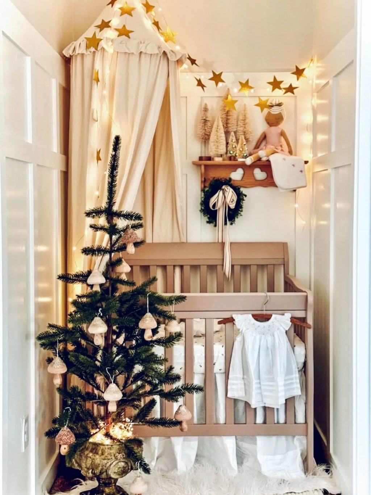

> TIP:QUICK: Keep the mini tree out of reach of the crib rails and use soft, shatterproof ornaments only.

## 2. Soft Felt Garland on the Nursery Wall

A felt garland is made for a nursery: soft, light and impossible to break. Hang a string of felt trees, bells and stars high on the wall above the dresser, where it adds color at eye level for grown-ups and stays far above curious hands. Red, green and grey felt reads festive without overwhelming a calm nursery palette.

Felt garlands are easy to store flat, so they come out year after year. Drape one in a gentle swag rather than a straight line — the curve looks softer and suits a baby's room better than a taut, formal line.

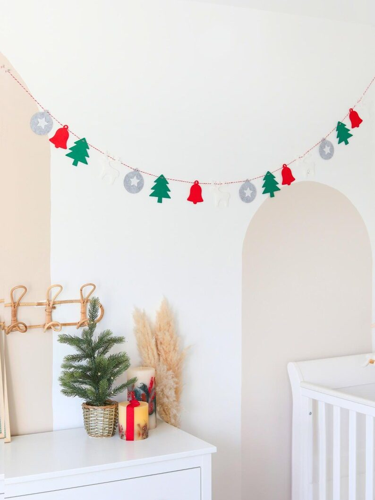

> TIP:CHECK: hang it high above the dresser; felt pieces only, nothing glass or heavy; store it flat after Christmas

## 3. Baby's First Christmas Stocking

A stocking for the baby is the sweetest tradition on this list, and the nursery wall is the natural place for it. Hang one small knit stocking on a peg rail above the crib, in cream or soft red, and let it be the room's one clearly Christmas moment. A row of matching stockings for the whole family looks lovely too, if the wall has the space.

Choose a soft knit stocking with no small sewn-on pieces that could come loose. Hang it with a short loop on a sturdy peg, and keep the bottom of the stocking well above the crib rail so it can never be grabbed or pulled down.

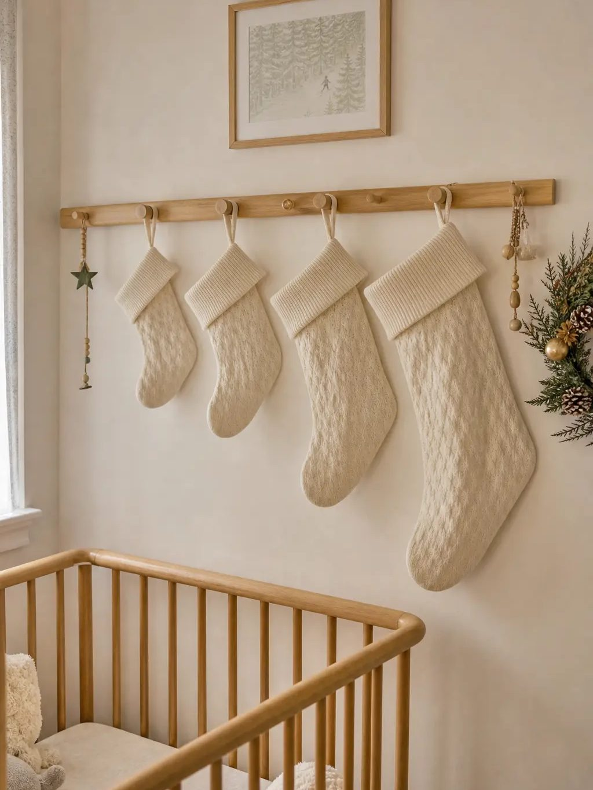

> TIP:GUIDE: Stocking: soft knit, no loose sewn-on pieces | Hang: short loop on a sturdy peg | Height: well above the crib rail

## 4. Warm White Fairy Lights High Above the Crib

Warm white fairy lights draped high above the crib turn the nursery into a soft, glowing room at bedtime. String them along the ceiling or across the top of the wall, over a canopy if you have one, and keep every cord and battery pack completely out of reach. The light should feel like a night sky, not a display.

Use a timer or a remote so the lights switch off by themselves after bedtime. Warm white is the right color for a nursery — cool white feels clinical, and colored lights make the room feel busy when it should feel sleepy.

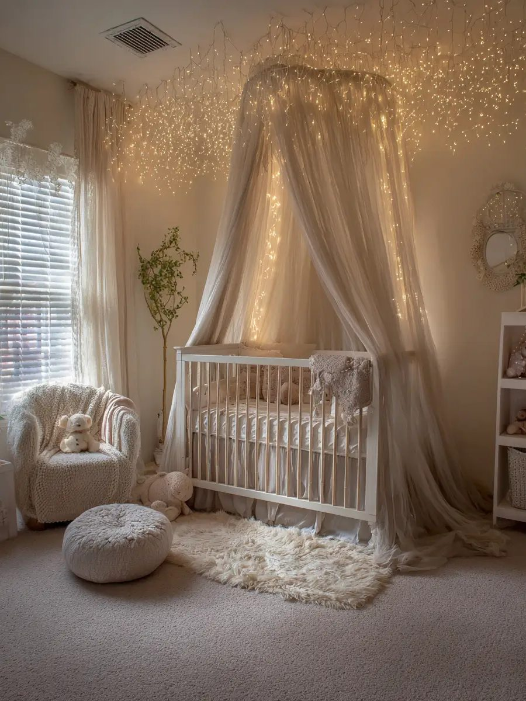

> TIP:QUICK: Run fairy lights along the ceiling only, with cords and battery packs fully out of reach.

## 5. Plaid Crib Bedding

A plaid crib sheet is the easiest Christmas swap in the nursery: one fitted sheet changes the whole room. A red and black buffalo plaid with white snowflakes and a pine tree feels festive the moment it goes on, and it works with the bedding you already have — just swap the sheet, not the whole set.

Keep the crib itself bare apart from the fitted sheet, exactly as safe sleep guidance asks. The pattern does all the decorating, so there is no need for loose blankets, pillows or bumpers to make the crib look dressed for Christmas.

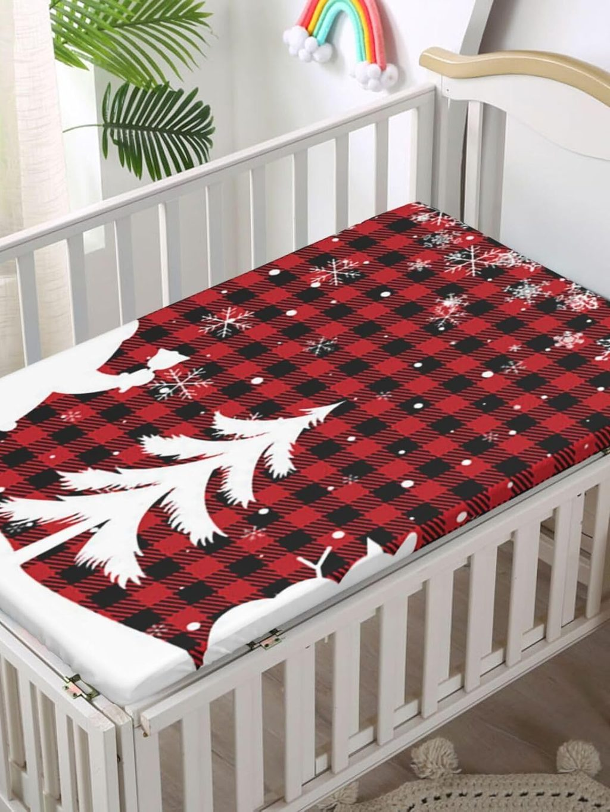

> TIP:CHECK: fitted sheet only in the crib; no loose blankets or pillows; let the plaid pattern do the decorating

## 6. Woodland Animal Christmas Mobile

A woodland mobile with a reindeer, a little house and a pine tree is Christmas and nursery decor in one piece. Hang it above the crib at the height you would hang any mobile — high enough that the baby can watch it but never grab it — and let the soft felt animals turn slowly in the warm air of the room.

Felt and fabric animals are the right choice here: they are light, soft and quiet if they ever brush the crib. A mobile with a house and trees also doubles as the room's main Christmas decoration, so the rest of the nursery can stay calm.

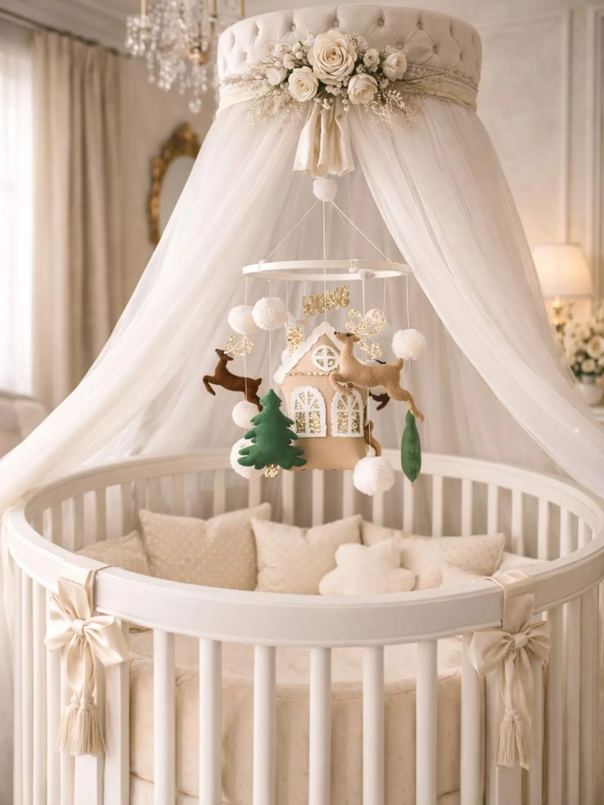

> TIP:GUIDE: Hang: above the crib, out of grabbing reach | Material: soft felt or fabric animals | Check: fixings tight before every use

## 7. Snowflake Wall Decals

Snowflake decals are the lowest-effort Christmas idea in the nursery: peel, stick, done. White snowflakes on a dark blue wall look like a night sky, and on a pale wall they read as a soft winter pattern. They are removable, so January takes five minutes and leaves no marks.

Scatter the flakes unevenly, with a few large ones and plenty of small ones, rather than lining them up in rows. A random scatter looks like falling snow; a grid looks like wallpaper. Keep them above the crib rail height so little fingers cannot peel them off.

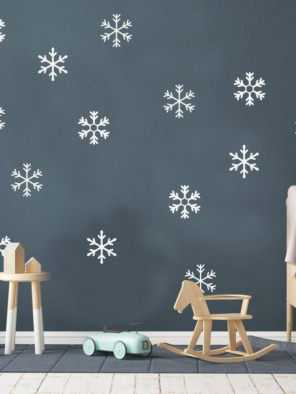

> TIP:QUICK: Scatter snowflakes randomly at different sizes — a grid looks like wallpaper, a scatter looks like snowfall.

## 8. Festive Dresser Topper

The dresser is the safest display surface in the nursery, so dress it up. A row of white knit stockings hung from the front, a few miniature wooden houses, a trail of greenery and a small ornament or two turn a plain dresser into the room's Christmas centerpiece, all well above the floor and out of reach.

Keep the topper to the back half of the dresser so the front stays clear for nappy changes and everyday use. Anything small or fragile goes at the back against the wall, and nothing should sit near the edge where it could be knocked off.

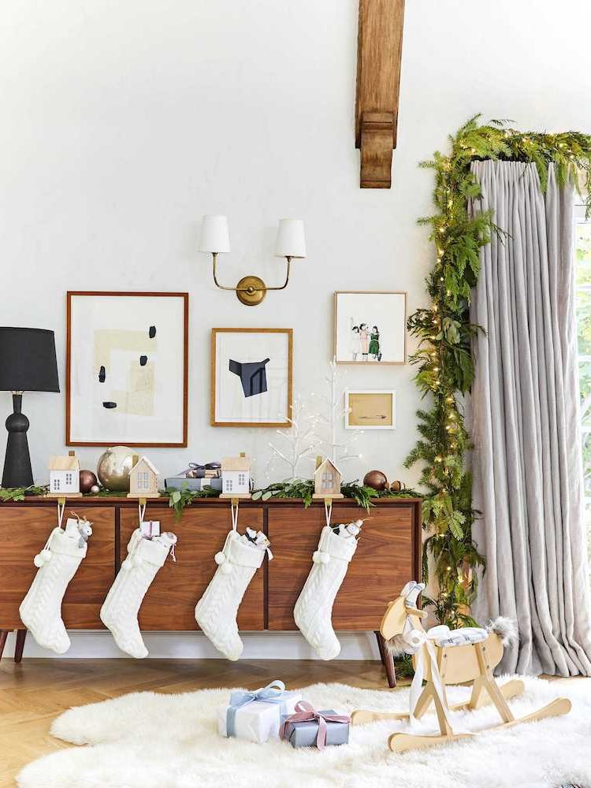

> TIP:CHECK: decorate the back half only; small pieces against the wall; nothing near the front edge

## 9. Festive Crib Skirt

A crib skirt is the one Christmas textile that is safe inside the crib's footprint, because it hangs below the mattress and never enters the sleeping space. A red and green striped skirt with a scalloped edge gives the crib a festive base, and it hides the storage boxes most nurseries keep underneath.

Pick a skirt that fits the crib's length and attaches firmly, so it cannot ride up or bunch. Washable cotton is the practical choice — nursery laundry is already constant, and a Christmas skirt should survive the wash like any other bedding.

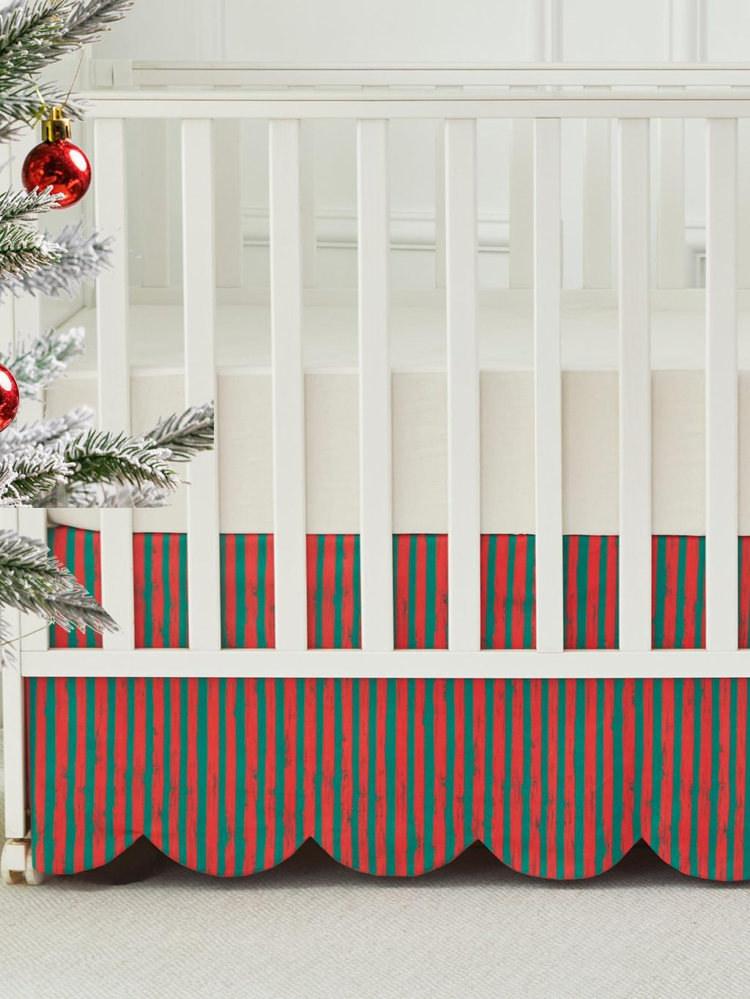

> TIP:GUIDE: Fit: matches the crib length, attaches firmly | Fabric: washable cotton | Rule: skirt stays below the mattress

## 10. Reindeer Wall Art

One framed reindeer print is all the wall art a Christmas nursery needs. A soft watercolor reindeer with a bright red nose suits a baby's room perfectly — sweet rather than silly, and calm enough to live on the wall all December without tiring anyone. Hang it where you see it from the rocking chair, not over the crib.

A single print beats a gallery wall in a nursery: the room is small, and one clear focal point feels peaceful. Choose a light frame that matches the crib or dresser, and hang it securely with proper fixings rather than adhesive strips.

> TIP:QUICK: Hang one reindeer print where you see it from the rocking chair, fixed securely with proper fixings.

## 11. Christmas Storybook Corner

A storybook corner turns the nursery's reading chair into a Christmas ritual. Stack a few holiday picture books on a low shelf — a Christmas truck story, a counting book, a mitten tale — and add a soft blanket and one festive cushion to the chair. The corner is for reading together, not for display, so everything in it should be touchable.

Rotate the books through December so there is always a fresh one to reach for at bedtime. A wreath on the wall above and a small sign complete the corner, but the books are the point: they are the decoration the baby actually uses.

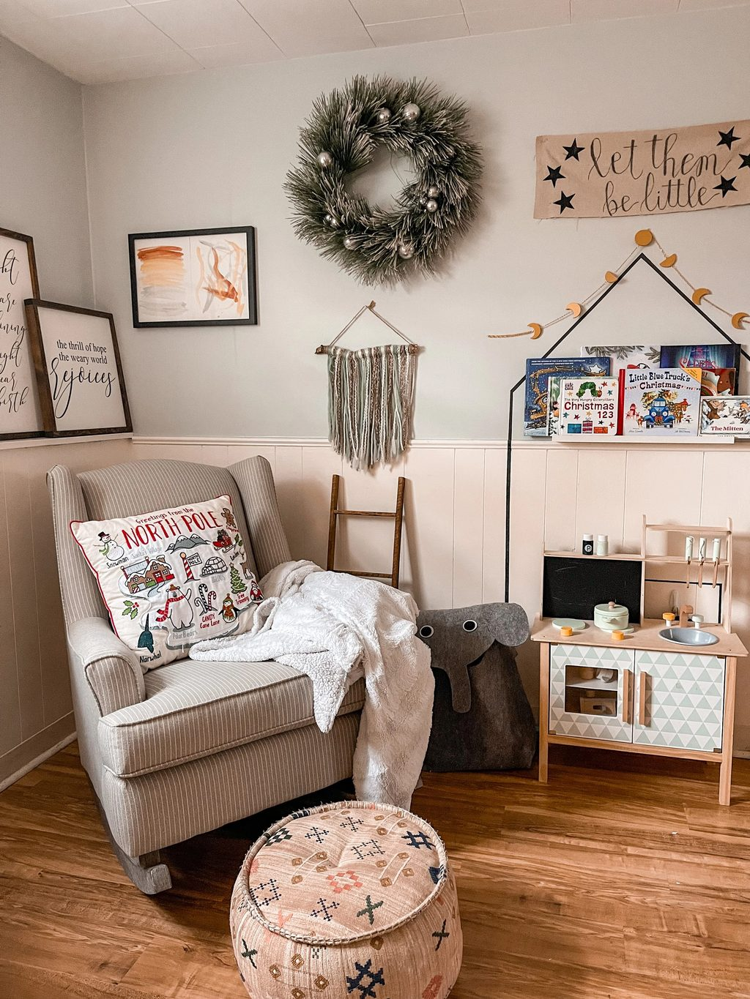

> TIP:CHECK: books within reach on a low shelf; one festive cushion; rotate a fresh book in each week

## 12. Plush Santa on the Shelf

A plush Santa sitting on a shelf is the classic nursery Christmas touch, and it works because it is soft all the way through. Choose a small, well-made plush with stitched features rather than glued-on eyes or buttons, and sit him on a high shelf where he can be seen from the crib but never grabbed.

One Santa is enough — a shelf full of plush figures starts to look like a toy shop. Pair him with a small lantern or a star light on the same shelf, and keep the shelf itself firmly fixed to the wall.

> TIP:GUIDE: Plush: stitched features, no glued-on eyes | Place: high shelf, visible but out of reach | Shelf: firmly fixed to the wall

## 13. Red and White Striped Curtains

Red and white striped curtains make the nursery window the Christmas feature. The bold candy-stripe pattern reads festive from across the room, and it needs nothing else: tie the curtains back with a simple band and tuck a sprig of greenery with red berries into each tieback for the finishing touch.

Keep the curtains short enough to clear the floor and the crib, and make sure the tiebacks are fixed high and tight, with no long cords hanging down. Stripes this bold pair best with plain walls and simple bedding, so the room stays calm.

> TIP:QUICK: Tie striped curtains back high with a fixed band — no long cords hanging anywhere near the crib.

## 14. Pinecone and Greenery Wreath on the Door

A wreath on the nursery door greets everyone who walks in, and a baby-themed one is even sweeter: pinecones, red berries and greenery, with tiny white booties and pacifiers tucked into the foliage. Hang it on the outside of the door so it never sits above the crib, and use a proper over-door hook rather than a nail.

Fresh greenery smells wonderful but sheds, so check the floor under the door each day. A good artificial wreath looks just as festive, lasts for years and drops nothing — the practical choice for a room where the baby spends time on the floor.

> TIP:CHECK: hang it on the outside of the door; use an over-door hook; sweep fallen needles daily

## 15. Battery Candles in the Window

Battery candles give the nursery window a warm glow with zero flame, which is the only kind of candle that belongs in a baby's room. Two LED taper candles in brass holders on the windowsill, with a trail of greenery and red berries along the sill, look like a traditional Christmas window from the street and feel cozy from the rocking chair.

Choose candles with a timer so they switch themselves off, and keep the battery compartments screwed shut. Never use a real flame in the nursery — not even a tealight — and keep matches and lighters out of the room entirely.

> TIP:GUIDE: Candles: LED only, with a timer | Batteries: compartments screwed shut | Rule: no real flame in the nursery

## 16. Christmas Tree-Shaped Wall Shelf

A tree-shaped wall shelf is Christmas decor that works all year as storage. The triangular tiers hold mini trees, a little house, alphabet blocks and a small jar, and the hooks underneath take two small stockings. Painted teal it adds a cheerful pop of color; painted white or wood it blends into any nursery.

Mount the shelf high on the wall with proper fixings into a stud, and keep the heaviest items on the lowest tier. Everything on it should be soft or unbreakable, because anything on a nursery shelf is one wobble away from the floor.

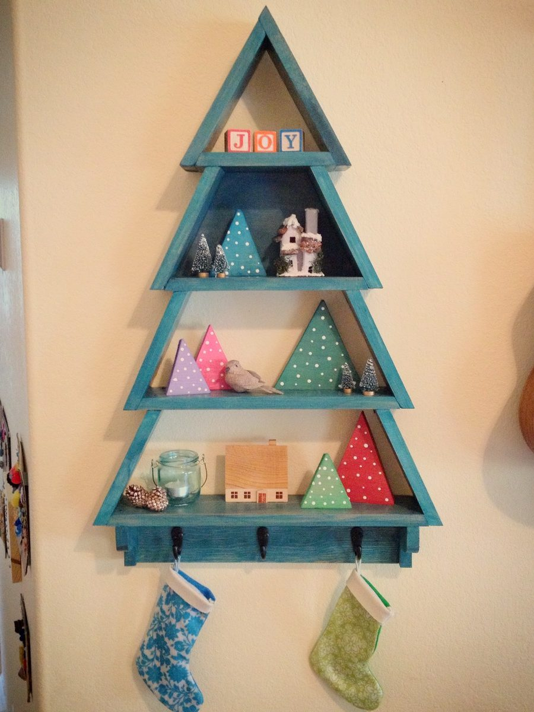

> TIP:QUICK: Fix a tree-shaped shelf into a wall stud and keep the heaviest items on the lowest tier.

## 17. Cream Nursery with Red Accents

If the nursery is already cream, Christmas is one red accent away. A red-trimmed Christmas quilt draped over the crib rail, a garland with tiny lights on the wall above and a candy-cane cushion on the floor are all it takes — the cream walls and furniture do the rest, and the room still feels calm enough for sleep.

The trick is restraint: one or two red pieces, not ten. A single strong accent color against cream looks intentional and festive; red on every surface looks cluttered. Keep the quilt as a daytime drape over the rail and remove it at bedtime.

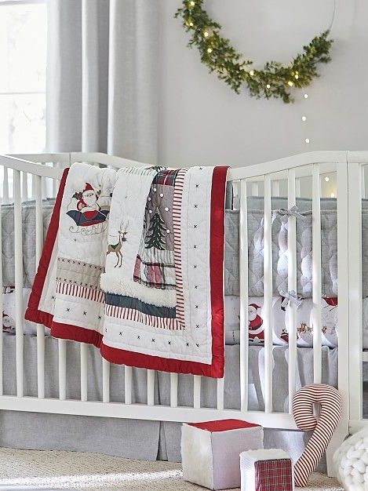

> TIP:CHECK: one or two red accents only; quilt over the rail by day; remove it at bedtime

## 18. Personalized Baby Name Ornament

A wooden ornament engraved with the baby's name and the year is the keepsake of the season. Hang it on the nursery tree, where it can be seen every day, and it becomes the ornament you reach for first every Christmas for years to come. Wood is the right material: warm, light and unbreakable if it ever falls.

Order it early in December so it arrives in time, and hang it with a short ribbon rather than a long string. Keep it on the tree, not in the crib, and pack it in tissue with the rest of the ornaments in January.

> TIP:GUIDE: Material: light wood, unbreakable | Hang: short ribbon on the nursery tree | Store: wrapped in tissue in January

## 19. Chunky Knit Blanket on the Rocking Chair

A chunky knit blanket draped over the rocking chair is the nursery's coziest Christmas detail. Cream is the classic choice — it suits any palette and looks like snow — and the thick knit reads warm even before anyone sits down. Drape it over the back of the chair, not folded in the crib, and add a small teddy bear on the floor beside it.

The blanket is for the grown-up doing the night feeds, so keep it within reach of the chair and out of the crib. A washable knit is worth choosing: nursery blankets get washed more than any other textile in the house.

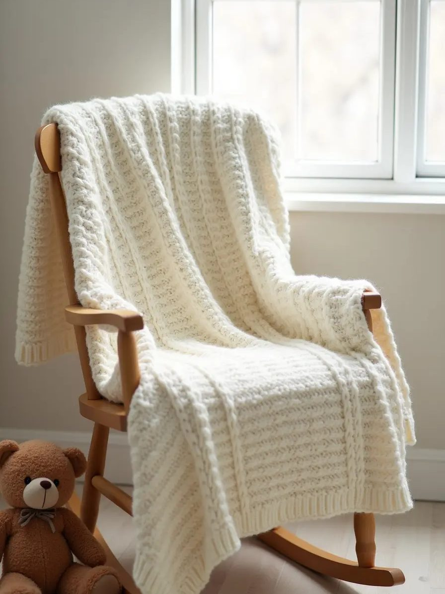

> TIP:QUICK: Drape the knit blanket over the rocking chair for night feeds — never inside the crib.

## 20. Festive Changing Table

The changing table is a display surface hiding in plain sight. A woven changing tray, a few bottle-brush trees in red, white and green, a round mirror above and a hanging star garland turn the dresser top into a little Christmas scene — and it all sits behind the changing area, where it never gets in the way.

Keep the display to the sides and leave the middle clear for the changing mat. Anything at baby height during a change gets grabbed, so the trees and ornaments belong at the back of the dresser, and the tray itself stays empty of small items.

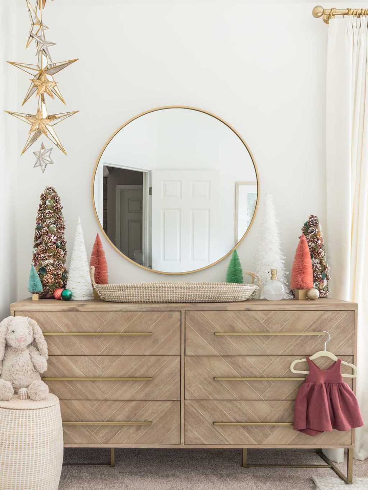

> TIP:CHECK: display at the back and sides; middle clear for the changing mat; nothing small within grabbing reach

## 21. Snowy Window Clings

Snowflake window clings are the nursery-safe version of window art: no glue, no tape, no mess. Press white snowflakes of different sizes onto the nursery window and they catch the light like frost, turning an ordinary window into a winter scene the baby can gaze at from the crib.

Clings peel off cleanly and stick again, so you can rearrange them as often as you like. Put the largest flakes at the top of the window and the smallest near the sill, and keep the bottom of the window clear so the room still gets its daylight.

> TIP:GUIDE: Clings: press onto clean glass, no glue | Layout: large flakes high, small near the sill | Removal: peel off cleanly in January

## 22. Gingerbread Wall Art

A framed gingerbread man print brings a smile to the nursery wall without a single small part. A watercolor gingerbread man in a red and white striped scarf, in a simple gold frame, is cheerful at a glance and gentle enough for a baby's room. Hang it at adult eye level on the wall opposite the crib.

One print is enough, and it pairs well with the reindeer art if you want two framed pieces in the room — just hang them on different walls so each gets its own space. Keep the frame light and the glass secure, and skip heavy frames above the changing table.

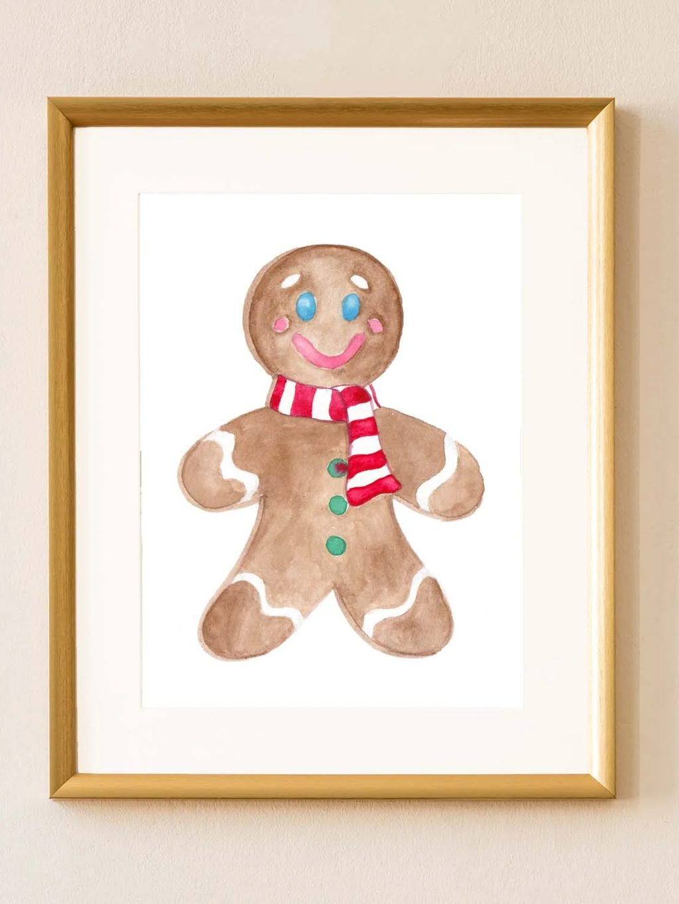

> TIP:QUICK: One gingerbread print is enough — hang it at adult eye level on the wall opposite the crib.

## 23. Green and Gold Tree Beside the Crib

A tree dressed in green and gold is the most elegant nursery tree of all. Deep green ornaments, gold stars and warm white lights against a flocked or plain green tree suit a nursery that already leans calm and natural, and the gold catches the lamplight beautifully at bedtime. Set the tree beside the crib, never behind it, so it never overhangs the sleeping space.

Keep the ornaments large, soft and shatterproof, and skip tinsel entirely — it sheds, and shed tinsel ends up in small mouths. A green and gold tree needs no topper at all; the lights and the stars do the work.

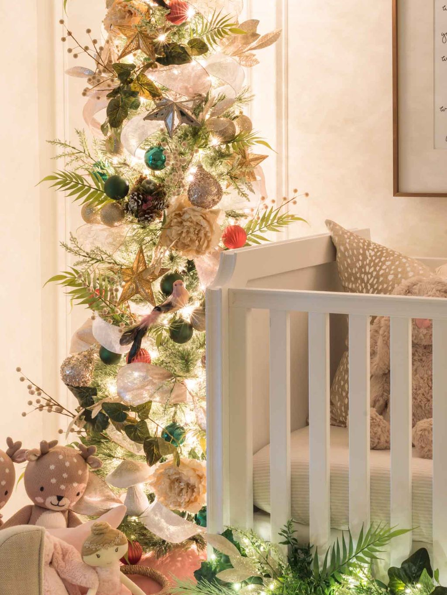

> TIP:CHECK: deep green ornaments with gold stars; warm white lights only; skip tinsel, it sheds

## 24. Advent Calendar on the Nursery Wall

A fabric advent calendar with numbered pockets turns December into a daily ritual, even for a baby too small to understand it yet. Hang it on the nursery wall at adult height, tuck a small soft toy or a tiny note into a few pockets, and open one together each morning. The calendar is really for the parents in the first year — and that is fine.

Choose a fabric calendar with stitched numbers and soft pockets, and keep the pockets empty of anything small enough to swallow. The dolls and soft toys that live in the pockets belong on a shelf, not in the crib, and the calendar itself should hang flat and secure.

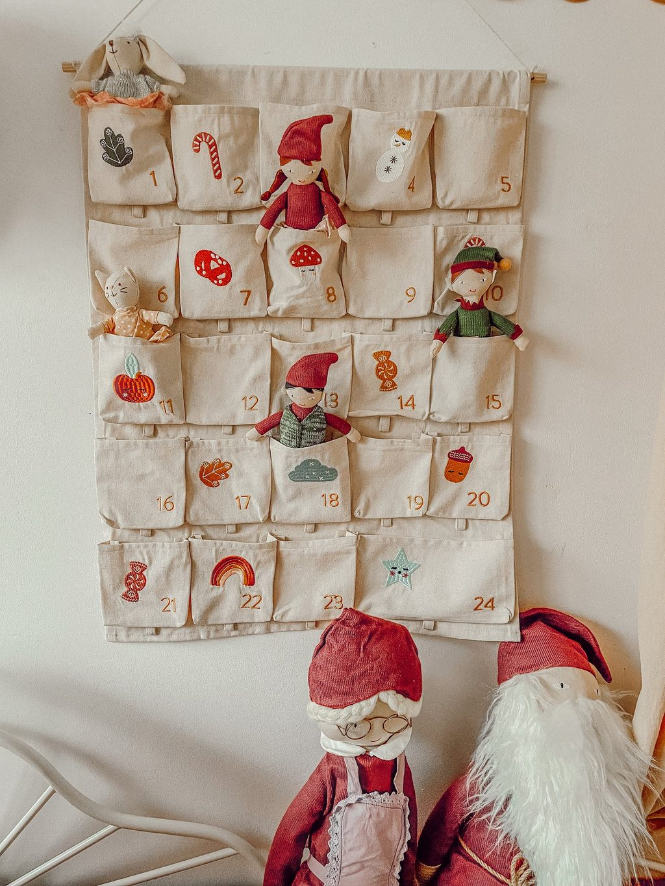

> TIP:GUIDE: Calendar: fabric with stitched numbers | Height: adult height on the wall | Pockets: soft toys only, nothing small

## 25. Plush Reindeer in a Corner Basket

A plush reindeer tucked into a wicker basket is the nursery corner sorted in one move. The basket holds the toy, the toy softens the corner, and together they read as Christmas decor without a single thing hanging on the wall. Choose a reindeer with a knitted scarf and stitched features, and keep the basket on the floor against the wall.

A basket is also practical storage: after Christmas the reindeer stays and the basket holds nappies, muslins or the next season's soft toys. Pick a sturdy, stable basket that cannot tip, and keep it away from the crib so it never becomes a climbing step.

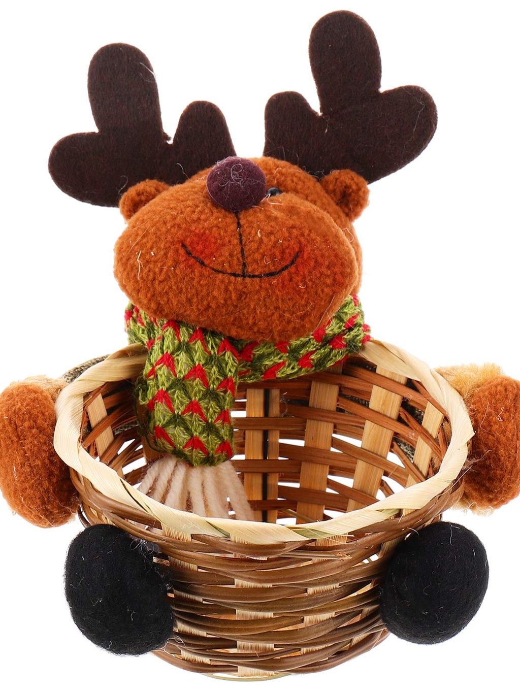

> TIP:QUICK: Pick a sturdy basket that cannot tip, and keep it against the wall away from the crib.

## 26. Christmas Tree Night Light

A Christmas tree night light is the nursery night light with a festive twist. A small glowing tree on a wooden base gives off just enough warm light for night feeds and nappy changes without waking the baby fully, and it looks like a decoration rather than a gadget. Set it on the dresser or a high shelf, never inside the crib.

Pick a light with a dimmer or a low setting, and a cool-touch LED that never gets hot. A tree light with a timer is ideal: it glows through the evening feed and switches itself off while everyone sleeps.

> TIP:CHECK: warm LED with a dimmer; cool to the touch; set it on the dresser or a high shelf

## 27. Festive Rug Under the Crib

A festive rug under the crib warms up the whole nursery floor. A red rug patterned with trees, reindeer and snowflakes gives the room its Christmas base, and it is the softest place in the room for tummy time and play. Choose a low-pile, washable rug so it survives the season and the inevitable spills.

Slide the rug partly under the crib so it anchors the room, with the patterned half spilling out onto the open floor. Make sure the rug lies flat with no curled corners — a curled corner is a trip hazard in a room you walk through half-asleep at night.

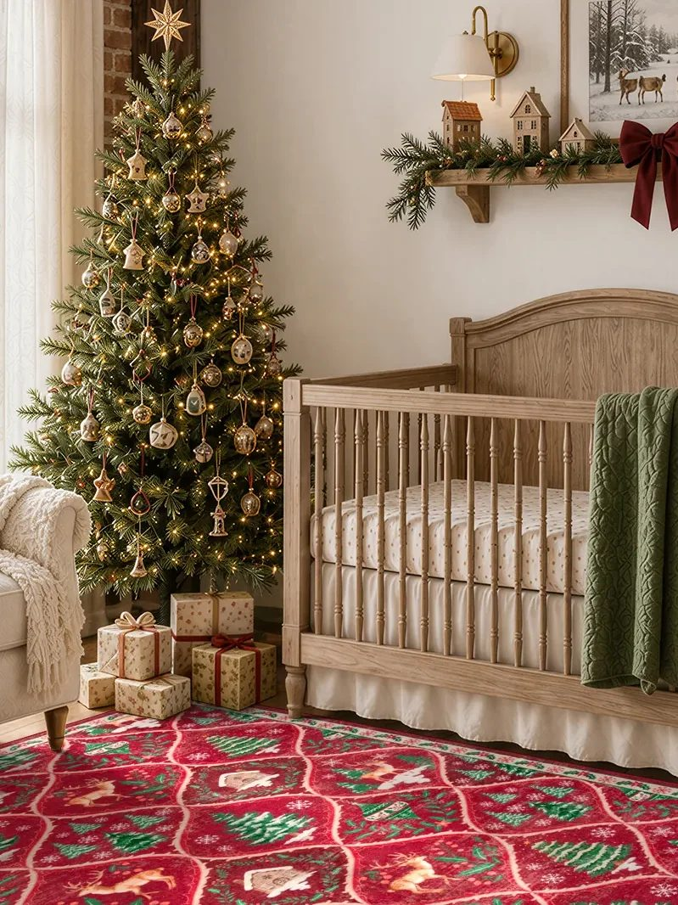

> TIP:GUIDE: Pile: low and washable | Place: partly under the crib, pattern spilling out | Safety: lies flat, no curled corners

## 28. Paper Snowflake Mobile

A paper snowflake mobile is the lightest decoration in the nursery, and one of the prettiest. Cut or buy white paper snowflakes in different sizes, hang them at different heights from a wooden dowel, and let them turn slowly above the changing table or in a corner — never directly over the crib, where a falling flake could land in the sleeping space.

Paper snowflakes cost almost nothing and take an evening to make, which makes them the perfect project for a quiet December afternoon. Hang the mobile high, check the strings are short and secure, and take it down if any flake starts to tear.

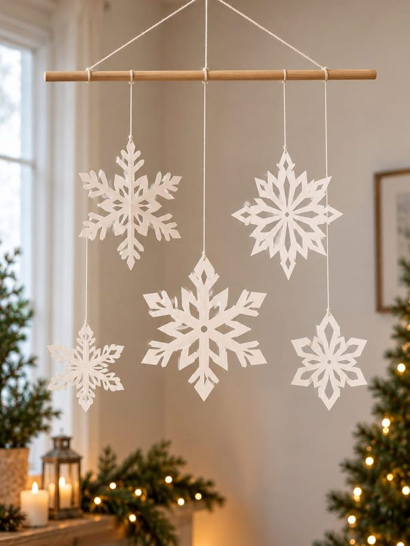

> TIP:QUICK: Hang the snowflake mobile high above the changing table, never directly over the crib.

## 29. Santa Hat on the Stuffed Bear

A Santa hat on the nursery's favorite teddy bear is the smallest Christmas gesture with the biggest smile. Pop a soft red Santa hat on the bear that already lives on the shelf or in the corner, and add a scarf if the bear will wear one — a "Baby's First Christmas" scarf turns the bear into the season's mascot and a photo prop in one.

Keep the hat loose and soft, with no small pom-pom or bell that could come off. The bear stays on the shelf or in the corner basket for display, and if the baby plays with it, check the hat and scarf for loose stitching first.

> TIP:CHECK: soft hat with no small pom-pom; check the stitching before play; display on a shelf or in a basket

## 30. Merry Christmas Banner Above the Dresser

A felt bunting banner spelling out Merry Christmas is the nursery's finishing touch. String red, green and grey felt triangles across the wall above the dresser, with a little snowflake in the middle, and the room is unmistakably festive from the doorway. Felt is soft, light and silent if it ever comes down, which is exactly what a nursery banner should be.

Hang the banner high and taut, with both ends fixed properly, so it never sags into reach. It takes two minutes to put up, stores flat in an envelope, and comes out again next year looking exactly the same.

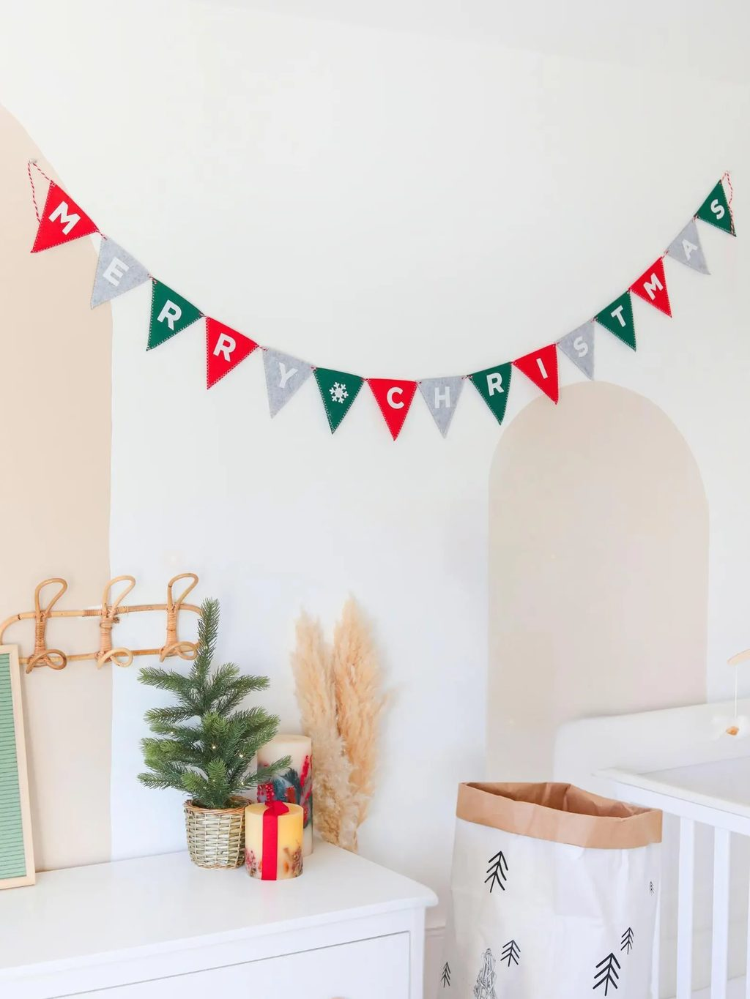

> TIP:GUIDE: Material: soft felt triangles | Hang: high above the dresser, both ends fixed | Store: flat in an envelope

## Takeaway

A festive nursery is a calm nursery with Christmas layered on top: a mini tree in the corner, soft garlands and lights high on the walls, one or two framed prints, and the dresser doing the heavy lifting. Start with the tree and the stocking, add the lights and the garland, and stop before the room feels busy — the baby sleeps in this room, and a peaceful room is the whole point. If you want to carry the same feeling through the rest of the house, our [30 Christmas Bedroom Ideas for a Cozy, Festive Retreat](/posts/christmas-bedroom/) and [30 Christmas Living Room Ideas for a Warm, Festive Home](/posts/christmas-living-room/) use the same soft, warm approach in the grown-ups' rooms. Whatever you choose, keep every decoration out of the crib and out of reach, and the nursery will be festive and safe all season.

## Frequently Asked Questions

### How do I decorate a nursery for Christmas safely?

Keep the crib bare apart from a fitted sheet, and put every decoration on the walls, the dresser or the far side of the room. Use soft, shatterproof ornaments, battery lights with cords out of reach, and nothing small or loose within grabbing distance. Check every hanging weekly, and take anything down that starts to loosen.

### What Christmas decorations are safe to put in a crib?

None, beyond a festive fitted sheet or a crib skirt below the mattress. The sleeping space should stay empty: no blankets, pillows, bumpers, plush toys or garlands inside the crib. Put the festive touches around the crib instead — on the wall, the dresser and the floor nearby.

### Can I put fairy lights in a baby's nursery?

Yes, if they are battery-operated, warm white, and strung high on the ceiling or the top of the wall, with cords and battery packs fully out of reach. Use a timer so they switch off after bedtime. Never use mains-powered lights with trailing cords, and never drape lights over or inside the crib.

### Where should I put the Christmas tree in a nursery?

In a corner beside the crib, never behind it or overhanging it, and far enough away that the baby cannot reach it from the crib rails. A slim tabletop tree on a sturdy dresser works well in small rooms. Use soft, shatterproof ornaments, skip tinsel, and anchor the tree so it cannot tip.

### Are stockings safe to hang above a crib?

Yes, if they hang well above the crib rail on a sturdy peg or rail, with a short loop and nothing dangling within reach. Choose soft knit stockings with no small sewn-on pieces. If the baby can reach or pull a stocking, move it higher or hang it on the dresser instead.

### What is the best Christmas color scheme for a nursery?

Cream with one strong accent — red, or green and gold — keeps the room calm and festive at the same time. Start from the nursery's existing palette and add two or three pieces in the accent color, like a plaid sheet, a red quilt or gold ornaments, rather than redecorating the whole room.

### How can I make a nursery feel Christmassy without a big tree?

Focus on the walls and the dresser: a felt garland, a framed reindeer or gingerbread print, snowflake decals, a small wreath on the door and a festive rug do the job. A mini tree on the dresser adds the finishing touch, and warm fairy lights high on the wall make the whole room glow.

### When should I take Christmas nursery decorations down?

Take them down in the first week of January, once the holidays are over, so the nursery returns to its calm everyday state. Peel off decals and clings, pack ornaments in tissue, store garlands and banners flat, and wash the festive bedding before putting it away for next year.
