# 30 Christmas Sunroom Decor Ideas for a Bright, Festive Space

A sunroom is the easiest room in the house to decorate for Christmas, because the light does half the work. These christmas sunroom decor ideas use that bright, glass-walled space the way it deserves — lit trees against snowy views, garlands along the window frames, wreaths on the glass doors, and cozy corners for cocoa and reading. The sun brings the sparkle by day, and fairy lights take over after dark.

Start with one anchor, usually the tree, then layer greenery, light and texture around it. Keep the palette simple so the view outside stays part of the decoration, and save this list for the ideas you want to try first.

## 1. Potted Christmas Tree by the Glass Walls

A potted tree in a basket or barrel is the most natural fit for a sunroom, where plants already live. Set it where the glass meets the floor so the lights reflect in the windows at dusk, and keep the decorations light — white lights, a few wooden ornaments and a simple topper — so the tree still reads as a plant, not a prop.

After Christmas, a potted tree can move outside or stay in its pot by the window until spring. Water it lightly through the season and keep it away from the hottest patch of direct sun so the needles stay fresh.

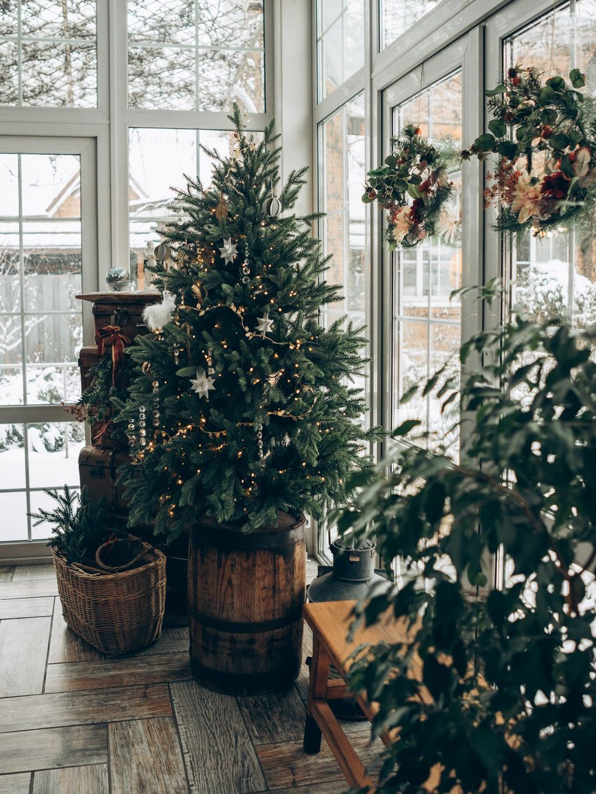

> TIP:QUICK: Set the tree where the glass meets the floor so the lights reflect in the windows at dusk.

## 2. Winter Conservatory Dressed for Christmas

A glass conservatory turns into a winter garden with very little effort: one lit tree, a chair with a thick faux fur throw, and a basket of pinecones on the rug. The greenery overhead and the plants around the edges make the whole room feel alive, even when the garden outside is bare.

Keep the furniture light and the colors soft — creams, greens and warm wood — so the room stays bright. The Christmas touches then read as a layer on top of the room you already love, not a takeover.

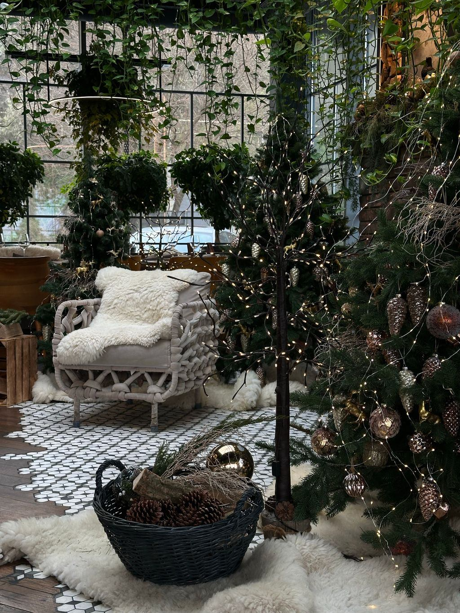

> TIP:CHECK: one lit tree as the anchor; a faux fur throw on the chair; a basket of pinecones on the rug

## 3. Wreath on the Glass Door

A wreath on the glass door is the sunroom version of a front-door wreath, and it works from both sides — you see it from the garden, and you see it from the sofa. Hang it with a wide ribbon looped over the top of the door so nothing sticks to the glass, and pick a full, simple evergreen wreath with a single red bow.

Because the door gets opened all day, keep the wreath light and wire the bow on firmly. A wreath that swings or slips every time the door moves will not last the season.

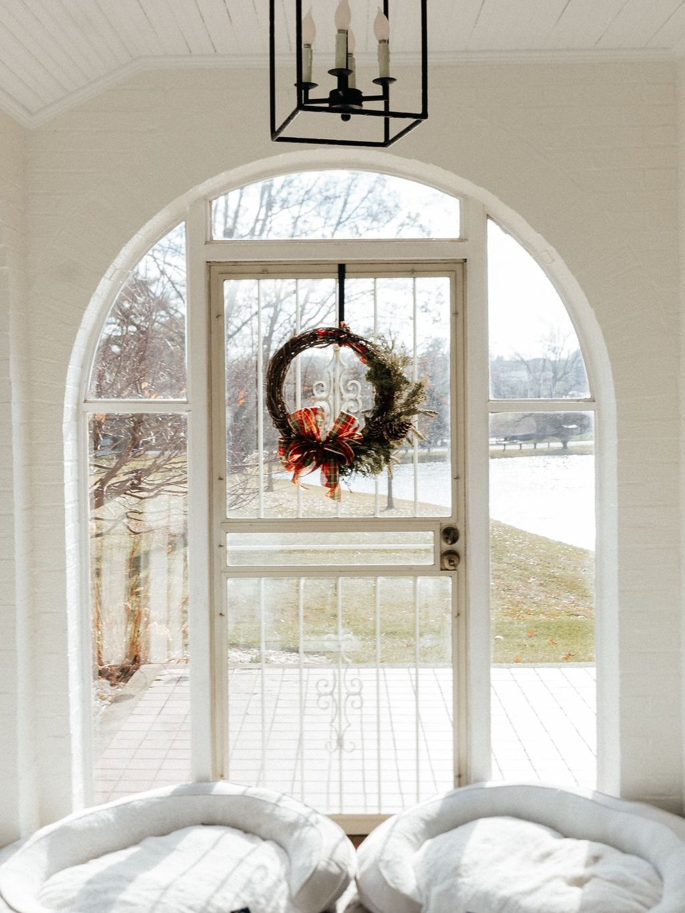

> TIP:GUIDE: Hang: wide ribbon looped over the door top | Wreath: full evergreen with one red bow | Fix: wire the bow on firmly

## 4. Greenhouse Glow with Lit Trees and Lanterns

A greenhouse-style sunroom with a glass roof is made for evening light. Line up two or three slim lit trees along the glass, set lanterns with pillar candles on the floor beside a wooden bench, and let the garland across the top frame the whole scene. By dusk the room glows like a lantern itself.

Battery candles in the lanterns keep this look safe and simple, and they can stay on a timer so the room lights itself every evening. Keep the bench cushions neutral so the green of the trees stays the star.

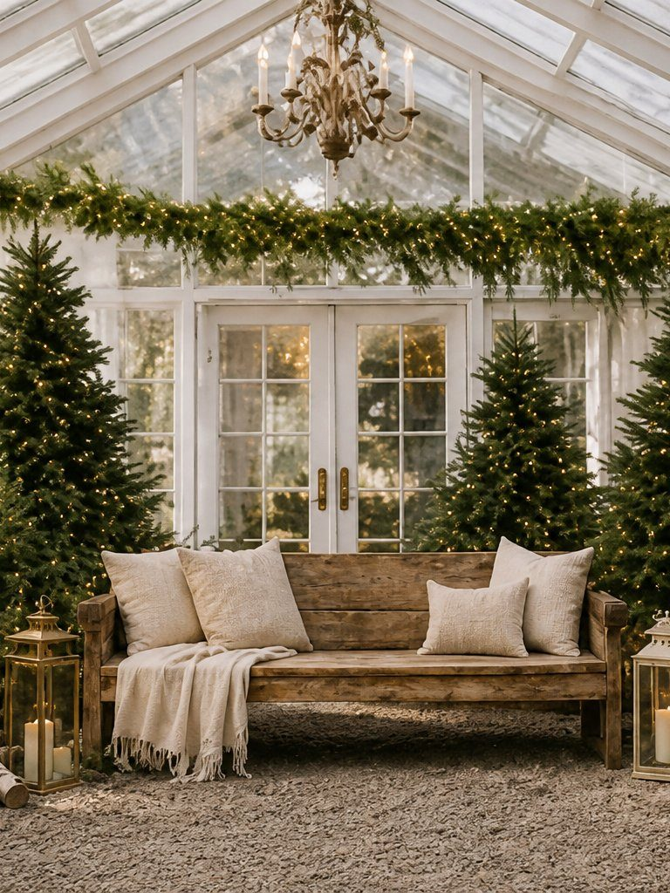

> TIP:QUICK: Use battery candles on a timer so the room lights itself every evening.

## 5. White Veranda Dining Table

A white veranda makes the prettiest Christmas dining room, because the snowy view outside does the decorating for you. Set the table with a plaid runner, a low evergreen centerpiece and hanging baubles in the windows, and keep the chairs light so the room stays airy even with a full table.

Red and white is the easiest palette here: red napkins, red glassware and a few red ornaments pick up the colors outside without competing with the view. Leave the table set all season so the room is always ready for a slow breakfast.

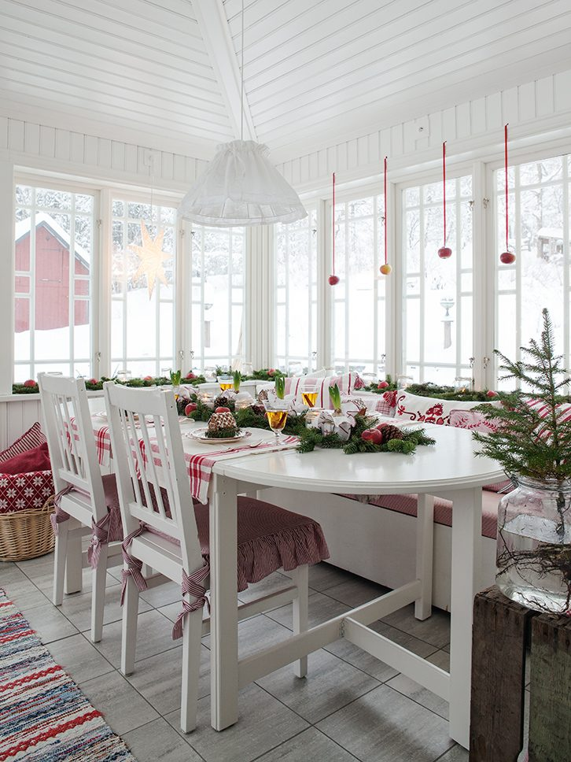

> TIP:CHECK: plaid runner down the center; low evergreen centerpiece; baubles hung in the windows

## 6. Christmas Tablescape with Poinsettias

A sunroom table is the perfect stage for a poinsettia tablescape, because the plants get the light they love. Build the centerpiece down the middle of the table — poinsettias in low pots, sprigs of evergreen, dried orange slices and a few red baubles — and let the place settings stay simple so the flowers lead.

Red glassware and plaid napkins tie the table to the rest of the room without any extra decoration. Water the poinsettias from the base and keep them away from cold draughts by the door so the leaves stay bright through the holidays.

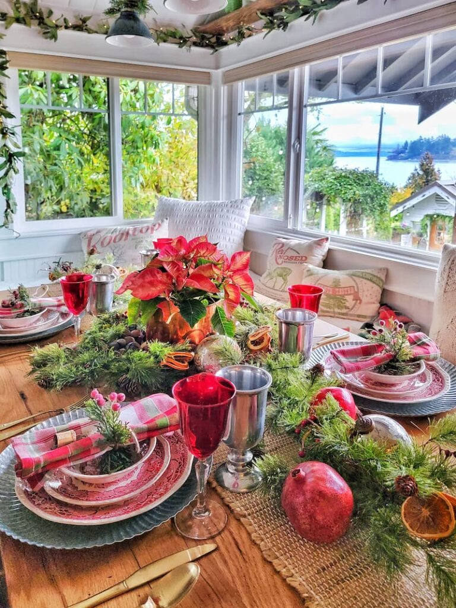

> TIP:GUIDE: Center: poinsettias with evergreen and dried orange | Settings: red glassware and plaid napkins | Care: water from the base, away from draughts

## 7. Paper Stars Glowing in the Windows

Paper star lanterns are the classic Scandinavian window decoration, and they suit a sunroom perfectly — they glow softly without blocking the view. Hang three or four in different sizes across the window, mix white stars with one deep red, and add tiny snowflake decals between them for a frosted effect.

Battery tea lights inside the stars keep them glowing all evening with no cords to hide. Hang them at different heights so the window looks layered rather than lined up, and keep one window clear so you can still watch the snow fall.

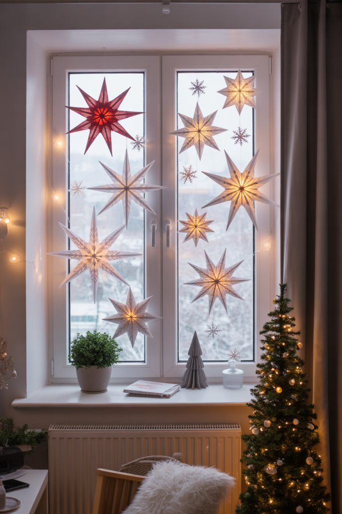

> TIP:QUICK: Hang stars at different heights so the window looks layered, not lined up.

## 8. Tree Ornaments Up Close

In a bright sunroom, the tree deserves a close look — gold and red baubles, wooden ornaments and warm white lights catch the daylight beautifully. Hang the largest ornaments on the outer branches where they catch the sun, and tuck smaller ones deeper inside the tree so it looks full from every angle.

Mix matte and shiny finishes so the tree has depth instead of glare. A few handmade or natural ornaments, like dried orange slices or pinecones, keep a very polished tree feeling warm and personal.

> TIP:CHECK: large ornaments on outer branches; small ones tucked inside; mix matte and shiny finishes

## 9. Fairy Lights and Bokeh by the Tree

Fairy lights are the sunroom's best friend after dark, when the glass turns black and the room needs its own glow. Drape them through the tree, along the window frames and across the ceiling beams, and let the reflections double the light. Warm white reads coziest against the snow outside.

Choose lights with a timer so they switch on at dusk and off at bedtime without a daily trip around the room. Keep the strands loose and a little uneven — perfectly straight lines look stiff, while a gentle drape looks like the lights grew there.

> TIP:GUIDE: Color: warm white against the snow | Timer: on at dusk, off at bedtime | Drape: loose and a little uneven

## 10. Angel Lantern Glowing in the Snow

A single red lantern with an angel cutout is a small decoration with a big effect, especially set outside the glass where the snow catches its light. Place it on the patio or a low wall just beyond the sunroom windows, with red berries scattered in the snow beside it, and the whole garden becomes part of your Christmas scene.

A battery candle inside means no flame to worry about in the wind, and the cutout throws a soft pattern onto the snow. Bring the lantern in during heavy storms and set it back out when the snow settles.

> TIP:QUICK: Set the lantern just beyond the glass so the garden becomes part of the scene.

## 11. Garland Framing a Red Door

A full evergreen garland with red and gold baubles turns a plain door into a Christmas entrance, and the red door behind it makes the green look even richer. Drape the garland around the frame rather than across it, so the door still opens freely, and let a few baubles hang low on thin ribbon for movement.

Wire the garland to the frame at three points — top and both sides — so it cannot slip. If the door is in daily use, skip loose berries and pinecones that shed, and save those for a garland that nobody touches.

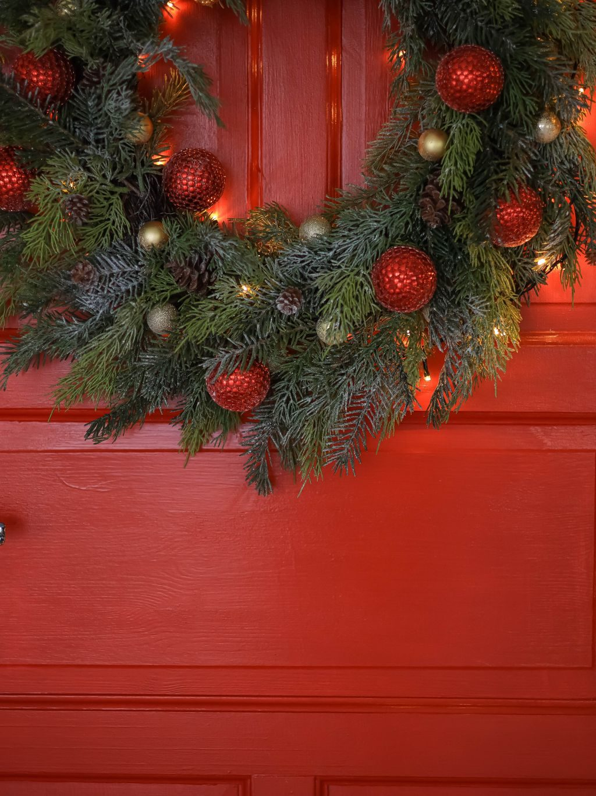

> TIP:CHECK: wire the garland at three points; let baubles hang low on ribbon; skip shedding berries on a busy door

## 12. Berry Wreath on a Wooden Door

A berry-heavy wreath is the boldest wreath you can hang, and it suits a plain wooden door perfectly. The mass of red berries reads from the far end of the garden, while the dark green foliage and pinecones keep it from looking flat. Hang it on a simple nail or a ribbon loop, centered at eye level.

Real berries fade and drop over a few weeks, so an artificial berry wreath is the practical choice for a whole season. Shake it gently outside before hanging to lose any loose pieces, and it will look fresh from the first week of December to the last.

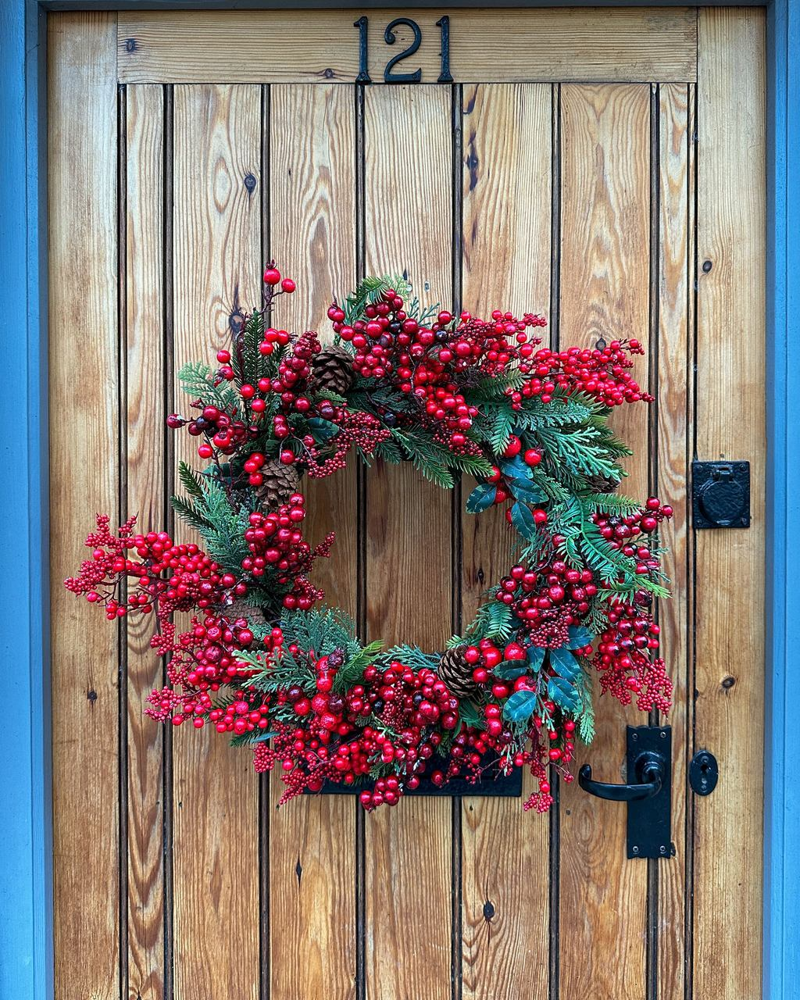

> TIP:GUIDE: Wreath: artificial berries for a full season | Hang: centered at eye level | Prep: shake it outside first to lose loose pieces

## 13. Classic Wreath on a Blue Door

A classic evergreen wreath with pinecones and red berries is at its best on a painted door, where the color behind it makes the green pop. Blue, green or even black doors all suit this wreath, because the contrast does the work — the wreath itself can stay simple and traditional.

Keep the wreath to one clear shape with nothing dangling below it, so the door handle stays usable and the wreath reads as a single clean circle from the street. A woven twig base with a few eucalyptus sprigs adds texture without adding clutter.

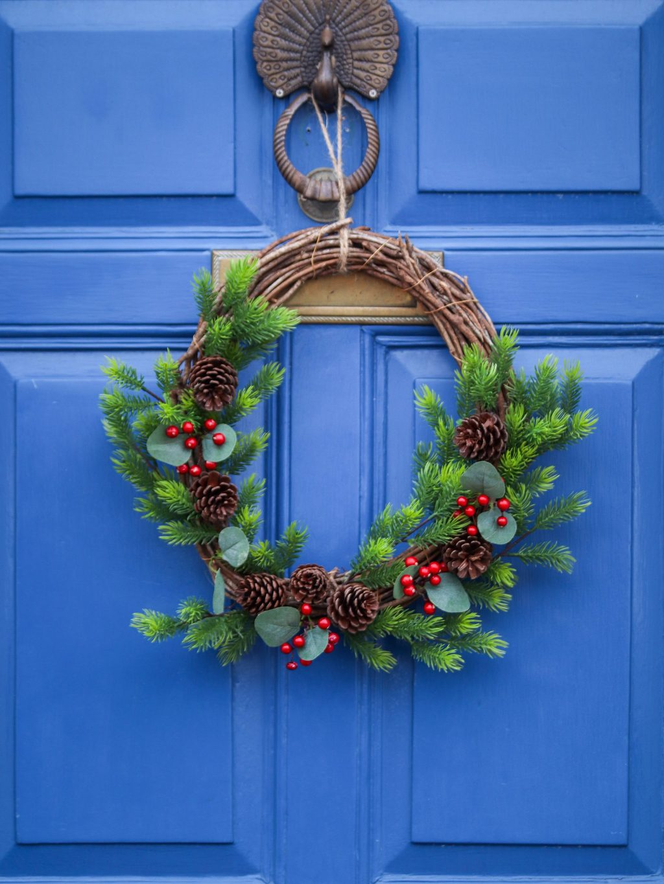

> TIP:QUICK: Keep the wreath a single clean circle so the door handle stays usable.

## 14. Snowy View Through the Window

Sometimes the best sunroom decoration is the view itself — a lit tree glowing through the window at dusk, with snow piled on the bushes outside. Frame that view instead of covering it: keep the windowsill clear except for a few candles, and let the tree stand where it shows through the glass from the garden.

From outside, the warm light in the windows is the decoration, so think about the room as a lantern. Keep the curtains open in the evening and let the tree lights do the work for the whole street.

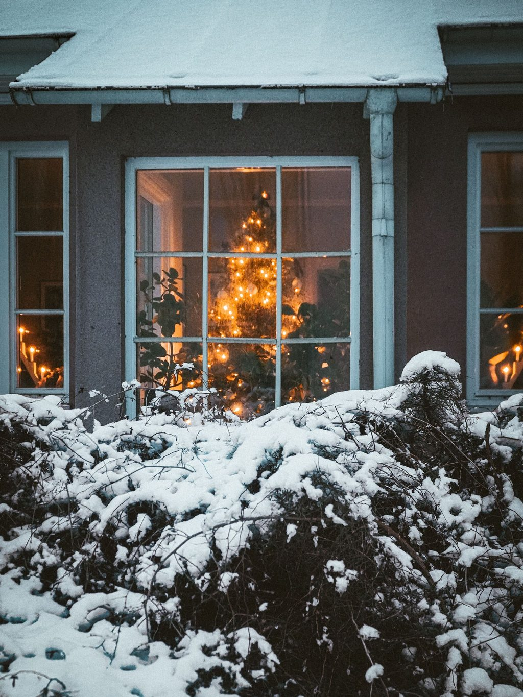

> TIP:CHECK: windowsill clear except for a few candles; curtains open in the evening; tree where it shows through the glass

## 15. Garland of Lights and Red Baubles

A close-up garland is all about texture: deep green fir, warm fairy lights woven through every branch, and glossy red baubles catching the light. Drape it along a mantel, a windowsill or the top of a dresser, and let it spill a little over the edges so it looks generous rather than measured.

Weave the lights through the garland before you hang it, so the glow comes from inside the greenery instead of sitting on top. Space the baubles in odd numbers — three or five to a cluster — and vary their sizes for a natural, gathered look.

> TIP:GUIDE: Lights: woven through before hanging | Baubles: clusters of three or five | Edge: let it spill a little for a generous look

## 16. Snowman Mug of Hot Cocoa

A snowman mug of cocoa with star-shaped marshmallows is the smallest Christmas scene in the sunroom, and one of the coziest. Set it on a side table beside the armchair with a plaid blanket folded nearby, and the room suddenly has a ritual — cocoa at dusk, lights on, feet up.

Keep a tray on the table so the mug has a home and the crumbs have a boundary. Star marshmallows, a candy cane stirrer and a sprinkle of cinnamon turn an ordinary cocoa into a small celebration without any extra effort.

> TIP:QUICK: Keep a tray on the side table so the cocoa ritual has a home.

## 17. Two Mugs of Cocoa Under the Tree

Two mugs of cocoa with marshmallows, set down under the tree, turn the sunroom into a place for two. The knitted throws folded beside them and the tree lights overhead do the rest — no big decoration needed, just warmth and company. This is the corner to build first if the room is mostly for quiet evenings.

Use mugs with lids or a tray if the cocoa travels far from the kitchen, and keep a small plate for marshmallow spoons. The best sunroom corners are the ones that invite you to sit down, not just look.

> TIP:CHECK: two mugs and a tray; knitted throws folded nearby; a small plate for spoons

## 18. Hot Chocolate with Marshmallows and Candy Cane

A close-up mug of hot chocolate — marshmallows melting under cocoa powder, a candy cane hooked on the rim — is a reminder that the sunroom is for tasting Christmas, not just looking at it. Serve it in the biggest mug you own, with the candy cane as the stirrer and a dusting of cinnamon on top.

Make the cocoa thick and dark so the marshmallows float instead of sinking, and warm the mug first with hot water so the drink stays hot while you sit by the window. A cinnamon stick in the mug adds scent as well as flavor.

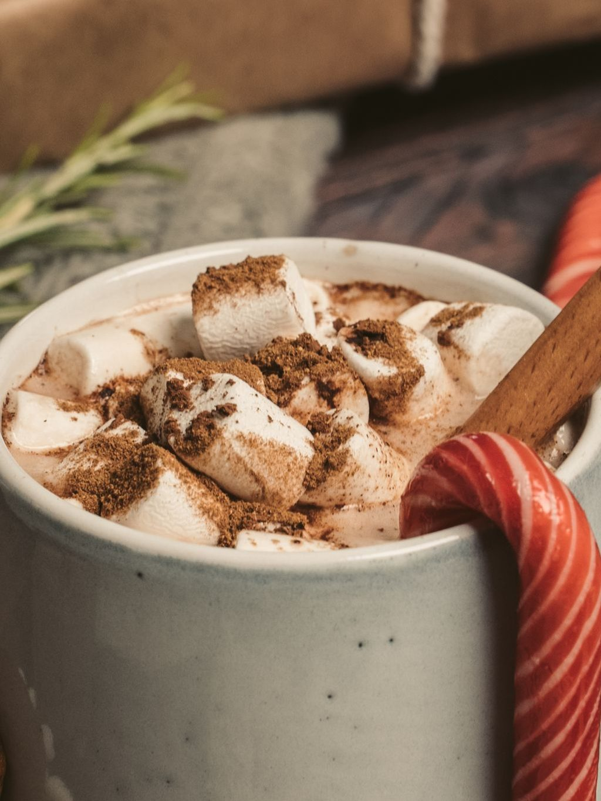

> TIP:GUIDE: Cocoa: thick and dark so marshmallows float | Mug: warmed first with hot water | Stirrer: candy cane, plus a cinnamon stick

## 19. Red Poinsettias by the Window

Red poinsettias are the sunroom's easiest Christmas plant, because the bright light keeps them happy for weeks. Group three pots of different heights on the windowsill or a low table, and let their red bracts be the room's main color — everything else can stay neutral.

Poinsettias dislike cold draughts and wet feet, so keep them away from the door and water only when the soil feels dry. A simple terracotta or woven pot suits them better than a shiny one, and lets the red take the spotlight.

> TIP:QUICK: Group three pots of different heights and let the red be the room's main color.

## 20. Miniature Christmas Village

A miniature village on the windowsill brings the whole Christmas story into the sunroom at small scale — lit houses, a tiny tree with a star, snowy roofs and a red post box. Set it where the light hits it in the afternoon, and it glows again at dusk when its own tiny lights come on.

Build the village in a shallow tray so it stays together and lifts off the sill in one piece for dusting. Start with three or four houses and one tree, then add a piece each year instead of buying the whole village at once.

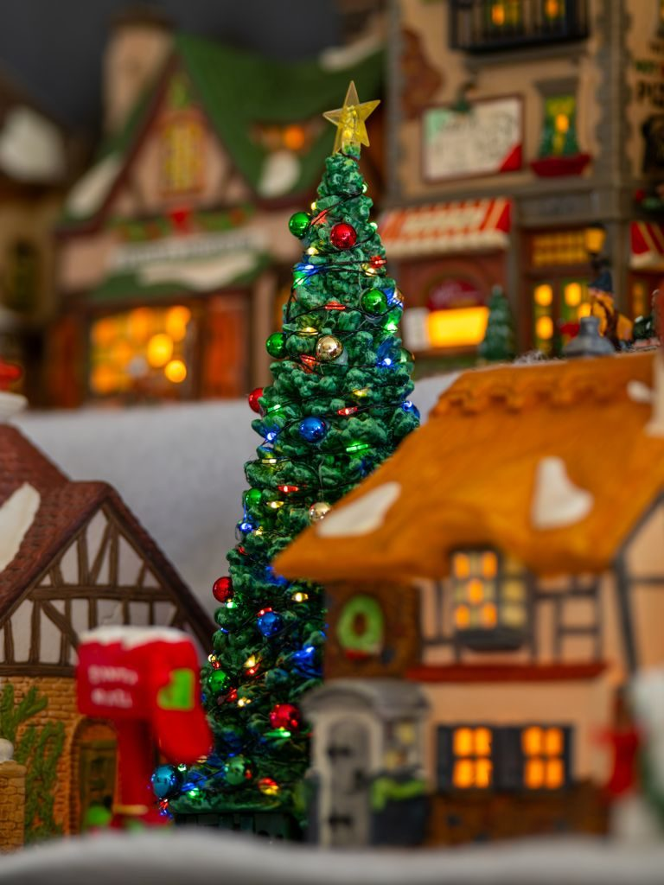

> TIP:CHECK: build it in a shallow tray; start with three or four houses; add one piece each year

## 21. Candlelit Dining Table

A candlelit dinner in the sunroom is Christmas at its most romantic — tall taper candles, evergreen garland down the center, wine glasses catching the light, and the dark garden beyond the glass. Keep the table setting simple and let the candles and greenery carry the evening, with the tree glowing softly in the background.

Never leave lit candles unattended, and keep the garland well away from the flames. Battery tapers in tall holders give the same glow with none of the worry, and they look just as good in photographs.

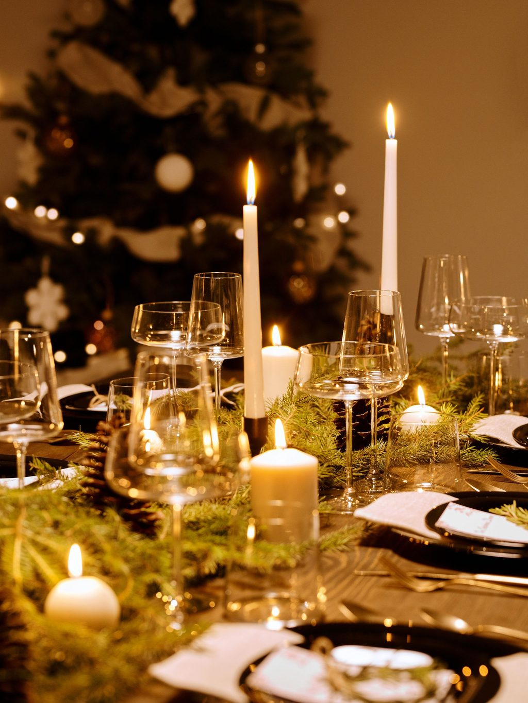

> TIP:GUIDE: Candles: tall tapers, never left unattended | Garland: kept well away from flames | Safer: battery tapers in tall holders

## 22. Festive Table with an Evergreen Runner

An evergreen runner is the fastest way to dress a sunroom dining table — a long sweep of fir down the center, pillar candles in simple holders, and the tree behind it. It needs no tablecloth and no fuss, and it smells wonderful every time someone sits down.

Lay the runner on a bare wood or white table so the green stands out, and add a few pinecones and gold baubles along its length. Keep the centerpiece low so people can see each other across the table, and save the tall candles for the sideboard.

> TIP:QUICK: Keep the runner low so everyone can see each other across the table.

## 23. Garland, Ornaments and Stockings on a Dresser

A dresser or sideboard in the sunroom becomes a Christmas display with three layers: garland across the top, ornaments hanging from the ceiling above it, and stockings hooked along its front. The layers fill the wall without a single nail, and the dresser still works for storage underneath.

Hang the ornaments on thin ribbons at different lengths so they float at different heights, and keep the stockings light — small ones filled with tissue rather than gifts — so the hooks hold all season. A mirror behind the dresser doubles the sparkle.

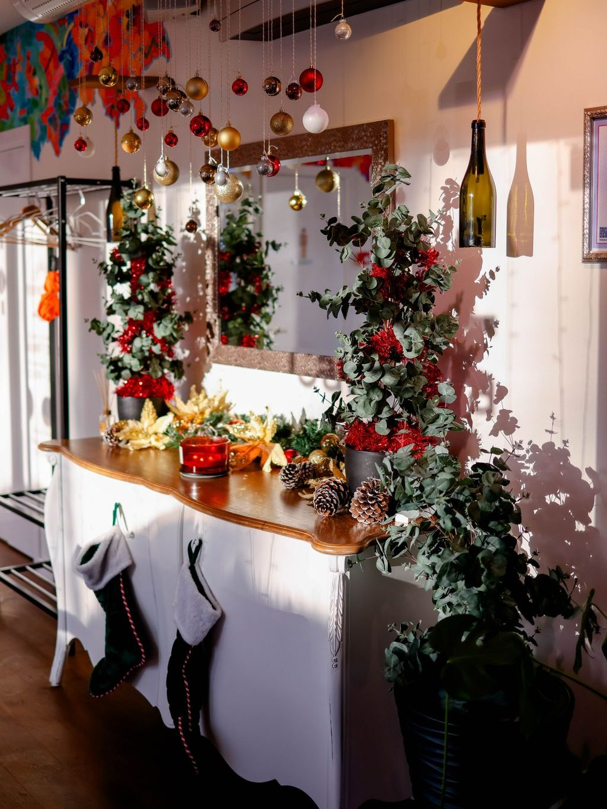

> TIP:CHECK: ornaments on ribbons at different lengths; stockings light and small; a mirror behind doubles the sparkle

## 24. Glowing Star Tree Topper

A glowing star topper is the finishing touch that makes the whole tree feel complete, and it looks especially good in a sunroom, where its light reflects in the glass. Choose a star with warm lights built in, and set it straight — a tilted topper is the first thing the eye catches.

The star should be in proportion to the tree: a big star on a slim tree looks top-heavy, while a small star disappears. For a tall tree, pick a star with long points that reads clearly from across the room.

> TIP:GUIDE: Star: warm lights built in, set straight | Size: in proportion to the tree | Tall tree: long points that read across the room

## 25. Small Lit Tree by Tall Windows

A small tree by tall windows is the sunroom's quiet solution — no need for a full-size tree when a slim one fits the space and the light. Dress it with warm white lights, a few delicate ornaments and a simple fabric skirt at the base, and let the window frames and the view do the rest of the decorating.

Small trees suit corners, entryways and the space beside the reading chair. Because they are light, they move easily, so try the tree in two or three spots before you commit to one.

> TIP:QUICK: Try the tree in two or three spots before you commit to one.

## 26. Wreath on a Cottage Door

A full wreath with red and gold baubles is the warmest welcome a cottage sunroom can offer. The round shape softens the straight lines of the door, and the baubles catch the low winter sun every afternoon. Hang it on a ribbon that matches the door color so the fixing disappears.

If the door faces the weather, choose a wreath with wired-in baubles rather than glued ones, so nothing works loose in the wind. A quick shake outside once a week keeps it looking fresh all season.

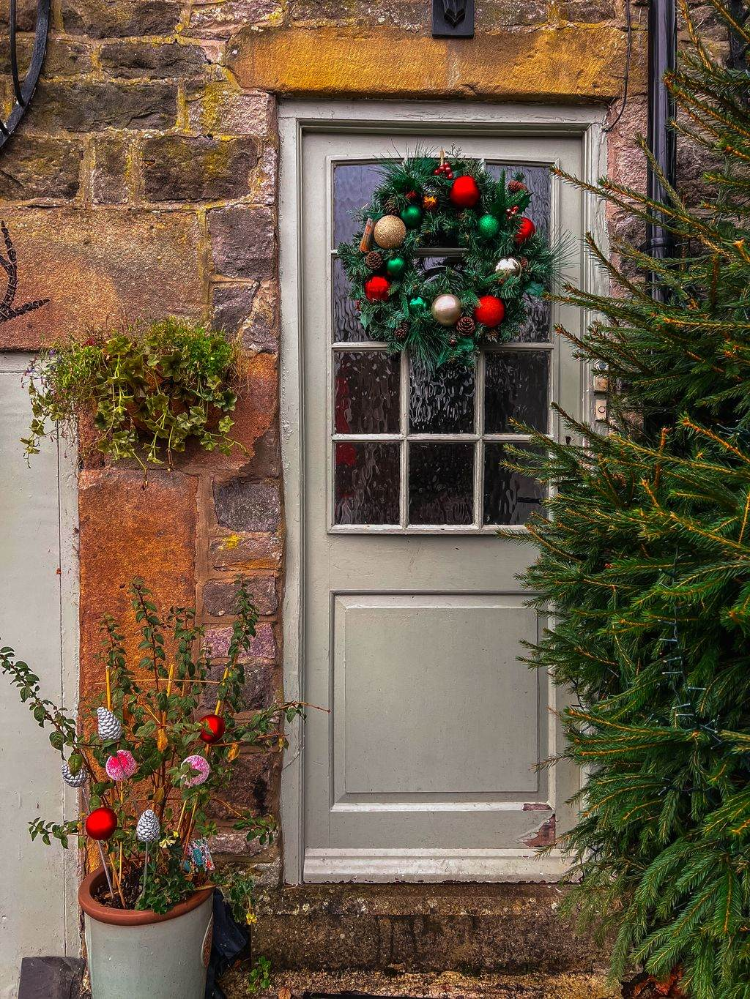

> TIP:CHECK: baubles wired in, not glued; ribbon matching the door; shake it outside weekly

## 27. Stockings Hung in a Row

A row of stockings on a wall rail is the simplest Christmas tradition to bring into a sunroom, and it works even without a fireplace. Hang one per person on a slim rail or a length of ribbon, mix patterns — a tree, a reindeer, snowflakes — and keep them evenly spaced so the row reads as a set.

Small felt stockings are the practical choice here, because they weigh almost nothing and hold their shape. Fill them with tissue paper so they keep their form, and save the real filling for Christmas Eve.

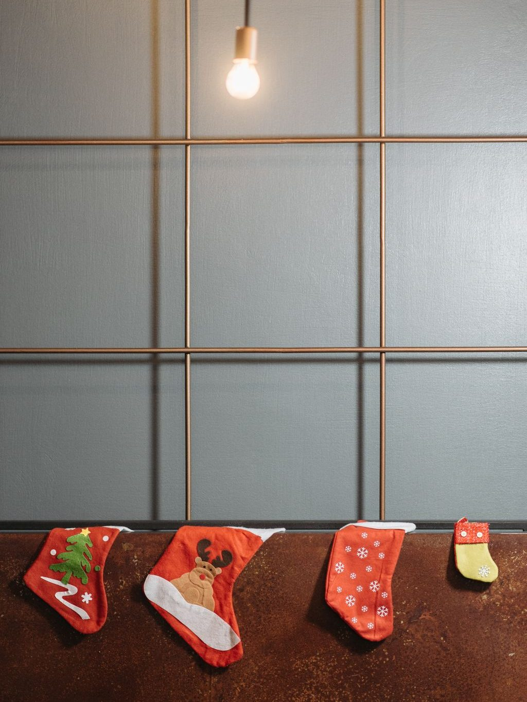

> TIP:GUIDE: Rail: one stocking per person, evenly spaced | Stockings: small felt, filled with tissue | Fill: save the real filling for Christmas Eve

## 28. Stockings on a Stone Mantel

Red stockings on a stone mantel bring the classic Christmas fireplace into a room that has no chimney — the stone, the garland and the candlelight do the work of a hearth. Hang the stockings from simple hooks along the mantel shelf, and let the garland drape over the edge above them.

Keep the stockings clear of any candles on the mantel, and use stocking holders with a wide base so they cannot tip forward. A clock or a small wreath above the mantel finishes the scene without adding clutter.

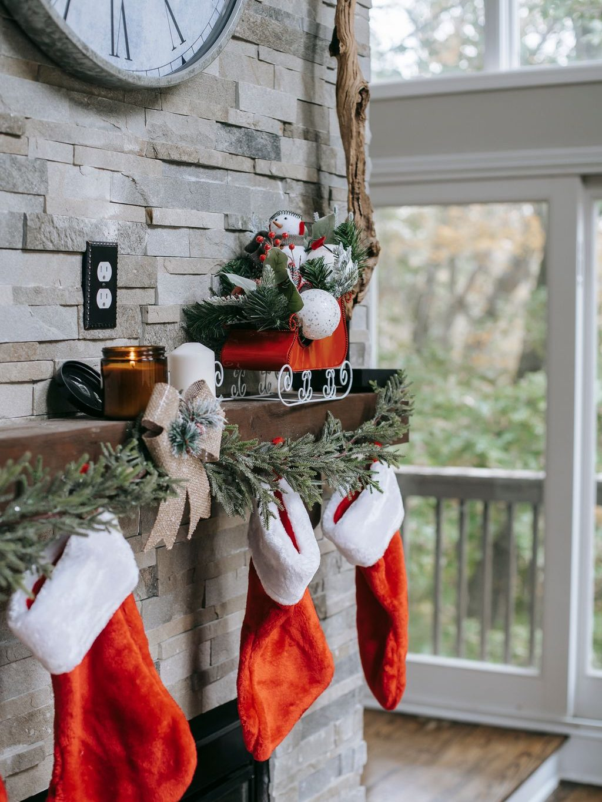

> TIP:QUICK: Use wide-based stocking holders so they cannot tip forward.

## 29. Plaid Throw on the Armchair

A red plaid throw over the arm of a chair is the fastest cozy fix in a sunroom — one fold of fabric and the whole corner feels like Christmas. Add a festive pillow with a simple design, set the chair where it catches the afternoon sun, and keep a stack of wrapped gifts beside it for color.

Plaid works because it is both a pattern and a tradition: it warms up white furniture, ties red accents together, and looks better slightly rumpled than perfectly folded. Choose a soft wool or fleece throw that people actually reach for, not one that only looks good.

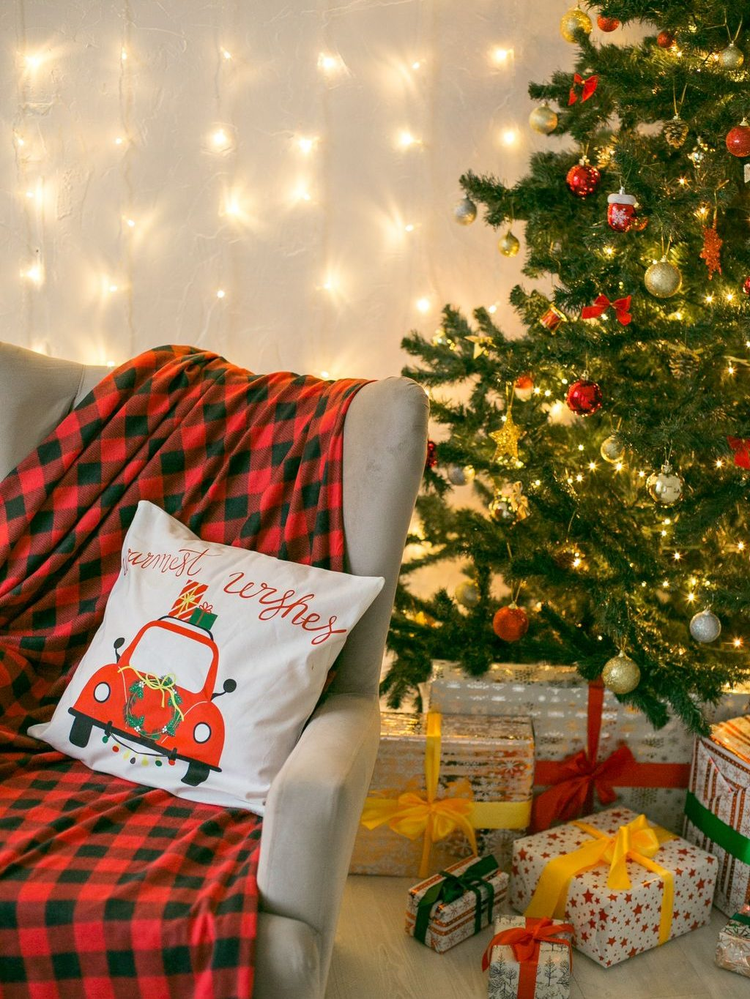

> TIP:CHECK: plaid throw over one arm; one festive pillow; chair where it catches the afternoon sun

## 30. Gold and White Tree with Paper Stars

A gold and white tree is the sunroom's most elegant option, because the pale ornaments glow in the bright light instead of disappearing into it. Dress the tree in white and gold baubles with warm lights, hang paper stars on the wall beside it, and keep the sofa cushions cream so the whole corner feels calm and luminous.

Gold ribbon wound loosely through the branches ties the tree to the paper stars, and a few wrapped gifts in white and gold paper at the base finish the look. This is the tree to choose when the room itself is already beautiful and you want the decoration to whisper, not shout.

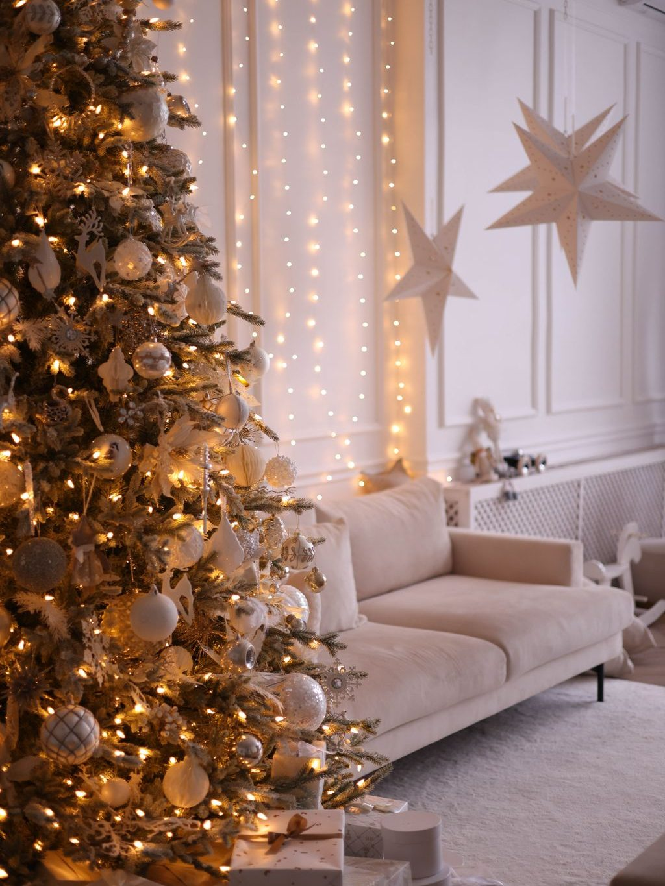

> TIP:GUIDE: Tree: white and gold baubles with warm lights | Stars: paper stars on the wall beside it | Base: gifts wrapped in white and gold

## Takeaway

- A Christmas sunroom needs only three things to feel festive: a tree that suits the light, greenery along the glass, and one cozy corner for sitting with cocoa.
- Start with the tree, add garland and a wreath, then finish with plaid and candlelight — and let the snowy view do the rest.
- For more window ideas, see our [winter window art ideas](/posts/winter-window-art/), and for the main living room, our [Christmas living room ideas](/posts/christmas-living-room/) pair beautifully with everything here.

## Frequently Asked Questions

### How do I decorate a sunroom for Christmas without blocking the view?

Keep the windowsills mostly clear and decorate the frames instead — garland along the top, stars or wreaths hung in the glass, and one low centerpiece on the table. Put the tree in a corner where it frames the view rather than standing in front of it, and leave at least one window bare so the snowy garden stays visible.

### What kind of Christmas tree works best in a sunroom?

A slim or potted tree suits a sunroom best, because the room is already full of glass and plants. Slim trees fit tight corners and leave the walkways clear, while potted trees in baskets look natural beside other plants. Keep decorations light and lights warm white so the tree glows without overwhelming the bright room.

### How do I keep my sunroom plants alive at Christmas?

Most sunroom plants like the same bright light your tree enjoys, so keep them in their usual spots and decorate around them. Move poinsettias away from cold draughts by the door, water only when the soil feels dry, and keep plants clear of hot fairy lights. A potted tree can join the other plants and move outside after Christmas.

### Are fairy lights safe in a glass sunroom?

Yes, when you use lights made for indoor use and keep them away from curtains and dry garland. Battery lights on a timer are the safest choice, since they switch off by themselves and have no cords to trip over. Check old strings for frayed wires before hanging them, and never overload one outlet with several long strands.

### How do I hang garland on windows without damaging the frames?

Use removable hooks or clear suction cups made for glass, and test one first to be sure it holds the garland's weight. Command-style hooks work on painted frames and come off cleanly in January. Avoid nails, screws and hot glue on window frames, and tie the garland with ribbon instead of wire where it touches the paint.

### How can I make a bright sunroom feel cozy at Christmas?

Layer soft textures against all that glass — plaid throws, faux fur cushions, a thick rug and warm white lights. Darker reds and greens feel warmer than pale colors in a bright room, and candles or lanterns add a low glow after dark. A cocoa station and a reading chair give the room a purpose beyond looking pretty.

### What colors suit a Christmas sunroom best?

Classic red and green suit a sunroom because they stand out against the white frames and the snowy view. Gold and white is the elegant alternative, glowing softly in bright light, while plaid ties red accents together. Pick one main palette for the whole room and repeat it in the tree, the table and the cushions.

### When should I take sunroom Christmas decor down?

Take fresh greenery and poinsettias down soon after the holidays, since they dry out fast in a warm, bright room. Lights, wreaths and ornaments can come down in early January, and artificial garland stores best in a dry box out of sunlight. Keep the paper stars up a little longer — they look lovely through the darkest weeks of winter.
