# 30 DIY Wood Tree Collar Ideas for a Rustic Christmas

A diy tree collar wood box is the fastest way to give a Christmas tree a finished, rustic look without sewing a single tree skirt. Four wooden panels hide the stand, the cords and the water reservoir, and the tree looks like it grew straight out of a farmhouse crate. This list gathers 30 wooden collar ideas, from simple slatted cones to barn-door boxes with X-brace panels, so you can find one that matches your tree and your tools.

Wooden collars suit almost any tree, and they store flat or stack neatly after Christmas if you build them in panels. Start with the size of your stand, pick a finish that matches your room, and steal one idea below — or mix two, like a pallet box with a plaid ribbon trim.

## 1. Pallet Collar in a Cozy Living Room

A pallet collar does its best work in a lived-in room, where its rough boards sit comfortably next to a sofa, a rug and a stack of wrapped gifts. The tree above it can be as fancy as you like — the collar grounds the whole scene and keeps the room from feeling like a showroom.

Keep the collar low and wide so it reads as part of the furniture rather than a box the tree is sitting in. A low collar also leaves the lowest branches free to drape, which is where the prettiest ornaments usually hang.

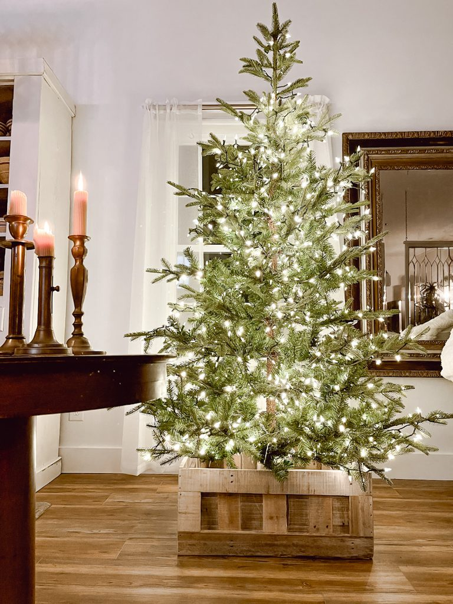

> TIP:QUICK: Keep the collar low and wide so it reads as furniture, not a box the tree sits in.

## 2. Light Slatted Cone Collar

Thin vertical slats with small gaps between them turn a plain tree base into a piece of furniture. The gaps let a little light through from the tree lights, which makes the collar glow softly in the evening, and the cone shape flares just enough to feel generous without eating floor space.

Space the slats evenly with a small spacer block as you build, and sand the top edges so nothing snags the lowest branches. This shape suits slim trees best, where a wide box would look out of proportion.

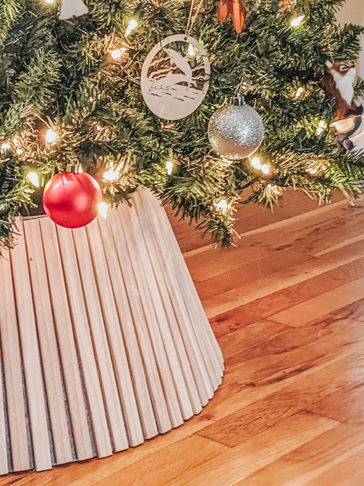

> TIP:CHECK: slats spaced evenly with a spacer block; top edges sanded smooth; suits slim trees best

## 3. Dark Stained Collar with Plaid Ribbon

A dark walnut stain gives a wooden collar instant weight, and a plaid ribbon wrapped around the top and bottom edges keeps it from feeling too serious. The ribbon echoes the ornaments above it, so the tree and its base read as one decorated unit rather than two separate pieces.

Choose a ribbon at least two inches wide so it reads from across the room, and pin it in place with small brass tacks instead of glue. The tacks come out cleanly in January, and the ribbon can be swapped for a new color next year.

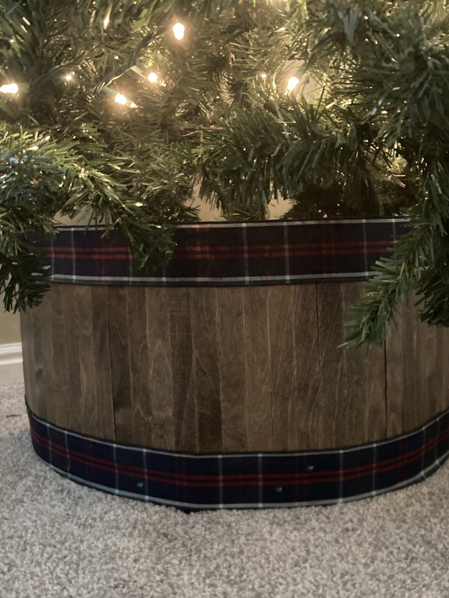

> TIP:GUIDE: Ribbon: at least 2 inches wide | Fasten: small brass tacks, not glue | Swap: new color each year

## 4. Light Wood Box Collar

A plain square box in pale wood is the quietest collar on this list, and sometimes quiet is exactly right. It disappears under a heavily decorated tree and lets the ornaments do the talking, while still hiding the stand and the tangle of light cords.

Build the box from four panels joined with corner battens, and leave the bottom open so it slides over the stand. A coat of clear polyurethane on the inside faces keeps spilled tree water from staining the wood.

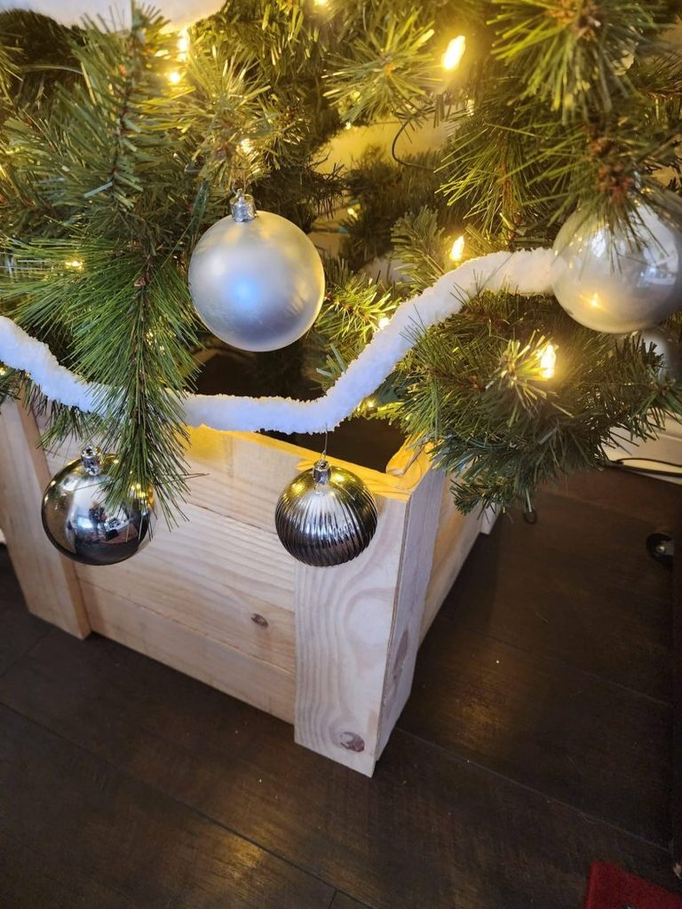

> TIP:QUICK: Build four panels with corner battens and leave the bottom open so it slides over the stand.

## 5. Weathered Wood Box Collar

Weathered grey boards give a collar the look of a box that has spent decades in a barn, even if you built it last weekend. The silvered grain pairs beautifully with a flocked tree and silver ornaments, and every knot and nail hole adds character no new board can fake.

If you cannot find real barn wood, weather new boards with a vinegar and steel wool solution and a grey wash. Test the mix on a scrap first — it darkens as it dries, and a second coat is easier to add than to remove.

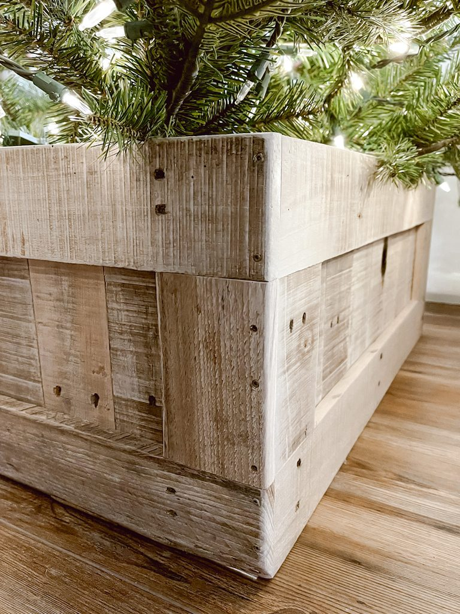

> TIP:CHECK: test the vinegar and steel wool mix on a scrap first; it darkens as it dries; one coat usually enough

## 6. Rustic Pallet Box Collar

Pallet wood is free, plentiful and already rough around the edges, which makes it perfect for a rustic tree collar. The mixed tones of the boards — some pale, some dark, some grey — give the box a patchwork look that a single species of wood never achieves.

Take pallets apart carefully and pull every nail before cutting, and check the pallet stamp for the HT mark, which means heat treated and safe to use indoors. Sand just enough to remove splinters and keep the rough texture.

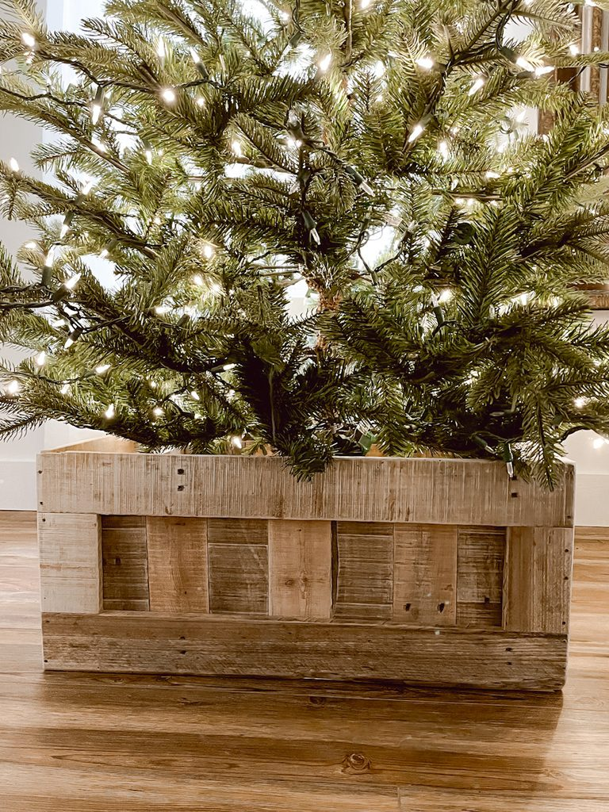

> TIP:GUIDE: Pallets: check for the HT heat-treated stamp | Nails: pull every one before cutting | Sand: just enough to remove splinters

## 7. Natural Tapered Slat Collar

A tapered collar made of natural pine slats is the simplest wooden collar you can build, and it looks good with almost any tree. The slats flare gently outward toward the floor, so the collar reads like a basket made of wood, and the pale unfinished grain keeps the whole tree feeling light and Scandinavian.

Leave the wood bare for a minimal look, or rub in a clear wax to warm the tone slightly without hiding the grain. Measure the widest point of your stand first — the collar should clear it by at least an inch on every side.

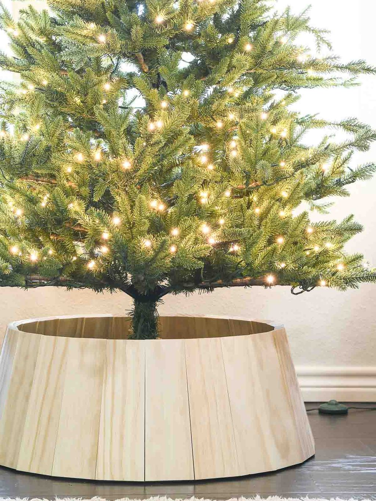

> TIP:QUICK: Measure the stand first — the collar must clear it by an inch on every side.

## 8. Dark Stained Wood Box

A dark stained box collar is the most furniture-like option here: it looks like a low chest the tree happens to be growing out of. The deep brown finish suits traditional rooms with dark wood floors and leather furniture, and it hides scuffs far better than pale wood does.

Stain all four panels before assembly so the color is even in the corners, and finish with a satin topcoat that wipes clean. A dark box shows dust, so a quick wipe with a damp cloth once a week keeps it looking new.

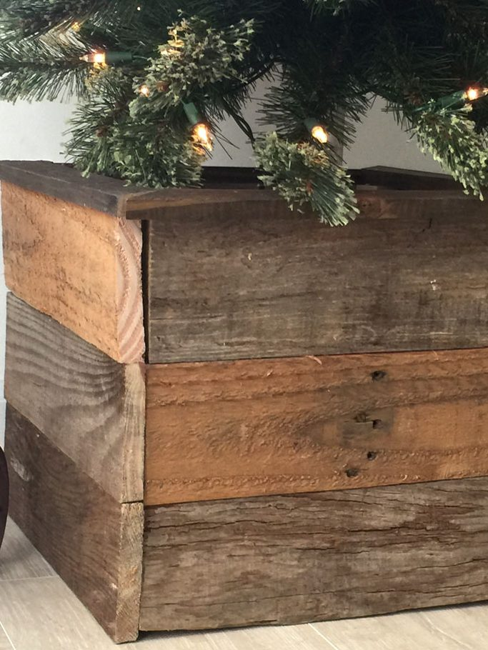

> TIP:CHECK: stain panels before assembly; satin topcoat that wipes clean; dust it weekly with a damp cloth

## 9. Gray Barn-Door X-Brace Box

The X-brace is the signature detail of the barn-door style, and it turns a plain wooden box into the most recognizable collar on this list. Two diagonal battens crossed on each face give the box structure and a farmhouse look at the same time.

Cut the diagonals with a 45-degree mitre so they meet neatly in the middle, and screw them from the inside so no fasteners show on the face. The grey wash over the boards should be thin enough that the grain still shows through.

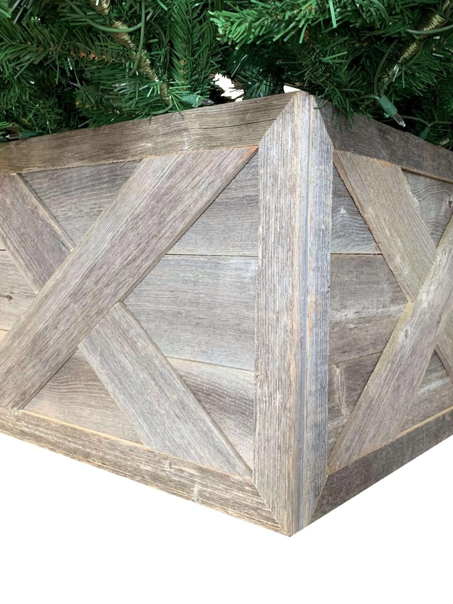

> TIP:GUIDE: Diagonals: 45-degree mitre joints | Screws: from the inside so none show | Wash: thin grey, grain showing

## 10. Rustic Pallet Box with a Lit Tree

A lit tree in a pallet box is the classic farmhouse Christmas scene: warm white lights, rough boards and a wood floor. The collar does not compete with the tree at all — it simply frames the base and gives the eye somewhere solid to rest.

Leave a small gap at the back of the collar for the light cord to exit, and set the whole tree on a waterproof mat first. A pallet box will not hold a spill, and a mat protects the floor underneath.

> TIP:QUICK: Leave a gap at the back for the light cord and set the tree on a waterproof mat first.

## 11. Whitewashed Box in a Festive Room

A whitewashed box collar brightens a room that already has a lot of red and green in it. The pale finish reflects the tree lights, and the box looks crisp against a dark floor or a patterned rug, especially with gifts stacked beside it.

Whitewash is just thinned white paint wiped back with a rag, so the wood grain shows through the color. One coat is usually enough — a second coat starts to look painted rather than washed, which loses the rustic effect.

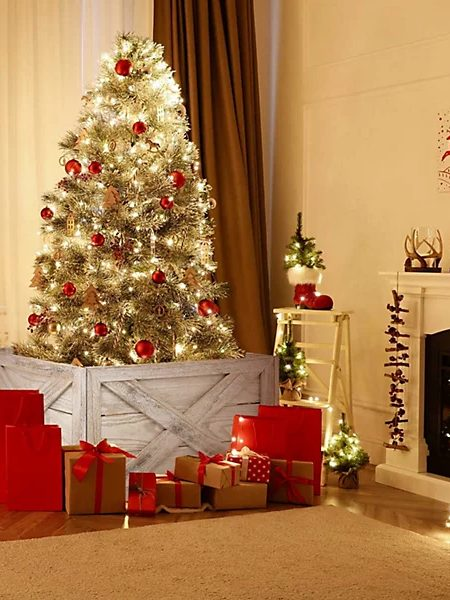

> TIP:CHECK: whitewash is thinned white paint wiped back; one coat is enough; a second coat looks painted, not washed

## 12. Farm Fresh Whitewashed Box

A printed Farm Fresh Christmas Trees design turns a whitewashed box into a little piece of signage, like the crates at a tree lot. It is a small detail, but it is the one guests always comment on, and it costs nothing more than a stencil and a steady hand.

Use a vinyl stencil and a foam pouncer for the cleanest letters, and seal the design with a clear matte topcoat so it survives storage. If freehand lettering makes you nervous, a printed transfer works just as well.

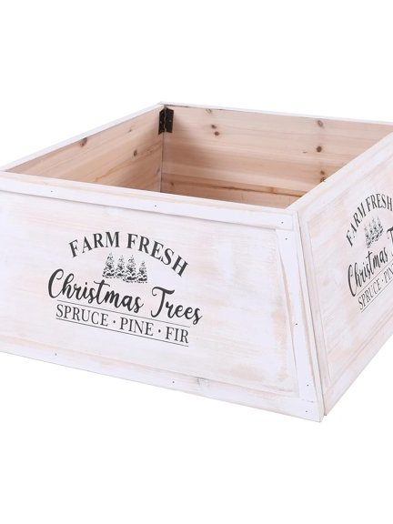

> TIP:GUIDE: Stencil: vinyl stencil with a foam pouncer | Seal: clear matte topcoat | Alternative: a printed transfer

## 13. Light X-Brace Box with a Decorated Tree

A light wood X-brace box under a fully decorated tree is the balance point of this list: the collar is interesting enough to notice and plain enough to let the ornaments lead. The pale wood keeps the base from visually weighing the tree down.

Match the wood tone to your floor if you can — a collar that matches the floor reads as part of the room, while one that clashes with it reads as a prop. A pale oak or ash box suits most light wood floors.

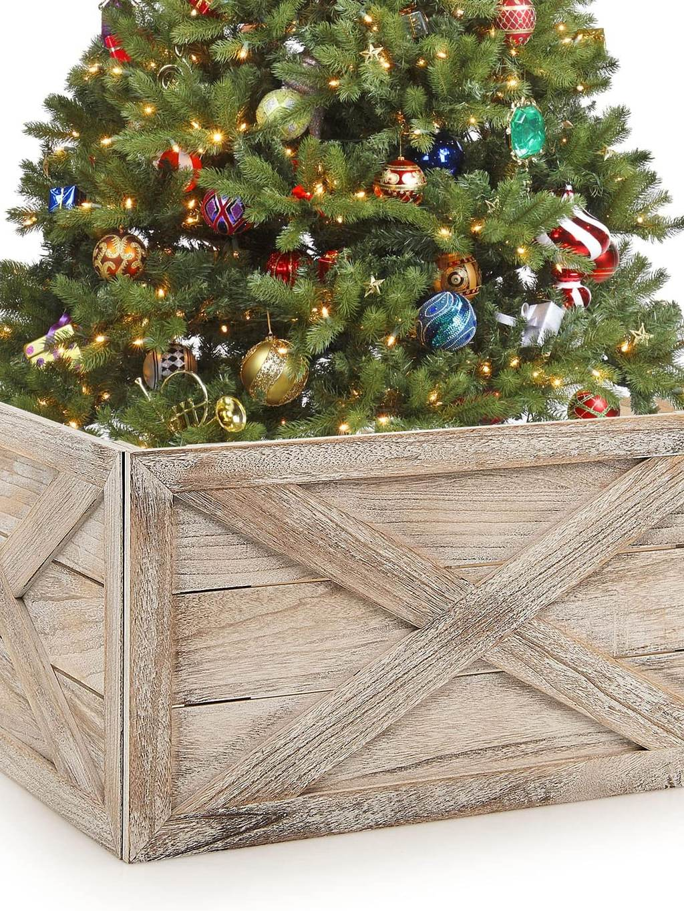

> TIP:QUICK: Match the wood tone to your floor so the collar reads as part of the room.

## 14. Whitewashed X-Brace Box with Gold Ornaments

Whitewash and gold is one of the prettiest combinations on a Christmas tree, and the collar is where it starts. The pale box sets off gold and white baubles above it, and the X-brace panels catch the light in a way flat boards never do.

Keep the rest of the base simple when the ornaments are gold — no ribbon, no extra signage — so the gold stays the star. A white fur rug under the box adds softness and hides the floor.

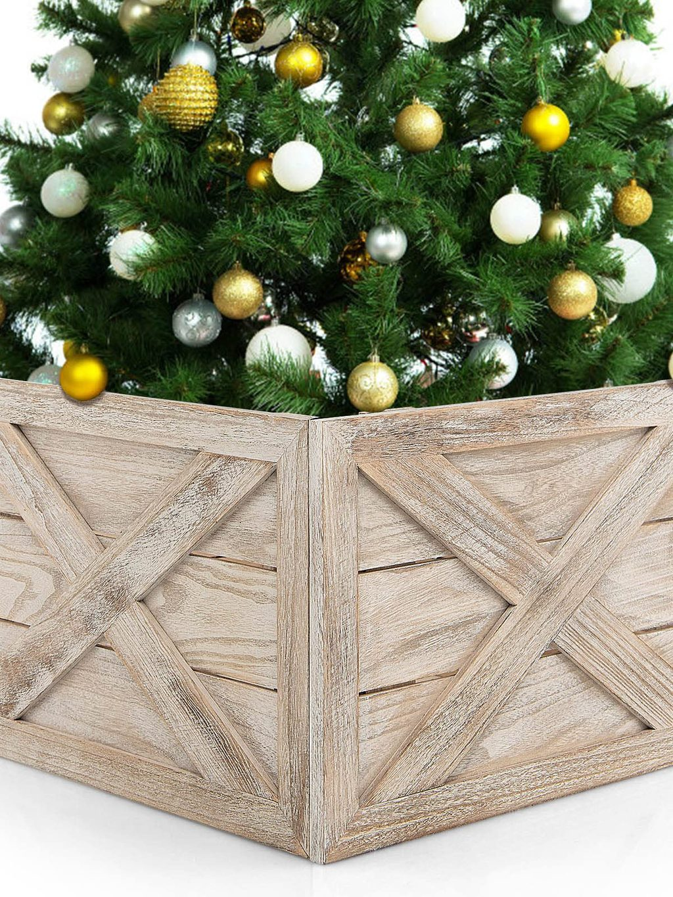

> TIP:CHECK: pale box sets off gold and white baubles; no ribbon or signage; white fur rug underneath

## 15. Two-Tone X-Brace Box

A two-tone box — pale panels with darker X-braces, or the reverse — gives the collar a built-in contrast that a single finish cannot match. The darker braces outline the panels and make the X shape pop from across the room.

Stain the braces before you attach them, and mask the panels with tape if you are staining after assembly. Two tones only work when the boundary is crisp, so take your time with the edges.

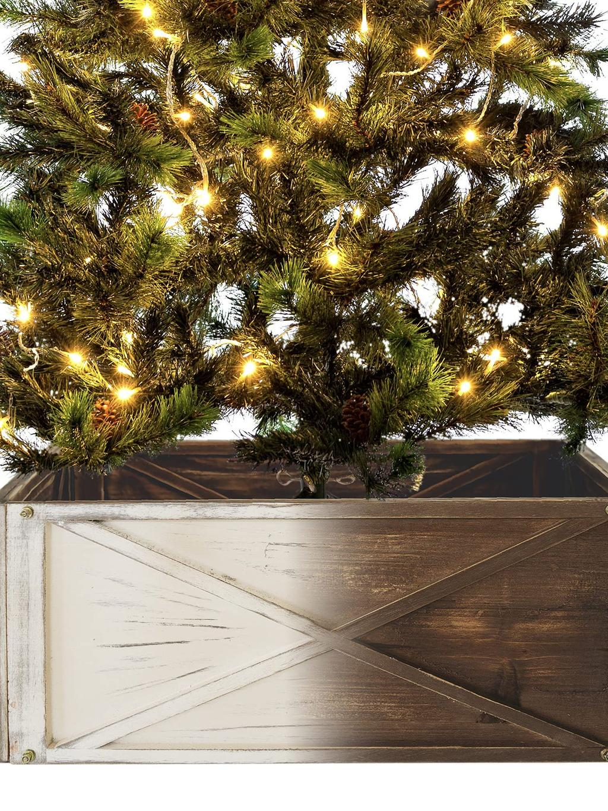

> TIP:GUIDE: Braces: stain before attaching | Edges: mask panels with tape | Rule: the boundary must stay crisp

## 16. White Farm Fresh Tapered Box

A tapered box is slightly wider at the bottom than the top, which makes it look more like a crate and less like a cabinet. In white with a Farm Fresh print, it reads as a vintage tree-lot box, and the taper keeps it from looking bulky under a small tree.

Cut the side panels with a slight angle — about five degrees is enough — and join them with corner battens cut to match. The taper is subtle, but the eye reads it as intentional craftsmanship.

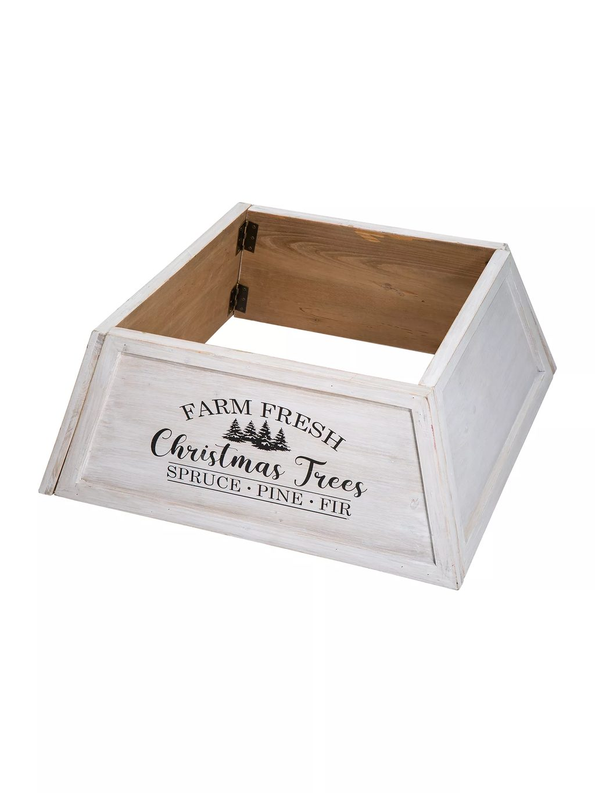

> TIP:QUICK: Cut side panels at about five degrees of taper — subtle, but the eye reads it as craft.

## 17. Dark Wood Box Collar Close-Up

Seen up close, a dark wood box collar is all about the grain: long boards, a few knots, and a satin finish that catches the tree lights. It is the collar to choose when your tree is simple and the room is the decoration.

Choose boards with straight, even grain for the front face and save the knottier pieces for the sides. A dark stain forgives a lot, but a knot right in the middle of the front panel will always draw the eye.

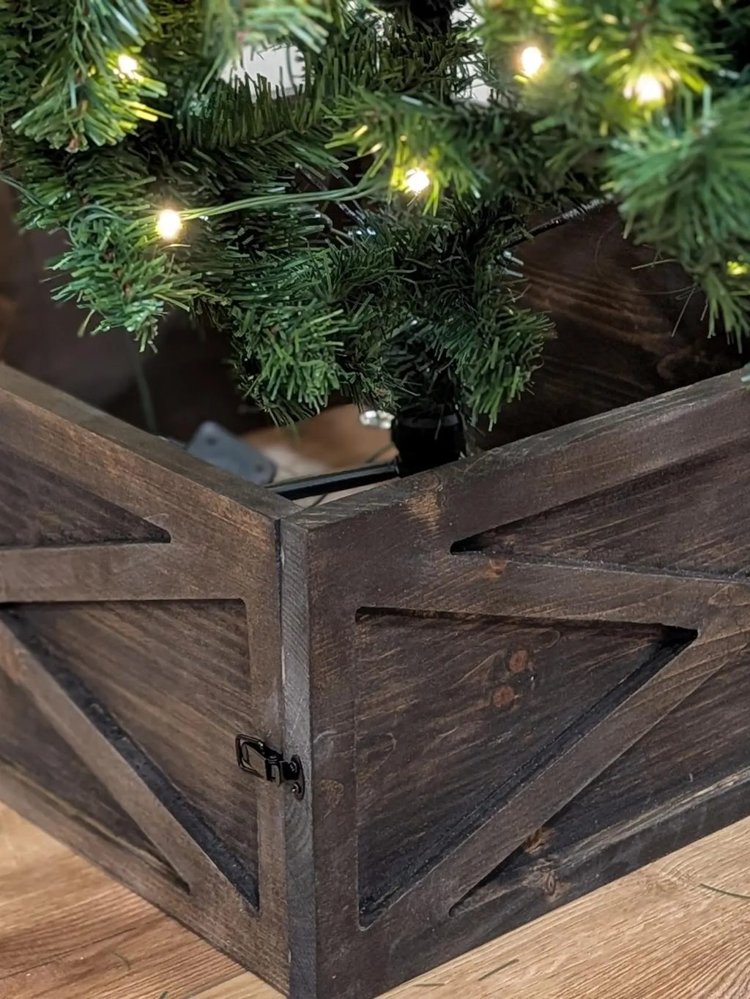

> TIP:CHECK: straight, even grain on the front face; knottier boards on the sides; a knot dead center always draws the eye

## 18. Farm Fresh Truck Box

The little red truck carrying a tree is the most nostalgic print a collar can wear, and it suits a dark wood box perfectly. The white lettering stands out against the stain, and the whole box feels like something found at an old-fashioned tree farm.

Apply the design with a stencil and white chalk paint, then distress the edges lightly with sandpaper for a vintage look. Seal it well — chalk paint rubs off easily without a topcoat.

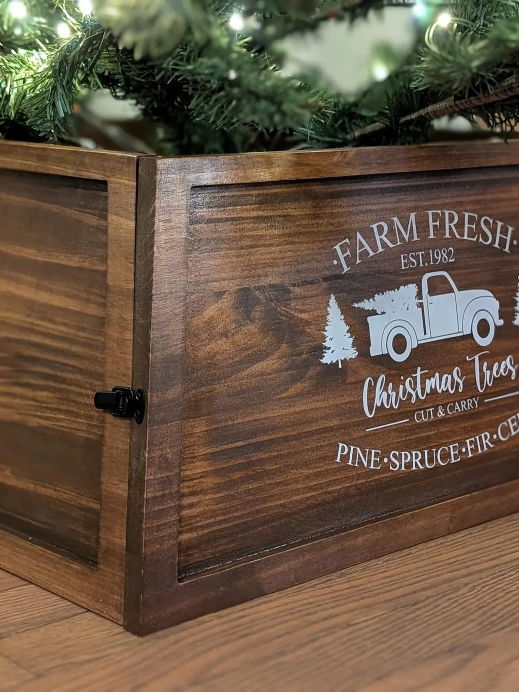

> TIP:GUIDE: Stencil: white chalk paint | Distress: light sandpaper on the edges | Seal: topcoat, chalk paint rubs off

## 19. Hexagonal Tree-Cutout Collar

A hexagonal collar with tree-shaped cutouts is the most decorative shape on this list, and the cutouts let the tree lights shine through in little tree shapes on the floor. It takes more cutting than a square box, but the result looks bought, not built.

Cut the tree shapes with a jigsaw and sand the edges smooth before assembly, since the cutouts are the feature. Six panels joined at 120 degrees make the hexagon — a simple jig keeps the angles consistent.

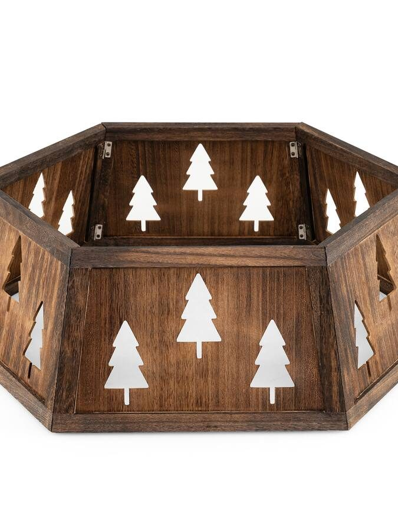

> TIP:QUICK: Cut tree shapes with a jigsaw and sand the edges smooth before assembly — the cutouts are the feature.

## 20. Dark Hexagonal X-Brace Collar

A dark hexagonal collar with X-brace panels on each face is a substantial piece — it suits a full, wide tree and a large room. The six faces give you more surface for the X detail, and the dark stain keeps the whole thing from feeling busy.

Build the hexagon from six identical panels so any face can be the front, and join them with vertical battens on the inside. A hexagonal collar needs a wider stand clearance than a square one, so measure twice.

> TIP:CHECK: six identical panels so any face can be the front; join with inside battens; allow wider stand clearance

## 21. Brown Hexagonal Merry Christmas Collar

A brown hexagonal collar with a Merry Christmas design and reindeer is the most festive of the wooden collars — the print does the decorating so the tree above can stay simple. It works best with red and gold ornaments that pick up the colors in the print.

Keep the print to one face if you want the option of turning the collar around for a plainer look. A single decorated face gives you two collars in one: festive on one side, plain on the other.

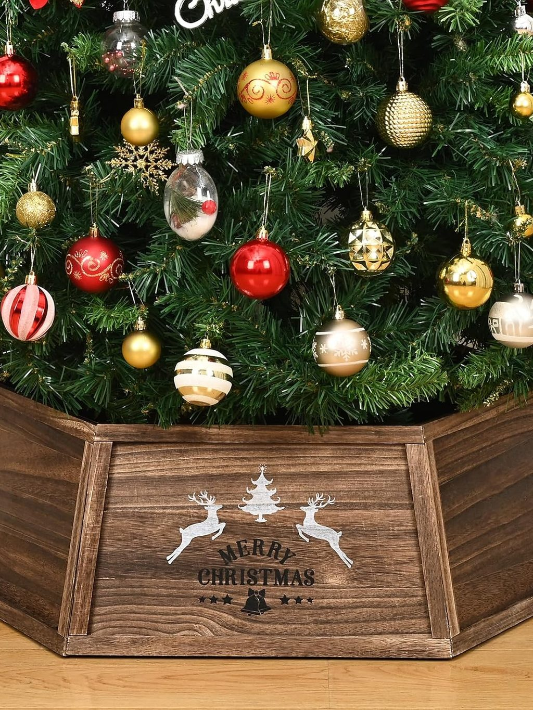

> TIP:GUIDE: Print: one face only | Benefit: festive on one side, plain on the other | Ornaments: red and gold to match

## 22. Rustic Box Mid-Build

A collar caught mid-build — boards clamped, drill on the floor, flocked branches waiting — is a reminder that these boxes are genuinely simple to make. Four boards, a few screws and an afternoon is all most of them need.

Dry-fit the whole box around the stand before you drive a single screw, and check that the tree sits level inside it. It is far easier to trim a panel now than to rebuild a finished box in December.

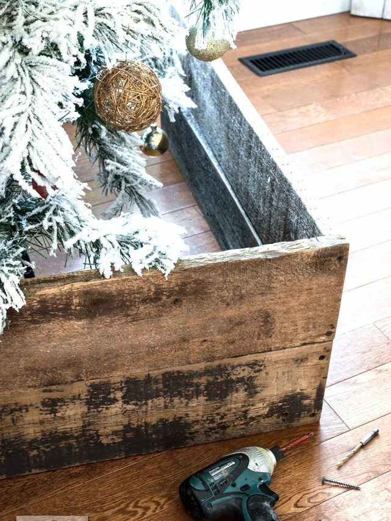

> TIP:QUICK: Dry-fit the whole box around the stand before driving a single screw.

## 23. Dark X-Brace Box on a Fur Rug

A dark X-brace box on a white fur rug is a study in contrast: dark wood, pale rug, warm lights. The rug softens the hard edges of the box and catches any needles that fall, and the combination photographs beautifully.

Use a washable faux-fur rug under the tree, since real fur and tree water do not mix. Shake it out after Christmas and it is ready to store with the collar.

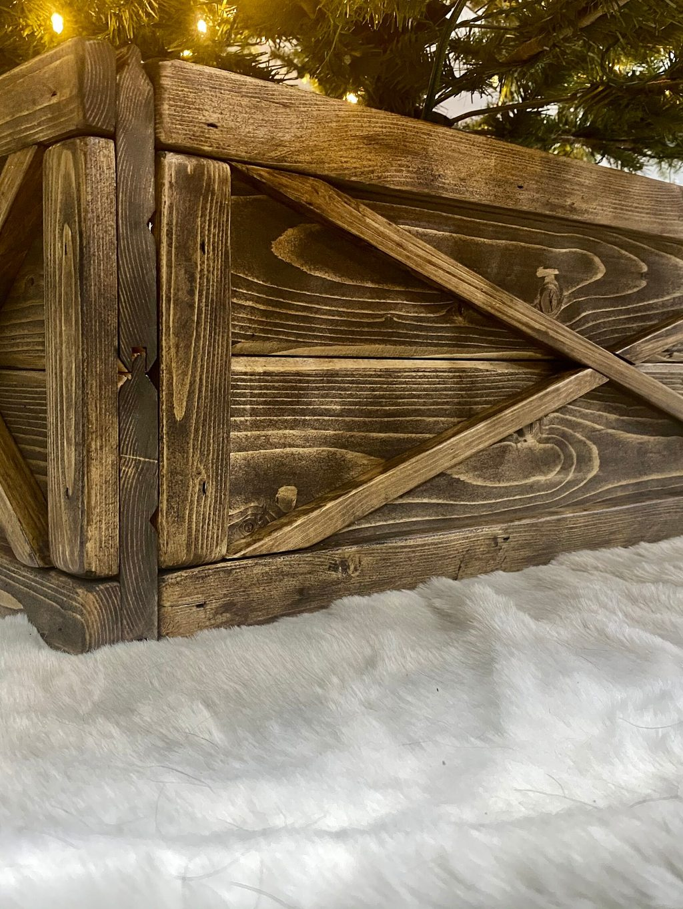

> TIP:CHECK: washable faux-fur rug underneath; shake it out after Christmas; it catches fallen needles too

## 24. Light Hexagonal X-Brace Collar

A light wood hexagonal collar with X-braces is the airy version of the dark one: same six faces, same structure, but the pale finish keeps it from dominating a small room. It suits trees with red ornaments, which pop against the pale wood.

Sand the X-braces before assembly — their diagonal edges are hard to sand once they are screwed in place. A light finish shows every scratch, so handle the panels with clean hands.

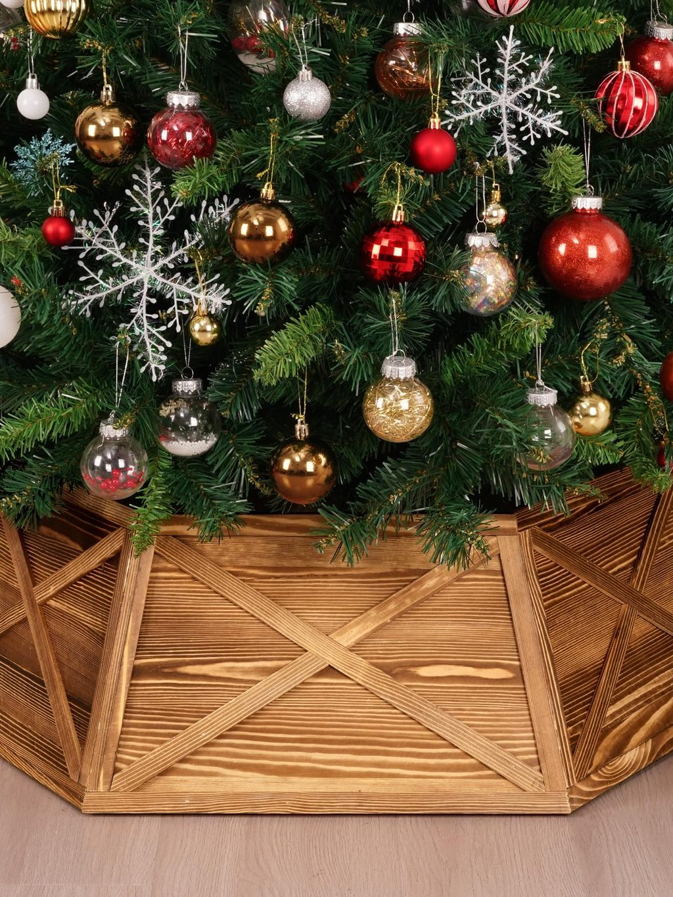

> TIP:GUIDE: Sand: X-braces before assembly | Finish: light stain shows scratches | Handle: with clean hands

## 25. Personalized Family Name Box

A family name on the front of a wooden collar turns a decoration into a keepsake. It is the collar that comes out first every year and the one nobody else in the family has, and it costs nothing more than a stencil and an evening.

Center the name carefully and keep the lettering simple — a clean serif reads better at a distance than a fancy script. Add the year you built it underneath, and the box becomes a record of your Christmases.

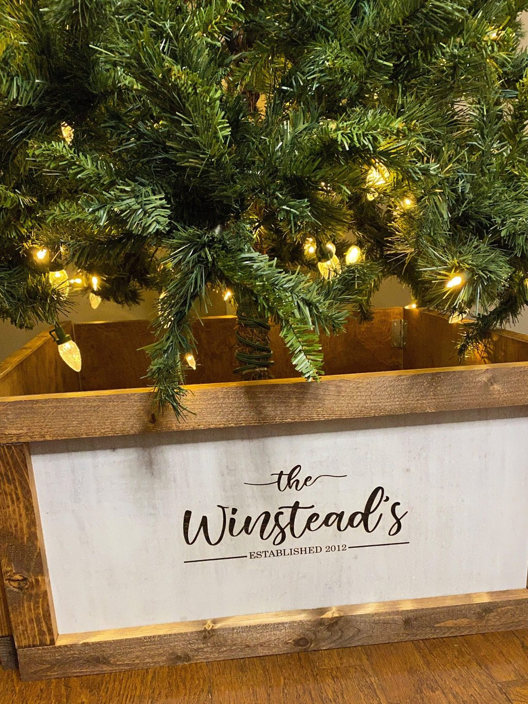

> TIP:QUICK: Center the name carefully and keep the lettering simple — a clean serif reads best at a distance.

## 26. Slatted Wooden Planter Collar

A slatted wooden collar with wide gaps between the boards reads more like a planter than a box, and it suits a modern tree with simple white lights. The open slats keep the collar light visually, which matters under a tall, narrow tree.

Space the slats with a consistent gap — a scrap offcut makes a perfect spacer — and join them to two horizontal rails on the inside. The rails stay hidden, so the outside stays clean.

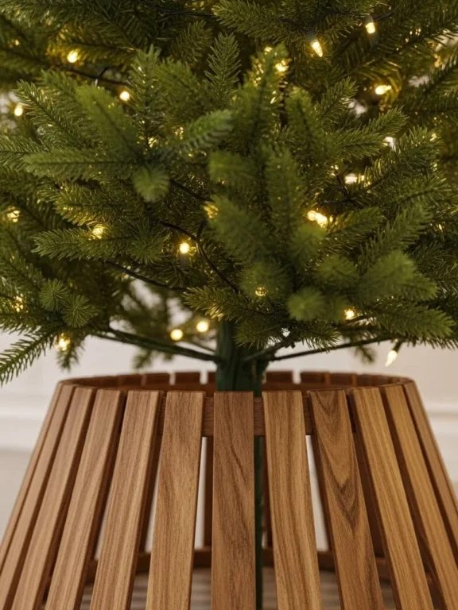

> TIP:CHECK: gap: consistent, use a scrap offcut as a spacer; rails on the inside; outside stays clean

## 27. Light Round Collar with Colorful Ornaments

A round collar in light wood softens the base of the tree in a way no square box can. The curve echoes the round ornaments above it, and the pale finish keeps the whole tree feeling bright and cheerful.

A round collar is best made from thin, flexible slats bent around a form, or from short vertical staves. Either way, build it slightly oversized — a round collar that fits too tightly is hard to remove in January.

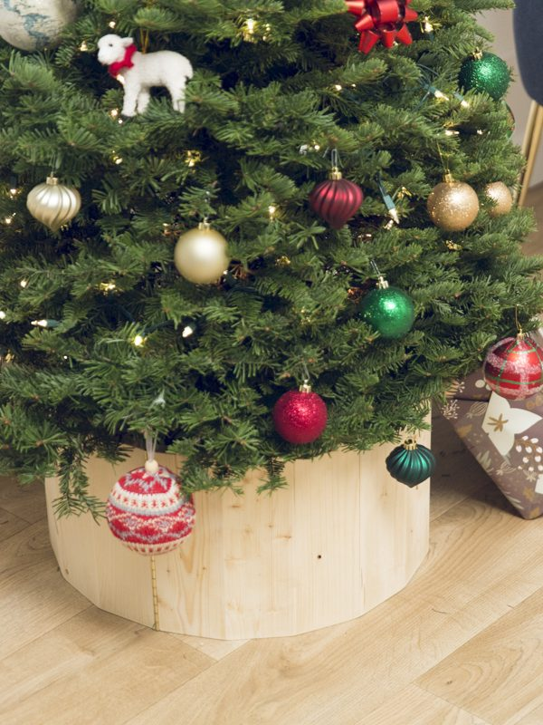

> TIP:GUIDE: Build: thin slats bent around a form, or short vertical staves | Fit: slightly oversized | Removal: easy in January

## 28. White Wood Box with a Flocked Tree

A white wood box under a flocked tree is a snow scene in miniature: white branches, white box, warm lights. The box disappears into the flocking at first glance, which is exactly the point — the tree looks like it is growing out of the snow.

Paint the box with a satin white that wipes clean, since flocking sheds. A matte finish shows every grey smudge from the flocked branches, while satin shrugs it off.

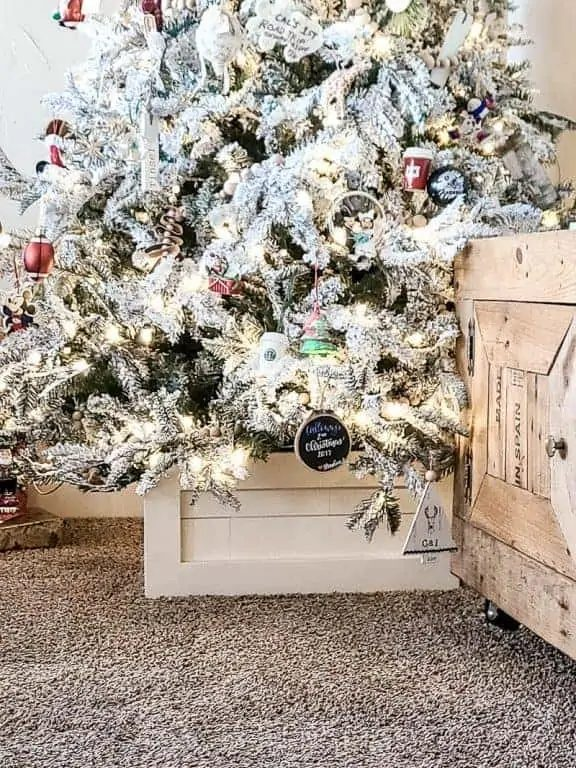

> TIP:QUICK: Paint the box satin white, not matte — satin wipes clean of flocking smudges.

## 29. Rope-Handle Weathered Box

Rope handles on a weathered box collar are a small, practical detail that also looks wonderful. They make the box easy to lift off the stand for watering, and the thick rope suits the rough boards perfectly.

Thread the rope through drilled holes and knot it on the inside, with a washer behind each knot so it cannot pull through. Choose a natural jute or hemp rope — synthetic rope looks wrong against old wood.

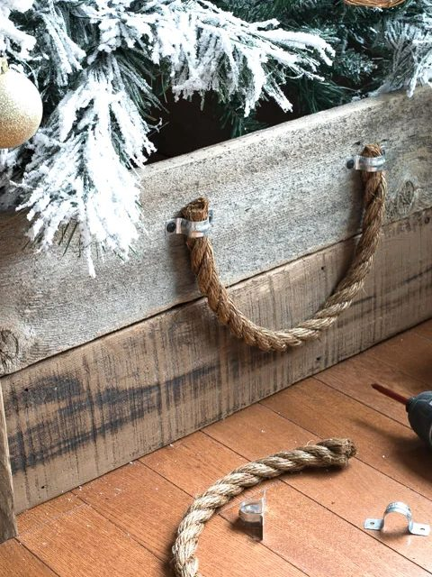

> TIP:CHECK: rope: natural jute or hemp, never synthetic; knots inside with a washer behind each one

## 30. Dark Slatted Cone Collar

A dark slatted cone collar is the moodiest option here, and it suits a tree with metallic ornaments and warm white lights. The dark wood recedes into the shadows under the tree, so the ornaments seem to float above it.

Stain the slats before assembly so the color is even in the gaps, and keep the gaps narrow — about a quarter inch — so the stand stays hidden while the light still filters through.

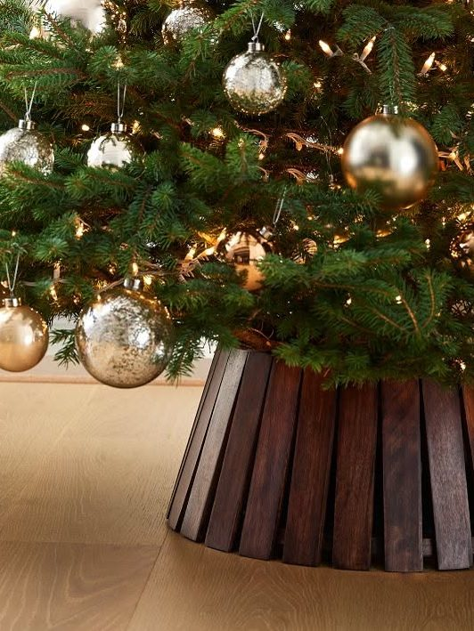

> TIP:GUIDE: Stain: slats before assembly | Gap: about a quarter inch | Effect: light filters through, stand stays hidden

## Takeaway

- A wooden tree collar is one of the simplest builds in Christmas decorating, and one of the most satisfying: four panels, an afternoon, and a tree that looks finished from the floor up.
- Start with a plain box in a finish you love, and add one detail — an X-brace, a stencil, a plaid ribbon — rather than all of them at once.
- If you want to compare wood with the other materials, our [30 DIY Tree Collar Ideas for a Finished Christmas Tree](https://www.cozynesthomeideas.com/posts/diy-tree-collar/) covers metal, wicker, rattan and fabric collars, so you can see which material suits your tree best.

## Frequently Asked Questions

### What size should a DIY wood tree collar be?

Measure the widest part of your tree stand, then add at least two inches on every side so the collar slides over it easily. For most artificial trees, a box 20 to 24 inches wide and 12 to 14 inches tall works well. Too tall hides the lowest branches; too short leaves the stand visible.

### What kind of wood is best for a tree collar?

Pine is the easiest choice: it is cheap, light and simple to cut and stain. Pallet wood and reclaimed barn wood give the most rustic look, but they need checking for nails and old finishes. Plywood works for painted collars, though solid boards look better with a stain. Avoid treated lumber indoors.

### How do I water a real tree inside a wooden collar?

Build the collar with an open bottom and set the tree stand on a waterproof tray inside it, leaving a gap at the back for access. You can reach the reservoir with a watering can with a long spout, or lift one panel off if you built the collar in sections. Never let water sit against bare wood.

### Can I make a wooden tree collar without power tools?

Yes, if you buy the boards pre-cut to size at the hardware store. A hand saw, a drill and a screwdriver are enough to assemble a simple box collar, and sandpaper finishes the edges. Slatted and hexagonal collars are much easier with a mitre saw and a jigsaw, so start with a square box.

### How do I keep a wooden tree collar from scratching the floor?

Stick felt furniture pads or a strip of cork to the bottom edge of every panel before you set the collar down. A rug or a waterproof mat underneath protects the floor from both scratches and tree water. Lift the collar to move it rather than dragging it across hardwood.

### Should a wood tree collar match the tree or the room?

Match the room. The collar sits on the floor with your furniture, so its finish should sit comfortably with your floors and other wood tones. A pale collar suits light floors and Scandinavian rooms, while a dark stain suits traditional rooms. The tree itself changes every year; the room does not.

### How do I store a wooden tree collar after Christmas?

Build it in four panels joined with wing nuts or latches if you want it to store flat. A fixed box stacks well in a garage or loft, but wrap it in an old sheet to keep dust off the finish. Keep it dry — damp storage will warp boards and lift stain.

### Is a wooden tree collar safe around a real tree and lights?

Yes, with the same care as any wooden furniture near a tree. Keep lights in good condition, never use damaged strings, and keep the tree watered so it does not dry out. Do not place candles on or beside the collar, and unplug the lights when you leave the house or go to bed.
