# 30 Doorway Garland Ideas for a Welcoming Home

A doorway garland is the first Christmas decoration your guests see, and the one that makes coming home feel like an occasion. One long swag of greenery around the front door — or an interior doorway, an arch or a hallway — frames the entrance and sets the mood for the whole house.

This list gathers 30 doorway garland ideas, from classic front-door frames with wreaths to grand hallway arches strung with lights. Most of them use the same simple technique as a mantel garland: drape, secure, then dress with bows, ornaments and lights.

## 1. Classic Garland Around a Navy Front Door

A navy front door framed by a lit garland with silver ornaments and a wreath is the classic Christmas entrance. The dark door makes the greenery pop, the lights warm up the whole porch, and the wreath in the middle ties the frame together.

Hang the garland from adhesive hooks on the door frame, not the door itself, so the door still opens freely. Let the ends puddle slightly at the base of the frame for a generous, finished look.

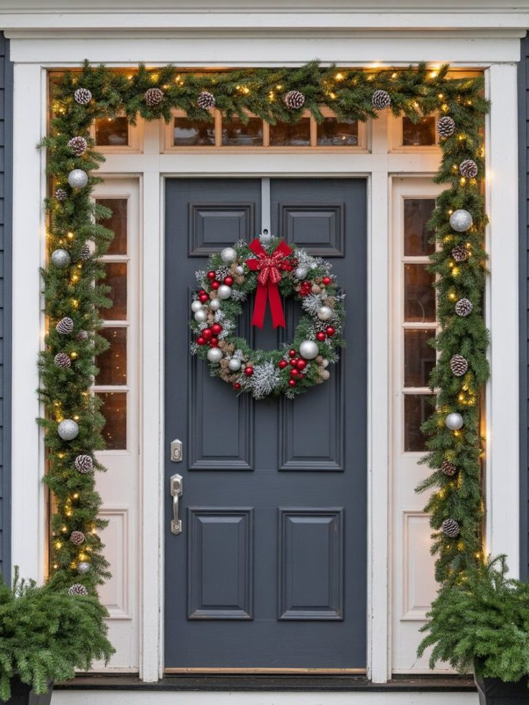

> TIP:QUICK: Hang the garland from hooks on the door frame, not the door, so the door still opens freely.

## 2. Cedar Garland on a Navy Door

Cedar garland is softer and more feathery than pine, and it drapes beautifully around a door frame. On a navy door the blue-green cedar and red berries look rich and traditional, and the wreath in the middle completes the frame.

Cedar dries out faster than pine outdoors, so mist a real cedar garland every few days, or choose a good faux cedar for a front door that gets sun. A faux garland also survives winter wind without shedding.

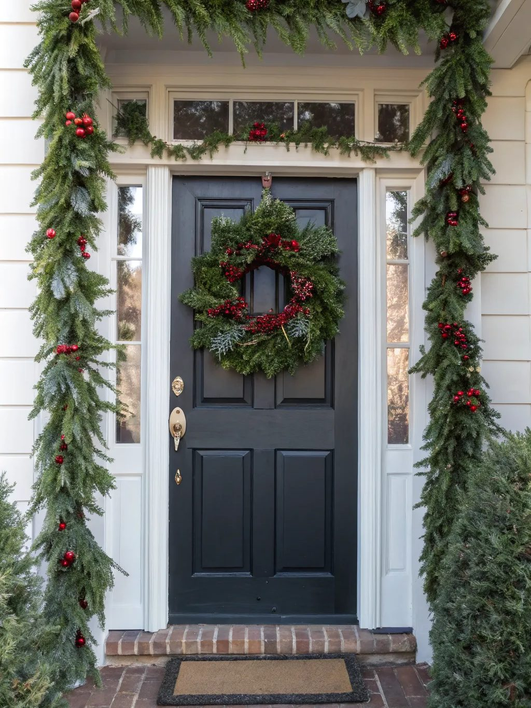

> TIP:CHECK: mist real cedar every few days; faux cedar survives sun and wind without shedding

## 3. Garland and Wreath on a Black Door

A black front door with a green garland and a wreath is the most striking entrance on this list. The black door is already dramatic, and the greenery against it looks like a picture frame around the entrance.

A brick porch suits this look perfectly — the red brick, black door and green garland are a classic trio. Keep the wreath simple so the frame stays the star.

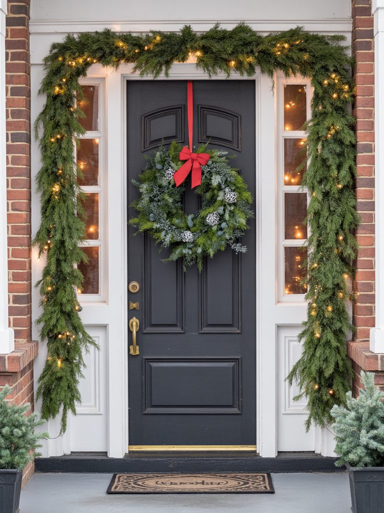

> TIP:GUIDE: Trio: red brick, black door, green garland | Wreath: keep it simple | Frame: the garland is the star

## 4. Garland with Gold Ornaments on a Wood Door

Gold ornaments in a doorway garland bring a warm, glamorous glow to a wooden front door. The gold picks up the wood tones of the door and the porch, and the wreath with a striped bow in the middle ties the whole frame together.

Use shatterproof ornaments outdoors, since a windy day can knock them onto the porch. Wire them to the garland rather than hanging them from hooks, so they stay put through the season.

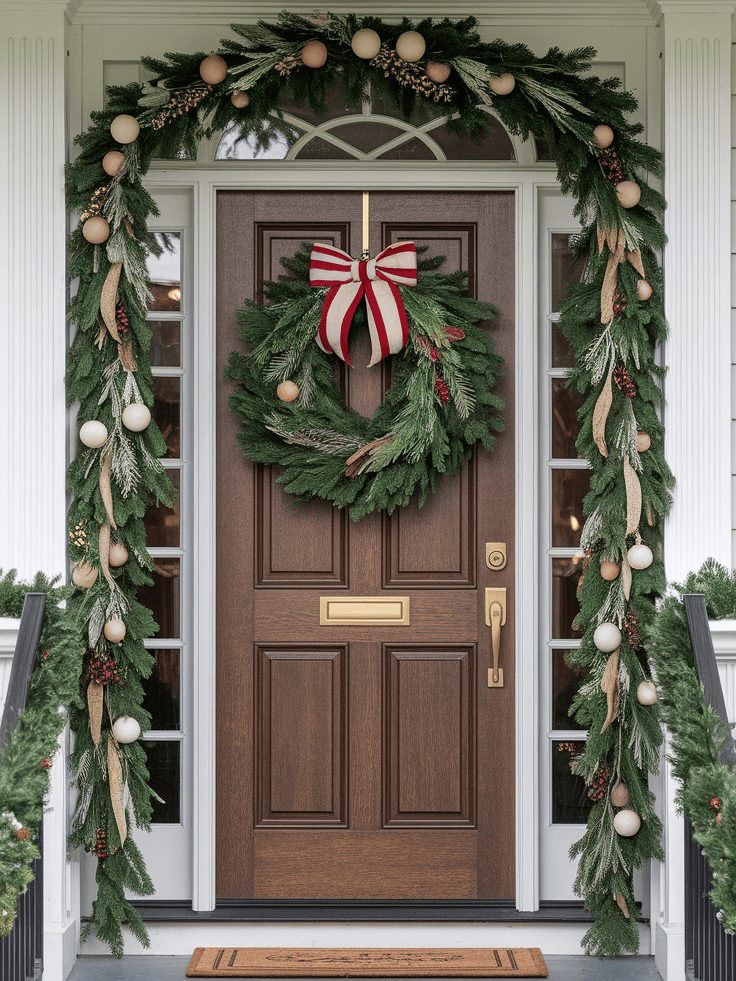

> TIP:QUICK: Use shatterproof ornaments outdoors and wire them on — wind will knock loose ones onto the porch.

## 5. Garland Around a Teal Front Door

A teal front door framed by a lit garland with a red berry wreath is the most colorful entrance here. The teal is unexpected and cheerful, and the red berries in the wreath pick up the warmth of the lights.

A teal door suits a house with white trim and a brick or stone porch. Keep the garland green and simple so the door stays the focus — the garland is the frame, not the picture.

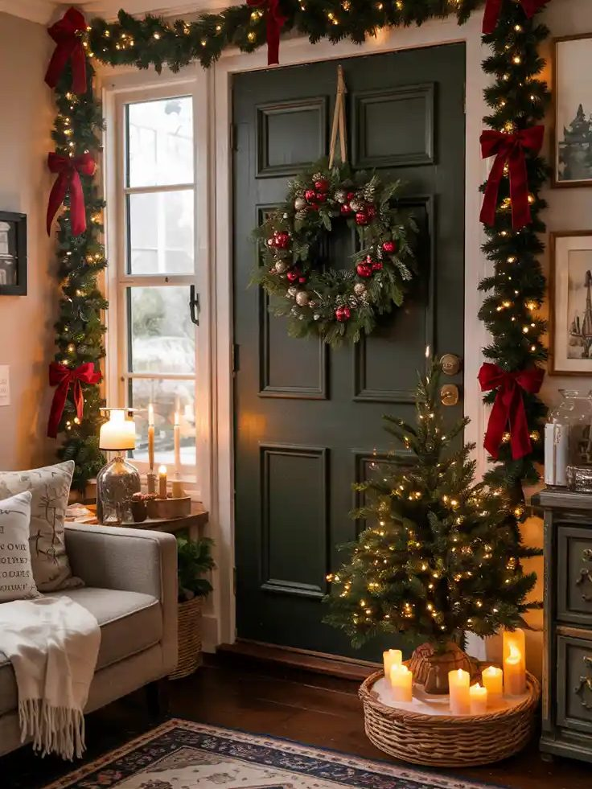

> TIP:CHECK: garland green and simple so the teal door stays the focus; the garland is the frame, not the picture

## 6. Lush Garland on a Black Door

A lush, thick garland around a black door makes the entrance feel like a grand occasion. The greenery is full and deep, the red berries add color, and the wreath in the middle is the finishing touch.

A thick garland needs strong hooks — use outdoor adhesive hooks rated for the weight, or screw small cup hooks into the door frame where they will not show. A thin garland on a grand door looks lost.

> TIP:GUIDE: Hooks: outdoor-rated, strong enough for a thick garland | Thin garland: looks lost on a grand door | Check: fixings after the first windy day

## 7. Berry Garland Around a White Entry Door

A red berry garland around a white entry door is the brightest entrance on this list. The berries cover the garland like a hedge in fruit, and the wreath in the middle is a smaller echo of the same idea.

Berry garlands look best in daylight, so this is a good choice for a door that gets morning sun. Keep the berries to the front of the garland where they show, and let the greenery fill the back.

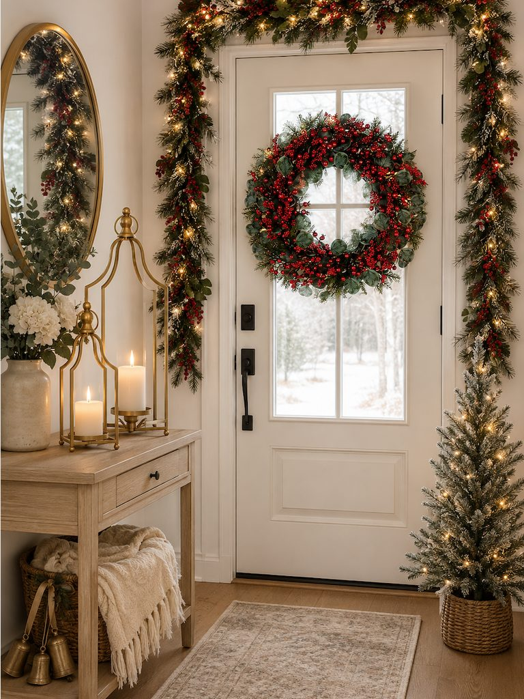

> TIP:QUICK: Berry garlands look best in daylight — a good choice for a door that gets morning sun.

## 8. Lit Garland Around a Cream Front Door

A lit garland around a cream front door, with gifts stacked beside it and a wreath in the middle, is the warmest welcome here. The lights make the entrance glow in the evening, and the cream door keeps the whole scene soft.

Battery fairy lights are the easiest choice for a front door, since there is no cord to run. Use a timer so they come on at dusk and off at bedtime without you thinking about it.

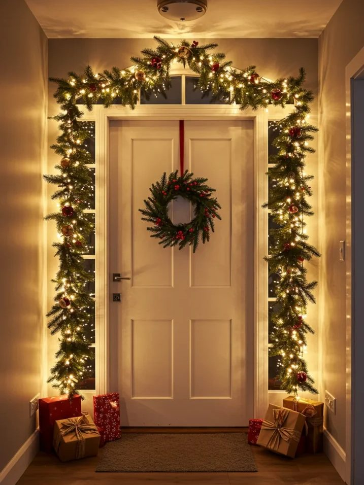

> TIP:CHECK: battery fairy lights with a timer; on at dusk, off at bedtime, no cord to run

## 9. Silver Bow Garland in a Hallway

A garland with silver bows and ornaments around an interior doorway brings Christmas into the hallway without a single outdoor decoration. The silver suits a modern hallway, and the garland frames the rooms beyond it.

Interior garlands can be lighter than outdoor ones, since there is no wind — a thin garland with good dressing looks full indoors. Silver bows catch the hallway light and make the doorway feel festive.

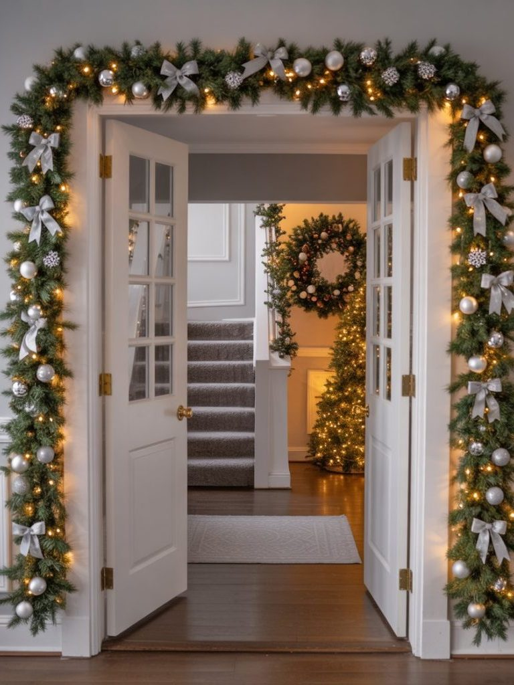

> TIP:GUIDE: Interior: lighter garland works, no wind | Silver bows: catch hallway light | Frame: the rooms beyond

## 10. Double Doors with Twin Wreaths

White double front doors with a garland around the frame and a wreath on each door is the most symmetrical entrance here. The twin wreaths balance each other, and the garland ties the two doors into one grand entrance.

Symmetry is the whole trick: hang both wreaths at exactly the same height, and let the garland drape evenly on both sides. A small difference is more noticeable than a big one, so measure twice.

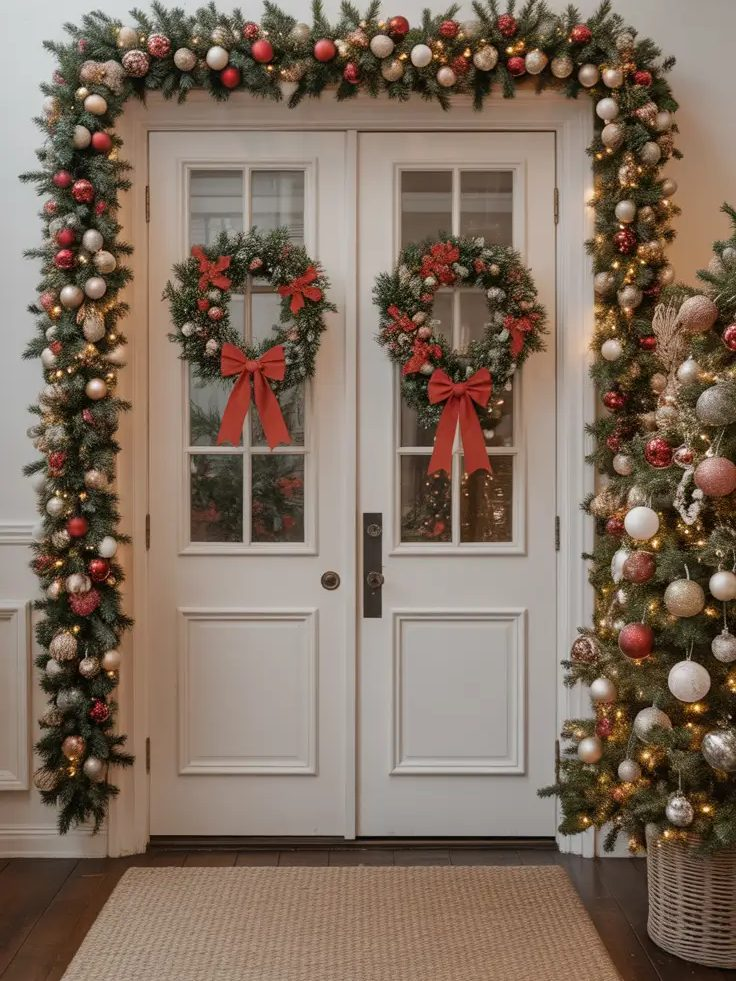

> TIP:QUICK: Symmetry is the whole trick — hang both wreaths at exactly the same height.

## 11. Red Bow Garland at an Open Front Door

Big red bows on a garland around an open front door is the most welcoming entrance on this list — the door is literally open, and the bows say come in. The garland frames the doorway and the lit tree just inside.

Wired ribbon holds its shape in wind, so use it for outdoor bows. Tie the bows directly onto the garland with the ribbon itself, so they sit in the greenery rather than on top of it.

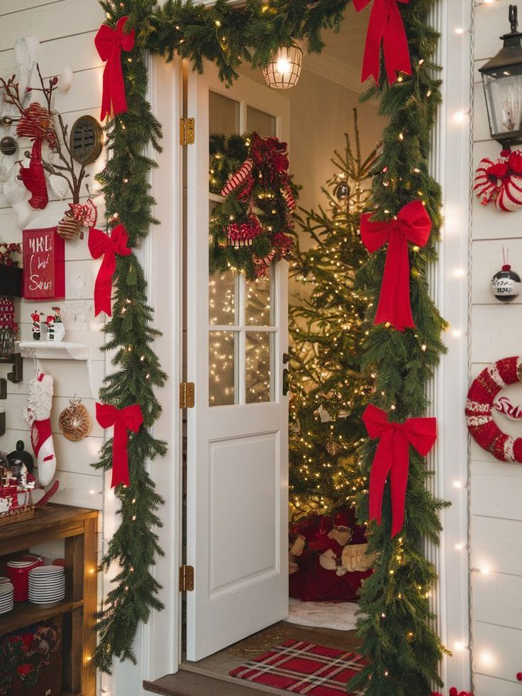

> TIP:CHECK: wired ribbon holds its shape in wind; tie bows into the greenery, not on top of it

## 12. Arched Garland Over a Glass Front Door

An arched garland over a glass front door, with a wreath hanging in the middle, is the most elegant entrance here. The arch follows the shape of the door, and the glass lets the warm light from inside shine through the garland.

An arched doorway needs a longer garland than a square one — measure around the arch, not across it. A garland that follows the arch looks intentional; one that cuts across it looks like a mistake.

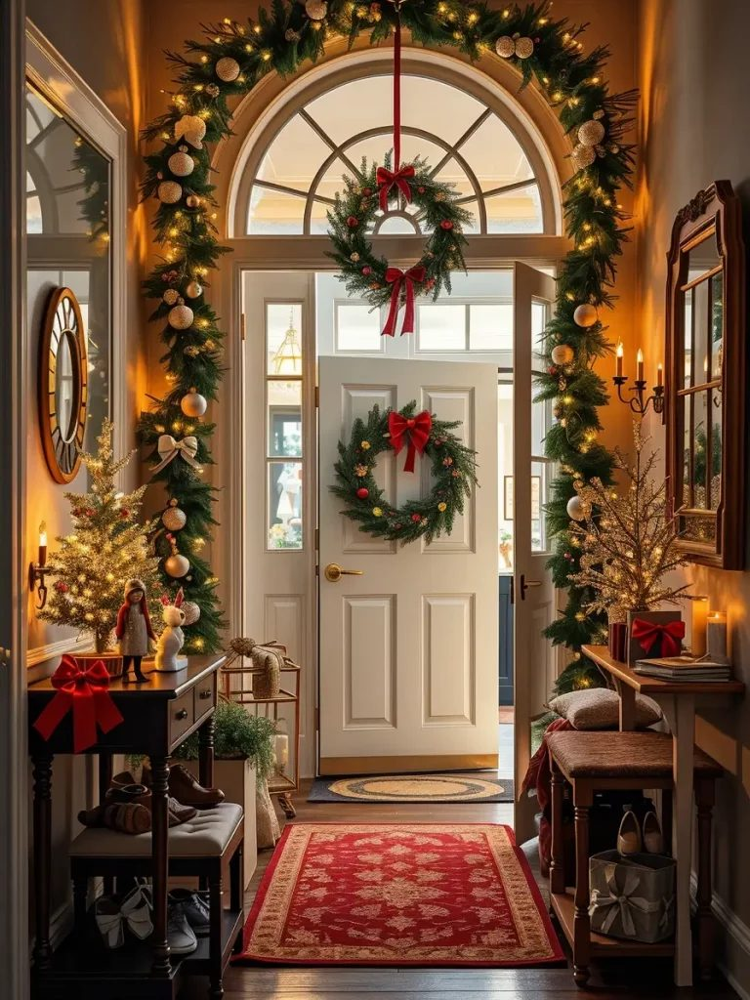

> TIP:GUIDE: Measure: around the arch, not across it | Length: longer than a square door needs | Look: a garland following the arch looks intentional

## 13. Ornament Garland on a Glass Door

Red and gold ornaments in a garland around a glass front door make the entrance sparkle from the street. The ornaments catch the porch light and the light from inside, and the wreath in the middle completes the frame.

Glass doors show the back of the garland from inside, so dress both sides — or choose a garland that looks good from the back. A full garland reads well from both sides; a thin one does not.

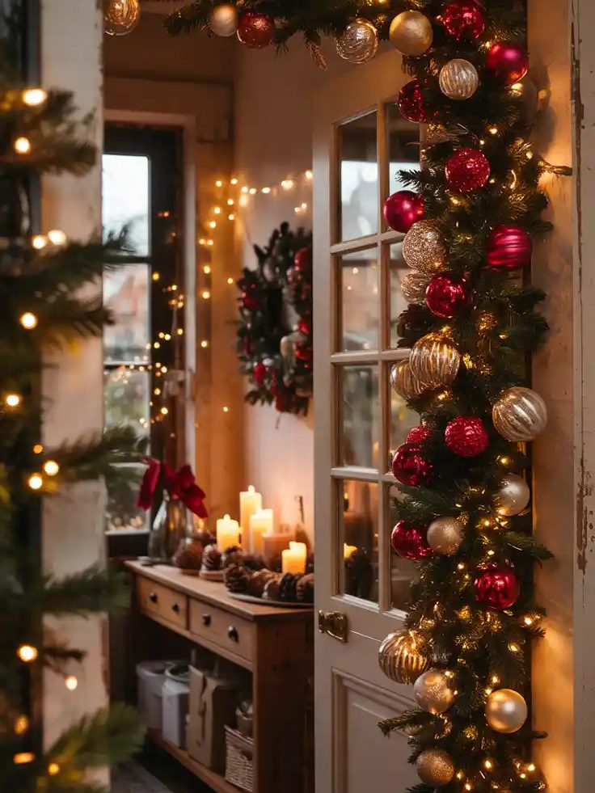

> TIP:QUICK: Dress both sides of a glass-door garland — the back shows from inside.

## 14. Garland with Hanging Ornaments in a Doorway

A garland around an interior doorway with red and gold ornaments hanging from it in strings is the most festive interior idea here. The hanging ornaments turn the doorway into a curtain of Christmas, and the garland above frames it.

Hang the ornament strings at different lengths so they cascade rather than lining up. Keep them short enough that nobody walks into them — above shoulder height is the rule.

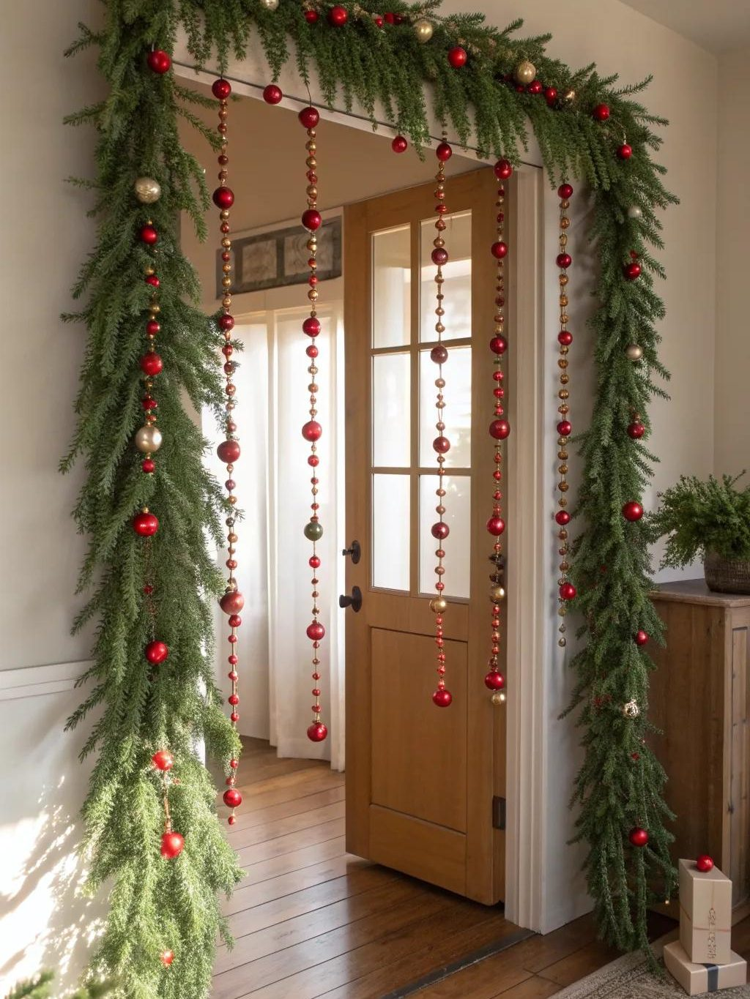

> TIP:CHECK: hang ornament strings at different lengths; keep them above shoulder height

## 15. Double Doors with Twin Wreaths and Gifts

Dark double front doors with a garland, twin wreaths and gifts stacked beside them is the grandest entrance on this list. The gifts make the porch feel like Christmas morning, and the garland ties the whole scene together.

Use empty wrapped boxes for porch gifts, so nothing valuable sits outside. A lantern beside the door adds light and balances the gifts on the other side.

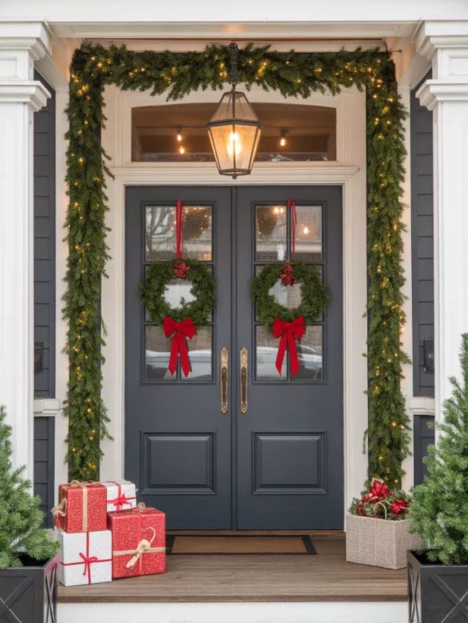

> TIP:GUIDE: Gifts: empty wrapped boxes for the porch | Lantern: balances the gifts on the other side | Safety: nothing valuable sits outside

## 16. Simple Garland Over White Double Doors

A simple green garland with small red bows over white double doors is the most restrained entrance here, and it suits a modern house where one quiet detail beats a dozen. The garland is the only decoration, and it is enough.

This look only works if the garland is full — a thin garland on a wide double door looks unfinished. Choose the fullest garland you can find and let it drape low on both sides.

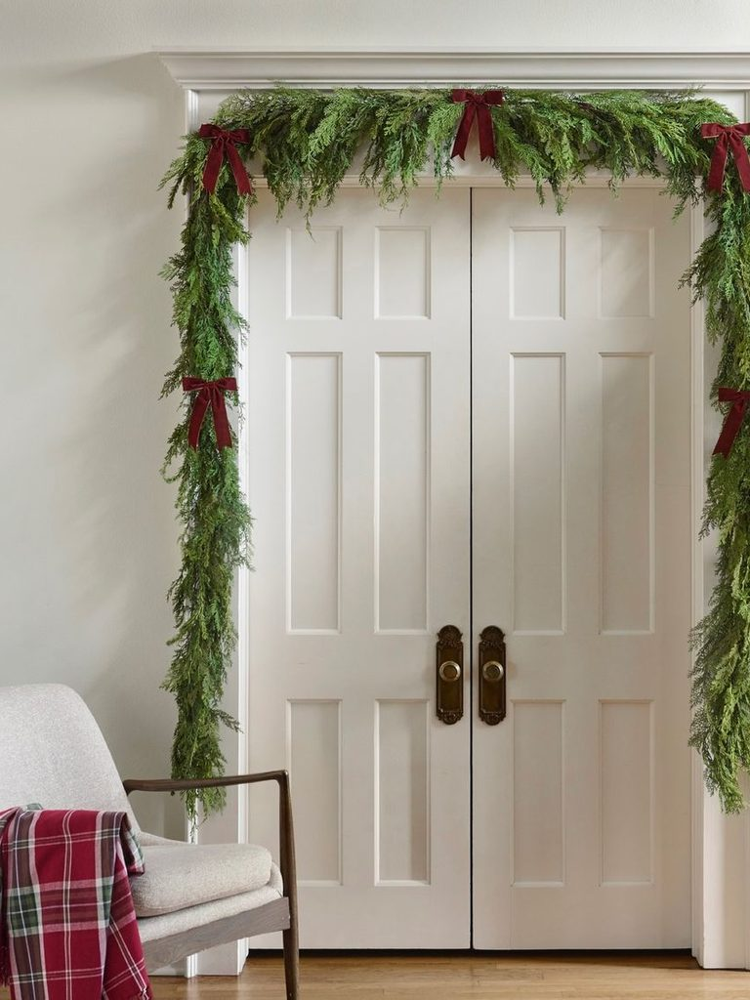

> TIP:QUICK: A simple garland on a wide double door must be full — a thin one looks unfinished.

## 17. Garland with a Burgundy Bow Wreath

A wooden front door framed by a garland with a burgundy bow wreath is the most traditional entrance here. The burgundy is deeper and richer than bright red, and it suits a house with warm wood and stone.

Burgundy ribbon in a velvet finish reads richer than satin, especially in low winter light. A burgundy bow on the wreath and small matching bows on the garland tie the frame together.

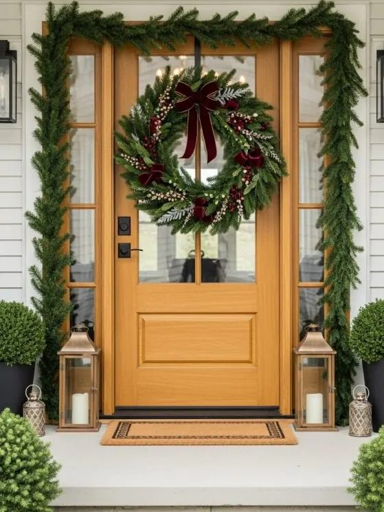

> TIP:CHECK: burgundy velvet reads richer than satin in low light; match small bows on the garland to the wreath bow

## 18. Pinecone and Berry Garland on a Wood Door

A pinecone and berry garland on a wooden front door is the most natural entrance on this list. The pinecones and berries look gathered rather than bought, and the wood door underneath suits them perfectly.

Wire the pinecones to the garland in clusters of three and tuck the berries in between, so the garland looks like a hedgerow. A wood door and a natural garland need no other decoration.

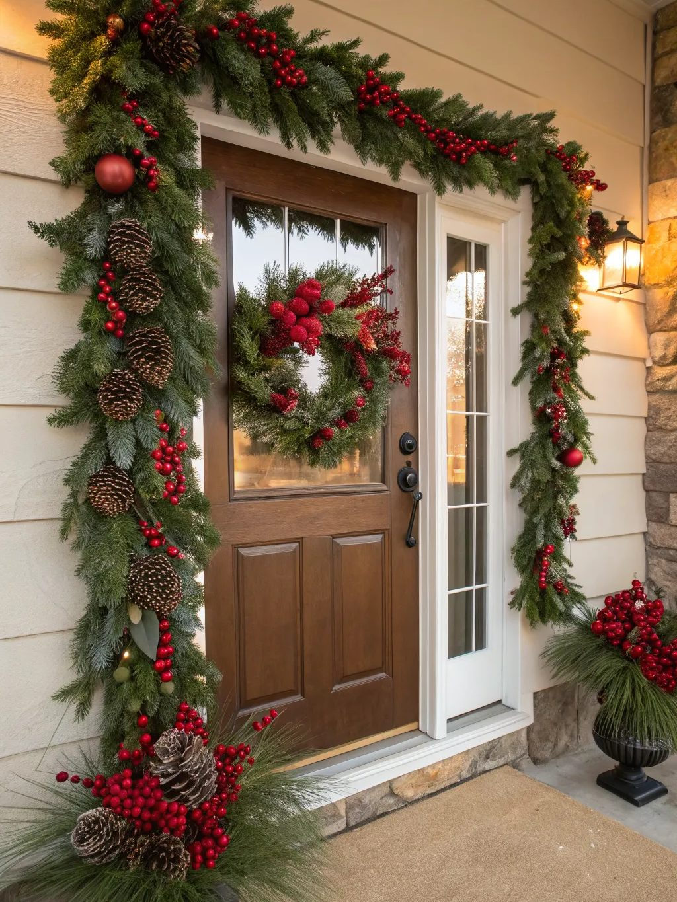

> TIP:GUIDE: Pinecones: clusters of three | Berries: tucked between | Door: wood needs no other decoration

## 19. Red Bow Garland on a Navy Door

Red bows and silver snowflakes on a garland around a navy door is the most festive entrance here. The red against the navy is bold, the silver snowflakes add sparkle, and the wreath in the middle completes the frame.

Silver snowflakes are light, so wire them firmly to the garland — a windy day will carry a loose one away. Red bows in a velvet finish look richer than satin against a dark door.

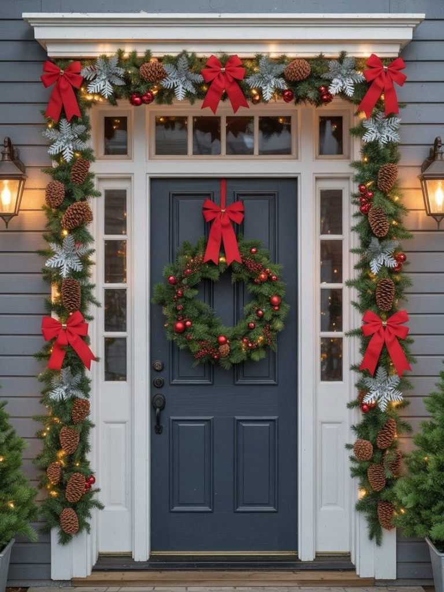

> TIP:QUICK: Wire silver snowflakes on firmly — a windy day will carry a loose one away.

## 20. Double Doors with a Lantern at Dusk

Dark double front doors with a lit garland and a hanging lantern, photographed at dusk, is the most atmospheric entrance here. The lantern glows, the garland lights twinkle, and the whole porch feels like a Christmas card.

A lantern hung from the porch ceiling is the finishing touch for any front door garland. Use a battery candle inside it for safety, and a timer so it glows at dusk without you thinking about it.

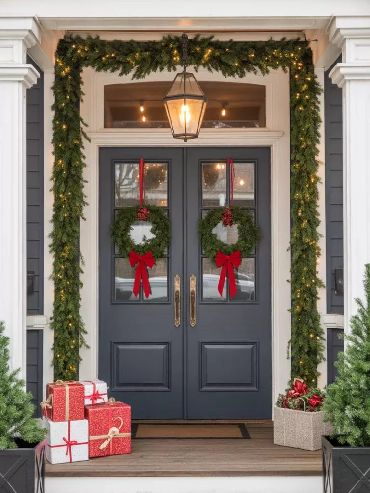

> TIP:CHECK: lantern from the porch ceiling; battery candle inside; timer so it glows at dusk

## 21. Lush Garland Over a Black Door

A lush green garland with a wreath and lanterns on either side of a black door is the most complete front-door scene here. The lanterns frame the door, the garland frames the lanterns, and the wreath is the centerpiece.

Lanterns on the porch floor balance a garland above the door — the eye travels from the lanterns up the garland to the wreath. Keep the lanterns the same height so the frame stays balanced.

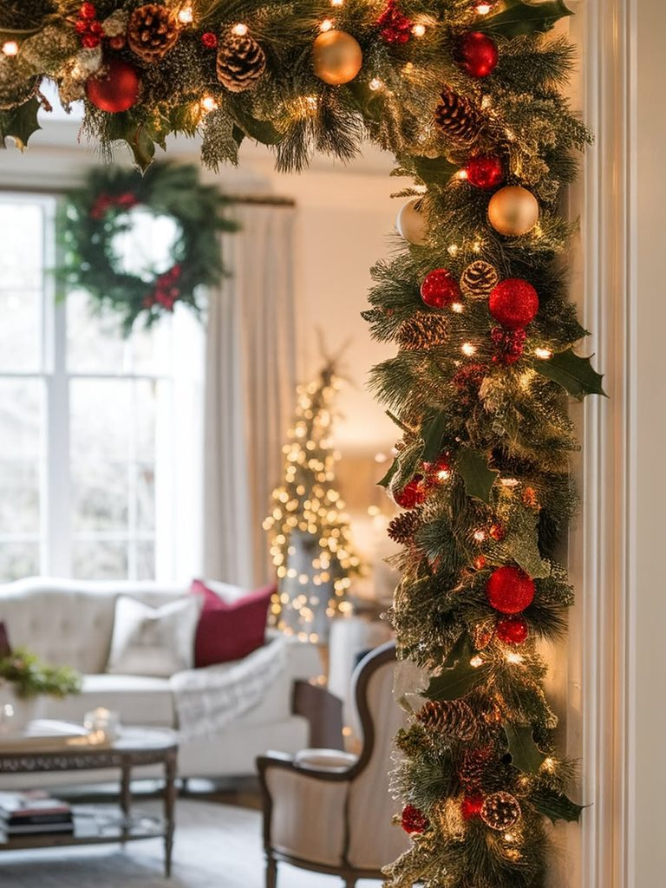

> TIP:GUIDE: Lanterns: same height on both sides | Frame: lanterns below, garland above, wreath center | Balance: the eye travels up the frame

## 22. Garland in a Lit Hallway

A lit garland around an interior hallway doorway, with a gold wreath on the door beyond it, is the warmest interior idea here. The hallway glows, the wreath shines, and the whole house feels dressed for Christmas.

Interior garlands can use plug-in lights, since there is an outlet nearby — and plug-in lights are brighter than battery ones. Run the cord along the top of the door frame where it stays hidden.

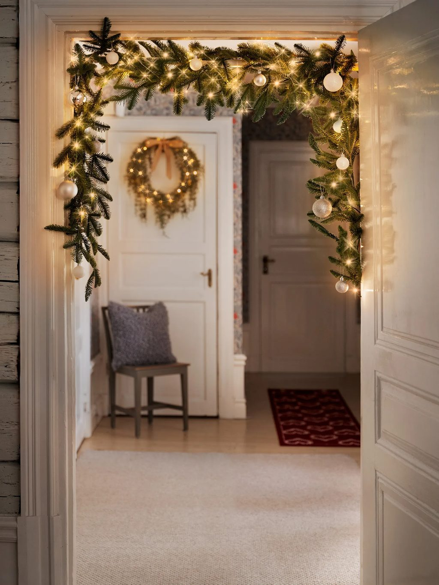

> TIP:QUICK: Plug-in lights are brighter indoors — run the cord along the top of the frame where it hides.

## 23. Garland in a Hallway with a Wreath

A hallway garland with a wreath at the far end is the simplest interior idea here: the garland frames the doorway, and the wreath at the end of the hall gives the eye somewhere to land. It makes a plain hallway feel like a Christmas corridor.

Hang the wreath on the door at the end of the hall, not on the garland itself, so the two read as separate decorations in conversation. A lit garland makes a dark hallway feel welcoming.

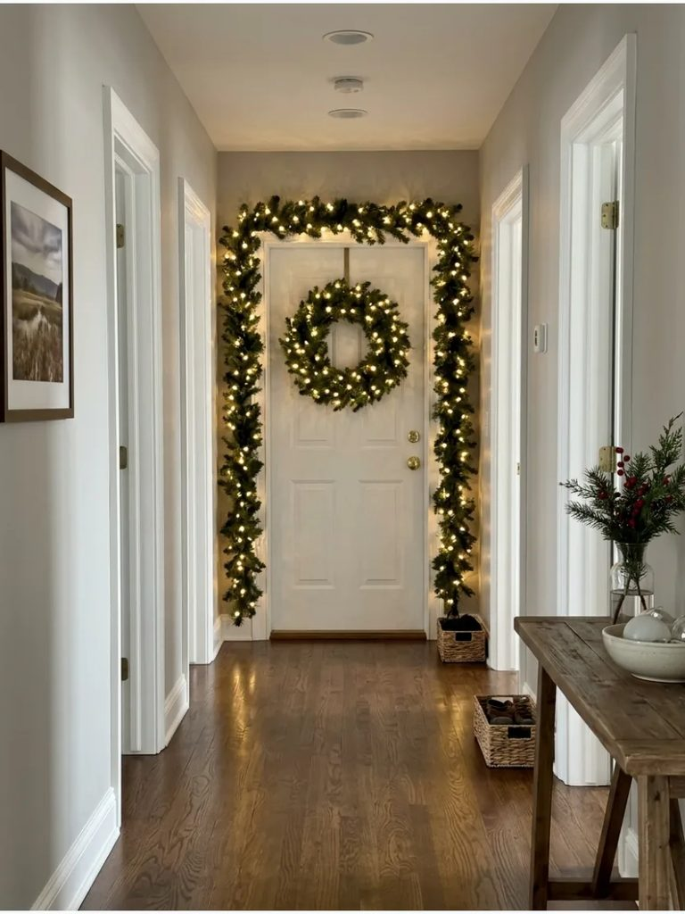

> TIP:CHECK: wreath on the door at the end of the hall, not on the garland; lit garland warms a dark hallway

## 24. Garland Around French Doors

A garland around French doors in a warm entryway, with wreaths on the doors beyond, is the most elegant interior idea here. The French doors are already beautiful, and the garland just frames them.

French doors have a lot of glass, so the garland shows from both sides — dress it fully, front and back. A garland that looks good from the living room and the hallway is worth the extra effort.

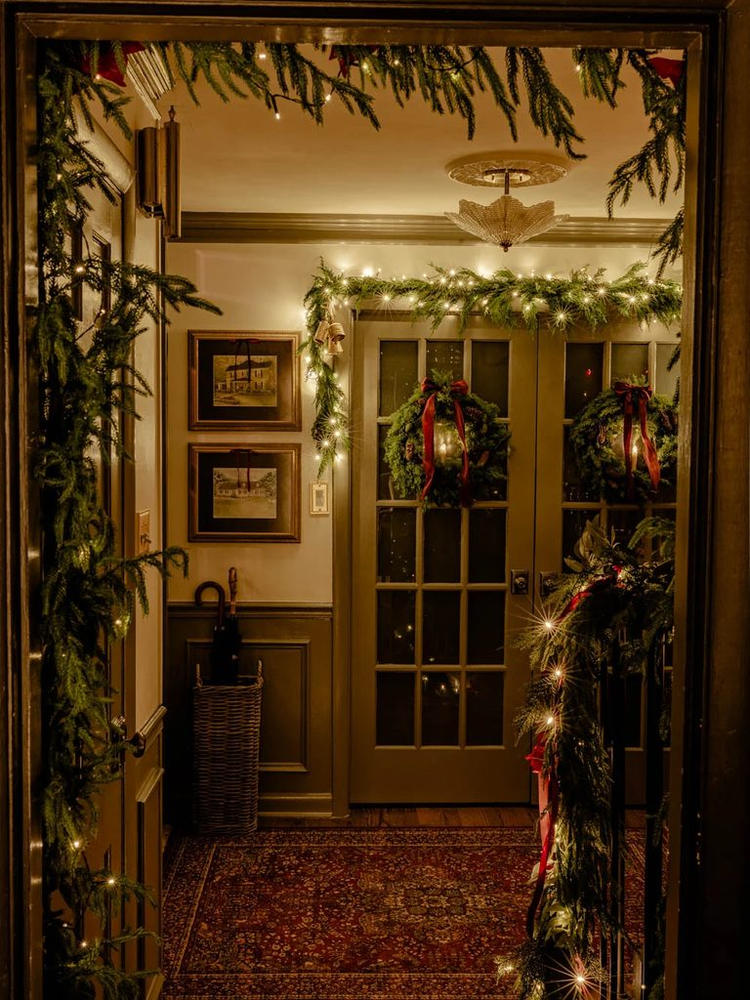

> TIP:GUIDE: Dress: fully, front and back — French doors show both sides | Effort: worth it for two rooms | Glass: shows the back of the garland

## 25. Red and Gold Garland in a Living Room Doorway

A red and gold garland with a big bow in a living room doorway is the most glamorous interior idea here. The red and gold suit a room with warm colors, and the big bow at the top is the finishing touch.

A big bow needs wired ribbon to hold its shape, and it should be at least twelve inches across to read from across the room. Hang it at the top center of the doorway, where it crowns the frame.

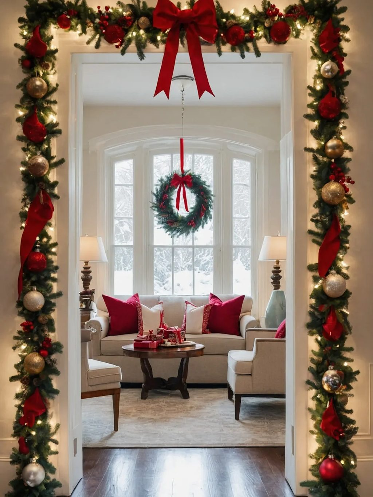

> TIP:QUICK: A big bow needs wired ribbon and at least twelve inches across to read from across the room.

## 26. Gold Ornament Arch in a Hallway

A hallway arch dressed with a garland and gold ornaments is the most golden interior idea here. The arch is already a beautiful shape, and the garland with gold baubles makes it feel like a Christmas gateway.

An arch needs a longer garland than a square doorway — measure around the curve. Gold ornaments catch the hallway light and make the arch glow, especially with fairy lights woven in.

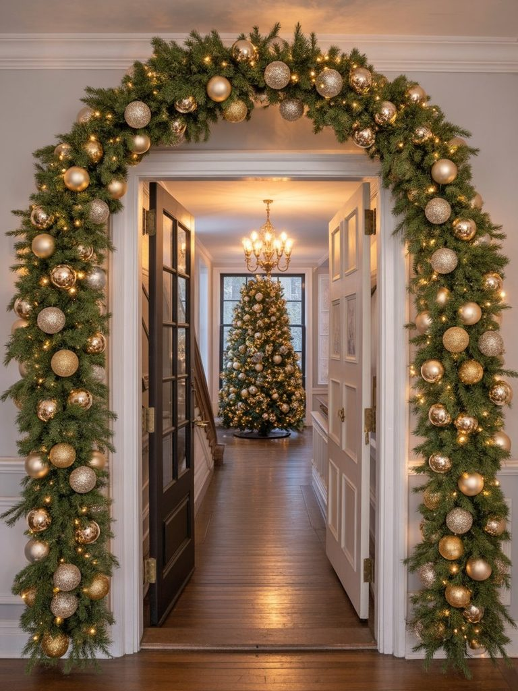

> TIP:CHECK: measure around the curve, not across; gold ornaments catch hallway light; weave fairy lights in

## 27. Double Garland Arch in a Hallway

Two garland arches in a hallway, one behind the other, leading to a front door with a wreath, is the most dramatic interior idea here. The arches repeat like a colonnade, and the wreath at the end is the destination.

Repeating the same garland twice is the trick — the same greenery, the same lights, the same dressing. Two different garlands would compete; two identical ones feel like architecture.

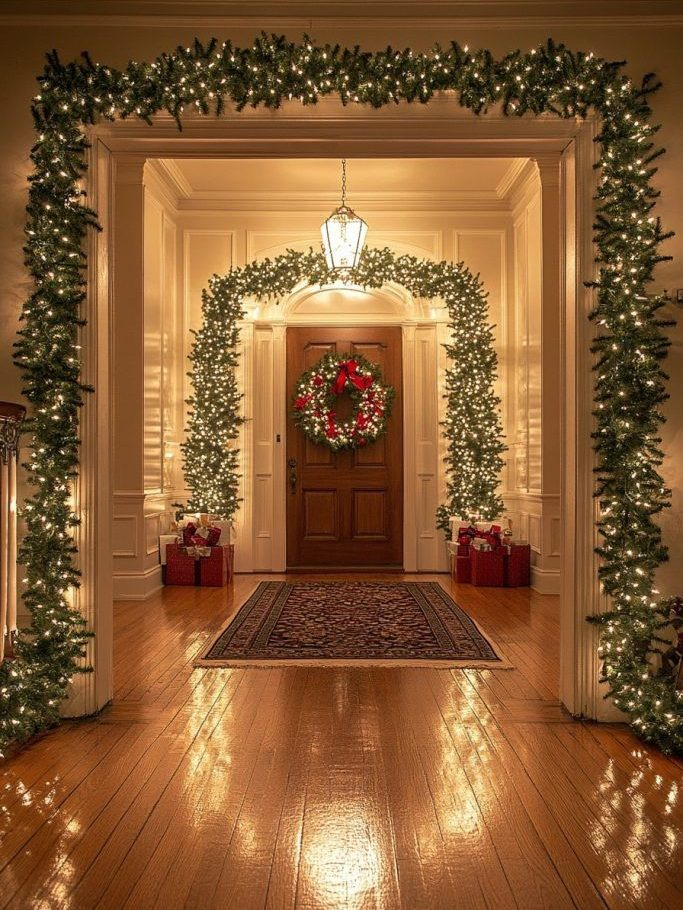

> TIP:GUIDE: Repeat: same garland twice, identical dressing | Two different garlands would compete | Effect: the arches feel like architecture

## 28. Red Bow Garland in a Hallway

A hallway doorway with a garland and red velvet bows is the most traditional interior idea here. The red bows are the whole decoration, and they turn a plain white hallway into a Christmas corridor.

Red velvet bows in a hallway need no other color — the white walls and the green garland are enough. Hang the bows at the top corners and the middle, so the frame feels balanced.

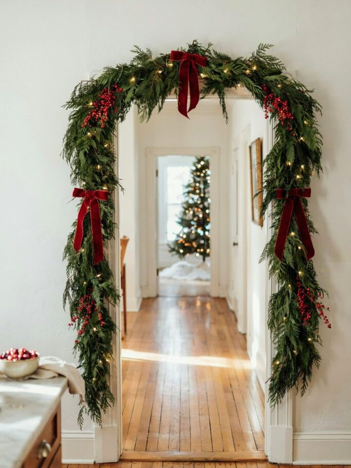

> TIP:QUICK: Red velvet bows need no other color in a hallway — white walls and green garland are enough.

## 29. Red Ribbon Garland in a Living Room Doorway

A living room doorway with a garland and red ribbon, crowned by a big bow, is the most welcoming interior idea here. The ribbon winds through the greenery like a vine, and the bow at the top is the finishing touch.

Wind the ribbon through the garland in loose loops rather than wrapping it tightly — the loops catch the light and look generous. A red ribbon suits a living room with red cushions or a red rug.

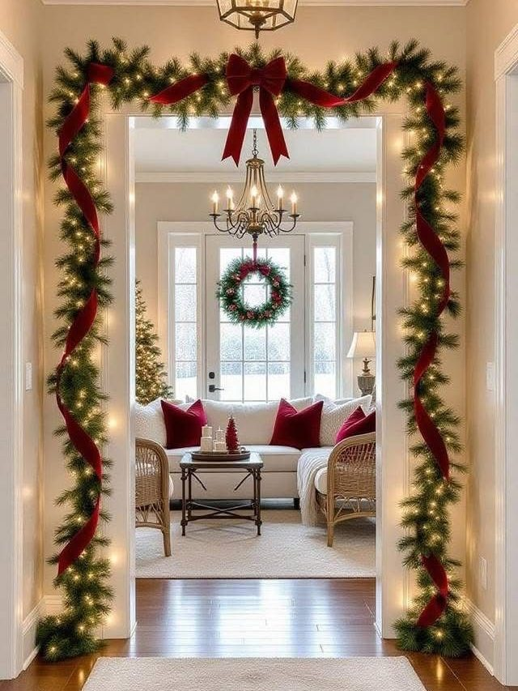

> TIP:CHECK: ribbon in loose loops, never wrapped tight; red suits rooms with red cushions or a red rug

## 30. Garland Arches Down a Grand Hallway

A grand hallway with a row of garland arches and a red carpet is the most spectacular idea on this list. The arches repeat down the hall like a Christmas avenue, and the red carpet underneath ties them together.

This is the look to steal in miniature: even two arches in a short hallway give the same effect. Keep the dressing identical on every arch, so the repetition reads as intentional.

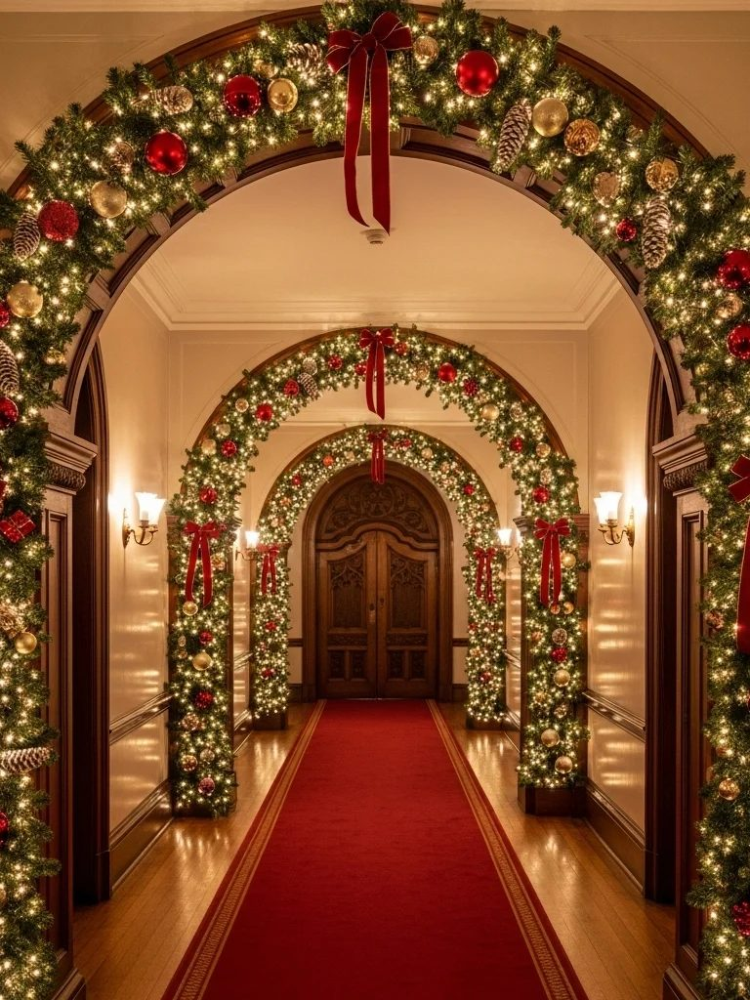

> TIP:GUIDE: Steal it small: two arches in a short hall give the same effect | Dressing: identical on every arch | Carpet: red ties the arches together

## Takeaway

- A doorway garland is the first Christmas decoration anyone sees, and the one that makes coming home feel special.
- Start with the front door — one full garland, a wreath in the middle, and a bow or two — and then carry the same greenery inside to a hallway or a living room doorway.
- If the mantel is next on your list, our [30 Garland on Mantle Ideas for a Warm, Festive Home](https://www.cozynesthomeideas.com/posts/garland-on-mantle/) shows how the same garland dresses a fireplace.

## Frequently Asked Questions

### How do I hang garland around a front door without damaging it?

Use outdoor adhesive hooks or garland ties on the door frame, never nails in the door itself. Stick the hooks to the trim where they stay hidden, and choose hooks rated for outdoor use and for your garland's weight. Remove them slowly in January, warming the adhesive with a hair dryer if it resists.

### How long should a doorway garland be?

Measure around the door frame — up one side, across the top and down the other — then add at least a foot so the ends can drape. A standard front door needs a nine- or ten-foot garland, while a double door or an arch needs twelve feet or more. A garland that ends exactly at the frame looks stretched.

### Should I use real or faux garland on a front door?

Faux garland is the practical choice outdoors: it never sheds, survives wind and rain, and stores for years. Real garland smells wonderful but dries out fast in sun and wind, and it drops needles on the porch. A good compromise is a faux base garland dressed with real pinecones and a fresh wreath.

### How do I keep a doorway garland from blowing away?

Secure the garland at five points — both ends, both top corners and the middle — with outdoor hooks, zip ties or garland ties. A heavier garland stays put better than a light one, so choose a full garland and wire the ornaments on firmly. Check the fixings after the first windy day and tighten anything loose.

### Can I use lights on a front door garland?

Yes, and battery fairy lights with a timer are the easiest choice, since there is no cord to run across the porch. Plug-in lights are brighter but need an outdoor-rated extension cord and a covered outlet. Keep the light string tucked into the greenery so the wire stays hidden and the bulbs do not get knocked.

### What is the difference between a doorway garland and a mantel garland?

Very little — the technique is the same, but a doorway garland is usually longer, fuller and more weatherproof, since it faces wind and rain. A mantel garland can be lighter and more delicate, with candles and ornaments that would not survive outdoors. The same garland can often do both jobs in different years.

### How do I dress a doorway garland so it looks full?

Layer two garlands together, twisting them so the branches fill each other's gaps, and tuck in extra sprigs where you can see through. Add pinecones, ornaments, ribbon and bows to fill the remaining gaps, and let the ends drape long. A doorway garland should look generous — a thin garland on a grand door looks lost.

### When should I put up and take down a doorway garland?

Most people put the front door garland up in late November or early December, once the porch is clear of autumn leaves. Take it down in the first week of January, before winter weather damages it. Real garland should come down sooner, as soon as it dries out — usually by New Year.
