# 30 Fall Home Decor Ideas for Living Rooms

Fall is the season the living room finally gets to be the coziest room in the house. These fall home decor ideas for living rooms work with warm texture, low golden light and one or two seasonal touches — no full redecoration needed, and most of them take an afternoon at most.

The rule that holds every room in this list together is simple: add softness first, then warm light, then one autumn accent. Start with a throw and a pillow, add a candle or two, and finish with pumpkins, leaves or dried stems. If you want the same warmth with a festive twist later in the year, our [30 Christmas Living Room Ideas for a Warm, Festive Home](/posts/christmas-living-room/) picks up where fall leaves off.

## 1. A Chunky Knit Throw on the Sofa

A chunky knit throw is the fastest way to make a living room feel like fall. Here a thick cream knit drapes over the arm of a beige sofa, with a basket of small pumpkins on the floor below and candles glowing on the coffee table. The oversized stitches do the work — the bigger the knit, the cozier the room reads.

Drape it, do not fold it. A throw tossed over the back of the sofa looks inviting, while a neatly folded one looks like storage. Keep it on the sofa all season so the room is always ready for a cold evening.

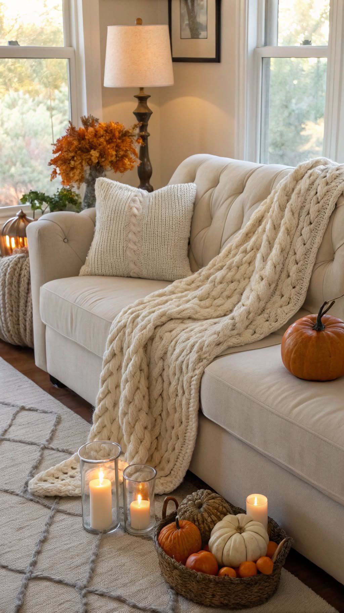

> TIP:QUICK: One oversized throw beats three small ones — scale is what makes a knit read as cozy.

## 2. Plaid Throw Pillows in Rust and Mustard

Plaid pillows in rust, mustard and cream turn a plain sofa into a fall scene in minutes. Here two sofas face each other across a rug scattered with leaves, each dressed with plaid throws and pillows in warm autumn tones, with a basket of gourds waiting on the floor between them.

Mix the plaids in one color family — rust, mustard and brown — and let the rest of the room stay calm. Three to five pillows is the sweet spot; more than that and the sofa becomes a cushion shop.

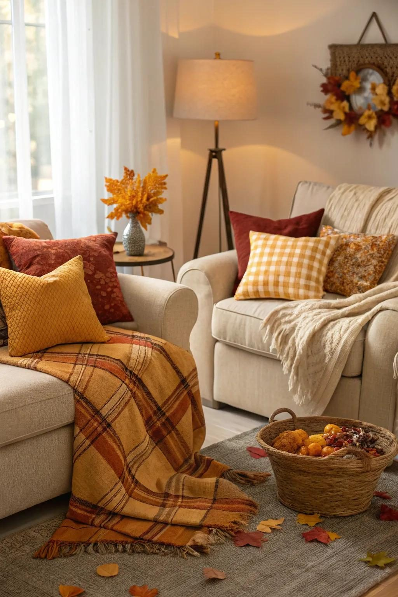

> TIP:CHECK: one large plaid; one small check; one solid color in the same warm family

## 3. A Pumpkin Centerpiece on the Coffee Table

A pumpkin centerpiece is the classic fall coffee table, and it works because it is low, round and warm. Here a mix of orange and white pumpkins sits on a round table with candles and fall leaves, the big pumpkin on the floor below echoing the ones above. Nothing on the table is taller than a mug, so conversation still flows across it.

Build the centerpiece on a tray so it lifts off in one move when you need the table. A wooden tray, a few pumpkins of different sizes and one candle is the whole recipe.

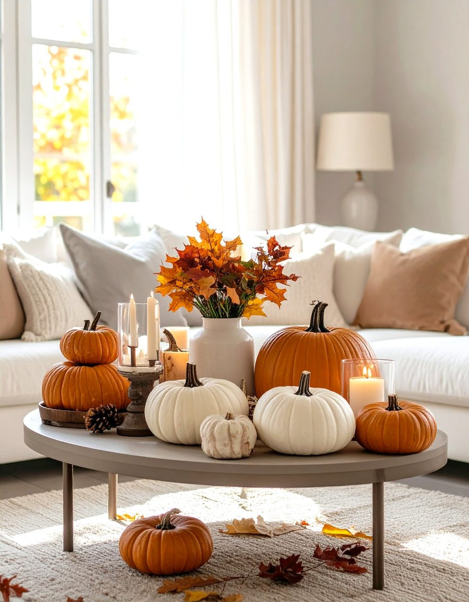

> TIP:GUIDE: Tray: one wooden tray | Pumpkins: three sizes, two colors | Candle: one pillar, unscented

## 4. Dried Eucalyptus in a Dark Vase

Dried eucalyptus brings fall color without a single fresh flower. Here copper-brown eucalyptus stems fill a dark, textured vase, their round leaves catching the light against a soft sofa behind. The arrangement lasts all season, needs no water, and costs less than a weekly bouquet.

Cut the stems to different heights so the arrangement looks gathered rather than arranged. A tall vase on a side table or console is the best home for it — the stems need height to show off their shape.

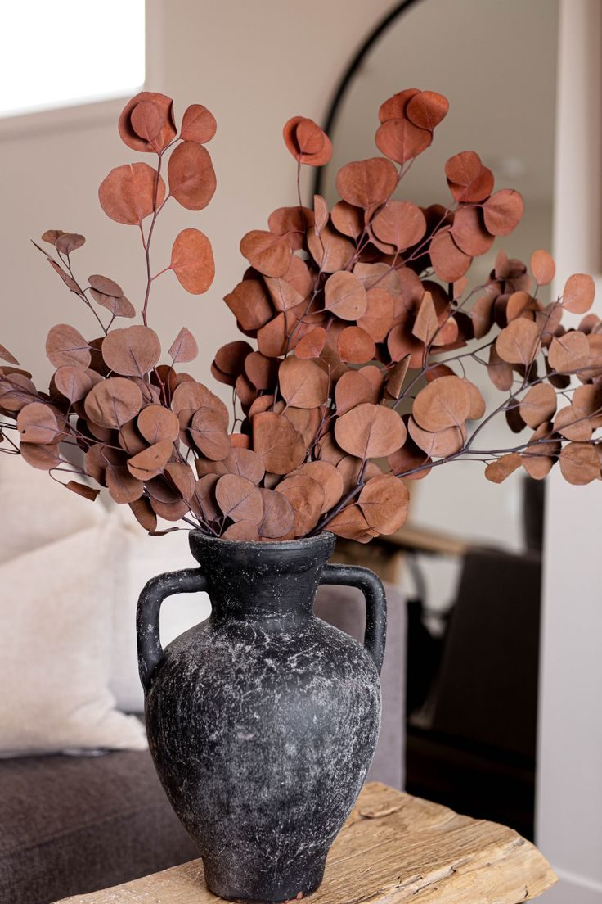

> TIP:QUICK: Copper and burgundy eucalyptus reads as fall; silver-green reads as spring — pick the warm one.

## 5. Amber Candles on the Mantel

Amber candles turn a mantel into the warmest corner of the room. Here a fireplace glows with candles of every size — tall tapers, chunky pillars and small votives in amber glass — with pumpkins and autumn leaves tucked between them and a garland running along the shelf.

Group candles in odd numbers and mix the heights so the light feels layered rather than lined up. Battery candles work just as well on a high mantel, and nobody can tell from the sofa.

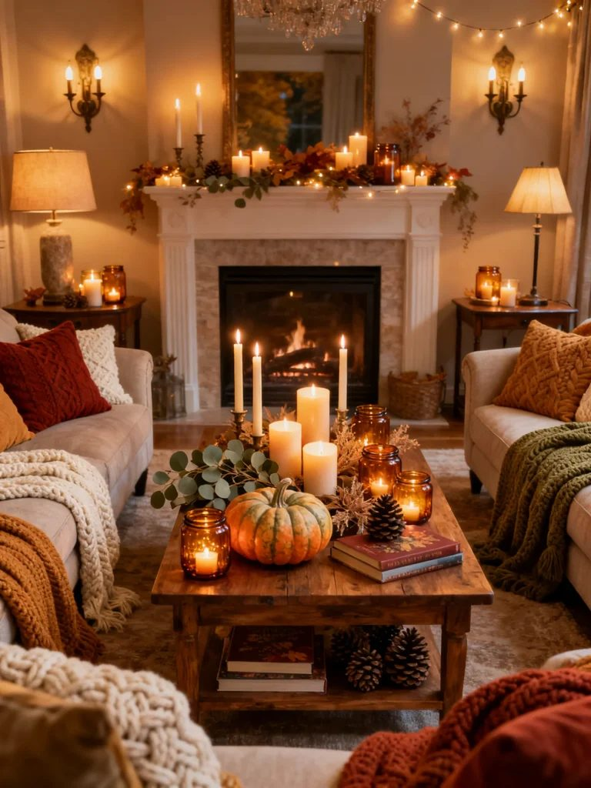

> TIP:CHECK: three heights of candle; amber or brown glass; one small pumpkin between groups

## 6. Rust Velvet Pillows for Instant Warmth

Rust velvet pillows are the quickest color change a fall living room can get. Here two deep rust velvet pillows sit on a light sofa with a matching knit throw, the plush fabric catching the window light while the rest of the room stays pale and calm. No new furniture, no paint — just pillows.

Velvet works in fall because it holds light the way summer linen does not. Two pillows in the same rust tone are enough to warm a whole sofa; add a throw in the same color and the look is finished.

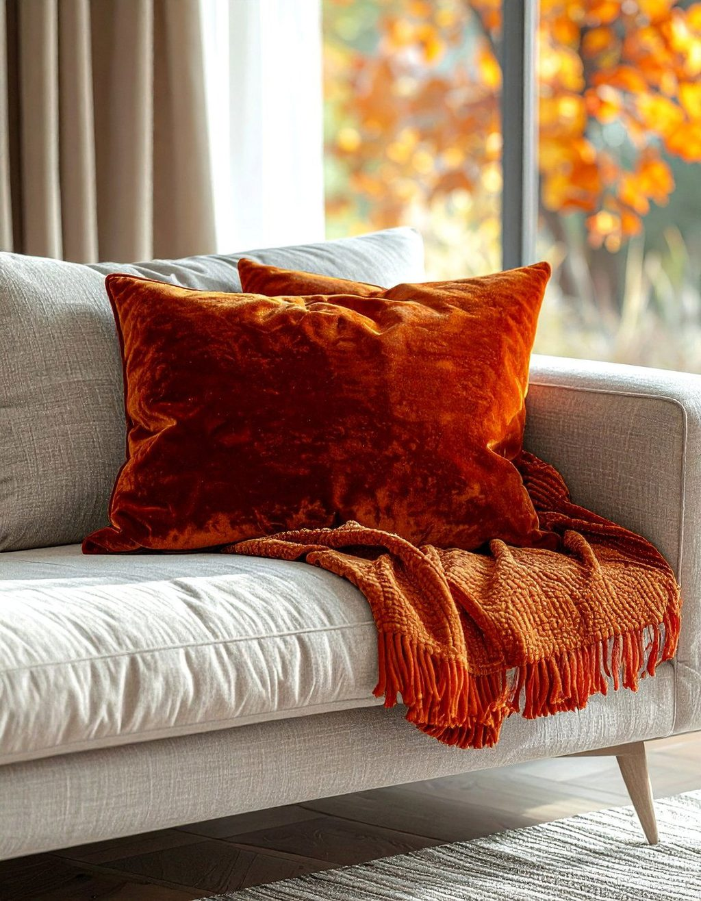

> TIP:GUIDE: Pillows: two, 20 inch square | Fabric: velvet or corduroy | Pair with: a knit throw in the same rust

## 7. A Basket of Firewood by the Fireplace

A basket of firewood beside the fireplace says fall before anything else in the room does. Here two woven baskets sit in front of a lit stone fireplace — one holding stacked logs, the other folded blankets — with a chunky knit throw draped over the furniture nearby and candlelight warming the whole corner.

Even a fireplace that never gets lit looks better with a basket of logs beside it. Keep the basket on the hearth or just to one side, and stack the logs loosely so the texture shows.

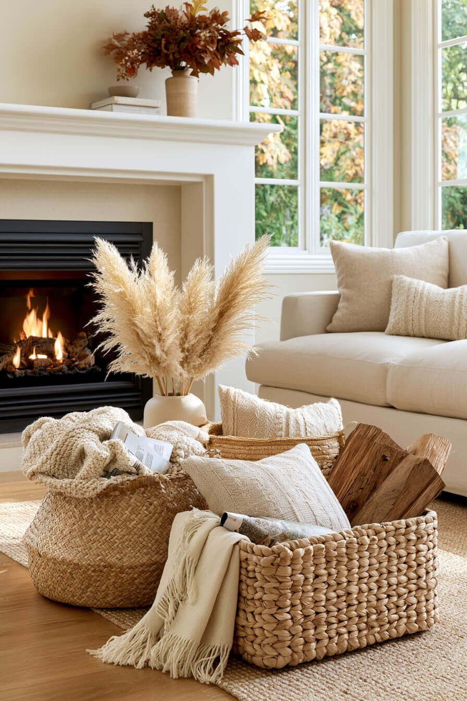

> TIP:QUICK: Birch logs look best — the pale bark reads as decor even before a fire is lit.

## 8. Layered Rugs: Jute Under Plaid Wool

Layered rugs make a fall living room feel warmer underfoot the moment you step in. Here a natural jute rug grounds the room, with a plaid wool layer on top and a plaid ottoman anchoring the seating area. The textures stack — rough jute, soft wool, woven pattern — and the floor feels as dressed as the sofa.

Let the bottom rug be the bigger one and the top layer sit slightly off-center, so both edges show. A jute base with any patterned wool rug on top is the combination that almost always works.

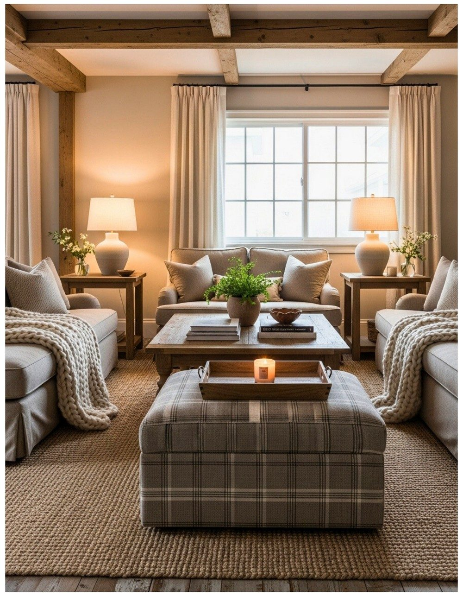

> TIP:CHECK: bottom rug in natural jute, the largest; plaid wool rug on top, smaller; show 15 cm of jute all round

## 9. A Fall Leaf Garland on the Mantel

A fall leaf garland draped over the mantel is the single piece that makes a fireplace read as autumn. Here maple leaves in red, orange and yellow swag across a white mantel and down both sides, with pumpkins lined along the shelf and the hearth, pinecones tucked between them, and a leaf-framed mirror above.

Drape the garland, do not hang it straight — the swag is what makes it look generous. Let the ends fall a little past the mantel edges, and add pinecones where the garland dips lowest.

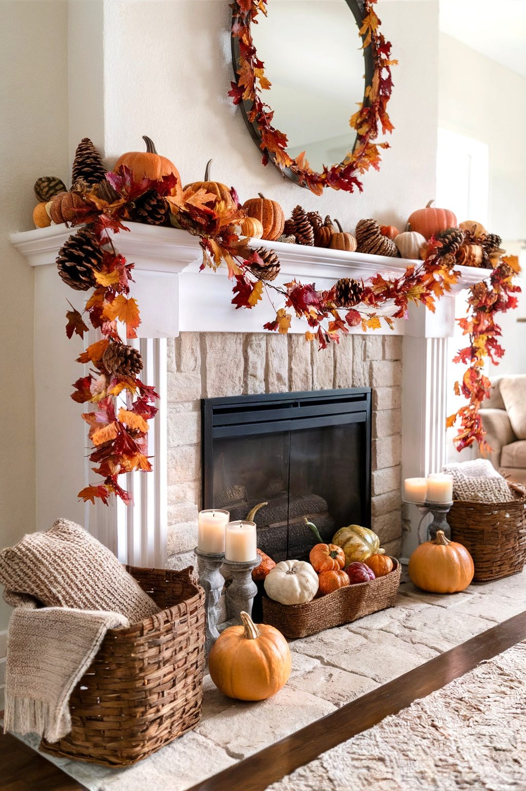

> TIP:GUIDE: Garland: one long maple-leaf swag | Pumpkins: five, mixed sizes | Pinecones: three, tucked into the dips

## 10. Amber Glass Vases and Candle Holders

Amber glass glows the moment a candle is lit behind it, and a cluster of it on the coffee table is fall light in a bottle. Here amber vases and candle holders of different shapes sit on a wooden table, the flames inside warming the glass to honey-gold, with a small pumpkin and dried stems finishing the arrangement.

Mix the shapes — one tall bottle, one squat jar, one ribbed votive — and keep them in the same amber tone so the group reads as a set. Two lit candles are enough; the rest can stay empty as vases.

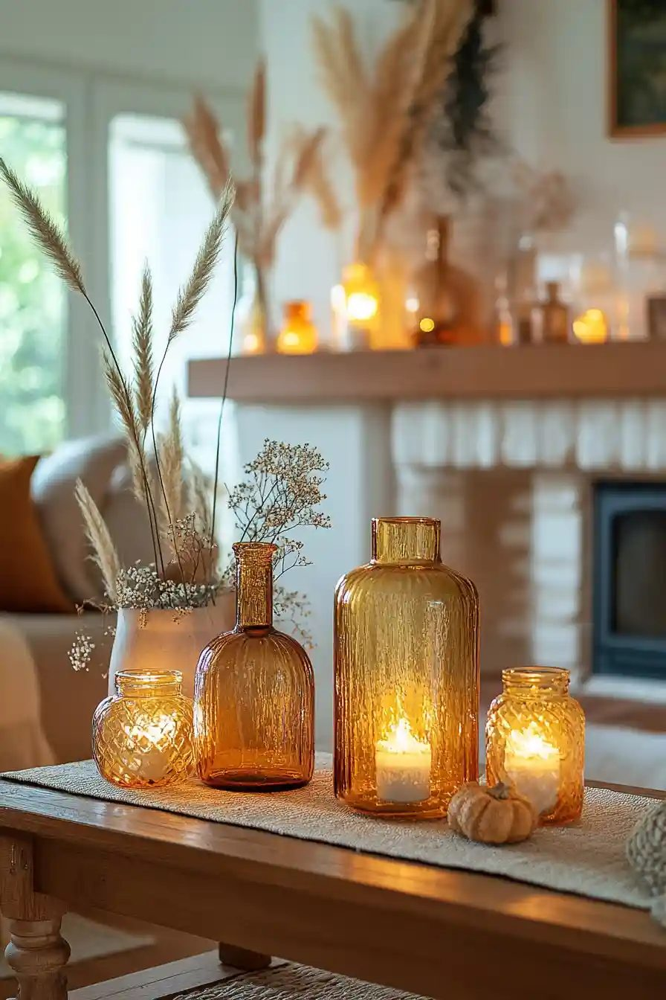

> TIP:QUICK: Put the tallest amber piece at the back so the light layers from tall to short.

## 11. A Reading Nook with a Plaid Blanket

A reading nook is fall's best excuse for a quiet corner. Here a wingback armchair wears a burnt-orange plaid throw, with a small side table holding a lamp, a mug and a few pumpkins, and books stacked on the lower shelf. The chair faces the window, and the whole corner feels like an invitation to sit down with a book.

The nook needs only four things: a comfortable chair, a throw, a light and a place for a mug. Put it near a window if you can — fall light through glass is the best reading lamp there is.

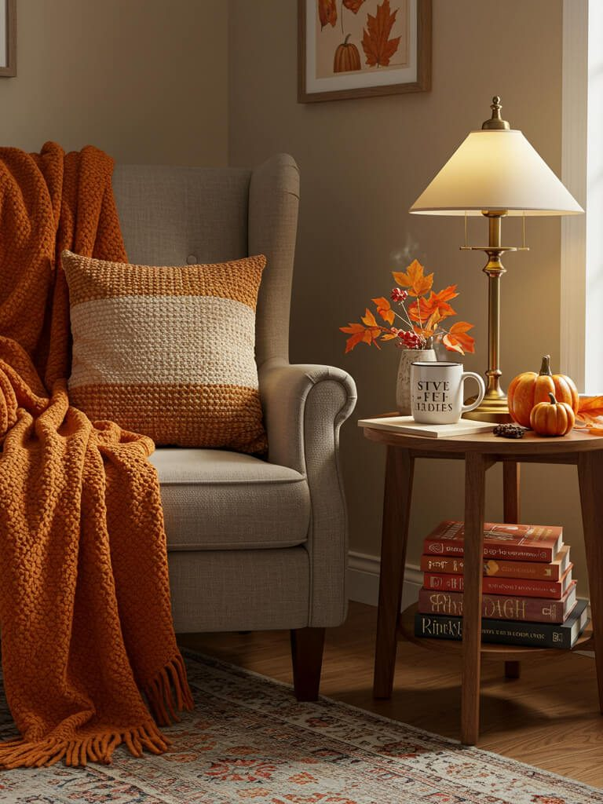

> TIP:CHECK: one comfortable chair; one plaid throw; one warm lamp and a table for a mug

## 12. A Burnt Orange Throw on the Armchair

A burnt orange throw over an armchair is the boldest single move in this list, and it works because the color does all the talking. Here a thick cable-knit throw in vivid orange covers a beige wingback chair, pooling onto the floor, with small pumpkins and fall leaves on the side table behind it.

Let the throw be the only strong orange in that corner — the chair, the rug and the walls stay neutral so the color has somewhere quiet to sit. A chunky cable knit reads warmer than a flat weave, so pick texture over pattern here.

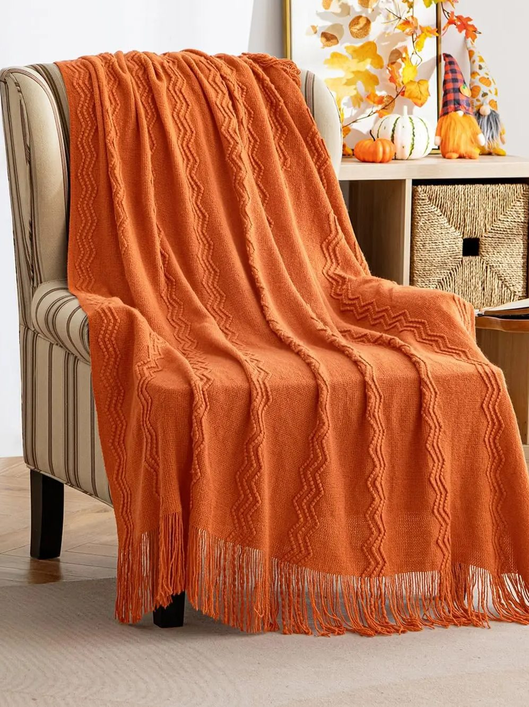

> TIP:GUIDE: Throw: cable knit, burnt orange | Chair: neutral, plain back | Rest of corner: cream and wood only

## 13. A Wooden Coffee Table Styled with Pumpkins and Books

A wooden coffee table styled for fall is a still life you get to use every day. Here a light wood table holds a stack of books topped with a candle, a vase of autumn branches, and a tray of white pumpkins and pinecones, with a cream throw and rust pillows on the sofa behind it.

Style in thirds: books on one end, a tray in the middle, a vase on the other end. Leave one third of the table empty — a styled table still needs room for a mug.

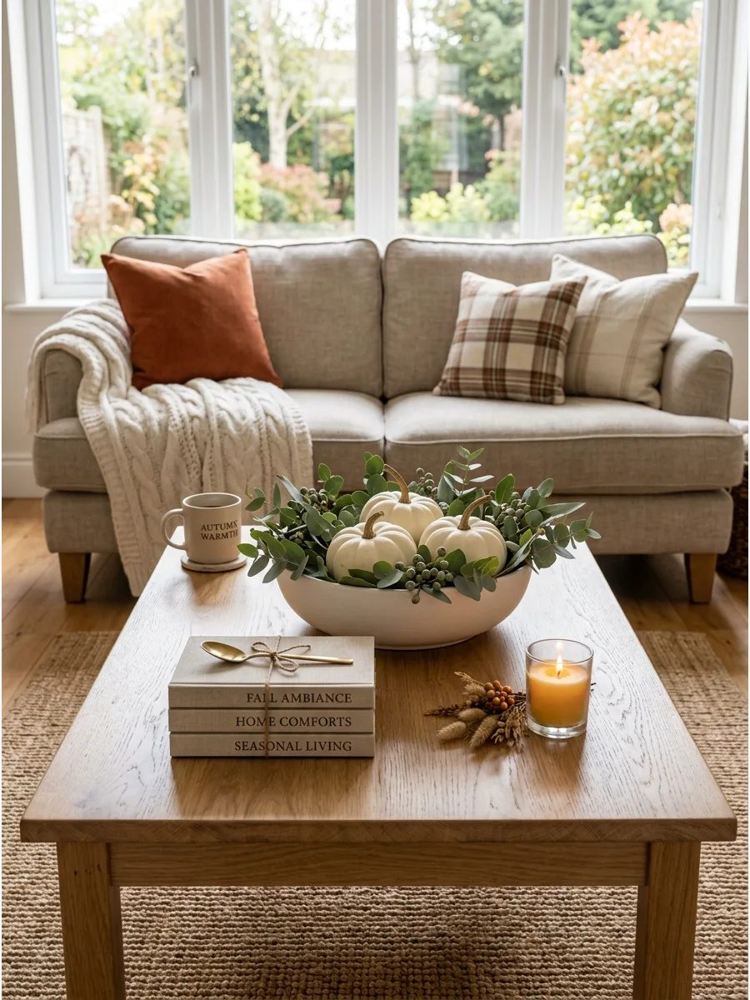

> TIP:QUICK: Books under a candle lift it to eye level and protect the wood in one move.

## 14. A Mustard Yellow Accent Chair

A mustard yellow accent chair is fall color in furniture form. Here a velvet mustard chair sits by a tall window with autumn trees outside, an open book and a rust throw on the seat, a steaming mug and small pumpkins on the side table, and a floor lamp glowing amber beside it.

One mustard chair is a statement; two would be a theme. Keep the rest of the corner warm but quiet — wood, cream and rust — and let the chair be the color.

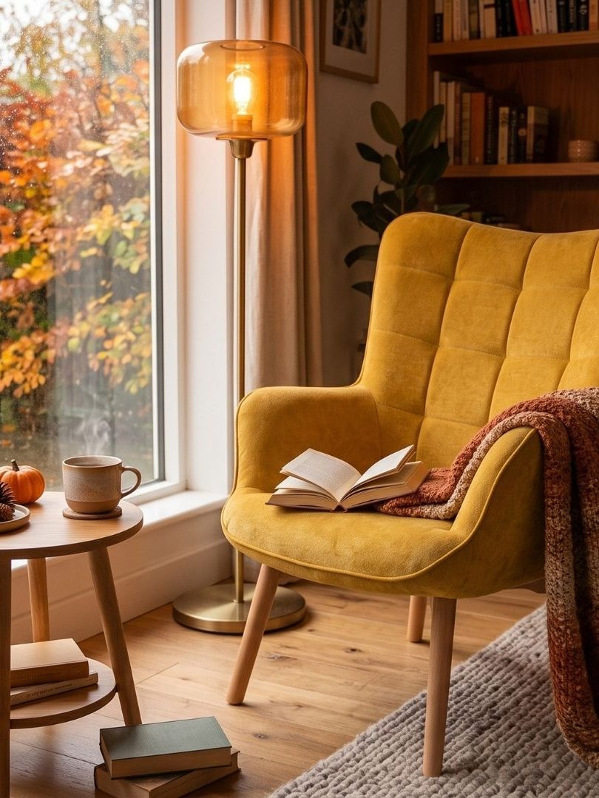

> TIP:CHECK: one mustard chair; warm wood side table; rust throw to tie chair to sofa

## 15. A Fall Wreath Above the Sofa

A fall wreath above the sofa is the wall art that only fall can offer. Here a large wreath of deep red, orange and gold leaves hangs on a white wall, with a white sofa below dressed in rust velvet and cream knit pillows, and a coffee table of pumpkins and candles in front of it.

Hang the wreath so its center sits at eye level from the sofa, not high near the ceiling — a wreath hung too high reads as a ceiling decoration. A wreath with berries and seed pods looks fuller than one of leaves alone.

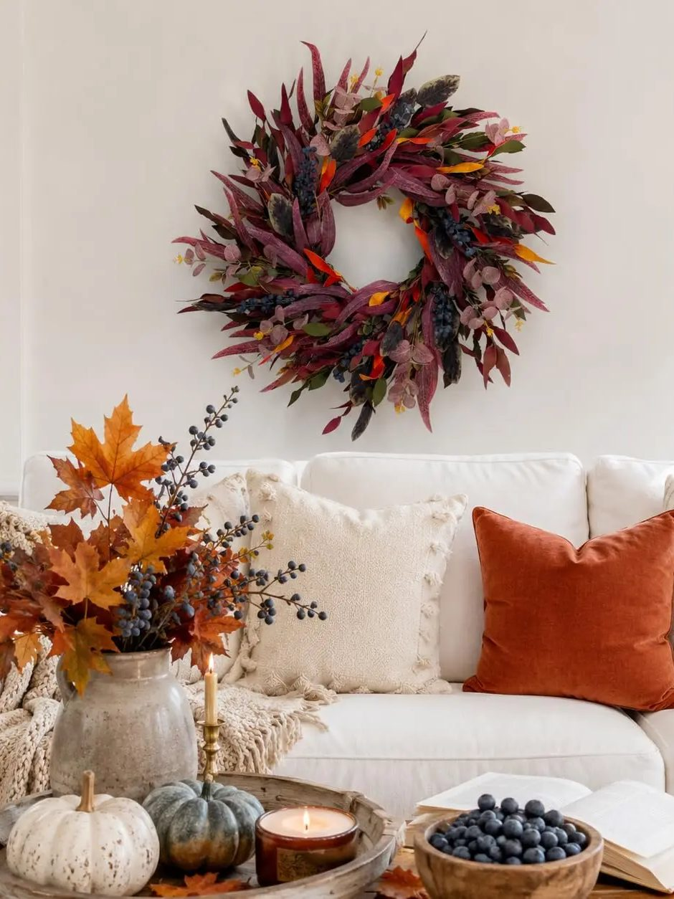

> TIP:GUIDE: Size: wreath about two-thirds the sofa width | Height: center at eye level | Style: leaves plus berries

## 16. Warm Wood in a Walnut Side Table

Warm wood is fall's quietest texture, and a walnut side table brings it in without a single seasonal object. Here a solid wood side table with a wide tapered base stands beside a leather armchair, holding an amber glass lamp and an open book, with autumn foliage glowing through the window behind it.

Wood warms a room the way metal cools it, so swap one cold surface for wood in fall — a side table, a tray, a bowl. The grain is the decoration; nothing on the table needs to be seasonal for the corner to feel like autumn.

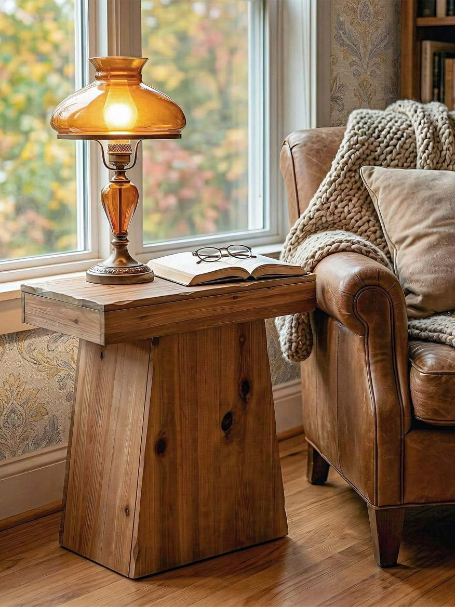

> TIP:QUICK: One walnut or oak piece per seating area is enough — wood is a spice, not the main dish.

## 17. A Faux Fur Throw for Extra Texture

A faux fur throw is the softest layer a fall living room can have. Here a thick dark-brown faux fur blanket drapes over a light sofa in heavy folds, pooling onto the floor, with autumn foliage visible through the windows behind it and a single cream pillow for contrast.

Faux fur works best as the one fluffy thing in the room — pair it with smooth velvet or flat linen, not with another shaggy texture. Dark brown reads as fall; cream reads as winter, so pick the brown while the leaves are still turning.

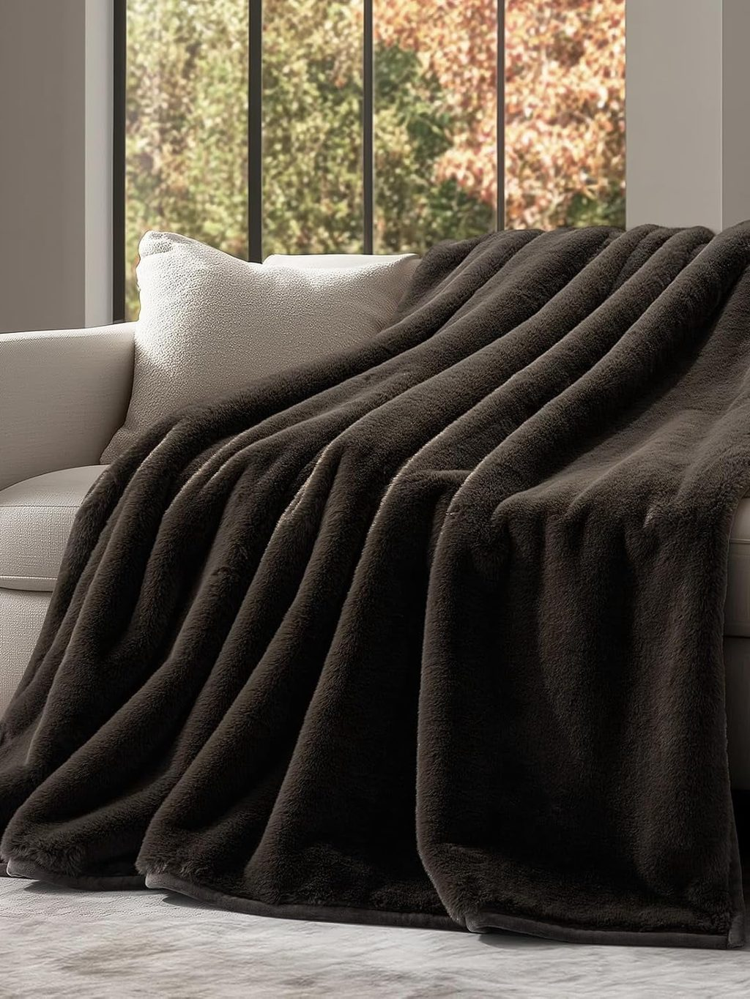

> TIP:CHECK: one faux fur throw; smooth pillows beside it; dark brown for fall, cream for winter

## 18. Copper and Brass Accents

Copper and brass catch fall light like nothing else in the room. Here tall brass candlesticks and a brass tray hold lit tapers on a dark wood coffee table, with copper vases on the shelves behind and rust and mustard pillows on the sofa. The metals warm the whole palette by reflection alone.

Mix copper and brass freely — they are cousins, not rivals — but keep the finish consistent, all polished or all aged. Three metallic pieces per room is plenty; more than that and the room starts to glitter.

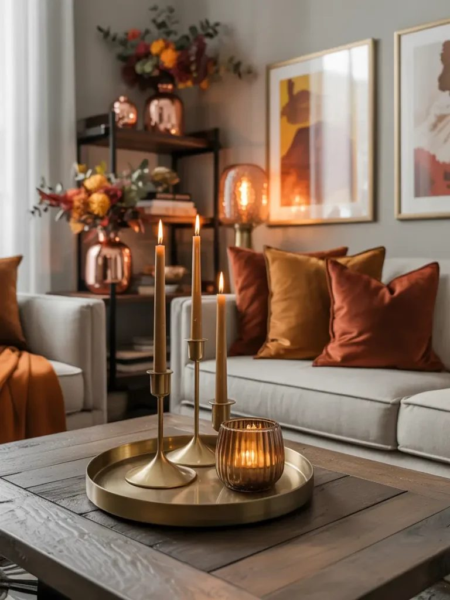

> TIP:GUIDE: Metals: brass tray plus copper vases | Finish: all polished or all aged | Count: three metallic pieces per room

## 19. Dried Pampas Grass in a Tall Vase

Dried pampas grass is fall's tallest, softest decoration. Here feathery plumes rise from a ceramic vase on a wooden coffee table, with white pumpkins, a lit candle and a stack of books around the base, and a chunky knit throw on the sofa behind it. The plumes move slightly with the room's air, which is half their charm.

Trim the stems so the plumes clear the ceiling by a comfortable margin and the vase looks full, not crowded — five to seven stems is the usual sweet spot. Keep pampas away from open flames; it is beautiful and very flammable.

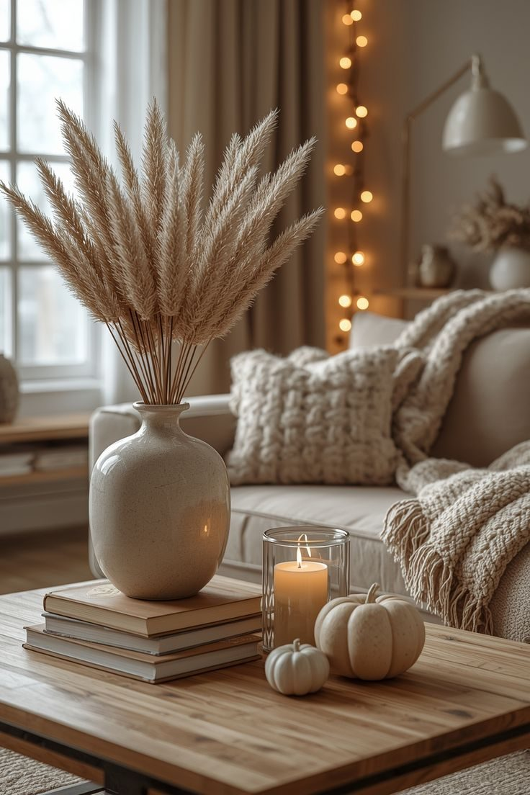

> TIP:QUICK: Five to seven stems fill a vase; more than that looks like a broom, not a bouquet.

## 20. A Stack of Books Topped with a Mini Pumpkin

A stack of books topped with a mini pumpkin is the smallest fall decoration in this list and one of the most charming. Here two white ceramic pumpkins flank three upright navy books on a light wood coffee table, with a mug of tea and a vase of orange maple leaves nearby and a knit throw on the sofa behind.

Use books you actually like — the spines show — and keep the stack to three or four. A mini pumpkin on top is the seasonal note; without it, the stack is just books.

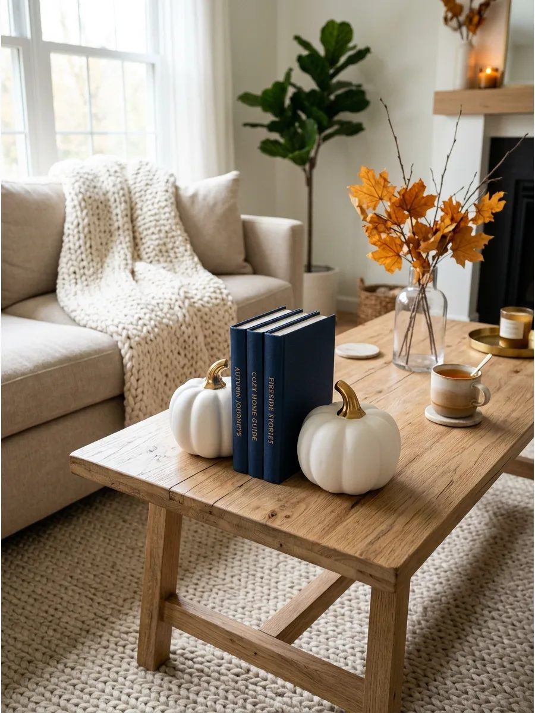

> TIP:CHECK: three upright books; one mini pumpkin on top; one mug beside the stack

## 21. Rust Linen Curtains at the Window

Rust linen curtains frame the autumn view and warm the whole wall. Here floor-length rust panels hang on either side of a large window, the orange and yellow trees outside echoing the fabric, with a wooden coffee table, a white sofa and dried arrangements completing the room.

Curtains are the biggest single piece of color most living rooms have, so changing them changes the room. Hang them high and wide — rod above the window frame, panels past the edges — so the window looks larger, not smaller.

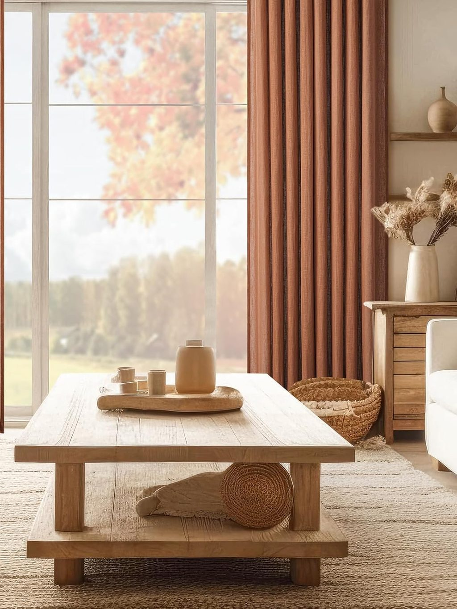

> TIP:GUIDE: Rod: above the frame, wider than the window | Length: floor length | Fabric: linen or linen-look

## 22. A Rustic Ladder Shelf Styled for Fall

A rustic ladder shelf is fall storage and fall decor in one piece. Here a wooden leaning shelf holds books in earth tones, small pumpkins, pinecones and a folded knit blanket, with an armchair and a rust throw beside it and a woven rug underfoot. Every shelf is a small still life, and the whole thing leans casually against the wall.

Style from the top down: tall items on top, heavier books in the middle, blankets and baskets at the bottom. Leave one shelf partly empty — a ladder shelf that is full on every rung looks like a shop display.

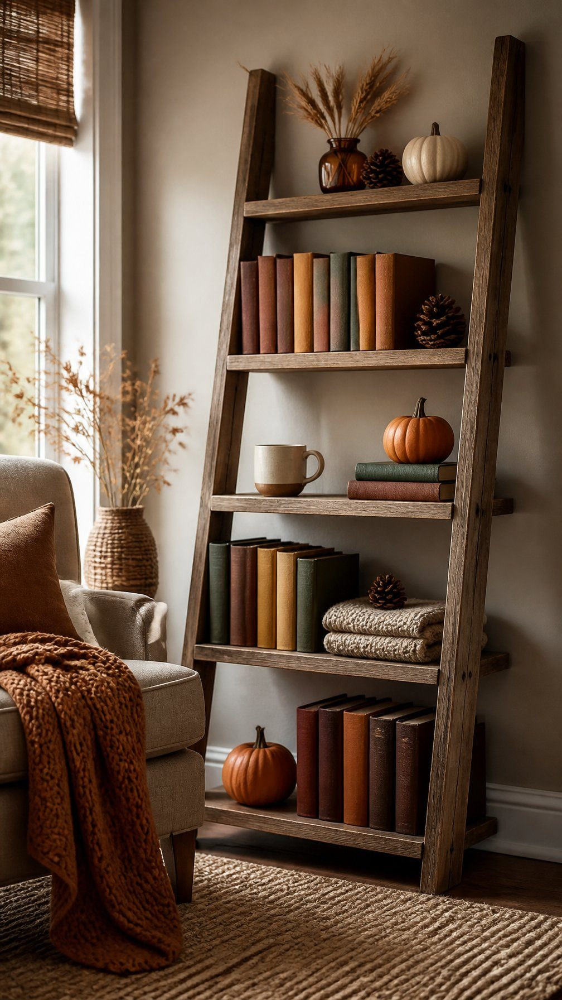

> TIP:QUICK: One pumpkin per shelf is the rule — two per shelf and the ladder becomes a pumpkin farm.

## 23. A Basket of Blankets Beside the Sofa

A basket of blankets beside the sofa is fall's most practical decoration. Here a large woven basket overflows with folded throws in cream knit, beige, rust and plaid, with an orange fringed blanket draped over the side and a burnt-orange ottoman waiting nearby. Guests help themselves, and the room never looks undressed.

Pick a basket big enough that the blankets sit proud of the rim — a half-empty basket looks like laundry waiting to be put away. Roll the throws instead of folding them for a fuller, softer look.

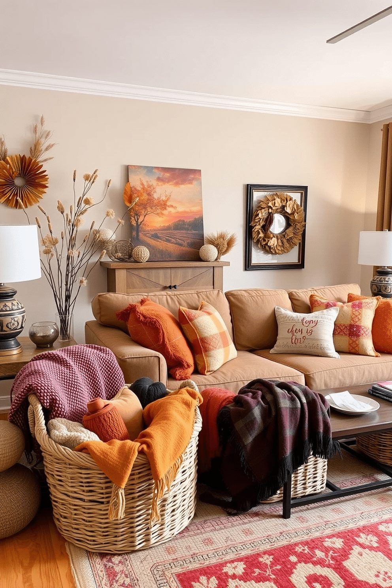

> TIP:CHECK: one large basket; three to four throws; one draped over the rim

## 24. Scented Candles and Cinnamon Sticks

Scented candles and cinnamon sticks are the fall living room you can smell before you see. Here pillar candles and a jar candle glow on a dark wood table, ringed with pinecones and cinnamon sticks, their warm light and spice scent doing what no decoration can do on its own.

Keep the scents to one family — cinnamon, clove and amber together, or apple and cedar — and never light more than two scented candles at once. A cinnamon stick tied to a plain candle with twine is the cheapest fall decoration in this list.

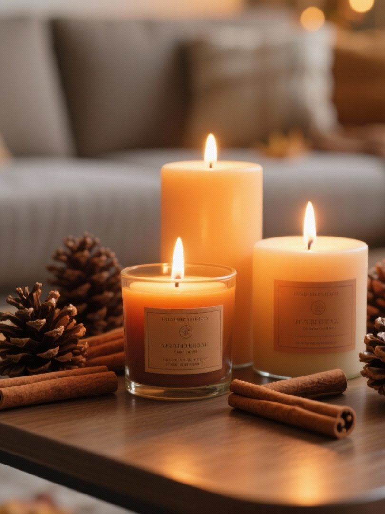

> TIP:GUIDE: Scents: one family only, cinnamon or apple | Candles lit: two at most | Cinnamon: tied to a pillar with twine

## 25. Framed Autumn Leaf Prints

Framed autumn leaf prints are fall wall art that stays up all season without ever shouting. Here a large framed print of orange autumn leaves hangs above a grey sofa, the bright leaves the only strong color in an otherwise calm, pale room, with a black coffee table and woven poufs below.

One large leaf print beats a cluster of small ones in a living room — the scale makes it art rather than decoration. Pick leaves in orange and gold, and frame them in light wood or white to keep the look airy.

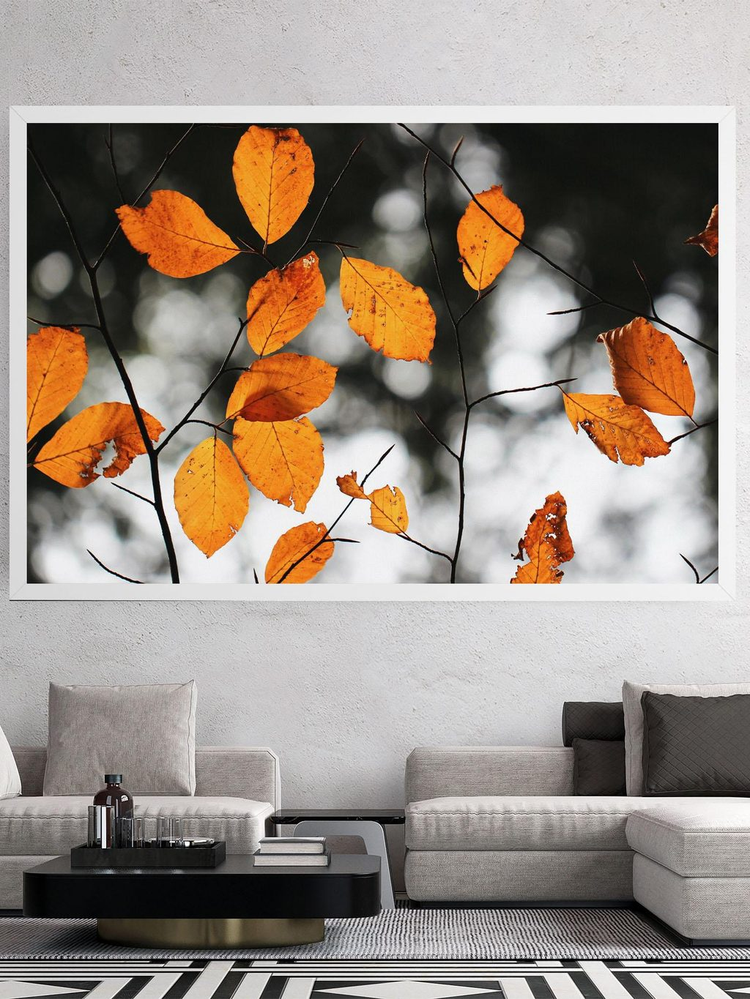

> TIP:QUICK: One large leaf print above the sofa reads as art; six small ones read as a craft project.

## 26. A Chunky Knit Pouf by the Fireplace

A chunky knit pouf by the fireplace is a footrest, an extra seat and a fall decoration in one. Here a cream knit pouf sits on a textured rug in front of a stone fireplace, with a wingback chair and a knit throw beside it and books resting on top of the pouf.

Put the pouf where feet actually land — beside the favorite chair, not in a corner as decoration. A knit pouf in cream or oatmeal goes with every fall palette, and it is the first seat guests reach for.

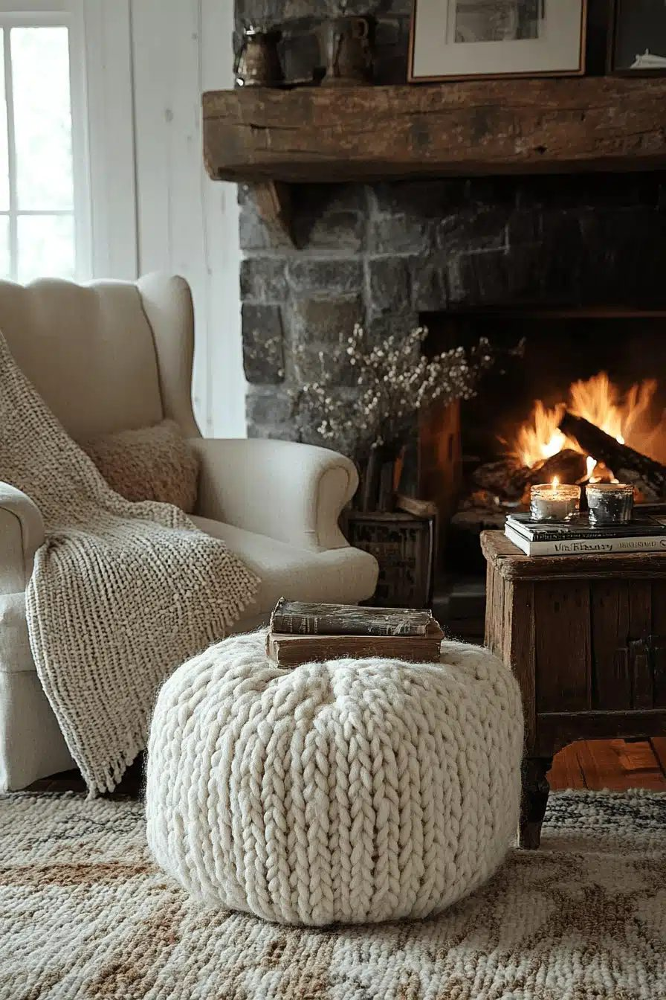

> TIP:CHECK: one knit pouf; beside the favorite chair; cream or oatmeal to match any palette

## 27. Terracotta Pots of Fall Mums

Terracotta pots of fall mums bring the garden into the living room while the weather still allows it. Here rust-orange and yellow chrysanthemums in terracotta pots sit on a stone windowsill with pumpkins and pinecones, the bright blooms the freshest color in the whole room.

Mums are the hardiest fall flower, but they still need light and a little water — a sunny windowsill and a saucer underneath keep them happy for weeks. When the blooms fade, swap the pots for pinecones and the sill stays dressed.

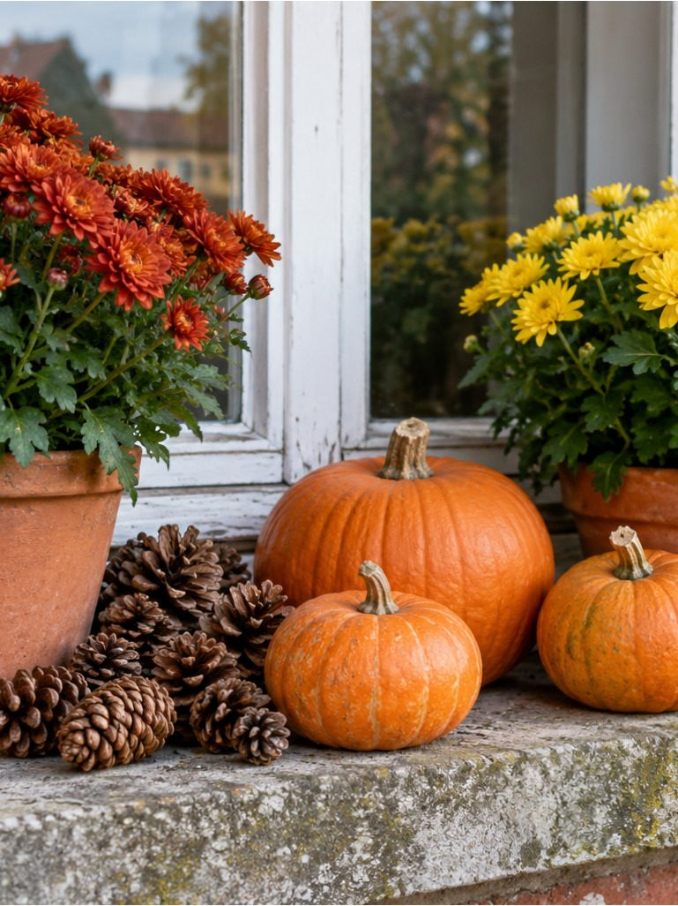

> TIP:GUIDE: Pots: terracotta, two or three | Spot: sunny windowsill | Care: water lightly, saucer underneath

## 28. Floor Cushions for Autumn Evenings

Floor cushions turn a fall evening into a low, loungy gathering. Here large cushions in burnt orange and rust spread across the wooden floor, with an open book, small pumpkins and scattered leaves around them and a sofa draped in knit throws behind. It is the setup for reading, talking or doing nothing at all.

Keep the cushions in the same warm family as the sofa so the floor reads as part of the room, not a separate camp. Two large cushions and a small one is enough for a corner; the rug underneath should be soft enough to sit on.

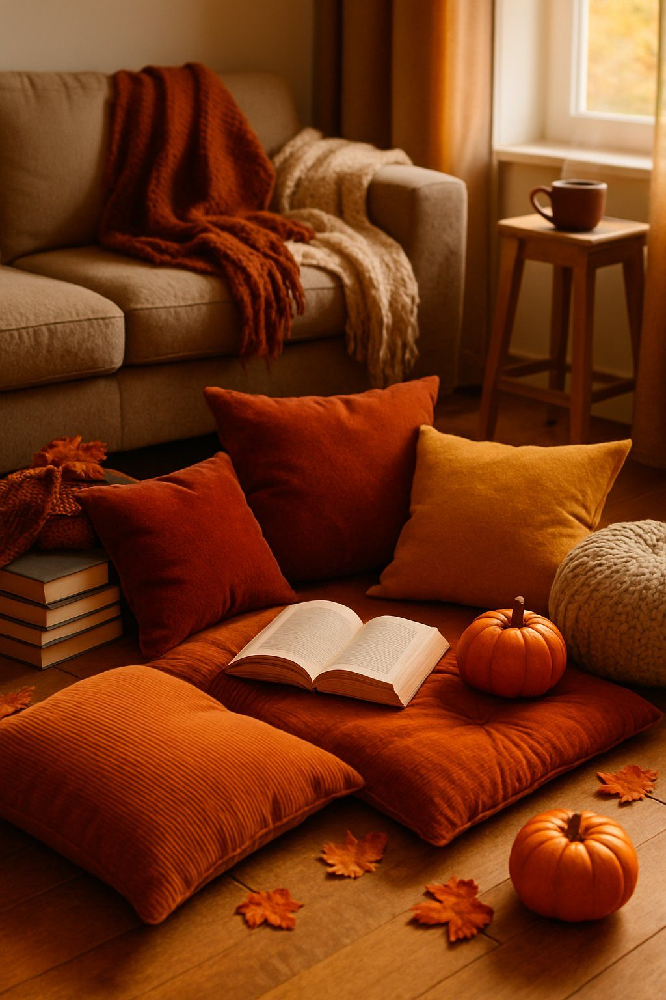

> TIP:QUICK: Floor cushions in the sofa's color family make the floor part of the room, not a campsite.

## 29. A Warm-Toned Gallery Wall

A warm-toned gallery wall is fall color you can hang once and enjoy all season. Here seventeen framed botanical prints — pressed leaves, ferns and mushrooms in earthy autumn tones — cover the wall above a rust-orange sofa, with pumpkins and a candle on the coffee table below and a fireplace glowing to one side.

Plan the layout on the floor before a single nail goes in, and keep the frames in one or two wood tones so the wall reads as a collection. Start with the biggest frame in the center and build outward, leaving even gaps of a few centimeters.

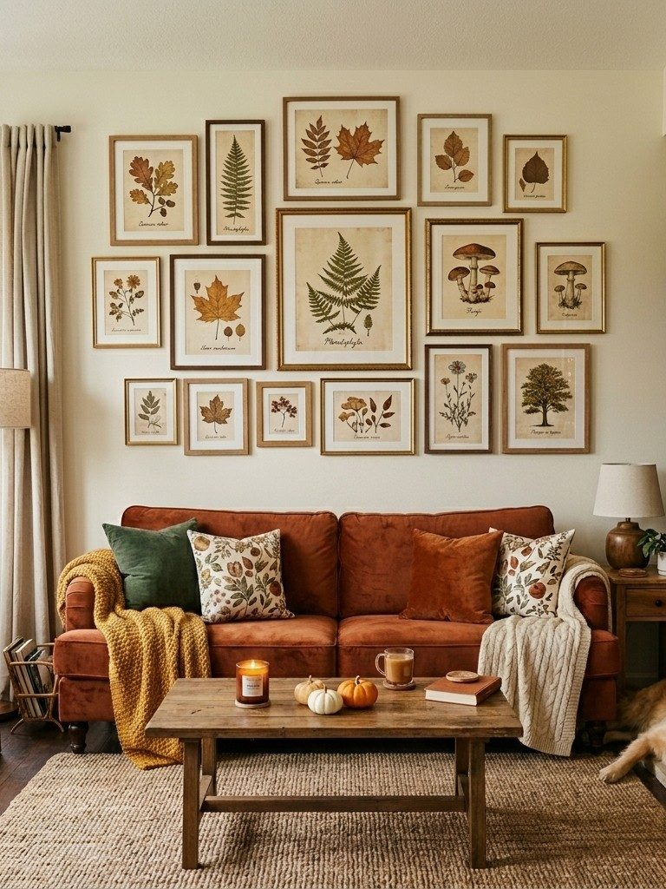

> TIP:CHECK: one or two frame finishes; biggest frame in the center; even gaps of a few centimeters

## 30. One Calm Palette: Cream, Rust and Wood

The calmest fall living room in this list is also the simplest: cream, rust and wood, nothing else. Here a tan sofa wears rust and cream pillows and a chunky knit throw, a wooden coffee table holds dried grasses and small pumpkins, and a fiddle-leaf fig in a terracotta pot stands by the tall windows. The palette does the seasonal work so no single decoration has to.

A three-color palette is the easiest way to make a room look designed rather than decorated. Pick your three — cream, rust and wood is the fall classic — and check every new piece against them before it enters the room.

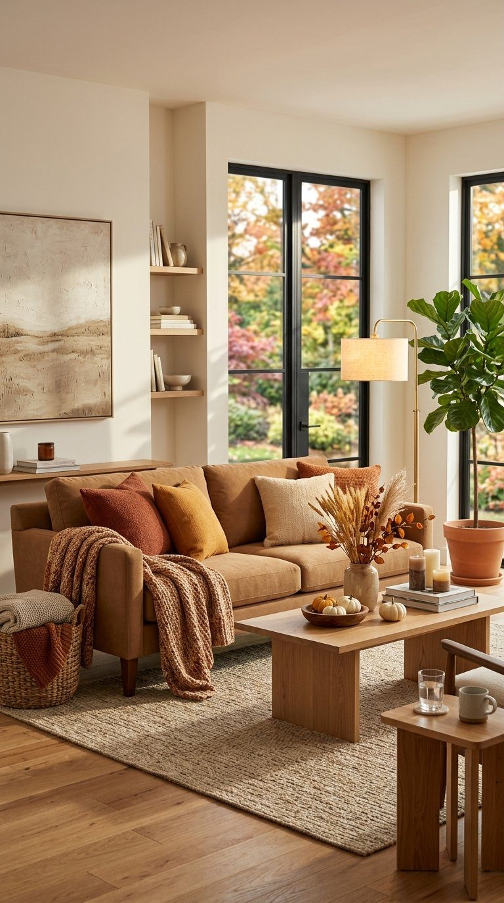

> TIP:GUIDE: Palette: cream, rust, wood | Test: every new piece against all three | Result: the room looks designed

## Takeaway

- A cozy fall living room is not a shopping list — it is a way of layering.
- Start with one soft thing on the sofa, add warm light at a low height, and finish with one seasonal touch per surface: a throw on the armchair, a pumpkin on the table, a garland on the mantel.
- If you want the same layered warmth carried through the coldest months, our [30 Winter Home Ideas for a Cozy, Snowy Season](/posts/winter-home/) shows how these same textures work once the leaves are gone.

## Frequently Asked Questions

### How do I decorate my living room for fall on a budget?

Start with what you already own: swap in warm-toned cushions, drape a knit throw over the sofa arm, and gather pinecones or branches from outside for a free centerpiece. Add one or two small pumpkins and a few candles, then stop. Texture and warm light do more than a dozen new decorations.

### What colors work best for fall living room decor?

Warm earth tones carry fall: rust, burnt orange, mustard, deep gold and warm browns, set against cream, beige and soft wood. Keep the big pieces neutral — sofa, rug, curtains — and bring the autumn color through pillows, throws and small decor. That way the room feels seasonal, not painted for one month.

### When should I start decorating for fall?

Mid-September is the sweet spot for most homes: the light has turned golden, evenings are cooler, and fall decor feels right rather than early. If you love the season, start the first week of September; if you prefer a short season, wait until October. Take it down after Thanksgiving or keep the textures into winter.

### How do I make my living room feel cozy for fall without clutter?

Pick one hero per surface: a throw on the sofa, a centerpiece on the coffee table, a garland on the mantel. Leave breathing room around each piece and store the rest in a basket. If a surface looks busy, remove one item — cozy comes from layers of texture, not from the number of objects.

### Can I mix plaid, velvet and knit textures in one room?

Yes — mixing textures is what makes a fall room feel rich. Keep the colors in one warm family, then vary the surfaces: a smooth velvet pillow, a chunky knit throw, a plaid blanket. Two or three textures per seat is plenty; more than that starts to look busy instead of layered.

### How do I style a fall mantel?

Start with a garland or a row of candles along the mantel shelf, then add height at the ends — a tall vase of branches on one side, a stack of books on the other. Keep the middle low so a mirror or artwork above it stays visible, and step back to check the balance before adding anything else.

### Are real pumpkins or faux pumpkins better for indoor fall decor?

Faux pumpkins win indoors for most people: they last all season, never rot, and you can reuse them next year. Real mini pumpkins look better up close and smell like autumn, but they soften within a week or two. Use real ones on the porch and faux ones on the coffee table.

### How do I transition fall decor into winter?

Yes, easily. Take down the pumpkins, the leaf garlands and anything orange, and keep the knit throws, candles, amber glass and warm wood. Swap the rust pillows for cream or deep green, and the room slides from autumn into winter without a full redecoration or a single new piece of furniture.
