# 30 FunHaus Interior Ideas for a Playful Home

A funhaus interior is not one look applied to the whole house — it is a different playful idea in every room. The living room gets the color-drenched sofa wall, the bedroom gets the scalloped headboard, the kitchen gets the bold backsplash, and each space earns its own moment of fun. This list walks through 30 room-by-room ideas so you can steal the one your home is missing.

The thread running through all of them is the same: two or three loud colors, one pattern that leads, and something in the room that is there purely because it makes you smile. For the big-picture version of the style, our [30 FunHaus Ideas for a Playful, Bold Home](/posts/funhaus/) covers the whole-home approach, from rainbow staircases to Memphis color clashes.

## 1. Living Room: A Color-Drenched Sofa Wall

Give the living room one wall in a saturated color and let the sofa sit against it like a jewel in a box. A hot pink or cobalt wall behind a sofa in a contrasting bright color makes the seating area feel deliberate and dramatic, even with simple furniture.

Keep the other walls pale and the rug plain so the color wall owns the room. One piece of art in a clashing color on the wall is enough — the wall itself is doing the decorating.

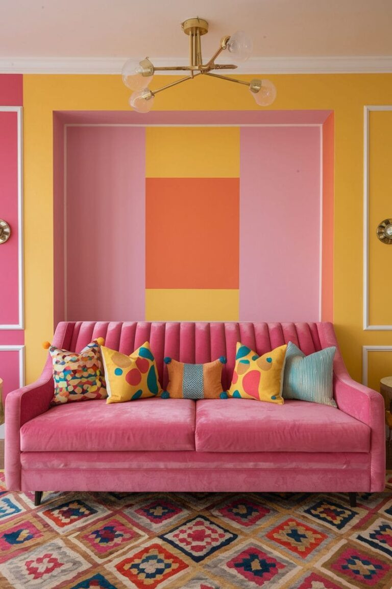

> TIP:QUICK: Paint just the sofa wall so the color feels bold without closing the room in.

## 2. Living Room: A Bold Wallpaper Mural

A cartoon-creature wallpaper mural turns the living room into a storybook. Big, playful characters in bright colors make the wall the room's art, and they work surprisingly well with grown-up furniture when the palette is shared.

Pick the mural's brightest color for the sofa cushions and its softest for the rug. The room stays playful but grounded, and guests will spend the first five minutes just looking at the wall.

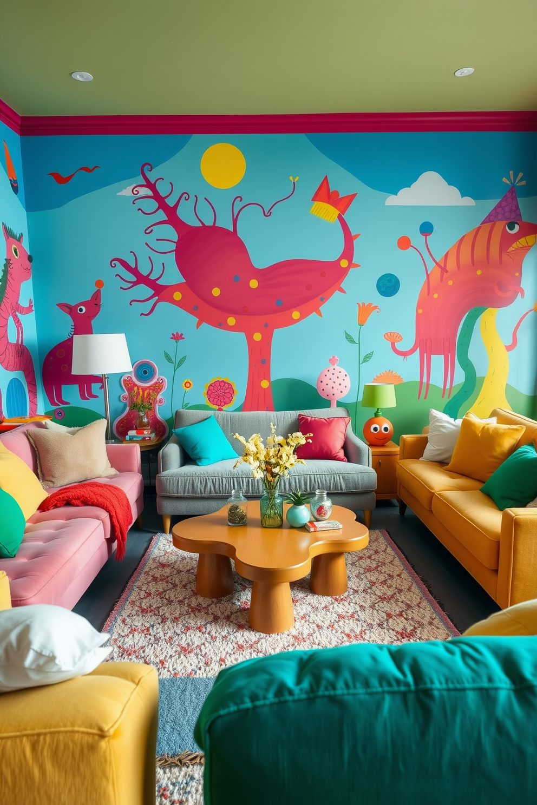

> TIP:CHECK: Mural on one wall only; Brightest mural color in cushions; Softest mural color in the rug

## 3. Living Room: A Gallery Wall Above a Pink Sofa

A gallery wall above a pink sofa is the classic FunHaus living room move. Mixed frames, mixed art and one pink anchor piece tie the wall together, and the sofa's color sets the palette for everything hung above it.

Vary the frame sizes but keep the spacing even, and include one three-dimensional piece — a small shelf, a woven disc — to break up the flat prints. The wall should feel collected over time, not bought in one afternoon.

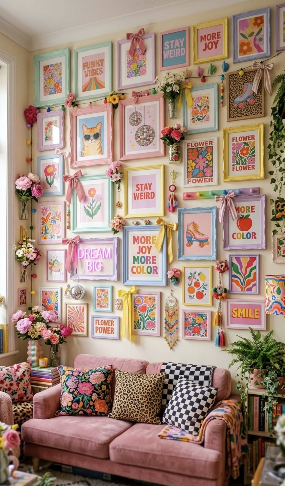

> TIP:GUIDE: Sofa: bright pink | Frames: mixed sizes, even spacing | Extra: one 3D piece

## 4. Bedroom: A Color-Block Wall

A color-block wall behind the bed turns the bedroom into a graphic composition. Two or three blocks of bold color — a big rectangle behind the headboard, a smaller one beside it — frame the bed like a piece of art.

Paint the blocks before the bed goes in, and use painter's tape for crisp edges. Keep the bedding in one of the block colors and the rest of the room pale, so the wall is the only loud thing in a room meant for rest.

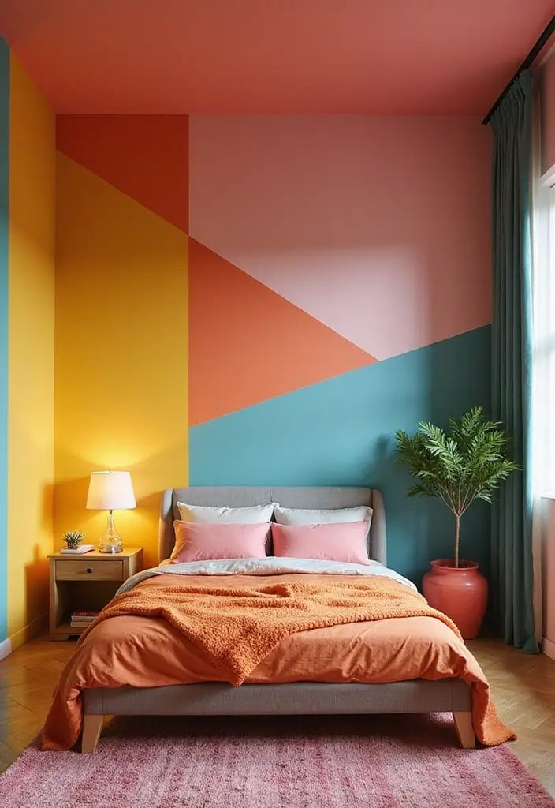

> TIP:QUICK: Use painter's tape for crisp edges and paint the blocks before the bed goes in.

## 5. Bedroom: Color-Drenched Walls

A color-drenched bedroom wraps you in one saturated hue from wall to wall. It sounds intense, but in a bedroom the effect is cocooning rather than loud — especially in a deep teal, plum or terracotta with warm bedding.

Keep the ceiling the same color for the full wrap, or paint it a shade lighter so the room still feels tall. Lamps with warm bulbs matter more here than anywhere else, because the color deepens beautifully in evening light.

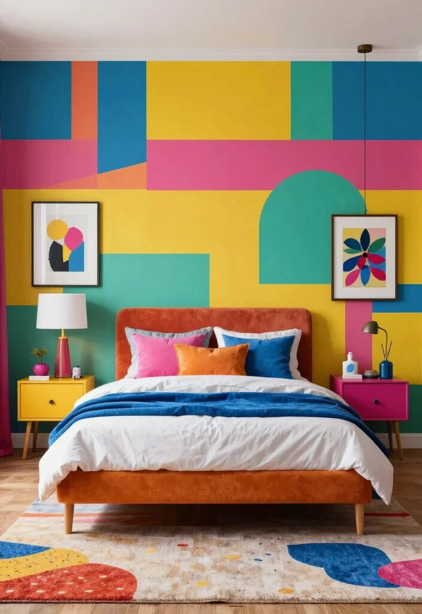

> TIP:CHECK: Same color on walls and ceiling; Warm bulbs; Bedding in a lighter shade of the wall

## 6. Bedroom: A Scalloped Headboard

A scalloped headboard adds a playful curve to the bedroom without touching the walls. The scallops soften the bed's rectangle and read as both retro and modern, especially in a bright color against a pale wall.

Upholstered scallops feel soft and luxurious, while a painted wooden one is the budget route. Either way, keep the bedding simple so the headboard's shape stays the star of the bed wall.

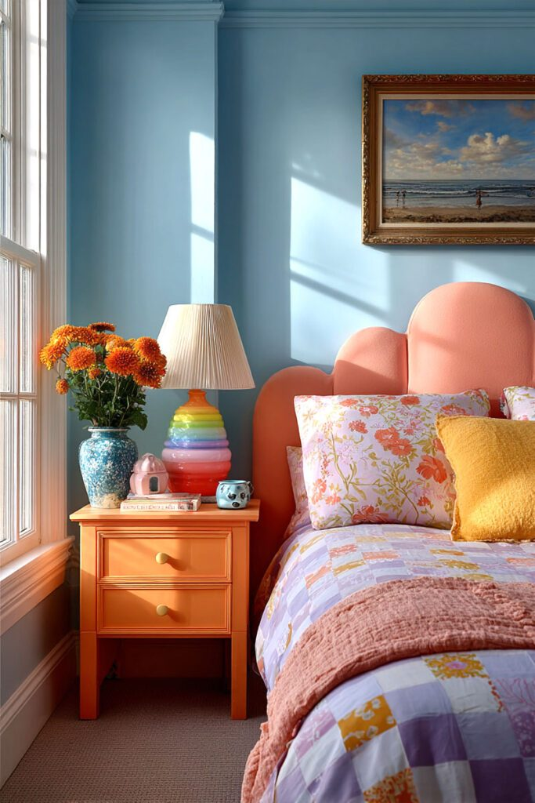

> TIP:GUIDE: Headboard: scalloped, one bright color | Wall: pale | Bedding: simple and plain

## 7. Kitchen: A Bold Backsplash

A bold backsplash is the kitchen's one chance to be loud, and FunHaus takes it. Bright tiles in a graphic pattern or a single saturated color turn the strip between worktop and cabinets into the room's jewelry.

Because the area is small, you can afford the tiles you actually love. Keep the cabinets and worktops plain — white, wood or a single quiet color — so the backsplash reads as a feature rather than a fight.

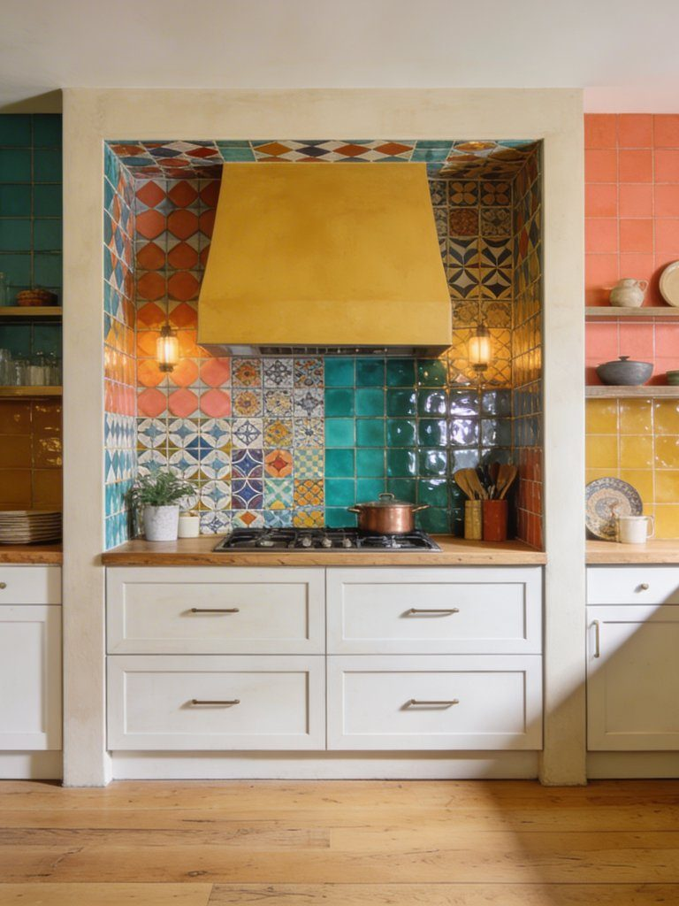

> TIP:QUICK: Spend on the backsplash tiles and keep the cabinets plain — the strip is small but mighty.

## 8. Kitchen: Open Shelving with Colorful Dishes

Open shelving turns your dishes into the kitchen's decoration. Stack colorful plates, bowls and mugs in a rainbow order and the shelves become a display you change every time you cook.

Keep the shelves to two or three runs and the dishes to the ones you actually use, so the display stays honest and the shelves stay tidy. A row of plants or a few cookbooks breaks up the color and keeps the shelves from looking like a shop.

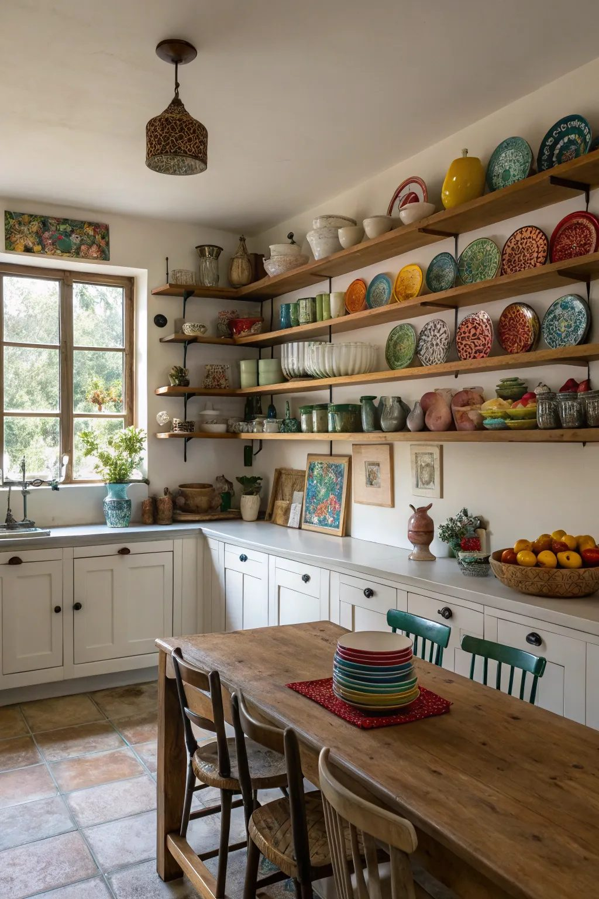

> TIP:CHECK: Two or three shelf runs; Dishes in rainbow order; One plant row to break the color

## 9. Bathroom: A Playful Vanity

A playful vanity makes the smallest room in the house the most fun. A coral cabinet against orange and teal walls, with a round mirror and a bright soap dish, turns a routine bathroom into a little jewel box.

Small rooms can take big color because you are never in them for long. Keep the floor plain and the towels white, and let the vanity and the walls do all the talking.

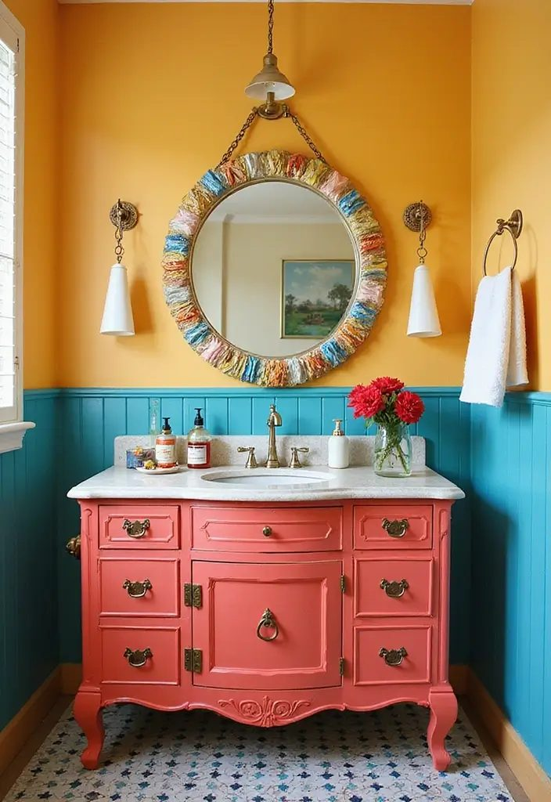

> TIP:GUIDE: Vanity: coral | Walls: orange and teal | Towels: plain white

## 10. Bathroom: A Bold Shower Curtain

A bold shower curtain is the cheapest FunHaus move in any bathroom. It covers the biggest surface in the room, it changes in five minutes, and it sets the color scheme for the towels, the bath mat and the soap dish.

Pick a curtain with one big graphic print rather than a fussy small one — it reads better through steam and from across the room. Match one of its colors in the towels and let the rest of the bathroom stay white.

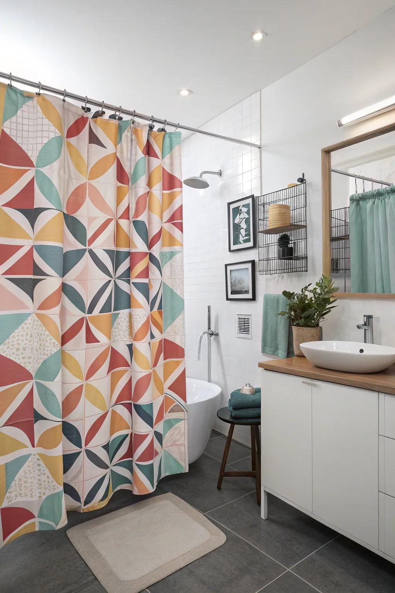

> TIP:QUICK: Choose one big graphic print and match a towel to one of its colors.

## 11. Kids' Room: A Rainbow Wall

A rainbow wall in a kids' room is the most natural FunHaus idea there is. Painted arches or stripes in soft rainbow colors give the room a cheerful backdrop that works from toddler years through to teens, especially when the furniture stays simple.

Paint the rainbow on the wall the bed sits against so it frames the bed like a headboard. Keep the other walls white and the storage low, so the room can grow with the child without another repaint.

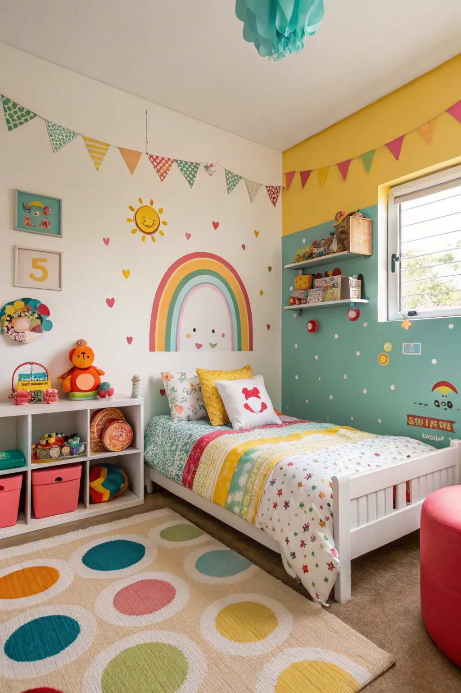

> TIP:CHECK: Rainbow on the bed wall; Other walls white; Low storage the child can reach

## 12. Kids' Room: Bunk Bed Fun

Bunk beds are already fun — FunHaus just makes them louder. Bright bedding on each bunk, a different color per bed and a string of lights or bunting along the frame turn the bunks into the room's centerpiece.

Give each bunk its own color so the kids can claim a side, and add a small shelf or clip-on light per bunk for reading. A rug in one of the bedding colors ties the floor to the beds.

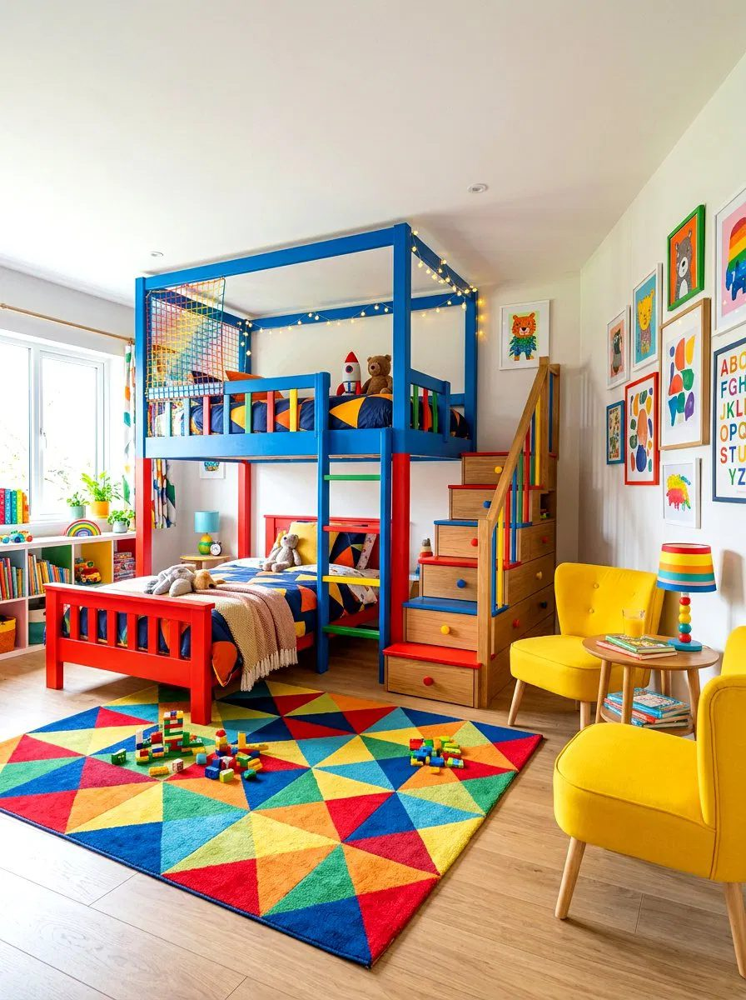

> TIP:GUIDE: Bunks: one color each | Extras: clip-on light per bunk | Rug: one bedding color

## 13. Entryway: A Statement Pendant

A statement pendant in the entryway sets the tone the moment the door opens. Colorful glass globes in a cluster hang like a bunch of balloons and throw colored light across the walls in the evening.

Hang the pendant low enough to be seen and high enough to walk under — about seven feet from the floor in most homes. One bold pendant is enough; the entryway should feel like a welcome, not a chandelier showroom.

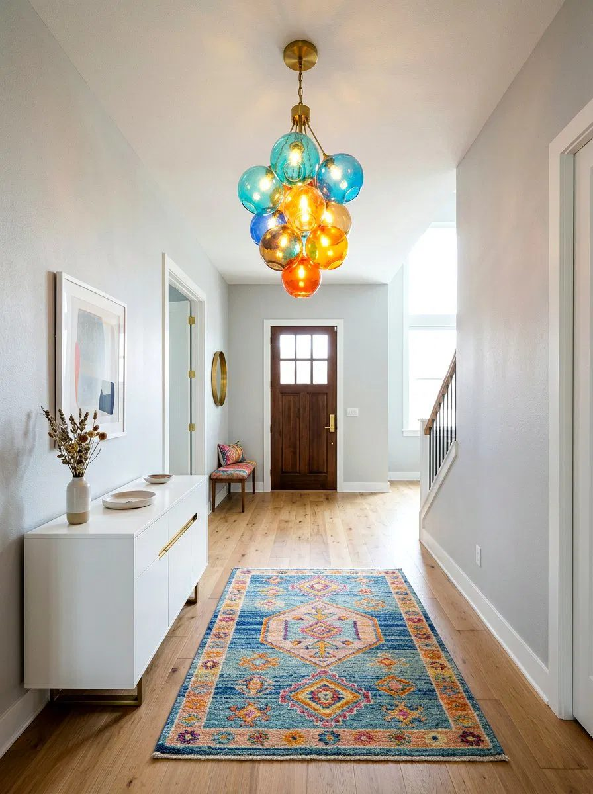

> TIP:QUICK: Hang it about seven feet up so it is seen but never ducked under.

## 14. Entryway: A Bold Runner and Art

A bold runner and a piece of colorful art turn a plain hallway into an entryway with intent. The runner pulls the eye down the hall and protects the floor, while the art gives guests something to look at while they take off their shoes.

Choose a runner with a strong pattern in colors that match the art, and keep the walls pale so the floor and the frame carry the color. A small bench or a row of hooks finishes the space without cluttering it.

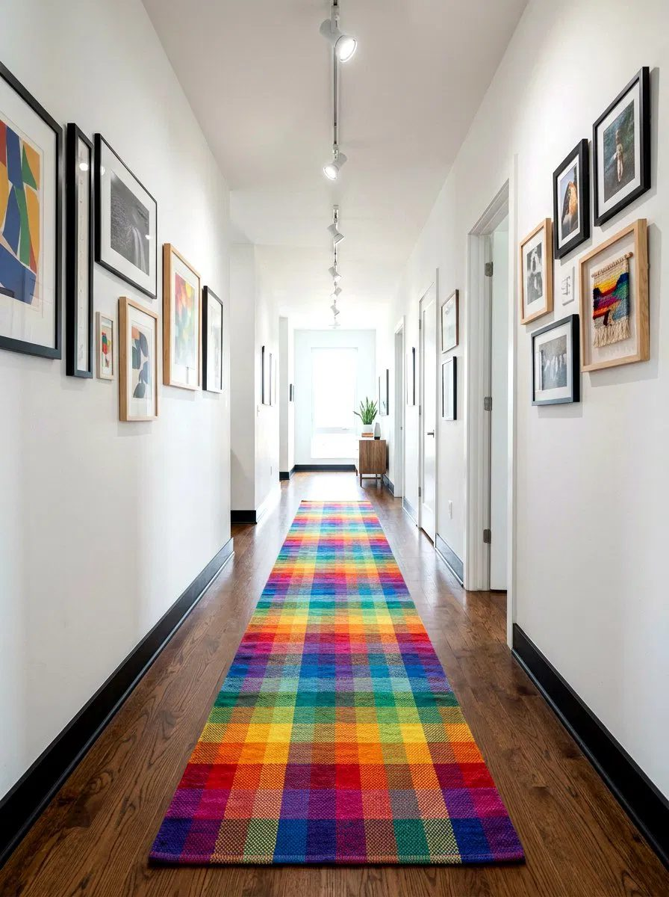

> TIP:CHECK: Runner pattern matches the art; Walls pale; One bench or hook row

## 15. Dining Room: Mismatched Chairs

Mismatched chairs make the dining room feel like a gathering rather than a set. Different colors, different shapes, one shared table — and the meal becomes the event rather than the furniture.

Unify the chairs with one detail: the same paint finish, the same seat height or the same wood tone. A plain table and a simple centerpiece keep the focus on the people sitting in the chairs, which is the whole point.

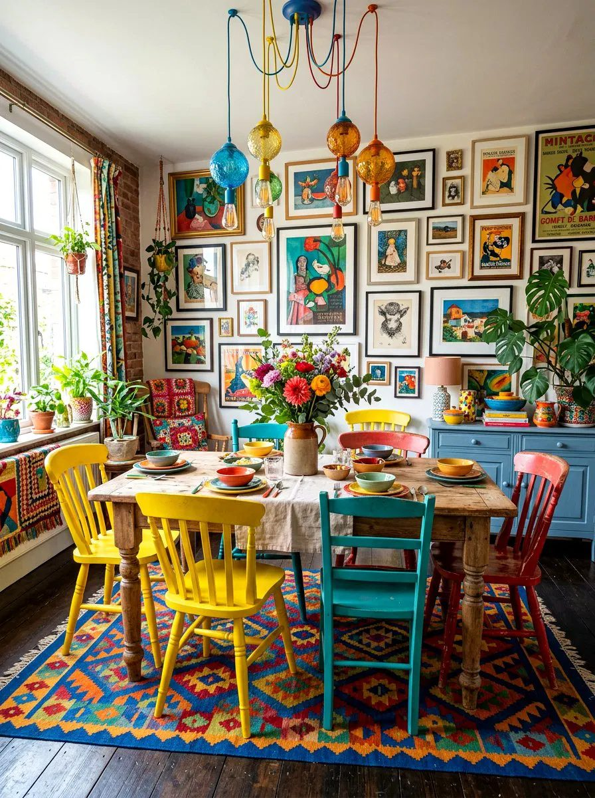

> TIP:GUIDE: Chairs: different colors and shapes | Shared detail: one paint finish | Table: plain

## 16. Dining Room: A Colorful Tablescape

A colorful tablescape turns an ordinary dinner into an occasion. Bright plates, mismatched glasses and a runner in a clashing color make the table the room's decoration, and it changes with every meal.

Build the tablescape around one color story — citrus brights, say, or jewel tones — and let the plates, napkins and candles all pull from it. Fresh flowers in a plain vase are the only neutral the table needs.

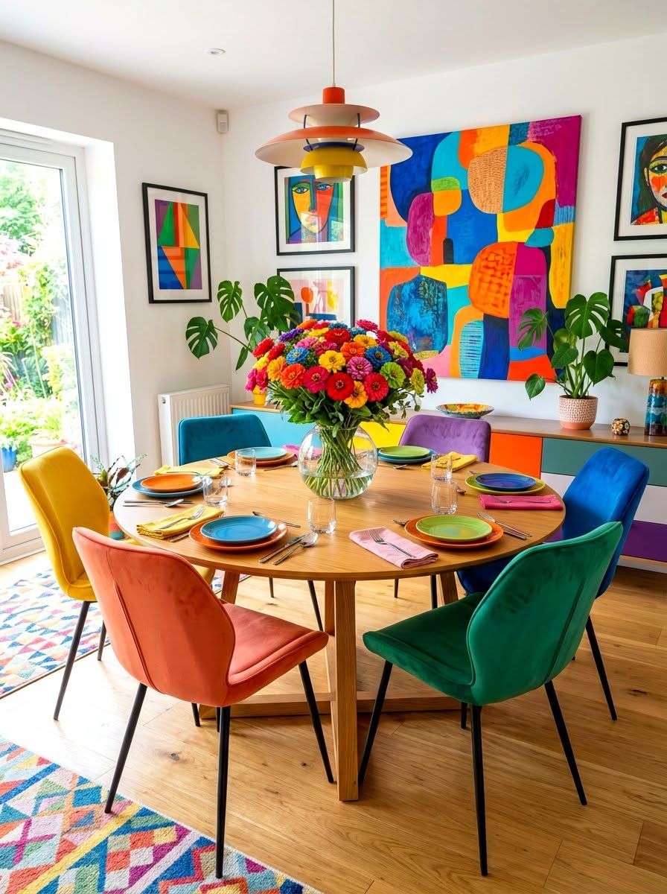

> TIP:QUICK: Build the table around one color story and let plates, napkins and candles follow it.

## 17. Home Office: A Bright Desk

A bright desk makes the home office a place you want to sit. Paint a plain desk in a bold color or buy one in a saturated hue, then keep the rest of the workspace calm so the desk stays the star.

Pair the desk with a comfortable chair in a contrasting color and a pinboard in a bright frame. The desk is where the work happens, so it should be the most cheerful object in the room, not the dullest.

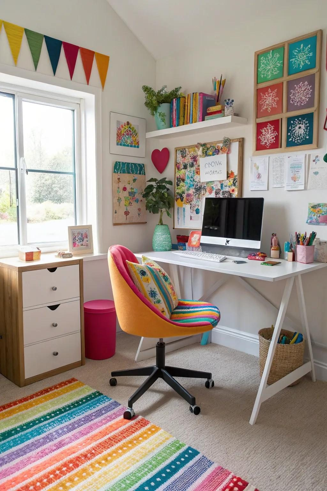

> TIP:CHECK: Desk in one bold color; Chair in a contrasting color; Pinboard in a bright frame

## 18. Playroom: Toy Storage That Pops

Colorful cubby storage turns tidying into a game. Assign each cubby a color and each color a type of toy, and the playroom stays organized because the system is visible and fun to use.

Keep the cubbies low and open so children can reach everything themselves. Label the bins with pictures for younger kids, and leave one cubby empty — it will fill itself soon enough.

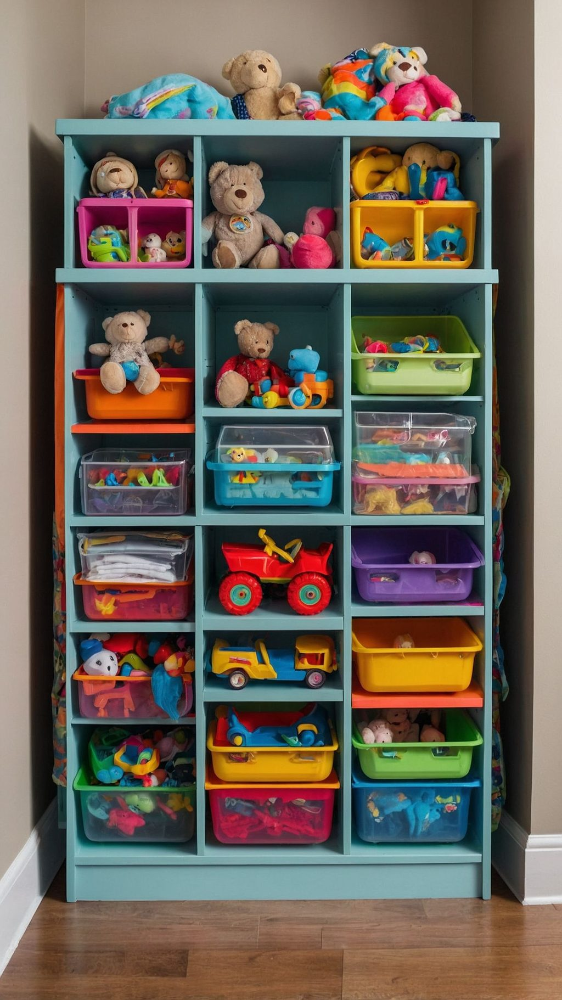

> TIP:GUIDE: Cubbies: one color each | Labels: pictures for young kids | Spare: one empty cubby

## 19. Playroom: A Reading Nook

A reading nook gives the playroom a quiet corner. Cushions in bright colors, a low shelf of books and a small lamp create a nest that children will actually use, especially when it feels like a secret spot rather than a formal corner.

Tuck the nook into a corner or under a window and keep it small — cozy is the point. A canopy or a curtain across the entrance makes it feel like a hideout, which is exactly why kids love it.

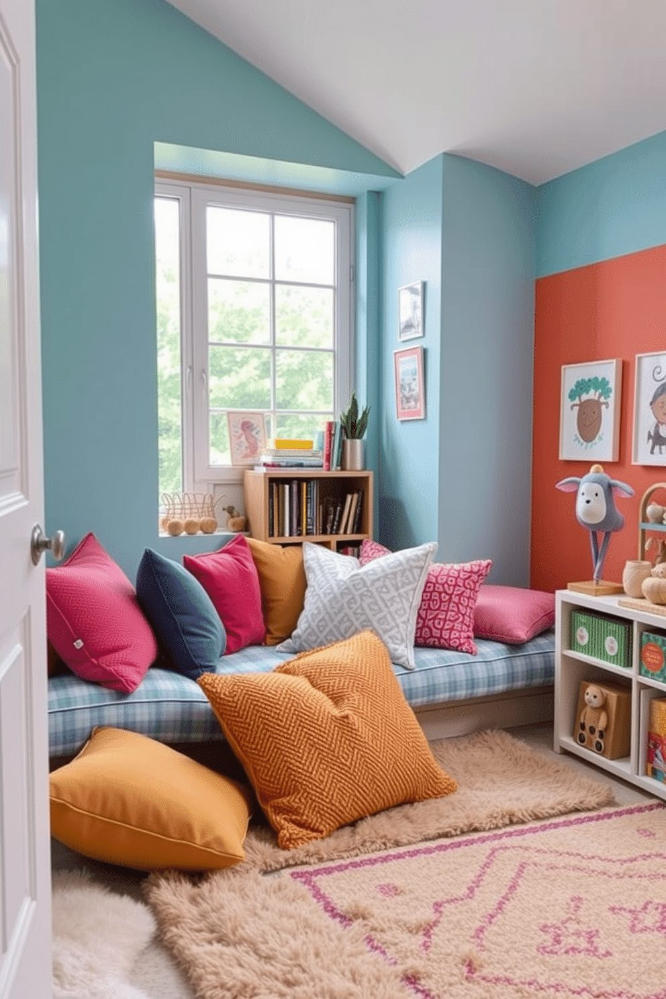

> TIP:QUICK: Keep the nook small and tuck it into a corner so it feels like a hideout.

## 20. Hallway: Bold Color

Hallways are the most underused rooms in the house, which makes them perfect for bold color. Orange walls and a rainbow runner turn a passage into a destination, and because nobody lingers there, the color never gets tiring.

Paint the hallway in one saturated color and let the runner do the pattern work. Hang one large piece of art at the end of the hall so the eye has somewhere to land, and keep the doors white for contrast.

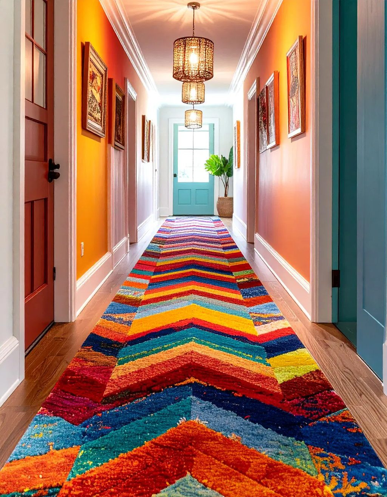

> TIP:CHECK: One saturated wall color; Rainbow runner; One large art piece at the end

## 21. Living Room: Curvy Furniture

Curvy furniture softens a living room full of straight lines. A curved sofa, a round coffee table and an arched floor lamp create a room that feels like a hug, especially when the curves are paired with an abstract mural and a coral sofa.

Let one curve lead — usually the sofa — and repeat it in smaller pieces. Two curves are a theme; five are a funhouse. Keep the rug simple so the furniture shapes stay readable.

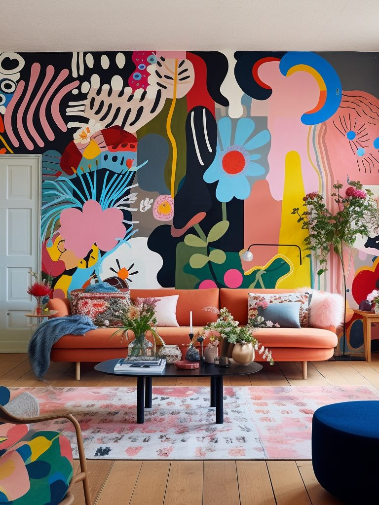

> TIP:GUIDE: Lead curve: the sofa | Repeats: round table, arched lamp | Rug: simple

## 22. Bedroom: Geometric Color-Blocking

Geometric color-blocking turns a bedroom wall into a modern art piece. Triangles, arches or rectangles in bold colors, painted with crisp tape lines, frame the bed and give the room a graphic edge without any wallpaper.

Sketch the design on paper first and measure twice — the geometry is the whole effect, so the lines need to be straight and the proportions intentional. Keep the bedding in one of the block colors and the rest of the room quiet.

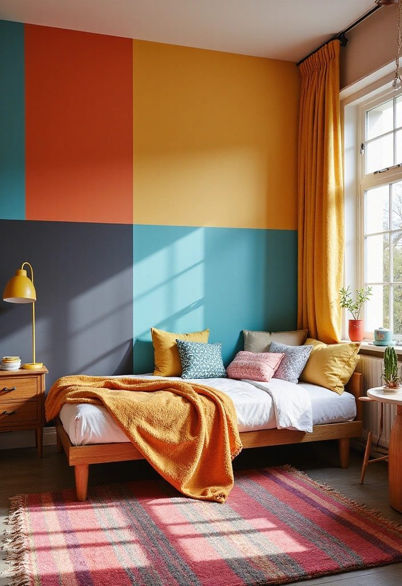

> TIP:QUICK: Sketch the geometry on paper first — straight lines are the whole effect.

## 23. Kitchen: A Geometric Tile Mural

A geometric tile mural turns the kitchen backsplash into a piece of art. Triangles, diamonds or chevrons in bright colors run along the worktop and make the kitchen feel designed rather than assembled.

Keep the mural to the backsplash strip and let the cabinets stay plain. The tiles are the pattern, so the worktops should be a single quiet material — butcher block, white quartz or pale stone — that lets the geometry shine.

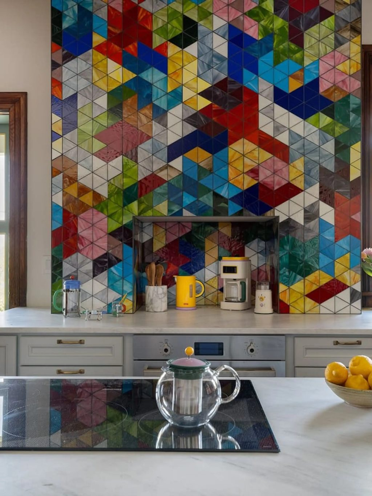

> TIP:CHECK: Mural on the backsplash only; Cabinets plain; Worktop in one quiet material

## 24. Bathroom: Bold Wallpaper

Bold wallpaper in a bathroom is a small-room luxury: one or two rolls cover the whole space, so you can afford the print you actually love. A turquoise vanity and a gallery wall on top of the pattern make the bathroom feel like a boutique hotel.

Choose a wallpaper rated for humid rooms and ventilate well. The vanity should pull one color from the print, and the mirror should be large and plain so the pattern has a place to rest.

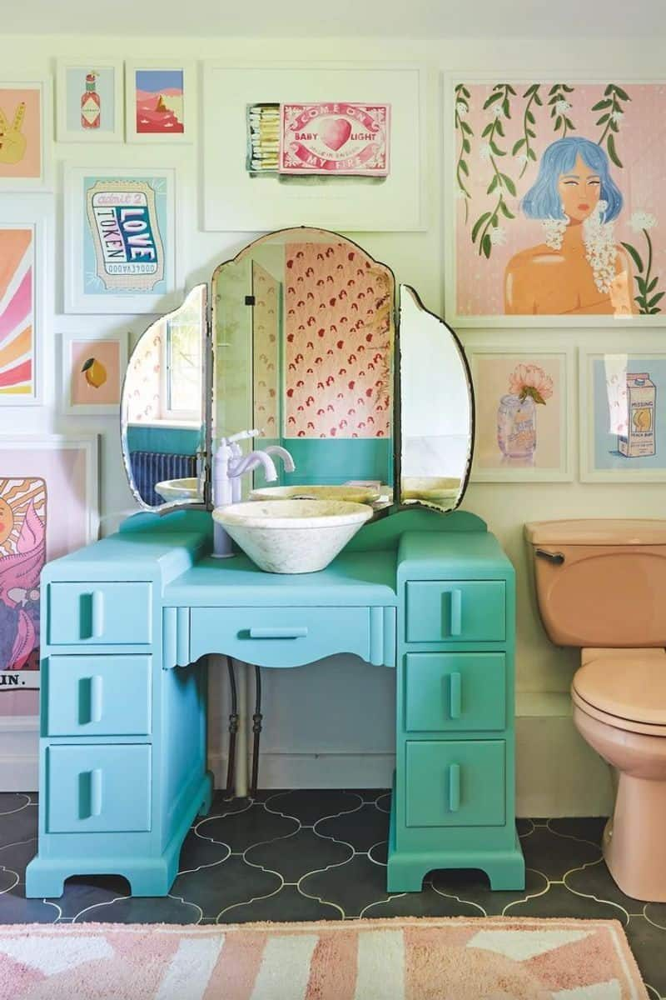

> TIP:GUIDE: Wallpaper: humidity-rated | Vanity: one print color | Mirror: large and plain

## 25. Kids' Room: Color-Blocked Bunks

Color-blocked bunks give each child their own zone in a shared room. Paint the top bunk one color and the bottom another, or block each bunk's wall in its own hue, and the shared room suddenly feels like two rooms.

Let each child choose their bunk's color and bedding, and keep the shared floor and storage neutral. The color-blocking does the dividing, so you do not need a physical partition.

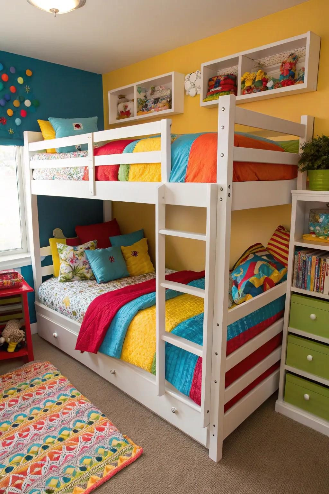

> TIP:QUICK: Let each child choose their bunk's color so the room feels like theirs.

## 26. Dining Room: Pattern Mixing

Pattern mixing in the dining room works when the prints share a palette. A lavender gallery wall, a striped tablecloth and floral cushions all feel like one family when the same lilac threads through them.

Keep the table itself plain wood or white so the patterns have a quiet stage. One pattern should be the largest — usually the wall art — and the others should step down in scale from there.

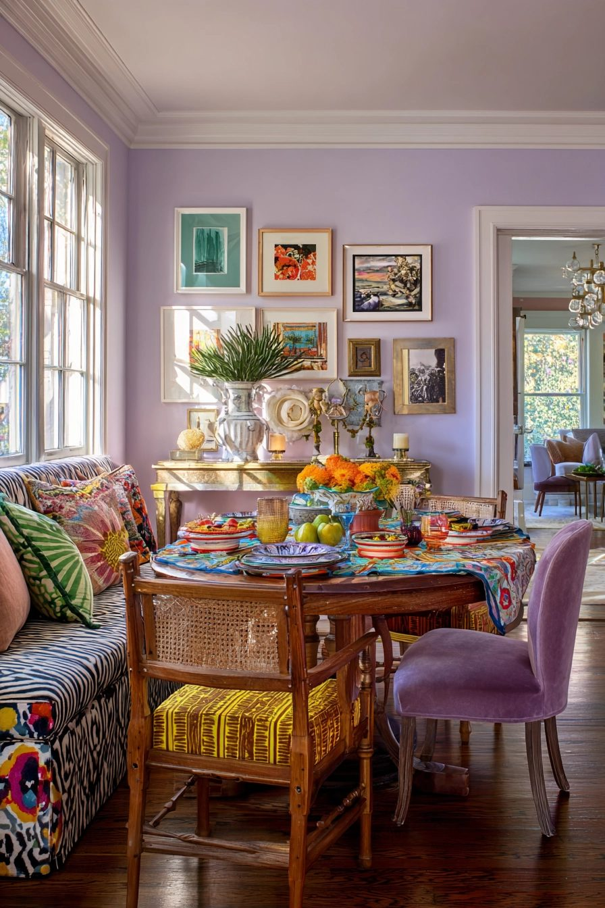

> TIP:CHECK: One shared palette; Largest pattern on the wall; Table plain wood or white

## 27. Entryway: A Tassel Chandelier

A tassel chandelier brings movement and texture to the entryway. The tassels sway slightly when the door opens, which makes the entrance feel alive, and the colors pick up the runner or the art on the wall.

Hang it centered over the entry table or in the middle of the hall, and keep the surrounding walls pale so the tassels read as sculpture. It is a statement piece, so give it a clear sightline from the front door.

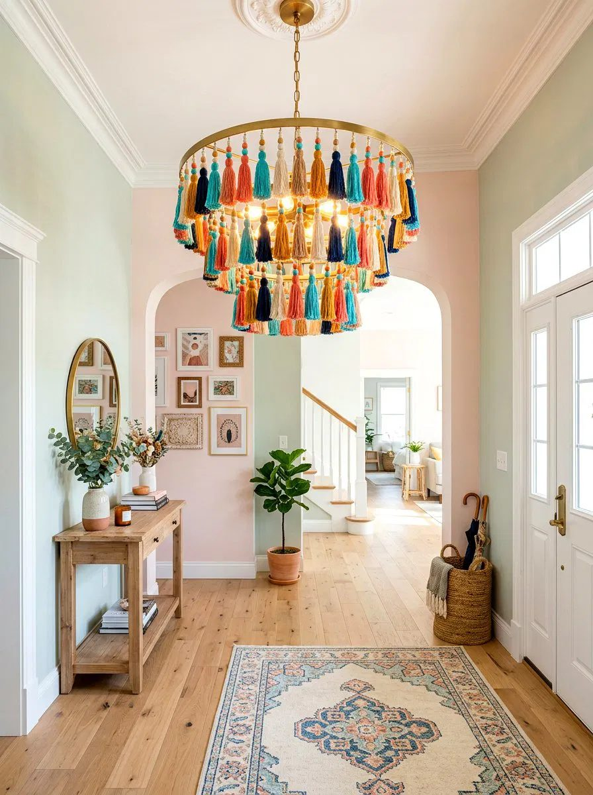

> TIP:GUIDE: Position: centered over the entry table | Walls: pale | Sightline: clear from the door

## 28. Living Room: Color-Blocked

A color-blocked living room divides the space into bold zones without building a single wall. One block of color behind the sofa, another on the far wall and a third on the rug create a room that feels composed and playful at once.

Keep the blocks large and few — two or three per room is plenty. The furniture should sit inside the blocks rather than straddling them, so each zone reads as its own little scene.

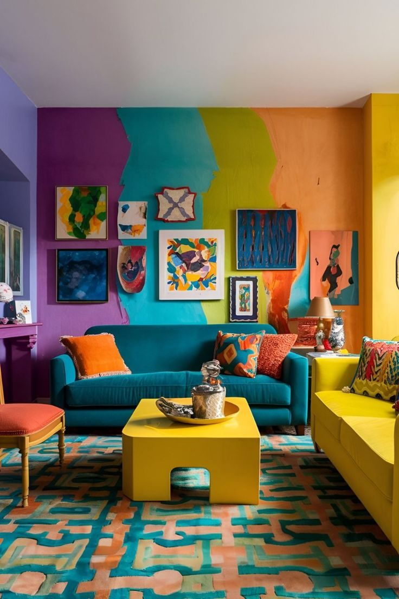

> TIP:QUICK: Keep the blocks large and few, and let the furniture sit inside them.

## 29. Bedroom: Bold Bedding and Art

Bold bedding and art make a bedroom without touching the walls. A geometric color-block wall behind the bed is the exception here — the bedding and the art pull its colors into the room, so the wall and the bed feel like one composition.

Choose bedding in the wall's brightest color and art in its quietest one. The balance keeps the bedroom energetic in the morning and calm enough at night, which is exactly what a bedroom should be.

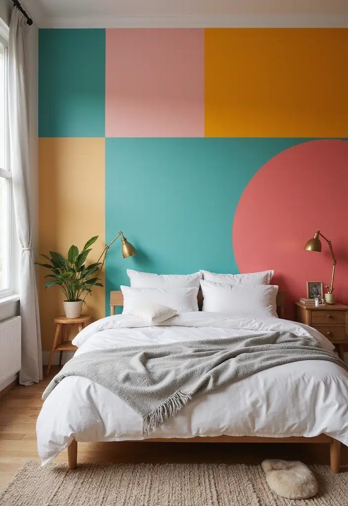

> TIP:CHECK: Bedding in the brightest wall color; Art in the quietest; One plain throw

## 30. Bedroom: A Gallery Wall

A gallery wall above the bed turns the bedroom into a personal exhibition. Framed prints, photos and small objects on a green wall create a display that is entirely yours, and the green backdrop makes every frame pop.

Vary the frames but keep the spacing even, and include one piece that is purely sentimental — the gallery wall is the one place in the house where the art does not need to match anything except you.

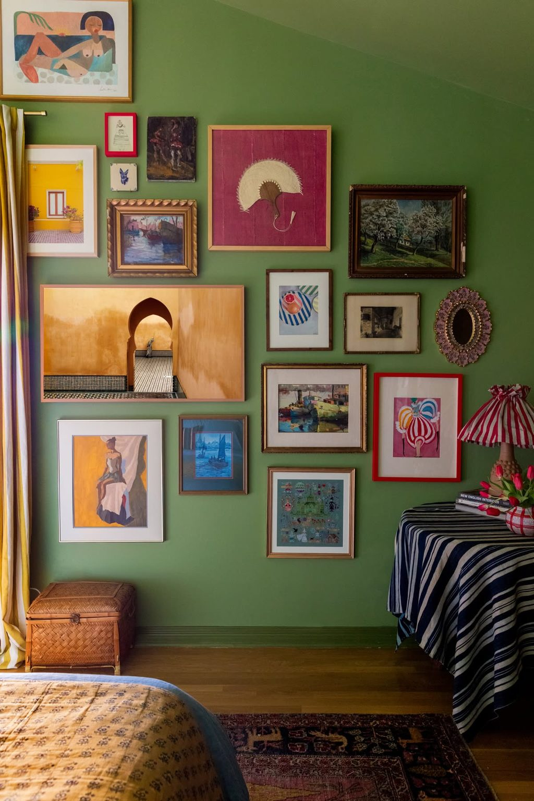

> TIP:GUIDE: Wall: deep green | Frames: varied, even spacing | Include: one sentimental piece

## Takeaway

The funhaus interior works room by room, so start with the room you use most. A color-drenched sofa wall, a bold backsplash or a scalloped headboard — pick one, live with it, and let the next room follow. For the whole-home version of the style, our [30 FunHaus Ideas for a Playful, Bold Home](/posts/funhaus/) has the rainbow staircases and Memphis clashes to go with these room ideas. The rule is the same everywhere: two loud colors, one leading pattern, and something in the room that is there just because it makes you smile.

## Frequently Asked Questions

### What is a FunHaus interior?

A funhaus interior applies the playful FunHaus style room by room: saturated color, bold patterns and quirky shapes tailored to each space. Living rooms get color-drenched walls, bedrooms get scalloped headboards, kitchens get bold backsplashes — one fun idea per room, tied together by a shared palette.

### How do I make a FunHaus interior feel cohesive?

Repeat two or three colors across the whole house, even if each room uses them differently. The living room's pink sofa and the bedroom's pink cushions tie the rooms together without making them match, and one neutral like cream or pale wood runs through everything.

### Which room should I start with?

Start with the room you spend the most waking time in — usually the living room or kitchen. One bold move there, like a color-drenched wall or a bright backsplash, shows you how the style feels to live with before you commit to the rest of the house.

### Can FunHaus work in a rental?

Yes. Use removable wallpaper, bold bedding, a colorful rug and painted secondhand furniture. A bright shower curtain, a statement pendant and a gallery wall hung with removable hooks give the look without touching the landlord's paint. Command strips and tension rods hold most of it, so the whole look comes down in an afternoon when you move out.

### How do I keep a colorful bedroom restful?

Limit the bedroom to one loud element — a color-block wall or bold bedding — and keep everything else pale and plain. Warm lamps and soft textures calm the color down at night, so the room feels energetic in the morning and restful after dark.

### What is the easiest FunHaus idea for a kitchen?

A bold backsplash or open shelving with colorful dishes. Both are small areas, so they are cheap to change, and they set the kitchen's color scheme without repainting cabinets or replacing worktops. Peel-and-stick tiles make the backsplash renter-friendly, and the shelves just need dishes you already own in bright colors.

### How do I style a FunHaus entryway?

Give it one statement — a colorful pendant, a tassel chandelier or a bold runner — plus a place for keys and coats. The entryway is small, so one loud piece and one practical piece are all it needs to feel intentional.

### Do kids' rooms need a different approach?

Kids' rooms suit FunHaus naturally, but keep the color washable and the storage low and open. Let children choose their own bunk or wall color, and keep one wall plain for their art, because their work is the best decoration the room will have.
