# 30 FunHaus Ideas for a Playful, Bold Home

FunHaus is the look for people who think a room should make you smile before it makes you sit down. It is maximalist, bright and unapologetically playful: saturated color, clashing patterns, curvy furniture and at least one thing in the room that is there purely because it is fun. This list gathers 30 FunHaus ideas from across the whole home, so you can dip a toe in with one rainbow wall or go all in with a color-drenched living room.

The trick to FunHaus is confidence, not chaos. Pick two or three loud colors, repeat them around the room, and let one pattern lead while the others play backup. If you want the room-by-room version of this style, our [30 FunHaus Interior Ideas for a Playful Home](/posts/funhaus-interior/) walks through living rooms, bedrooms, kitchens and bathrooms one space at a time.

## 1. Color-Drenched Maximalist Living Room

Drench the whole living room in one bold color family and let pattern do the talking. Walls, sofa and rug all pull from the same saturated palette, while clashing prints on cushions and curtains keep the room from feeling flat. The result is loud, warm and impossible to ignore — exactly the point.

Keep one neutral in the mix, like a cream ceiling or pale wood floor, so the color has somewhere to rest. Then add a second pattern in a smaller scale and a third color in the smallest doses, and the room reads as designed rather than accidental.

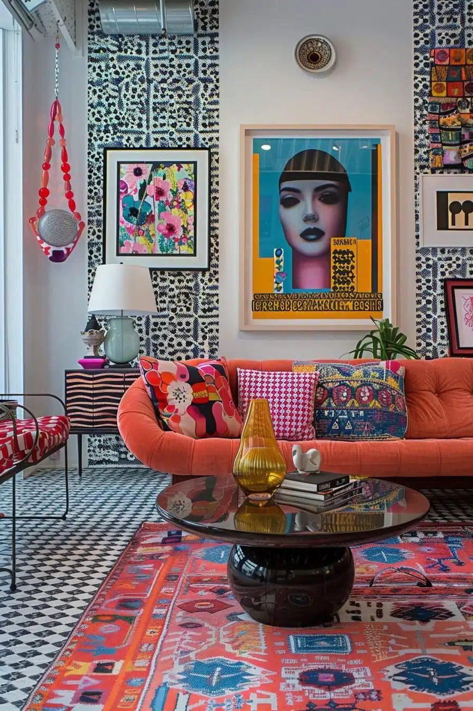

> TIP:QUICK: Paint the walls and ceiling the same bold color so the room feels wrapped, not just painted.

## 2. Pattern Mixing, Turned Up

FunHaus pattern mixing works when the patterns share at least one color. Stripes on the sofa, florals on the curtains and a geometric rug all feel like one family when a single hot pink or cobalt threads through them. Scale matters too: one big print, one medium, one small.

Start with the biggest surface — the rug or the sofa — and build outward. If two patterns fight, swap one for a smaller-scale version of the same print rather than dropping the idea entirely.

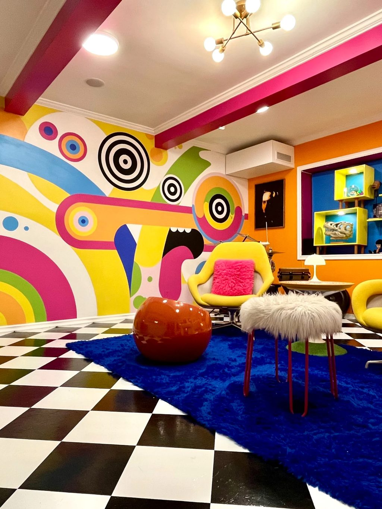

> TIP:CHECK: One shared color across prints; Three different scales; One plain cushion to rest the eye

## 3. A Puffy Bubble Sofa

A puffy bubble sofa is the FunHaus hero piece: rounded, soft and a little bit silly in the best way. In a bright color it anchors a playful living room without needing anything else to be loud, so the rest of the room can stay calmer around it.

Style it with one bold cushion and a low, simple coffee table so the sofa keeps the spotlight. The curves also soften a room full of straight lines, which is why it works so well in boxy modern living rooms.

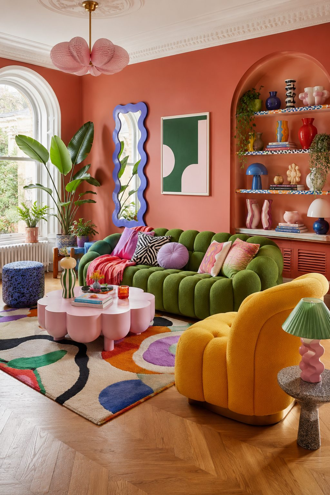

> TIP:GUIDE: Sofa color: one saturated hue | Cushions: one bold, one plain | Table: low and simple

## 4. A Checkerboard Floor

A checkerboard floor is the fastest way to give a room a playful backbone. Black and white is the classic, but FunHaus versions go pink and cream, green and white, or full rainbow. It works in kitchens, entryways and living rooms alike, and it makes even plain furniture look intentional.

Painted checkerboard is the budget route and vinyl tiles are the renter-friendly one. Either way, keep the grout lines crisp and the squares even — a wobbly grid reads messy, while a sharp one reads graphic and fun.

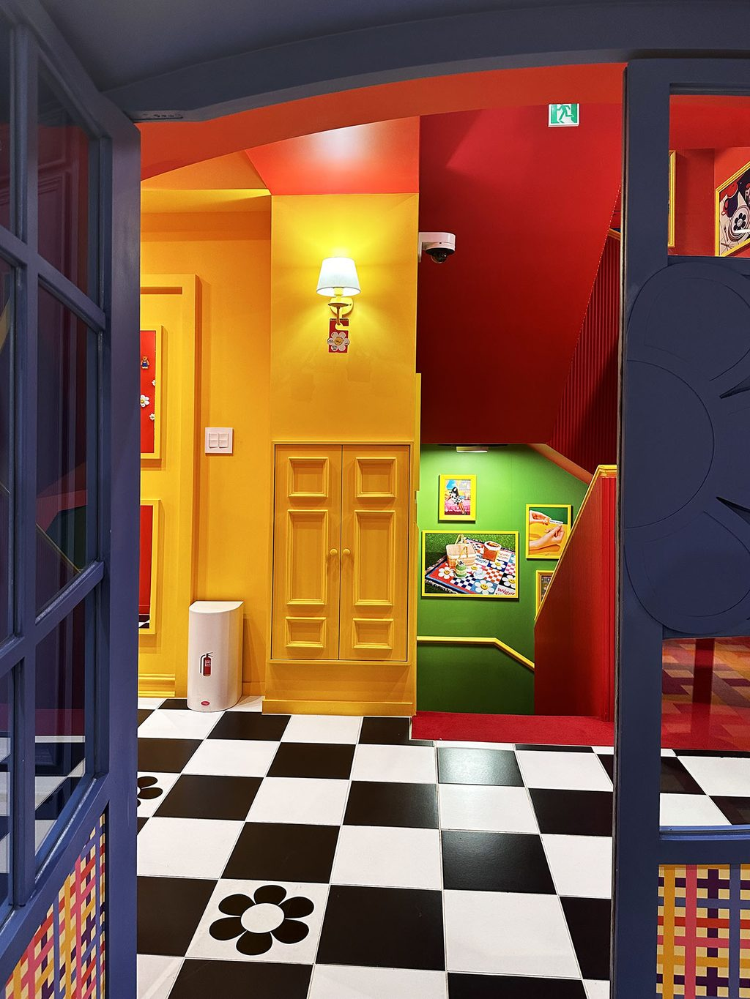

> TIP:QUICK: Use large squares in small rooms so the pattern feels bold instead of busy.

## 5. A Rainbow Mural Wall

A rainbow mural wall turns one wall into the room's artwork. Painted arches, stripes or a full spectrum sweep work equally well, and the mural sets the color palette for everything else in the room. It is a weekend project with a big payoff.

Sketch the design in chalk first and step back often while painting. The mural does not need to be perfect — hand-painted edges are part of the charm — but the bands should be even in width so the rainbow reads as deliberate.

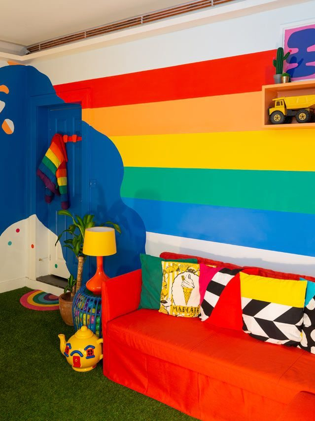

> TIP:CHECK: Chalk sketch first; Even band widths; Repeat one mural color in cushions

## 6. Bold Floral Wallpaper

Bold floral wallpaper is FunHaus in a roll: oversized blooms, saturated color and zero apology. One wall is enough in a small room, but a full-room wrap works when the print is dark-grounded and the furniture is simple.

Let the wallpaper be the loudest thing in the room. Pair it with solid-color furniture in one of the print's colors and keep the art minimal, so the wall itself is the gallery.

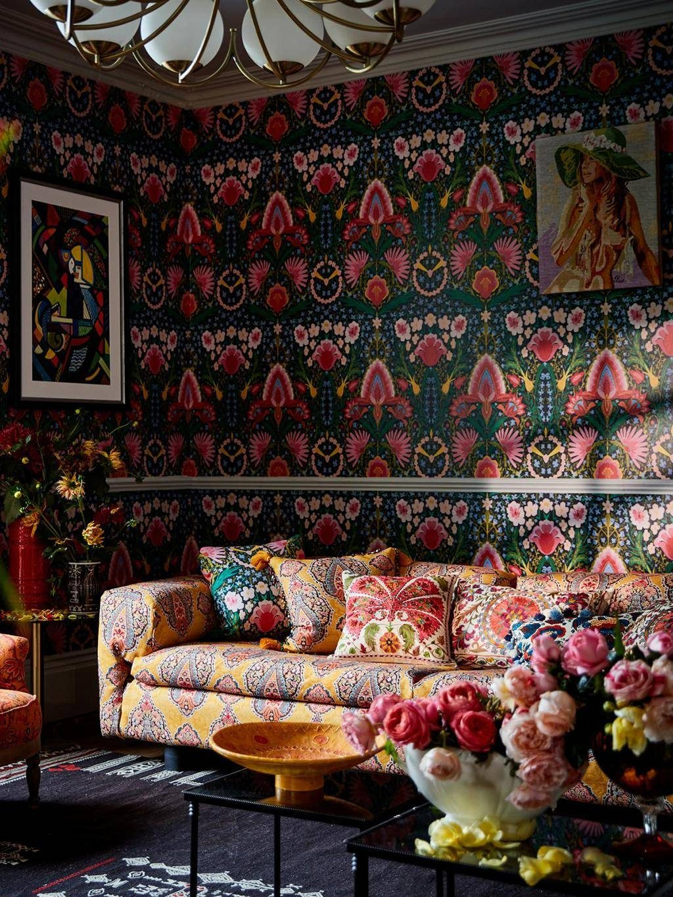

> TIP:GUIDE: Wallpaper: oversized blooms | Furniture: one solid print color | Art: minimal or none

## 7. Rainbow Kitchen Cabinets

Rainbow kitchen cabinets turn the hardest-working room in the house into the happiest one. Paint each run of cabinets a different bright color, or go gradient across the wall so the colors flow from one to the next. White worktops and a simple backsplash keep it from tipping into chaos.

If a full rainbow feels too much, paint just the lower cabinets and leave the uppers white. You still get the color hit every time you walk in, but the room stays light and the work surfaces stay calm.

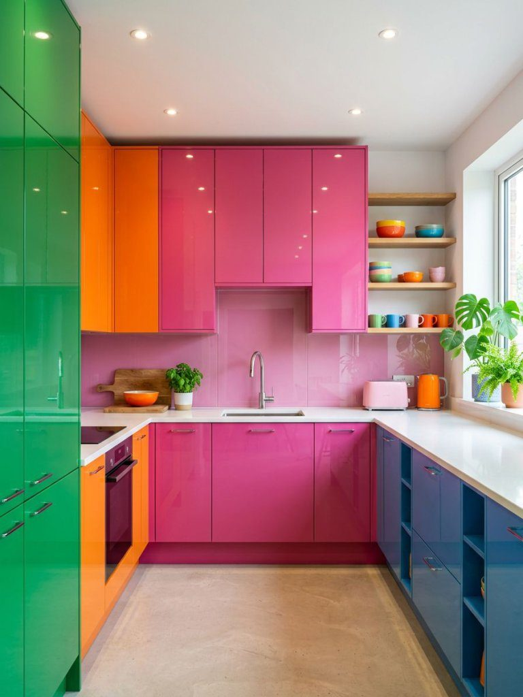

> TIP:QUICK: Paint only the lower cabinets for color without losing the light.

## 8. A Wavy Mirror

A wavy mirror is the FunHaus accent that works in every room. The undulating frame softens a straight-edged wall and catches the light in a way a plain rectangle never does. Hang it over a console, a dresser or a sofa and it instantly makes the wall feel playful.

Scale it generously — a small wavy mirror gets lost, while a large one becomes the room's sculpture. Pair it with a bold wall color so the frame reads as a shape, not just a reflection.

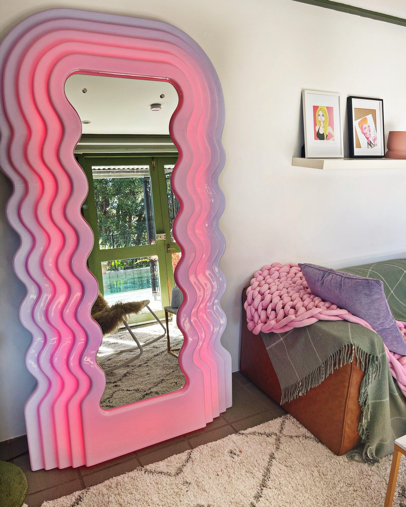

> TIP:CHECK: Large scale; Bold wall color behind it; Nothing else competing on that wall

## 9. A Color-Blocked Tile Bathroom

Color-blocked tile turns a small bathroom into a jewel box. Stack bright tiles in blocks of pink, blue and yellow, and let the grout lines draw the grid. Because bathrooms are small, you can afford the boldest tiles in the shop without the cost spiraling.

Keep the sanitaryware white and the fixtures simple chrome or brass. The tiles are the decoration, so everything else should stay quiet and let the blocks do the talking.

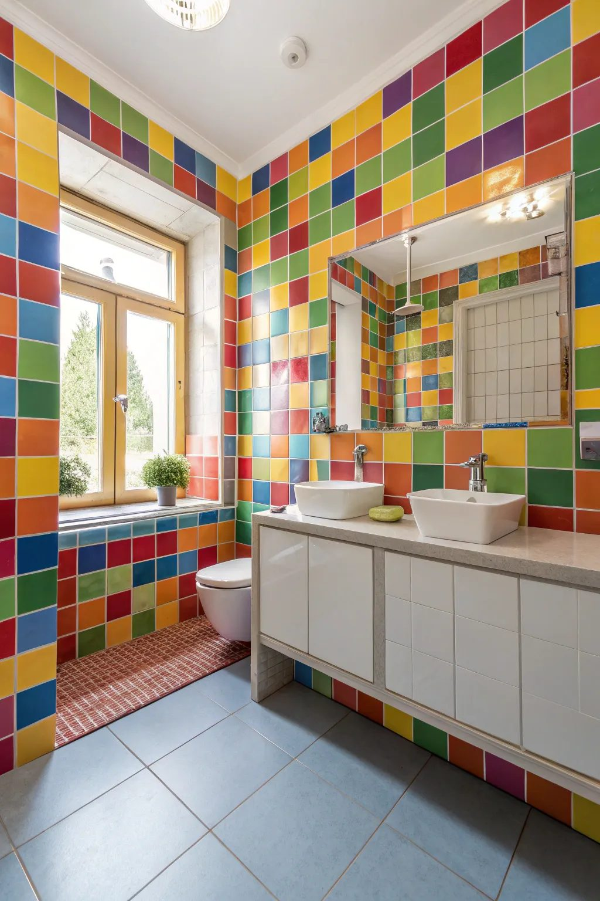

> TIP:GUIDE: Tiles: three bright blocks | Sanitaryware: plain white | Fixtures: simple chrome or brass

## 10. Mismatched Dining Chairs

Mismatched dining chairs are the easiest FunHaus win: buy chairs in different colors, shapes or eras and let the table tie them together. The trick is one shared element — the same wood tone, the same seat height or the same color family — so the mix reads as a set.

Paint is your friend here. A coat of bright paint unifies charity-shop finds into a deliberate collection, and you can repaint a single chair whenever you fancy a change without redoing the room.

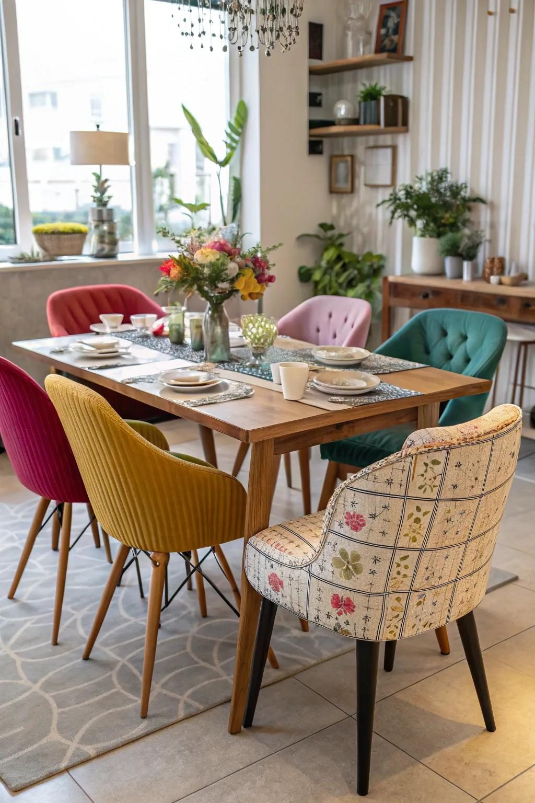

> TIP:QUICK: Give every chair one shared detail, like matching paint or the same wood tone.

## 11. Bold Bedding in the Bedroom

Bold bedding is the fastest FunHaus move in a bedroom because it covers the biggest surface in the room. A bright patterned duvet, clashing pillow shams and a throw in a third color make the bed the centerpiece, even in a plain white room.

Layer the patterns like you would in a living room: one large print on the duvet, a smaller one on the shams and a solid throw to calm it down. Change the bedding with the seasons and the whole room gets a refresh for the price of a duvet set.

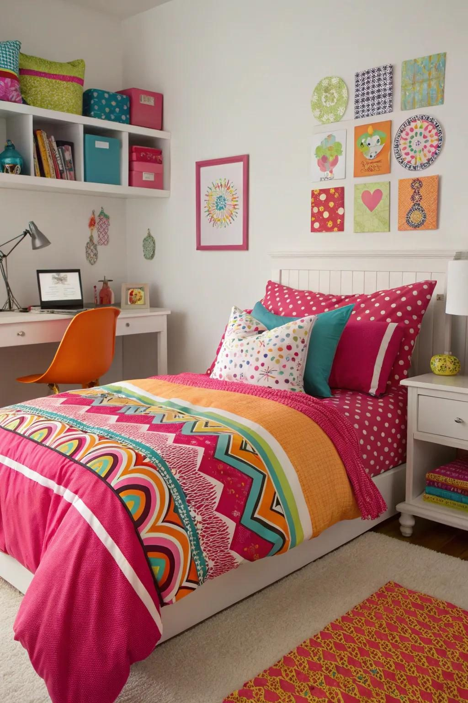

> TIP:CHECK: Large print on duvet; Small print on shams; One solid throw to calm it down

## 12. A Funky Entryway Console

The entryway is the first thing guests see, so it is the perfect place for a funky console. A brightly painted table, a wavy mirror above it and a bowl for keys in a clashing color set the tone before anyone reaches the living room.

Keep the console practical: a tray for keys, hooks for coats and a small lamp for evening light. The fun comes from the color and the shape, not from clutter, so edit ruthlessly and let each piece earn its spot.

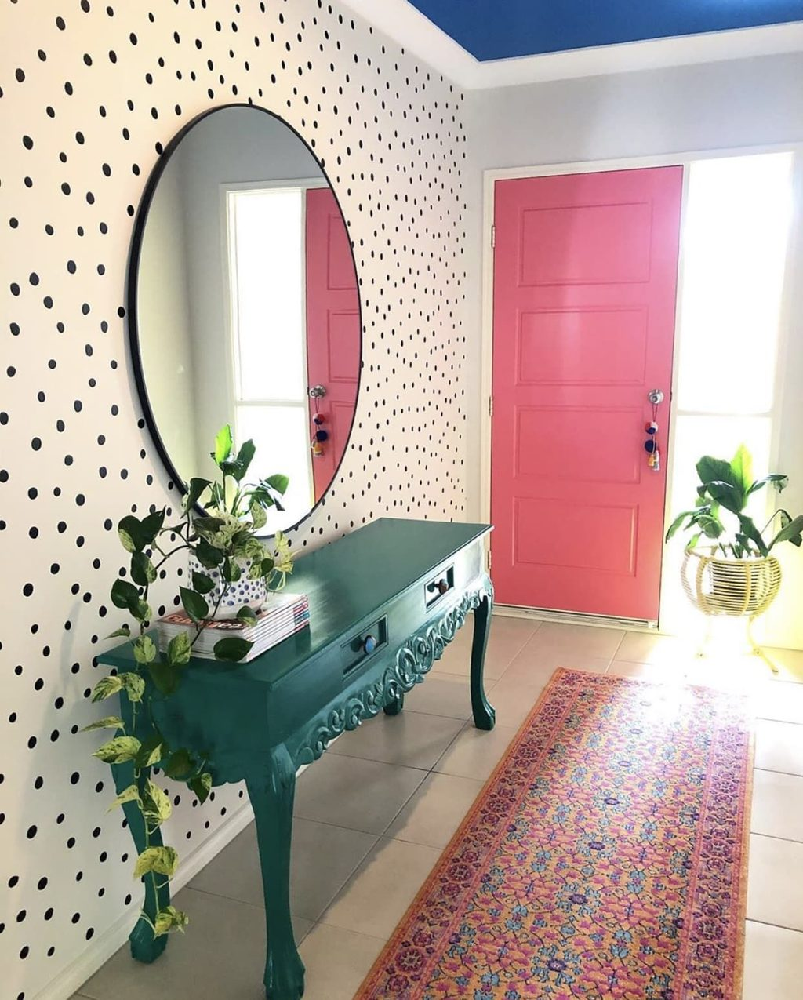

> TIP:GUIDE: Console: bright painted color | Mirror: wavy or arched | Tray: one clashing color

## 13. A Playful Home Office

A playful home office makes work feel less like work. Paint one wall a bright color, add a bold rug under the desk and choose a chair in a color that makes you grin. When the room is fun to sit in, you will actually sit in it.

Keep the desk surface clear and the storage closed, so the color reads as design rather than mess. A pinboard in a bright frame doubles as decoration and a place for ideas, and a fun lamp finishes the desk.

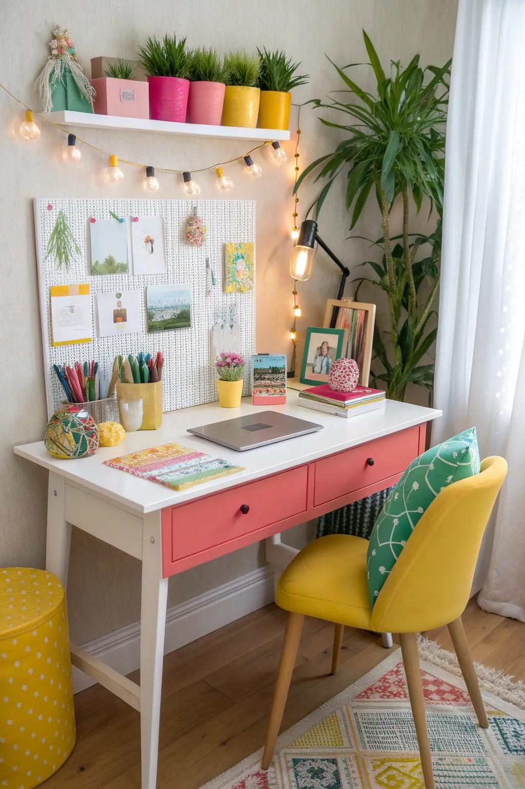

> TIP:QUICK: Paint one wall behind the desk so it shows up on video calls too.

## 14. A Geometric Rug

A geometric rug is the FunHaus foundation piece: it anchors the furniture, sets the color palette and adds pattern without touching the walls. Big shapes in bright colors work best, and a rug that is slightly too big is better than one that is slightly too small.

Let the rug's colors guide the cushions and throws. Pull one color from the rug for the sofa cushions and a second for a throw, and the whole seating area will feel pulled together without matching exactly.

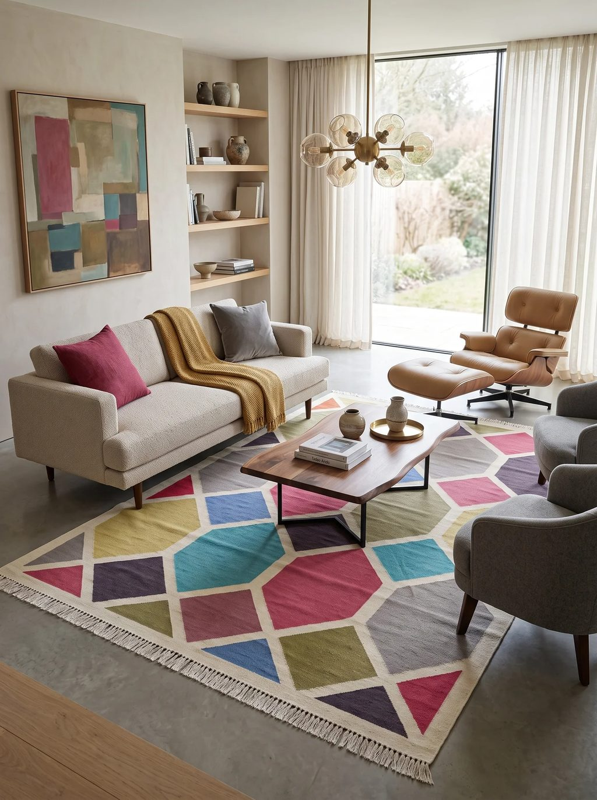

> TIP:CHECK: Rug larger than the sofa; Two rug colors repeated in cushions; Front legs on the rug

## 15. A Rainbow Staircase

A rainbow staircase turns the most boring part of the house into a daily dose of joy. Paint each riser a different color of the spectrum, working from bottom to top, and the climb becomes a color journey. It works best on a staircase you see from the living room or entryway.

Use durable floor paint and a clear topcoat, because stairs take a beating. Keep the handrail and balusters white or natural wood so the rainbow stays the star and the staircase stays safe and readable.

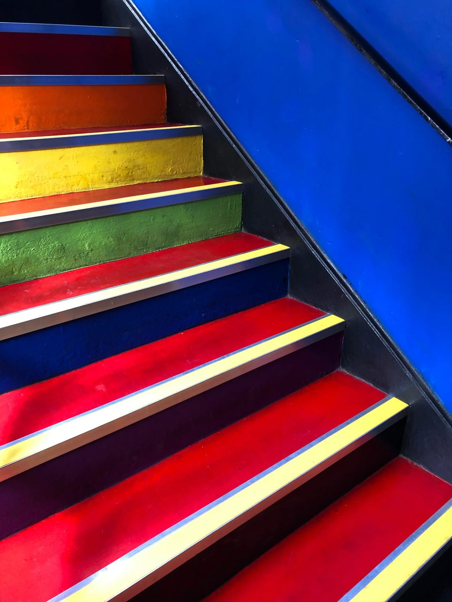

> TIP:GUIDE: Paint: durable floor paint | Order: spectrum bottom to top | Handrail: white or natural wood

## 16. A Sculptural Accent Chair

A sculptural accent chair is furniture as art. Look for curves, twists and unexpected shapes — a chair that makes guests ask where you found it. In a bright color it becomes the room's talking point, so place it where it can be seen from the door.

One sculptural chair is enough. Pair it with a small side table and a simple floor lamp, and resist the urge to add a second statement piece nearby. The chair needs breathing room to be appreciated.

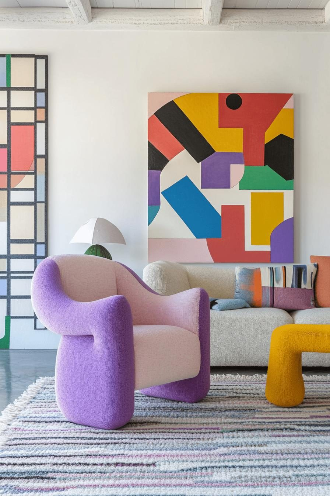

> TIP:QUICK: Place it where you see it from the door so it greets everyone.

## 17. A Colorful Patio

FunHaus does not stop at the back door. A colorful patio with bright chairs, a patterned outdoor rug and painted plant pots turns the garden into another room of the house. Outdoor paint and weatherproof cushions make it last through the season.

Start with the seating: two or three chairs in different bright colors, then add the rug and pots in the same palette. String lights overhead finish the look and make the patio usable long after sunset.

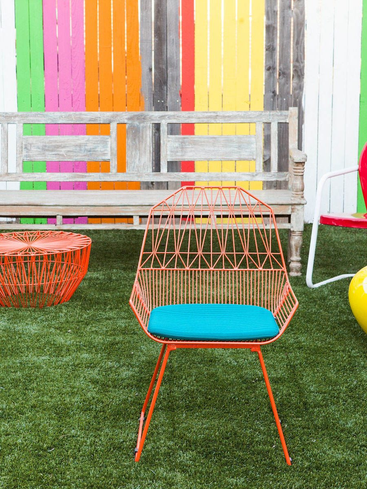

> TIP:CHECK: Weatherproof cushions; Outdoor paint on pots; String lights for evenings

## 18. A Rainbow Playroom

A rainbow playroom is FunHaus at its most natural: bright colors, low storage and everything within reach. Paint the walls in soft rainbow bands or use one wall for a mural, then keep the furniture low and the storage open so kids can actually use it.

Open cubbies in different colors make tidying into a sorting game, and a big rug defines the play zone. Keep one wall plain for art display, because the kids' own work is the best decoration this room will ever have.

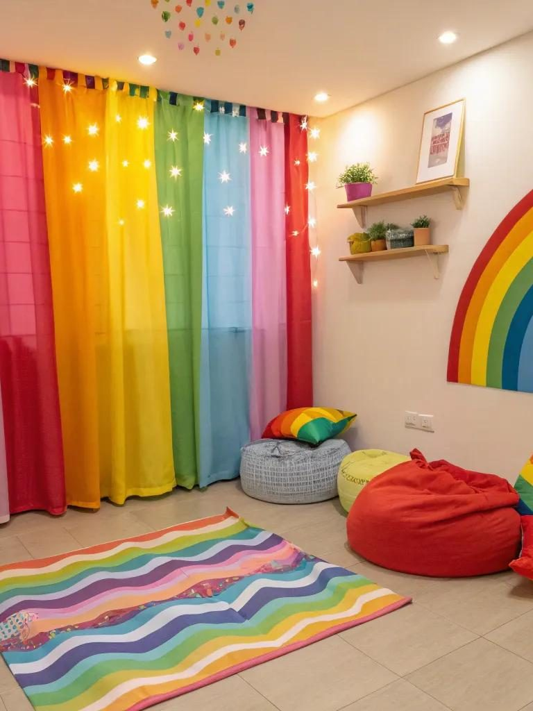

> TIP:GUIDE: Walls: soft rainbow bands | Storage: low open cubbies | Display: one wall for kids' art

## 19. Memphis-Style Color Clash

Memphis style is FunHaus with a design-history degree: bold geometric shapes, clashing primary colors and patterns that refuse to behave. A squiggle rug, a triangle cushion and a circle mirror in one room sounds wrong until you see it work.

The key is repetition. Pick three shapes and three colors and repeat them across the room — on the rug, the cushions and the wall art — so the clash feels like a system rather than an accident.

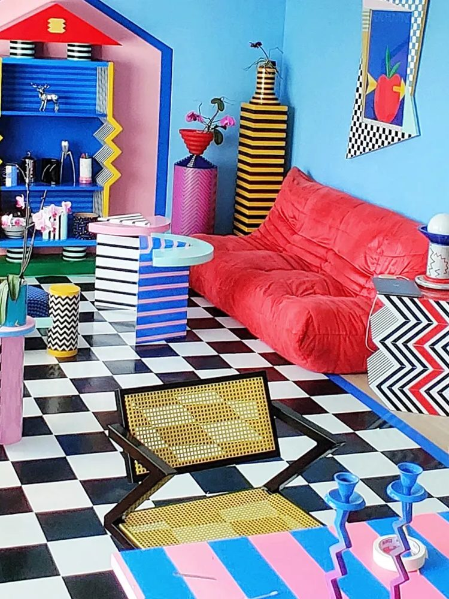

> TIP:QUICK: Repeat three shapes and three colors across the room to make the clash feel planned.

## 20. An Orange Ikat Sofa with Dark Florals

An orange ikat sofa against dark floral wallpaper is the kind of pairing that sounds risky and looks wonderful. The ikat's bold geometry and the wallpaper's deep blooms share a warm, saturated palette, so they argue in the same language.

Keep the rest of the room simple: a dark wood coffee table, a plain rug and one brass lamp. The sofa and the wall are doing all the work, and anything else loud would start a second argument.

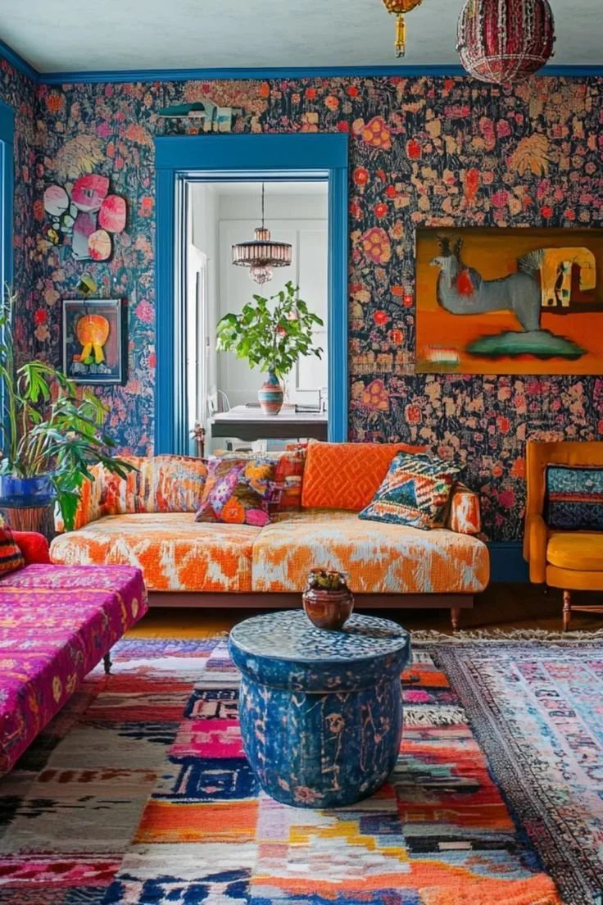

> TIP:CHECK: Shared warm palette; Plain rug; One brass lamp as the only metal

## 21. A Curvy Color-Block Sofa

A curvy color-block sofa brings the FunHaus shape language to the biggest piece in the room. The curves soften the silhouette and the color blocks — two or three bold hues on one sofa — make it look custom even when it is not.

Style it with cushions in one of the sofa's own colors and a rug in a contrasting solid. The sofa is already doing two jobs at once, so the rest of the seating area should stay simple and let it shine.

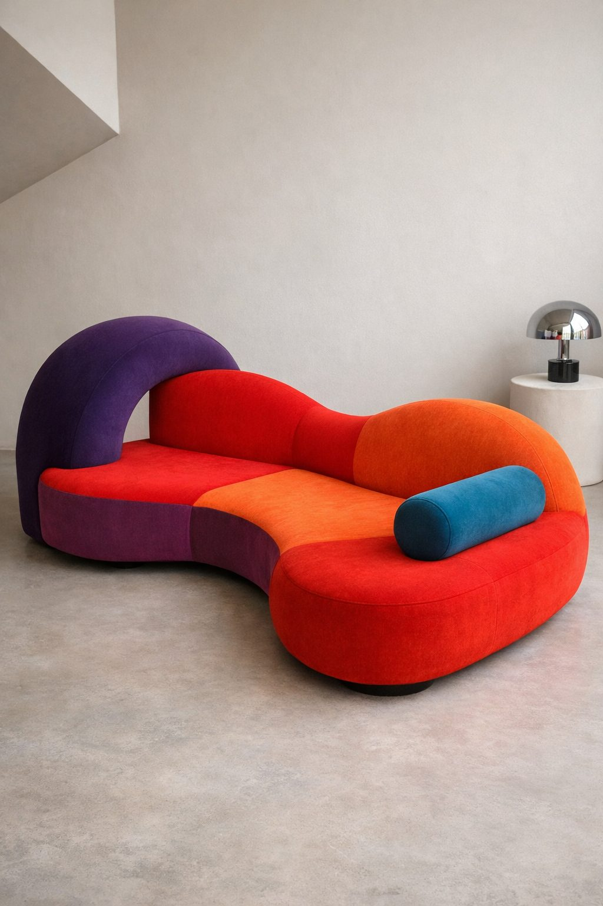

> TIP:GUIDE: Sofa: two or three color blocks | Cushions: one sofa color | Rug: contrasting solid

## 22. A Rainbow Cabinet Makeover

A rainbow cabinet makeover is the thrift-store FunHaus classic. Take a plain chest of drawers, paint each drawer a different bright color, and swap the knobs for mismatched ones. An afternoon's work turns a boring piece into the room's star.

Sand and prime first so the paint sticks, and use the same finish on every drawer so the colors read as a set. The knobs are the jewelry: mix shapes and materials, but keep them roughly the same size so the drawers still open easily.

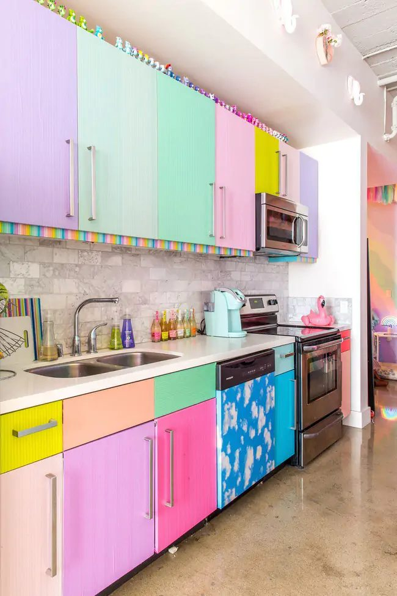

> TIP:QUICK: Paint each drawer a different color and swap in mismatched knobs.

## 23. A Primary-Color Tile Bathroom

A primary-color tile bathroom is a masterclass in doing more with less. Red, blue and yellow tiles in simple blocks turn a plain bathroom into a graphic statement, and because the palette is limited to three colors it never feels random.

Use the brightest color sparingly — one block of red against larger fields of blue and yellow, for example. White grout keeps the grid crisp, and a plain mirror and white towels let the tiles own the room.

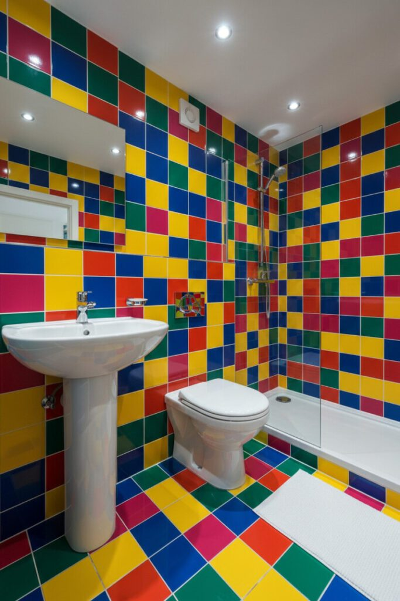

> TIP:CHECK: Three colors only; Brightest color sparingly; White grout for a crisp grid

## 24. Painted Dining Chairs

Painted dining chairs are the quickest FunHaus upgrade in the house. A set of plain wooden chairs in a row of bright colors turns every meal into a small celebration, and the project costs little more than a few tester pots of paint.

Paint the chairs in a gradient — from yellow through orange to pink, say — so the row reads as one idea. Keep the table natural wood or white so the chairs stay the focus, and add a simple runner in one of the chair colors.

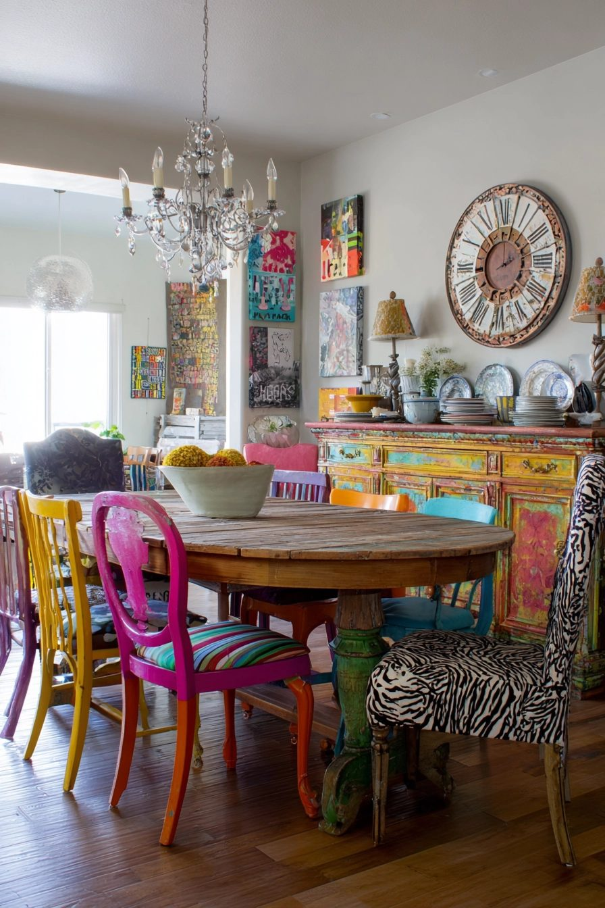

> TIP:GUIDE: Colors: gradient across the row | Table: natural wood or white | Runner: one chair color

## 25. A Rainbow Ceiling

A rainbow ceiling is the FunHaus move nobody expects and everybody remembers. Paint the ceiling in stripes or a soft gradient and the room gets a surprise overhead, while the walls can stay calm. It works beautifully in bedrooms, playrooms and dining rooms.

Keep the walls pale and the furniture simple, because the ceiling is now the room's biggest pattern. A plain pendant light hangs best against the stripes, and the effect is strongest in rooms where you spend time looking up — over the bed or the dining table.

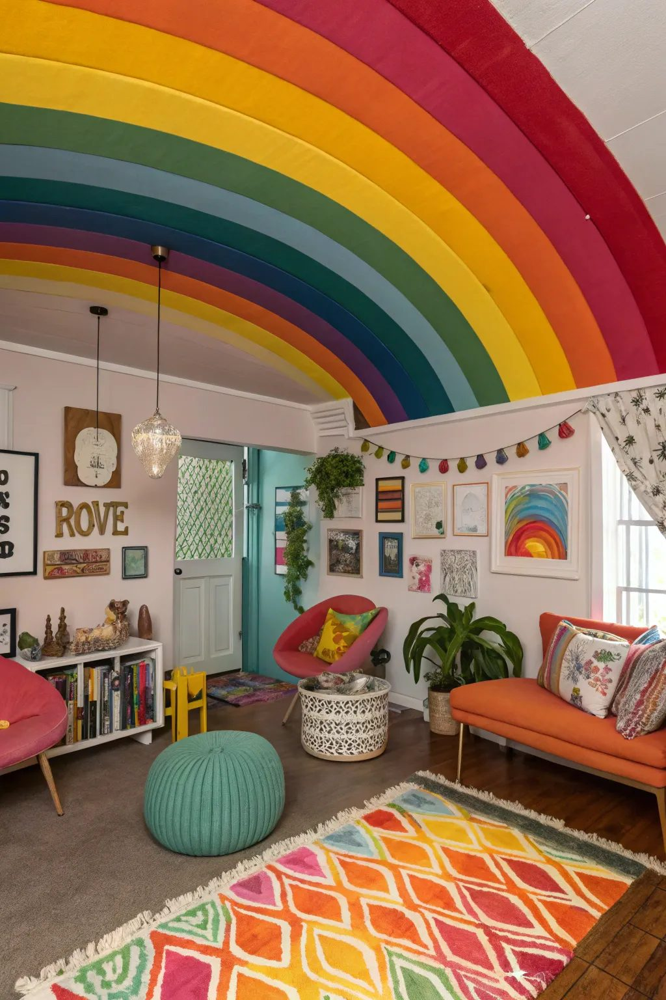

> TIP:QUICK: Keep the walls pale so the ceiling stays the star of the room.

## 26. A Glowing Wavy Mirror

A glowing wavy mirror adds light as well as shape. Backlit or flanked by warm bulbs, the undulating frame casts a soft glow that makes the whole corner feel alive in the evening. It works over a console, a dresser or in a dark hallway.

Choose warm light, not cool, so the glow feels cozy rather than clinical. The mirror should be the only light source on that wall in the evening, so it reads as a feature rather than just another lamp.

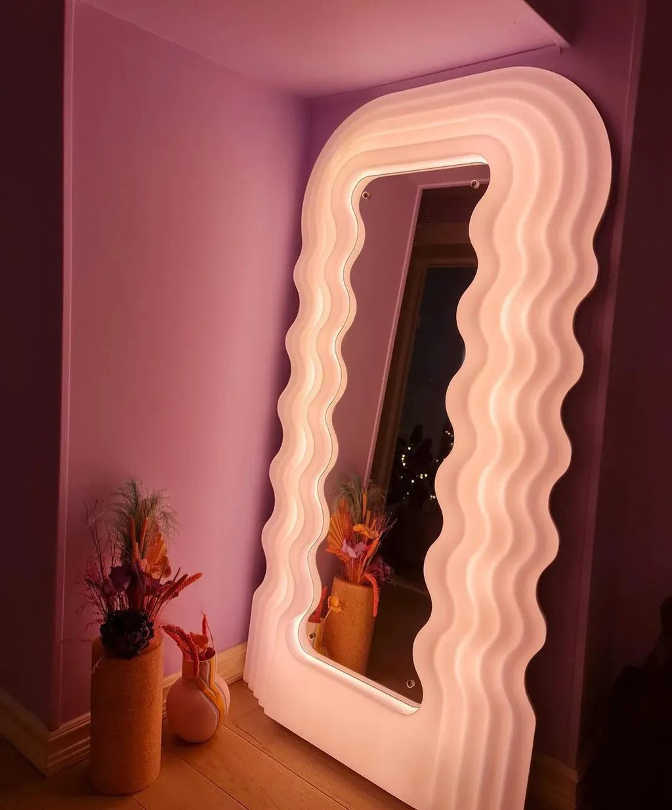

> TIP:CHECK: Warm light only; One light source on the wall; Hang over a console or dresser

## 27. A Patchwork Rug with a Teal Sofa

A patchwork rug with a teal sofa is FunHaus comfort: the rug's mixed patterns and colors do the playful work while the solid teal sofa grounds the room. It is the easiest way to get a maximalist look without painting a single wall.

Pull one color from the rug for a cushion and another for a throw, and the sofa and rug will feel like they were chosen together. A plain coffee table in wood or brass keeps the middle of the room calm.

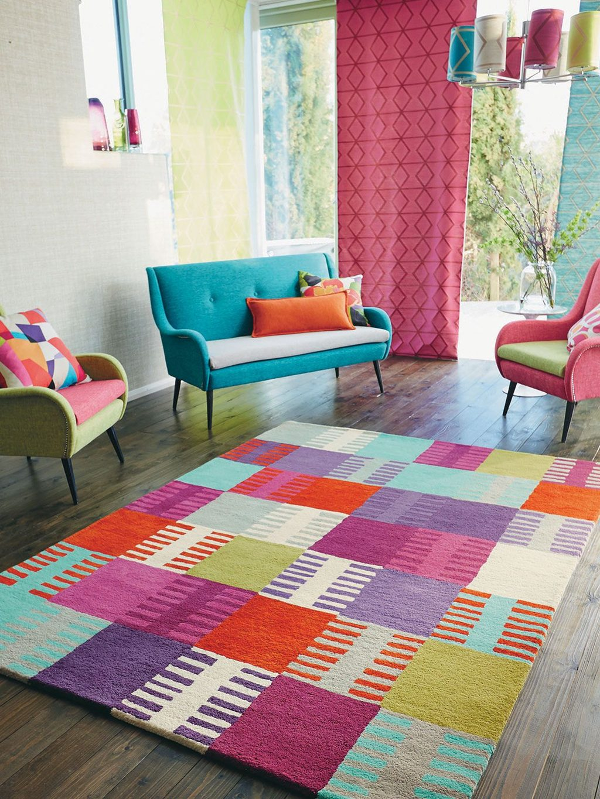

> TIP:GUIDE: Rug: mixed patchwork | Sofa: solid teal | Cushion: one rug color

## 28. Pastel Rainbow Steps

Pastel rainbow steps are the softer cousin of the full rainbow staircase. Soft pink, mint, butter yellow and sky blue on the risers give the same joyful climb in a gentler register, and they suit hallways and bedrooms where a loud spectrum would be too much.

Keep the treads natural wood and the handrail white so the pastels read as a wash of color rather than a shout. A runner in one of the pastel shades ties the staircase to the hallway floor.

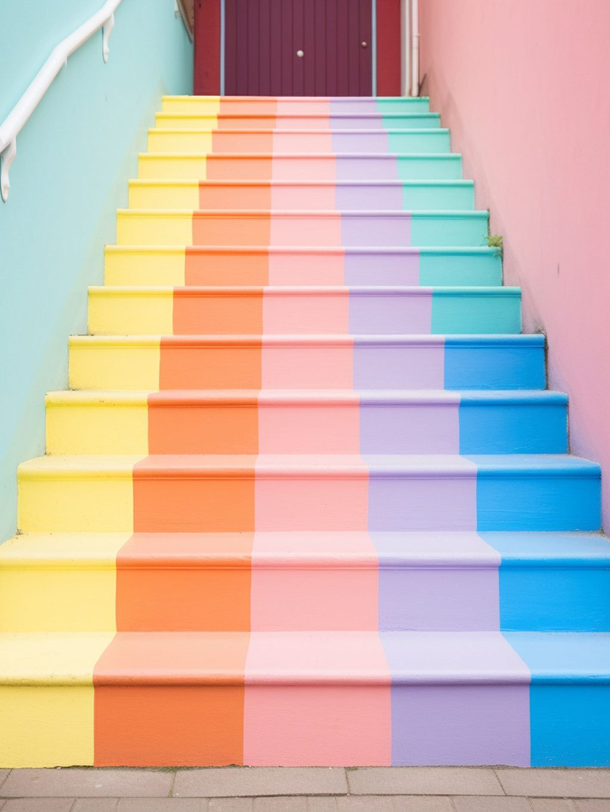

> TIP:QUICK: Keep treads natural wood so the pastels read as a soft wash.

## 29. A Purple Gallery-Wall Entryway

A purple gallery-wall entryway makes the smallest room in the house the boldest. Deep purple walls, a grid of framed art in mixed frames and a small bench or console create a gallery you walk through every day.

Mix frame sizes and art styles, but keep one thread — all black frames, or all prints in the same palette — so the wall feels curated rather than cluttered. A small rug in a purple tone finishes the space.

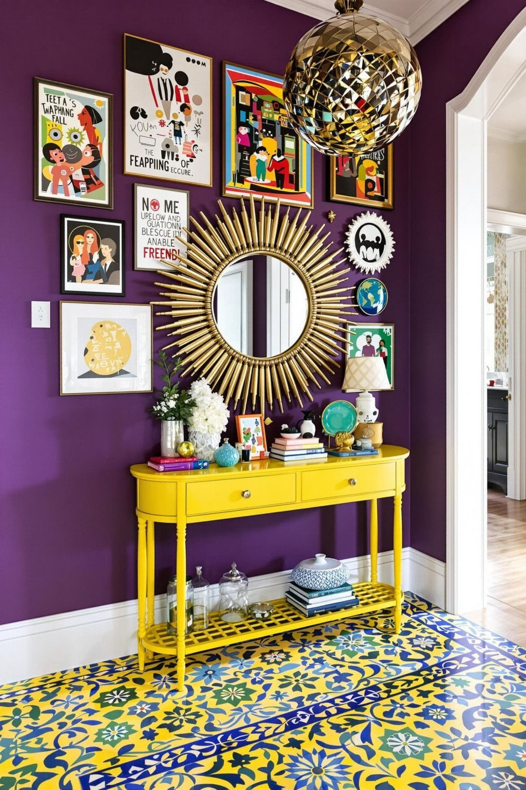

> TIP:CHECK: One frame thread; Mixed sizes; Rug in a purple tone

## 30. A Rainbow-Quilt Kids' Bedroom

A rainbow-quilt kids' bedroom is the FunHaus look at its coziest. A bright quilt in rainbow stripes, cushions in the same colors and a simple white wall behind it make the bed the whole decoration. The quilt is also practical: it is the blanket, the art and the color scheme in one.

Let the quilt set the palette and repeat its colors in small doses — a cushion here, a storage box there. Keep the furniture pale wood and the walls white, and the room will feel bright and cheerful without ever feeling loud.

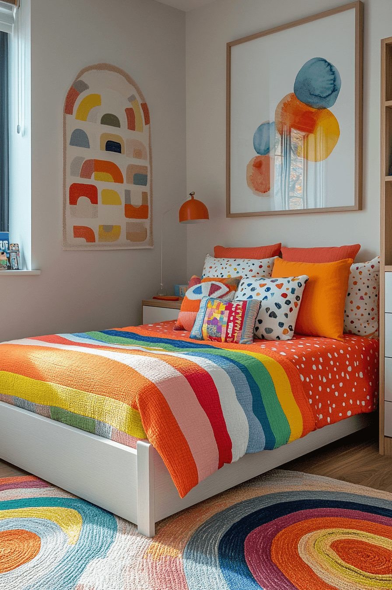

> TIP:GUIDE: Quilt: rainbow stripes | Walls: plain white | Furniture: pale wood

## Takeaway

FunHaus works when you commit. Start with one bold move — a rainbow wall, a color-drenched sofa or a checkerboard floor — and repeat its colors in two or three smaller places around the room. If you want the room-by-room version, our [30 FunHaus Interior Ideas for a Playful Home](/posts/funhaus-interior/) shows how the same spirit plays out in living rooms, bedrooms, kitchens and bathrooms. Pick the idea that made you smile, start there, and let the color spread.

## Frequently Asked Questions

### What is FunHaus style?

FunHaus is a playful, bold maximalist style built on saturated color, clashing patterns, curvy shapes and fun furniture. It mixes rainbow hues, geometric prints and quirky pieces across the whole home, with one or two repeated colors keeping the look intentional rather than chaotic.

### How do I start with FunHaus without repainting everything?

Start with one bold move: a patterned rug, bright bedding or a painted piece of furniture. Repeat one of its colors in cushions or art, and live with it for a few weeks. If you love it, add a painted wall or a second bold piece.

### Does FunHaus work in a small home?

Yes, and it can make a small home feel bigger and happier. Use one bold color per room, keep the ceiling and floor light, and let a single statement piece do the work. Small rooms suit color-blocking and murals because every surface is close and visible.

### What colors define FunHaus?

FunHaus favors saturated brights: hot pink, cobalt, orange, sunny yellow, emerald and teal, often used together. The trick is repeating two or three of them around a room, with one neutral like cream or pale wood to give the eye a rest.

### Can FunHaus be renter-friendly?

Absolutely. Use removable wallpaper, a bold rug, colorful bedding and painted secondhand furniture you can take with you. Stick-on tiles and temporary murals give the same impact as paint without risking your deposit. Peel-and-stick hooks hold gallery walls and mirrors, and nothing you buy needs to stay behind when you move.

### How do I mix patterns in FunHaus without it looking messy?

Share one color across all your patterns and use three different scales: one large print, one medium and one small. Add a solid cushion or throw to rest the eye, and the mix will read as deliberate rather than accidental.

### Is FunHaus the same as maximalism?

FunHaus is a playful branch of maximalism with its own flavor: more rainbow color, more curves and more humor. Classic maximalism can be dark and layered; FunHaus is bright, graphic and fun, with Memphis-style shapes and bold color-blocking. Think of maximalism as the family and FunHaus as its loudest, happiest member.

### How much color is too much in FunHaus?

If every surface is shouting, nothing stands out. Keep one quiet element in each room — a plain ceiling, a pale floor or a solid sofa — and let the bold pieces take turns. When in doubt, remove one colorful item and see if the room feels better.
