# 30 Gallery Wall Ideas for Living Rooms

A blank living room wall is the easiest room in the house to fix. Gallery wall ideas for living rooms work because they fill a big empty surface with things you already love — family photos, travel prints, art you picked up along the way — arranged so the whole wall reads as one piece instead of a dozen small ones. This list gathers 30 real rooms, from tight symmetrical grids to full salon-style walls, so you can find the layout that fits your wall, your sofa and your collection.

The rule that holds every wall together is simple: pick one anchor piece first, keep the gaps between frames even, and let the bottom edge of the arrangement sit roughly level with the top of the sofa. If your room leans relaxed and layered, our [30 Boho Living Room Ideas for a Relaxed, Layered Home](/posts/boho-living-room/) shows how a gallery wall sits inside a softer, texture-first room.

## 1. A Black-and-White Photo Gallery

Black-and-white photos make a gallery wall feel calm even when it is large. Stripping the color out unifies portraits, cityscapes and landscapes that would clash in color, so the wall reads as one collection. Matching black frames and white mats sharpen the effect, and the wall works in almost any room because it borrows nothing from the furniture palette.

Print your favorites in the same size and paper finish, and mix portraits with a few landscapes so the wall has rhythm. A sectional sofa underneath gives the wall a wide, low base that suits a grid wrapping around a corner.

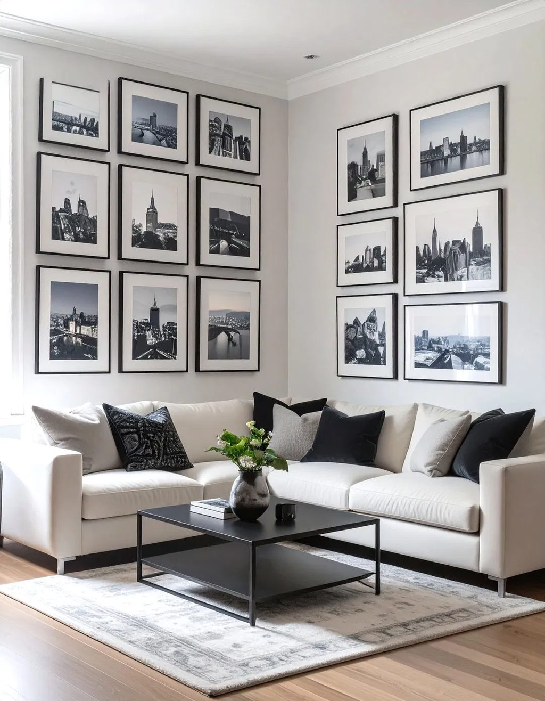

> TIP:GUIDE: Print size: 8x10 or 11x14 mixed | Paper: same matte finish for all | Frames: thin black with white mats

## 2. A Salon-Style Eclectic Mix

A salon wall is the opposite of a grid: frames of every size, mixed finishes, art and photos side by side, hung edge to edge until the wall is full. It suits a room with a strong sofa color, like the burnt orange one here, because the wall and the furniture balance each other — busy wall, simple seating, or the other way around.

Start with the biggest piece slightly off-center, then fill outward, keeping gaps small and even. The trick is a shared thread: one repeated color, one repeated frame finish, or one subject that shows up in several pieces.

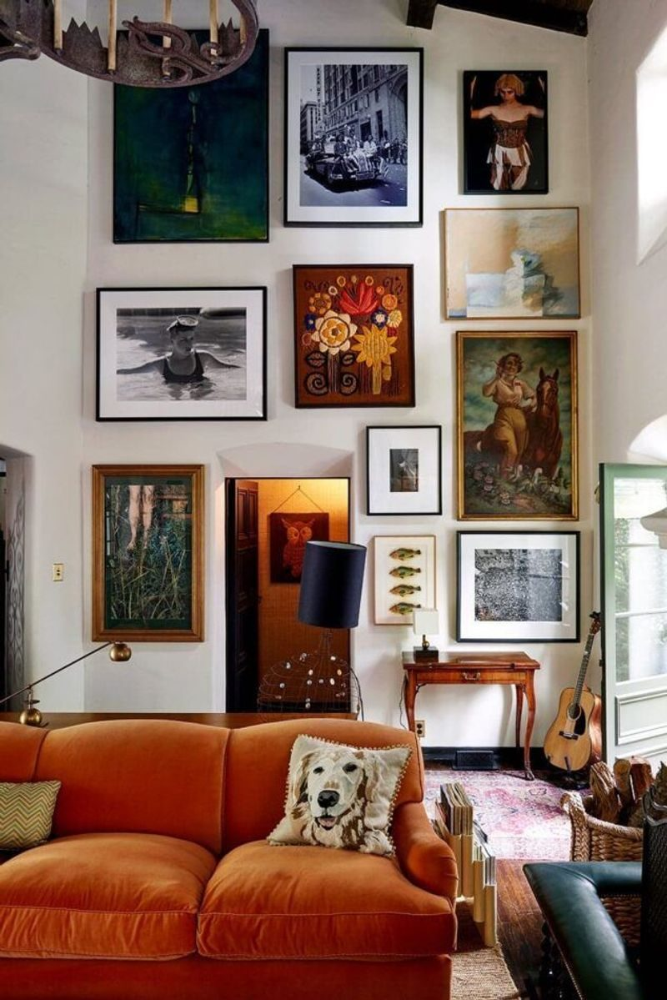

> TIP:CHECK: One anchor piece hung first; gaps of 2–3 inches throughout; one repeated color or frame finish tying the mix together

## 3. A Symmetrical Grid Above the Sofa

A grid is the calmest gallery wall there is, and the easiest to hang well. Identical black frames with white mats, spaced evenly in rows, turn a wall of family and travel photos into something that looks deliberate rather than collected by accident. The symmetry does the styling for you, so the photos themselves can be as varied as you like.

Keep the whole grid about two-thirds the width of the sofa below it, and leave the same gap — two to three inches — between every frame. If one photo is a favorite, put it at eye level in the center and build the grid outward from there.

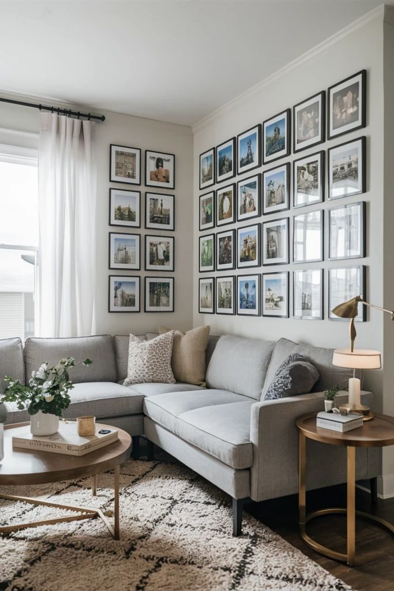

> TIP:QUICK: Lay the grid on the floor first and tape the outline on the wall — you will spot a crooked row before any nail goes in.

## 4. A Large Anchor Piece with Smaller Frames

Every good gallery wall has a boss. Hang one large piece first — a big abstract, a favorite landscape, a mirror — and let the smaller frames gather around it. The anchor sets the scale of the whole wall, so the small pieces read as companions instead of clutter, and the eye always knows where to land first.

Place the anchor slightly above the center of the arrangement and keep the frames nearest to it the second-largest in the group. Fill the edges with the smallest pieces, and leave a little more space around the anchor than between the small frames so it can breathe.

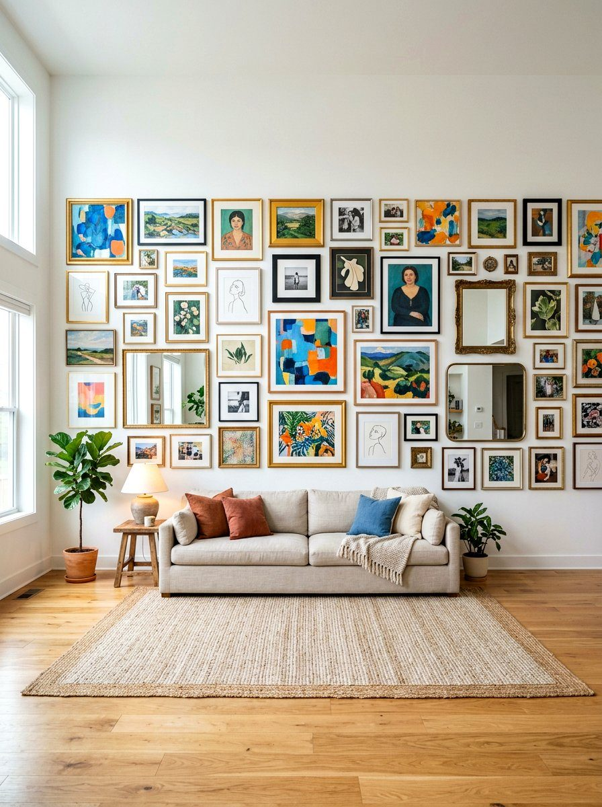

> TIP:QUICK: Hang the anchor at eye level first, then build outward — never start with the small frames and hope the big one fits.

## 5. A Gallery Wall Over the Fireplace

The wall above the fireplace is usually the room's focal point, so a gallery wall there has to earn it. A dense cluster of frames in varied sizes works beautifully above a mantel because the mantel itself gives the arrangement a base line, and the fire below adds warmth that flat art alone cannot. Keep the frames clear of the heat: art should sit at least a foot above the mantel shelf.

Echo the mantel styling in the frames — warm wood tones, brass, or black — and let one larger painting sit directly above the firebox as the center. Smaller pieces fan out to the sides, and the mantel below holds a plant, candles and one framed photo to tie the two layers together.

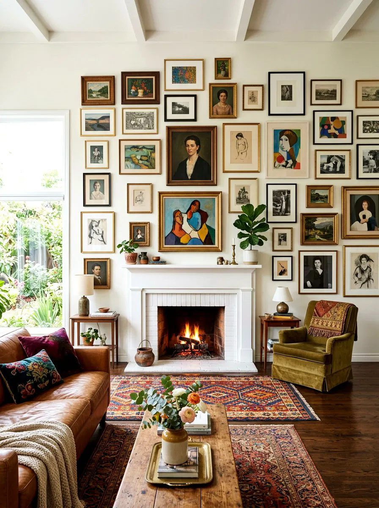

> TIP:CHECK: Art at least 12 inches above the mantel; one large piece centered over the firebox; mantel decor kept low so it never crowds the frames

## 6. Picture Ledges for Easy Swaps

Picture ledges are the gallery wall for people who change their minds. Frames simply lean on narrow shelves, so you can swap a print, add a new photo or restyle for a season without a single new nail hole. Three ledges above a sofa give you three rows to play with, and leaning frames at slightly different angles makes the wall feel relaxed rather than rigid.

Mix frame sizes on each ledge and overlap a small frame in front of a larger one for depth. Keep the bottom ledge clear of the sofa back by a few inches so nothing gets knocked when someone sits down.

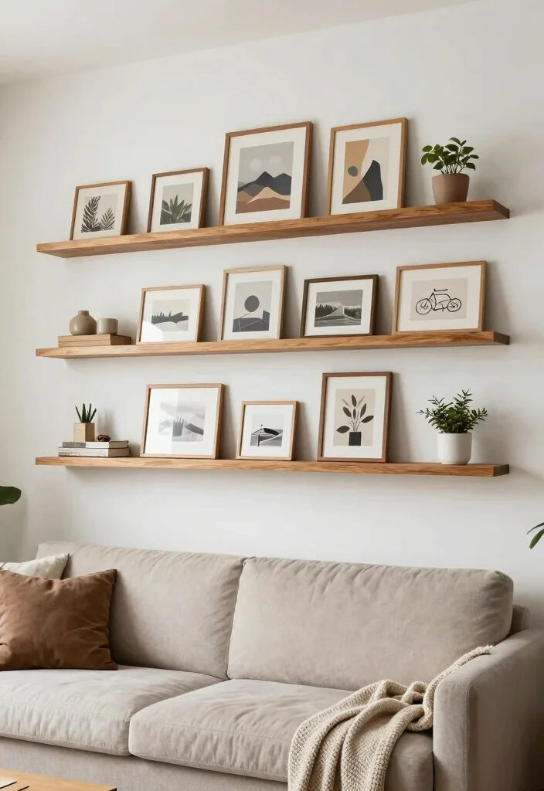

> TIP:GUIDE: Ledge depth: 3–4 inches | Spacing between ledges: 12–15 inches | Overlap: small frames in front of large ones

## 7. Botanical Prints in a Neat Grid

Botanical prints are the friendliest gallery wall subject: green is restful, the shapes are simple, and a grid of fifteen matching prints fills a wall without a single hard decision. Light wood frames and white mats keep the look fresh, and the prints pair naturally with real plants in the room — the wall and the windowsill start to feel like one garden.

Choose prints in the same illustration style, even if the plants differ, and keep the grid tight and even. A beige sofa and a jute rug underneath let the green do all the talking.

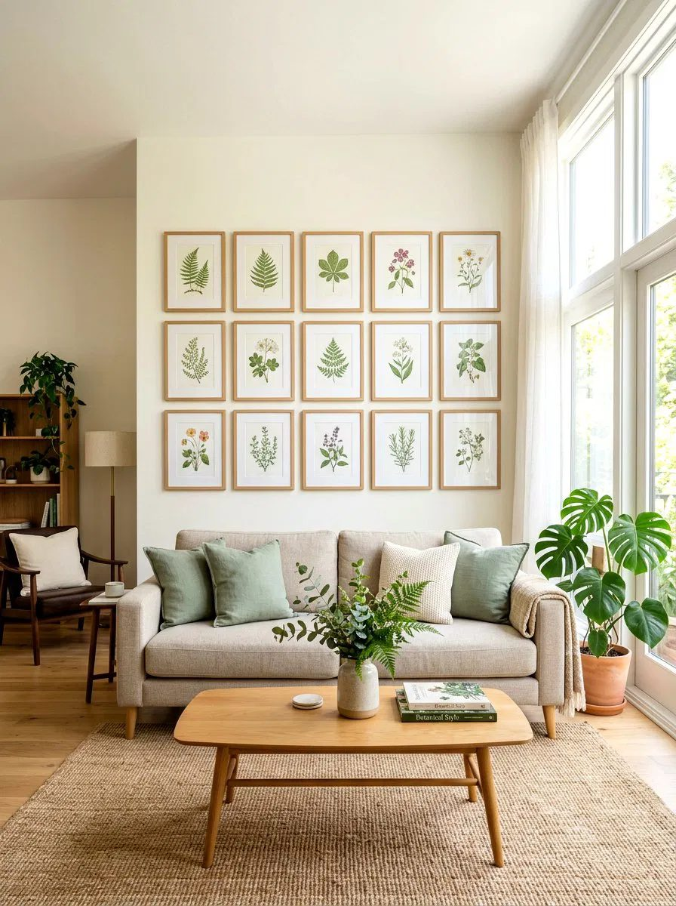

> TIP:QUICK: Buy the prints as a matched set in one style — mixing illustration styles is what makes a botanical grid look messy.

## 8. A Family Photo Timeline

A family gallery wall works best when it tells a story in order. Arrange the photos chronologically — early years at one end, recent years at the other — and the wall becomes a timeline guests actually walk along and read. Mixed frame finishes are fine here because the story, not the frames, is the thread.

Use the same print size for the main row and let a few larger portraits break the rhythm at intervals. Keep captions off the wall itself; the photos should do the talking, and a small shelf below can hold the objects that go with the years on display.

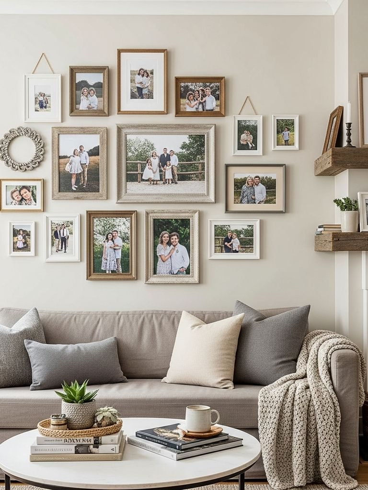

> TIP:CHECK: Photos in chronological order left to right; one print size for the main row; two or three larger portraits as rhythm-breakers

## 9. Matching Black Frames

One frame finish, used everywhere, is the fastest way to make a mixed collection look intentional. Black frames with white mats unify travel photos, portraits and art prints that have nothing else in common, and the high contrast suits a white sofa and pale walls. The wall reads as graphic and modern even when the pictures inside are soft and personal.

Vary the frame sizes while keeping the finish identical, and hang the largest frames at the outer edges so the arrangement feels anchored. A small plant on the coffee table is all the color the room needs.

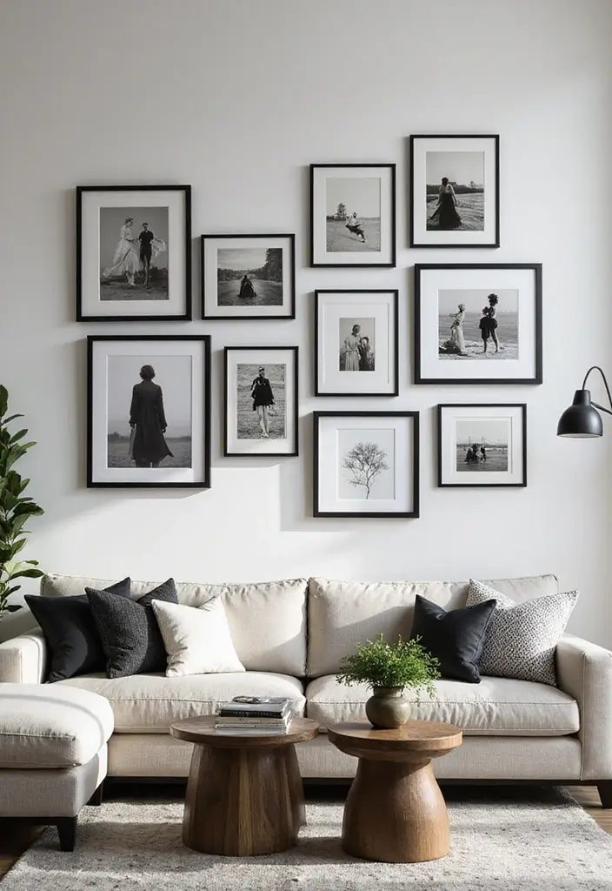

> TIP:GUIDE: Frame finish: matte black throughout | Mats: white, same width | Sizes: mix 8x10, 11x14 and one 16x20

## 10. Gold Frames on a Dark Wall

Gold frames need a dark wall to show off against, and a dark wall needs gold frames to keep it from feeling flat. On charcoal or deep green, gilt frames catch the light and turn even simple prints into something that looks collected over decades. A green velvet sofa underneath doubles down on the moody palette, and warm lamps keep the room inviting rather than gloomy.

Mix ornate vintage frames with a few plain gold ones so the wall feels gathered, not bought as a set. Keep the art itself muted — landscapes, portraits, botanical sketches — and let the frames carry the drama.

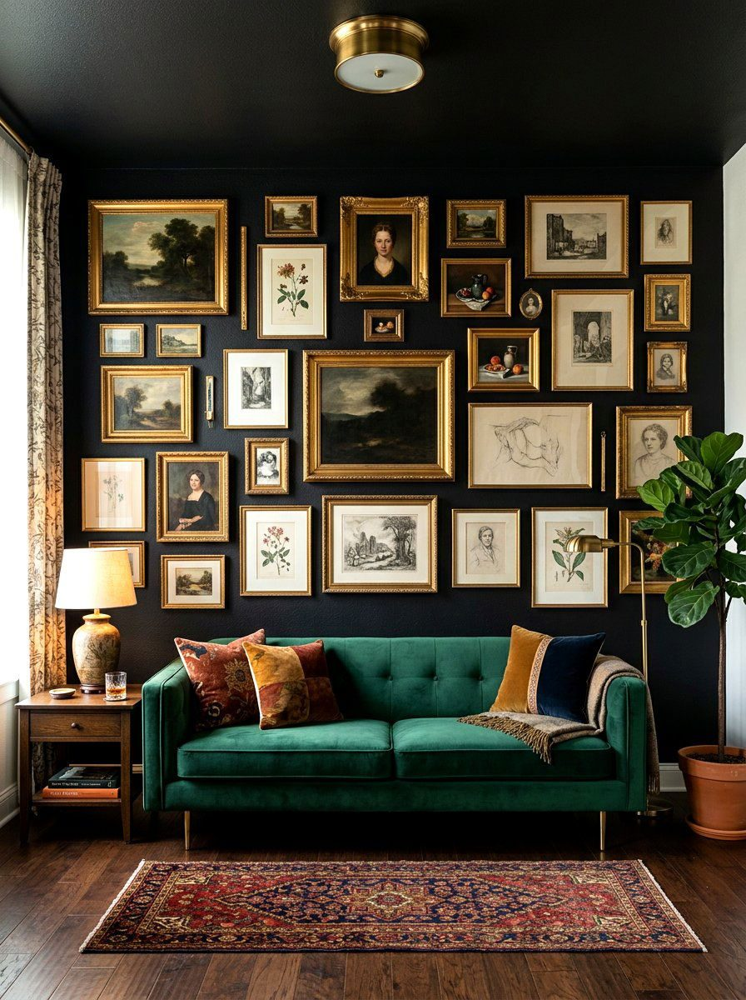

> TIP:QUICK: One warm lamp on each side of the sofa keeps a dark gallery wall from going gloomy after sunset.

## 11. A Gallery Wall Around the TV

A television is a big black rectangle that dominates most living rooms, and a gallery wall is the best way to tame it. Frames on all four sides turn the screen into one more picture in the arrangement, and when the TV is off it disappears into the wall instead of staring back at the room. The trick is treating the TV as a frame: give it the same breathing room you would give the largest artwork.

Hang the frames first, leaving a TV-sized gap, then mount the screen in the middle. Keep the frames nearest the TV simple and dark so the screen blends in, and put the brightest art at the outer edges where it draws the eye outward.

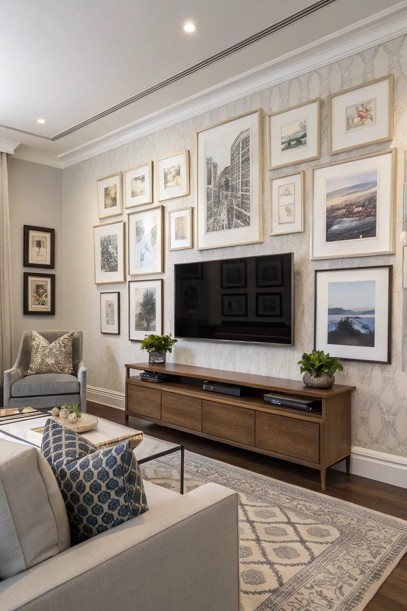

> TIP:CHECK: TV treated as the largest frame; same gap around the screen as between frames; brightest art at the outer edges

## 12. A Corner Gallery Wall

Corners are the most wasted walls in a living room, and a gallery wall that wraps around one turns dead space into the room's best feature. Frames continue from one wall onto the next, so the corner itself becomes part of the display, and a sectional sofa tucked underneath makes the whole corner feel like a designed nook rather than an awkward angle.

Start the arrangement on the longer wall and let it turn the corner at the same height, keeping the top and bottom edges level as it wraps. A small armchair in the corner gives the wall a purpose — somewhere to sit and actually look at the pictures.

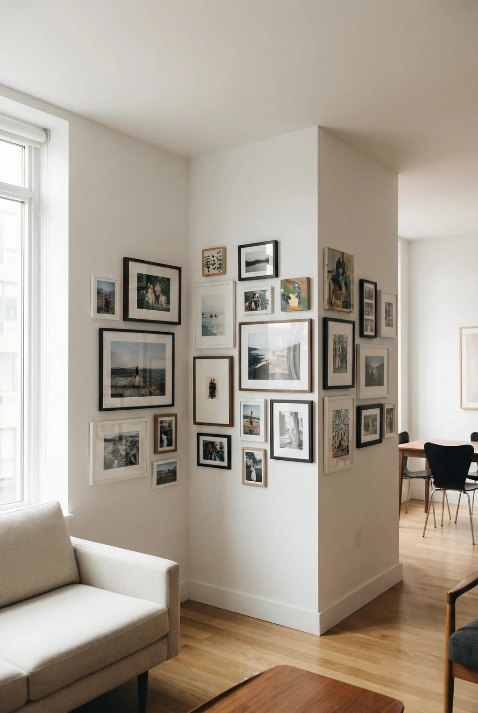

> TIP:GUIDE: Start on: the longer wall | Wrap height: same top and bottom edges | Corner piece: one frame straddling the angle

## 13. A Small-Space Mini Gallery

A small living room does not need a small gallery wall — it needs a dense one. Packing many small frames tightly above a compact sofa makes the wall feel generous, while a few large frames would crowd the room. The density is the point: the wall becomes texture, like wallpaper, and the sofa below looks intentionally scaled to it.

Keep the arrangement to one wall, roughly the width of the sofa, and use thin frames so the grid stays light. A round coffee table and a patterned rug underneath keep the floor as uncluttered as the wall is full.

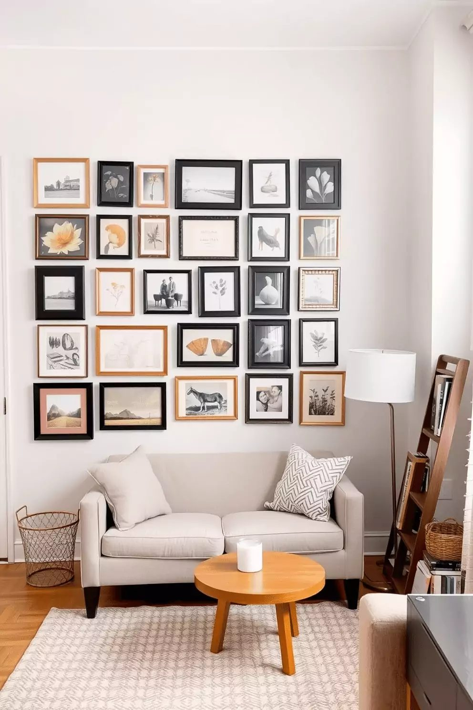

> TIP:QUICK: In a small room, go dense and small-framed — a few big frames will crowd the wall, a tight grid will fill it.

## 14. Vintage Maps and Travel Prints

Maps make a gallery wall personal in a way generic art cannot. A wall of vintage world maps above a teal sofa tells guests where you have been and where you dream of going, and the sepia tones and old cartography suit warm wood and leather beautifully. Mix large world maps with smaller city and coastline charts so the wall has both sweep and detail.

Frame the maps in matching dark wood and hang them in a grid for a library feel, or cluster them salon-style for a traveler's wall. A globe on the side table finishes the story without a single extra frame.

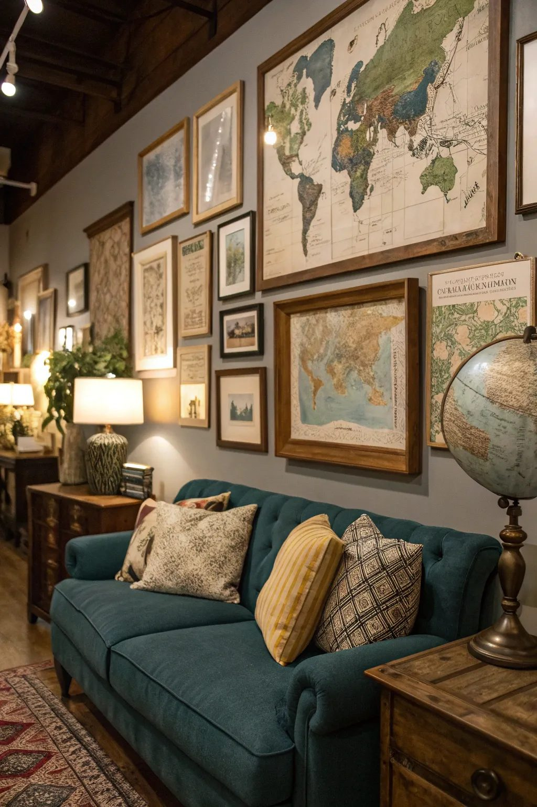

> TIP:CHECK: One large world map as anchor; smaller city maps as fillers; matching dark wood frames for a library feel

## 15. A Children's Art Gallery

Children's artwork deserves better than the fridge door, and a proper gallery wall gives it pride of place. Matching frames — white or natural wood — turn crayon drawings and paintings into a real collection, and the bright colors pop against a calm sofa and pale walls. Rotate the pieces as new ones arrive, and the wall becomes a living record of the year.

Frame the best pieces at eye level and let smaller works fill the gaps. Keep the frames identical so the art, not the framing, is what changes — and date the back of each piece so you remember when it was made.

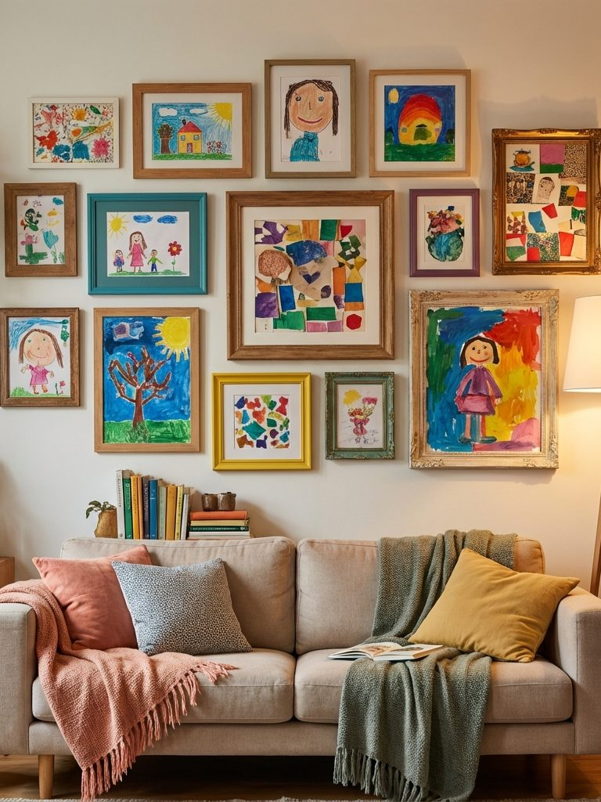

> TIP:GUIDE: Frames: identical white or wood | Rotation: swap two pieces per season | Back of each piece: child's name and date

## 16. Woven Baskets Mixed with Frames

A gallery wall does not have to be all frames. Woven baskets hung in a loose cluster bring texture and warmth that flat art cannot, and mixing in two or three framed prints keeps the wall from reading as a single craft project. The round shapes soften a rectangular room, and the natural fibers suit a white sofa, jute rug and rattan furniture perfectly.

Vary the basket sizes and weave patterns, and hang the largest basket near the center. Keep the framed prints small and simple — a botanical or a line drawing — so the baskets stay the stars of the wall.

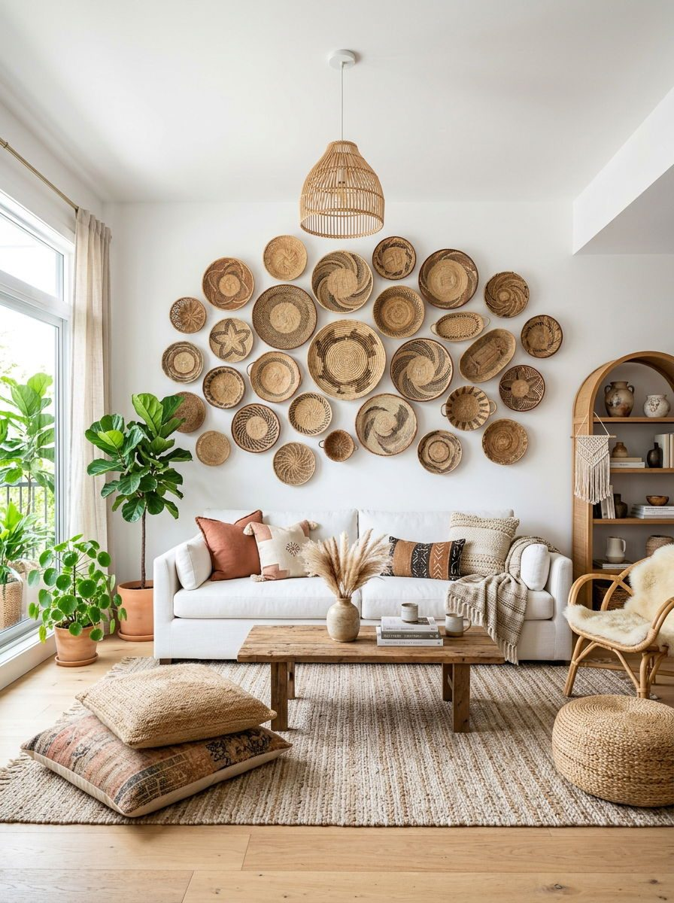

> TIP:QUICK: Hang the biggest basket first, dead center, then cluster the smaller ones around it like petals.

## 17. Mirrors Mixed into the Gallery

Mirrors are the gallery wall's secret weapon: they bounce light around the room, make a small living room feel larger, and break up a wall of flat art with reflection and shine. Mixed among framed photos and prints in gold and black frames, they read as art themselves — especially in varied shapes like octagons, arches and ovals.

Place the largest mirror near the center so it catches the window light, and keep mirrors away from direct views of clutter. A navy sofa underneath gives the reflective wall a deep, calm base to sit on.

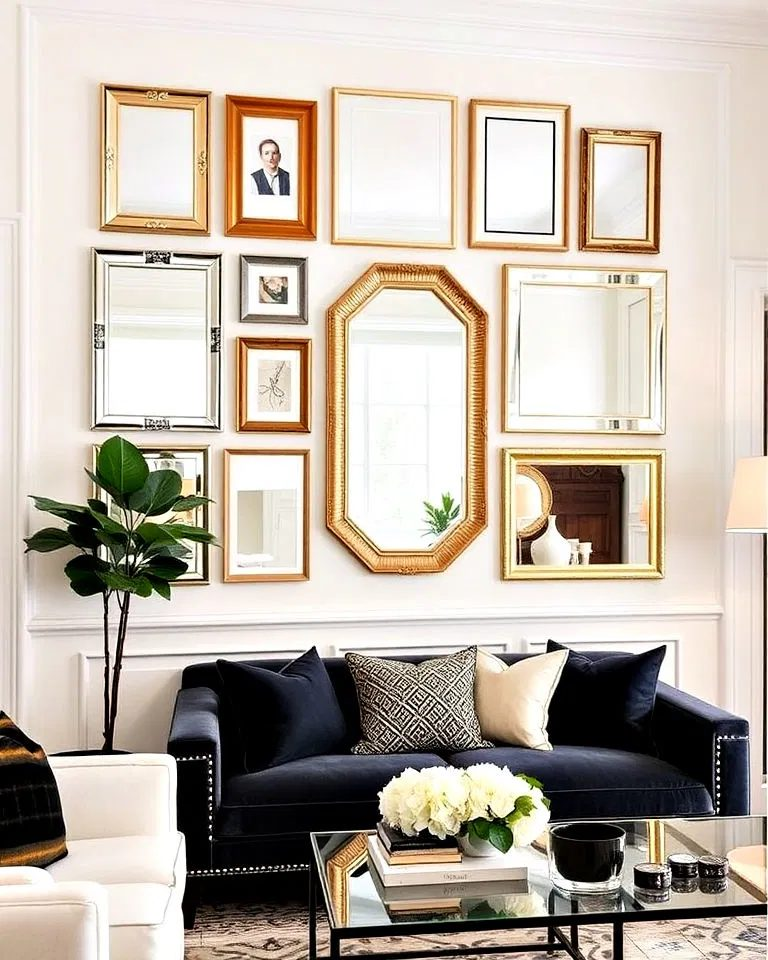

> TIP:CHECK: Largest mirror near the center; mirrors angled to catch window light; no mirror facing the messiest corner of the room

## 18. A Floor-to-Ceiling Gallery

When the wall is tall, use all of it. A floor-to-ceiling gallery wall turns a high living room wall into a private art collection, with frames stacked from just above the sofa to near the ceiling. The scale is dramatic, but the method is simple: treat the wall as one big rectangle and fill it evenly, with the largest pieces at eye level and smaller ones filling the top and bottom.

You will need a step stool and a paper template on the floor first — never freehand a wall this size. A deep green sofa and a patterned rug ground the height so the room feels cozy rather than cavernous.

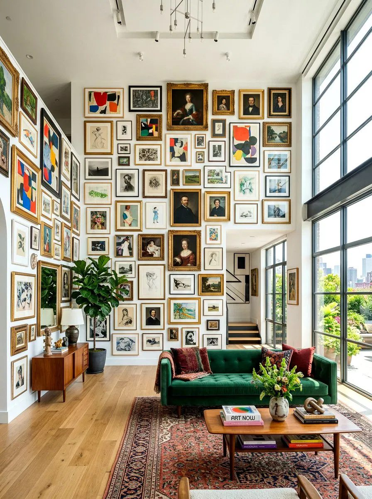

> TIP:GUIDE: Template: paper cutouts on the floor first | Largest pieces: at eye level | Top rows: smallest frames, hung last

## 19. A Gallery Above a Console Table

A console table gives a gallery wall a base, and the wall gives the table a reason to exist. Frames hung above a slim wooden console — with lamps, books and a vase below — create a layered vignette that works in an entryway, behind a sofa or along any long blank wall. The table catches the eye first, then the wall above it rewards a second look.

Keep the frames within the width of the table so the arrangement feels anchored, and leave six to eight inches between the tabletop and the lowest frame so lamps and vases never crowd the art.

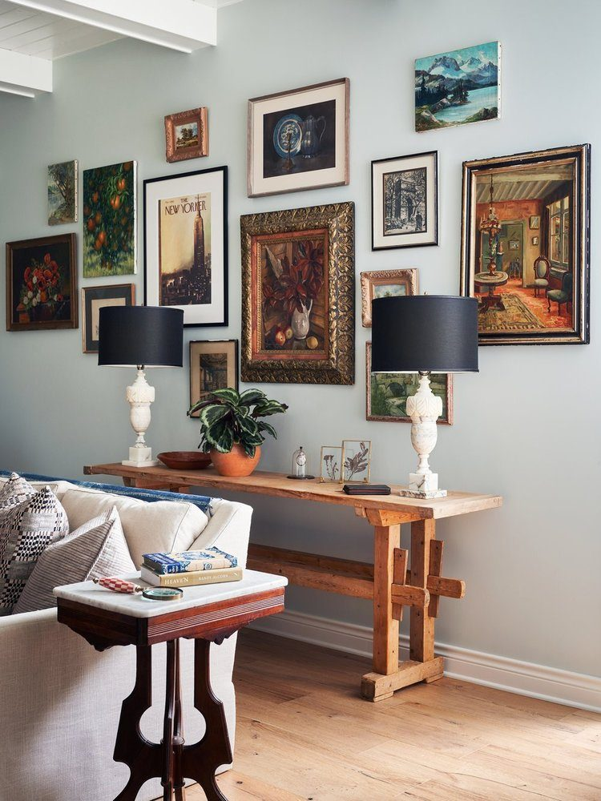

> TIP:QUICK: Keep the gallery no wider than the console below it — a wall wider than its base looks like it is floating.

## 20. A Monochrome Neutral Gallery

A monochrome gallery wall is the quietest look in this list, and sometimes the right one. Black-and-white prints in black frames above a white sofa, on a pale wall, with nothing else competing — the room feels calm, gallery-like and deliberately edited. It suits a neutral living room perfectly because it adds interest without adding a single new color.

The discipline is in the edit: every print should be black, white or grey, and the frames should match. One textured element — a knit throw, a pampas arrangement — keeps the room from feeling cold.

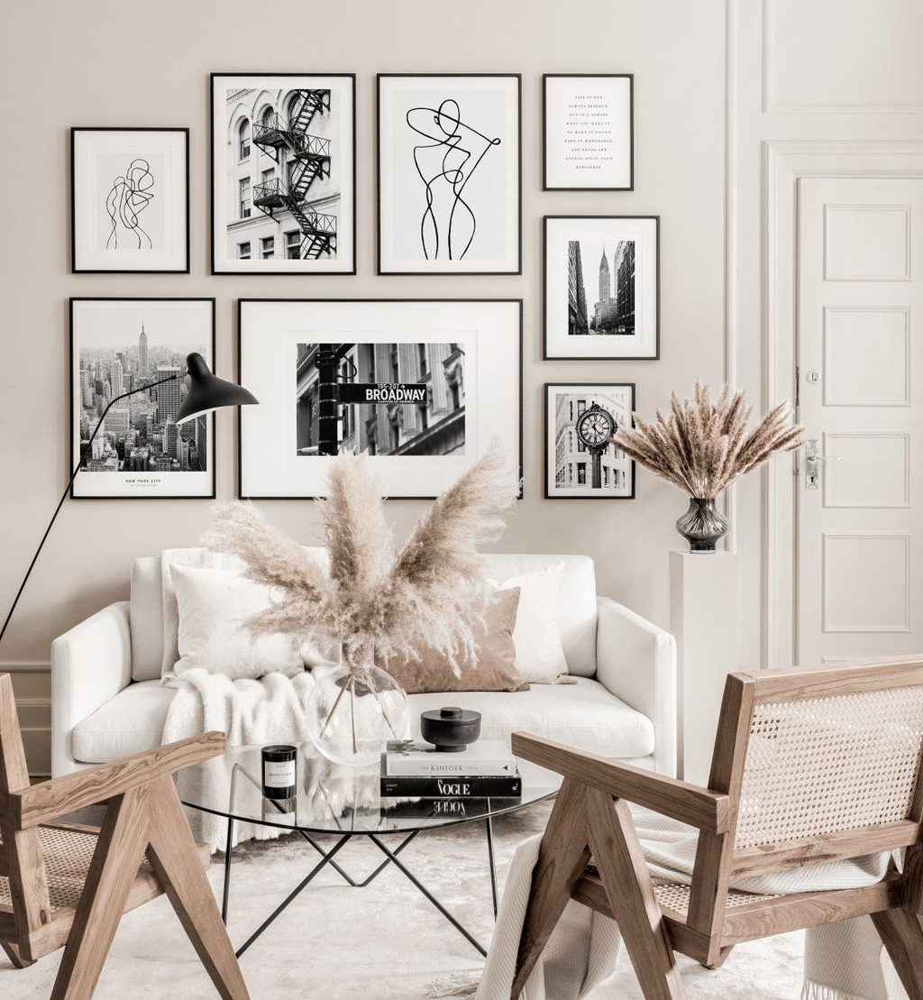

> TIP:CHECK: Every print black, white or grey; frames identical; one textured throw or plant to warm the room

## 21. A Colorful, Bold Gallery

Some rooms want a gallery wall that shouts. Bright abstract paintings, bold portraits and saturated color, packed salon-style above a grey sofa, turn the wall into the room's entertainment — guests will stand in front of it and talk about individual pieces. The grey sofa is doing important work here: it stays quiet so the wall can be loud.

Balance the color by repeating two or three hues across several frames, and keep the cushions in the same family as the art. If every frame is a different color with nothing repeated, the wall tips from bold into chaotic.

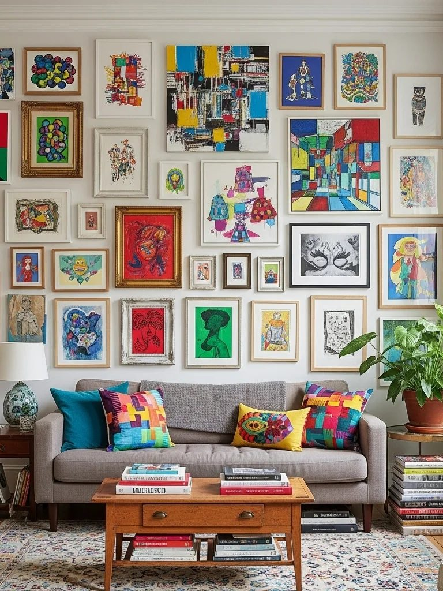

> TIP:GUIDE: Repeat: 2–3 hues across several frames | Sofa: quiet grey or cream | Cushions: colors pulled from the art

## 22. An Abstract Art Gallery

Abstract art is the easiest subject for a gallery wall because it asks nothing of the viewer except a feeling. A dense grid of abstract prints in black frames — bold blocks of blue, orange and yellow beside quiet line drawings — fills a wall with energy while staying abstract enough to suit any sofa color. The shared black frames hold the variety together.

Mix large color-block pieces with smaller monochrome ones so the wall has both punch and rest. A fiddle-leaf fig beside the sofa adds the one organic shape in a room full of geometry.

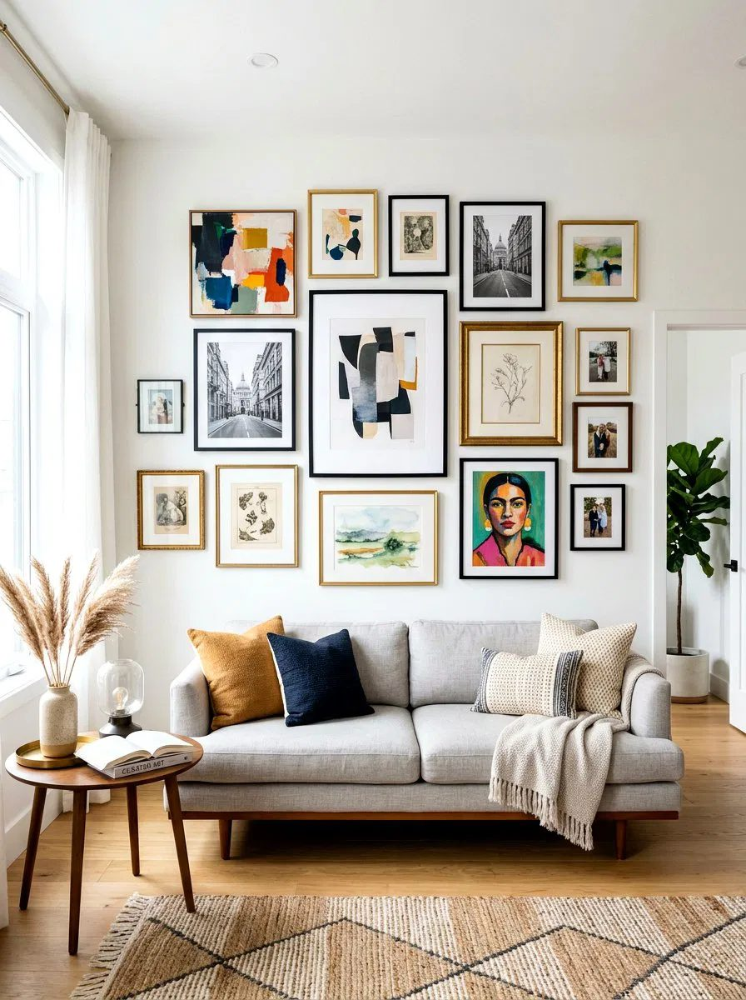

> TIP:QUICK: Alternate one bold color-block piece with one quiet monochrome piece — the rhythm keeps a big abstract wall from shouting.

## 23. A Gallery Wall Lit by Sconces

Good lighting is what separates a gallery wall from a wall with pictures on it. Sconces mounted between the frames wash the art in warm light, make the wall glow after dark, and turn the whole arrangement into the room's evening focal point. They work best flanking a central group of frames, one on each side, at the same height as the middle row.

Choose warm bulbs around 2700 Kelvin so the light flatters both the art and the room, and wire the sconces to a dimmer so you can drop the light low in the evening. Framed landscape prints suit sconce light especially well.

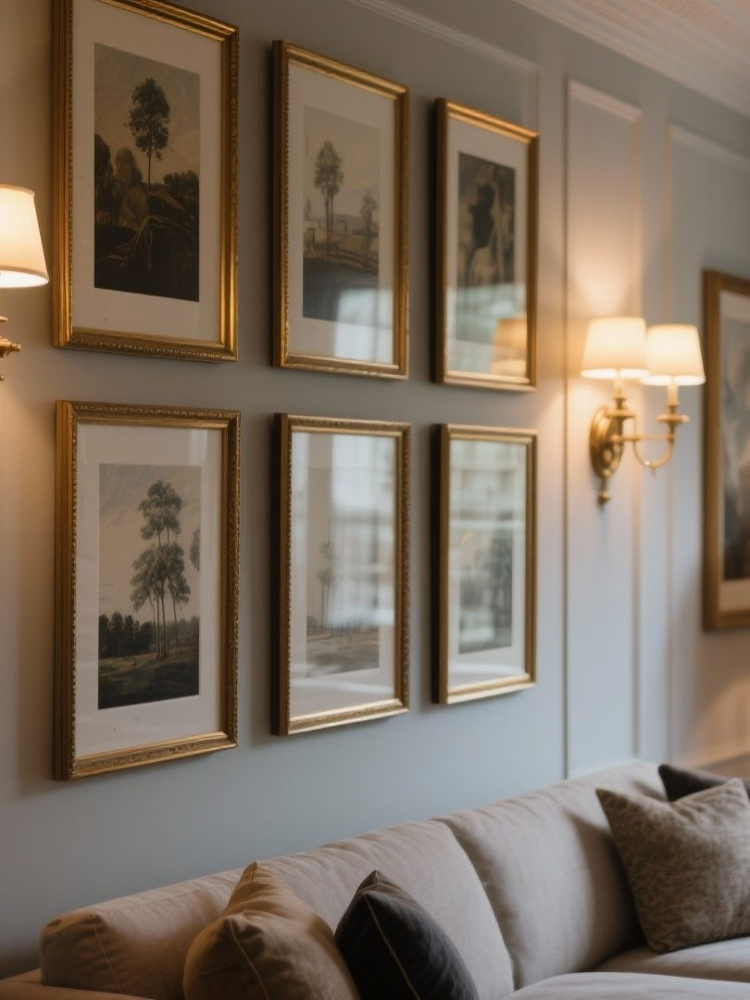

> TIP:CHECK: Sconces flanking the central frames; warm 2700K bulbs; dimmer switch for evening light

## 24. A Gallery Wrapped Around a Reading Nook

A reading nook is the coziest place for a gallery wall, because the art wraps around the chair the way a blanket does. Frames continue around the corner behind a leather armchair, with a bookshelf on one side and a floor lamp on the other, so sitting down feels like settling into the collection. The art should be personal here — favorite prints, small landscapes, line drawings — things you actually like looking at up close.

Keep the frames at armchair height, low enough to enjoy while seated, and leave the wall above the bookshelf clear so the corner does not feel crowded. A throw over the chair arm and a book on the seat finish the invitation.

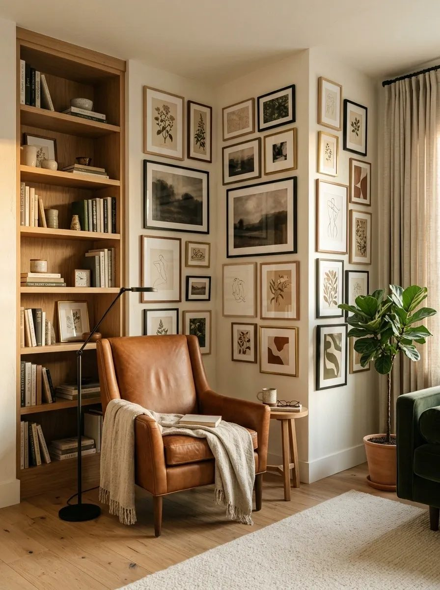

> TIP:GUIDE: Frame height: centered on the seated eye line | Art: personal favorites, not showpieces | Corner: one frame straddling the angle

## 25. Rustic Wood Frames

Rustic wood frames bring warmth that black and gold cannot. Thick, natural or reclaimed-wood frames around family portraits and nature photos suit a farmhouse or cabin-style living room, and the wood grain adds texture even before you look at the pictures inside. Six frames in two even rows above a light sofa is all it takes — the simplicity is the style.

Keep the wood tones in one family, warm or weathered, and use white mats so the photos stay bright against the heavy frames. A natural-fiber rug and a wooden coffee table underneath complete the material story.

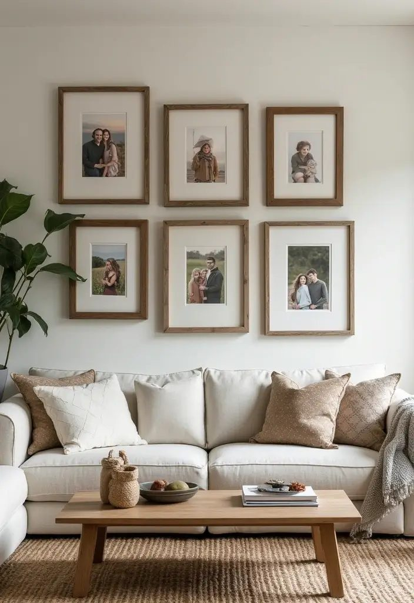

> TIP:QUICK: Keep all the wood in one tone family — mixing warm oak with grey barn wood on one wall looks accidental.

## 26. A Minimalist Three-Piece Gallery

Sometimes three frames are the whole gallery wall. Three matching black frames in a row above a sofa — coastal landscape, lone tree, bright interior — give a minimalist living room exactly enough art without asking anything more of the wall. The white space around them is part of the design, so resist the urge to fill it.

Hang the trio with the center frame over the center of the sofa, level and evenly spaced, and keep the rest of the wall bare. A lamp on the side table and a folded throw are all the styling the scene needs.

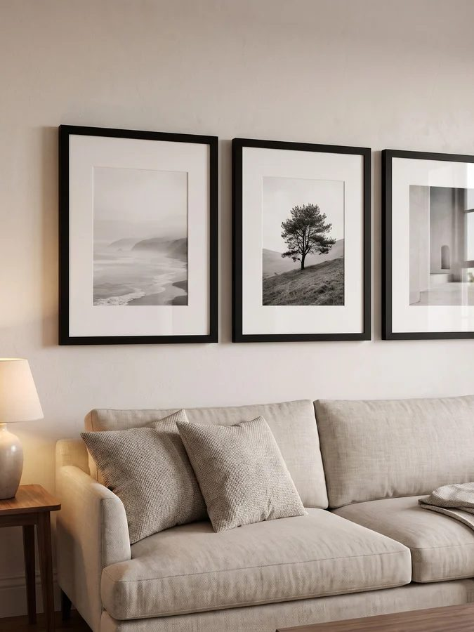

> TIP:CHECK: Center frame over the sofa's center; even gaps; rest of the wall left bare on purpose

## 27. A Gallery Wall with Plants and Greenery

Plants and gallery walls belong together: the art is flat and the plants are alive, and each makes the other look better. Botanical prints in light wood frames above a sofa, with a trailing plant on one side and a big potted monstera on the other, turn the wall into part of the room's garden. The green in the prints echoes the green in the pots, so the whole corner feels connected.

Keep the frames light and the mats white so the greenery stands out, and let one trailing plant overlap a frame edge slightly — the overlap is what makes the wall feel grown rather than hung.

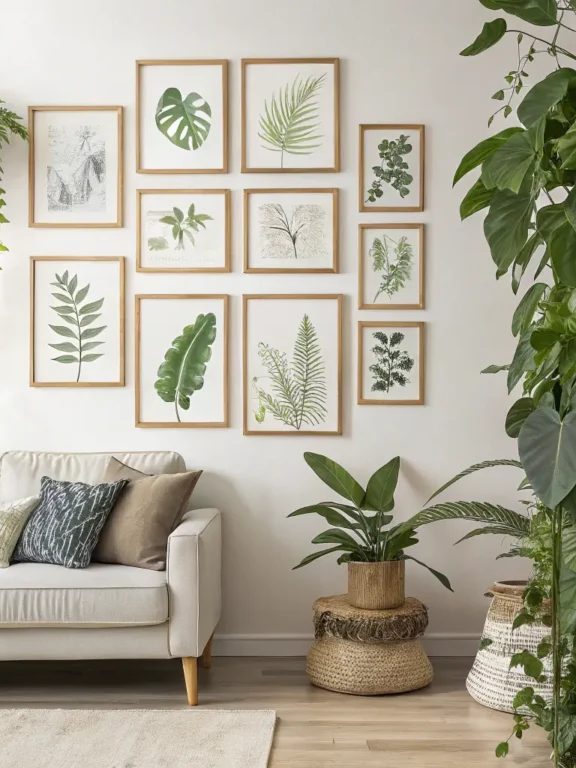

> TIP:GUIDE: Frames: light wood, white mats | Plants: one trailing, one floor-standing | Overlap: one vine crossing a frame edge

## 28. A Seasonal, Rotating Gallery

A gallery wall does not have to be permanent. Keep the frames fixed and rotate the art inside them with the seasons — warm landscapes for autumn, bright botanicals for spring, snowy scenes for winter — and the wall feels new four times a year for the cost of a few prints. The trick is standardizing the frame sizes so any print fits any frame.

Store the off-season prints flat in a portfolio box, and change just three or four pieces at a time rather than the whole wall. A grey sectional and a low wooden console below make the perfect neutral stage for the rotation.

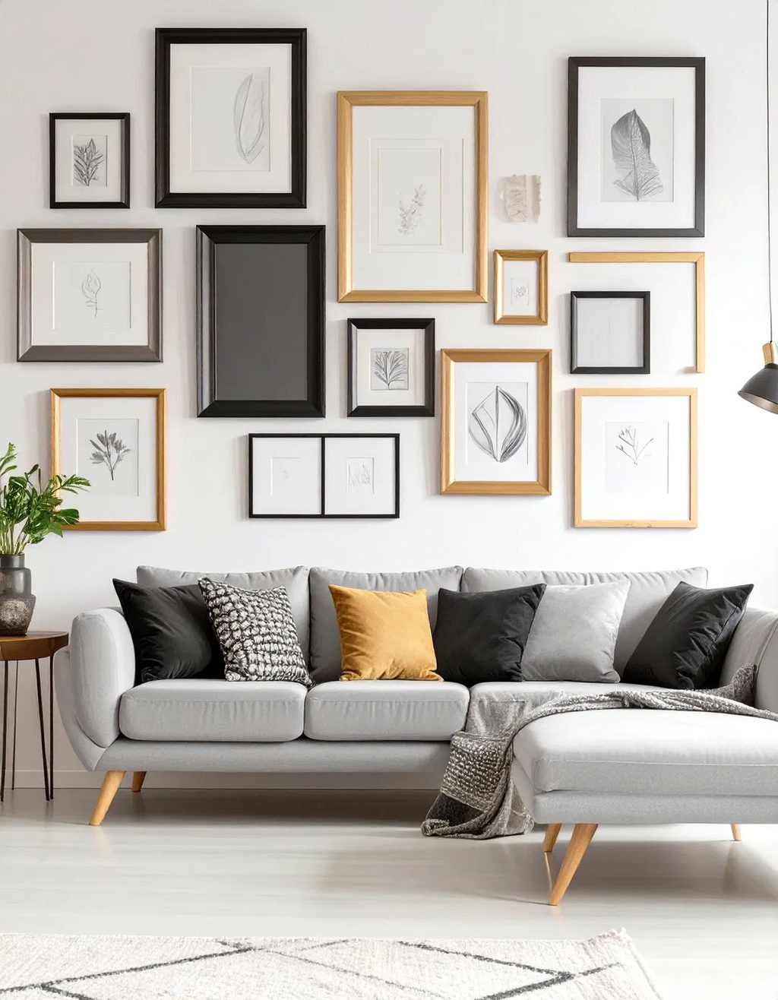

> TIP:QUICK: Standardize your frame sizes first — then any seasonal print fits any frame, and swaps take ten minutes.

## 29. Gallery Shelves with Objects and Sculptures

Ledge shelves earn their place when they hold more than frames. A mix of framed art, small sculptures, books, vases and a brass clock across three dark wood shelves turns a gallery wall into a display cabinet without glass — the objects give the flat art depth, and the art gives the objects a backdrop. The key is editing: every shelf should have one tall piece, one medium piece and breathing room.

Vary the heights across each shelf and repeat one material — brass, black or wood — in small doses on all three levels. Step back after styling each shelf and remove one thing before calling it done.

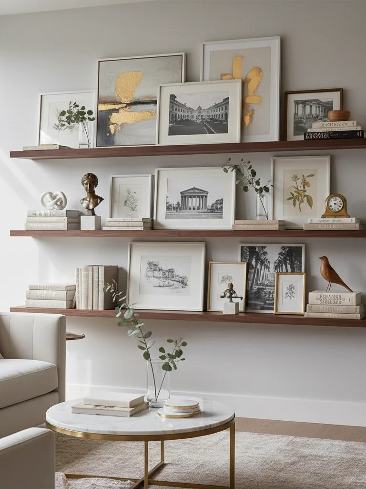

> TIP:CHECK: One tall, one medium piece per shelf; one repeated material across all levels; remove one object before calling it done

## 30. An Entryway Gallery That Leads into the Living Room

The best gallery wall in a living room sometimes starts before you reach it. A wall of framed art running down the entryway hallway draws guests straight into the living room, and the frames on the hall wall preview the collection waiting inside. It makes a plain passage feel like a gallery corridor and gives the living room a grander entrance.

Keep the hallway frames in the same finishes as the living room wall so the two spaces feel connected, and hang them in a single line at eye level — a hallway is a walkway, not a room, so the art should be enjoyed in passing.

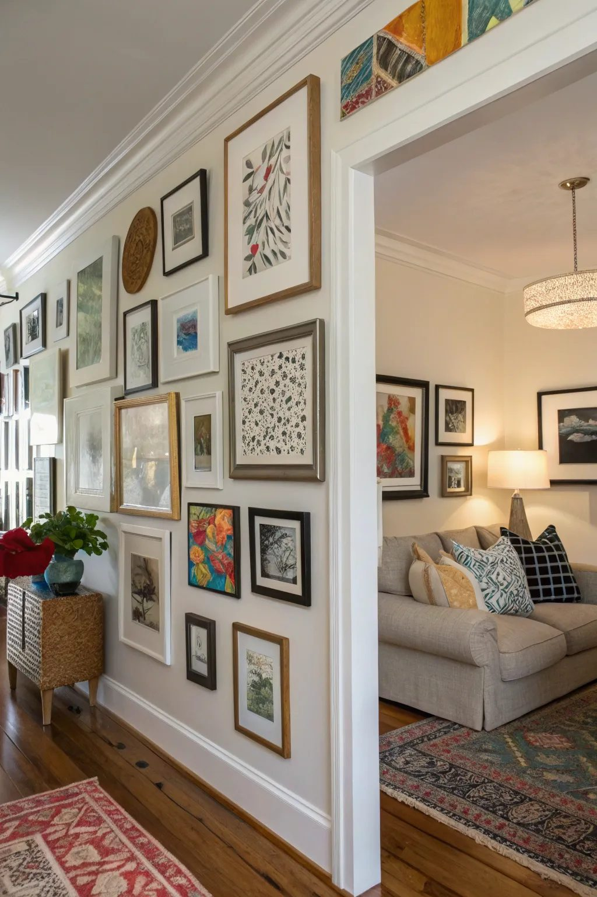

> TIP:GUIDE: Frame finish: same as the living room wall | Hang height: single eye-level line | Hallway rule: art for passing, not for lingering

## Takeaway

- A gallery wall is not about owning a lot of art — it is about hanging what you have with intention.
- Start with one anchor piece, keep your gaps even, and let the arrangement sit about two-thirds the width of the sofa below it.
- Mix frames or match them, go dense or go minimal, but commit to one idea per wall and let the rest of the room stay quiet around it.
- If your room leans warm and collected, our [30 Farmhouse Living Room Ideas for a Warm, Collected Home](/posts/farmhouse-living-room/) shows how a gallery wall fits a slipcovered, wood-and-plaid room.

## Frequently Asked Questions

### How do I start a gallery wall in my living room?

Pick one anchor piece first — the largest frame or the favorite photo — and hang it at eye level, about 57 inches to its center. Lay the rest of the frames on the floor and arrange them around it, then trace paper templates on the wall before hanging anything. Starting with the anchor keeps the whole wall from drifting.

### How high should a gallery wall hang above the sofa?

Leave six to eight inches between the top of the sofa back and the bottom edge of the lowest frame. The center of the whole arrangement should sit around 57 to 60 inches from the floor, which is average eye level. Hanging higher is the most common mistake — it disconnects the art from the furniture below it.

### How far apart should frames be on a gallery wall?

Keep two to three inches between frames for a tight, gallery-style look, and up to four inches for a looser, more relaxed wall. Whatever gap you choose, keep it the same everywhere — even spacing is what makes a mixed collection look intentional. Measure the gaps with a small spacer block so every one matches.

### Can I mix frame colors and sizes on one wall?

Yes, mixing frames is the heart of the salon style, but the mix needs one unifying thread. Repeat one finish, one color or one mat style across several frames so the wall feels collected rather than random. If every frame is different in every way, the wall reads as clutter instead of a collection.

### What is the best layout for a gallery wall above a sofa?

A symmetrical grid suits calm, modern rooms, while a salon-style cluster suits collected, eclectic ones. Either way, keep the arrangement about two-thirds the width of the sofa and center it over the seating. Start with the largest piece slightly off-center, then fill outward with smaller frames at even gaps.

### How do I hang a gallery wall without damaging the wall?

Use adhesive picture-hanging strips rated for each frame's weight for light frames, and picture ledges if you want zero holes at all. For heavier frames, use one small nail per frame with a proper hook — a single tiny hole is easy to fill later. Always check the strip's weight limit before trusting it with glass.

### What should I put on a gallery wall besides photos?

Art prints, maps, botanical illustrations, children's drawings, mirrors, woven baskets and small wall sculptures all belong on a gallery wall. Mix flat pieces with one or two dimensional objects for depth, but keep the objects light and shallow. The wall should stay mostly flat so nothing gets knocked off.

### How do I make a small living room gallery wall look bigger?

Hang the frames higher and wider than the sofa to draw the eye outward, and include one or two mirrors to bounce light around the room. Use thin frames and light mats so the wall feels airy, and keep the arrangement to one wall. A dense grid of small frames reads larger than a few big ones.
