# 30 Garland on Mantle Ideas for a Warm, Festive Home

A garland on mantle is the single decoration that makes a living room feel like Christmas. One long swag of greenery across the mantel, dressed with lights, pinecones or stockings, turns an ordinary fireplace into the warm heart of the house — and it takes less than an hour to put up.

This list gathers 30 garland on mantle ideas, from classic cedar with red stockings to frosted eucalyptus with lanterns, so you can find one that fits your fireplace, your style and the time you have. Most of them use the same simple technique: drape, secure, then dress.

## 1. Classic Garland with Stockings and Wreath

The classic mantel is a full green garland draped across the shelf and down both sides, white stockings hung in a row, and a lit wreath above it all. It is the look most of us grew up with, and it works in every house because the proportions are so forgiving.

Hang the garland first and let the ends puddle slightly on the mantel ends, then add the stockings so they hang from the garland rather than the mantel edge. The wreath goes last, centered above the fire.

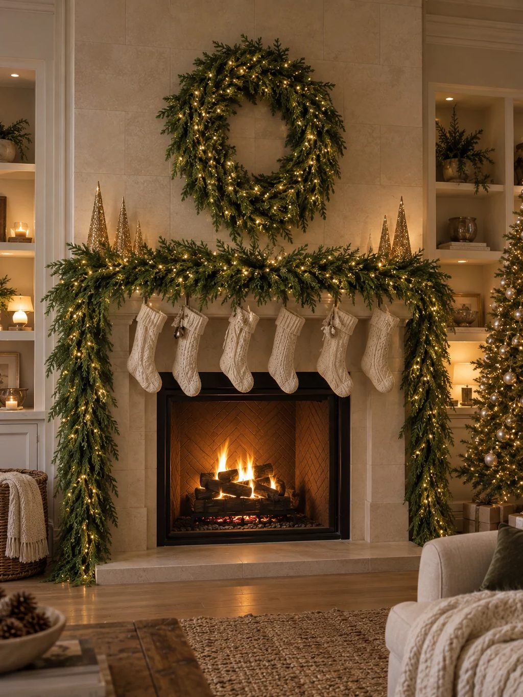

> TIP:QUICK: Hang the garland first, then the stockings, then the wreath — in that order.

## 2. Cedar Garland with Red Stockings and Candles

Cedar garland is softer and more feathery than pine, and it drapes beautifully down the sides of a mantel. Red stockings against the blue-green cedar give the mantel a traditional pop of color, and pillar candles on the hearth below echo the warm light above.

Cedar dries out faster than pine, so mist it lightly every few days if it is real, or choose a good faux cedar and skip the maintenance. Keep candles on the hearth, never on the mantel, where the garland could catch.

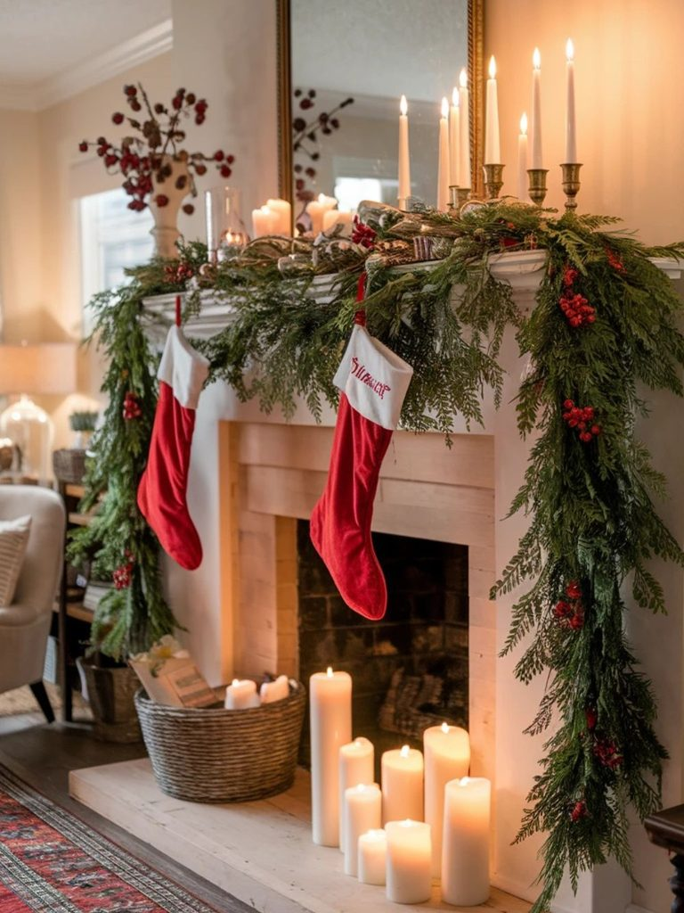

> TIP:CHECK: mist real cedar lightly every few days; keep candles on the hearth, never on the mantel

## 3. Ornament Garland with a Gold Mirror

A garland dressed with red, gold and silver ornaments turns the mantel into a continuation of the tree. Hung under a gold mirror, the ornaments catch the light twice — once in the room and once in the reflection — which makes the whole fireplace glow.

Use shatterproof ornaments on a mantel garland, since they sit above a hard hearth and get knocked more often than tree ornaments. Wire them to the garland rather than hanging them from hooks, so they stay put.

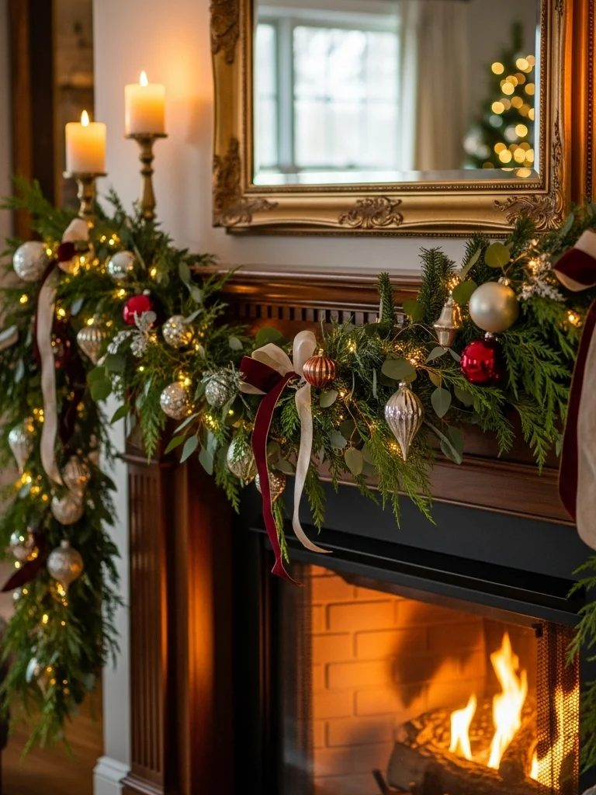

> TIP:GUIDE: Ornaments: shatterproof, wired to the garland | Mirror: doubles the light | Colors: red, gold, silver

## 4. Red Bow Garland on a Marble Mantel

Big red velvet bows spaced along a garland are the fastest way to make a mantel look dressed. On a marble mantel the red against the pale stone is striking, and the bows give the garland a tailored, almost gift-wrapped look.

Make the bows from wired ribbon so they hold their shape all season, and attach them with floral wire rather than glue. Three large bows beat six small ones — the scale is what makes this look work.

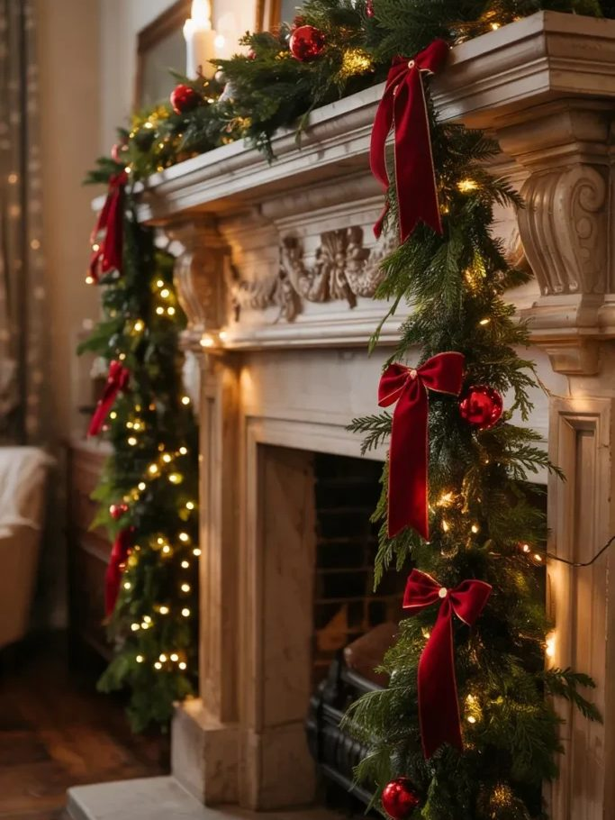

> TIP:QUICK: Make bows from wired ribbon so they hold their shape all season — three large bows beat six small ones.

## 5. Pinecone Garland with Teal Ribbons

Pinecones and teal ribbons are an unexpected combination that works beautifully on a white mantel. The brown pinecones ground the garland, the teal ribbon cools it down, and the gold ornaments in between tie the two together.

Wire the pinecones to the garland in clusters of three rather than spacing them evenly — odd numbers look more natural. Teal ribbon in a velvet finish reads richer than satin under fairy lights.

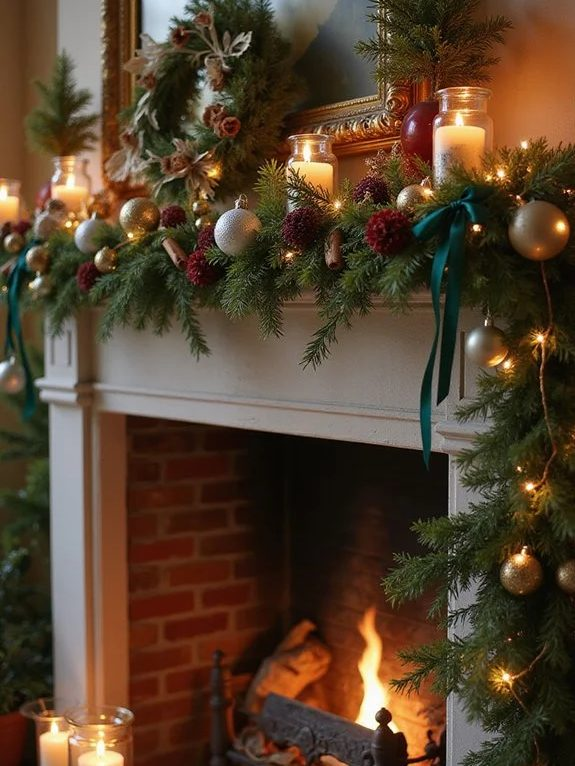

> TIP:CHECK: pinecones in clusters of three; teal ribbon in velvet, not satin; gold ornaments tie it together

## 6. Gold and Red Garland with Stockings

Gold and red is the most traditional mantel palette, and it never fails. A garland with gold baubles, red berries and a few pinecones, with stockings hung below it, makes a white mantel look like a Christmas card.

Keep the gold ornaments to one size for a calm look, or mix two sizes for a livelier one — but not three, which starts to look cluttered. Red berries tucked into the greenery fill the gaps between ornaments.

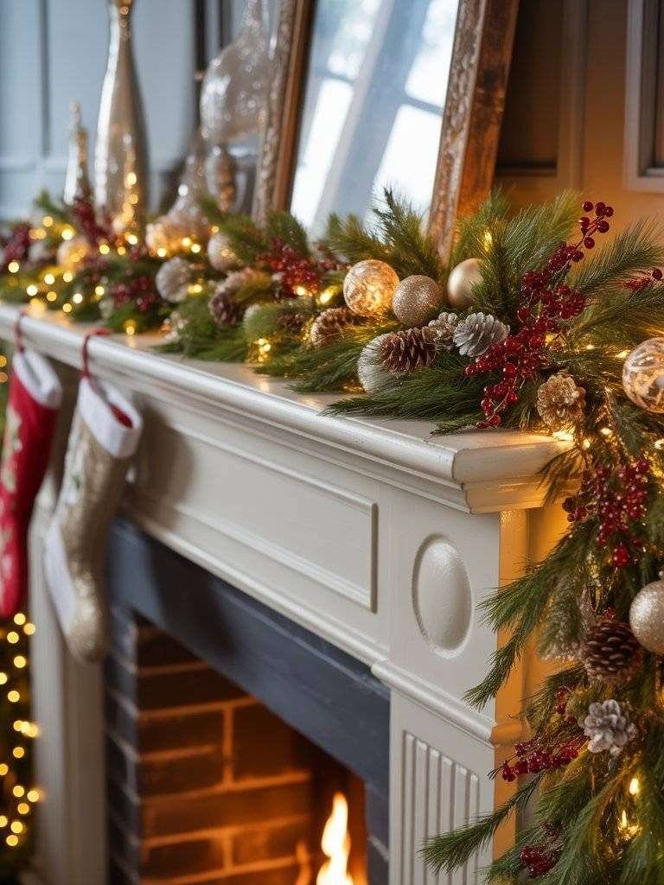

> TIP:GUIDE: Gold: one or two ornament sizes, never three | Berries: tucked into gaps | Stockings: hung from the garland

## 7. Plaid Garland with Red Stockings

A plaid ribbon woven through a mantel garland brings a cozy, cabin feel to the fireplace, especially with red knit stockings hung below it. The plaid picks up the colors of the fire and the room, so the mantel feels like part of the house rather than a decoration on it.

Weave the ribbon through the garland in loose loops rather than wrapping it tightly — the loops catch the light and look generous. A dark fireplace surround makes the plaid pop, while a white one softens it.

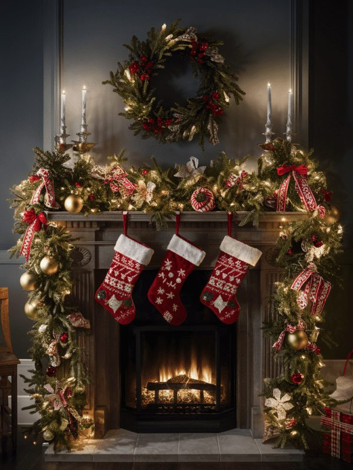

> TIP:QUICK: Weave ribbon through the garland in loose loops — the loops catch the light and look generous.

## 8. Simple Garland with One Stocking

A simple garland with a single stocking is the most restrained mantel on this list, and it suits a modern room where one perfect detail beats a dozen. The garland is full and green, the stocking is knitted and soft, and everything else on the mantel is quiet.

This look only works if the garland itself is lush — a thin garland with one stocking looks unfinished. Choose the fullest garland you can find, and let it drape low on both sides for balance.

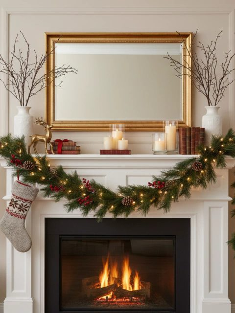

> TIP:CHECK: the garland must be lush for this to work; let it drape low on both sides for balance

## 9. Merry Christmas Sign with Knit Stockings

A wooden Merry Christmas sign hung on the front of a mantel garland turns the garland into a greeting. Knit stockings in cream and red hang below it, and red berries in the greenery pick up the sign's warmth.

Hang the sign from the garland with ribbon rather than nailing it to the mantel, so the mantel stays undamaged. A sign in a natural wood tone suits a farmhouse mantel, while a painted one suits a colorful room.

> TIP:GUIDE: Sign: hang from the garland with ribbon | Wood tone: farmhouse | Painted: colorful rooms

## 10. Knit Stockings on a Pine Garland

Four knit stockings in different patterns on a pine garland is the coziest mantel here. The knits — cable, Fair Isle, plain — add texture that the greenery alone cannot, and the pine garland underneath keeps the whole thing grounded in Christmas.

Mix stocking patterns but keep the colors in one family, so the row reads as a collection rather than a jumble. Hang the stockings from the garland with small hooks hidden in the greenery.

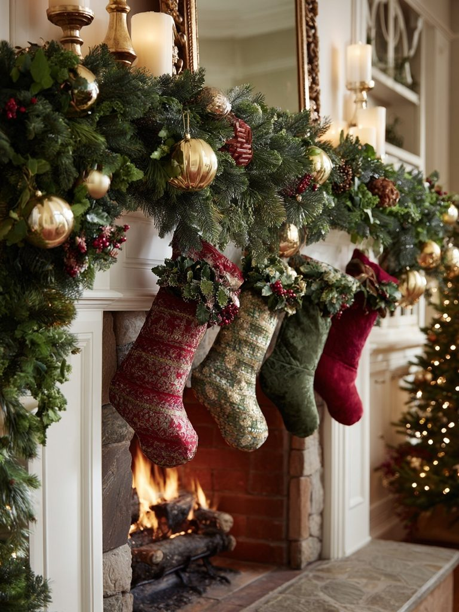

> TIP:QUICK: Mix stocking patterns but keep the colors in one family, so the row reads as a collection.

## 11. Red Velvet Stockings with Gold Snowflakes

Red velvet stockings embroidered with gold snowflakes are the most luxurious stockings on this list, and they deserve a garland that lets them shine. A simple green garland with warm lights and a few gold ornaments is all they need.

Velvet shows dust, so brush the stockings before you hang them and keep them away from the fire. Gold snowflakes catch the fairy lights beautifully, so hang the stockings where the light hits them.

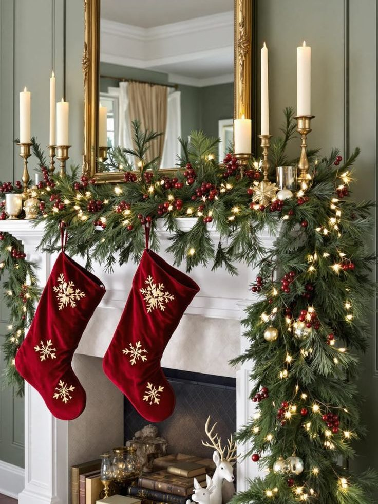

> TIP:CHECK: velvet shows dust — brush before hanging; hang where the fairy lights hit the gold snowflakes

## 12. Red Ribbon Garland with Knit Stockings

Red ribbon bows tied along a garland, with knit stockings hung below, is the mantel that looks like it took hours and took twenty minutes. The bows give the garland structure, the stockings give it warmth, and the wood mantel underneath gives it weight.

Tie the bows directly onto the garland with the ribbon itself, so they sit in the greenery rather than on top of it. Two stockings is enough for a small mantel — more than four crowds it.

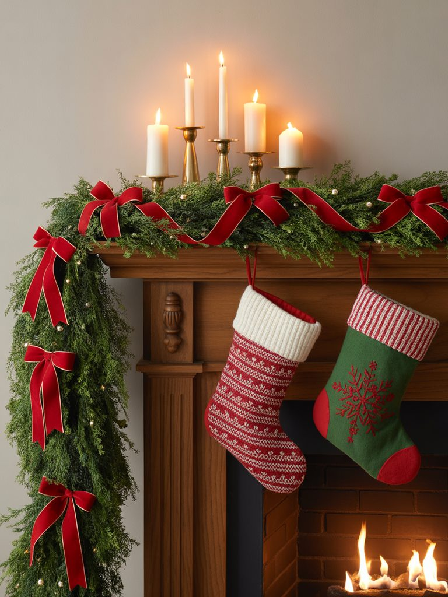

> TIP:GUIDE: Bows: tie with the ribbon itself, into the greenery | Stockings: two is enough for a small mantel | Wood: the mantel gives it weight

## 13. Eucalyptus and Pinecone Garland

Eucalyptus changes the whole character of a mantel garland: the round silver-green leaves soften the pine, and the scent is calmer and fresher than pine alone. Pinecones and red berries tucked into the mix keep it firmly Christmas.

Mix the eucalyptus into the pine garland rather than layering it on top, so the two greens read as one garland. Fresh eucalyptus dries well and keeps its shape, so this garland lasts the whole season.

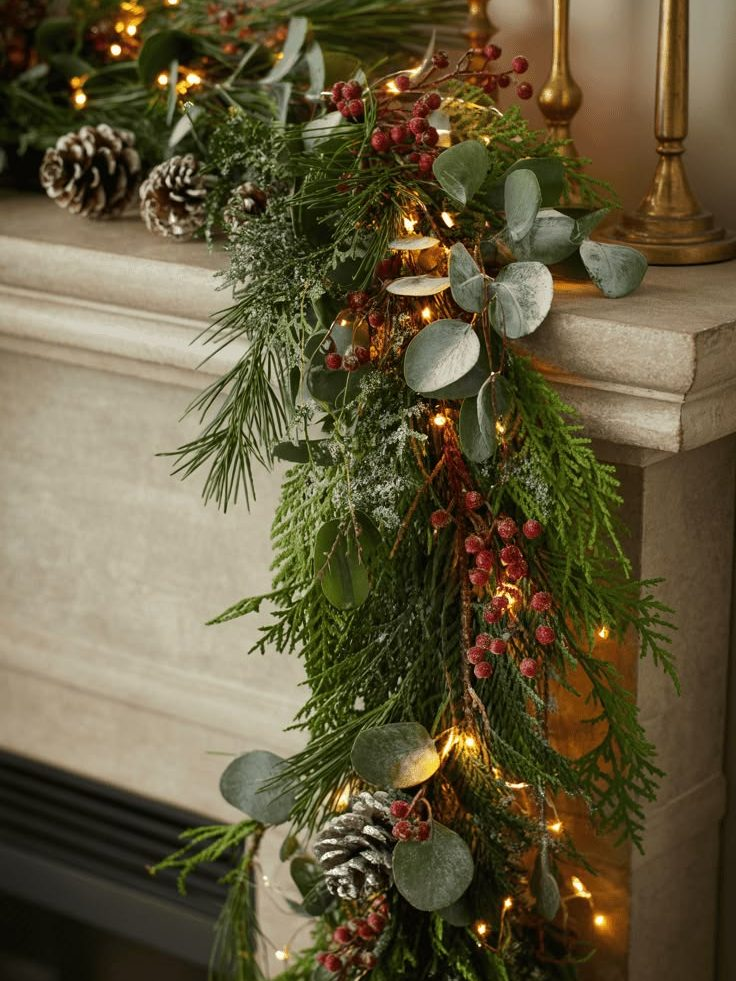

> TIP:QUICK: Mix eucalyptus into the pine rather than layering it on top, so the two greens read as one.

## 14. Mixed Greenery Garland with Fairy Lights

A garland of mixed greenery — pine, cedar, eucalyptus and a little fir — looks more like a real hedge than a decoration, and fairy lights woven through it make it glow from the inside. It is the lushest garland on this list.

Weave the lights through the garland before you hang it, and test them first — restringing a hung garland is miserable. Mixed greenery needs a full garland to look right, so do not skimp on the length.

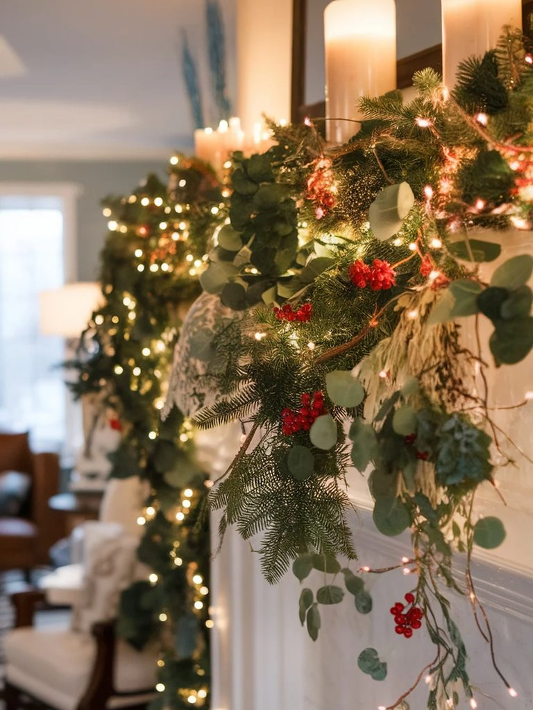

> TIP:CHECK: weave lights through before hanging; test them first; mixed greenery needs a full-length garland

## 15. Berry and Light Garland Close-Up

Seen up close, a garland is all about the details: red berries clustered in the greenery, warm fairy lights glowing between the branches, and a few pinecones for texture. This is the garland to study when you want to know how the professionals make a mantel look full.

Cluster the berries in groups of three or five and tuck them deep into the greenery, so they look like they grew there. Lights go in last, woven through the front of the garland where they show.

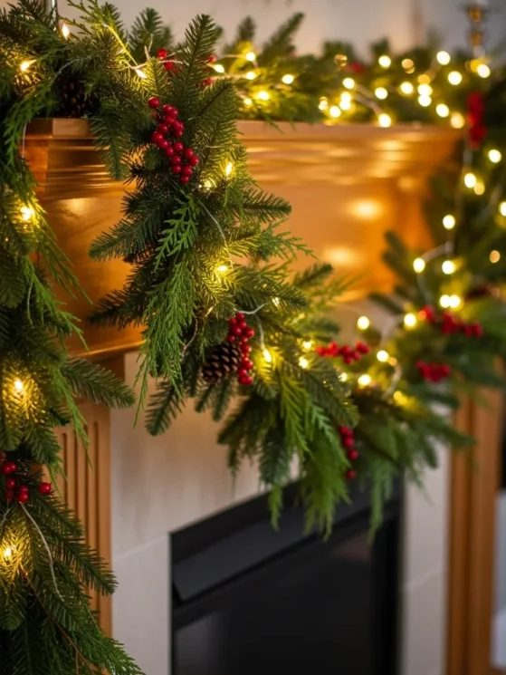

> TIP:GUIDE: Berries: clusters of three or five, tucked deep | Lights: woven through the front, added last | Pinecones: a few for texture

## 16. Pine Garland with Pinecones and Lights

A pine garland with pinecones and warm white lights is the simplest dressed garland here, and it is the one to choose when the mantel itself is beautiful. The garland frames the fireplace without competing with it.

Space the pinecones unevenly and in different sizes, since nature never spaces anything evenly. One strand of lights per six feet of garland is enough — more than that washes out the greenery.

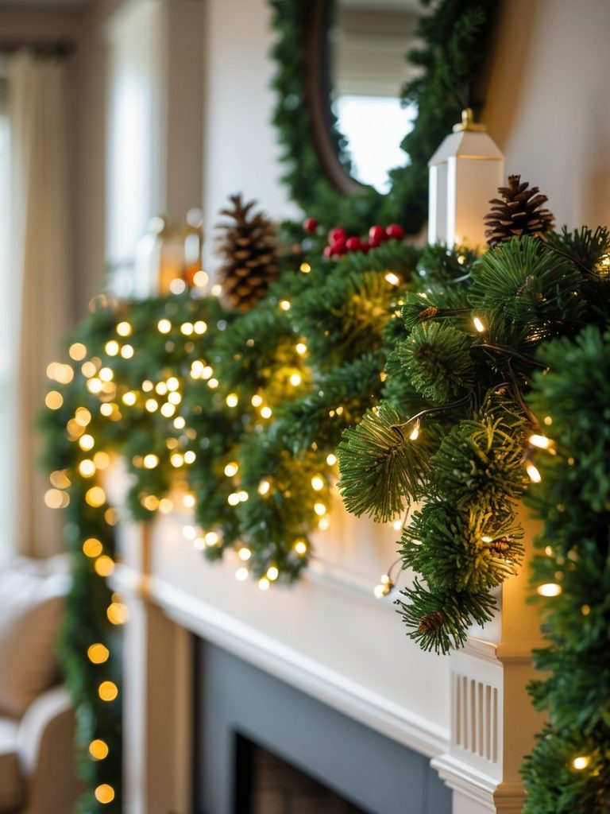

> TIP:QUICK: Space pinecones unevenly and in different sizes — nature never spaces anything evenly.

## 17. Eucalyptus Garland with Silver Ribbon

A eucalyptus garland with a silver ribbon is the most elegant mantel here, and it suits a white fireplace with a lit fire. The silver ribbon catches the firelight, and the eucalyptus softens the whole mantel into something calm and wintry.

Use a wide silver ribbon — at least three inches — so it reads from across the room, and let it drape in loose swags rather than wrapping it tightly. Silver and eucalyptus need no other color.

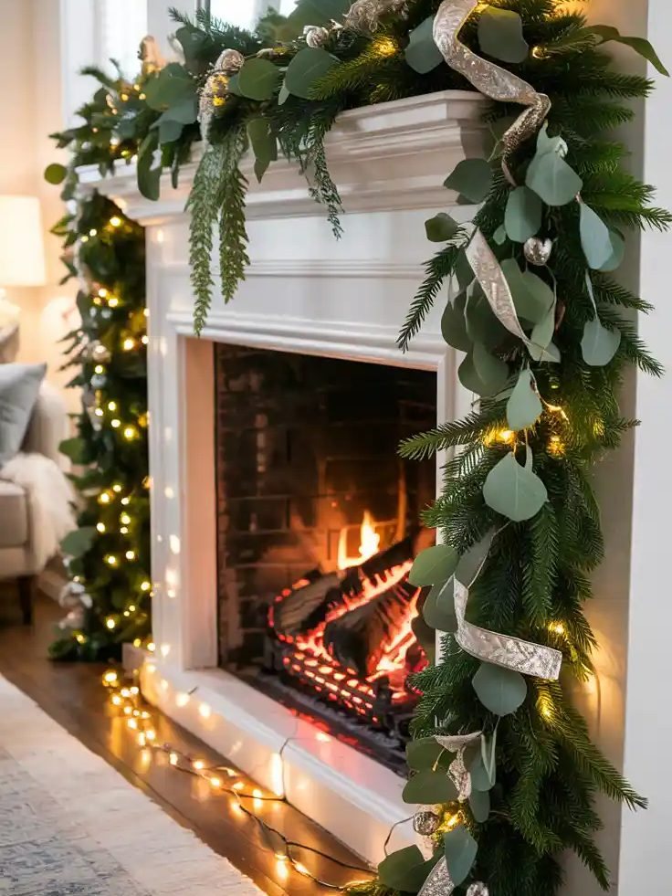

> TIP:CHECK: ribbon at least three inches wide; loose swags, never wrapped tight; silver and eucalyptus need no other color

## 18. Trailing Greenery Garland

A trailing garland that spills down the sides of the fireplace and onto the hearth is the most romantic mantel here. The greenery looks like it is growing down the chimney breast, and the fairy lights in it make the whole fireplace glow.

Let the ends hang at different lengths — one side longer than the other looks more natural than a perfect match. Secure the garland at the top corners so the weight does not pull it down over the fire.

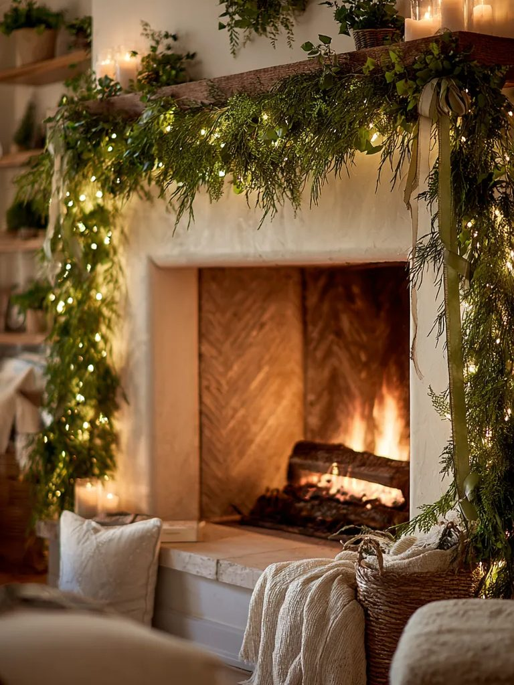

> TIP:GUIDE: Ends: hang at different lengths, one side longer | Secure: top corners so weight cannot pull it down | Look: trailing ends feel romantic

## 19. Berry Wreath with Gold Candlesticks

A red berry wreath above the mantel, gold candlesticks on either side, and a lit garland below is the most formal mantel on this list. It suits a dining room or a traditional living room, where the fireplace is the centerpiece of the house.

Keep the candles unlit or use battery candles on the mantel — real flames and a garland are a bad combination. Gold candlesticks in different heights look better than a matching pair.

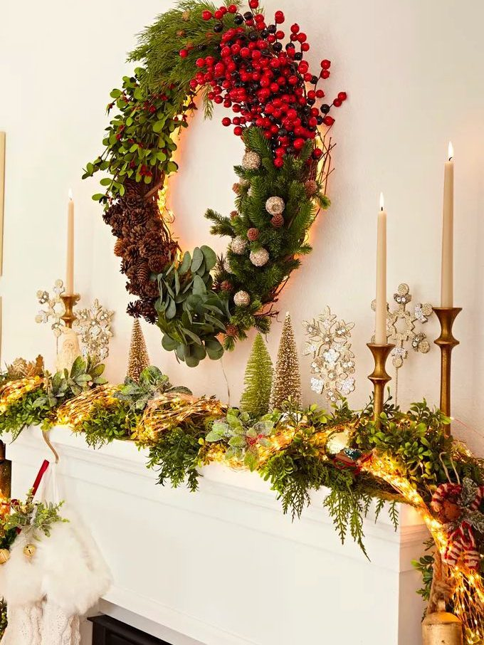

> TIP:QUICK: Keep mantel candles battery-powered — real flames and a garland are a bad combination.

## 20. Pinecone Garland on a Stone Mantel

A pinecone garland on a rough stone mantel is the most rustic combination here. The stone is already textured and uneven, so the garland does not need to be perfect — the pinecones and brass candlesticks do the work.

Stone mantels are usually deep, so a thick garland suits them better than a thin one. Brass candlesticks warm up the grey stone, and a wood fire below completes the cabin feel.

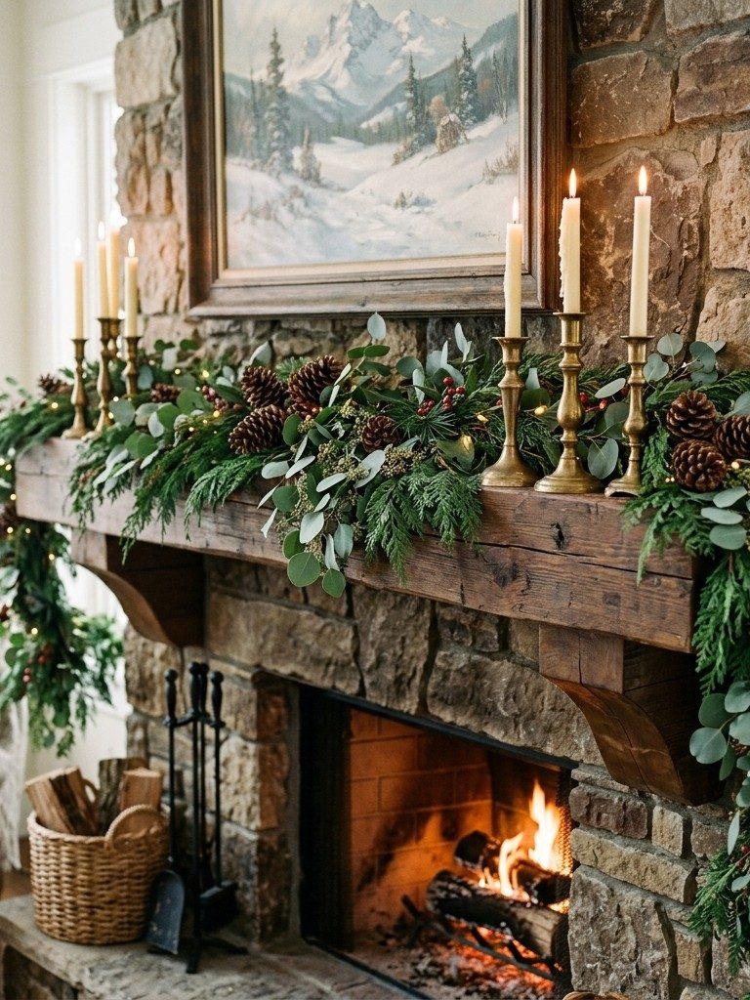

> TIP:CHECK: stone mantels are deep, so use a thick garland; brass candlesticks warm the grey stone

## 21. Frosted Eucalyptus Garland Close-Up

A frosted eucalyptus garland, dusted white as if with snow, is the wintriest garland on this list. The frosted leaves catch the fairy lights in a soft, diffused glow, and the pinecones tucked into it look like they were gathered from a snowy wood.

Frosted garlands shed a little flocking, so vacuum the mantel once a week. The flocking also dulls the green, so pair it with warm lights rather than cool ones — warm light restores the glow.

> TIP:GUIDE: Sheds: vacuum the mantel weekly | Lights: warm, not cool — warm restores the glow | Pair: pinecones for texture

## 22. Pinecone and Eucalyptus Mantel Garland

Pinecones and eucalyptus together make a garland that is both rustic and refined: the pinecones bring the woodland, the eucalyptus brings the softness, and the red berries in between bring the Christmas.

This garland photographs beautifully in close-up, so it is a good choice for a mantel you see every day. Keep the pinecones to the front of the garland where they show, and the eucalyptus to the top where it drapes.

> TIP:QUICK: Keep pinecones to the front where they show and eucalyptus to the top where it drapes.

## 23. Pinecone Garland on a Rustic Beam

A garland on a rough-hewn wood beam is the most farmhouse mantel here. The beam is already the feature, so the garland just needs to soften it — pinecones, eucalyptus and a few warm lights are enough.

A beam mantel is often high, so use a garland with long trailing ends to bring the decoration down to eye level. A garland that ends at the beam looks unfinished; one that drapes below it looks complete.

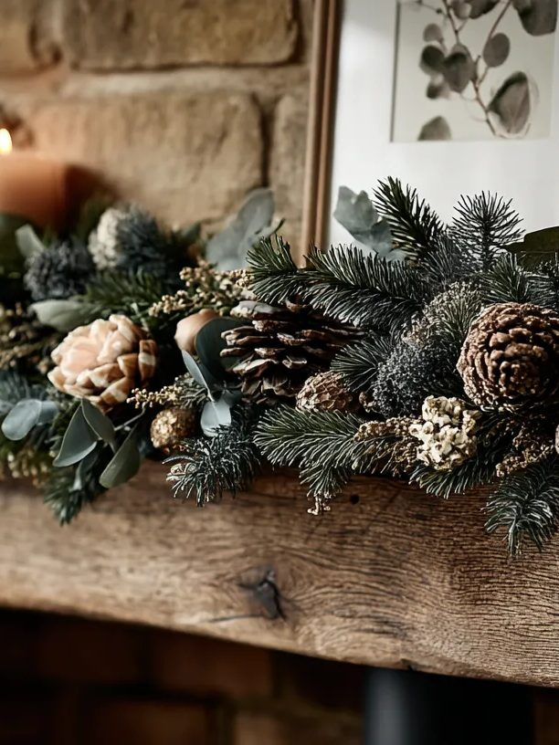

> TIP:CHECK: beam mantels are high — let the garland drape below the beam to bring it to eye level

## 24. Garland with Candles and a Round Mirror

A garland with pillar candles and a round mirror above it is the most balanced mantel on this list. The mirror reflects the tree across the room, so the fireplace feels connected to the rest of the house, and the candles add a warm glow at eye level.

Use battery candles on the mantel for safety, and put the real candles on the hearth below. A round mirror softens a rectangular mantel, and the garland underneath it frames the reflection.

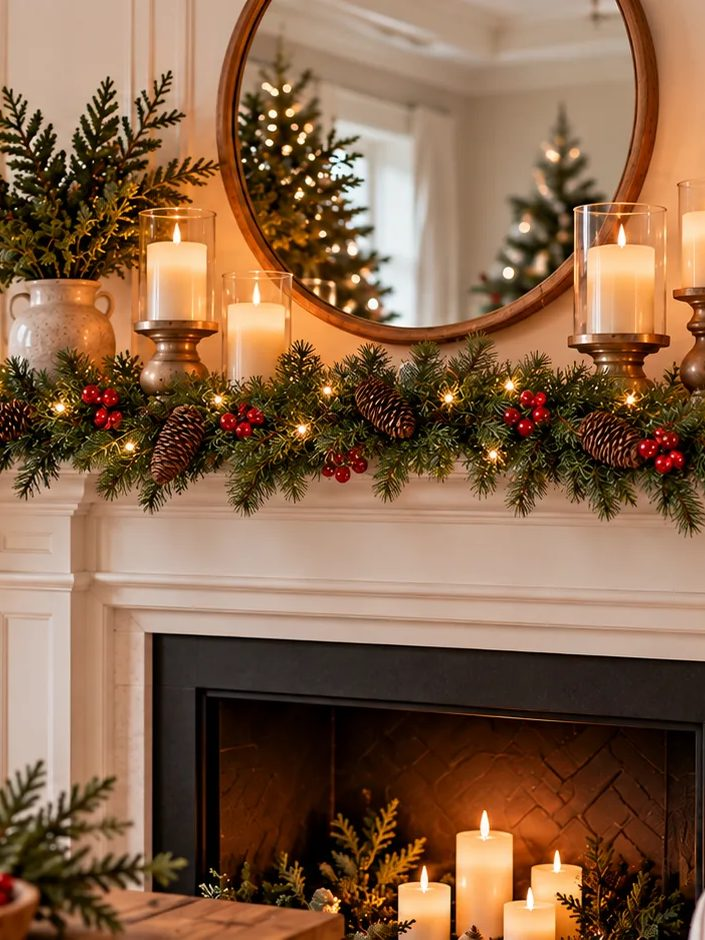

> TIP:GUIDE: Candles: battery on the mantel, real ones on the hearth | Mirror: round softens a rectangular mantel | Glow: candles add warmth at eye level

## 25. Pinecone and Berry Garland Close-Up

A close-up of a pinecone and berry garland shows how much texture a mantel can hold: rough pinecones, glossy berries, soft eucalyptus and sharp pine needles, all in one swag. It is the garland to copy when you want your mantel to reward a closer look.

Texture is the trick: mix at least three textures in every foot of garland, and the eye never gets bored. Berries go in clusters, pinecones go singly, and the greenery fills everything else.

> TIP:QUICK: Mix at least three textures in every foot of garland and the eye never gets bored.

## 26. Pinecone Garland with Lanterns

Lanterns on a mantel garland bring a warm, old-fashioned glow that candles alone cannot match. The lanterns sit on the mantel ends like bookends, and the garland with pinecones and eucalyptus runs between them.

Use battery candles inside the lanterns for safety, and choose lanterns in different sizes for a collected look. A lantern on each end of the mantel balances the garland and frames the fireplace.

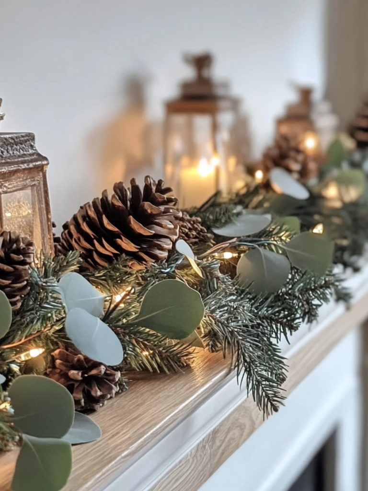

> TIP:CHECK: lanterns in different sizes look collected; battery candles inside; one on each end balances the mantel

## 27. Farmhouse Garland with Burlap Bows

Big burlap bows on a garland over a brick fireplace is the farmhouse mantel at its best. The burlap is rough and natural, the brick is warm and uneven, and the garland with pinecones and berries ties them together.

Burlap bows need wired ribbon to hold their shape, and they look best large — at least eight inches across. A farmhouse sign on the mantel above the garland completes the look, but keep it small.

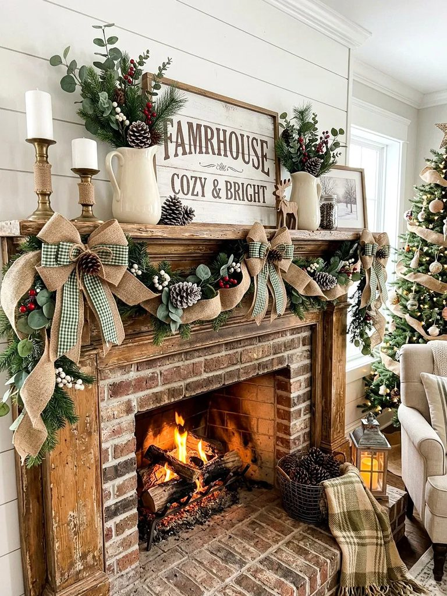

> TIP:GUIDE: Bows: wired ribbon, at least eight inches across | Sign: small, above the garland | Brick: warm and uneven

## 28. Wreath and Garland with Lanterns

A wreath above the mantel, a garland across it, and black lanterns on the hearth below is the most complete mantel scene here. Each element is simple on its own, and together they make the fireplace the warm heart of the room.

Black lanterns ground a white mantel and keep it from floating away visually. Put the lanterns on the hearth rather than the mantel, where they are safer and where they frame the fire.

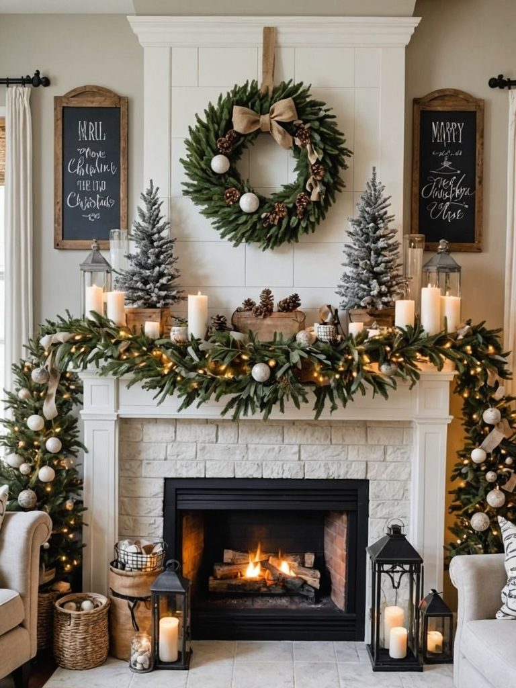

> TIP:QUICK: Put lanterns on the hearth, not the mantel — safer, and they frame the fire.

## 29. Plaid Stockings on a Stone Mantel

Three plaid stockings on a stone mantel, with a garland and a few ornaments above them, is the coziest mantel on this list. The plaid is warm, the stone is solid, and the garland ties them together with greenery.

Plaid stockings in different colors but the same pattern look like a family rather than a set. Hang them at slightly different heights for a relaxed feel, and keep the garland simple so the stockings lead.

> TIP:CHECK: plaid stockings in different colors, same pattern; hang at slightly different heights; keep the garland simple

## 30. Frosted Garland with a Burlap Wreath

A frosted garland with a burlap bow wreath above it is the softest mantel here. The frosted greenery is pale and wintry, the burlap bow is warm and natural, and the pinecones in the garland ground the whole scene.

A burlap bow wreath is easy to make: a grapevine wreath, some greenery and a big wired burlap bow. Hang it above the garland so the two read as one decoration, not two separate ones.

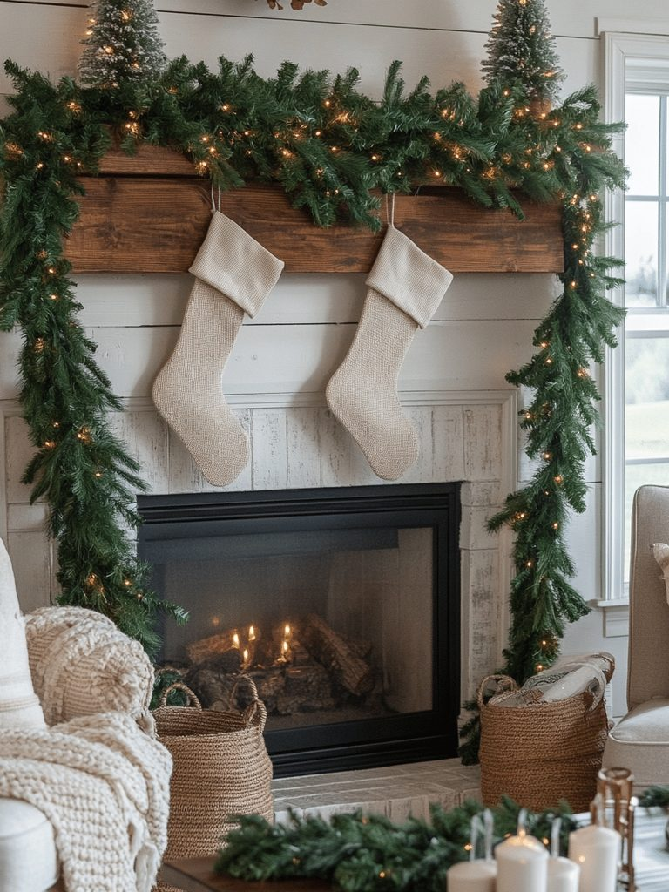

> TIP:GUIDE: Wreath: grapevine base with greenery and a wired burlap bow | Hang: above the garland as one decoration | Feel: softest mantel on the list

## Takeaway

A garland on the mantel is the fastest route to a Christmas living room: one swag of greenery, a few lights, and whatever you love most — stockings, pinecones, ribbons or lanterns — and the fireplace becomes the warm heart of the house. Start with the fullest garland you can find, hang it securely, and dress it slowly, stepping back after every addition. If the garland has you in the mood to dress the rest of the house, our [30 Doorway Garland Ideas for a Welcoming Home](https://www.cozynesthomeideas.com/posts/doorway-garland/) carries the same greenery to your front door, and our [30 Valentine Mantel Decor Ideas](https://www.cozynesthomeideas.com/posts/valentine-mantel-decor/) keeps the mantel dressed once Christmas is over.

## Frequently Asked Questions

### How do I hang garland on a mantel without damaging it?

Use removable adhesive hooks or garland ties made for mantels, and never nail into the wood or stone. Stick the hooks to the underside or back edge where they stay hidden, and test one hook first — some finishes do not hold adhesive well. Remove hooks slowly in January, warming the adhesive with a hair dryer if it resists.

### How long should a garland be for a mantel?

Measure the mantel width, then add at least two feet so the garland can drape down both sides. A six-foot mantel needs an eight- or nine-foot garland for a generous drape. A garland that ends exactly at the mantel edges looks stretched, while one with long trailing ends looks lush and intentional.

### Should I use real or faux garland on a mantel?

Faux garland is the practical choice for a mantel: it never sheds, never dries out near the fire, and stores for years. Real garland smells wonderful and looks more natural, but it needs misting and drops needles on the hearth. A good compromise is a faux base garland dressed with real pinecones and eucalyptus sprigs.

### How do I keep garland from sliding off the mantel?

Secure the garland at three points — both ends and the middle — with adhesive hooks, garland ties or small Command strips on the underside of the mantel. Let the garland rest on the mantel shelf rather than hanging from the front edge, so gravity works with you. A heavier garland stays put better than a light one.

### Can I put real candles on a garland mantel?

Keep real candles off the mantel itself, where the garland could catch fire. Use battery candles on the mantel for the same glow with no risk, and put real pillar candles on the hearth below, well away from the garland ends. Never leave any candle burning unattended, and keep the garland away from the firebox.

### How do I make a thin garland look full?

Layer two garlands together, twisting them so the branches fill each other's gaps, and tuck in extra sprigs of eucalyptus, pine or cedar where you can see through. Add pinecones, ornaments and ribbon to fill the remaining gaps. A thin garland dressed well looks fuller than a thick garland left bare.

### What goes with garland on a mantel besides stockings?

Almost anything: pillar candles and lanterns, a wreath or a mirror above it, a wooden sign, bottle-brush trees, pinecones, ornaments, ribbon bows and small framed art. The rule is one focal point above the mantel and one or two accents on the shelf, so the garland stays the star and the mantel never looks crowded.

### When should I take mantel garland down?

Most people take it down in the first week of January, once the tree is down. Real garland should come down sooner — as soon as it starts to dry out and shed, usually by New Year. Faux garland can stay up until mid-January if you like it, but the room feels fresher once the mantel is bare again.
