# 30 DIY Gingerbread House Door Decoration Ideas for a Sweet Welcome

Gingerbread house door decorations diy projects are the sweetest kind of Christmas craft: a brown door, some white icing trim, a peppermint wreath you made yourself, and suddenly the whole entrance smells of Christmas — even if it is only felt and paint. These 30 gingerbread house door decorations diy ideas are all handmade, from a felt gingerbread house door hanger you can sew in an evening to a full cardboard cottage facade built over a weekend.

Every project below lists what you need and how it goes together, and most of them cost less than a shop-bought wreath. Start with one easy win — the painted sign or the paper garland — and work up to the big facade once you trust your hands. If you would rather shop the finished look first, our [30 Gingerbread House Door Decoration Ideas for a Sweet Welcome](/posts/gingerbread-house-door-decorations/) shows the same gingerbread door styles ready-made, so you can compare and pick your lane.

## 1. DIY Felt Gingerbread House Door Hanger

Sew a little gingerbread house from brown felt, with a red-and-green scalloped roof, white icing trim, felt pretzels and candy canes, and set it by the door or hang it from a ribbon loop. You need brown, white, red and green felt, embroidery floss, a needle and ribbon.

Sew the icing trim on before you glue the gumdrops down, so the stitching sits flat and the candy details layer neatly on top.

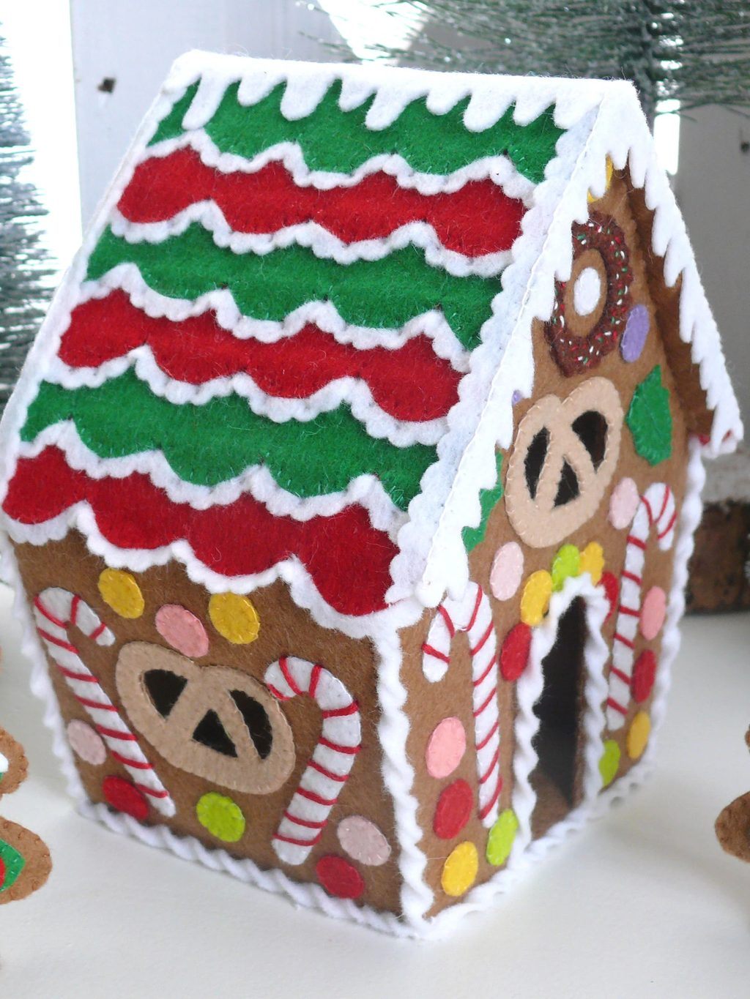

> TIP:QUICK: Stitch the icing trim on first, then glue the gumdrops — layering in that order keeps the hanger flat.

## 2. Hand-Painted Gingerbread House Door Sign

Paint a wooden plaque brown, add white icing drips along the top edge with a brush, dot on gumdrop colours and letter Welcome in cream paint. You need a wooden plaque, acrylic paint, brushes and a sealer.

Sketch the house and lettering in pencil first, paint the brown base, then add the icing and candy details once the base is fully dry.

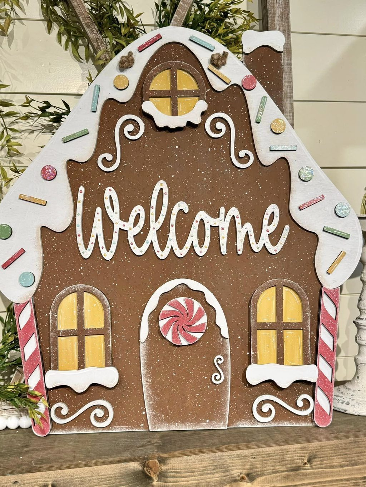

> TIP:CHECK: pencil sketch first; brown base fully dry before icing; sealer coat to protect it outdoors

## 3. DIY Candy Cane Garland for the Door

Twist greenery garland around the door frame, wire on candy canes, lollipops and peppermint discs, and finish with big striped bows at the corners. You need greenery garland, candy props, floral wire and ribbon.

Wire the candy onto the garland while it lies flat on a table, then hang the whole frame — it is far easier than wiring pieces at arm's length on the door.

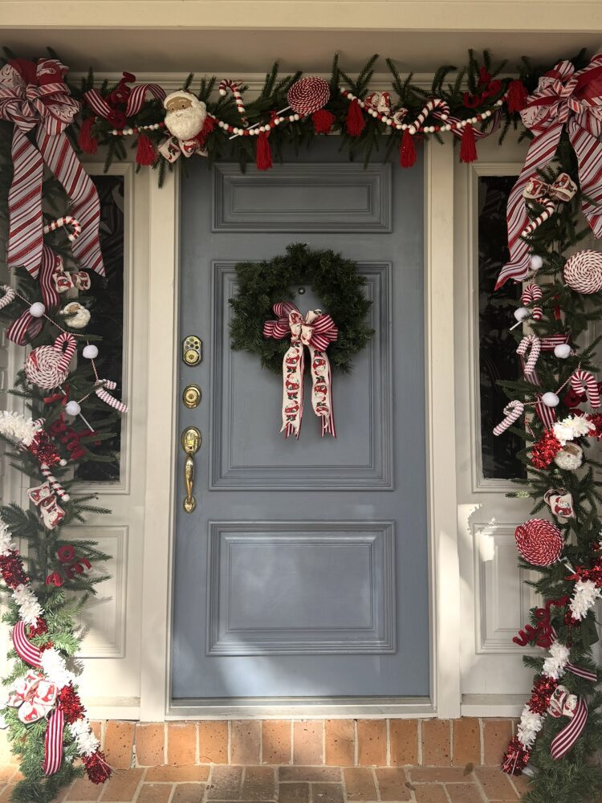

> TIP:GUIDE: Budget: under $25 for garland and candy props | Time: one hour to wire | Skill: beginner

## 4. DIY Foam Gingerbread Man Wreath

Take a green wreath and wire on mini gingerbread men, snowflake cookies, cinnamon sticks and gingham bows. You need a green wreath, gingerbread ornaments, cinnamon sticks and ribbon.

Space the gingerbread men evenly around the ring first, pin them in place, then glue — moving a glued figure leaves a mark on the wreath.

> TIP:QUICK: Pin the felt figures in place around the ring before you glue a single one.

## 5. DIY Peppermint Door Frame Garland

Wrap a green garland around the door frame, wire on peppermint discs and red baubles, and hang a wreath with a big red bow in the centre. You need greenery garland, peppermint props, floral wire and ribbon.

Hang the garland across the top first and work down the sides, wiring each peppermint twice so nothing slips.

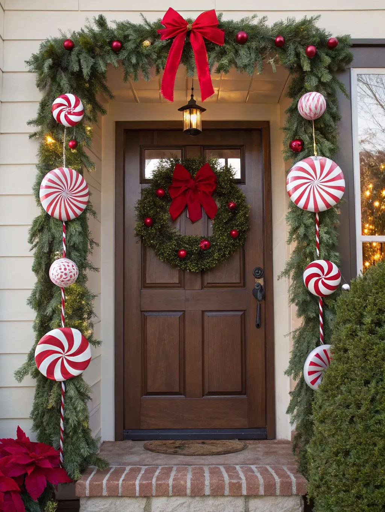

> TIP:CHECK: garland across the top first; peppermints wired twice; wreath centred at eye level

## 6. DIY Cardboard Gingerbread House Door Facade

Cut a full gingerbread house front from large cardboard boxes, paint it brown, add white icing trim with a caulk gun or puffy paint, and tape the panels around the door. You need cardboard, brown paint, white puffy paint and strong tape.

Build the facade in three flat panels — left, right and top — so one person can carry it outside and tape it up without help.

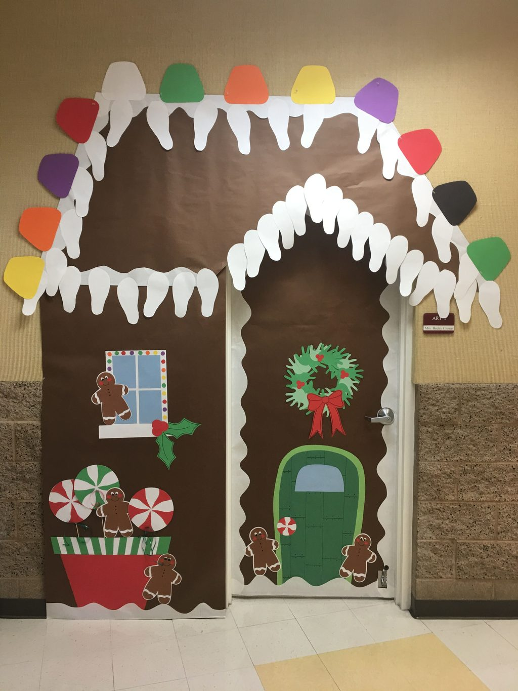

> TIP:GUIDE: Budget: under $15 for cardboard and paint | Time: one weekend to build | Skill: intermediate

## 7. DIY Peppermint Candy Wreath

Glue red-and-white peppermint candies or painted wooden discs onto a foam wreath ring, working in overlapping rows until no foam shows. You need a foam ring, peppermints or wooden discs, paint and hot glue.

Work in small sections and overlap each row by half, so the wreath looks full and no foam peeks through between the candies.

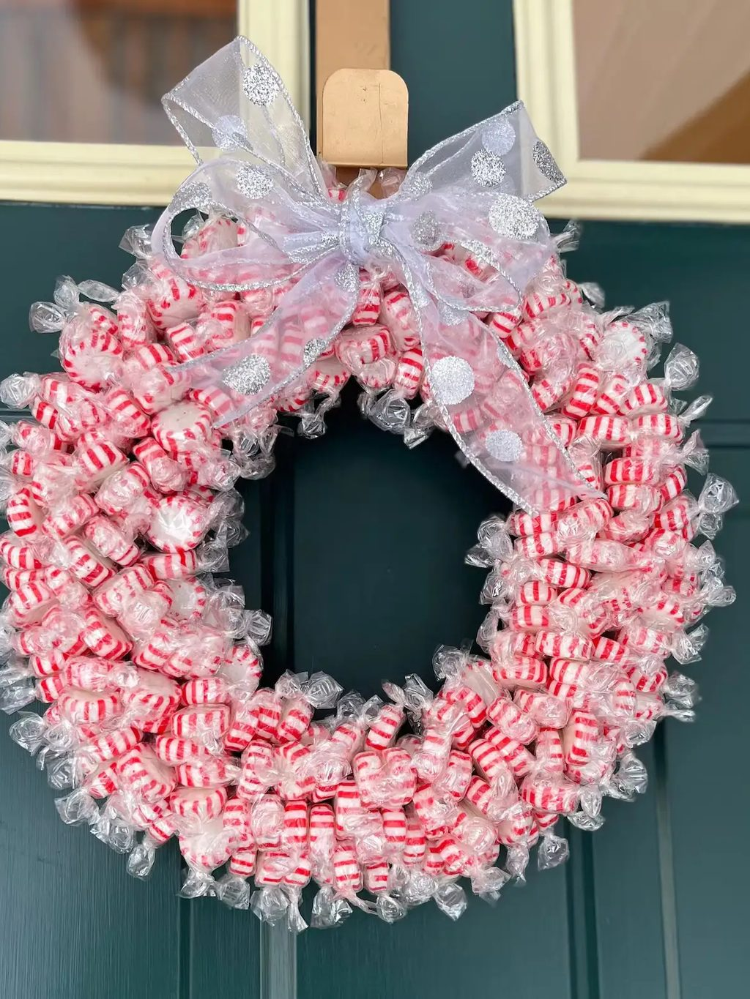

> TIP:QUICK: Overlap each row of peppermints by half so no foam shows through.

## 8. DIY Felt Gumdrop Garland

Roll felt balls in red, green and white, stitch peppermint discs and little stars, and string them on twine for a soft, playful garland. You need wool felt balls or felt sheets, thread and twine.

Cut all the peppermint discs from one template so they match, and string them with a knot between each piece so they stay evenly spaced.

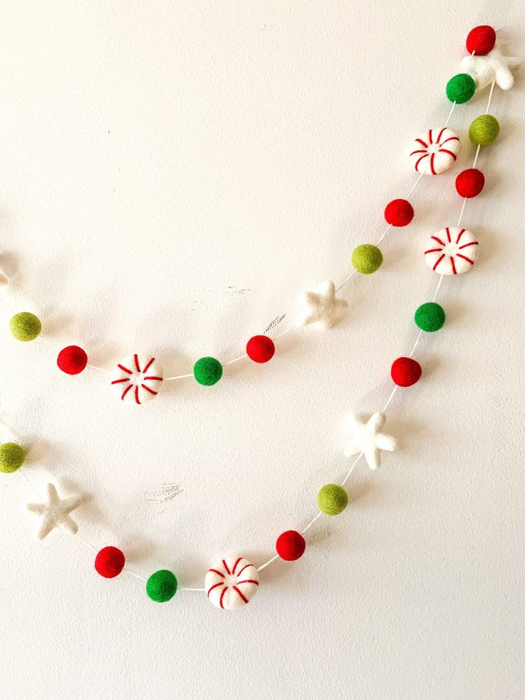

> TIP:CHECK: one template for every gumdrop; a knot between each one; colours alternating around the string

## 9. DIY Wooden Gingerbread House Sign

Paint a wooden sign with a gingerbread house in the middle, North Pole Gingerbread Baking Co. lettering and Christmas trees, and stand it by the door. You need a wooden board, acrylic paint, brushes and a stand.

Sand the board smooth before painting, because rough wood drinks paint and leaves the lettering ragged.

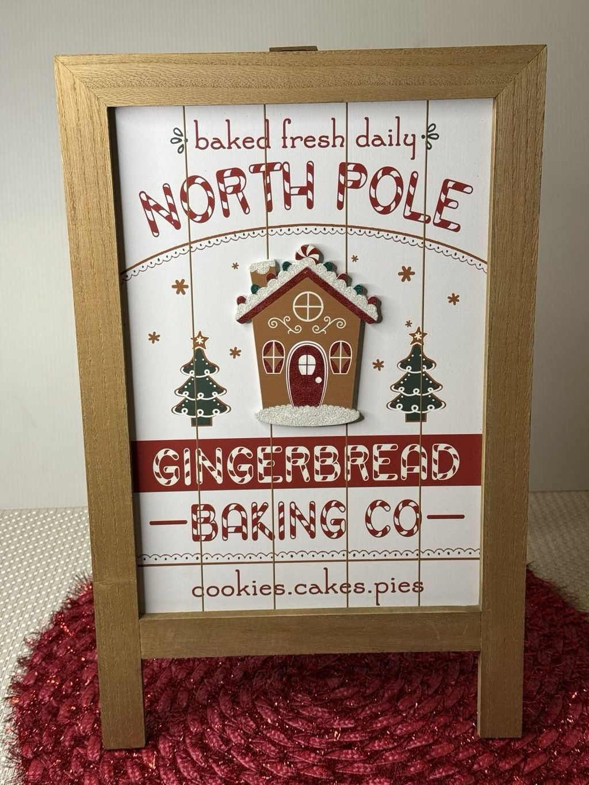

> TIP:GUIDE: Budget: under $20 for a board and paint | Time: two hours plus drying | Skill: beginner

## 10. DIY Greenery and Candy Door Swag

Wire together pine branches, candy canes and lollipops into a swag, tie it with a big red bow, and hang it across the top of the door. You need pine branches, floral wire, candy props and ribbon.

Build the swag on a table first, wiring the greenery as the base and the candy on top, so you only lift it to the door once.

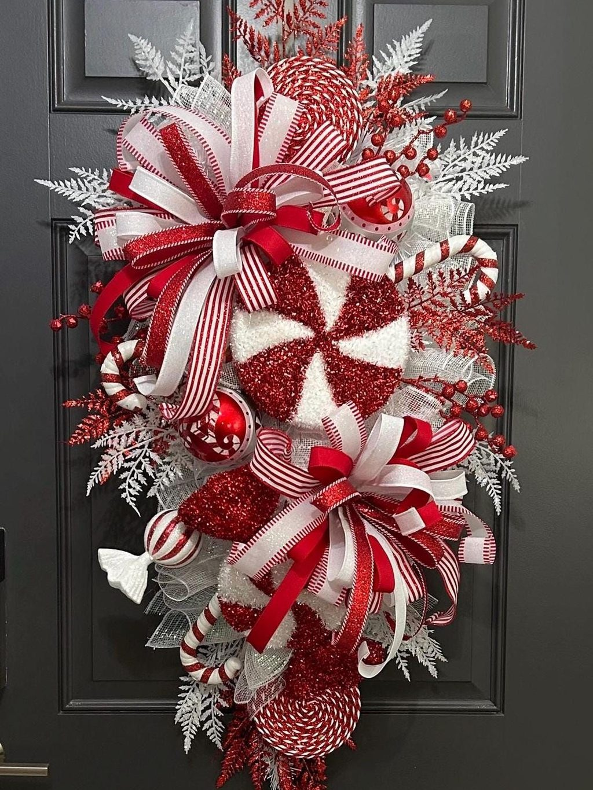

> TIP:QUICK: Build the swag flat on a table first — lift it to the door only when it is finished.

## 11. DIY Candy Cane Door Bow

Make an oversized bow from red ribbon, fluff the loops, and tie it over the door with a candy cane tucked through it, then frame the door with a candy garland. You need wired ribbon, floral wire, a candy cane prop and greenery garland.

Use wired ribbon only — soft ribbon collapses outdoors, while wired ribbon holds its loops through wind and rain.

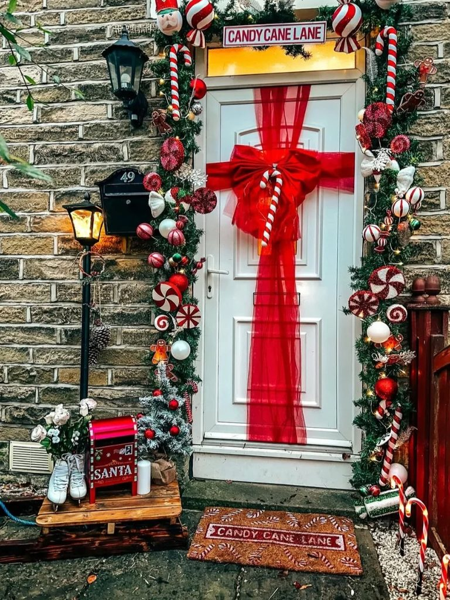

> TIP:CHECK: wired ribbon, never soft; loops fluffed evenly; wire the bow on, never glue

## 12. DIY Gingerbread Village Window Clings

Cut gingerbread houses, candy canes and snowflakes from coloured vinyl or static-cling sheets, and stick them on the glass door panels. You need cling sheets, a craft knife, a cutting mat and a template.

Cut the houses from a printed template taped under the cling sheet, and test one cling on the glass before cutting the whole village.

> TIP:GUIDE: Budget: under $12 for cling sheets | Time: one evening to cut a village | Skill: beginner

## 13. DIY Wooden Gingerbread Cottage Stack

Cut three gingerbread house shapes from thin plywood, layer them in a stack with candy-cane and lollipop details, and stand the stack on a base by the door. You need thin plywood, a jigsaw or scroll saw, wood glue and a base.

Sand the cut edges smooth before you glue the stack, and leave the wood natural or paint it — the bare wood looks beautiful against greenery.

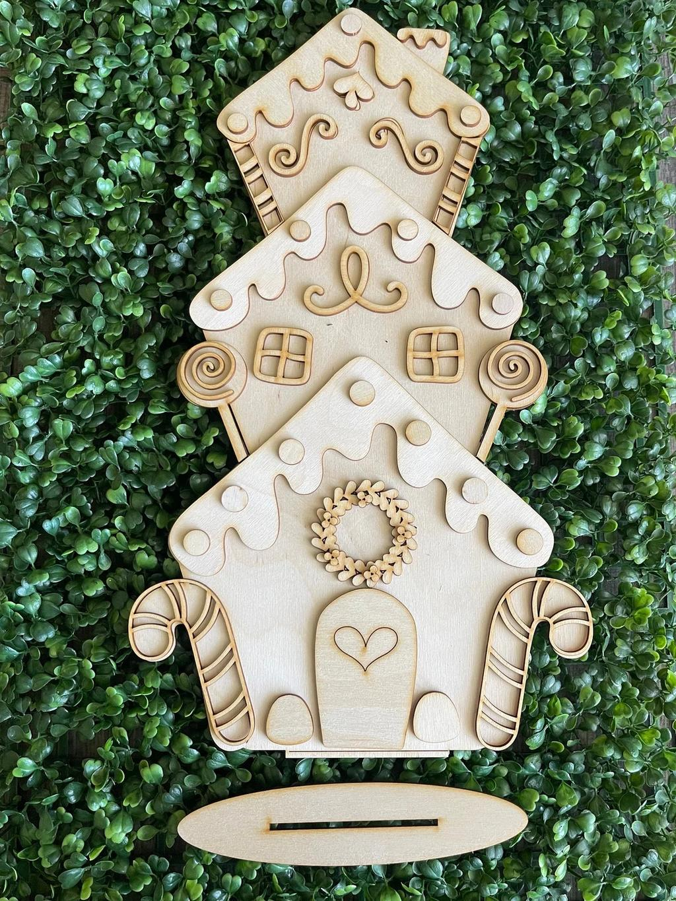

> TIP:QUICK: Paint the big shapes first and the icing details last, once the background is dry.

## 14. DIY Pom-Pom Gumdrop Garland

Make chunky felt balls in candy colours, add peppermint discs, and string them on twine for a soft, playful garland. You need felt balls in red, green and white, peppermint discs and twine.

Alternate the colours in a repeating pattern — red, green, white, peppermint — so the garland looks even from a distance.

> TIP:CHECK: colours in a repeating pattern; knots between pieces; peppermints spaced evenly

## 15. DIY Gingerbread Man Door Greeter

Cut a life-size gingerbread man from plywood, paint him brown with white icing details and a red bow tie, and hang him on the door with a candy frame around him. You need plywood, a jigsaw, brown and white paint and a hanging wire.

Trace the figure from a printed template in two halves — head and body — because a life-size template rarely fits on one sheet of paper.

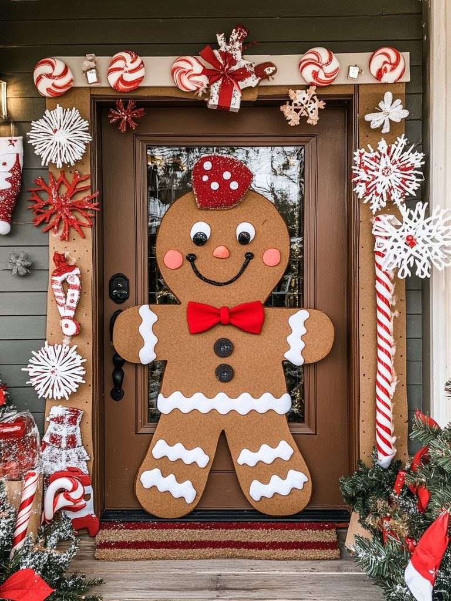

> TIP:GUIDE: Budget: under $25 for plywood and paint | Time: one afternoon to cut and paint | Skill: intermediate

## 16. DIY Gingerbread Cookie Wreath

Bake gingerbread men and star cookies, decorate them with white icing and coloured sprinkles, and wire them onto a green wreath ring with ribbons. You need gingerbread dough, icing, a wreath ring and ribbon.

Wire the cookies on while the wreath lies flat, spacing them evenly, and hang it indoors or under a covered porch — real cookies are for looks, not for eating after a week outside.

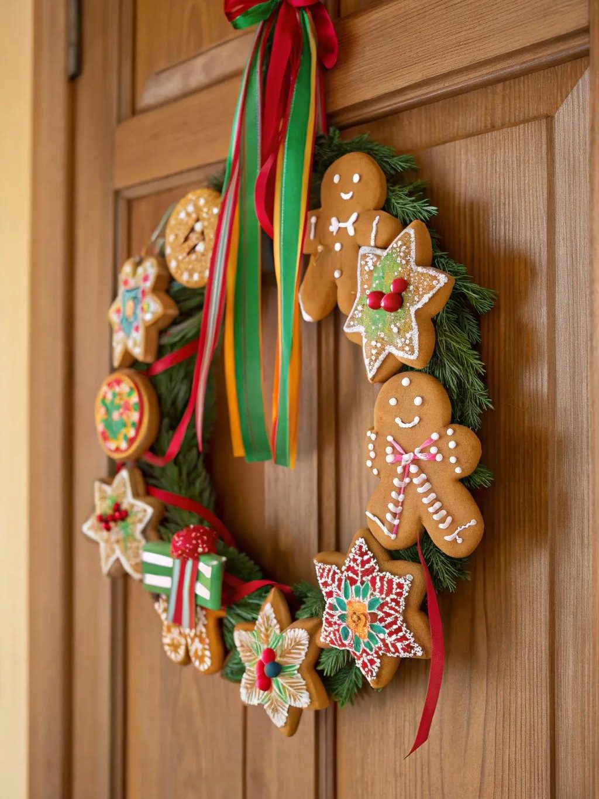

> TIP:QUICK: Spray the fake snow first and let it dry before gluing the gingerbread men on.

## 17. DIY Candy Lollipop Door Swag

Make a door swag starring giant lollipops: wire red-and-white lollipops, candy canes and striped bows onto a pine base and hang it on the door. You need pine branches, lollipop props, candy canes, floral wire and ribbon.

Put the biggest lollipop at the top so it reads from the street, and wire everything twice — a swag is heavy and a single wire will slip.

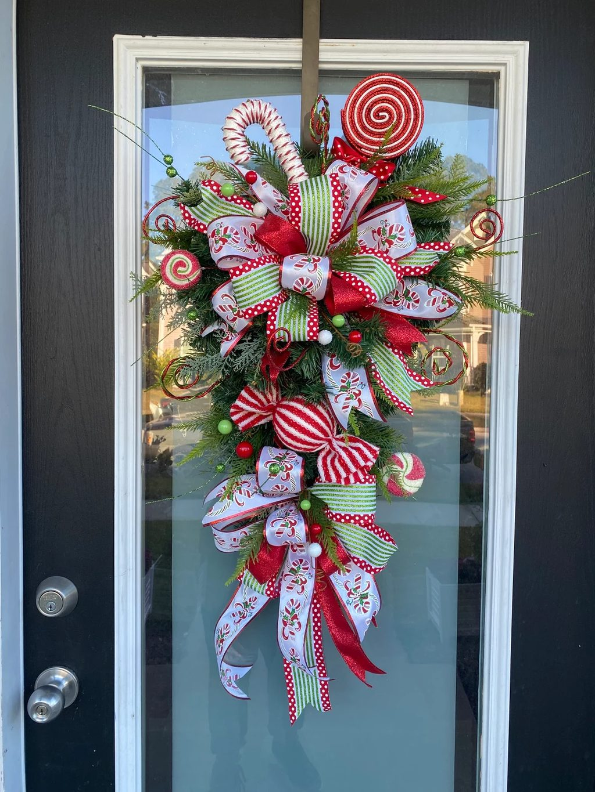

> TIP:CHECK: biggest lollipop at the top; everything wired twice; swag built flat on a table first

## 18. DIY Stencilled Gingerbread Doormat

Stencil a gingerbread house and Welcome onto a plain coir doormat with outdoor paint, using a homemade cardboard stencil. You need a coir mat, outdoor paint, cardboard and a craft knife.

Dab the paint on with a stencil brush instead of brushing it, so the paint does not bleed under the stencil edges.

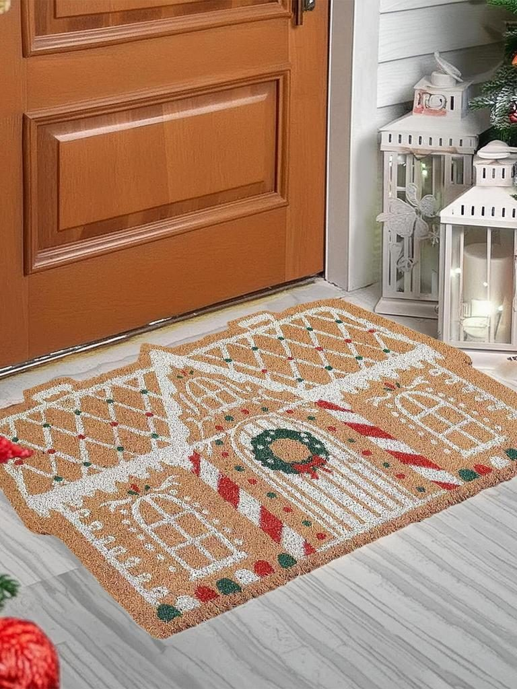

> TIP:GUIDE: Budget: under $15 for a mat and paint | Time: one hour to stencil | Skill: beginner

## 19. DIY Embroidered Christmas Wreath Hoop

Stretch linen in a wooden embroidery hoop and stitch a Christmas wreath — holly leaves, red berries, pinecones and a gold bow — in the centre, with Merry Christmas lettering. You need a hoop, linen, embroidery floss and a needle.

Transfer the wreath design with a disappearing ink pen first, so the stitching follows the lines and the wreath stays centred in the hoop.

> TIP:QUICK: Draw the house on the linen first with disappearing ink, then stitch along the lines.

## 20. DIY Gingerbread Advent Calendar Door

Make a gingerbread house advent calendar with 24 little doors — wooden, cardboard or felt — and hang it on or beside the door for December. You need a house-shaped board, 24 small doors, numbers and paint.

Number the doors in order so the calendar reads top to bottom, left to right, and leave the tops hinged so each door opens.

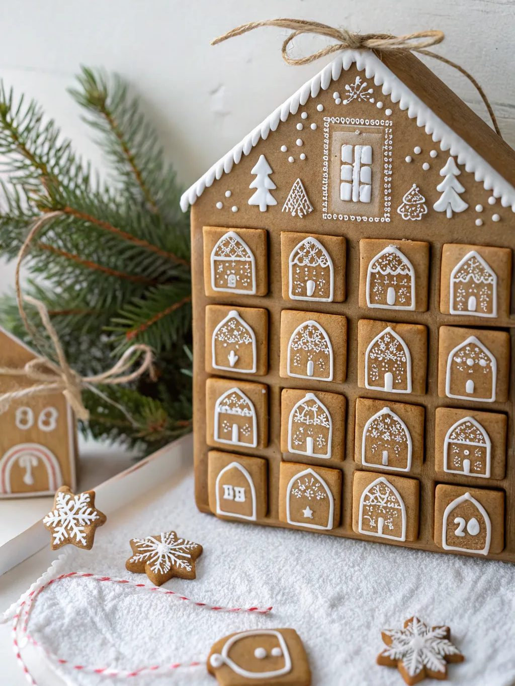

> TIP:CHECK: doors numbered in reading order; tops hinged; one small treat behind each door

## 21. DIY Twine and Felt Gingerbread Garland

Cut gingerbread men from brown and tan felt, stitch white icing outlines on each one, and string them on red-and-white twine with candy canes between them. You need felt, floss, twine and candy canes.

Stitch the icing on all the houses before you string them, so you can work flat at a table instead of fumbling with a hanging garland.

> TIP:GUIDE: Budget: under $12 for felt and twine | Time: one evening to stitch ten figures | Skill: beginner

## 22. DIY Round Gingerbread Holiday Sign

Paint a round wooden sign blue, add a gingerbread house with candy-cane pillars, peppermint swirls and two Christmas trees, and letter Welcome across the bottom. You need a round wooden sign, acrylic paint and brushes.

Paint the house first and the lettering last, and seal the sign so the blue paint stays bright outdoors.

> TIP:QUICK: Two coats of chalkboard paint and a full day to cure before you write on it.

## 23. DIY Gingerbread Man Paper Garland

Cut gingerbread men from brown card or bake real gingerbread men, decorate with white icing, and clip them to twine with wooden pegs to hang across the mantel or door. You need brown card or gingerbread dough, white icing, twine and pegs.

Space the figures evenly along the twine and hang the garland where it will not be knocked — real gingerbread men are fragile, so card versions last longer on a busy door.

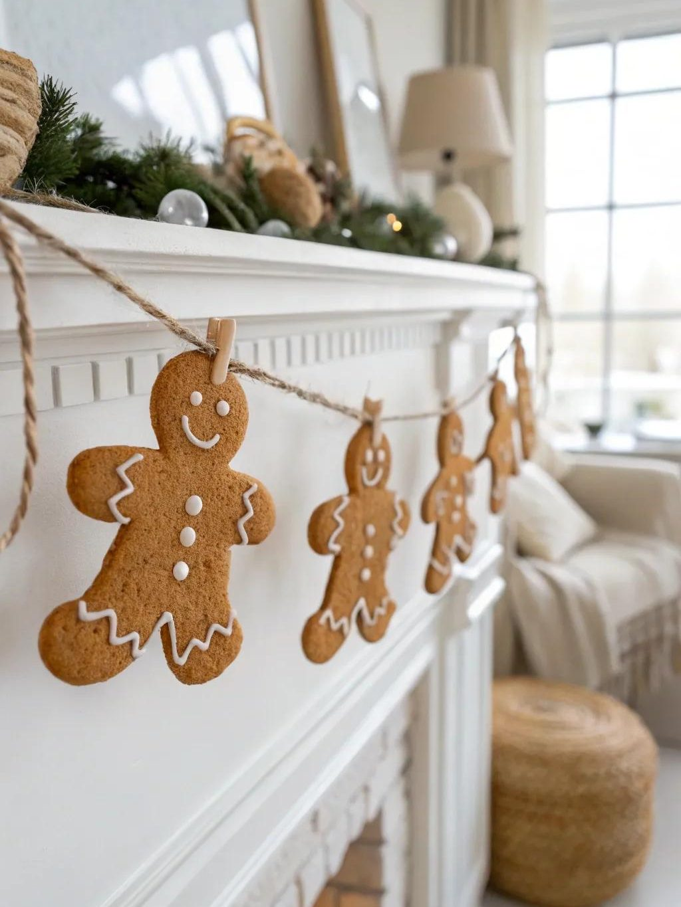

> TIP:CHECK: fold lines scored first; icing drawn with white gel pen; houses spaced evenly on the twine

## 24. DIY Wooden Bead Candy Garland

Paint wooden beads in candy colours, string them on twine with a gingerbread house bead in the middle, and drape the garland around the door. You need wooden beads, paint, twine and a large needle.

Paint the beads on skewers so you can paint all sides without touching wet paint, and let them dry overnight before stringing.

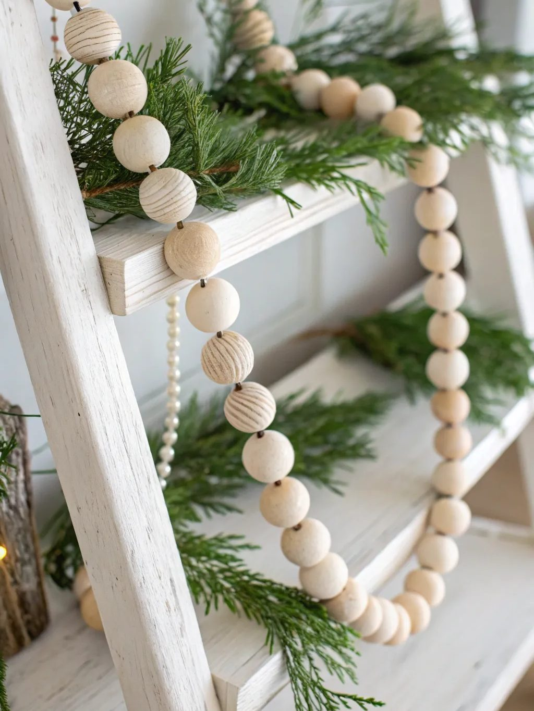

> TIP:GUIDE: Budget: under $10 for beads and paint | Time: one evening plus drying | Skill: beginner

## 25. DIY Gingerbread Bakery Hanging Sign

Paint a wooden sign with Gingerbread Baking Co. lettering, a gingerbread man and a rolling pin, and hang it in the window or by the door with twine. You need a wooden board, acrylic paint, brushes and twine.

Paint the lettering with a small flat brush in two thin coats, because one thick coat of white paint on brown wood always looks patchy.

> TIP:QUICK: Two thin coats of white lettering paint, never one thick coat — it always looks patchy.

## 26. DIY Salt Dough Gingerbread Ornaments for the Door

Roll salt dough, cut gingerbread men and houses, bake until hard, paint them, and hang them from the wreath or garland. You need flour, salt, water, cookie cutters, paint and ribbon.

Poke the hanging hole with a straw before baking, because drilling a hole in baked salt dough cracks it.

> TIP:CHECK: holes poked before baking; ornaments baked until fully hard; sealed with varnish for outdoor use

## 27. DIY Ribbon and Candy Door Hanger

Layer loops of red, white and green ribbon into a big wreath, tuck in a felt gingerbread girl, cinnamon-roll swirls and peppermint discs, and hang it on the door. You need ribbon in three colours, floral wire, a wreath base and a felt figure.

Cut all the ribbon loops to the same length first, then layer them longest at the back and shortest at the front for a tidy cascade.

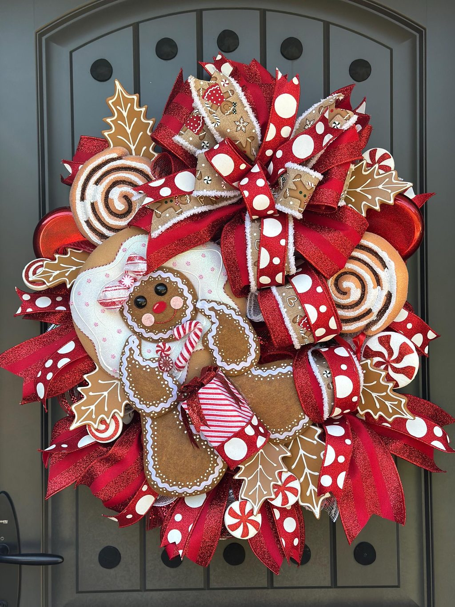

> TIP:GUIDE: Budget: under $15 for ribbon and trims | Time: forty-five minutes to layer | Skill: beginner

## 28. DIY Mini Gingerbread House Lanterns

Build a tiny gingerbread house from card, cut windows in it, and set a battery tea light inside so it glows on the porch steps. You need card, a craft knife, paint and a battery tea light.

Cut the windows before you glue the house together, because cutting them afterwards crushes the walls.

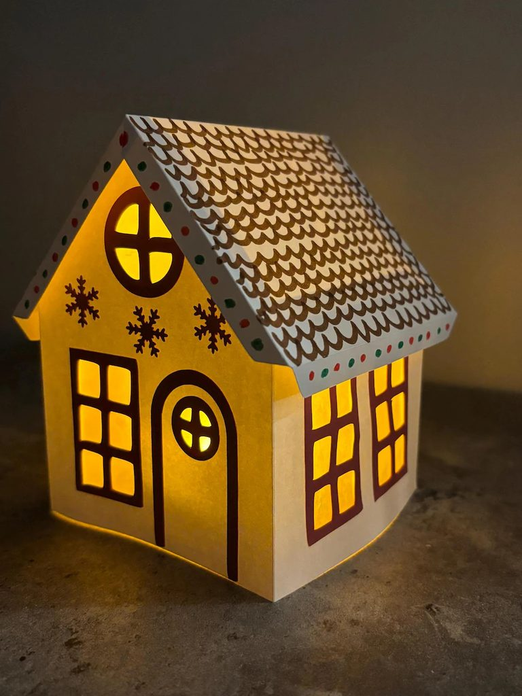

> TIP:QUICK: Cut the windows out before you glue the house together — afterwards the walls crush.

## 29. DIY Burlap Gingerbread Man Door Hanger

Cut a gingerbread man shape from burlap stretched over a twig frame, paint on a smiling face and white icing dots, add a peppermint bow and a lollipop, and hang it on the door. You need burlap, twigs, paint, ribbon and a lollipop prop.

Bend the twig frame to the gingerbread shape first and glue the burlap over it, so the hanger holds its shape on the door.

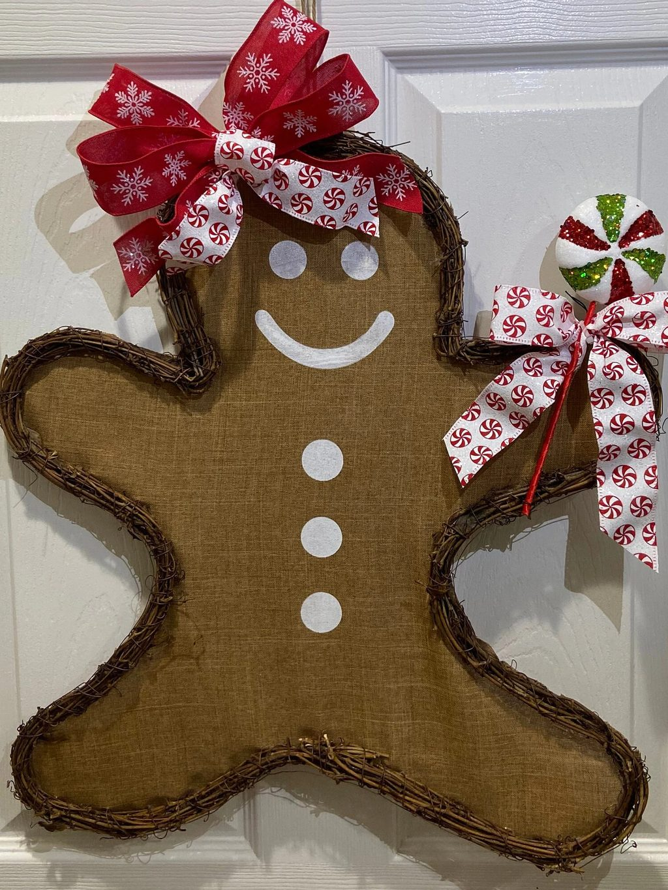

> TIP:CHECK: twig frame bent to shape first; burlap glued taut over it; face painted after the burlap is set

## 30. DIY Yarn Candy Cane Striped Wreath

Wrap a foam wreath ring in red and white yarn, alternating stripes, then tie a chunky yarn bow at the top. You need a foam ring, red and white yarn and ribbon.

Wrap the yarn tightly with no gaps, anchoring each colour change with a dab of hot glue, so the stripes stay crisp and even.

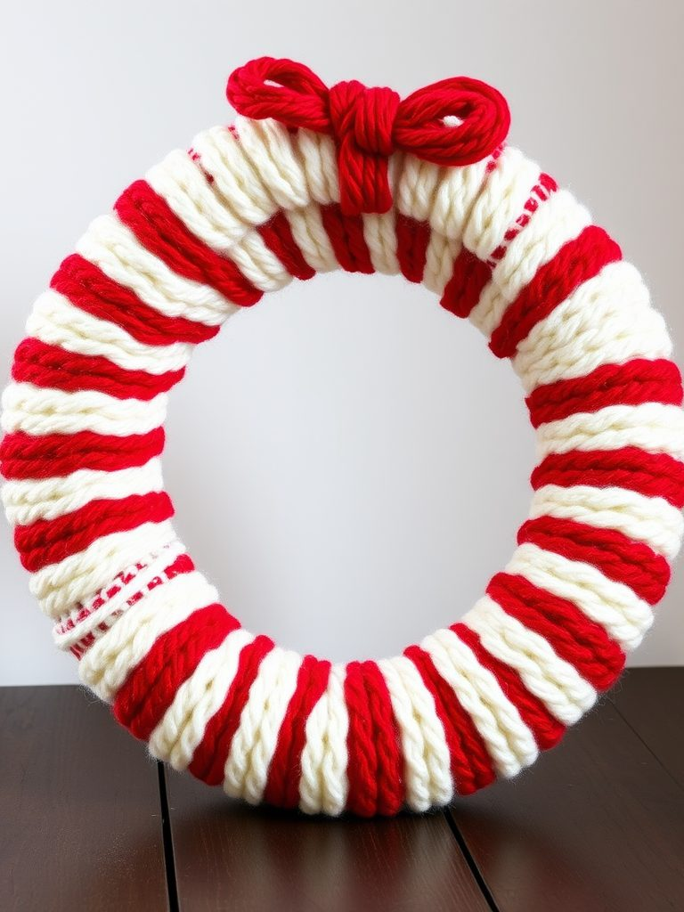

> TIP:GUIDE: Budget: under $12 for yarn and a foam ring | Time: two hours of wrapping | Skill: beginner

## Takeaway

The best first project is the one you can finish tonight: the painted sign, the paper banner or the felt door hanger. Once it is on the door, the bigger builds — the cardboard facade, the life-size greeter — stop feeling daunting and start feeling like next weekend's plan. Keep your palette to brown, white, red and green, save your templates, and next Christmas you will only need an evening to hang the whole collection again. And if you want to see how these handmade pieces look beside the shop-bought versions, our [30 Gingerbread House Door Decoration Ideas for a Sweet Welcome](/posts/gingerbread-house-door-decorations/) puts the finished looks side by side.

## Frequently Asked Questions

### What is the easiest DIY gingerbread door decoration to make?

The felt gingerbread house door hanger is the easiest: cut a house from brown felt, stitch white icing trim along the roof, glue on felt gumdrops and hang it from a ribbon. It needs no power tools, costs under ten dollars, and most people finish it in one evening.

### How do I make a gingerbread house door decoration from cardboard?

Cut three flat panels from large cardboard boxes, paint them brown, add white icing trim with puffy paint, and tape them around the door frame. Build the panels separately so one person can carry them, and bring the facade inside during heavy rain.

### What materials do I need for DIY gingerbread door decor?

Brown felt, foam board or cardboard for the house shapes, white paint or puffy paint for icing, red and green felt or paint for candy details, hot glue, ribbon and twine. Most projects on this list use only that one small kit, so buy it once and make several pieces.

### How do I make gingerbread door decorations weatherproof?

Seal painted wood and cardboard with outdoor varnish, use battery lights instead of candles, and hang felt pieces under a covered porch. Paper banners and salt dough ornaments should come inside during rain, while foam, resin and sealed wood can stay out all season.

### Can I make a gingerbread wreath without a hot glue gun?

Yes, use a foam wreath ring and pin the felt figures on with dressmaking pins, or stitch them through the foam with a long needle and thread. Hot glue is faster, but pins and stitching hold just as well and let you rearrange the design next year.

### How long does a DIY gingerbread door decoration take to make?

Small projects like the felt hanger, the paper banner or the stencilled doormat take one to two hours. A wreath takes an evening, and the full cardboard facade or the life-size greeter takes a weekend, mostly in drying time between paint coats.

### How do I hang DIY gingerbread decorations without damaging my door?

Use over-door hooks for wreaths, removable adhesive hooks for garlands, and painter's tape or removable mounting strips for foam panels. Never screw into the door itself, and test the whole arrangement by opening and closing the door a few times.

### Can kids help make gingerbread house door decorations?

Absolutely — the pom-pom garland, the salt dough ornaments and the paper banner are all safe for children with adult supervision. Let kids paint, cut felt shapes and string beads, and leave the craft knife, jigsaw and hot glue gun to the adults.
