# 30 Gingerbread House Door Decoration Ideas for a Sweet Welcome

Gingerbread house door decorations turn an ordinary front door into the sweetest welcome on the street. Think brown doors trimmed like cookie walls, white icing drips along the frame, peppermint wreaths, candy-cane columns and gumdrop garlands — the whole gingerbread cottage, right at your entrance. This list gathers 30 gingerbread house door decoration ideas, from full facades that transform the whole doorway to a single wreath or sign that brings the same charm in miniature.

You do not need a big budget or a big porch to pull the look off. Some ideas here are shop-bought statement pieces, others are simple swaps — a wreath, a doormat, a garland — that layer the candy-cottage look over the door you already have. Pick one hero piece, add a couple of small candy touches, and the door does the rest. And if you would rather make yours by hand, our [30 DIY Gingerbread House Door Decoration Ideas for a Sweet Welcome](/posts/gingerbread-house-door-decorations-diy/) walks through 30 handmade projects, step by step.

## 1. A Full Gingerbread House Door Facade

Turn the whole doorway into a gingerbread cottage: brown panels for cookie walls, white icing trim along the roofline, candy-cane columns flanking the door and a peppermint wreath at the centre. It is the most dramatic look on this list and the one neighbours photograph.

Keep the facade lightweight — foam board, vinyl decals and felt candy pieces — so nothing pulls on the door or blocks it from opening.

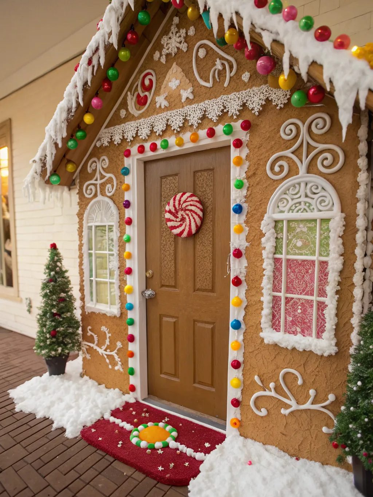

> TIP:QUICK: Build the facade in flat panels you can tape up and take down in one evening.

## 2. A Peppermint Swirl Wreath

A big red-and-white peppermint swirl wreath is the fastest way to say gingerbread. Hang it dead centre on the door and let the swirl do the talking — no other decoration needed.

Choose a wreath at least half the width of the door so it reads from the street, and hang it from a hook that holds its weight.

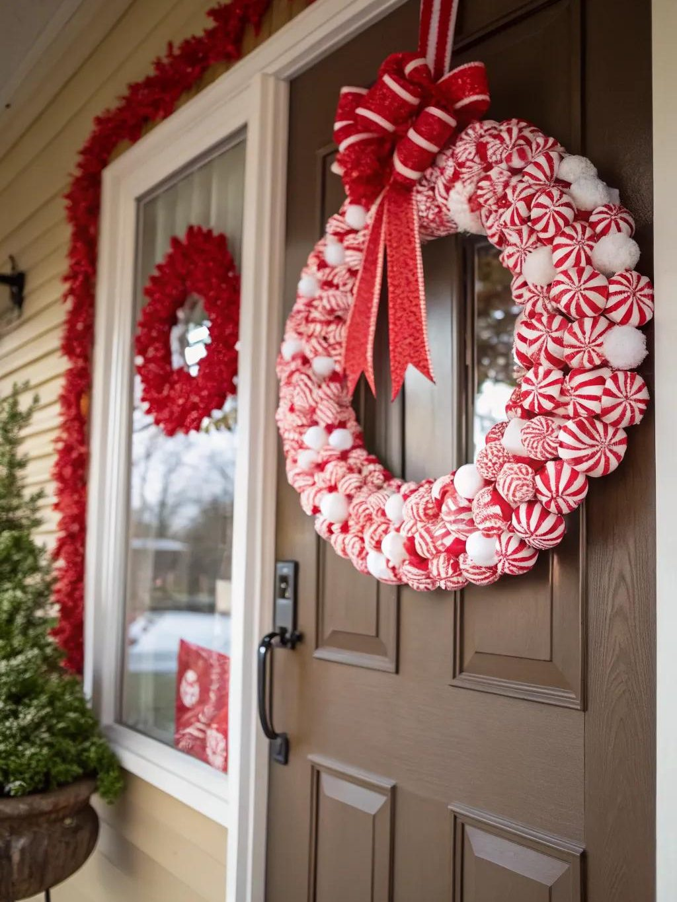

> TIP:CHECK: wreath at least half the door width; a sturdy over-door hook; swirl centred at eye level

## 3. A Gingerbread Man Door Hanger

A smiling gingerbread man cutout hanging on the door is friendly, simple and loved by kids. Wooden or foam versions last for years and take paint well.

Hang it with a ribbon long enough that it sits at eye level, and pick a version with icing details painted on so it reads as gingerbread from the pavement.

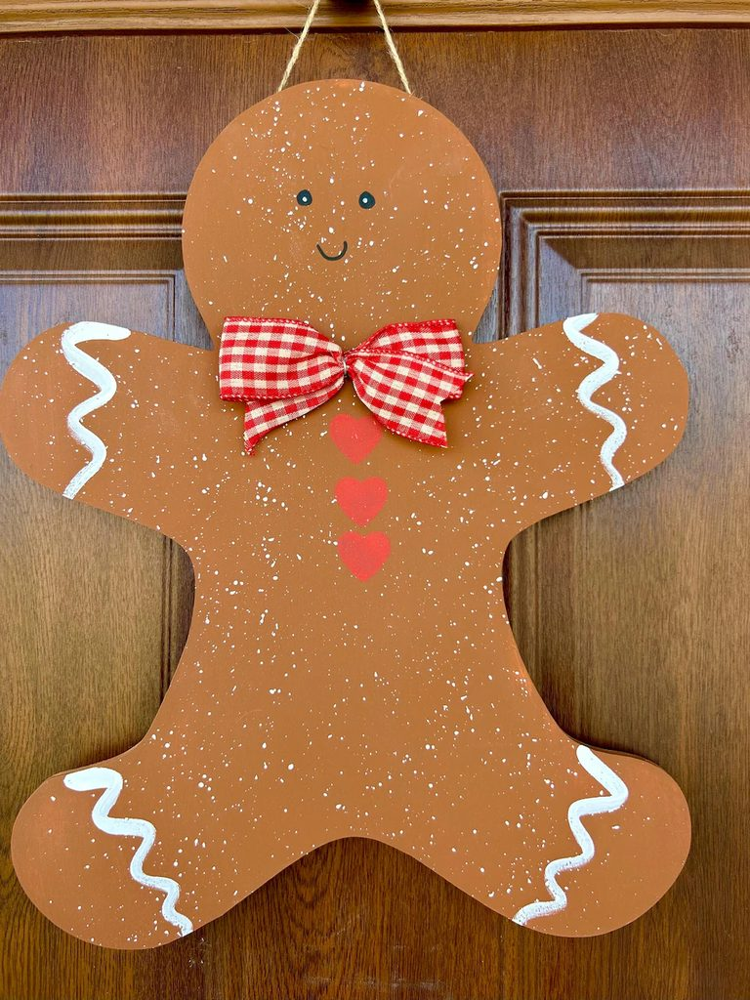

> TIP:GUIDE: Budget: from $15 for a ready-made hanger | Time: ten minutes to hang | Skill: beginner

## 4. Candy Cane Columns Flanking the Door

A giant candy cane beside the door, with peppermint garland framing the entrance, turns the doorway into the pillars of a gingerbread cottage.

Use a freestanding cane or a tall striped pole in a planter so it stays upright in wind, and match the stripe width to the door so it looks built-in.

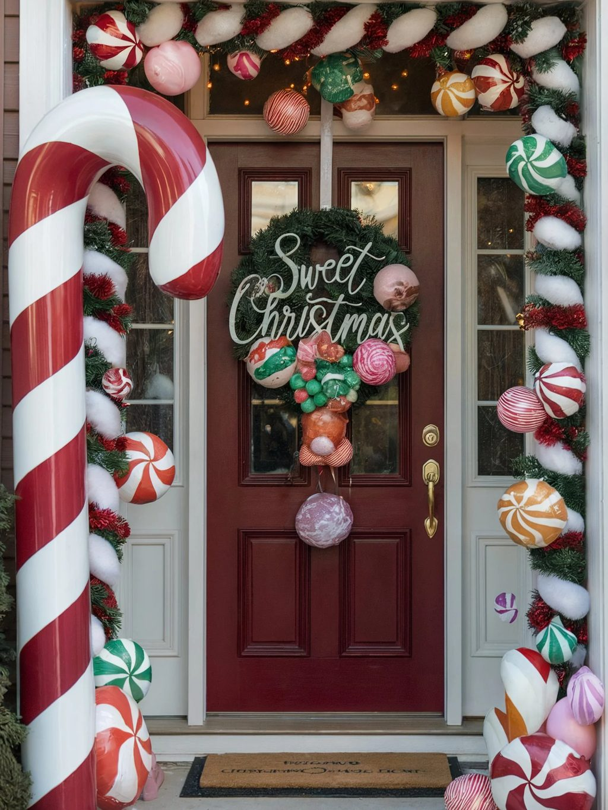

> TIP:QUICK: Stand striped poles in planters filled with stones so wind cannot topple them.

## 5. An Icing-Drip Door Frame Garland

A lit garland framing the whole door, with a giant candy cane and a big red bow, makes the entrance glow like a frosted gingerbread cottage.

Run the garland across the top and a little way down each side, keeping the lights even so the whole frame glows.

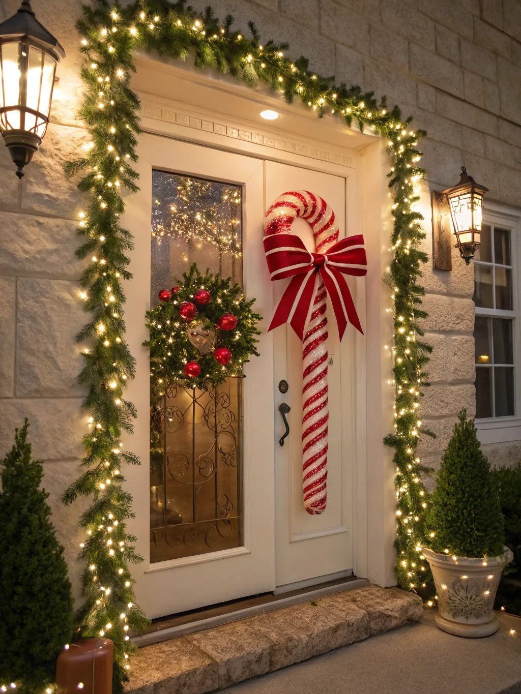

> TIP:CHECK: garland across the top and partway down; drips uneven, like real icing; ends tucked behind the frame

## 6. A Gumdrop Garland Across the Door

Bright candy garlands — peppermint swirls, gumdrops and red bows — wrapped around the door frame turn a plain red door into a sweet shop entrance.

Drape the garland around the frame in a gentle swag rather than one straight line, and space the candies so the greenery still shows between them.

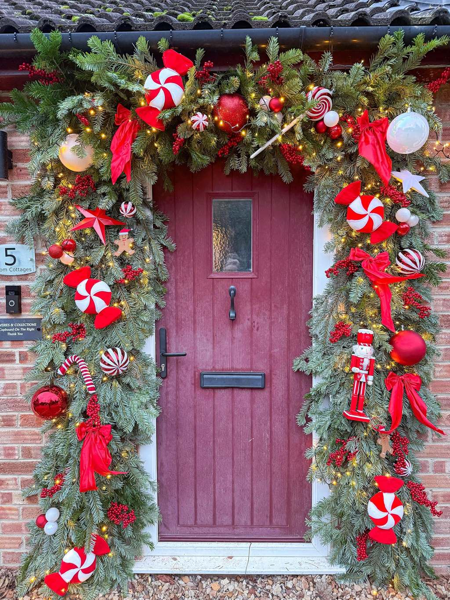

> TIP:GUIDE: Budget: under $20 for two strands | Time: fifteen minutes to drape | Skill: beginner

## 7. A Gingerbread House Door Sign

A wooden gingerbread house sign with a welcome message does the greeting for you. Look for one with icing trim, candy-cane pillars and a little chimney.

Hang the sign at eye level and keep the lettering large — a welcome sign nobody can read from the path is just a picture.

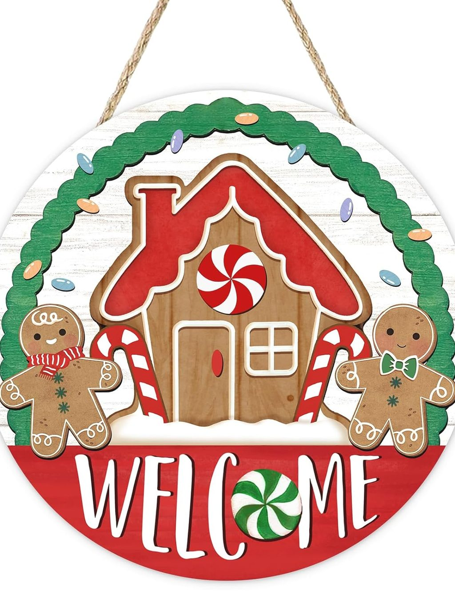

> TIP:QUICK: Choose lettering tall enough to read from the front path, not just the porch.

## 8. A Frosted Gingerbread Porch Display

Set a lit gingerbread house on the porch beside the door — icing drips, candy-cane columns, glowing windows — so the decoration spills beyond the door itself.

Group the pieces in odd numbers and at different heights — a tall lantern, a low house, a medium tree — so the display looks arranged rather than lined up.

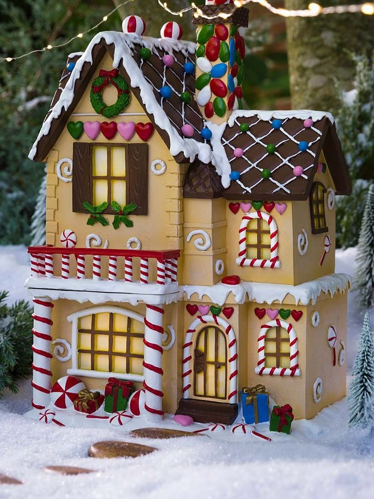

> TIP:CHECK: pieces in odd numbers; three different heights; one light source among them

## 9. A Peppermint and Greenery Wreath

Peppermint swirls and red baubles tucked into a green wreath, with a soft gingerbread man at the centre, give you the gingerbread colours with a classic Christmas shape. It suits doors that already have garland or a traditional look.

Hang it dead centre and keep the wreath full — the peppermints, pinecones and red berries should fill the ring so no bare greenery shows through.

> TIP:GUIDE: Budget: from $25 for a ready-made wreath | Time: ten minutes to hang | Skill: beginner

## 10. A Gingerbread Family on the Door

A green wreath carrying four gingerbread people — two big, two small — turns the door into a family portrait in cookie form, with candy canes tucked between them and a big red-striped bow on top.

Hang the wreath dead centre so the family sits at eye level, and pick a version with matching icing details so the four figures read as one set.

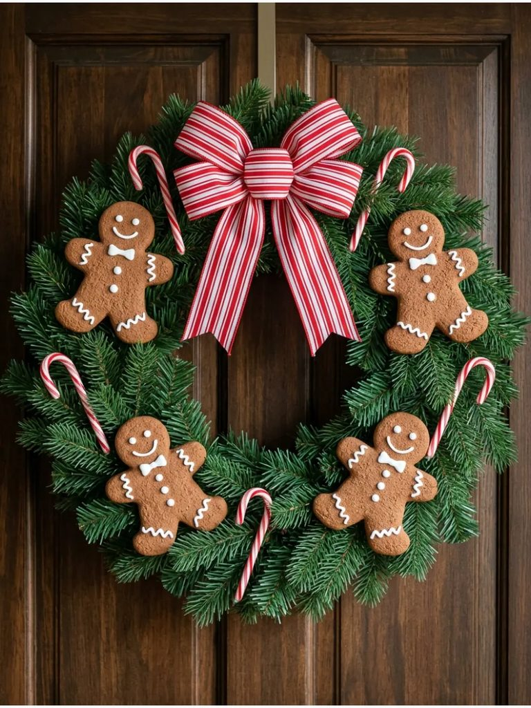

> TIP:QUICK: Hang the family in a straight row at one height so it reads as a single decoration.

## 11. A Snowy Gingerbread Cottage Scene

A snowy gingerbread cottage scene on the porch — a white iced house, candy-cane columns, pine trees and fairy lights — feels like a gingerbread village under fresh snow.

Keep the white flocking to the edges so the cottage in the middle stays visible, and add one warm light so the scene glows after dark.

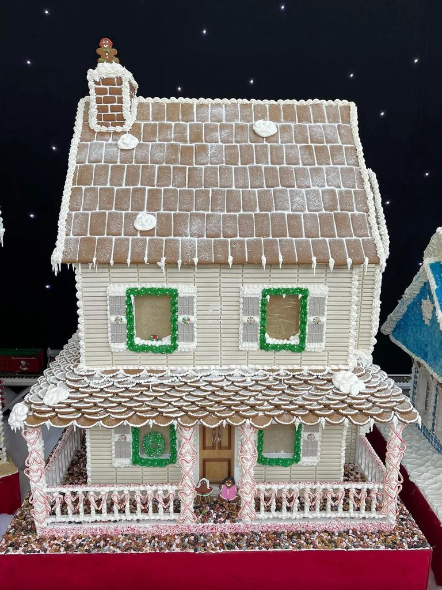

> TIP:CHECK: flocking kept to the edges; cottage visible in the middle; one warm light for evenings

## 12. Candy-Striped Door Bows

Big red-and-white striped bows on the door frame or the wreath add the candy-shop finish. They are cheap, cheerful and easy to swap each year.

Make the bow loops full and even, and wire the tails so they hold their shape instead of flopping against the door.

> TIP:GUIDE: Budget: under $10 for ribbon | Time: ten minutes to tie and wire | Skill: beginner

## 13. Gingerbread House Lanterns by the Door

Lanterns shaped like gingerbread houses, lit from inside, glow on the porch steps like tiny cottages. They look best in pairs, one on each side of the door.

Use battery candles inside so the lanterns can stay lit all evening, and pick lanterns with clear windows so the light shows through.

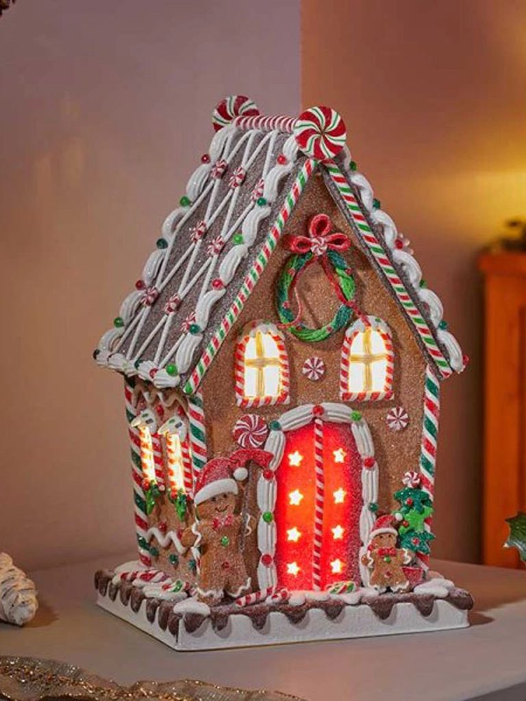

> TIP:QUICK: Battery candles inside mean the lanterns can glow all evening with no flame risk.

## 14. A Lollipop and Candy Door Swag

A swag of oversized lollipops, candy canes and gumdrops across the top of the door is pure candy shop. It works best on a plain door where the colours can shine.

Hang the swag high enough that it clears the top of the door when it opens, and keep the biggest lollipop in the centre.

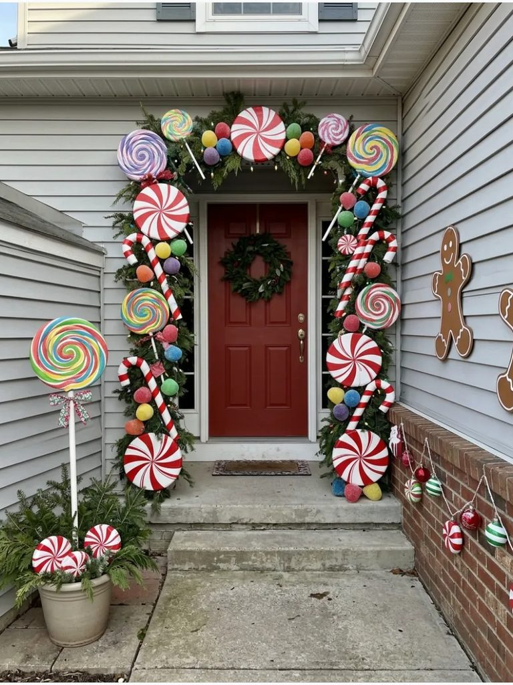

> TIP:CHECK: swag clears the door when it opens; biggest lollipop in the centre; colours matched to the wreath

## 15. A Mini Gingerbread Village on the Door Shelf

If your door has a shelf, a mail slot ledge or a porch rail, set a mini gingerbread house there with a couple of tiny frosted trees in fake snow — a whole village in miniature.

Pick a house with white icing trim so it reads against the door, and add a string of fairy lights behind it so it glows after dark.

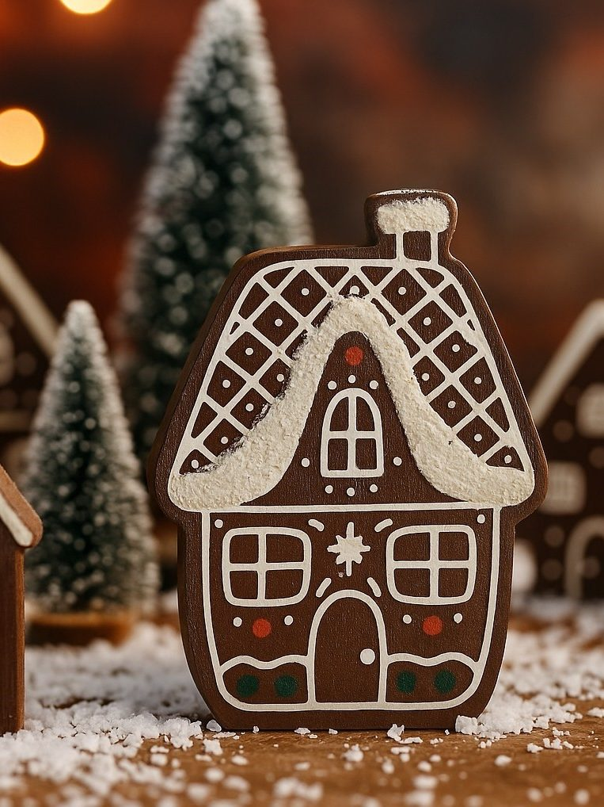

> TIP:GUIDE: Budget: from $20 for a set of mini houses | Time: twenty minutes to arrange | Skill: beginner

## 16. A Gingerbread House Chalkboard Sign

A chalkboard shaped like a gingerbread house lets you write your own welcome — the family name, the date, or a short Christmas greeting — and change it whenever you like.

Write in white chalk pen for a crisp icing look, and keep the message to five words or fewer so it reads from the path.

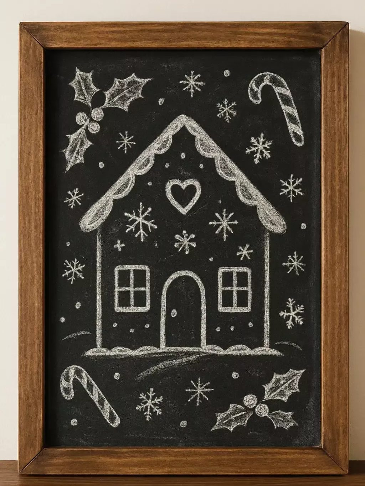

> TIP:QUICK: Five words or fewer on a chalkboard sign, so it reads from the front path.

## 17. A Red and White Peppermint Door Wreath

A full peppermint wreath — red and white swirls all the way around — is the boldest wreath on this list and needs nothing else on the door.

Let it hang alone on a plain door so the swirls get all the attention, and match the doormat to the same red and white.

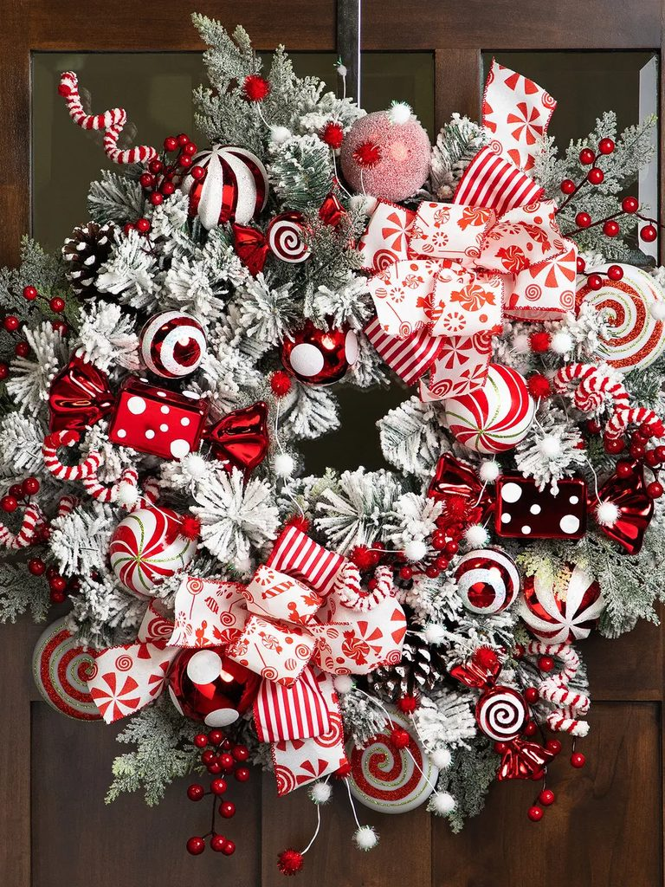

> TIP:CHECK: wreath hangs alone on a plain door; doormat in the same red and white; no competing garland

## 18. A Rustic Gingerbread Door Plaque

A weathered-wood plaque with a gingerbread house and a welcome message suits farmhouse porches and older doors. The rustic wood softens the candy colours.

Hang the plaque on the wall beside the door rather than on the door itself, so it does not swing or knock when the door opens.

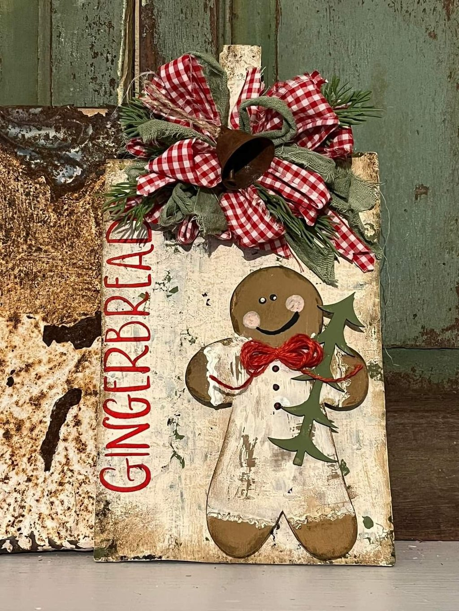

> TIP:GUIDE: Budget: from $20 for a wooden plaque | Time: ten minutes to hang | Skill: beginner

## 19. A Gingerbread Advent Door

Numbered gingerbread doors, pockets or windows across the front door turn December into a countdown the whole street can follow.

Keep the numbers large and in order, and put the first days at the top so children can reach the later ones as the month goes on.

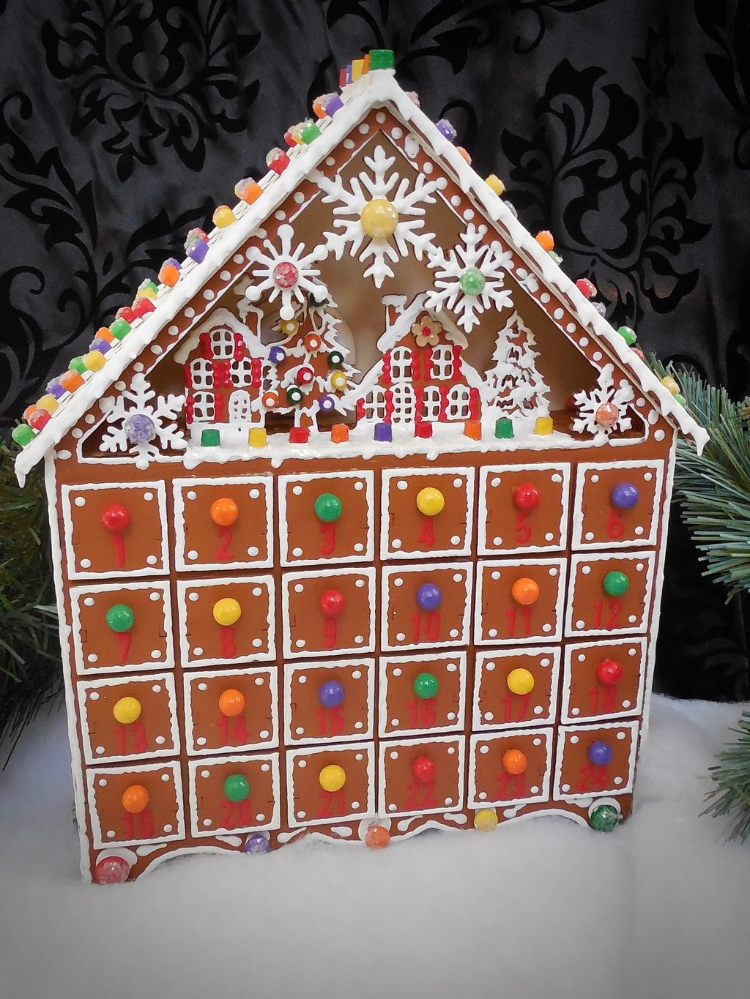

> TIP:QUICK: Put the early December numbers at the top so small hands can reach the later ones.

## 20. A Gingerbread Cottage Porch Vignette

A whole porch vignette — a gingerbread house sign on the walk, wreaths on the windows, fairy lights along the porch — makes the entrance feel like a cottage you could step into.

Keep the furniture to one side so the path to the door stays clear, and use the lights and wreaths to pull the eye toward the door.

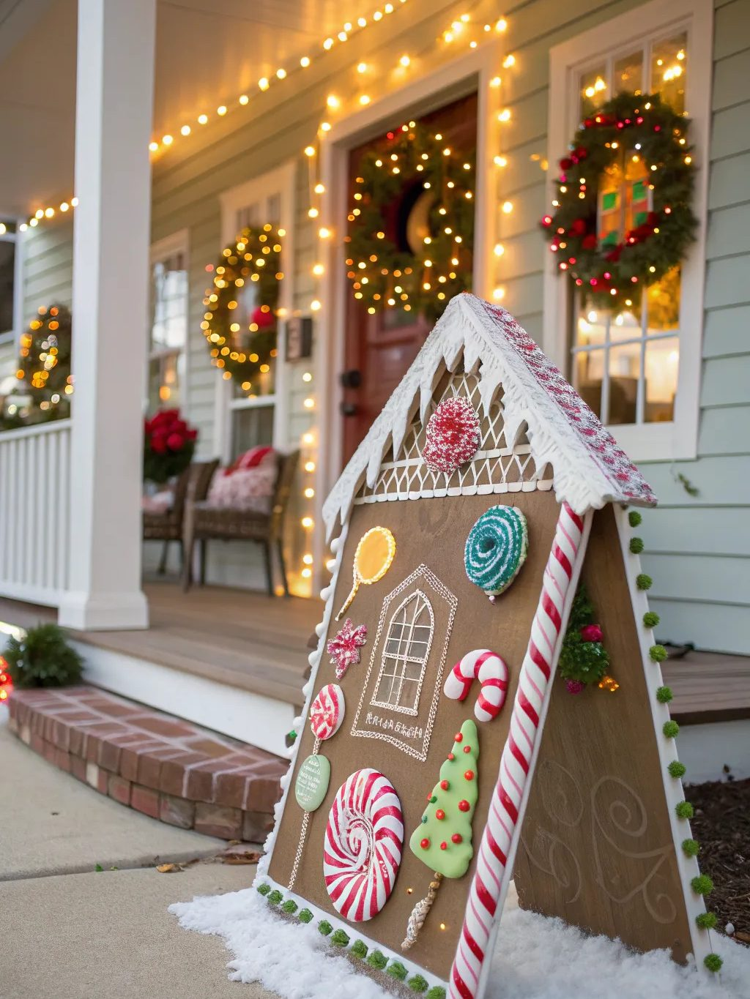

> TIP:CHECK: furniture to one side; path to the door clear; blanket and basket pull the eye to the door

## 21. A Sweet Shoppe Door Sign

A vintage-style Gingerbread Bakery sign — a gingerbread baker, a striped awning, cookies, cakes and pies — turns the door into a little shop front. It is playful and suits a door with a window or a glass panel, or the wall right beside it.

Match the sign's lettering style to the house — script for a cottage, block letters for a modern door — so it looks chosen, not borrowed.

> TIP:GUIDE: Budget: from $15 for a printed sign | Time: ten minutes to hang | Skill: beginner

## 22. A Gingerbread House Door Topper

A gingerbread house topper sitting above the door, on the lintel or the transom, crowns the entrance without covering the door at all.

Measure the lintel first — the topper should span at least two-thirds of the door width or it will look lost up there.

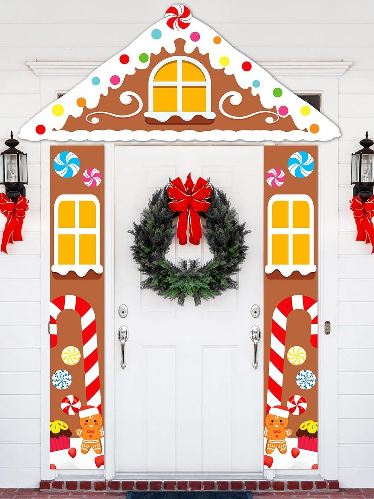

> TIP:QUICK: A door topper should span at least two-thirds of the door width or it looks lost.

## 23. Frosted Window Clings on the Door

Frosted gingerbread window clings — houses, candy canes, snowflakes — dress a glass-panel door in minutes and peel off without a trace in January.

Apply clings to clean, dry glass and smooth from the centre out so no air bubbles show, and keep the design low so it does not block the peephole.

> TIP:CHECK: glass clean and dry first; smooth from the centre out; design kept low, clear of the peephole

## 24. A Candy Cane Door Frame

Two giant candy canes crossed over the door, tied with a big red bow, make a look that reads from the end of the street.

Use removable hooks or tape so the door is not damaged, and keep the canes the same size so the cross stays balanced.

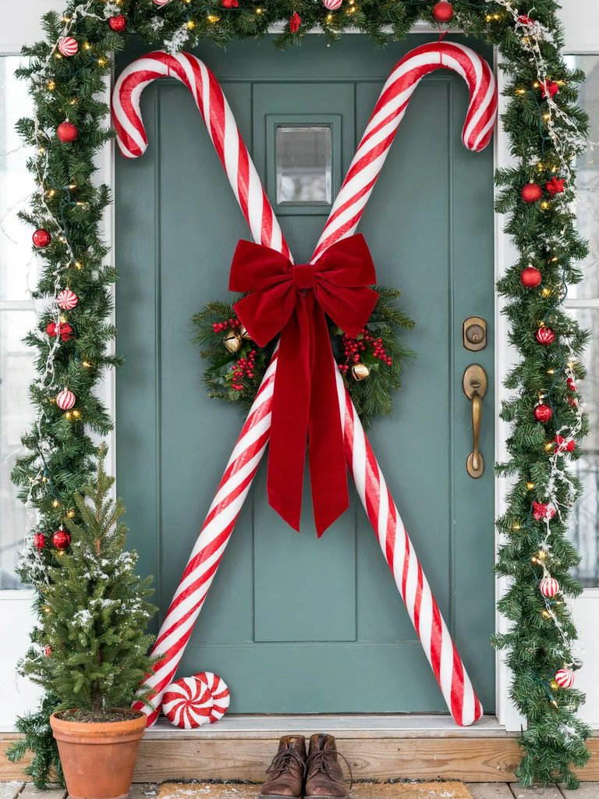

> TIP:GUIDE: Budget: under $15 for striped tape or fabric | Time: thirty minutes to wrap | Skill: beginner

## 25. A Gingerbread Man Welcome Sign

A round gingerbread face sign with Welcome written across it hangs on the door like a cheerful greeter. Kids love it and it photographs beautifully.

Hang the sign at eye level on the door so visitors see it as they reach for the bell, and pick one with a sturdy loop so it hangs straight.

> TIP:QUICK: Put the welcome sign on the handle side so visitors see it as they reach for the bell.

## 26. A Snow-Dusted Gingerbread Doormat Scene

Layer a gingerbread doormat over a larger plaid mat and flank it with two small frosted trees, so the welcome starts at the ground.

Layer the mats with the gingerbread one on top and offset slightly, so both patterns show, and keep the trees clear of the swing of the door.

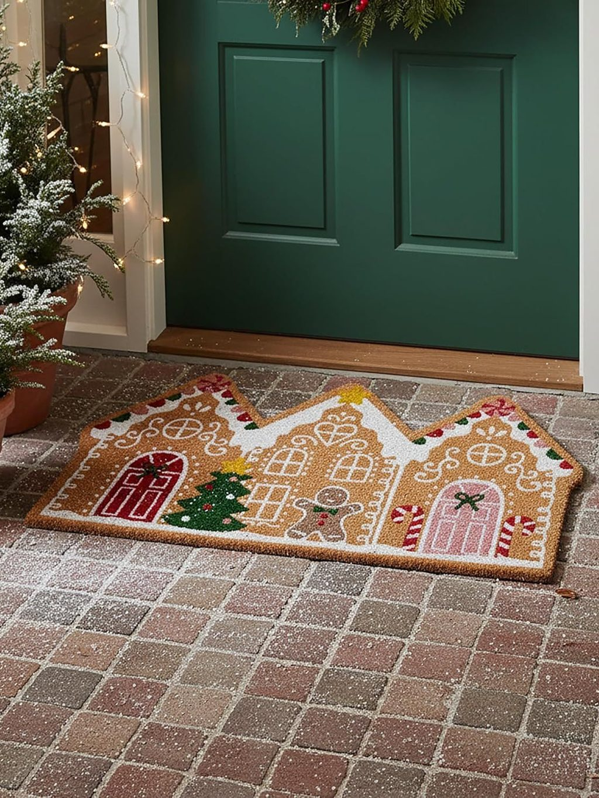

> TIP:CHECK: gingerbread mat layered on top, slightly offset; trees clear of the door swing; both mat patterns visible

## 27. A Gingerbread Garland Over the Transom

A full candy garland around the door, with a peppermint wreath in the middle, ties the door to the windows above it.

Drape the garland in a shallow swag with the lowest point in the middle, and secure the ends so it does not slip when the door slams.

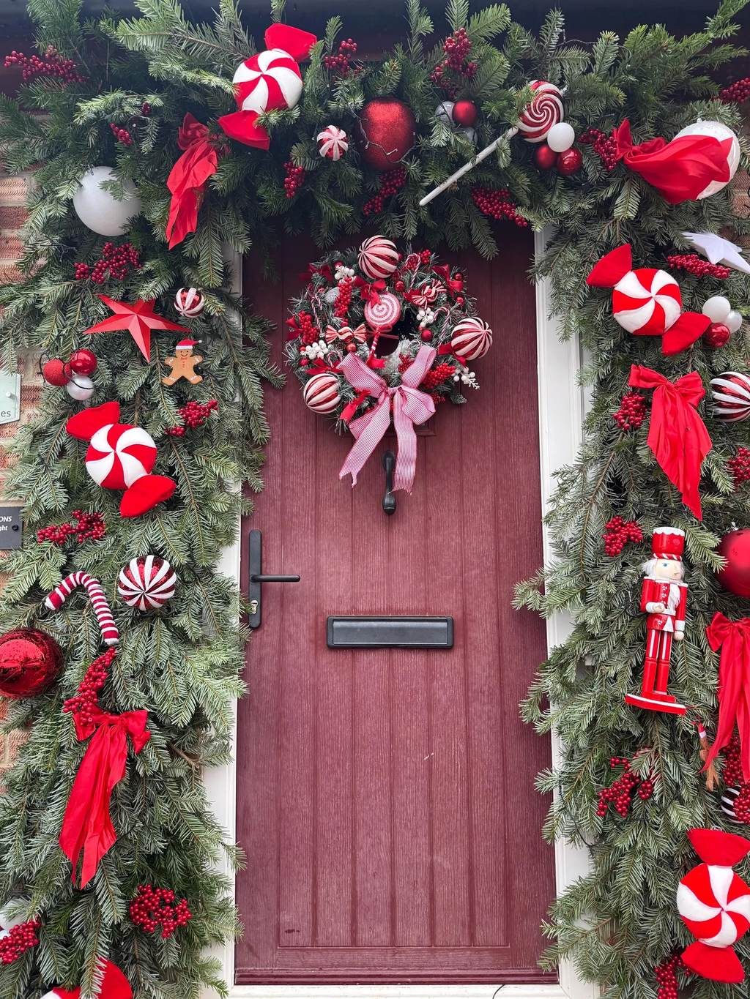

> TIP:GUIDE: Budget: from $20 for a garland | Time: fifteen minutes to hang | Skill: beginner

## 28. A Vintage Gingerbread Door Plaque

A vintage-style plaque — faded reds, cream icing, old-fashioned lettering — brings a nostalgic, storybook feel to the door.

Pair it with one simple wreath rather than a busy garland, so the vintage colours are not crowded out.

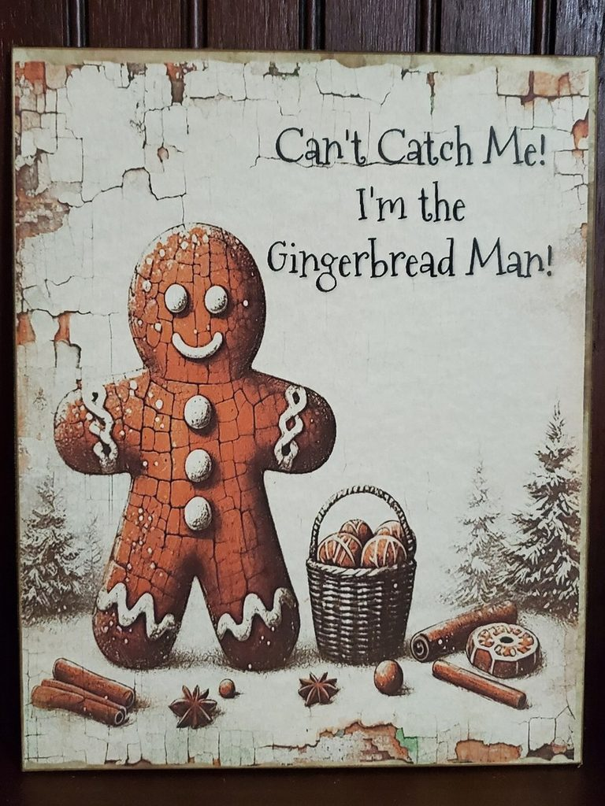

> TIP:QUICK: Pair a vintage plaque with one simple wreath, never a busy garland.

## 29. Gingerbread and Fairy Lights on the Door

Warm fairy lights woven through a gingerbread garland make the door glow after dark, when most visitors actually arrive.

Use battery lights with a timer so they switch on at dusk by themselves, and keep the wire tucked behind the garland so only the lights show.

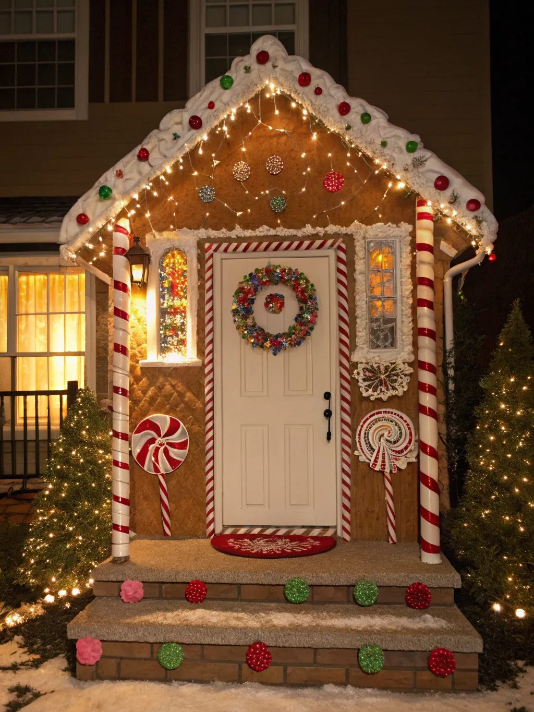

> TIP:CHECK: battery lights on a timer; wire tucked behind the garland; lights on at dusk, off by bedtime

## 30. A Gingerbread House and Candy Cane Door Duo

A gingerbread house facade with a wreath in the centre and two tall candy canes on either side of the door makes a balanced, symmetrical entrance that looks finished from every angle.

Keep the two sides mirror images — same cane height, same bow, same spacing — because symmetry is what makes this look feel deliberate.

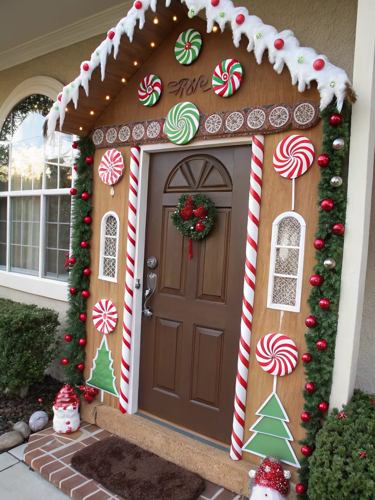

> TIP:GUIDE: Budget: from $30 for the wreath and canes | Time: twenty minutes to arrange | Skill: beginner

## Takeaway

Start with one hero piece — a peppermint wreath, a gingerbread house sign or a full facade — then add one or two small candy touches, a garland or a doormat, and stop there. The gingerbread look works because the colours are limited: brown, white, red and a little green. Keep to that palette and the door will look like a cottage, not a sweet shop explosion. If you caught the making bug, our [30 DIY Gingerbread House Door Decoration Ideas for a Sweet Welcome](/posts/gingerbread-house-door-decorations-diy/) turns every one of these looks into a project you can build yourself.

## Frequently Asked Questions

### How do I decorate my front door like a gingerbread house?

Start with a brown door or brown panels for cookie walls, add white icing trim along the frame, a peppermint wreath in the centre and candy-cane columns on either side. Keep the palette to brown, white, red and green, and use lightweight foam or felt pieces so nothing strains the door.

### What is the easiest gingerbread door decoration?

A peppermint swirl wreath is the easiest by far: one piece, one hook, and the door instantly reads as gingerbread. Add a red-and-white striped doormat underneath if you want a little more, and you are done in ten minutes with no tools at all.

### Can I decorate a glass front door with a gingerbread theme?

Yes, frosted window clings are made for glass doors — gingerbread houses, candy canes and snowflakes that stick without glue and peel off cleanly in January. Apply them to clean, dry glass, smooth from the centre out, and keep the design clear of the peephole and handle.

### How do I keep gingerbread door decorations from falling down?

Use over-door hooks rated for the wreath's weight, removable adhesive hooks for garlands, and planters filled with stones for freestanding columns. Test everything by opening and closing the door a few times before you call it finished, and re-check the hooks after the first windy night.

### What colours work for gingerbread house door decor?

Brown for the cookie walls, white for icing and snow, red for peppermint and bows, and a little green for wreaths and trees. That four-colour palette is what makes the door read as gingerbread instantly, so resist adding gold, silver or blue.

### Are gingerbread door decorations weatherproof?

Most shop-bought pieces are made for porches, but paper and felt pieces need a covered porch to survive rain. Check the label before you buy, bring paper decorations in during storms, and choose wooden, foam or resin pieces for an exposed door.

### How early should I put up gingerbread door decorations?

Early December is ideal, once the Christmas season properly starts and the door will not weather for weeks on end. If you love the look, the last week of November works too — just keep the pieces sheltered until the cold weather settles in.

### Where can I buy gingerbread house door decorations?

Craft shops, home decor stores and online marketplaces all stock gingerbread wreaths, signs and garlands from October onwards. For one-of-a-kind pieces, check local makers and craft fairs, or make your own with our [DIY gingerbread house door decorations](/posts/gingerbread-house-door-decorations-diy/) guide — it is the cheapest way to get exactly what you want.
