# 30 Home Decor Trends for 2027

Home decor trends for 2027 are warm, personal and a little bit brave. The cool grey rooms of recent years are giving way to clay tones, soft curves, rich textures and pieces that look collected over time rather than bought in one trip. The new look is comfortable first and stylish second, and it works in every room of the house.

You do not need a full renovation to join in. Most of these ideas start small: a coat of paint, a new cushion texture, a thrifted vase or a rug layered over the one you already own. Pick the two or three trends that suit your home and your budget, and let the rest inspire your next refresh.

## 1. Warm Earthy Terracotta Tones

Terracotta, clay and burnt orange are the warm heart of 2027 decorating. A terracotta wall, a rust-coloured sofa or even a set of clay pots can make a pale room feel instantly warmer and more grounded. These earthy tones pair beautifully with cream, warm wood and woven textures, so they never feel heavy.

Start with one anchor piece, like a sofa or a painted feature wall, and repeat the tone in smaller doses — cushions, a throw, a vase — so the colour travels around the room. Keep the rest of the palette soft and the terracotta will glow instead of shout.

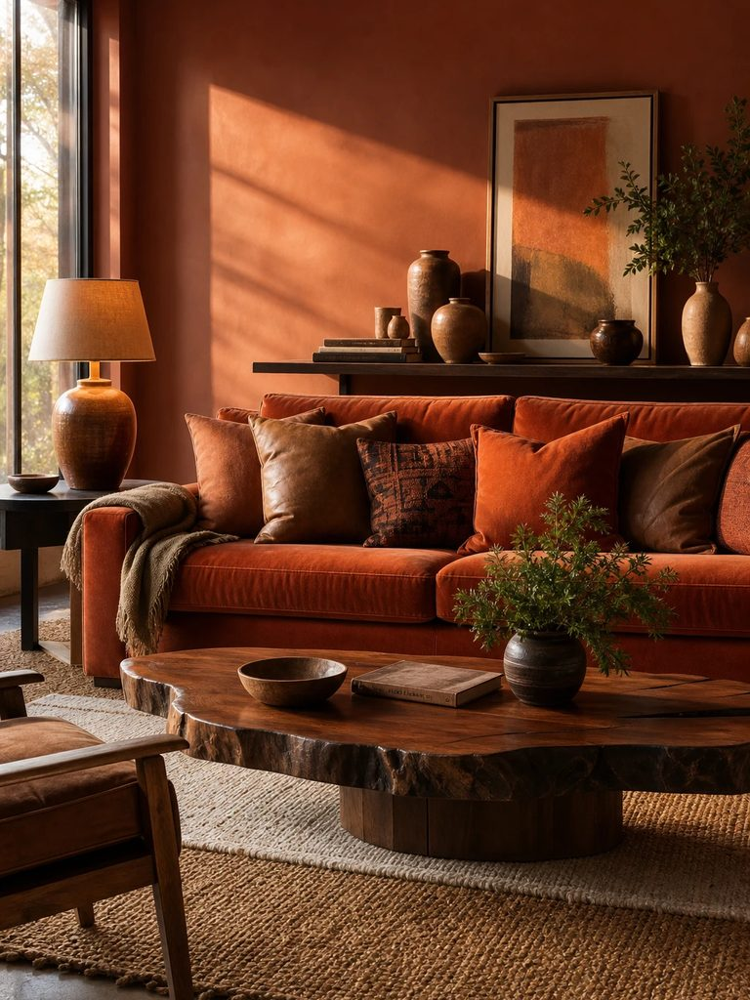

> TIP:QUICK: Pick one terracotta anchor piece, then repeat the tone in three smaller accessories.

## 2. Curved Sculptural Sofas

Straight lines are softening. Curved sofas with rounded backs and no sharp corners are shaping living rooms in 2027, and they do more than look good — they make a room feel welcoming and easier to gather in. A curved sofa naturally faces everyone toward each other, which suits conversation and family evenings.

Choose a plain, pale fabric if the shape is dramatic, so the curve stays the star. A low round coffee table echoes the shape, and a single arched floor lamp completes the gentle, sculptural mood.

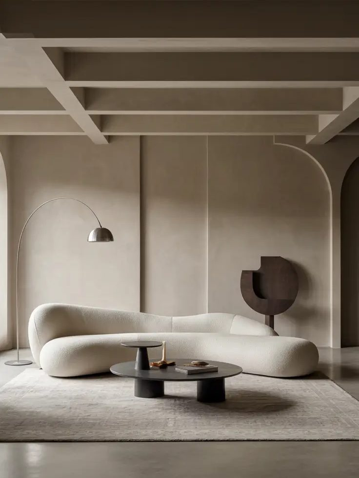

> TIP:CHECK: plain pale fabric so the curve leads; low round coffee table; one arched floor lamp

## 3. Boucle Everywhere

Boucle is moving beyond the occasional accent chair and onto sofas, ottomans, headboards and even dining chairs. The nubby, cloud-like texture adds instant softness to a room, and its creamy off-white tones keep even a large piece feeling light and calm.

Boucle shows marks more easily than a smooth fabric, so save it for lower-traffic spots or choose a washable slipcover version for family rooms. Pair it with smooth wood, leather or metal so the texture has something to contrast against.

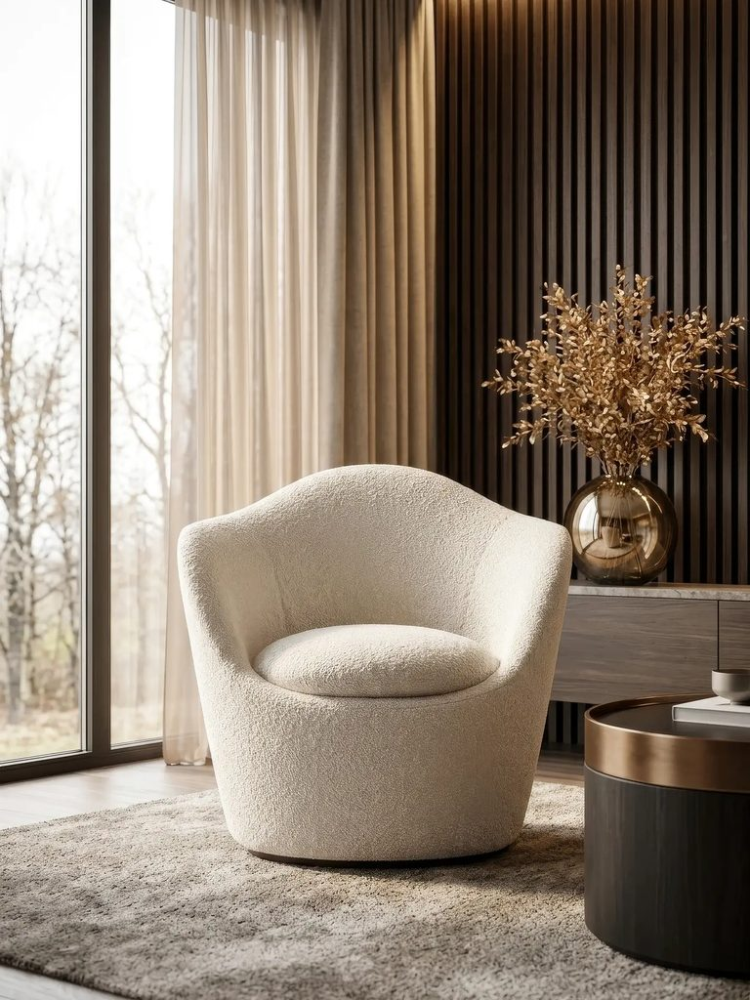

> TIP:GUIDE: Best rooms: bedrooms and quiet corners | Care: vacuum with a brush head | Pair with: smooth wood or leather

## 4. Statement Stone Tables

Marble, travertine and other natural stones are stepping forward as the hero piece of the living room. A round marble coffee table with bold veining anchors a seating area the way a rug used to, and it brings a cool, solid contrast to soft sofas and textiles.

Stone is heavy and needs a little care, so seal the surface and use coasters for drinks. If a full stone table is out of reach, a stone tray, a marble side table or a travertine vase gives you the same look in a smaller dose.

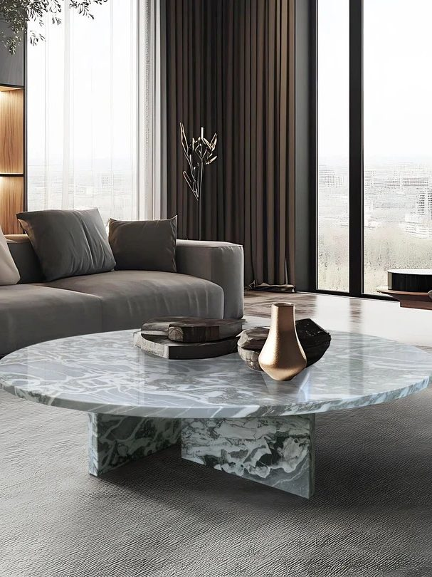

> TIP:QUICK: Seal a stone top once a year and keep coasters handy — rings are hard to remove.

## 5. Dark Moody Green Walls

Deep green walls are the cosy alternative to white in 2027. A dark green living room feels calm and cocooning in the evening, and it makes pale furniture, brass details and artwork stand out beautifully. Panelled walls in the same green add depth without any extra decoration.

Paint all four walls for a full cocoon, or just one wall if you want the drama in a smaller dose. Add warm lighting and a pale rug so the room stays bright enough during the day, and let plants echo the green.

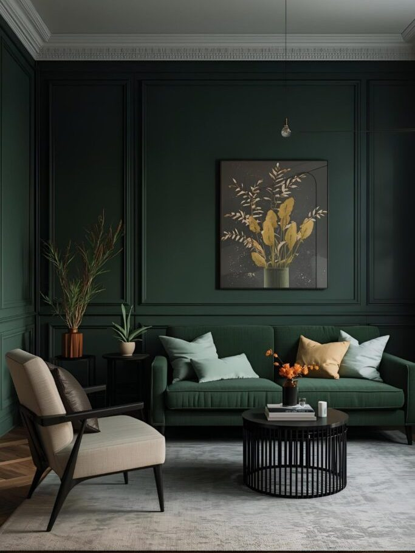

> TIP:CHECK: warm lighting to balance the dark walls; pale rug for daytime brightness; plants echo the green

## 6. Vintage Finds Mixed with Modern Pieces

The most interesting rooms in 2027 mix old and new without apology. A gilt-framed portrait hangs beside modern abstract art, an antique rug sits under a clean-lined sofa, and a worn wooden cabinet holds a brand-new lamp. The mix gives a room a story that a matching set never can.

Shop your own home first: move a vintage piece into a modern room and see what changes. Keep the mix balanced — roughly one vintage piece for every two or three modern ones — so the room feels curated rather than cluttered.

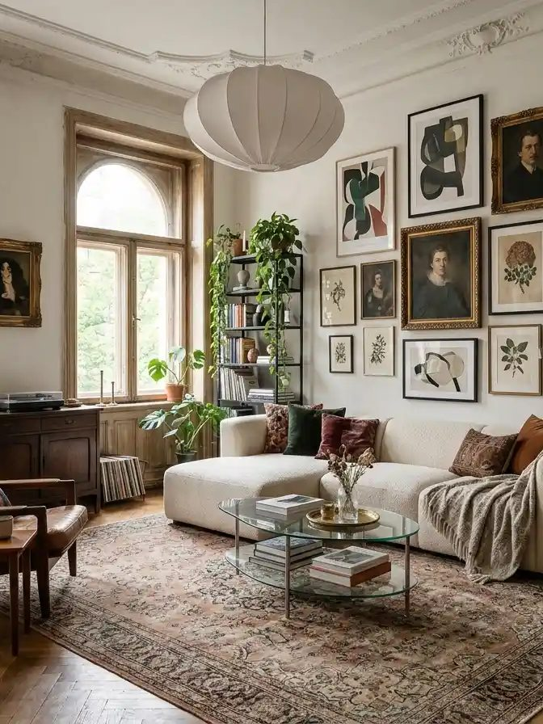

> TIP:GUIDE: Balance: one vintage piece per two or three modern ones | Start: shop your own home first | Rule: keep the rug or the art vintage, not both at once

## 7. Oversized Abstract Art

One huge piece of art is replacing the busy gallery wall in many 2027 living rooms. An oversized abstract canvas above the sofa gives the whole room a focal point, and its colours can set the palette for cushions, throws and rugs without any extra effort.

Hang the art so its centre sits at eye level when you are seated, and leave breathing room around it — no small frames crowding the edges. A single large piece works best on a plain wall with a low, simple sofa beneath it.

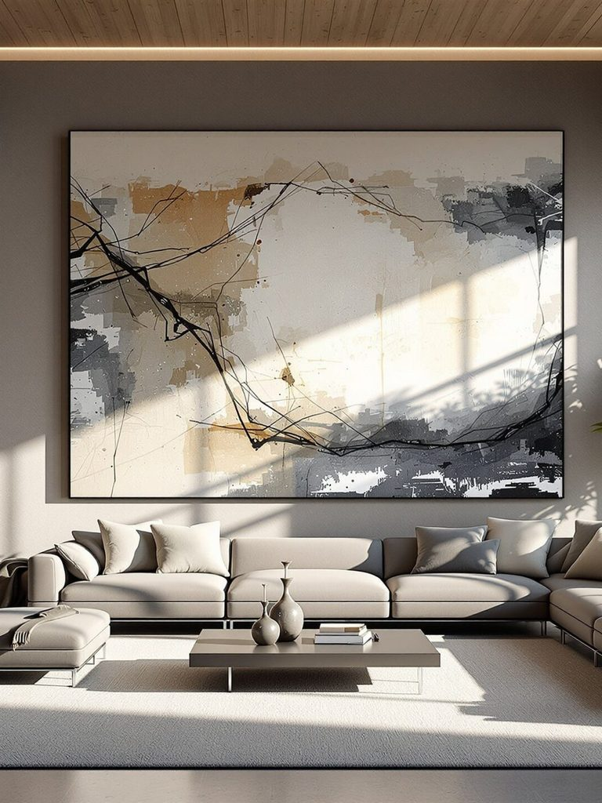

> TIP:QUICK: Centre oversized art at seated eye level and leave the wall around it empty.

## 8. Arches and Curved Doorways

Arches are softening the hard rectangles of the modern home. A curved doorway, an arched niche or even an arched mirror brings a gentle, almost Mediterranean calm to hallways and living spaces, and it makes the move from one room to the next feel like a moment rather than a gap.

You do not need to rebuild a wall to try the trend. An arched mirror, an arched bookcase or a painted arch shape above a doorway gives you the curve for very little money, and it suits both old houses and new builds.

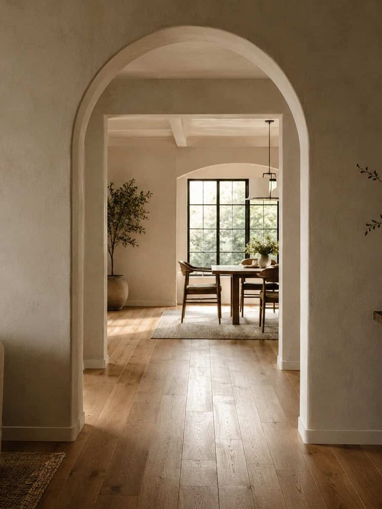

> TIP:CHECK: arched mirror for a no-build version; arched niche for display; painted arch above a plain doorway

## 9. Warm Natural Wood Kitchens

Kitchens are warming up. Pale grey cabinets are giving way to warm natural wood — oak, walnut and ash — with visible grain, open shelves and timber beams. The wood makes a kitchen feel like a lived-in room rather than a laboratory, and it pairs beautifully with cream walls and stone worktops.

Mix wood tones carefully: one dominant wood for cabinets and a lighter or darker wood for shelves or the island keeps the room calm. A white or cream worktop stops a lot of wood from feeling too dark.

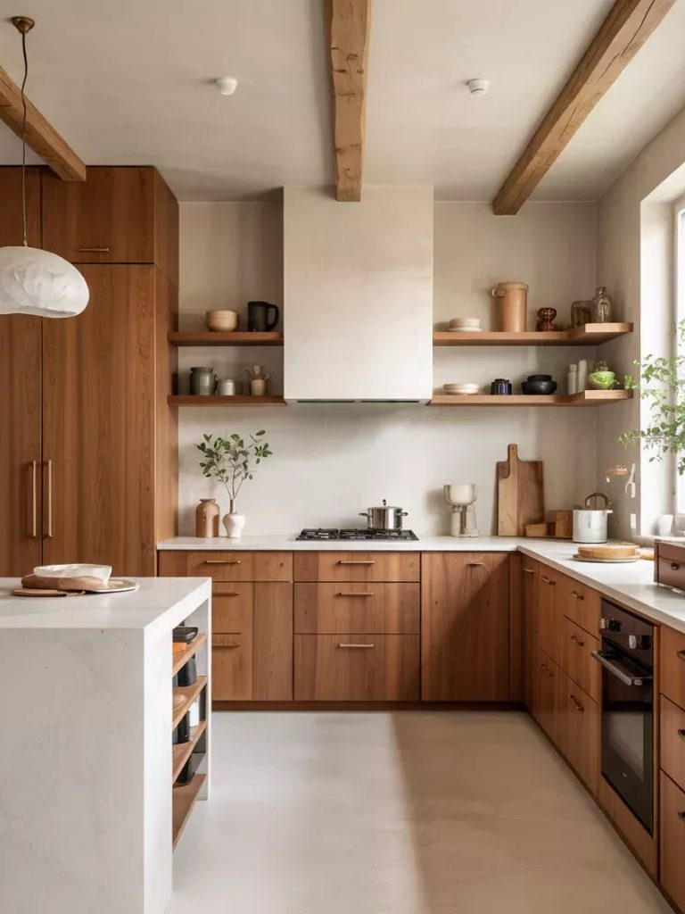

> TIP:GUIDE: Cabinets: one dominant wood tone | Contrast: cream or stone worktop | Accent: open wood shelves

## 10. Sculptural Lighting

Lamps are becoming sculptures in 2027. A curved table lamp, a folded metal pendant or a paper lantern with an unusual shape doubles as art when it is switched off and as warm, layered light when it is on. Lighting is no longer an afterthought — it is a decorating decision.

Layer three light sources in a living room: a ceiling light, a floor or table lamp, and a small accent light like a candle or a picture light. Warm bulbs, around the soft white range, keep the sculptural shapes feeling cosy rather than stark.

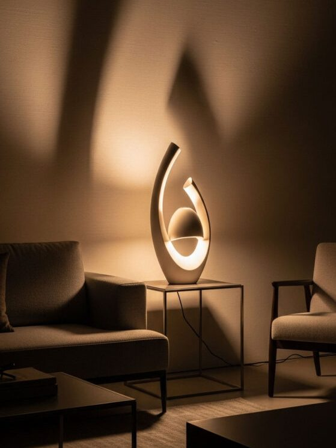

> TIP:QUICK: Layer three lights per room — ceiling, table or floor lamp, plus one small accent light.

## 11. Bold Patterned Wallpaper

Wallpaper is back with confidence. Bold floral, botanical and geometric patterns in deep colours are covering whole living rooms in 2027, often matched with patterned upholstery for a rich, layered look. The key is committing: a bold paper on one wall can look timid, while the same paper on all four feels intentional.

If a whole room feels too much, paper the wall behind the sofa and paint the rest in a colour pulled from the paper. Keep the sofa and cushions in colours from the same palette so the patterns talk to each other instead of competing.

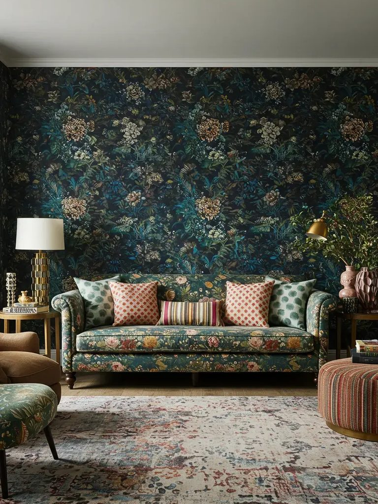

> TIP:CHECK: pull paint colours from the paper; keep cushions in the same palette; paper all four walls or just the sofa wall

## 12. Limewash and Textured Plaster Walls

Flat painted walls are giving way to texture. Limewash and soft plaster finishes give walls a cloudy, hand-finished look that changes with the light during the day, adding depth to even the plainest room. The effect is calm and earthy, and it suits the warm neutrals that run through 2027 decorating.

Limewash works best in warm beige, clay or soft grey, and it looks most natural on a large, unbroken wall. Keep the furniture simple and low so the wall itself is the decoration, and add one natural texture — jute, wood or linen — to echo it.

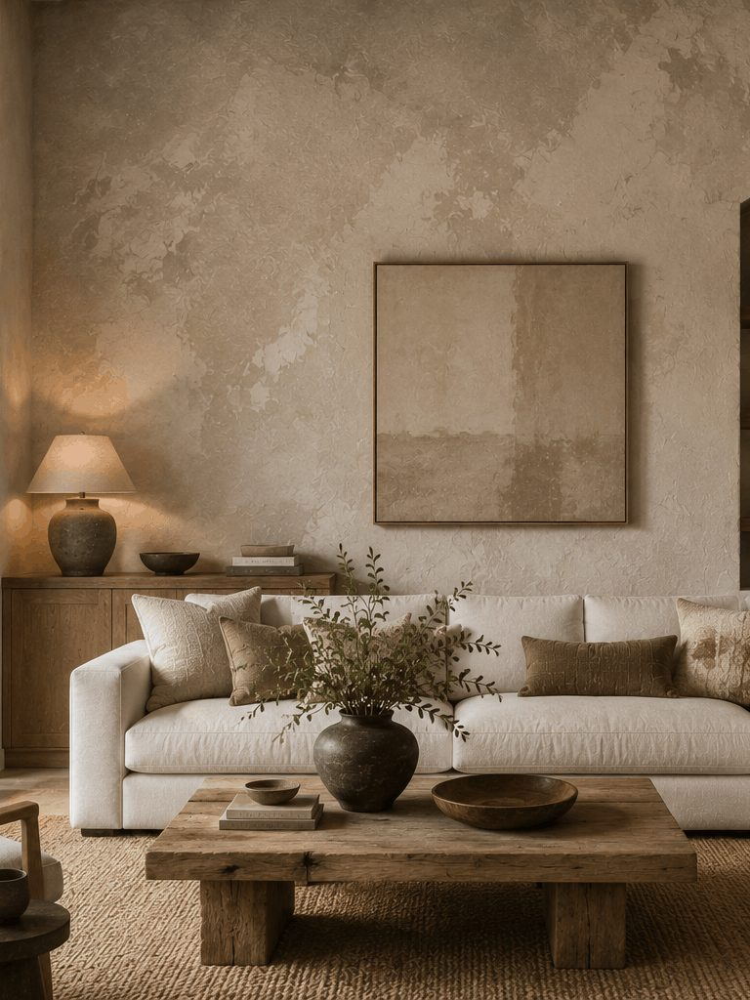

> TIP:GUIDE: Colours: warm beige, clay or soft grey | Best wall: large and unbroken | Furniture: low and simple

## 13. Indoor Plants as Decor

Plants are no longer a finishing touch — they are a decorating layer of their own. Tall leafy plants, trailing ferns and shelves of small pots bring life, colour and softness into living rooms, and they make even a simple sofa setup feel finished. A plant shelf or a large floor plant can anchor a corner that used to sit empty.

Group plants in odd numbers and mix heights: one tall floor plant, a medium one on a stool and a trailing one on a shelf. Choose plants that suit your light — a bright window corner can host almost anything, while a dark corner needs a low-light variety.

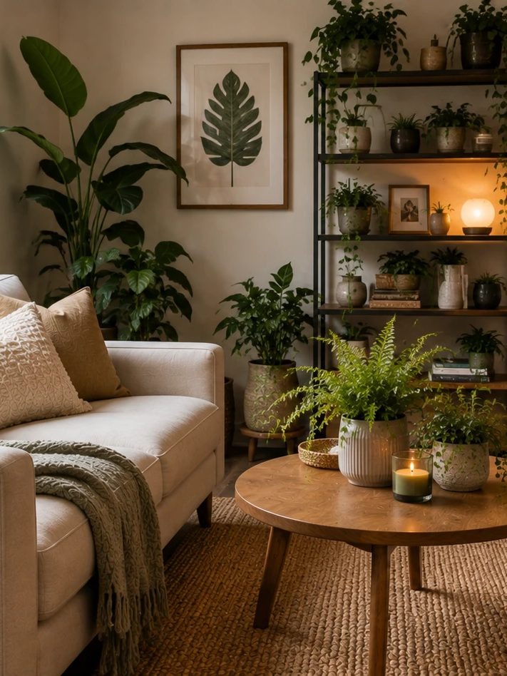

> TIP:QUICK: Group plants in threes at different heights — tall floor plant, medium on a stool, trailing on a shelf.

## 14. Mixed Metals in the Kitchen

Matching metals are out; mixing them is in. Black cabinets with brass handles, a brass tap beside black pendant lights, and copper pots on an open shelf give a kitchen a collected, layered feel. The trick is to repeat each metal at least twice so the mix looks deliberate rather than accidental.

Pick one dominant metal and one accent: brass and black is the classic 2027 pairing, with chrome or copper as a small third. Keep the metals warm — brushed or aged finishes sit more comfortably together than shiny ones.

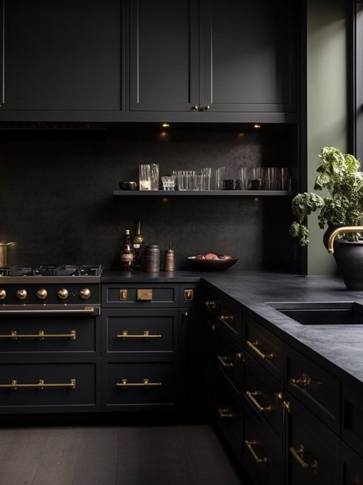

> TIP:CHECK: one dominant metal, one accent; repeat each metal at least twice; brushed or aged finishes mix best

## 15. Colour Drenching

Colour drenching paints a whole room — walls, ceiling, trim and sometimes the furniture — in one colour. The result is a calm, cocooning space where the architecture disappears and the room feels bigger and more intentional. Green, warm clay and deep blue are the most popular drenching colours for 2027.

Start in a bedroom, where the cocooning effect feels most natural, and use the same paint finish on walls and woodwork so the colour reads as one surface. Add bedding and cushions in lighter and darker tones of the same colour for depth.

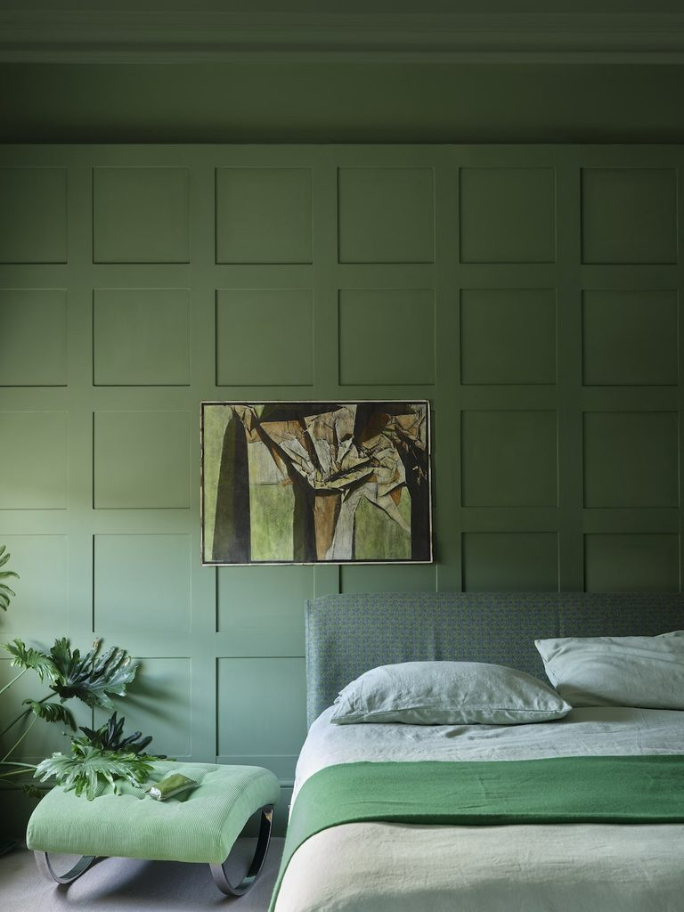

> TIP:GUIDE: Start room: a bedroom | Finish: same paint on walls and trim | Depth: lighter and darker tones of the same colour

## 16. Reclaimed Wood and Sustainable Materials

Sustainability is shaping how rooms are built in 2027. Reclaimed wood walls, a coffee table made from old beams, and furniture bought second-hand give a room character that new materials cannot match, and they keep good timber in use. Every knot, nail hole and faded patch tells a story.

Look for reclaimed pieces at salvage yards and second-hand shops, and check that old wood is clean, dry and free of pests before bringing it indoors. Pair reclaimed wood with plain linen, wool and cotton so the room feels warm and natural rather than rustic for its own sake.

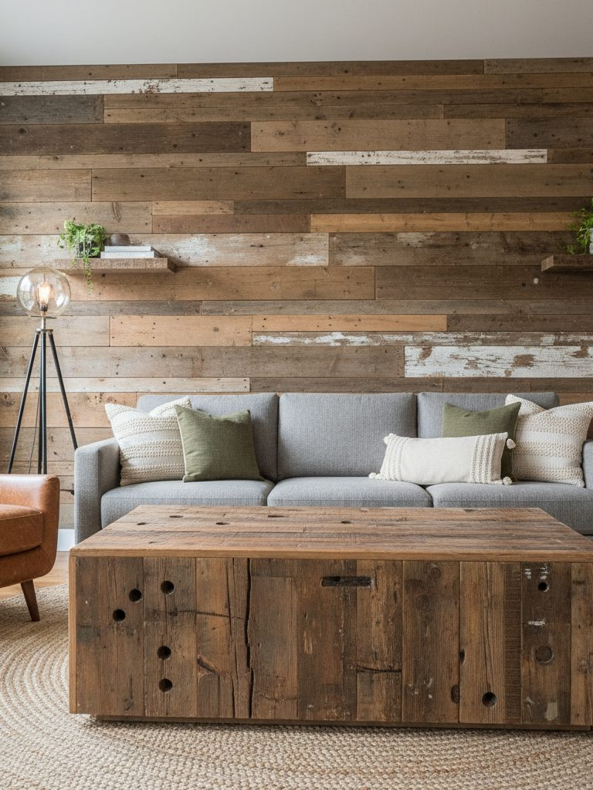

> TIP:QUICK: Check reclaimed wood is clean, dry and pest-free before bringing it inside.

## 17. Rich Velvet Upholstery

Velvet is the luxury texture of 2027, and it is at its best in deep, jewel colours — emerald green, navy, rust and plum. A velvet sofa catches the light differently from every angle, so the colour shifts through the day, and the soft pile makes a large sofa feel inviting rather than imposing.

Velvet suits a room with some light, since the pile needs light to show its depth. Keep the rest of the room fairly simple — plain walls, a quiet rug — so the velvet is the star, and add one or two contrasting cushions in silk or linen.

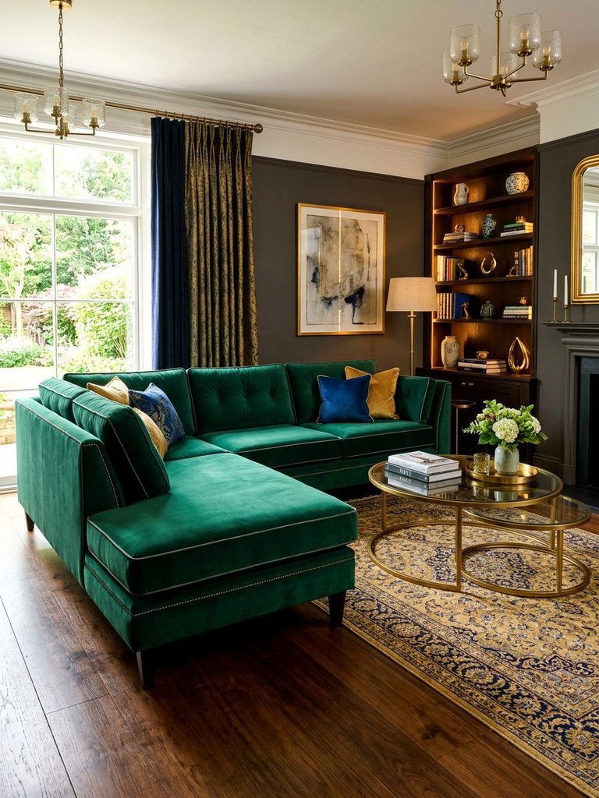

> TIP:CHECK: deep jewel colours show velvet best; plain walls and a quiet rug; one or two silk or linen cushions

## 18. Rattan and Cane Furniture

Rattan and cane are bringing a light, airy feel to 2027 living rooms. A cane-sided sofa, a rattan coffee table or a woven chair adds texture without weight, and the natural honey tone warms up pale rooms beautifully. It is the easiest way to add a relaxed, almost holiday feeling to an everyday room.

Cane furniture suits rooms with plenty of daylight and pale floors. Mix it with soft linen cushions and a jute rug for a natural look, and keep it out of damp spots, since rattan does not like constant moisture.

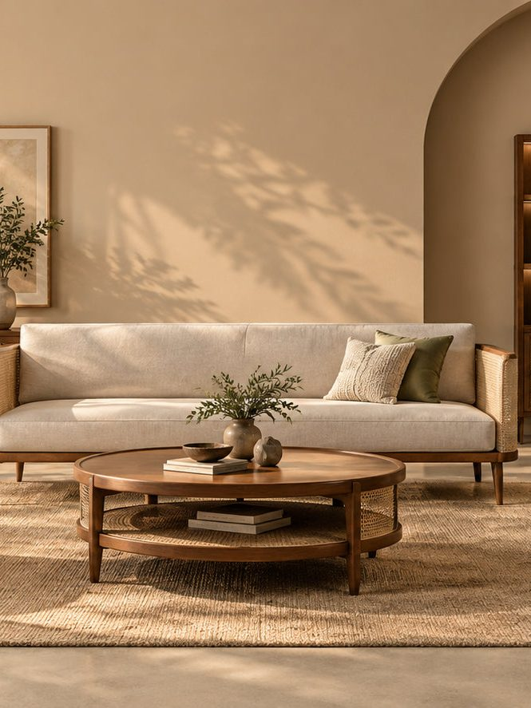

> TIP:GUIDE: Best light: bright daylight rooms | Pair with: linen cushions and a jute rug | Avoid: damp spots

## 19. Gallery Walls That Tell a Story

Gallery walls are becoming more personal in 2027. Instead of matching prints bought as a set, the new gallery wall mixes landscapes, family photos, botanical prints and small paintings collected over time, in frames of different sizes and finishes. A hallway is the perfect place, since you pass it every day.

Plan the layout on the floor first, leaving even gaps of a few inches between frames. Start with the largest frame slightly off-centre, then build around it, and hang the centre of the whole arrangement at eye level so it feels natural to look at.

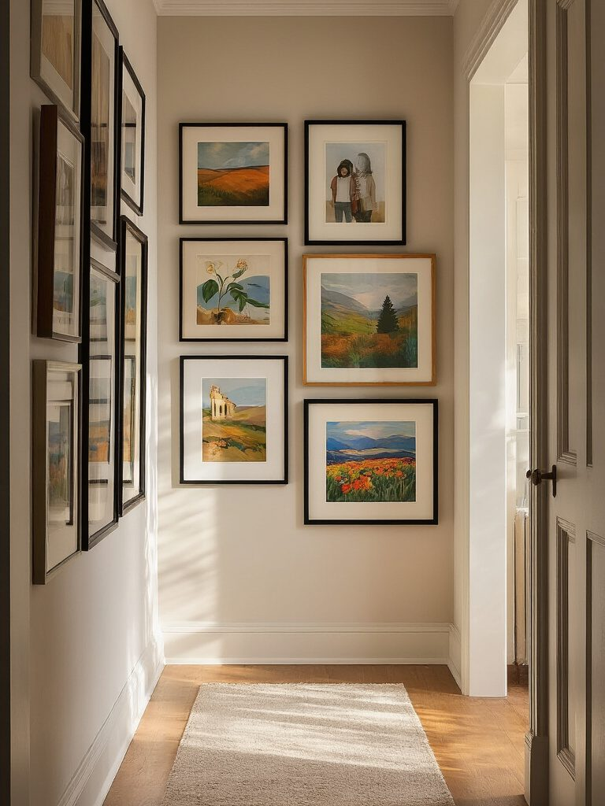

> TIP:QUICK: Lay frames on the floor first and keep even gaps of a few inches between them.

## 20. Checkerboard Tile Floors

Checkerboard floors are back, and they are bolder than before. Black and white tiles in a kitchen or hallway give a room instant graphic energy, and the classic pattern suits everything from a country kitchen to a city flat. The tiles also hide crumbs and marks far better than a plain floor.

Large tiles make the pattern feel modern, while small tiles feel more traditional, so choose the scale to match your home. A wood island or warm wood furniture softens the graphic floor, and pale walls keep the room bright.

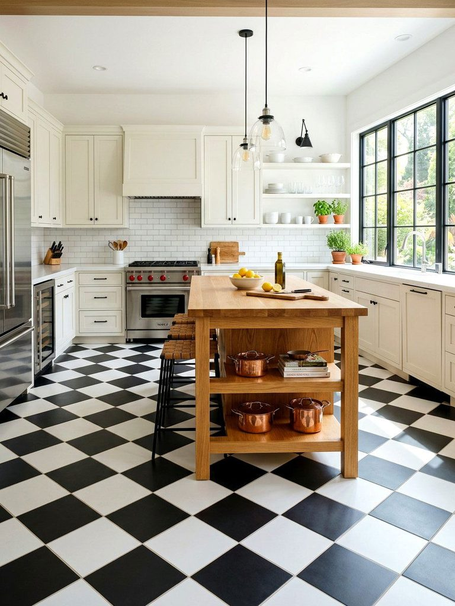

> TIP:CHECK: large tiles feel modern, small tiles feel traditional; warm wood softens the pattern; pale walls keep it bright

## 21. Cosy Reading Nooks

A dedicated reading nook is one of the simplest pleasures of 2027 decorating. A comfortable armchair by a window, a soft throw, a small side table for a cup of tea and a shelf of books within reach turn an unused corner into the most-loved spot in the house.

Light is everything: place the chair where daylight falls in the morning or afternoon, and add a reading lamp with a warm bulb for evenings. A basket beside the chair holds the current book and a spare blanket, so the nook is always ready.

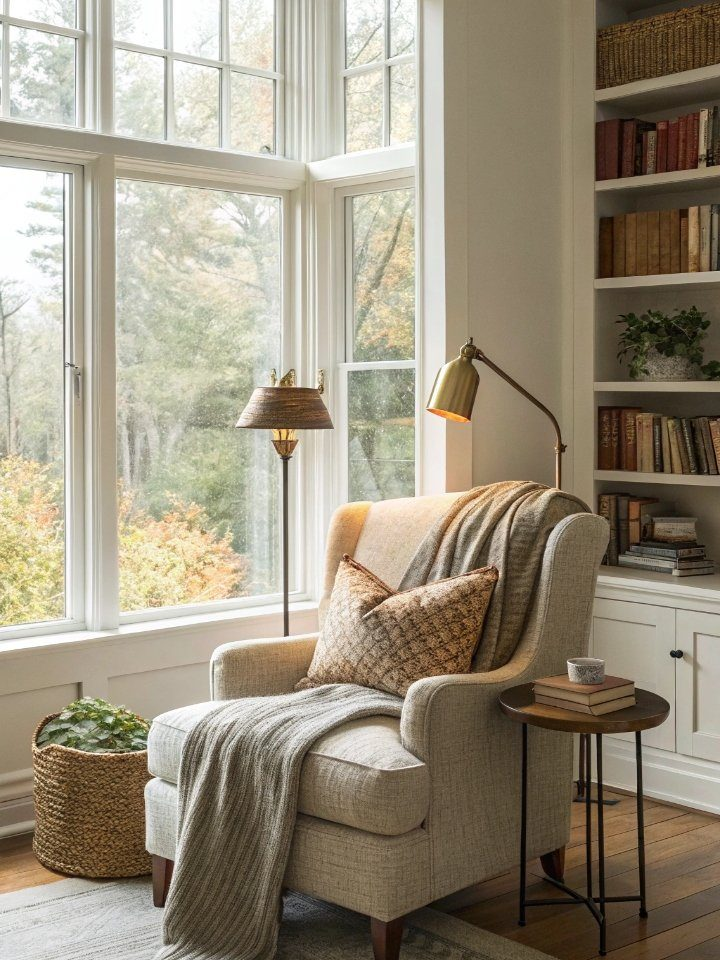

> TIP:GUIDE: Chair: by a window with good daylight | Light: warm reading lamp for evenings | Basket: book and spare blanket within reach

## 22. Statement Upholstered Headboards

Bedrooms are getting taller. Statement headboards that reach almost to the ceiling — tufted, panelled or softly curved — turn the bed into the clear focal point of the room and make even a plain bedroom feel like a hotel suite. A tall headboard also makes a low ceiling feel less noticeable.

Choose a fabric that suits the room: linen or boucle for a calm look, velvet for drama. Keep the bedding simple so the headboard leads, and add matching bedside lamps to frame the bed symmetrically.

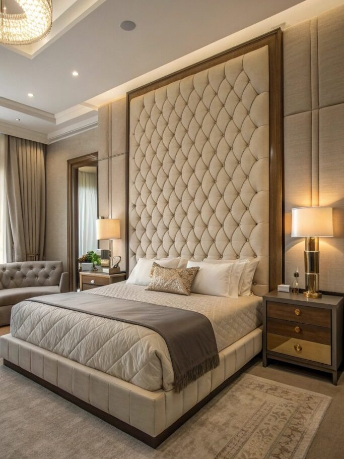

> TIP:QUICK: Keep bedding simple and add matching bedside lamps so the tall headboard leads the room.

## 23. Open Shelving in the Kitchen

Open shelves are replacing some upper cabinets in 2027 kitchens, and they change how a kitchen feels. Rows of white bowls, glass jars and potted herbs make the kitchen look lived-in and welcoming, and they put everyday things within easy reach instead of behind a door.

Style shelves in small groups: stack bowls, line up jars, and leave some breathing room between groups so the shelves read as display rather than storage. Keep the prettiest everyday items on show and the mismatched ones in a closed cupboard below.

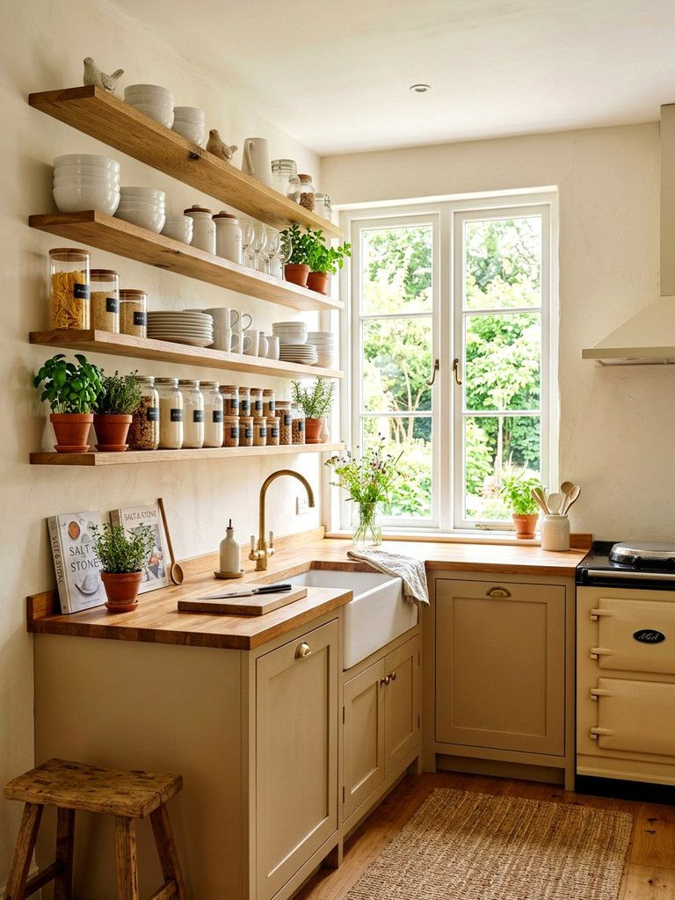

> TIP:CHECK: group items in small clusters; leave breathing room between groups; prettiest items on show, mismatched ones below

## 24. Earthy Green Kitchen Cabinets

Green cabinets are the defining kitchen colour of 2027. Earthy shades — sage, olive and moss — feel calm and natural, and they pair beautifully with warm wood worktops, brass knobs and cream walls. Unlike a bright colour, an earthy green is easy to live with for years.

Paint the lower cabinets green and keep the uppers cream or wood for a lighter feel, or drench the whole kitchen in green for a bold, cocooning look. A wood worktop and brass hardware stop the green from feeling cold.

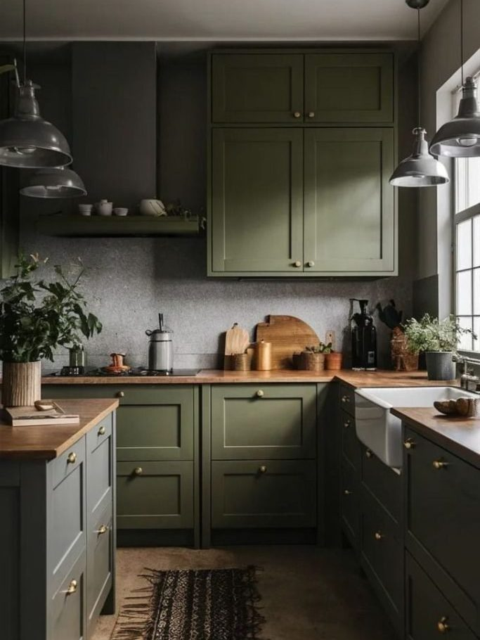

> TIP:GUIDE: Light option: green lowers, cream or wood uppers | Bold option: drench the whole kitchen | Hardware: brass knobs

## 25. Maximalist Pattern Mixing

Maximalism is the confident opposite of minimalism, and 2027 is its moment. Floral wallpaper, patterned sofas, striped cushions and a busy rug all share one room — and it works when the patterns share a colour palette. The room feels joyful, layered and deeply personal, like a home that has grown over time.

Pick three colours and let every pattern use at least one of them. Mix pattern scales — one large floral, one medium stripe, one small print — so the eye has somewhere to rest, and repeat the largest pattern in at least two places.

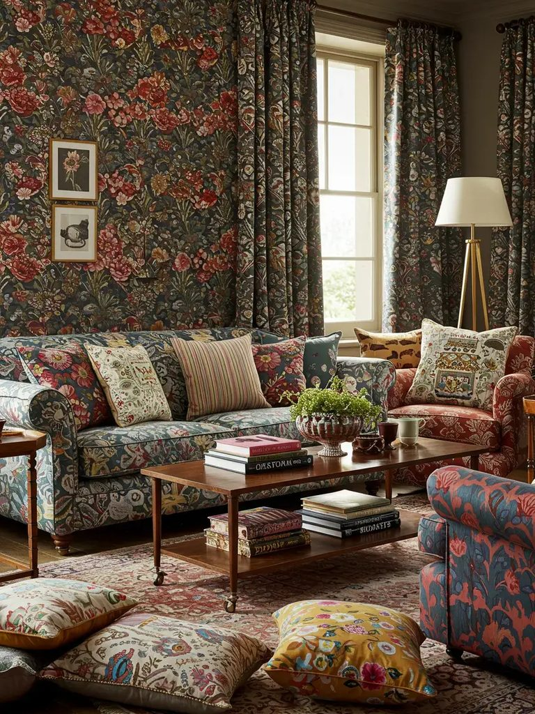

> TIP:QUICK: Pick three colours, mix one large, one medium and one small pattern, and repeat the largest twice.

## 26. Warm Japandi Minimalism

Japandi — the blend of Japanese calm and Scandinavian warmth — is softening in 2027. The look is still uncluttered, but the palette is warmer, the wood is richer and the textures are softer: a low sofa, a chunky wood coffee table, a woven rug and one quiet piece of art. Nothing shouts, and everything has a place.

Keep surfaces mostly clear and choose fewer, better pieces. A single branch in a vase, a handmade bowl and a folded throw are enough decoration, and the empty space around them is part of the design.

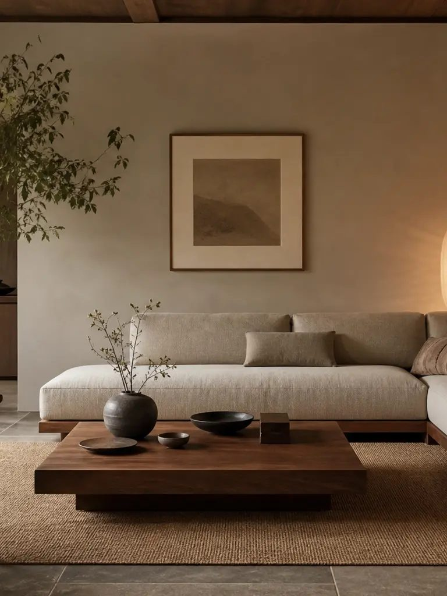

> TIP:CHECK: fewer, better pieces; warm wood and soft textures; one branch in a vase is enough decoration

## 27. Built-In Storage That Disappears

Clutter is the enemy of a calm home, and 2027 storage is designed to vanish. Built-in cabinets with flat, handle-free fronts hide toys, books and media, while open shelves between the closed sections display only the prettiest things. The wall looks like architecture, not furniture.

Plan built-ins around what you actually own: measure the tallest books and the widest boxes first, then design the shelves to fit them. Paint the cabinets the same colour as the wall so they blend in, and use the open sections for plants and books.

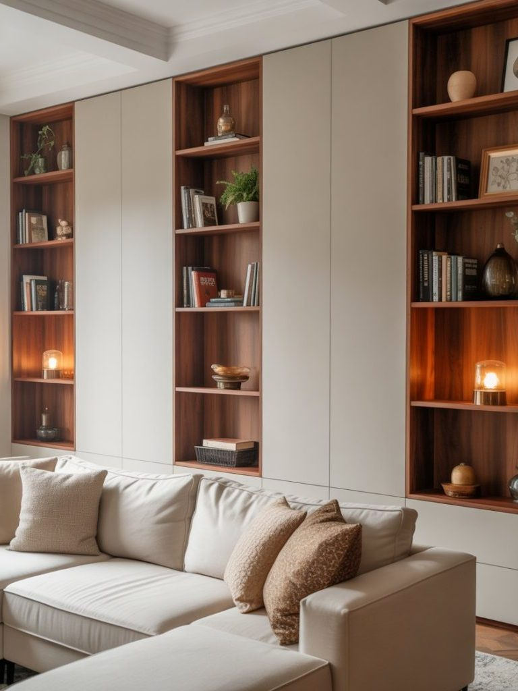

> TIP:GUIDE: Plan: measure tallest books first | Colour: same as the wall so it blends in | Display: open sections for plants and books

## 28. Layered Textured Rugs

One rug is no longer enough. Layering a patterned rug over a larger jute base, or a soft shaggy rug over a flat weave, adds warmth, texture and a sense of depth that a single rug cannot match. The layers also make a hard floor feel softer underfoot and a large room feel more intimate.

Start with a large, plain base rug in jute or wool, then add a smaller patterned or fluffy rug on top, slightly off-centre. Keep the top rug at least a foot smaller on every side so the base layer frames it like a border.

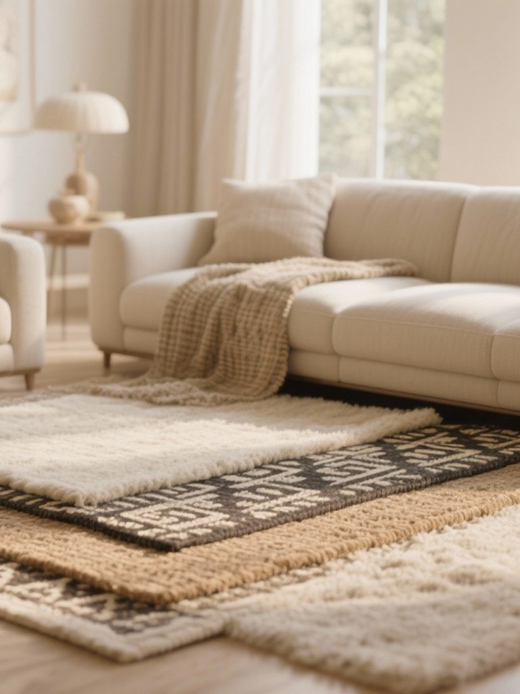

> TIP:QUICK: Start with a large plain jute base, then add a smaller patterned rug on top, off-centre.

## 29. Brass and Gold Accents

Brass and gold are warming up living rooms in 2027. A brass lamp, a gold-framed mirror, a gilt coffee table or a crystal chandelier with brass details adds a touch of glamour without making a room feel formal. The warm metal glows against cream walls and pale sofas, especially in the evening.

Use brass as an accent, not a theme: two or three pieces per room is enough. Mix brushed brass with glass, marble or dark wood so the gold feels collected rather than matched, and keep the rest of the room soft and neutral.

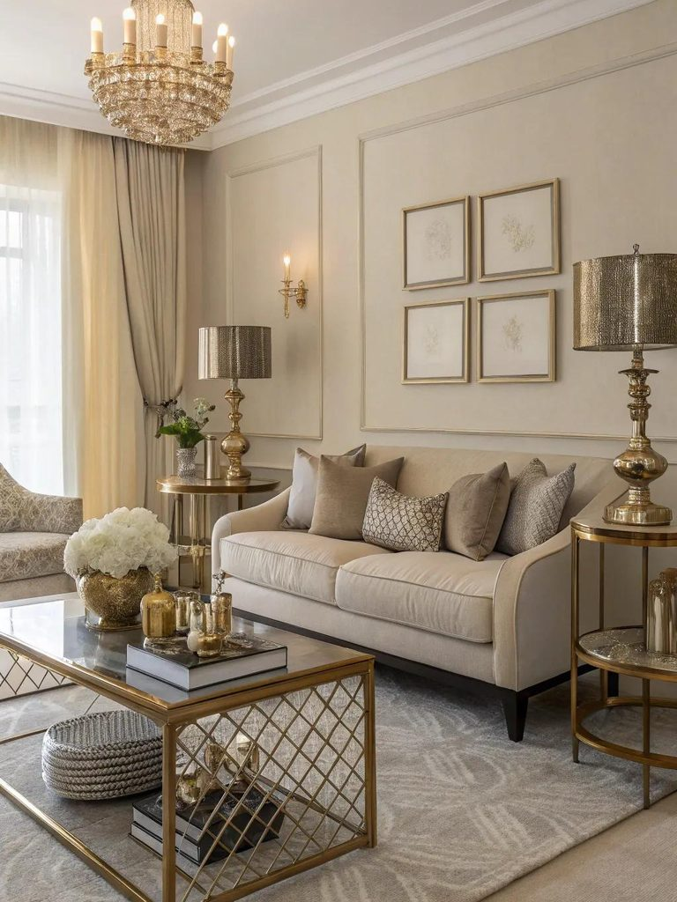

> TIP:CHECK: two or three brass pieces per room; mix with glass, marble or dark wood; keep the rest soft and neutral

## 30. Collected, Personal Shelves

The final trend of 2027 is the most personal: shelves filled with things that mean something. Teacups from travels, plates handed down through the family, framed photos, small sculptures and found objects — displayed together, they turn a shelf into a portrait of the people who live there.

Group objects by colour or material rather than by type, and vary the heights so the eye moves along the shelf. Leave a little empty space between groups, and rotate pieces seasonally so the shelf stays fresh without ever needing a full redesign.

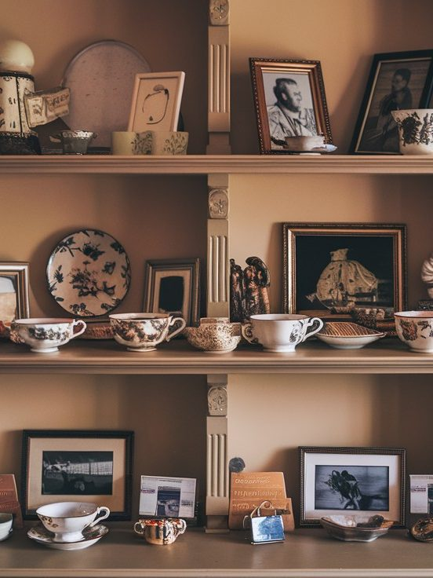

> TIP:GUIDE: Group by: colour or material, not type | Heights: vary them so the eye moves | Refresh: rotate pieces seasonally

## Takeaway

- Home decor trends for 2027 share one idea: a home should feel warm, personal and lived-in.
- Start with the trend that excites you most — a terracotta wall, a curved sofa, a shelf of collected treasures — and add one more when the first feels settled.
- If you want more ideas in the same spirit, our [30 Home Decor Ideas for 2027](/posts/2027-home-decor-ideas/) gathers room-by-room inspiration, and [30 Interior Design Trends for 2027](/posts/2027-interior-design-trends/) takes the wider view, from layouts to materials. Save the ideas you love and build your 2027 home one thoughtful change at a time.

## Frequently Asked Questions

### What are the biggest home decor trends for 2027?

The biggest home decor trends for 2027 are warm earthy colours like terracotta and olive green, curved and sculptural furniture, rich textures such as boucle and velvet, bold wallpaper, natural wood and stone, and deeply personal touches like collected objects and gallery walls that tell a story.

### How can I update my home for 2027 on a small budget?

Start with the cheapest changes first: paint one wall, swap cushion covers for boucle or velvet, layer a rug over the one you own, and move a vintage piece into a modern room. Thrifted vases, plants and a new lamp can refresh a whole room for very little money.

### What colours are trending in home decor for 2027?

Warm earth tones lead the way: terracotta, clay, olive and moss green, warm cream and honey wood tones. Deep moody greens and rich jewel colours like emerald and plum add drama, while soft beige and warm white keep rooms calm and bright.

### Are grey interiors out of style in 2027?

Cool grey is fading as the default, but grey has not disappeared. Warm greys mixed with wood, brass and earthy colours still work well. The shift is away from all-grey rooms toward warmer palettes, so add wood, cream and terracotta to soften any grey you keep.

### How do I mix patterns without making a room look messy?

Choose three colours and let every pattern use at least one of them. Mix pattern scales — one large floral, one medium stripe and one small print — and repeat the largest pattern in at least two places. Plain cushions and a quiet rug give the eye somewhere to rest.

### What is colour drenching and does it work in small rooms?

Colour drenching paints the walls, ceiling and trim in one colour, which makes a room feel calm and surprisingly larger because the edges disappear. It works well in small bedrooms, especially in soft green or warm clay, with lighter and darker tones of the same colour for depth.

### How do I make my home feel personal instead of like a showroom?

Display things with a story: travel finds, family pieces, framed photos and handmade objects. Mix old and new, group objects by colour rather than by type, and leave some shelves half-empty so the room feels lived-in. A home that shows its owners always feels warmer.

### Which 2027 trends are easiest to try first?

The easiest trends are plants, layered rugs, a new cushion texture like boucle or velvet, a sculptural lamp and a gallery wall of frames you already own. Each one takes an afternoon at most, costs little, and can be moved or changed if you decide the look is not for you.
