# 30 Home Library Lighting Ideas for a Warm, Glowing Nook

A home library lives or dies by its light. The right home library lighting ideas turn a wall of books into a warm, glowing nook you actually want to sit in — a brass lamp pooling light over an open book, LED strips making the shelves glow, a window seat catching the afternoon sun. Good lighting is what makes a library feel like a retreat instead of a storage room.

The trick is layering: one light for the room, one light for the shelves, and one light for the page. This list gathers 30 ways to do exactly that, from sconces and pendants to fairy lights in glass jars, so you can mix a few ideas and build a library that glows morning, noon and night.

## 1. Tall Floor Lamp Beside a Reading Chair

A tall floor lamp standing beside a reading chair turns any corner into a proper reading spot. The lamp's light falls over your shoulder onto the book, while the chair, a soft throw and the shelves behind it make the corner feel like a room of its own.

Look for a floor lamp with a shade that diffuses the light gently rather than throwing a hard spotlight. Place it just behind and beside the chair, close enough to read by but far enough that the shade never crowds your head.

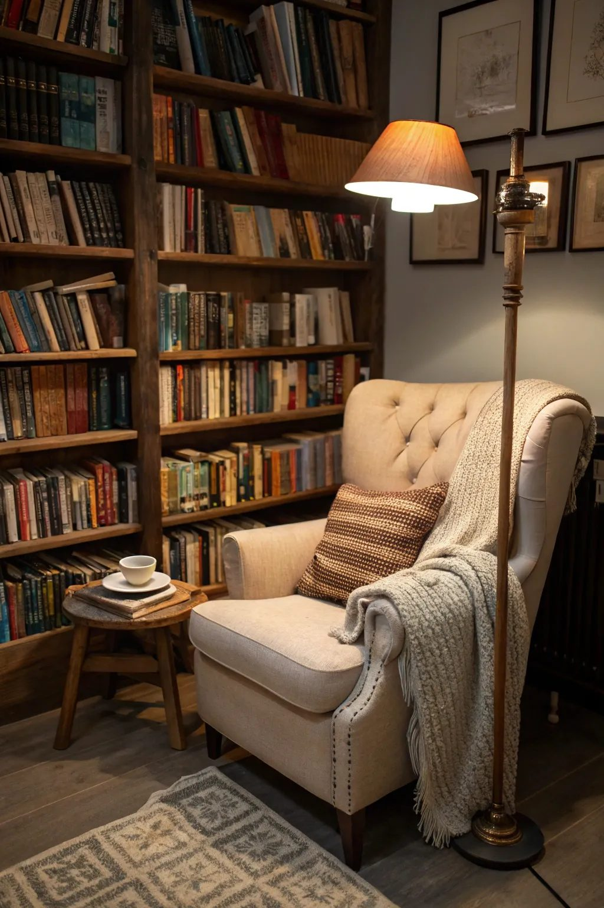

> TIP:QUICK: lamp just behind and beside the chair; shade diffuses the light; throw and cushion within reach

## 2. Brass Desk Lamp Beside an Open Book

A warm brass desk lamp is the simplest way to make a home library feel lived in. Set on a desk or a side table beside an open book, its dome shade throws a pool of golden light exactly where you read, while the rest of the room stays soft and dim around it.

Choose a lamp with a warm-toned bulb and a shade that directs light downward, so the glow lands on the page instead of in your eyes. Brass suits dark wood shelves beautifully, and the lamp becomes a small piece of decor even when it is switched off.

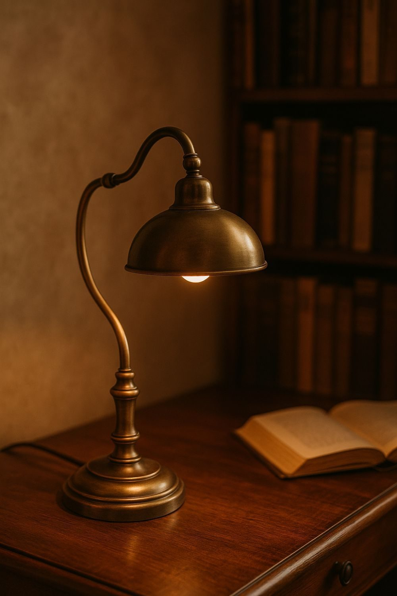

> TIP:CHECK: Pick a warm-toned bulb and a shade that points the light down onto the page.

## 3. Brass Wall Sconce Between the Shelves

A brass wall sconce mounted between dark bookshelves adds a warm glow at eye level, right where the books are. The light washes across the spines, picks out the gilt lettering and makes the whole wall feel richer, especially in the evening.

Pair sconces in twos for balance, one on each side of a central shelf or a piece of art. A cream fabric shade softens the light, and a dimmer lets you turn the glow down once the reading is done.

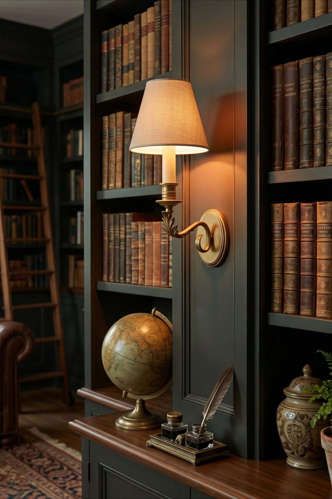

> TIP:GUIDE: Pairing: two sconces for balance | Shade: cream fabric to soften the light | Control: a dimmer for evenings

## 4. LED Strip Lights Along the Shelves

LED strip lights tucked along the front edge of each shelf give a home library a gentle, even glow. The books catch the light from above, the shelf edges disappear into shadow, and the whole bookcase looks as if it is lit from within.

Warm white strips suit a library far better than cool white, which can make wood look grey. Hide the strip behind a small lip or trim so you see the glow on the books, not the strip itself.

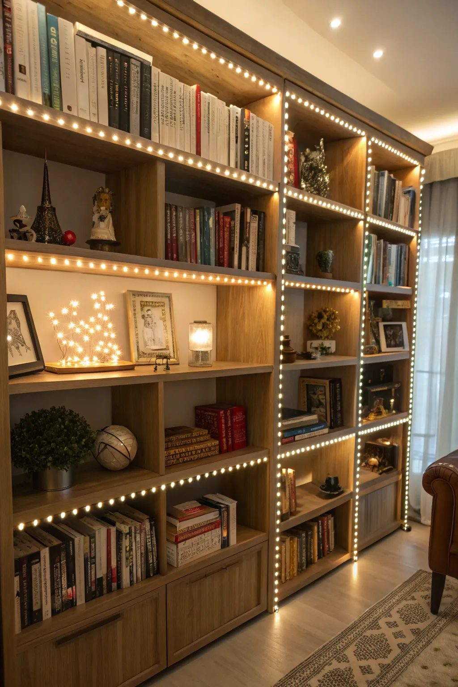

> TIP:QUICK: Hide the strip behind a small lip so you see the glow on the books, not the strip.

## 5. Picture Lights Over the Shelves

Picture lights mounted above the shelves borrow a gallery trick for the library. A slim brass bar throws light down across the spines and the art above them, so the top of the bookcase stops being a dark gap and becomes part of the room.

Keep the light warm and modest in brightness, and aim it so it washes the shelf front evenly. One picture light per wide shelf section is usually enough, and the brass finish doubles as jewellery for the room.

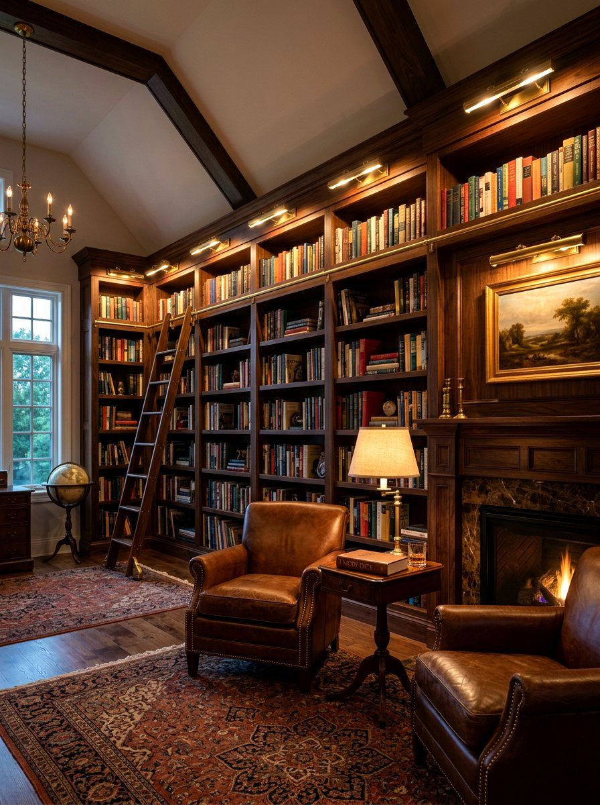

> TIP:CHECK: warm and modest brightness; light washes the shelf front evenly; one per wide shelf section

## 6. Pleated Linen Pendant Over the Desk

A pleated linen pendant hanging over the library desk gives the room a soft centre of light. The fabric shade glows from within, the pleats cast gentle shadows, and the desk below gets a calm, even light for reading and writing.

Hang the pendant low enough that the shade sits in view when you are seated, but high enough that it never blocks your sightline across the room. Linen suits a traditional library, and the warm bulb keeps the glow golden rather than stark.

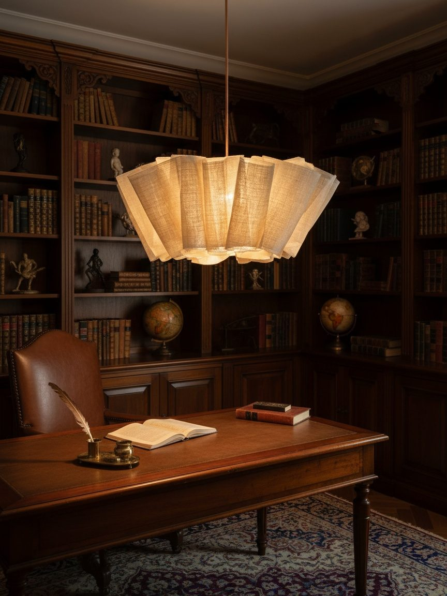

> TIP:GUIDE: Height: shade in view when seated, never blocking sightlines | Shade: pleated linen | Bulb: warm, never stark white

## 7. Crystal Chandelier in a Paneled Library

A crystal chandelier in a wood-paneled library is the most elegant light on this list. Its prisms catch the warm bulbs and scatter tiny points of light across the shelves, while the chandelier itself becomes the room's centrepiece.

Keep the chandelier modest in size so it suits the room rather than overwhelming it, and choose warm bulbs so the sparkle stays golden. It works best over an open area of floor, where the light can fall freely onto the shelves around it.

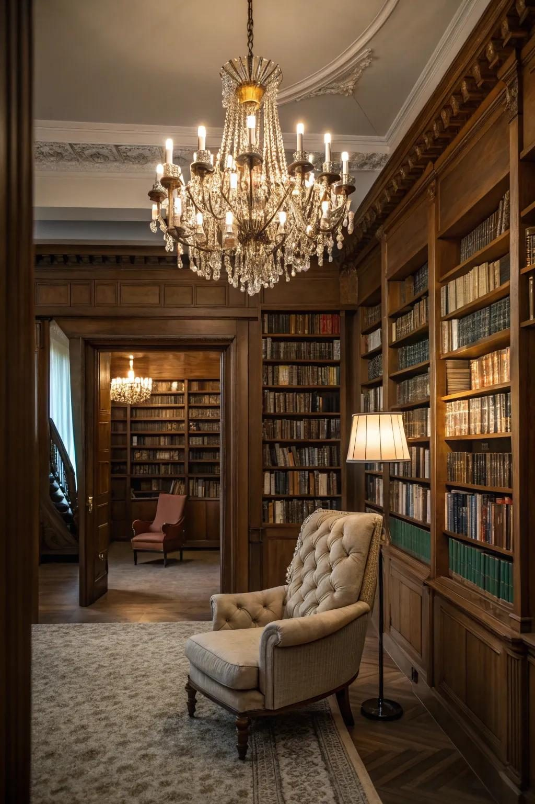

> TIP:QUICK: Keep the chandelier modest in size and use warm bulbs so the sparkle stays golden.

## 8. Fairy Lights Around the Window Nook

Fairy lights strung around a window reading nook make the brightest corner of the library glow after dark too. Draped along the shelf edges and the window frame, the tiny lights turn the nook into a soft, twinkling frame for evening reading.

Use warm white lights on a thin, nearly invisible wire so the glow seems to float. Battery-operated strings keep the nook free of trailing cords, and a timer means the lights come on as dusk falls.

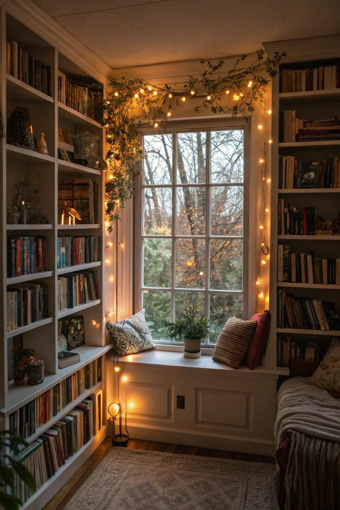

> TIP:CHECK: warm white lights on thin wire; battery-operated to avoid trailing cords; timer for dusk

## 9. Hanging Lantern Beside the Books

A hanging lantern beside the books brings a warm, old-world glow to a home library. Suspended from a bracket at the end of a bookcase, its glass panels and metal frame throw patterned light across the leather spines and the chair below.

Choose a lantern with clear glass and a warm bulb inside so the light is bright enough to read by, not just decorative. Hang it where it cannot be bumped as you reach for books, and let it be the one dark, romantic note in the room.

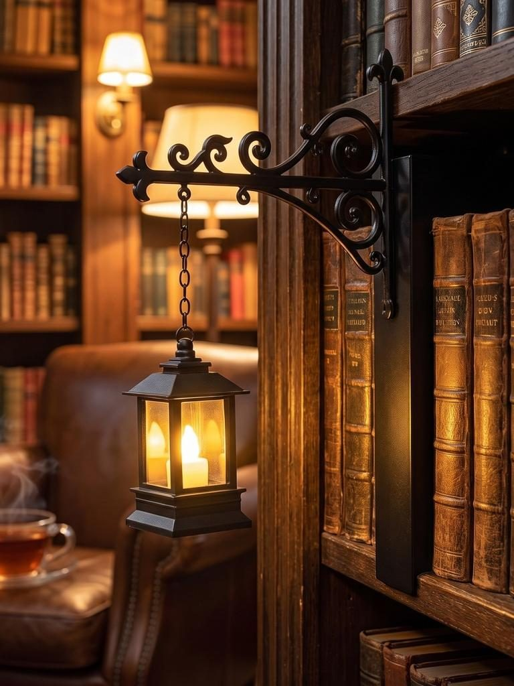

> TIP:GUIDE: Glass: clear, with a warm bulb inside | Hang: out of reach of browsing hands | Role: the one dark, romantic note

## 10. Articulated Desk Lamp on the Library Desk

An articulated desk lamp is the workhorse of home library lighting. Its jointed arm swings the light exactly where you need it — over the page, onto a notebook, or away while you think — and folds back neatly when the desk is cleared.

Pick a lamp with a solid base so it never topples when the arm is extended, and a shade that can tilt. A warm bulb keeps the focused light comfortable for long reading sessions, and the lamp's shape suits both classic and modern desks.

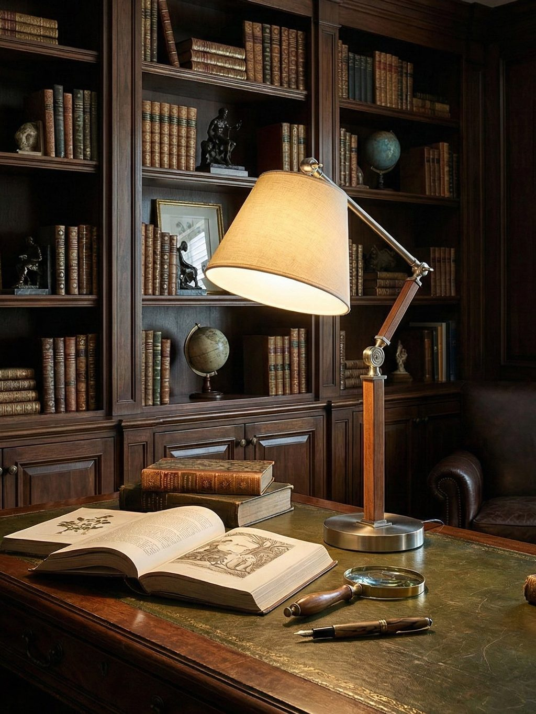

> TIP:QUICK: Choose a solid base so the lamp never topples when the arm is fully extended.

## 11. Brass Wall Lamp Over a Green Reading Chair

A brass wall lamp mounted above a green reading chair gives you reading light without taking up a single inch of floor or table space. The shade throws a warm pool of light down over the book, while the chair below stays clear for a throw and a cup of tea.

Mount the lamp at about shoulder height when seated, so the light lands on the page and not in your eyes. A swing arm is worth having here, since it lets you pull the light closer for small print and push it back when you rest.

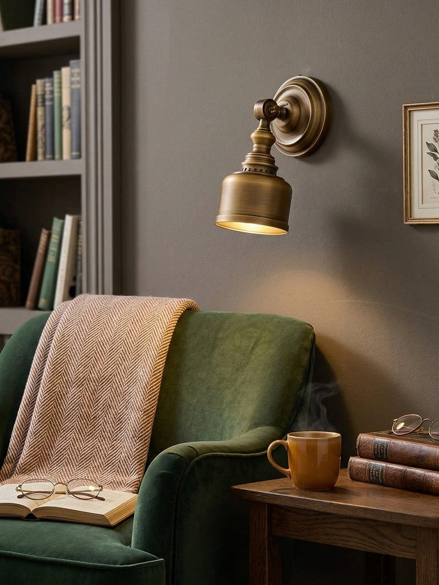

> TIP:CHECK: mount at seated shoulder height; light lands on the page, not in your eyes; swing arm if possible

## 12. Recessed Puck Lights Under the Shelves

Recessed puck lights set into the underside of each shelf light every row of books evenly. No shelf is left in shadow, the spines are easy to read, and the bookcase takes on the quiet glow of a shop display.

Space the pucks evenly and keep them small, so they read as part of the shelf rather than as fixtures. Warm white pucks suit wood best, and a dimmer lets the shelves glow softly in the evening instead of blazing.

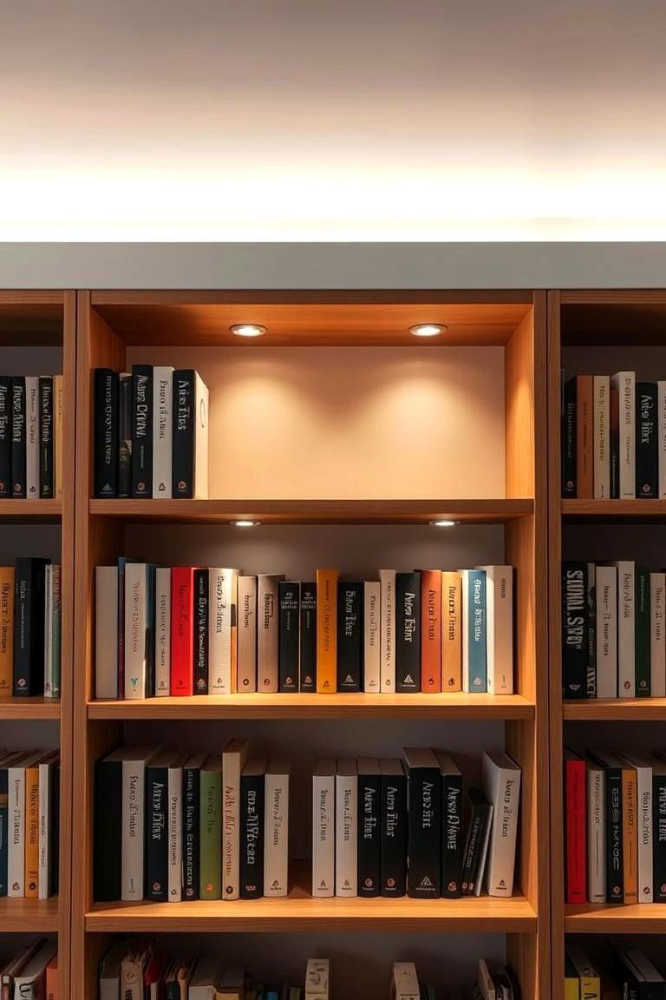

> TIP:GUIDE: Spacing: even, one per shelf section | Size: small, so they read as part of the shelf | Control: a dimmer for evenings

## 13. Green Banker's Lamp on the Desk

A green banker's lamp is the classic library light, and it still works beautifully. The emerald glass shade glows like a jewel on a dark wooden desk, throwing a soft green-tinged pool of light over the page while the rest of the room stays dim.

The brass base and the green shade suit paneled rooms and leather chairs best, where the lamp feels like it has always belonged. Keep the bulb warm and modest, so the green glass glows rather than glares.

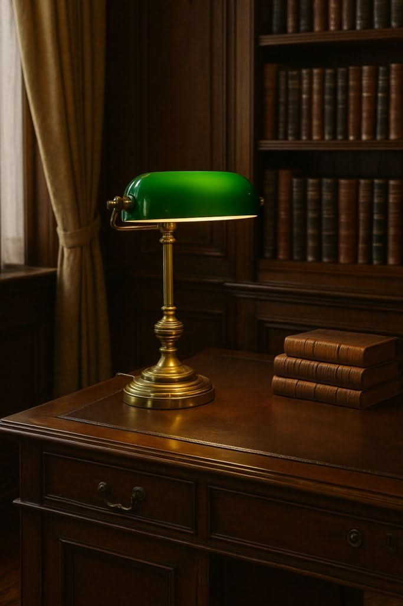

> TIP:QUICK: Keep the bulb warm and modest so the green glass glows rather than glares.

## 14. Moroccan Lantern Casting Patterned Light

A Moroccan lantern turns a quiet reading corner into something magical after dark. Its pierced metalwork throws lace-like patterns of light across the wall and the open book, and the warm glow makes the corner feel intimate and far away from the rest of the house.

Hang the lantern low enough that its patterns fall where you can see them, and pair it with a plain reading lamp for the actual reading. The lantern is the atmosphere; the lamp does the work.

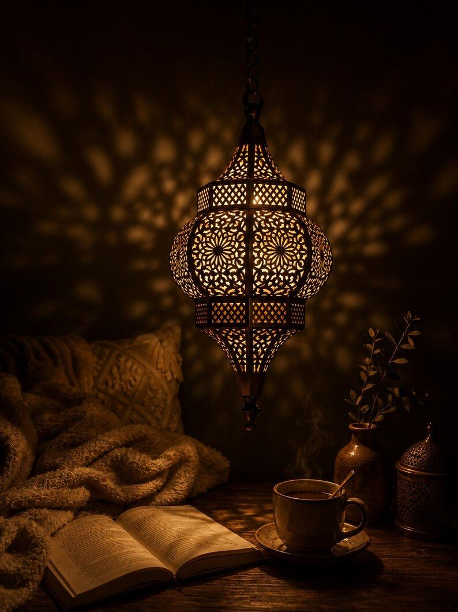

> TIP:CHECK: hang low enough for the patterns to show; pair with a plain lamp for reading; warm bulb only

## 15. Rattan Pendant Over the Reading Nook

A rattan pendant hanging over the reading nook brings a light, natural texture to the library. Its woven petals glow from within when the bulb is on, casting a dappled pattern on the shelves, and the pendant looks like a piece of craft even in daylight.

Hang it over the nook's chair or small table, where its glow falls on the reader rather than across the whole room. Rattan suits light wood shelves and cream walls, and a warm bulb keeps the woven shade golden.

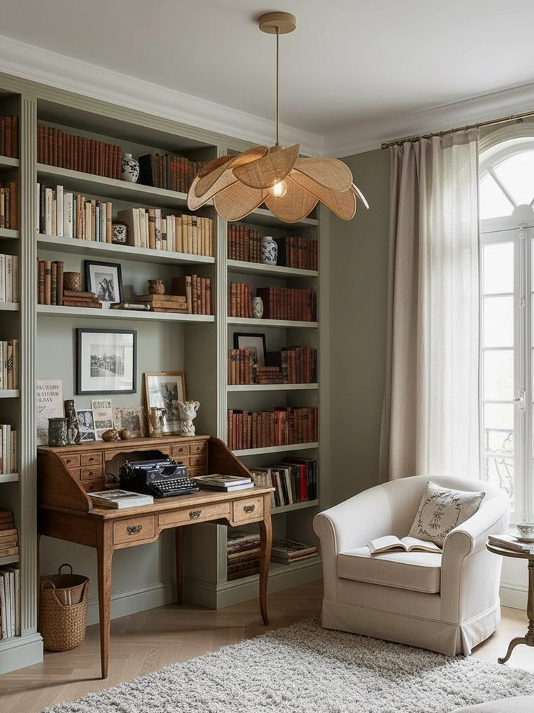

> TIP:GUIDE: Hang: over the nook's chair or small table | Suits: light wood shelves and cream walls | Bulb: warm, to keep the rattan golden

## 16. Edison Bulbs Hanging Over the Table

A row of hanging Edison bulbs over the library table gives the room a warm, workshop glow. The exposed filaments shine amber, the cords hang in gentle lines, and the table below gets a soft, even light that suits reading, writing and long conversations.

Hang the bulbs at different heights for a relaxed look, and keep them above eye level when seated so the filaments never glare. A dimmer is almost essential here, since bare bulbs are bright up close and lovely turned down low.

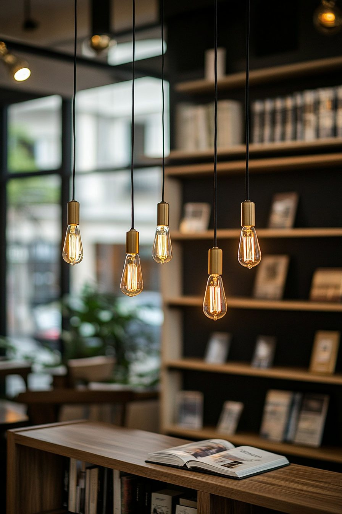

> TIP:QUICK: Hang the bulbs at different heights and keep them above eye level when seated.

## 17. Backlit Built-In Shelves

Backlit built-in shelves glow from behind the books, so the whole bookcase seems lit from within. A soft halo outlines each shelf and the spines stand out against the light, turning an ordinary wall of books into the warmest feature of the room.

Use warm LED strips or panels set behind the shelf backs, and keep the light even from top to bottom. The effect is strongest in the evening, when the lit shelves become the room's main light source.

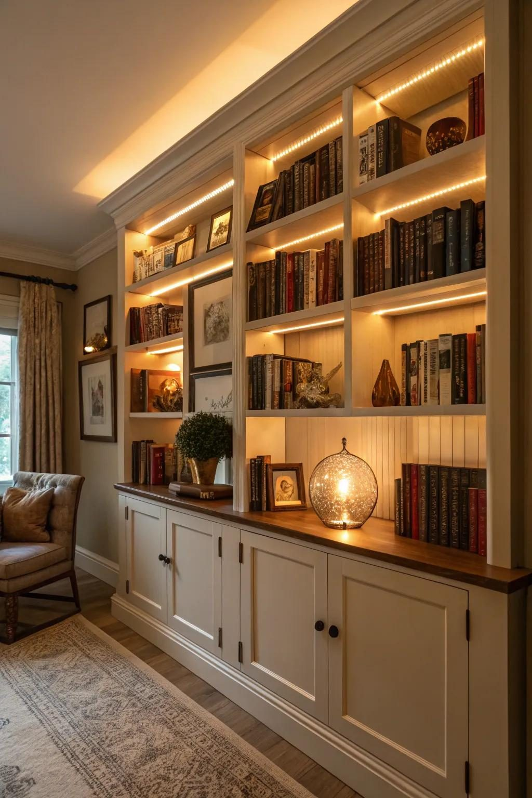

> TIP:CHECK: warm LEDs behind the shelf backs; light even from top to bottom; strongest in the evening

## 18. Sunlit Window Seat Between the Shelves

A sunlit window seat between the shelves is the library's best daytime light, and it costs nothing. The bay window pours daylight across the cushions, the shelves on either side frame the view, and the seat becomes the place everyone reaches for on a bright morning.

Keep the seat cushions pale so they bounce the daylight around, and add a small lamp at one end for cloudy afternoons. Sheer curtains soften the glare without blocking the light that makes the nook so inviting.

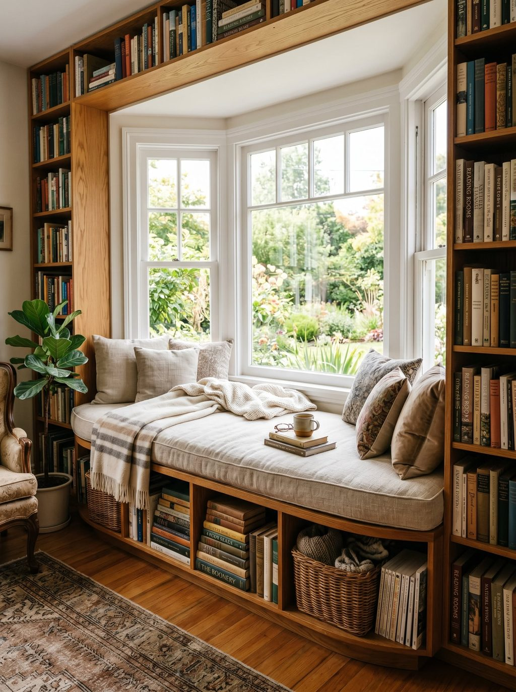

> TIP:GUIDE: Cushions: pale, to bounce daylight around | Extra: a small lamp for cloudy afternoons | Curtains: sheer, to soften glare

## 19. Linen-Shade Floor Lamp in the Corner

A linen-shade floor lamp in the corner of the library gives the room a soft, diffused glow that suits evening reading. The fabric shade turns the bulb's light into a warm wash, the green velvet chair beside it catches the warmth, and the corner feels calm rather than bright.

Choose a shade in cream or natural linen, and a base slim enough to tuck beside the chair without crowding it. The lamp should stand tall enough that the shade sits above the chair back, so the light spreads across the room.

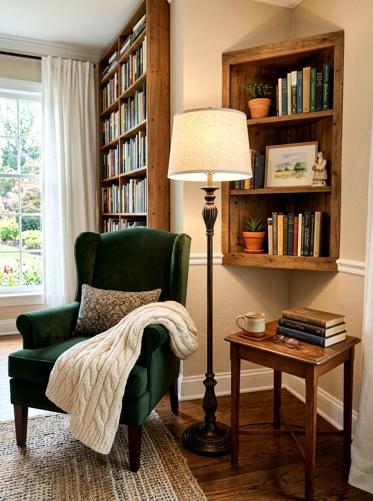

> TIP:QUICK: Pick a cream linen shade and a slim base that tucks beside the chair without crowding it.

## 20. Glowing Crystal Chandelier Close-Up

Seen up close, a small crystal chandelier is all sparkle and warm light. Its crystals catch every bulb and throw tiny glints across the book spines, while the glow it gives off is soft enough for a small library or a reading alcove.

This is the chandelier to choose when a full-sized one would overwhelm the room. Hang it where it can be seen against the shelves, keep the bulbs warm, and let it be the one piece of sparkle in an otherwise quiet room.

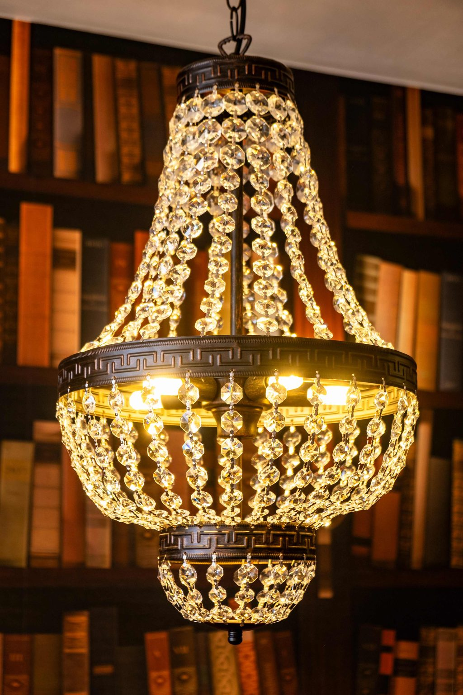

> TIP:CHECK: small scale for a small library; hang it against the shelves; warm bulbs only

## 21. Track Lighting Aimed at the Shelves

Track lighting mounted on the ceiling lets you aim a light at exactly the shelf you want to show off. Each head tilts and turns, so the top shelves, the art, or a favourite row of books can each get their own beam of warm light.

Use warm white heads and aim them slightly downward, so the beams wash the spines without glaring into the room. A track with three or four heads is usually enough for one wall of shelves, and the heads can be re-aimed whenever the display changes.

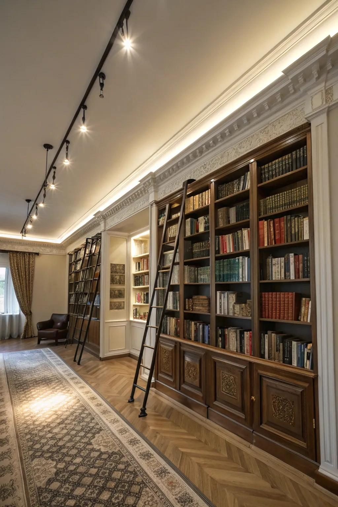

> TIP:GUIDE: Heads: three or four per wall of shelves | Aim: slightly downward, washing the spines | Bulbs: warm white

## 22. Flameless Candles on the Shelves

Flameless candles set among the books give a library the flicker of candlelight with none of the worry. Their warm, wavering glow softens the shelves, and a cluster of them on a low shelf looks like a little hearth in the middle of the books.

Choose candles with a realistic flicker and a warm amber tone, and group them in threes at different heights. Battery-operated candles with a timer switch themselves on at dusk, so the shelves glow every evening without a thought.

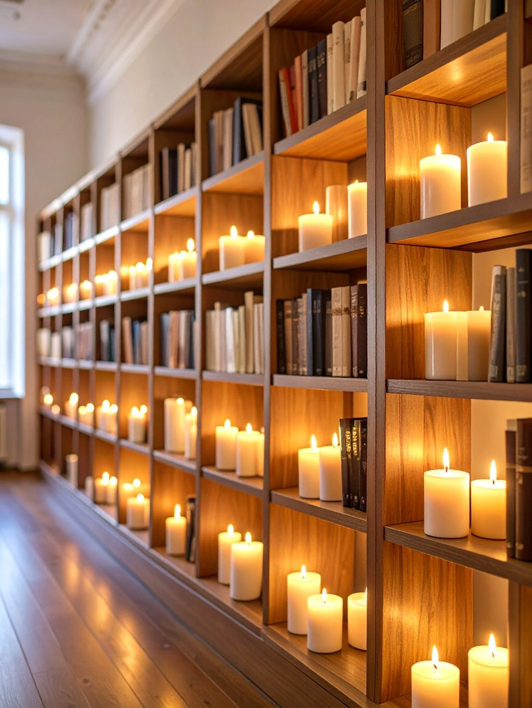

> TIP:QUICK: Group flameless candles in threes at different heights and use a timer for dusk.

## 23. Paper Lantern Floor Lamps

Paper lantern floor lamps bring a soft, moon-like glow to a reading corner. Their round shades diffuse the light in every direction, so the chair, the rug and the shelves all share the same gentle brightness, and the corner feels calm and uncluttered.

Use two lanterns of different sizes for a relaxed, layered look, and keep the bulbs warm so the paper glows amber rather than white. The lamps suit minimalist corners best, where their simple shapes can stand out.

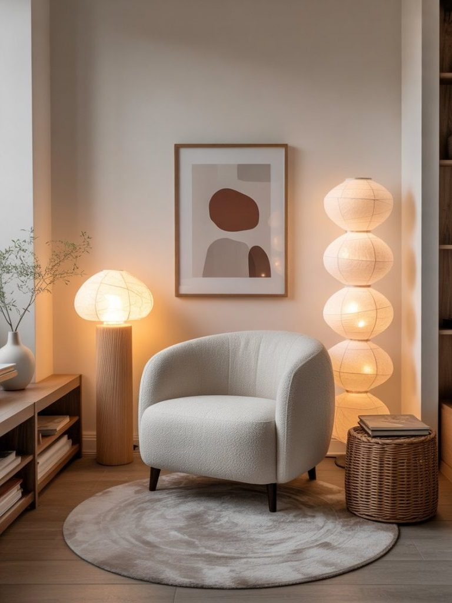

> TIP:CHECK: two lanterns of different sizes; warm bulbs so the paper glows amber; suits minimalist corners

## 24. Arc Floor Lamp Over a Blue Chair

An arc floor lamp curving over a blue reading chair is the library's most dramatic light. The tall stem stands behind the chair, the arm sweeps overhead, and the shade hangs exactly where a reader needs it, like a pendant that can move with you.

Give the lamp a heavy base so the long arm never tips, and place the chair so the shade sits just above and behind your head. Brass arcs suit leather chairs beautifully, and the warm bulb keeps the focused light kind to the eyes.

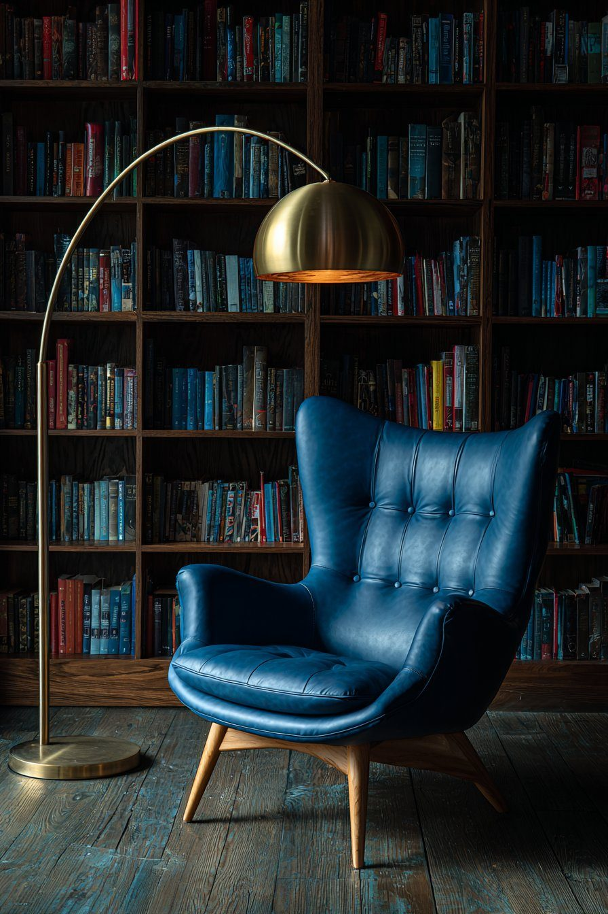

> TIP:GUIDE: Base: heavy, so the long arm never tips | Shade: just above and behind your head | Finish: brass suits leather

## 25. Sunlight Streaming Through the Library Window

Sunlight streaming through a tall library window is the light every other light is trying to imitate. It warms the wood, brightens the book spines and makes the reading chair the most inviting seat in the house, all before a single lamp is switched on.

Arrange the chair to face into the room with the window at its side, so the light falls across the book without shining straight into your eyes. Keep the window clear of heavy curtains, and let the daylight do the work until evening.

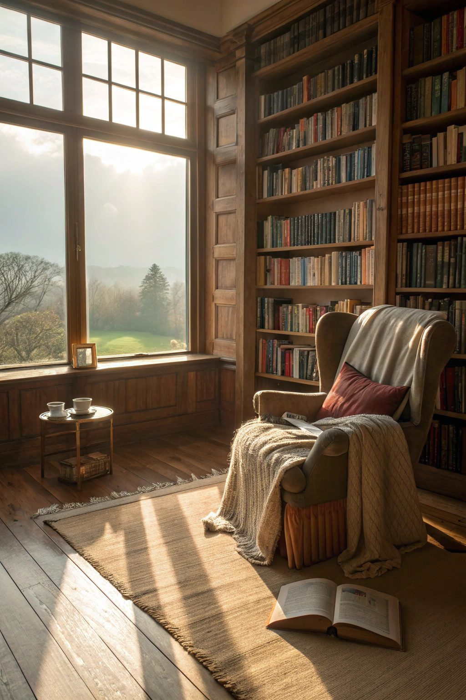

> TIP:QUICK: Place the chair with the window at its side so light falls across the book, not into your eyes.

## 26. Beaded Floor Lamp with a Dome Shade

A beaded floor lamp with a warm dome shade brings a soft, mid-century glow to a library corner. The beaded stem catches the light, the dome shade throws a wide pool of warmth over the chair, and the whole lamp feels like a piece of craft rather than a fixture.

Stand it beside the reading chair with the shade just above the chair back, so the light spreads over the book and the shelves nearby. A mustard or cream chair picks up the warmth beautifully, and the lamp suits wood shelves and woven textures.

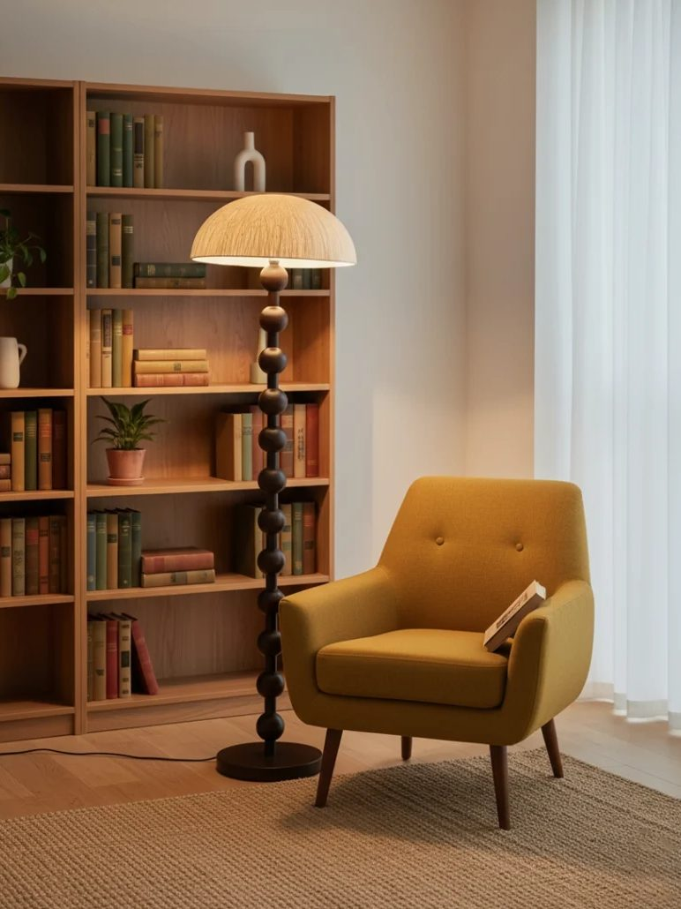

> TIP:CHECK: shade just above the chair back; light spreads over book and shelves; suits wood and woven textures

## 27. Edison Lamp Beside a Stack of Old Books

An Edison lamp set beside a stack of old books is a small still life that also happens to light the room. The glowing filament, the leather spines and the worn wood of the table tell the whole story of a library in one quiet corner.

Set the lamp on a sturdy stack of books you actually love, so the riser is part of the display, and keep the bulb warm and low in brightness. The lamp works best on a side table or a low shelf, where its glow can be seen across the room.

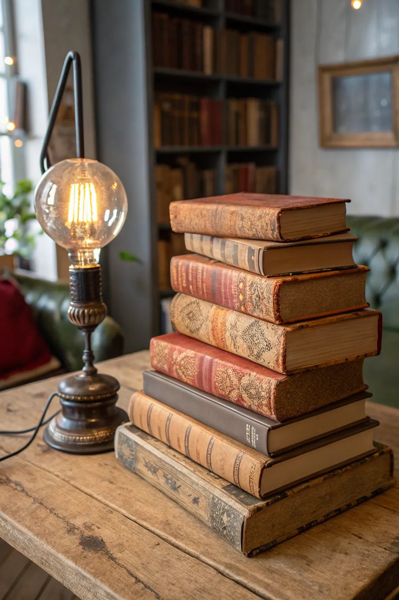

> TIP:GUIDE: Riser: a sturdy stack of books you love | Bulb: warm and low in brightness | Spot: a side table or low shelf

## 28. Swing-Arm Sconce Over a Leather Chair

A brass swing-arm sconce over a leather reading chair is the most flexible wall light in a library. Pull it out and angle it over the page while you read, then fold it flat against the wall when the book is closed and the chair is just for sitting.

Mount it at seated shoulder height on the wall beside the chair, and choose a shade that can tilt. The brass finish warms up against dark leather, and the sconce leaves the side table free for a cup and a stack of books.

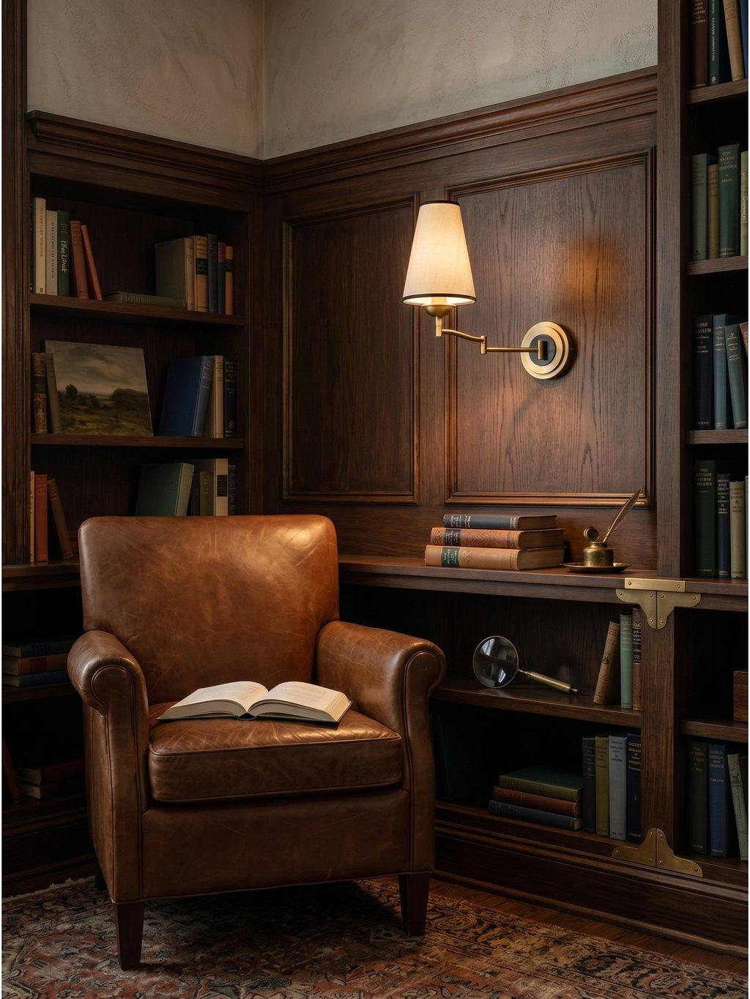

> TIP:QUICK: Mount it at seated shoulder height and fold it flat against the wall when not reading.

## 29. Fairy Lights in Glass Jars on the Shelf

Fairy lights coiled inside glass jars on a shelf turn ordinary jars into little lanterns. Three jars on a middle shelf glow softly between the books, and the whole bookcase takes on a warm, firefly light that suits quiet evenings.

Use warm white lights and jars of different sizes, and tuck the battery pack behind the books so no wires show. The jars work best on a shelf that is not too crowded, where their glow has room to breathe.

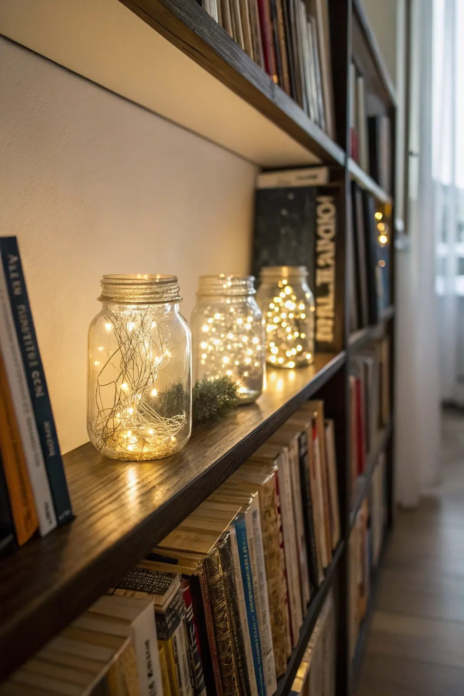

> TIP:CHECK: warm white lights; jars of different sizes; battery pack tucked behind the books

## 30. Night-Time Glow from Lit Shelves

At night, a library lit only by its own shelves is the warmest room in the house. The lit shelves glow softly, the leather chair waits in the dark, and the whole room feels like a quiet, glowing cave made for one reader and one book.

Layer the light for this effect: shelf lights for the glow, one reading lamp for the page, and nothing overhead. Turn the shelf lights on first at dusk, and let the room gather its warmth slowly as the evening goes on.

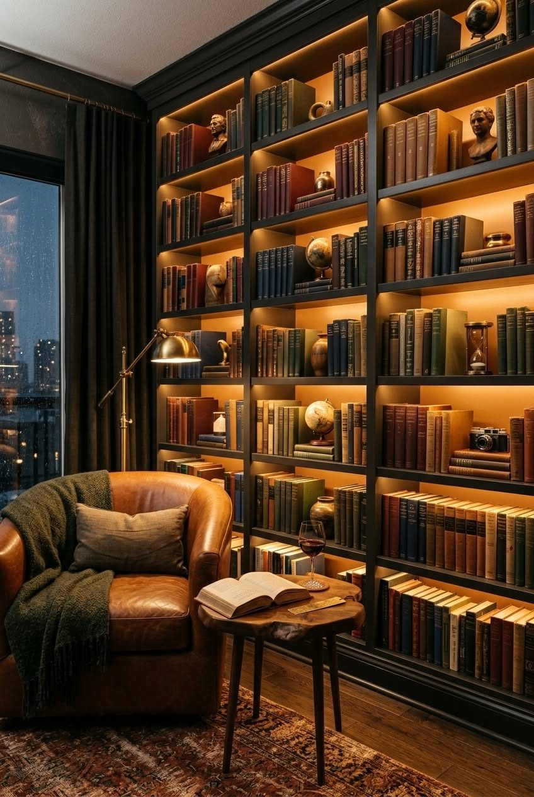

> TIP:GUIDE: Layer: shelf lights for glow, one lamp for the page | Overhead: nothing | Start: shelf lights on at dusk

## Takeaway

- The best home library lighting is layered: shelf lights for the glow, a pendant or chandelier for the room, and one focused lamp for the page.
- Start with the reading chair — one warm lamp beside it changes the whole room, and everything else can be added shelf by shelf.
- Once the shelves are dressed, style them with our [30 Bookshelf Decor Ideas](/posts/bookshelf-decor-ideas/) and, for a library in the bedroom, our [30 Bookshelf Decor Ideas for Bedrooms](/posts/bookshelf-decor-ideas-for-bedrooms/) — and save the combinations you love for your own nook.

## Frequently Asked Questions

### What is the best lighting for a home library?

Layered lighting works best in a home library: a warm overhead or pendant light for general glow, shelf lights so you can find books easily, and a focused reading lamp beside your chair. Warm bulbs around 2700K keep the room cozy, while a dimmer lets you soften everything in the evening.

### How bright should a reading lamp be in a library?

A reading lamp should be bright enough to read comfortably without straining your eyes, which usually means a bulb of around 400 to 800 lumens aimed at the page. The light should fall on the book, not into your eyes, and a warm tone is gentler for long reading sessions than cool white.

### Are LED strip lights good for bookshelves?

Yes, LED strip lights are one of the best choices for bookshelves because they are slim, cool-running and easy to hide. Warm white strips tucked behind a small lip light every row evenly and make the spines easy to read, while a dimmer keeps the glow soft in the evening.

### What color temperature is best for library lighting?

Warm white light, around 2700K to 3000K, suits a home library best because it flatters wood, leather and paper, and it feels relaxing in the evening. Cooler light can make a library feel like an office, so save daylight bulbs for task areas only, if you use them at all.

### How do I light a home library without ceiling lights?

You can light a library well without ceiling lights by layering floor lamps, table lamps and shelf lighting. Place a reading lamp beside each seat, add LED strips or puck lights to the shelves, and use a wall sconce or two for ambient glow. Together they cover the room without any overhead fixture.

### Where should I put a reading lamp in a library?

Put the reading lamp just behind and beside your chair, on the side of your reading hand, so the light falls over your shoulder onto the page. The shade should sit above eye level when you are seated, and the lamp should be close enough to read by without leaning toward it.

### Can fairy lights damage books on a shelf?

Fairy lights are safe for books when you choose LED strings, which stay cool to the touch and give off very little heat. Keep the lights from pressing directly against paper for long periods, use a timer so they are not on all day, and avoid old-style bulbs that run hot.

### How can I make a small home library feel brighter?

Make a small library brighter with pale walls and cushions that bounce light around, a mirror or light art opposite the window, and shelf lights that stop the bookcase from becoming a dark wall. A single warm pendant and a reading lamp add glow without crowding the small space.
