# 30 Kitchen Decor Ideas for 2027

These kitchen decor ideas for 2027 are all about warmth, texture and kitchens that feel lived in. The year ahead leans toward deep green cabinets, natural stone, fluted wood and terracotta tones, with mixed metals and softer shapes replacing the cool, matchy-matchy kitchens of a few years ago. Every idea below works on its own, so you can borrow one or two without redoing the whole room.

Use this list as a starting point, not a shopping list. Pick the idea that fixes the thing you notice most — the lighting, the cabinets, the storage — and let the rest of the kitchen catch up slowly. The best kitchens for 2027 are collected over time, not bought in one go.

## 1. Warm White Shaker Cabinets

Warm white shaker cabinets are the safest starting point in any kitchen, and they are still going strong in 2027. The simple framed door suits modern and traditional rooms alike, and a warm white — rather than a cold, blue white — keeps the room feeling soft under both daylight and evening light. Brass knobs and pulls add a gentle glow that stops the white from feeling flat.

Pair them with a pale stone countertop and warm wood floors so the kitchen reads as one calm space. If the room is small, take the cabinets to the ceiling and keep the hardware slim, which draws the eye upward and makes the wall feel taller.

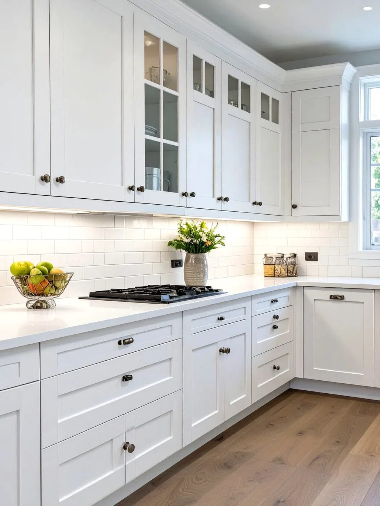

> TIP:QUICK: Choose a warm white with a creamy undertone, not a cold blue white — it stays soft under evening light.

## 2. Deep Green Cabinets

Deep green cabinets are the defining kitchen colour of 2027, and for good reason: green feels calm, works with wood and brass, and hides everyday marks better than white. A forest or emerald green on the lower cabinets, with pale uppers or open shelves above, gives the room depth without making it dark.

Keep the countertop light — marble or pale quartz — so the green stays the star, and let the brass hardware pick up the warmth in the wood floor. In a north-facing room, add under-cabinet lighting so the green reads as rich rather than murky.

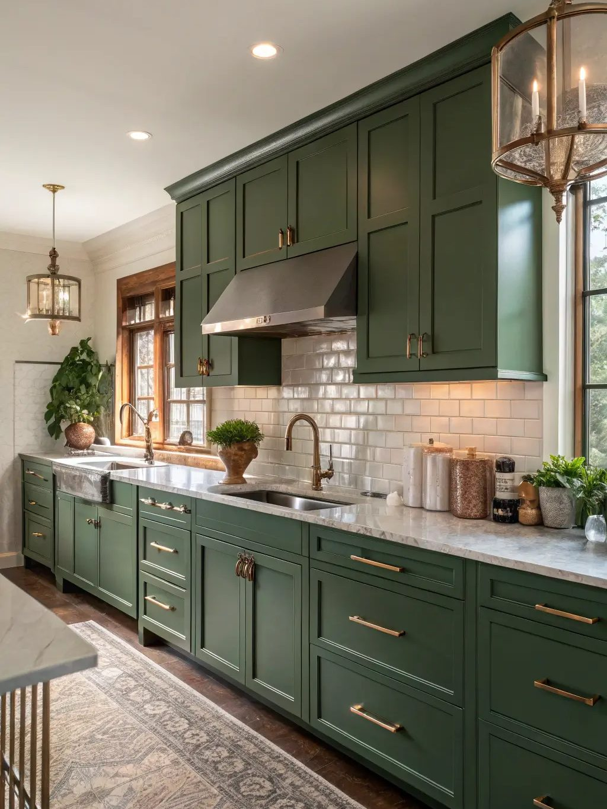

> TIP:CHECK: light countertop to balance the green; brass hardware for warmth; under-cabinet lighting in darker rooms

## 3. Navy Blue Island

A navy blue island is the easiest way to add colour without committing the whole kitchen to it. The deep blue anchors the room and looks wonderful against white cabinets, marble and warm wood stools, and it suits both classic and modern kitchens. Because it is only one piece of furniture, it is also the easiest colour to change later.

Paint the island in a durable satin finish so it wipes clean, and repeat the blue once elsewhere — a runner, a vase, a set of linen napkins — so the island feels connected to the room rather than dropped into it.

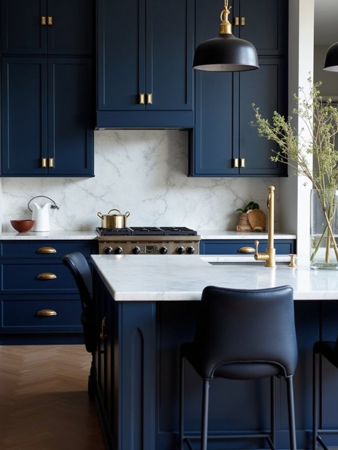

> TIP:GUIDE: Finish: durable satin paint, wipes clean | Repeat: the blue once elsewhere in the room | Stools: warm wood to soften the navy

## 4. Terracotta Tile Backsplash

A terracotta tile backsplash brings instant warmth to a kitchen, and the handmade look of clay tiles is a big part of the 2027 trend toward natural materials. The soft rust and peach tones sit beautifully with cream cabinets, wood and brass, and the slight variation from tile to tile keeps the wall from looking flat or factory-made.

Diamond-laid tiles add pattern without a busy print, and a pale grout keeps the look fresh rather than heavy. Seal the tiles well, since unglazed terracotta stains easily around a hob or sink.

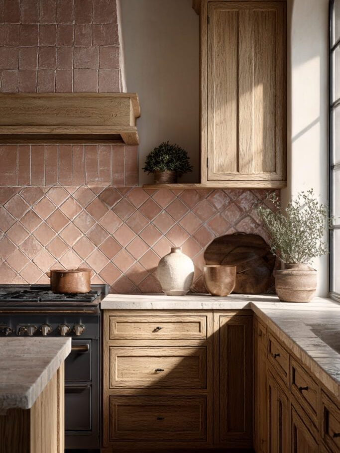

> TIP:QUICK: Seal terracotta tiles well — unglazed clay stains easily near the hob and sink.

## 5. Marble Waterfall Island

A marble waterfall island — where the stone runs down the sides of the island to the floor — is the most luxurious look in this list, and it suits open-plan kitchens where the island is seen from every angle. The continuous veining turns the island into a piece of sculpture, and the stone sides shrug off scuffs from shoes and stools.

Choose a slab with bold, interesting veining and ask the fabricator to book-match the sides so the pattern flows around the corners. A honed finish is more forgiving than a high polish for a family kitchen.

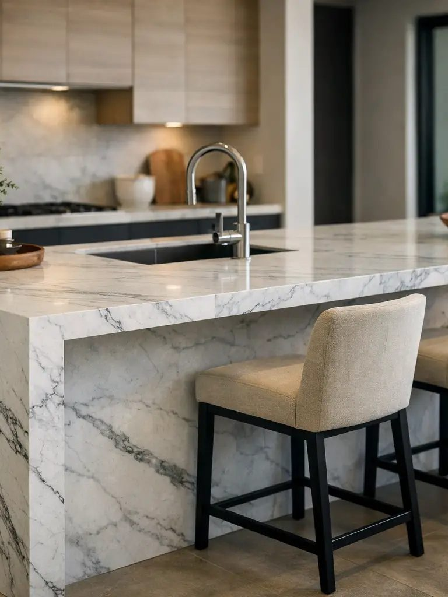

> TIP:CHECK: bold veining for the best effect; book-matched sides so the pattern flows; honed finish hides marks

## 6. Brass Pendant Lights

Brass pendant lights over the island are the warmest way to light a kitchen, and they double as jewellery for the room. Dome pendants in unlacquered brass develop a soft patina over time, which suits the collected, lived-in feel of 2027 kitchens far better than a shiny chrome finish.

Hang two or three pendants in a row, spaced evenly, about 30 to 36 inches above the countertop. Keep the bulbs warm white and dimmable so the island can shift from a cooking workspace to a relaxed evening spot.

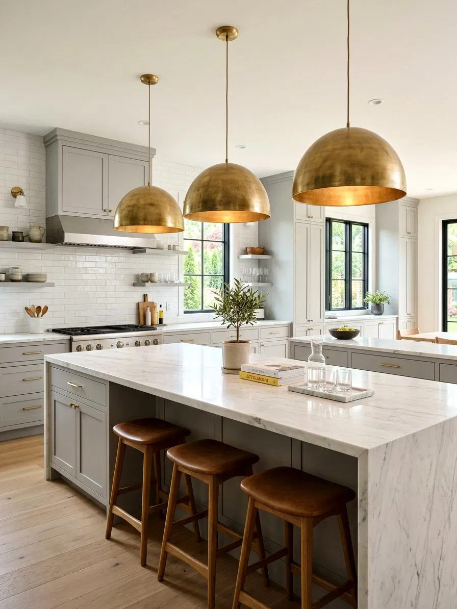

> TIP:GUIDE: Height: 30 to 36 inches above the countertop | Bulbs: warm white, dimmable | Finish: unlacquered brass that ages gracefully

## 7. Open Wood Shelving

Open wood shelving replaces a run of upper cabinets with breathing room, and it is the fastest way to make a kitchen feel bigger. Thick oak or walnut shelves hold everyday dishes and glasses within easy reach, and the wood adds warmth that painted cabinets cannot. Keep the styling simple: stacks of plates, a few bowls, a plant.

Limit open shelves to one or two runs — beside the range or the sink — and keep the rest of the storage closed. That way the shelves look styled rather than cluttered, and dusty items stay behind doors.

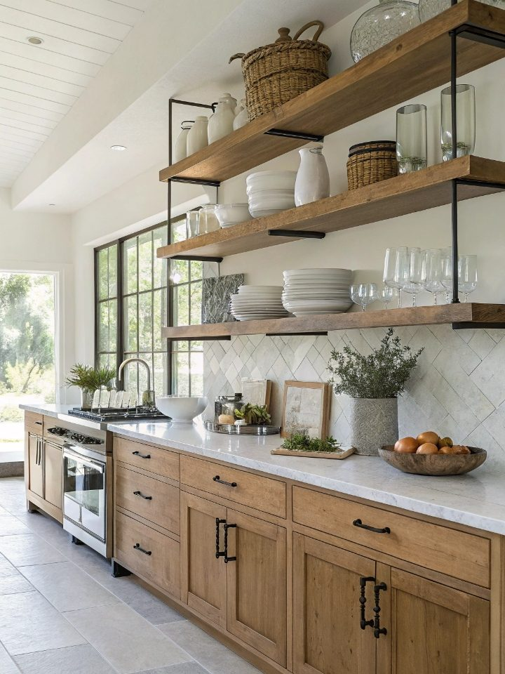

> TIP:QUICK: Limit open shelves to one or two runs — the rest of the storage stays behind closed doors.

## 8. Glass-Front Cabinets

Glass-front cabinets are the middle ground between open shelves and solid doors: they show off your prettiest dishes while keeping the dust out. In 2027 they are used in small doses — one run of uppers, or a dresser-style cabinet — rather than across the whole kitchen, which keeps the look calm.

Style the shelves lightly and leave some empty space, since a crowded glass cabinet looks messy from across the room. Interior lighting makes the glass glow in the evening and turns the cabinet into a feature after dark.

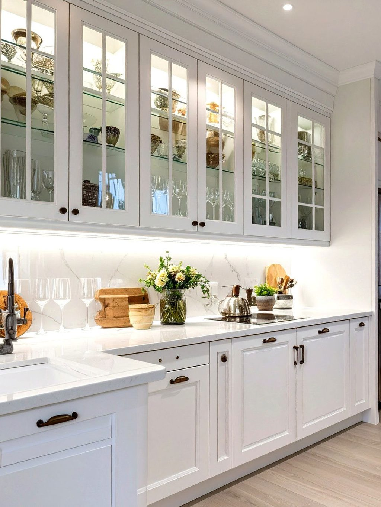

> TIP:CHECK: use glass fronts on one run only; leave empty space on the shelves; add interior lighting for evenings

## 9. Fluted Wood Island

Fluted wood — thin vertical slats — is one of the biggest texture trends for 2027, and the island is the best place to use it. The vertical grooves catch light and shadow all day, so the island looks different in the morning and the evening, and the wood tone warms up an otherwise pale kitchen.

Fluting works on the island base, a pantry wall or a breakfast bar, but use it in one place only. Two fluted surfaces in one room start to compete, and the effect loses its quiet charm.

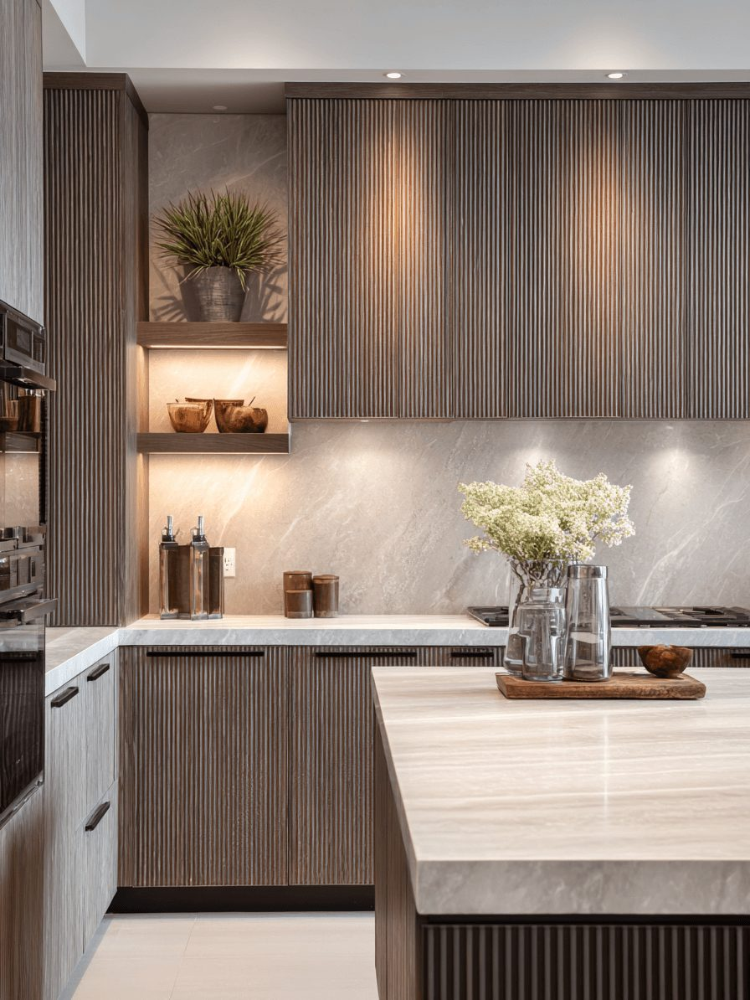

> TIP:GUIDE: Place: island base, pantry wall or breakfast bar | Rule: one fluted surface per room | Tone: warm wood to balance pale cabinets

## 10. Stone Range Hood

A stone range hood turns the cooker wall into the focal point of the kitchen. Stacked stone or a smooth plastered hood in a pale limestone tone adds texture and weight above the range, and it suits rustic, Mediterranean and modern farmhouse kitchens alike. The hood also hides the extractor neatly, so the wall reads as architecture rather than appliance.

Keep the rest of the wall simple — a plain backsplash and slim shelving — so the hood stays the star. A wood beam or a stone shelf at the base of the hood softens the transition to the tiles below.

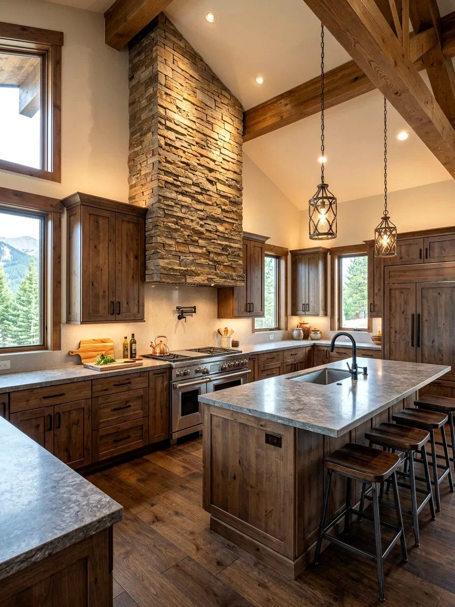

> TIP:QUICK: Keep the rest of the cooker wall plain — a simple backsplash lets the stone hood stay the star.

## 11. Butcher Block Island

A butcher block island brings the warmth of solid wood to the hardest-working surface in the kitchen. The thick timber top is kind to plates and glasses, forgiving to knives, and it ages beautifully — small marks sand out, and the wood deepens in colour over the years. It pairs naturally with white or green cabinets and a tiled backsplash.

Oil the top regularly to keep it water-resistant, and use a cutting board for raw meat rather than cutting directly on the surface. A butcher block top also suits a seating overhang, since wood is warmer to lean on than stone.

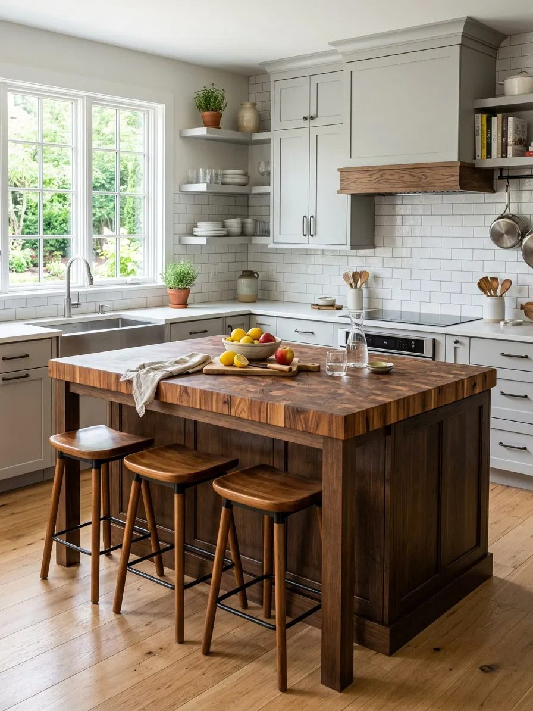

> TIP:CHECK: oil the top regularly to keep it water-resistant; use a board for raw meat; sand out small marks

## 12. Checkerboard Floor Tiles

Checkerboard floor tiles are back in a big way for 2027, and they give a kitchen instant character. Black and white squares suit classic and modern rooms alike, and the pattern hides crumbs and scuffs far better than a plain floor. Large-format tiles keep the look calm, while smaller tiles feel more vintage.

Pair the floor with plain cabinets so the pattern has room to breathe — a busy floor and busy cabinets fight each other. A matte finish is more forgiving underfoot than a high gloss, which shows every footprint.

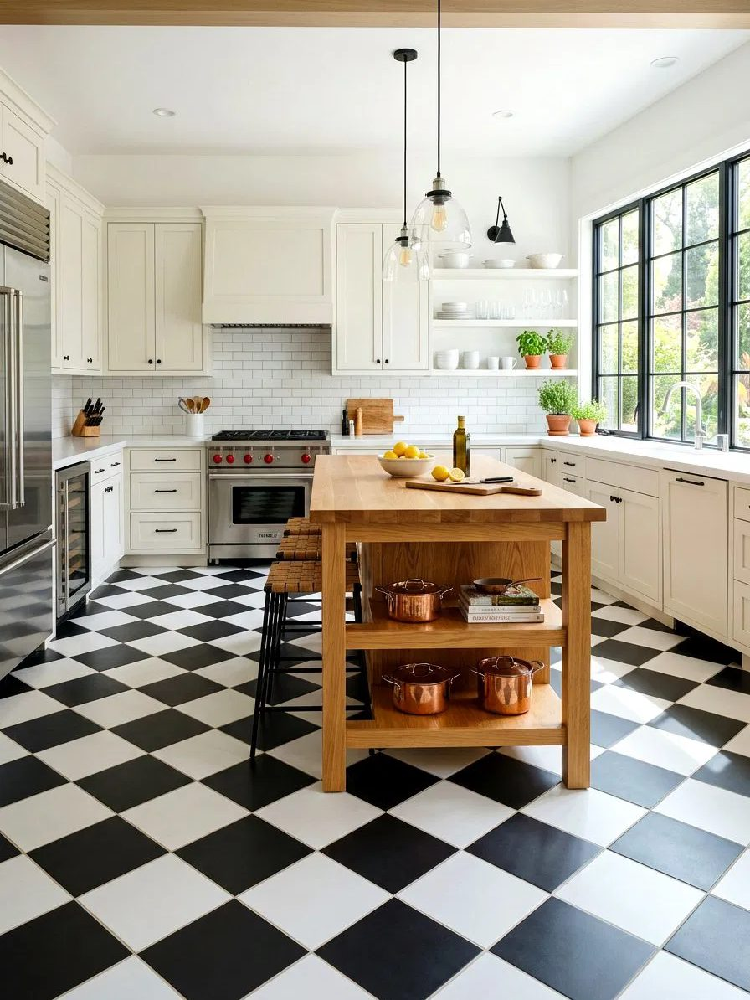

> TIP:GUIDE: Tiles: large format for a calm look, small for vintage | Cabinets: plain, so the floor breathes | Finish: matte, which hides footprints

## 13. Sage Green Kitchen

A sage green kitchen is the softer sister of the deep green trend, and it suits rooms that need light. The grey-green tone feels calm and fresh, works with cream, brass and pale wood, and it flatters both modern shaker cabinets and more traditional framed doors. It is also one of the easiest colours to live with long term.

Keep the worktop pale and the floor warm, and let plants do the decorating — sage green and living greenery are a natural pair. If the room is very small, use sage on the lower cabinets only and keep the uppers white.

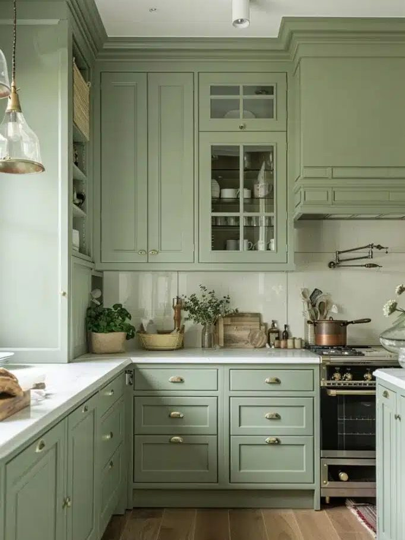

> TIP:QUICK: In a small room, use sage on the lower cabinets only and keep the uppers white.

## 14. Black and White Kitchen

A black and white kitchen is the most graphic look on this list, and 2027 versions keep it soft with warm wood and brass rather than cold chrome. Black lower cabinets with white uppers, a white marble worktop and a black tap give the room contrast without making it feel stark, and the monochrome palette never dates.

The trick is balance: roughly two-thirds light to one-third dark keeps the room bright. Add texture — wood stools, a linen runner, woven baskets — so the black and white does not read as a showroom display.

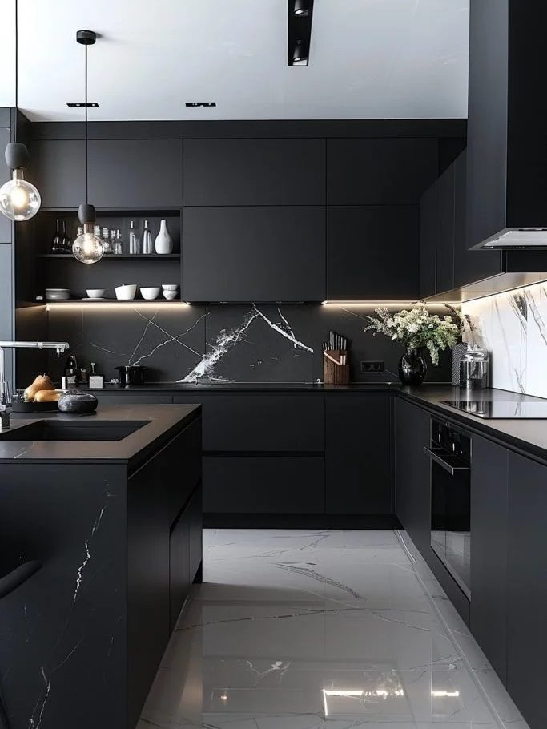

> TIP:CHECK: aim for two-thirds light to one-third dark; add wood and linen for warmth; brass beats chrome here

## 15. Coffee Station Nook

A coffee station nook turns a small stretch of counter into the happiest corner of the kitchen. A dedicated spot for the machine, mugs, beans and spoons means the morning routine happens in one place, and the main worktop stays clear for cooking. Open shelving above and a couple of baskets below keep everything tidy without a full cabinet.

Style it like a tiny café: matching mugs on hooks, a wooden tray, a small plant. A warm light above the station makes it inviting at dawn, and a wipe-clean surface matters, since coffee splashes are inevitable.

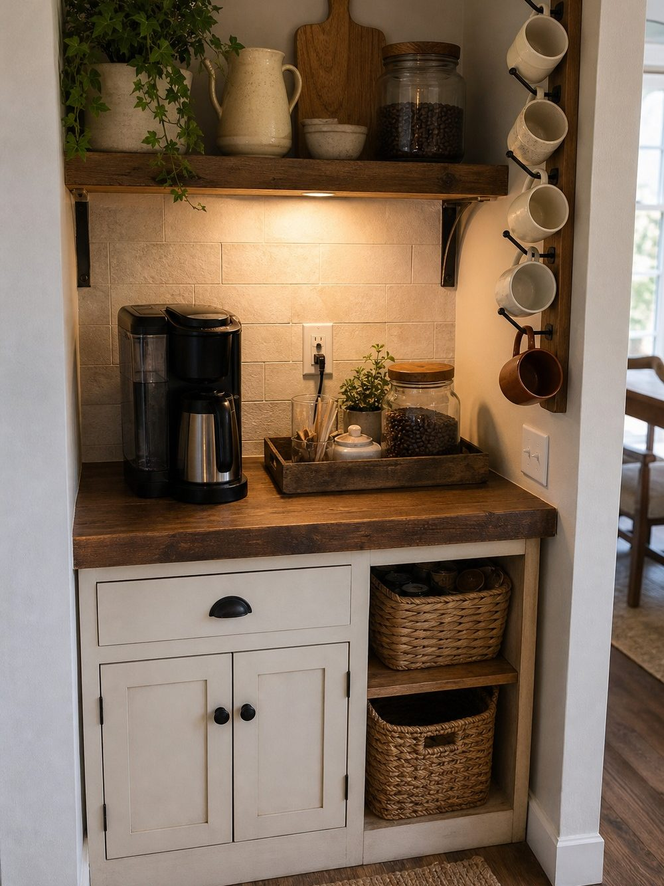

> TIP:GUIDE: Above: open shelf with matching mugs | Below: baskets for beans and filters | Light: a warm bulb makes dawn coffee inviting

## 16. Breakfast Nook with Banquette

A breakfast nook with built-in banquette seating makes the most of a corner that would otherwise hold a chair and a dead space. The bench seats two or three people comfortably, tucks the table close to the wall, and the base doubles as storage for tablecloths and board games. It is the cosiest seat in the house for slow weekend breakfasts.

Add cushions in a wipe-clean fabric and a round or oval table, which is easier to slide into than a square one. A pendant light low over the table and a window nearby complete the nook.

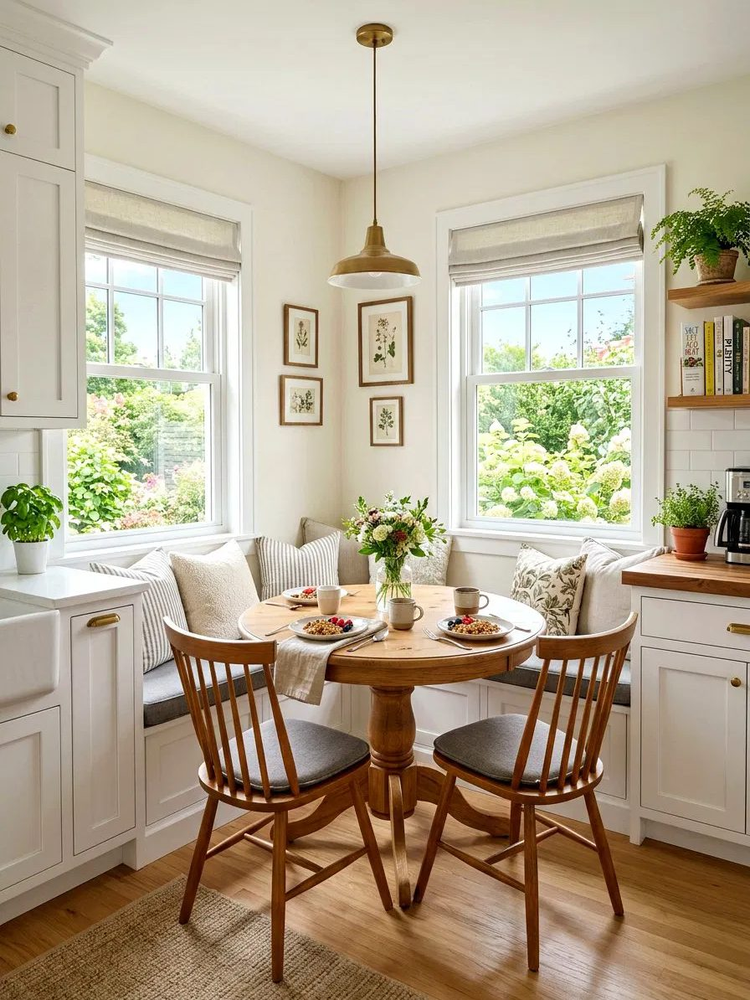

> TIP:QUICK: Choose a round or oval table for a banquette — it is much easier to slide into than a square one.

## 17. Pull-Out Pantry Storage

Pull-out pantry storage is the smartest storage idea for 2027 kitchens, because it makes every inch reachable. Tall pull-out shelves beside the fridge or the range hold jars, tins and spices in full view, so nothing hides at the back and nothing is bought twice. Shallow shelves are the secret — deep ones just recreate the same problem.

Label the shelves by use — breakfast, baking, spices — and keep heavy items low. A pull-out pantry fits even a narrow gap, which makes it ideal for small kitchens where a walk-in pantry is impossible.

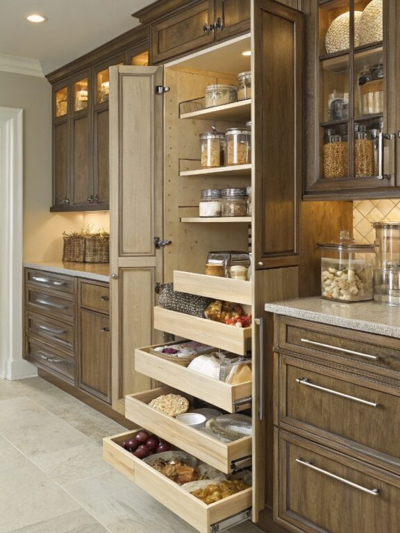

> TIP:CHECK: shallow shelves so nothing hides at the back; heavy items low; label shelves by use

## 18. Under-Cabinet Lighting

Under-cabinet lighting is the single most useful lighting upgrade in a kitchen. A warm LED strip under the wall cabinets lights the worktop properly, removes the shadows your body casts, and makes the whole room glow in the evening. It also shows off a tiled backsplash beautifully, which is reason enough on its own.

Choose warm white strips, hide the driver inside a cabinet, and put the lights on a dimmer so they can run bright for cooking and low for supper. Battery puck lights are a fine no-wiring alternative for renters.

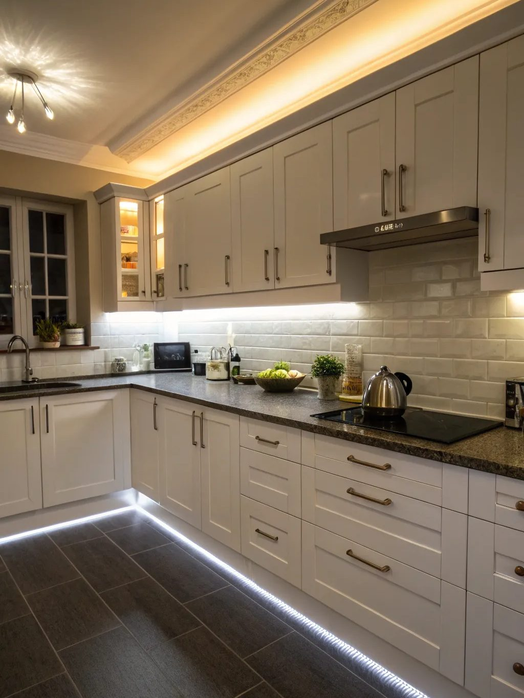

> TIP:GUIDE: Colour: warm white, never cool blue | Control: dimmer for cooking versus evening | Renters: battery puck lights, no wiring needed

## 19. Mixed Metal Fixtures

Mixed metal fixtures are the 2027 answer to the old rule that everything must match. Brass cabinet pulls with a matte black tap, or a brass tap with black pendant lights, looks collected and confident rather than careless. The trick is to keep it to two metals and repeat each one at least twice, so the mix looks deliberate.

Warm metals — brass, copper, bronze — pair with black, while chrome and nickel suit a cooler palette. Decide which metal is the lead and which is the accent, then stick to that ratio across the room.

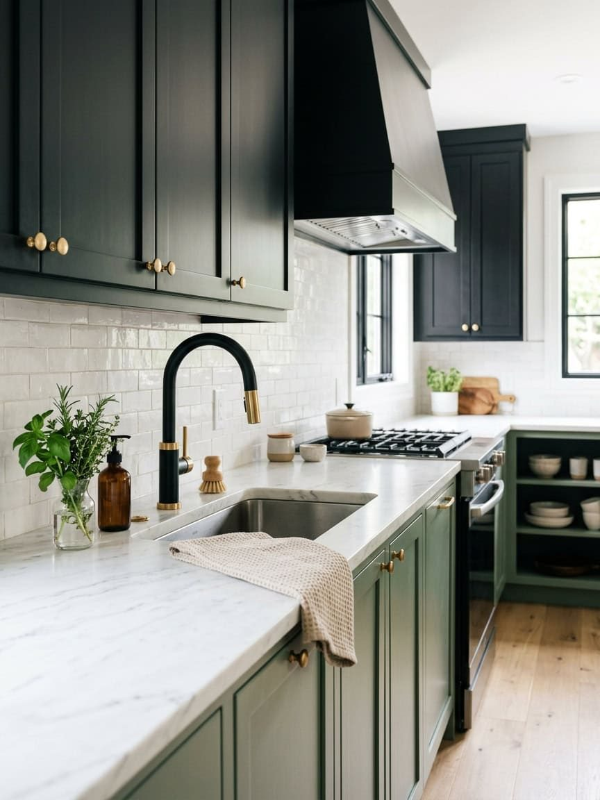

> TIP:QUICK: Keep it to two metals and repeat each one at least twice, so the mix looks deliberate.

## 20. Curved Kitchen Island

A curved kitchen island softens the whole room, and rounded corners are one of the clearest 2027 trends. The curve makes the island easier to walk around — no sharp corners at hip height — and it turns the island into a friendlier gathering spot, since people naturally arrange themselves around a curve.

A curved island works best in an open-plan kitchen with room to move around it, and it pairs beautifully with a fluted wood base or a marble top. Keep the stools simple so the curve stays the feature.

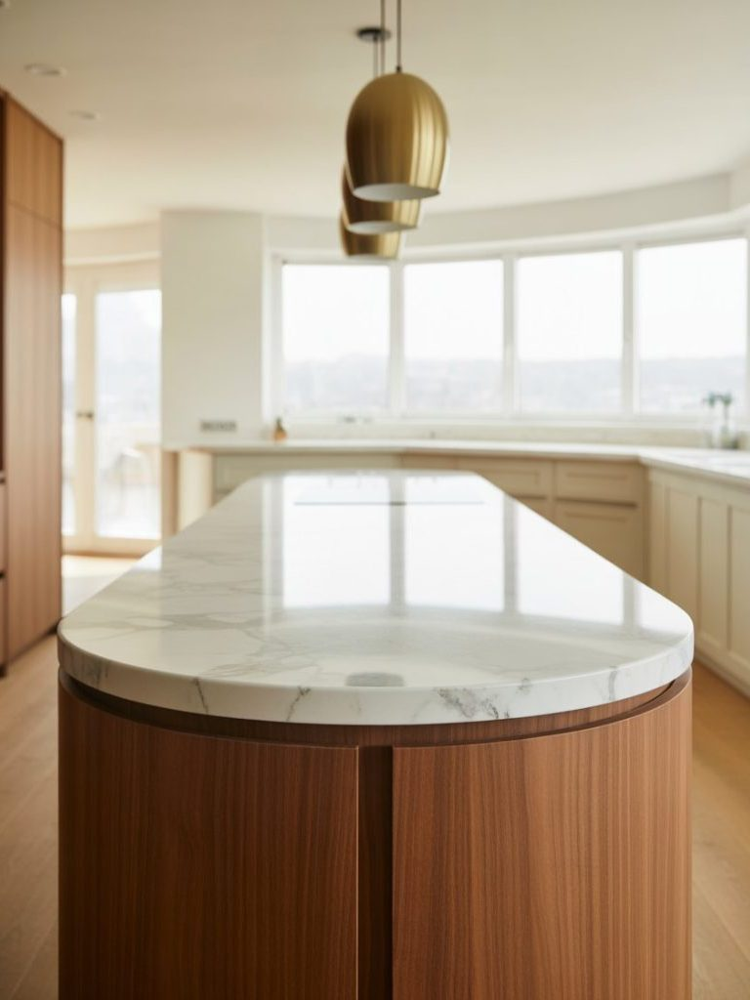

> TIP:CHECK: needs open space to walk around; pairs well with a fluted base or marble top; keep stools simple

## 21. Vintage Farmhouse Kitchen

A vintage farmhouse kitchen layers old and new until the room feels like it grew over decades. A worn wooden table, copper pans on hooks, open shelves with mismatched plates and a curtain under the sink all add the patina that a brand-new kitchen lacks. The key is real age — one or two genuinely old pieces beat a room full of distressed reproductions.

Start with the table or the dresser, then add small finds: an enamel jug, a wooden bread board, a stack of old cookbooks. Keep the cabinets plain so the vintage pieces have space to shine.

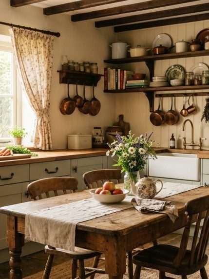

> TIP:GUIDE: Anchor: one genuinely old piece, like a table or dresser | Add: enamel, wood and old cookbooks | Cabinets: plain, so the vintage pieces shine

## 22. Handleless Minimalist Cabinets

Handleless minimalist cabinets give a kitchen its calmest possible look, and they suit the 2027 move toward quieter, less decorated rooms. Push-to-open doors and recessed channels keep the fronts completely flat, so the eye reads the wall as one smooth surface and the room feels larger. The look works best in pale tones or warm wood.

Keep the palette simple and the worktop uncluttered, since a minimalist kitchen shows every stray item. A single statement light or a bold backsplash stops the room from feeling empty rather than calm.

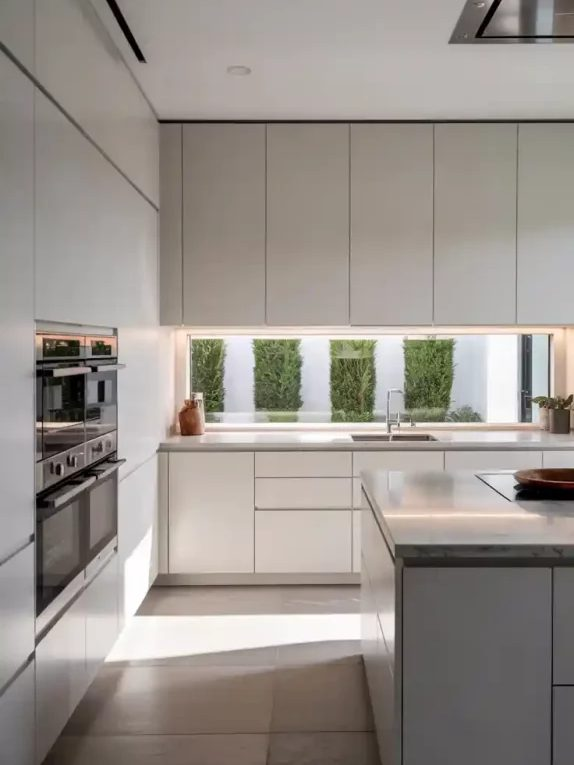

> TIP:QUICK: A minimalist kitchen shows every stray item — keep the worktop clear and add one bold feature.

## 23. Terracotta and Clay Tones

Terracotta and clay tones warm a kitchen from the floor up, and they are the earthiest palette of 2027. Rust, clay and ochre cabinets or tiles pair with cream walls, pale stone and dark wood, and the whole room feels sun-baked and welcoming even on a grey day. The colour works in both modern and rustic kitchens.

Use terracotta as an accent rather than a flood — lower cabinets, a tiled wall or a painted island — and balance it with plenty of cream or white. Terracotta planters with herbs on the windowsill repeat the colour for free.

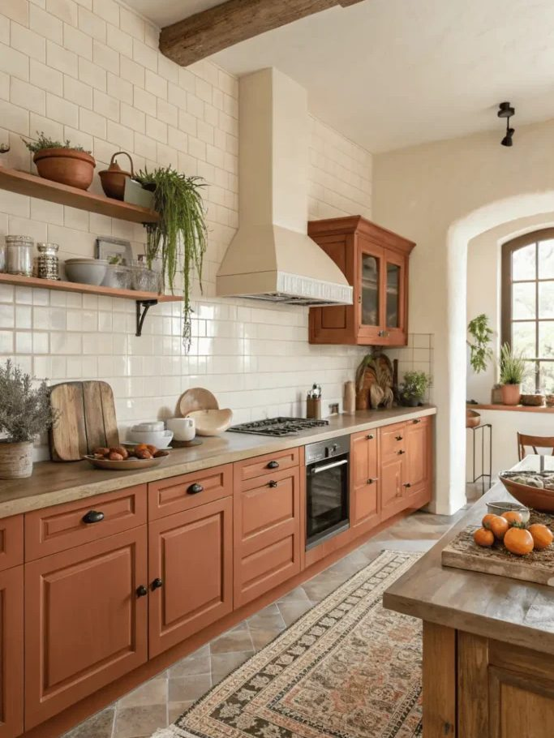

> TIP:CHECK: use terracotta as an accent, not a flood; balance with cream or white; repeat it with herb planters

## 24. Herb Garden Window

A herb garden window puts fresh flavour within arm's reach and turns a plain windowsill into a living feature. Basil, mint, rosemary and thyme in matching terracotta pots look wonderful against a tiled backsplash, and they smell even better. The green also softens a hard kitchen and adds life without taking any counter space.

Give the pots good light and a tray underneath to catch water, and snip little and often so the plants stay bushy. A small pair of scissors hung nearby makes it a habit rather than a chore.

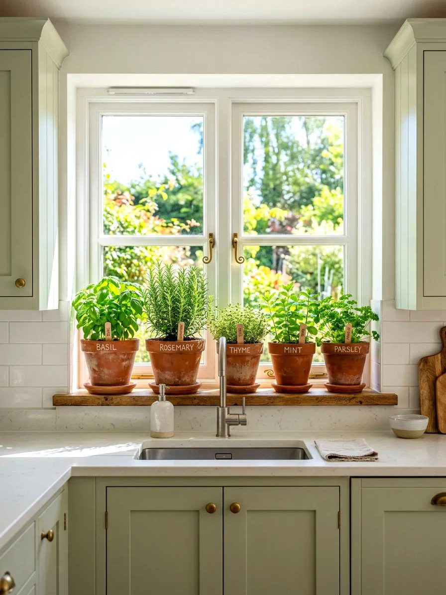

> TIP:GUIDE: Pots: matching terracotta, with a tray underneath | Care: snip little and often | Tools: small scissors hung nearby

## 25. Kitchen Wall Art

Kitchen wall art is the easiest personality upgrade in this list, and 2027 kitchens treat the walls like any other room. Framed food prints, a small gallery wall or one large vintage-style poster adds colour and charm to a space that is usually all cabinets and tiles. Choose art you actually like looking at while you cook.

Keep the frames away from the hob and sink, where steam and splashes will damage them, and use one frame style for a calm look. A picture ledge lets you swap prints with the seasons without new holes in the wall.

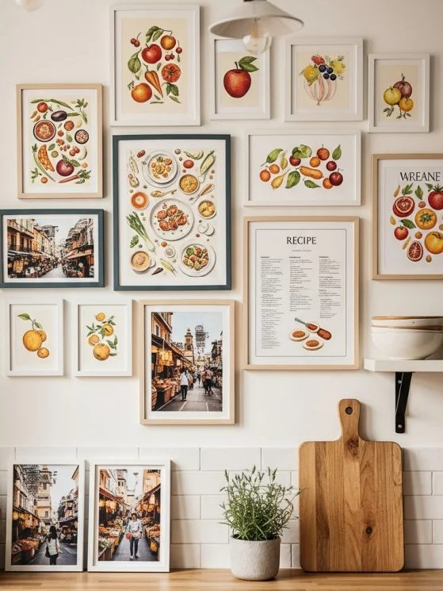

> TIP:QUICK: Keep frames away from the hob and sink — steam and splashes will damage them.

## 26. Zellige Tile Backsplash

A zellige tile backsplash is the handmade star of 2027 kitchens. The small Moroccan tiles are glazed by hand, so each one catches the light slightly differently and the whole wall shimmers. Cream, sage and pale blue are the most popular shades, and they suit both coloured cabinets and plain white ones.

Because the tiles vary, order a little extra and mix them well before fixing, so no single dark or light patch stands out. A matching grout keeps the look seamless, while a pale contrasting grout shows off the handmade edges.

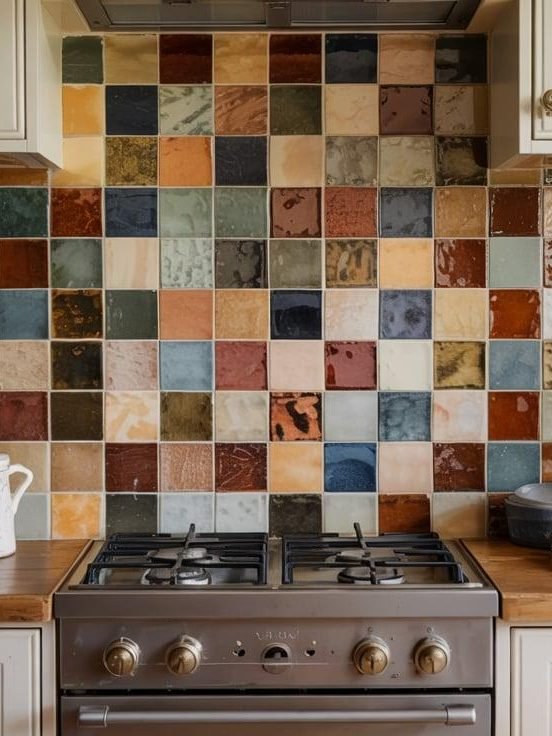

> TIP:CHECK: order extra tiles and mix them well; matching grout for a seamless look; pale grout to show the handmade edges

## 27. Warm Oak Wood Floor

A warm oak wood floor is the foundation of a 2027 kitchen: it softens stone and tile, warms up white cabinets and makes the room feel like home. Wide planks in a honey or cognac tone suit both modern and farmhouse kitchens, and the wood hides crumbs far better than a pale floor. Engineered oak handles kitchen humidity better than solid boards.

Seal the floor well and wipe up spills promptly, especially near the sink and dishwasher. A runner by the sink protects the busiest spot and adds a layer of pattern to the room.

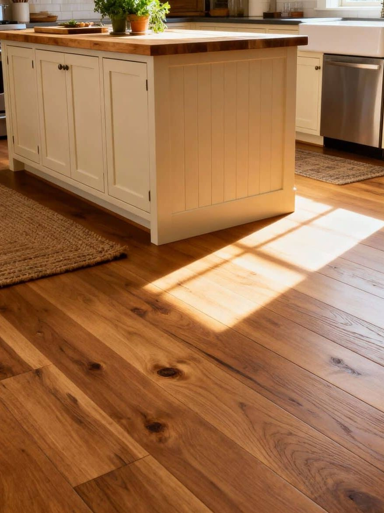

> TIP:GUIDE: Planks: wide, in honey or cognac oak | Type: engineered oak handles humidity best | Protect: a runner by the sink

## 28. Statement Range Cooker

A statement range cooker is the one appliance that earns its place as a design feature. A large range in a bold colour — deep blue, forest green or classic cream — anchors the whole kitchen and sets the palette for everything else. It suits farmhouse and traditional kitchens best, where its generous size feels at home.

Let the range lead and keep the surrounding cabinets quiet, so the cooker stays the hero. A simple stone or plaster hood above it, and brass or black hardware to match its trim, complete the look.

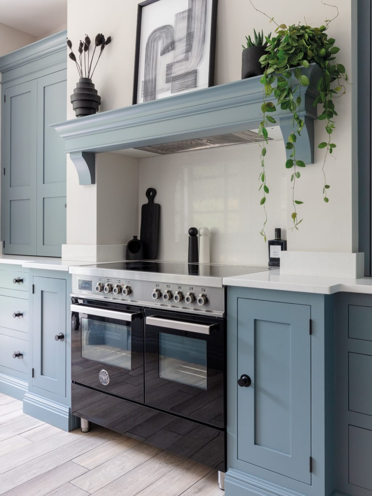

> TIP:QUICK: Let the range lead — keep the surrounding cabinets quiet so the cooker stays the hero.

## 29. Oversized Pendant Lights

Oversized pendant lights make a bold statement over an island, and one or two large domes do the work of three small ones. The big scale suits kitchens with high ceilings or a long island, and black metal domes add drama to an otherwise pale room. The light they throw is wide and even, which is ideal over a work surface.

Hang them lower than you think — about 30 inches above the counter — so they feel connected to the island rather than floating near the ceiling. Dimmable bulbs keep the drama soft in the evening.

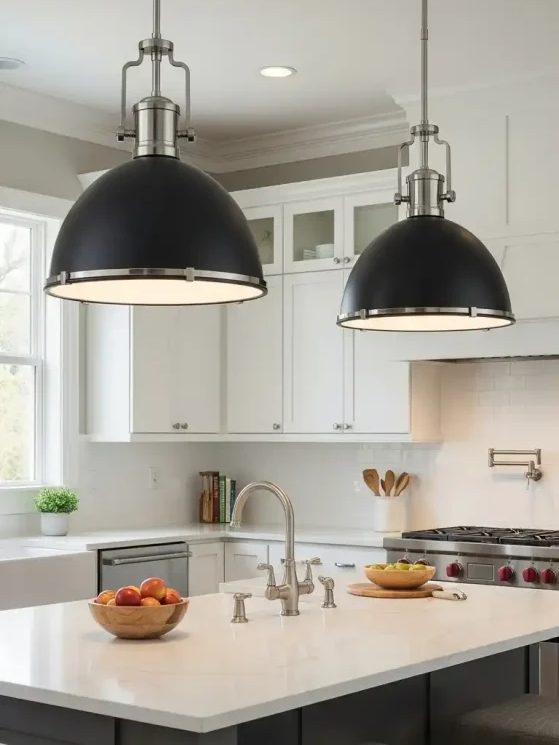

> TIP:CHECK: hang about 30 inches above the counter; best with high ceilings or a long island; dimmable bulbs for evenings

## 30. Natural Stone Countertop

A natural stone countertop — travertine, quartzite or marble — brings the one thing no manufactured surface can fake: a pattern that took millions of years to make. Each slab is unique, with veining and pitting that no two kitchens share, and the stone cools the room visually while warming it with its earthy tones. It suits both modern and rustic kitchens.

Seal natural stone every year or so and wipe up acidic spills like lemon juice and wine quickly, since stone can etch. A honed finish hides everyday wear better than a polished one and feels softer under the hand.

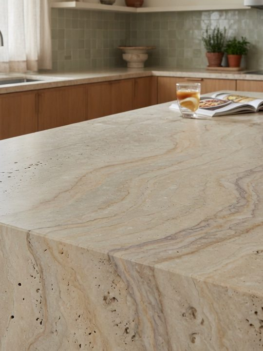

> TIP:GUIDE: Seal: once a year or so | Spills: wipe lemon juice and wine quickly | Finish: honed hides wear better than polished

## Takeaway

- The kitchen decor ideas for 2027 share one mood: warm, natural and a little bit personal.
- Start with the change that will make the biggest daily difference — better light, smarter storage or a colour you love — and add one texture, like fluted wood or handmade tile, to give the room its character. Save the ideas that caught your eye and build your kitchen slowly, one good decision at a time.
- If you love the cosy, lived-in side of this list, our [farmhouse kitchen ideas](/posts/farmhouse-kitchen/) go deeper into rustic warmth, and our [small kitchen decor ideas](/posts/small-kitchen-decor-ideas/) show how to make these trends work in a compact space.

## Frequently Asked Questions

### What are the biggest kitchen decor trends for 2027?

Warm, nature-led kitchens lead the way in 2027: deep green and sage cabinets, natural stone, fluted wood and terracotta tones. Mixed metals and statement lighting replace matchy-matchy finishes, while smart storage and curved islands make kitchens softer and easier to use. The overall mood is calm, collected and personal rather than showroom-perfect.

### What cabinet colour is most popular for 2027?

Deep green is the standout cabinet colour for 2027, with sage green close behind for lighter rooms. Both pair beautifully with brass, warm wood and marble. If you prefer neutrals, warm white shaker cabinets remain timeless and suit almost any style. Choose the shade that fits your light levels, not just the trend.

### Is a marble waterfall island worth it?

A marble waterfall island makes a strong focal point and protects the island sides from scuffs and spills. It works best in open-plan kitchens where the island is seen from several angles. Book-matched veining looks most striking, and a honed finish hides everyday marks better than a high polish.

### How can I update my kitchen without a full remodel?

Swap the hardware, paint the cabinets, change the pendant lights and add a new backsplash — those four changes transform a kitchen for a fraction of a remodel. Open shelving, a coffee station and fresh wall art add personality too. Start with the change you see most often and build from there.

### What backsplash goes with green cabinets?

Cream zellige tiles, warm terracotta and pale marble all sit beautifully with green cabinets. Zellige adds handmade texture and shine, terracotta warms a deep green, and marble keeps a sage kitchen light. Avoid cool grey tiles, which can make green cabinets look dull and muddy.

### Are open shelves still a good idea in 2027?

Yes, open shelves still work in 2027 when they are used in small doses — one or two runs beside the range or sink. Keep everyday dishes and glasses there and store the rest behind closed doors. Styled lightly with plants and wooden boards, they make a kitchen feel open without creating clutter.

### What lighting works best over a kitchen island?

Two or three pendants hung 30 to 36 inches above the countertop give the best light and the best look. Brass domes suit warm kitchens, while oversized black pendants anchor a modern one. Add under-cabinet strips for task light so the pendants can stay dim and atmospheric in the evening.

### How do I make a small kitchen feel bigger in 2027?

Light cabinets, a pale backsplash and warm wood floors open up a small kitchen, while glass-front cabinets and under-cabinet lighting add depth. A curved island or a banquette nook uses corners well, and pull-out storage keeps counters clear. Keep the palette to two or three colours so the room reads as one calm space.
