# 30 Neo Deco Living Room Ideas for a Bold, Modern Space

A neo deco living room is where the whole style comes together: the velvet sofa, the brass chandelier, the geometric rug and the sunburst mirror all in one space. This list is living-room-specific — every idea is about sofas, lighting, wall treatments, furniture and color palettes for the room you actually live in, not the style in general.

The living-room formula is the same as the whole-home one, just focused: one jewel tone, one geometric pattern and one brass accent, arranged with symmetry. For the style across the whole house, our [30 Neo Deco Ideas for a Bold, Modern Home](/posts/neo-deco/) covers bedrooms, kitchens, bathrooms and entryways too.

## 1. Black and Gold

A black and gold living room is neo deco at its most dramatic. Black walls with gold fan wallpaper, a curved black sofa and brass details create a room that feels like a private club — intimate, glamorous and unforgettable in the evening.

Light it warmly and generously, because black walls absorb light. A crystal chandelier, table lamps and sconces together will keep the room glowing, and the gold will catch every one of them.

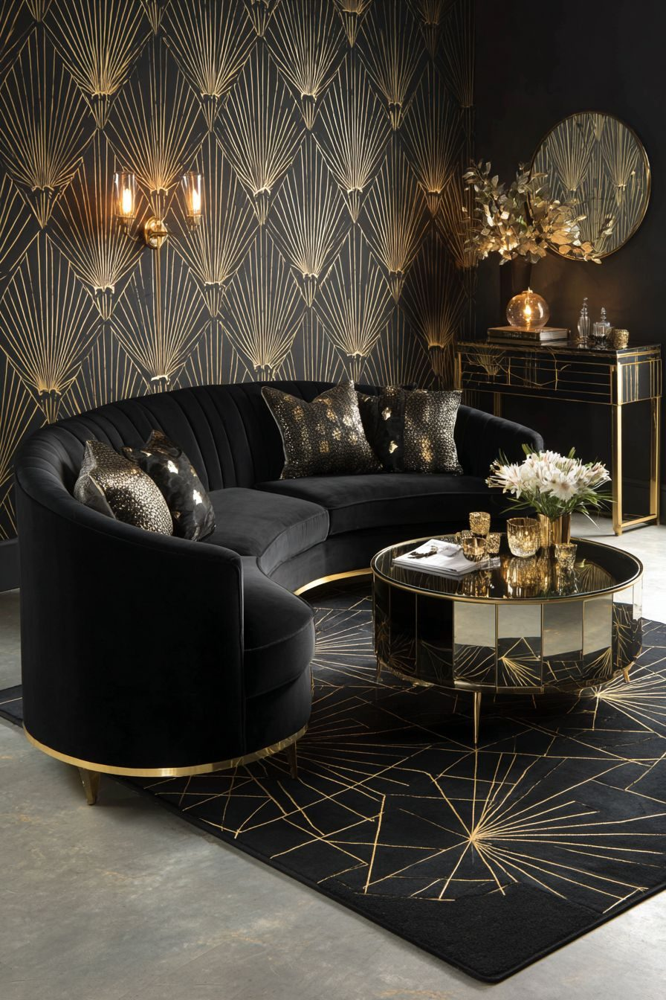

> TIP:GUIDE: Walls: black with gold fan wallpaper | Sofa: curved black velvet | Light: chandelier plus lamps

## 2. A Brass Chandelier

A brass chandelier with crystal drops is the living room's jewelry. Hung over the seating area, it throws warm light across the velvet and the marble, and the fixture itself is the room's sculpture even when it is switched off.

Hang it centered over the coffee table rather than the middle of the room, so the light pools where people sit. A cream sofa underneath keeps the room light, while the brass picks up the gold in the rug and the cushions.

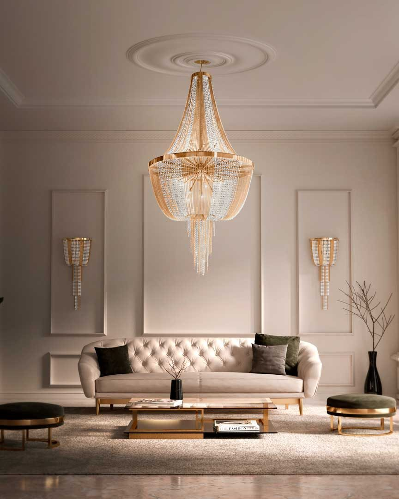

> TIP:CHECK: Center over the coffee table; Cream sofa underneath; Brass repeated in rug and cushions

## 3. A Geometric Rug

A geometric rug is the living room's foundation. Black, gold and cream shapes under a navy velvet sofa set the color palette for the whole room, and the pattern is underfoot where it can be bold without overwhelming the eye.

Size it generously — the front legs of every seat should sit on the rug. Pull one color from the rug for the cushions and a second for a throw, and the seating area will feel pulled together without matching exactly.

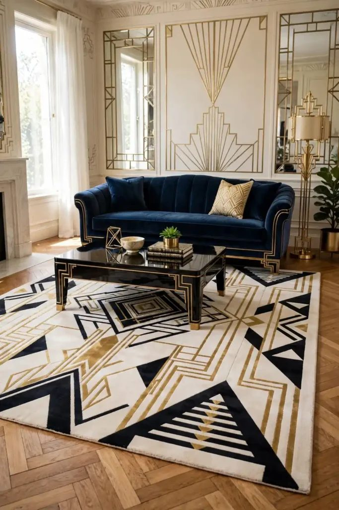

> TIP:GUIDE: Rug: front legs of all seats on it | Cushions: one rug color | Throw: second rug color

## 4. A Curved Sofa

A curved sofa softens a living room full of straight lines. The dark green velvet curve creates a conversation nook all by itself, and it pairs beautifully with a round coffee table and a large piece of geometric art above it.

Let the curve lead the layout: place the sofa first, then arrange the chairs and the table around its arc. A simple rug in a quiet pattern keeps the focus on the sofa's shape.

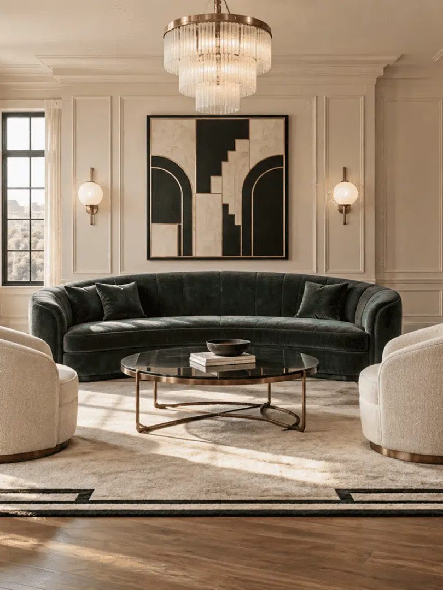

> TIP:QUICK: Place the curved sofa first and arrange everything else around its arc.

## 5. A Deco Fireplace

A deco fireplace is the living room's natural centerpiece. A marble surround with a stepped profile, a gold sunburst mirror above it and matching sconces on either side create a focal point that needs no other decoration.

Keep the mantel styling minimal — one pair of vases or a single sculpture — so the mirror and the surround stay the focus. The fire itself is the room's warm light, so the fireplace should be lit whenever the room is in use.

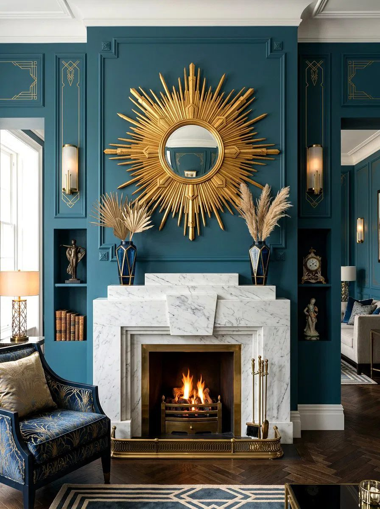

> TIP:CHECK: Sunburst mirror centered; Matching sconces each side; Mantel styling minimal

## 6. An Emerald Velvet Sofa

An emerald velvet sofa is the neo deco living room's anchor. The deep green reads as both rich and modern, and velvet's sheen catches the light in a way flat fabric never does. Place it against dark wood paneling and it looks like it was made for the room.

Style it with gold or brass cushions and a black-and-white geometric rug. The sofa is the jewel tone, the rug is the geometry and the brass is the metal — the whole formula in one seating area, and the room needs little else.

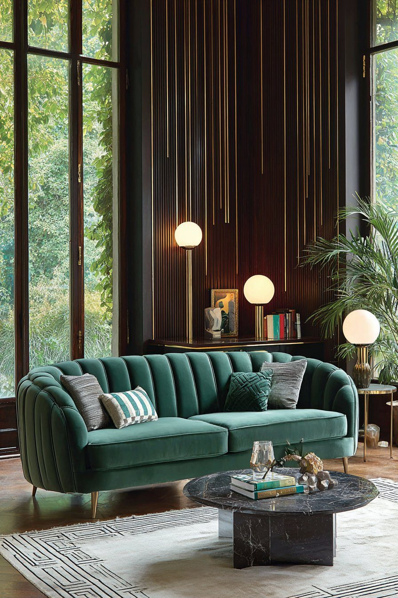

> TIP:QUICK: Put the emerald sofa against dark wood paneling so the green reads even richer.

## 7. A Velvet Armchair Pair

A pair of velvet armchairs flanks the living room's focal point — the fireplace, the mirror or the window — and creates the symmetry neo deco loves. Emerald velvet chairs under a gold sunburst mirror are the classic pairing.

Keep the chairs identical and the space between them even. A small round table between them holds drinks and books, and the symmetry of the pair makes the whole room feel ordered even when the rest of it is relaxed.

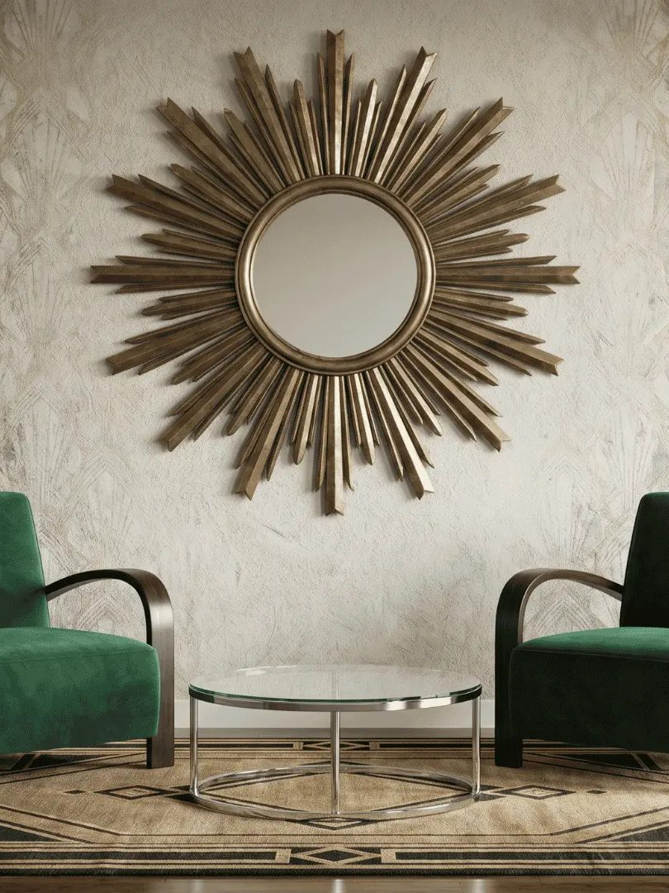

> TIP:QUICK: Keep the pair identical and the gap between them even for true symmetry.

## 8. A Marble Coffee Table with Brass

A marble coffee table with brass legs is the living room's quiet luxury. The white marble top reflects light, the brass frame adds the deco metal, and the whole piece is sturdy enough for daily use while looking like a showroom piece.

Style it with one gold object and one book — a tray, a small vase, a stack of two books at most. The table is already doing the decorative work, so it does not need clutter to justify itself.

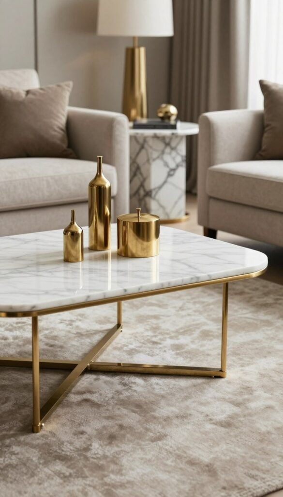

> TIP:CHECK: One gold object; One book stack; Nothing else on the table

## 9. An Arched Mirror

An arched mirror above the sofa does two jobs at once: it reflects light around the room and it brings the deco arch shape to the living room's main wall. The gold geometric framing makes it a piece of art even before it reflects anything.

Hang it centered over the sofa, with the bottom edge about a foot above the sofa back. The sofa should be a solid jewel tone — olive or emerald velvet — so the mirror's gold frame pops against it.

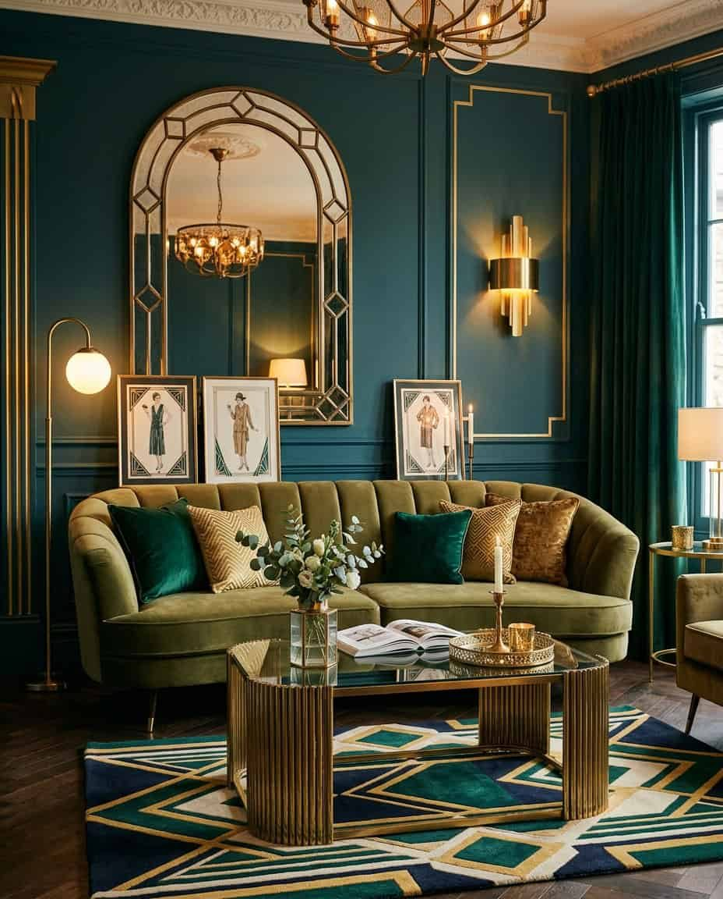

> TIP:GUIDE: Position: centered, a foot above the sofa | Sofa: solid jewel tone | Frame: gold geometric

## 10. A Ceiling Medallion

A ceiling medallion is the living room's most overlooked deco detail. An Art Deco plaster medallion — stepped, fan-shaped or geometric — turns the ceiling into architecture, and it gives the chandelier a proper frame.

Paint the medallion the same color as the ceiling so the shape reads in shadow rather than in color. The chandelier should hang from its center, and the medallion should be large enough to be noticed from the sofa — at least two feet across.

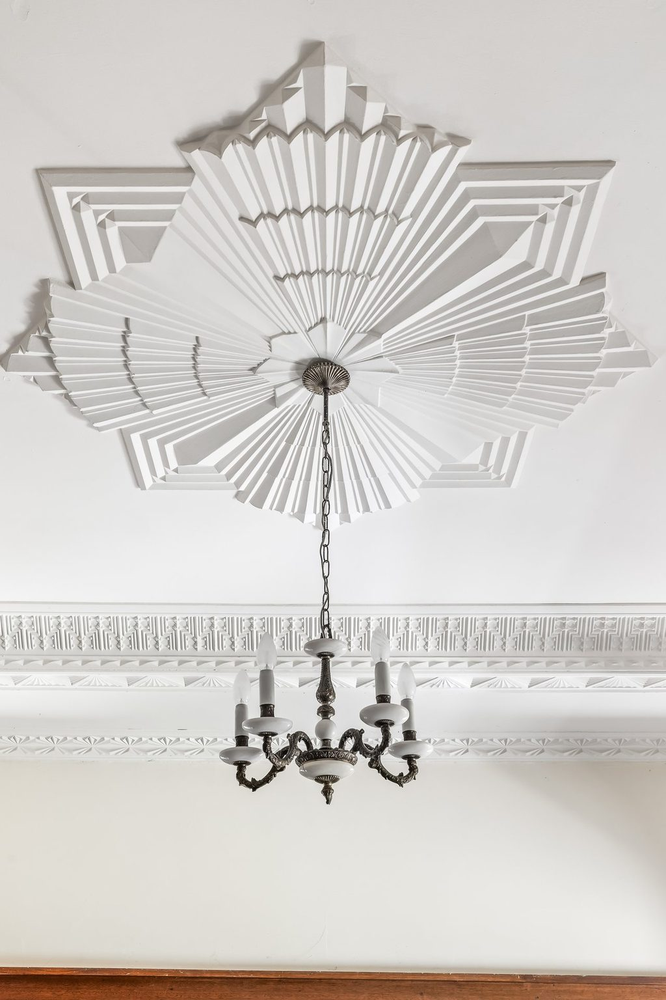

> TIP:QUICK: Paint the medallion ceiling-white and make it at least two feet across.

## 11. Burgundy Accents

Burgundy accents bring warmth to a neo deco living room. A burgundy velvet sofa with gold trim, set against burgundy paneled walls, creates a room that glows in lamplight — and the color is dark enough to feel intimate without feeling small.

Keep the rug pale and the wood warm so the burgundy does not go heavy. Gold appears in the wall trim, the coffee table and the lamp bases, tying the room's warm metals together.

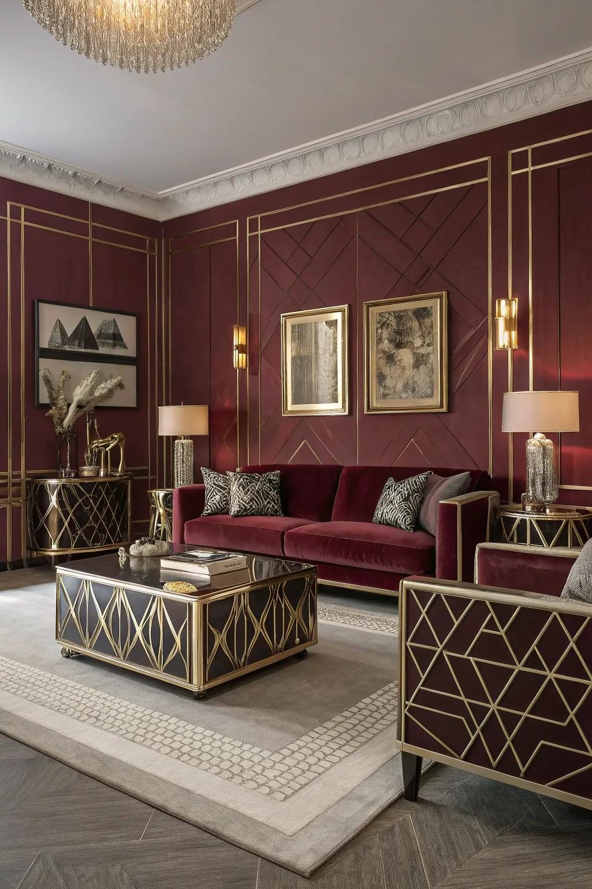

> TIP:CHECK: Rug pale; Wood warm; Gold in trim, table and lamp bases

## 12. A Terrazzo Floor

A terrazzo floor is the deco living room's most practical luxury. The speckled stone is tough, easy to clean and quietly glamorous, and its glossy surface reflects light around the room in a way wood never does.

Keep the furniture light and the walls pale so the floor's sparkle reads. A white sofa, a glass coffee table and a few brass details let the terrazzo be the room's texture while the furniture stays simple.

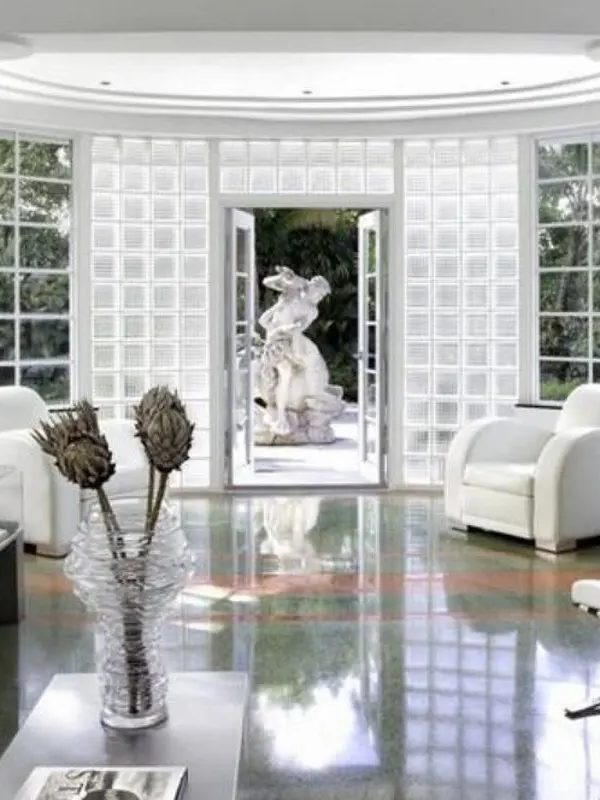

> TIP:GUIDE: Floor: glossy terrazzo | Furniture: light and simple | Details: brass

## 13. A Gallery Wall

A gallery wall of vintage travel posters turns the living room into a private exhibition. Gold-framed prints and sunburst mirrors arranged symmetrically above a console create a display that is both personal and perfectly deco.

Vary the frame sizes but keep the spacing even, and include one mirror in the arrangement to break up the prints and bounce light around. The wall should feel collected over time, not bought in one afternoon.

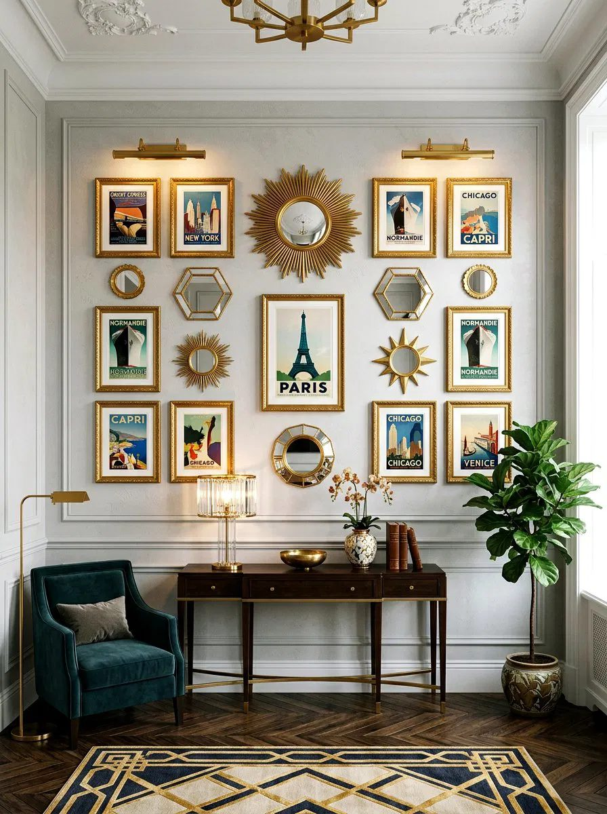

> TIP:QUICK: Include one mirror in the gallery to break up the prints and bounce light.

## 14. A Bar Cart

A bar cart is the living room's most sociable piece of furniture. A gold cart with bottles, glassware and a shaker, parked under a sunburst mirror against teal walls, turns the corner of the room into a cocktail bar.

Stock it with what you actually drink and keep the glassware to one style. The cart should look used, not staged — a bottle open, a glass out — so the room feels lived in rather than displayed.

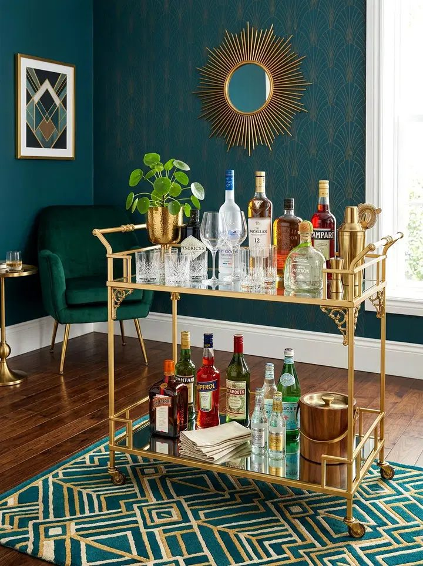

> TIP:CHECK: Stock what you drink; One glassware style; Keep it looking used, not staged

## 15. A Fluted Panel Wall

A fluted panel wall adds deco texture to the living room without pattern. Walnut panels with bronze inlay and green marble below create a wall of vertical rhythm that catches light and shadow all day.

Use the fluted wall as the room's backdrop — behind the seating area or the fireplace — and keep the furniture in front of it simple. The panels are the texture, so the sofa and the rug should be plain.

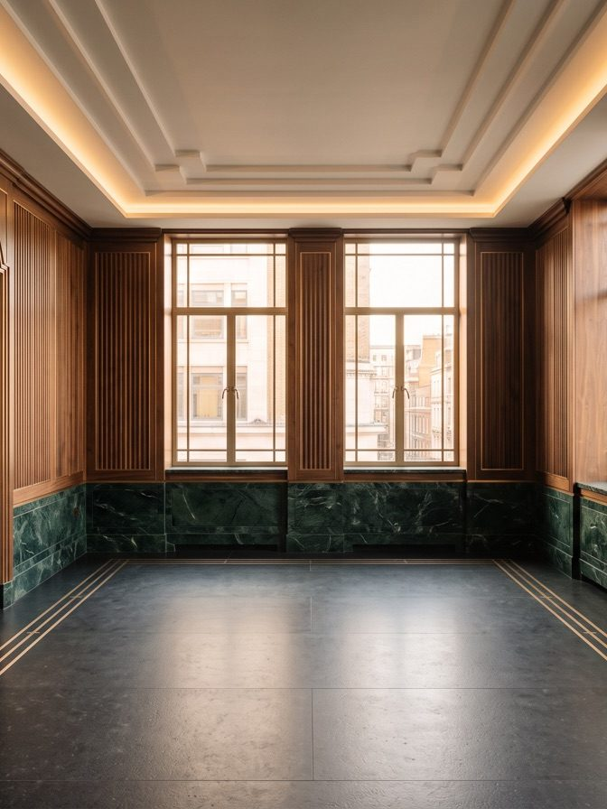

> TIP:GUIDE: Wall: fluted walnut with marble | Furniture: plain | Rug: simple

## 16. Bold Patterned Cushions

Bold patterned cushions are the cheapest way to bring deco into a living room. Floral cushions in jewel tones on an emerald armchair, against a geometric wallpaper, add pattern without touching the walls or the furniture.

Pick cushions that share one color with the chair and one with the wallpaper, and keep the rest of the seating plain. Two patterned cushions are enough — a third starts to compete with the wallpaper.

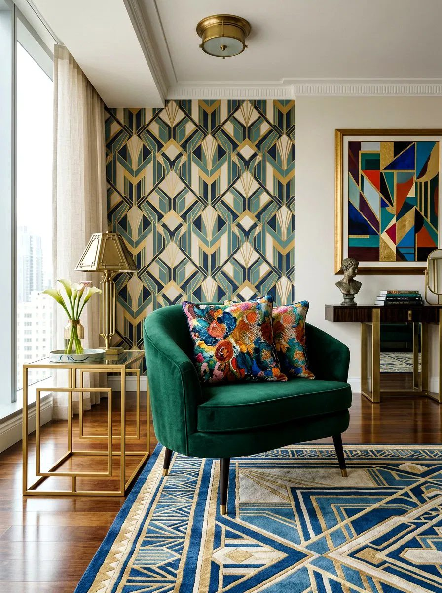

> TIP:QUICK: Two patterned cushions are enough — a third competes with the wallpaper.

## 17. Mirrored Furniture

Mirrored furniture doubles the light and the glamour in a living room. A mirrored console and coffee table reflect the emerald sofa, the gold art and the geometric rug, making the room feel larger and more luminous.

Use mirrored pieces sparingly — one console and one table is plenty — and keep them clean, because fingerprints show on mirror. The reflection should be of something beautiful, so place the mirrored furniture opposite the room's best feature.

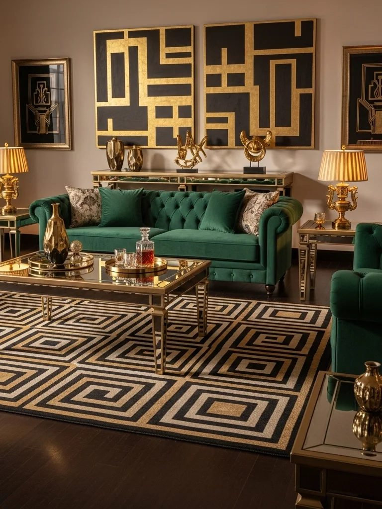

> TIP:CHECK: One console, one table; Place opposite the room's best feature; Keep it clean

## 18. Monochrome Black Deco

A monochrome black deco living room is the boldest version of the style. Black paneled walls, a black velvet sofa and gold accents create a room that feels like a private club — dramatic, intimate and unforgettable.

Light it warmly and generously, because black absorbs light. A gold wall sconce, a brass table lamp and a glass coffee table with a gold rim will keep the room glowing rather than gloomy.

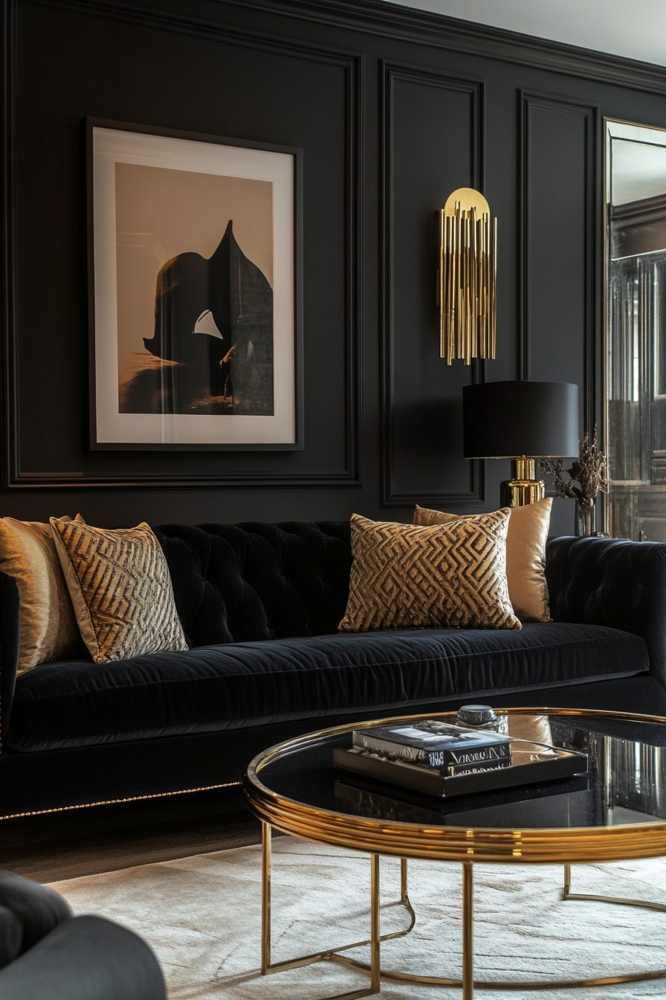

> TIP:GUIDE: Walls: black paneled | Sofa: black velvet | Light: sconce, lamp and glass table

## 19. Layered Lighting

Layered lighting is what makes a neo deco living room glow. A brass and glass chandelier overhead, sconces on the walls and a floor lamp beside the sofa create three levels of warm light that flatter velvet and marble alike.

Put the chandelier on a dimmer and the lamps on separate switches, so the room can go from bright daytime to candlelit evening. The lighting should be warm — 2700K bulbs — because cool light kills the jewel tones.

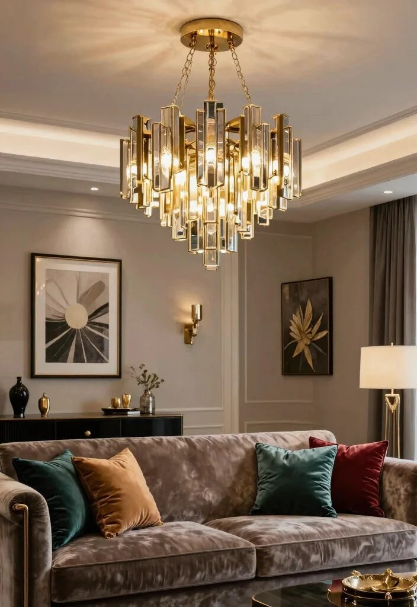

> TIP:QUICK: Use warm 2700K bulbs and put the chandelier on a dimmer.

## 20. Statement Art

Statement art is the living room's deco signature. A wall of gold and blue deco prints above a mustard sofa creates a gallery that is both the room's color scheme and its decoration, and it needs nothing else on the wall.

Hang the prints in a tight grid with even spacing, and keep the sofa below them a solid color. The art is the pattern, so the cushions should be plain — one gold, one navy — and the rug a quiet geometric.

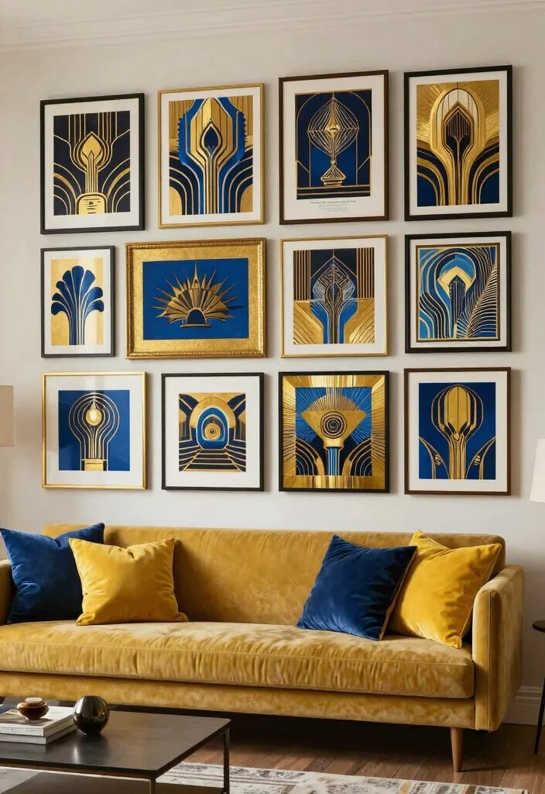

> TIP:CHECK: Tight grid, even spacing; Sofa solid; Cushions plain, one gold and one navy

## 21. A Curved Velvet Sofa

A curved velvet sofa in champagne with gold lattice turns the living room into a salon. The curve creates a conversation nook, the velvet catches the light, and the gold detailing ties the sofa to the room's brass and mirrors.

Style it with cushions in the room's jewel tone — emerald or sapphire — and a round coffee table that echoes the curve. A geometric rug underneath grounds the arrangement and keeps the curve from floating.

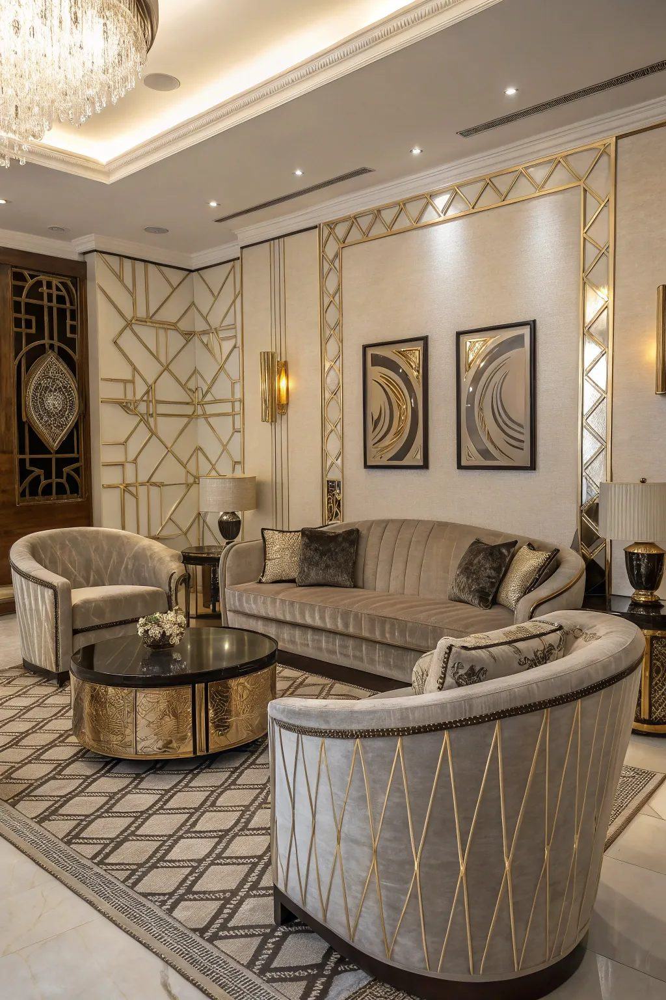

> TIP:GUIDE: Sofa: curved champagne velvet | Cushions: jewel tone | Table: round, echoing the curve

## 22. Navy Panelled Walls

Navy panelled walls give the living room its deco architecture. The molded panels add shadow and rhythm, the deep blue makes the emerald sofa glow, and the gold bar cart in the corner completes the jewel-box effect.

Keep the ceiling white and the floor warm wood so the navy does not close the room in. The panels should be painted the same navy as the walls, so the shape reads in shadow rather than in color.

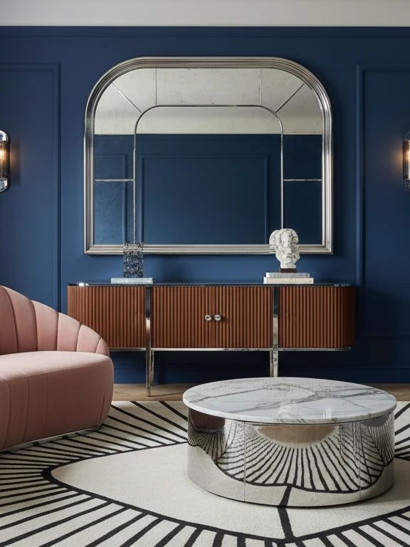

> TIP:QUICK: Paint panels the same navy as the walls so the shape reads in shadow.

## 23. Jewel-Tone Throw Styling

Jewel-tone throw styling is the living room's finishing layer. A throw in emerald or sapphire draped over the sofa arm, cushions in gold and teal, and a deco wallpaper behind it all create a room that looks styled without looking staged.

Drape the throw casually — folded once over the arm, not arranged — and keep the cushions to three at most. The styling should look like someone just left the room, not like a photoshoot.

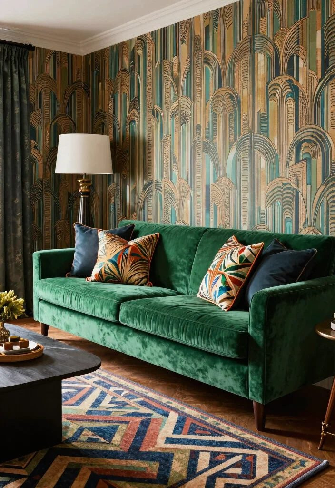

> TIP:CHECK: Throw draped casually; Three cushions at most; Wallpaper behind ties it together

## 24. A Dark Wood and Gold Living Room

A dark wood and gold living room is neo deco's warmest version. Fluted dark wood panels, a marble fireplace with a gold-trimmed mirror and herringbone floors create a room that feels like a gentleman's club — rich, quiet and deeply comfortable.

Keep the furniture low and the palette warm: dark wood, brass and cream. The fireplace is the focal point, so the seating should face it, and the mirror above it should reflect the window rather than a blank wall.

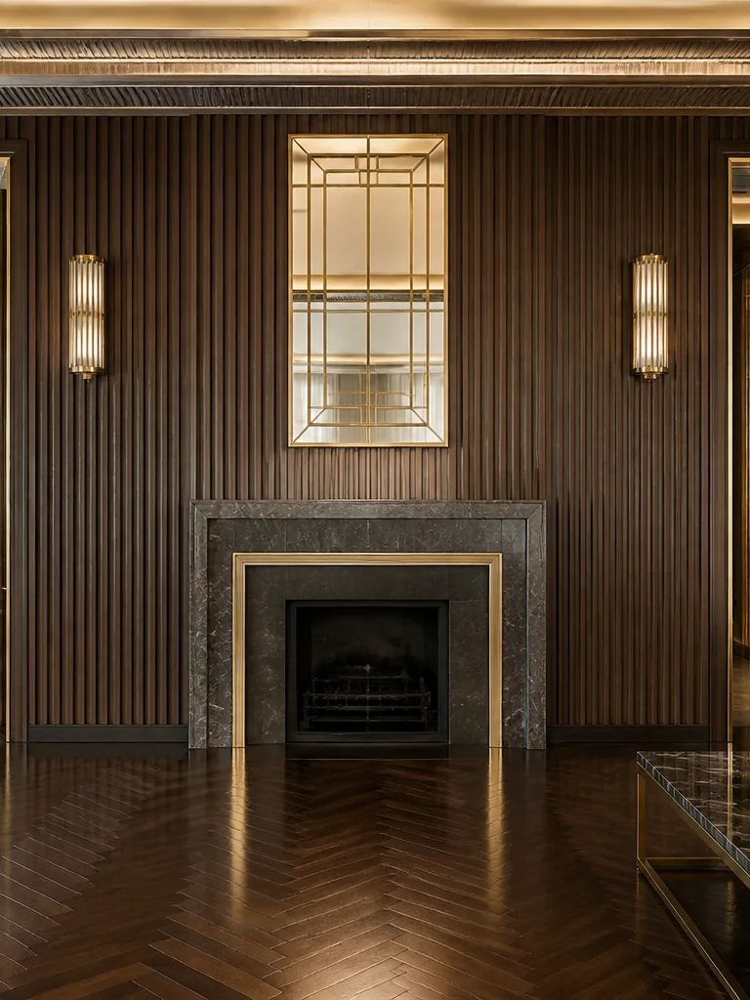

> TIP:GUIDE: Walls: fluted dark wood | Fireplace: marble with gold mirror | Seating: facing the fire

## 25. A Grid of Gold-Framed Art

A grid of gold-framed art above a black sideboard turns the living room's wall into a gallery. Eight deco prints in identical gold frames, hung in two rows of four, create a composition that is both bold and perfectly ordered.

Measure the grid carefully — the frames must align exactly, or the symmetry fails. The sideboard below should be black with brass handles, and the lamp on it should be the only object competing for attention.

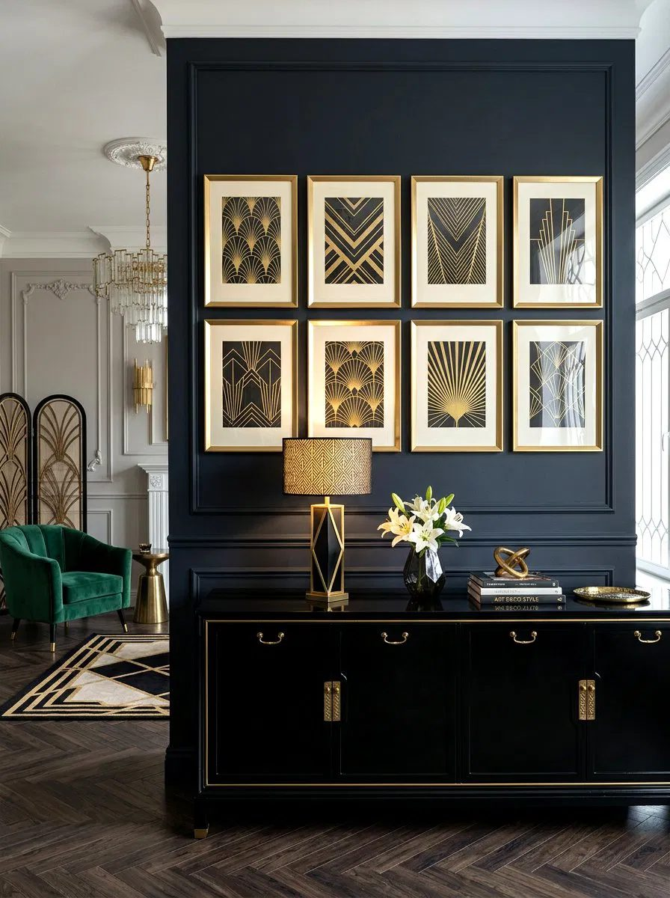

> TIP:QUICK: Align the grid exactly — identical frames, even spacing, two rows of four.

## 26. A Teal Sofa with Orange Pillows

A teal sofa with orange pillows is the neo deco color combination that surprises everyone. The cool teal and the warm orange are opposites on the color wheel, so they make each other glow — and the gold fan art above the sofa ties them together.

Keep the rug geometric in orange, teal and cream so the floor repeats the sofa's story. One brass floor lamp and a round marble coffee table finish a room that feels both bold and balanced.

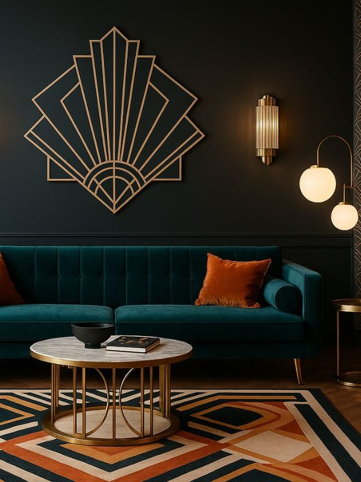

> TIP:CHECK: Opposites on the color wheel; Rug repeats the story; One brass floor lamp

## 27. A Patterned Rug with Velvet

A patterned rug with velvet seating is the living room's textural pairing. An emerald geometric rug under a navy velvet armchair creates a corner that is both patterned and plush, and the gold lamp beside it adds the deco metal.

Let the rug be the pattern and the chair be the solid color. A brass side table and a single cushion in the rug's gold complete the vignette without adding a second pattern to compete with the floor.

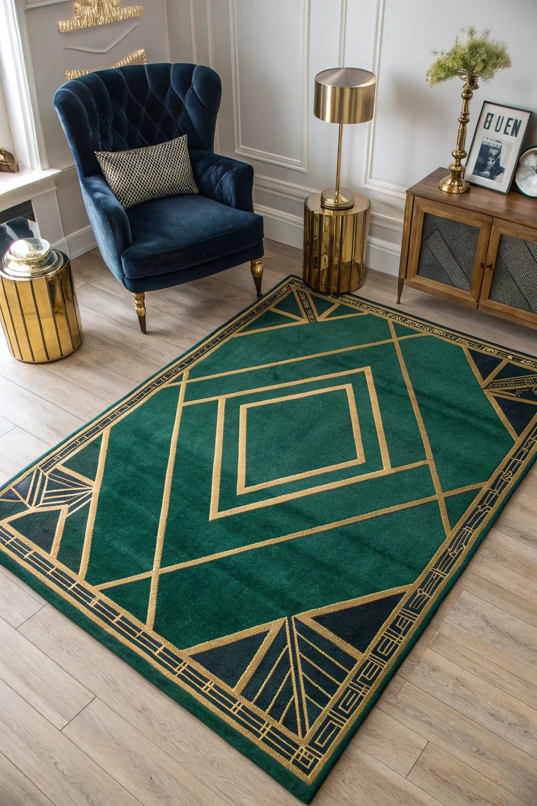

> TIP:GUIDE: Rug: the pattern | Chair: solid velvet | Table: brass, one cushion in rug gold

## 28. A Warm Evening Deco Living Room

A warm evening deco living room is the style at its most inviting. A burgundy velvet chair, a brass bar cart and a marble fireplace, all lit by candles and a single pendant, create a room that feels like the best seat in a private club.

Layer the light: the pendant for general glow, candles on the coffee table for warmth and a small lamp beside the chair for reading. The room should feel like it is waiting for someone to sit down with a drink.

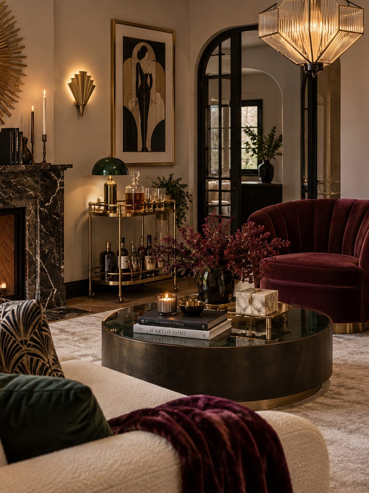

> TIP:QUICK: Layer the light — pendant, candles and one reading lamp — for evening warmth.

## 29. A Bold Symmetry Layout

A bold symmetry layout is the neo deco living room's purest form. Matching emerald sofas facing each other across a marble coffee table, arched windows at either end and a centered chandelier create a room that feels ordered, formal and deeply glamorous.

Symmetry demands discipline: the sofas must match, the lamps must be identical and the rug must be centered exactly. The payoff is a room that photographs beautifully and feels calm despite its drama.

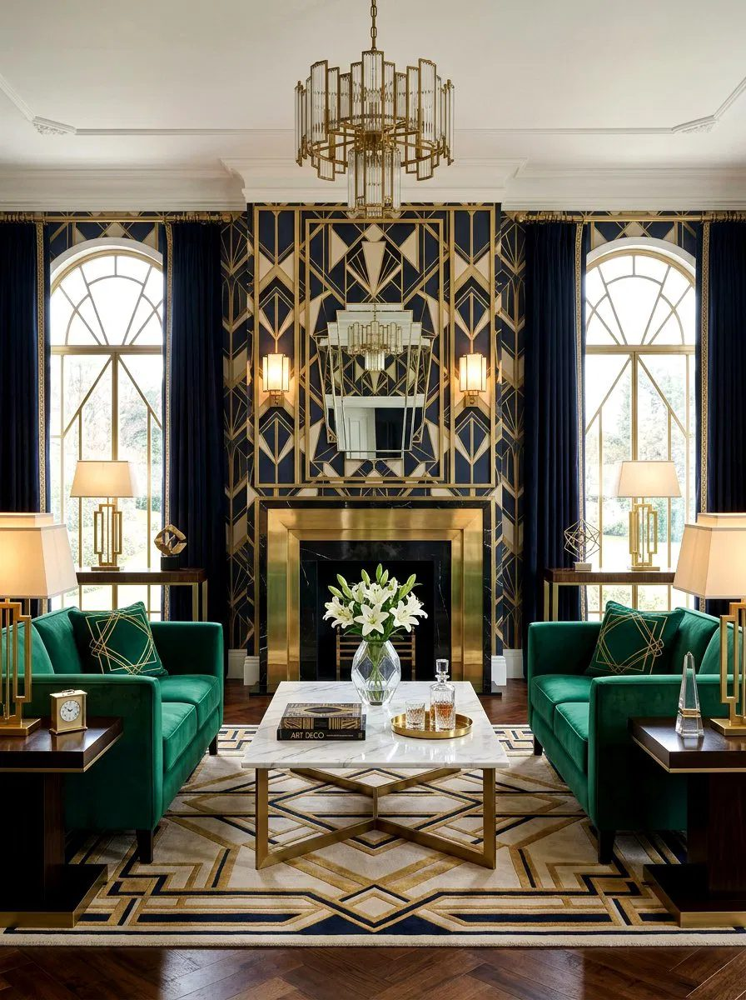

> TIP:CHECK: Matching sofas; Identical lamps; Rug centered exactly

## 30. A Jewel-Tone Rug

A jewel-tone rug is the living room's easiest deco win. A black and gold rug with a fan motif under a green velvet sofa sets the color palette for the whole room, and the pattern is underfoot where it can be bold without overwhelming the eye.

Pull one color from the rug for the cushions and let the sofa's green be the room's jewel tone. A brass side table and a marble-topped stool complete a seating area that feels designed rather than assembled.

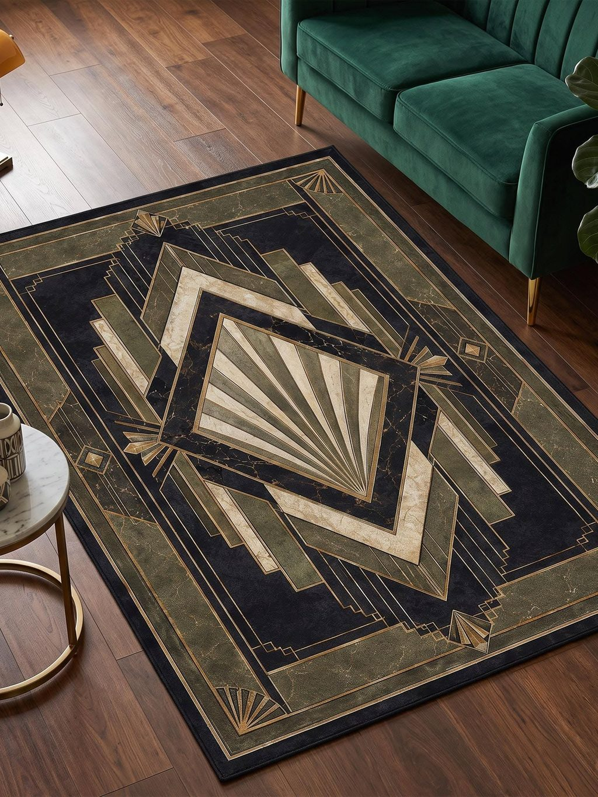

> TIP:GUIDE: Rug: black and gold fan motif | Sofa: green velvet | Cushions: one rug color

## Takeaway

- A neo deco living room works when the formula holds and the symmetry holds.
- One jewel tone, one geometric pattern and one brass accent, arranged so the room feels ordered even when it is dramatic. Start with the sofa — emerald velvet is the classic — then add the rug, the mirror and the light in that order.
- For the style across the rest of the house, our [30 Neo Deco Ideas for a Bold, Modern Home](/posts/neo-deco/) takes the same formula into bedrooms, kitchens, bathrooms and entryways.

## Frequently Asked Questions

### What makes a living room neo deco?

A neo deco living room combines a jewel-tone velvet sofa, a geometric rug, brass lighting and a sunburst or arched mirror, arranged with symmetry. The palette is emerald, sapphire or burgundy with black and gold, and the motifs — fans, chevrons, sunbursts — appear once or twice per room, never everywhere.

### What is the best sofa color for a neo deco living room?

Emerald velvet is the classic, followed by teal, sapphire and cobalt. The sofa is the room's jewel tone, so choose the color you love most and build the cushions, rug and art around it. A solid color works better than a pattern, because the rug carries the geometry.

### How do I light a neo deco living room?

Layer three levels: a brass or crystal chandelier overhead, sconces or table lamps at seat height, and candles or a floor lamp for warmth. Warm 2700K bulbs flatter velvet and marble, and a dimmer on the chandelier lets the room go from bright to candlelit.

### Can a neo deco living room work with a TV?

Yes. Mount the TV on the wall opposite the sofa and frame it with paneling or a dark surround so it reads as part of the architecture. Keep the media unit low and lacquered black, and let the fireplace or the mirror — not the TV — be the room's focal point.

### What rug works best in a neo deco living room?

A geometric rug in black, gold and cream, or in the room's jewel tone with gold. Size it so the front legs of every seat sit on it, and let its colors guide the cushions. One bold rug is better than two competing patterns in the same room.

### How much gold is too much in a living room?

Gold should appear in three places: the light fixture, the mirror frame and one piece of furniture hardware or decor. More than that and the metal competes with the jewel tones. Brass and gold can mix, but keep them in the same warm family.

### Does neo deco suit a small living room?

It suits small rooms well. One velvet sofa, a sunburst mirror and a geometric rug are all a small living room needs, and the dark, glossy palette makes the space feel intentional. Keep the ceiling pale and the lighting warm so the room stays bright.

### How do I add neo deco to a living room without replacing furniture?

Add a geometric rug, velvet cushions in a jewel tone, a sunburst mirror and a brass floor lamp. These four pieces set the style over your existing sofa and tables, and a coat of deep paint on one wall finishes the look without new furniture.
