# 30 Neo Deco Ideas for a Bold, Modern Home

Neo deco takes the glamour of 1920s Art Deco — geometric patterns, jewel tones, brass and bold symmetry — and strips it back for modern life. The result is a home that feels luxurious without feeling like a museum: emerald velvet next to clean lines, arches next to flat-screen TVs, gold fan wallpaper next to a simple white sofa. This list gathers 30 neo deco ideas from across the whole home.

The formula is simple: one jewel tone, one geometric pattern and one brass accent per room, repeated with discipline. If you want the living-room version in depth, our [30 Neo Deco Living Room Ideas for a Bold, Modern Space](/posts/neo-deco-living-room/) covers sofas, lighting, wall treatments and layouts for that one room alone.

## 1. An Emerald Velvet Sofa

An emerald velvet sofa is the neo deco starting point. The deep green reads as both rich and modern, and velvet's sheen catches the light the way 1920s glamour demands. It anchors a living room without needing anything else to be loud.

Style it with gold or brass cushions and a black-and-white geometric rug. The sofa is the jewel tone, the rug is the geometry and the brass is the metal — the whole neo deco formula in one seating area.

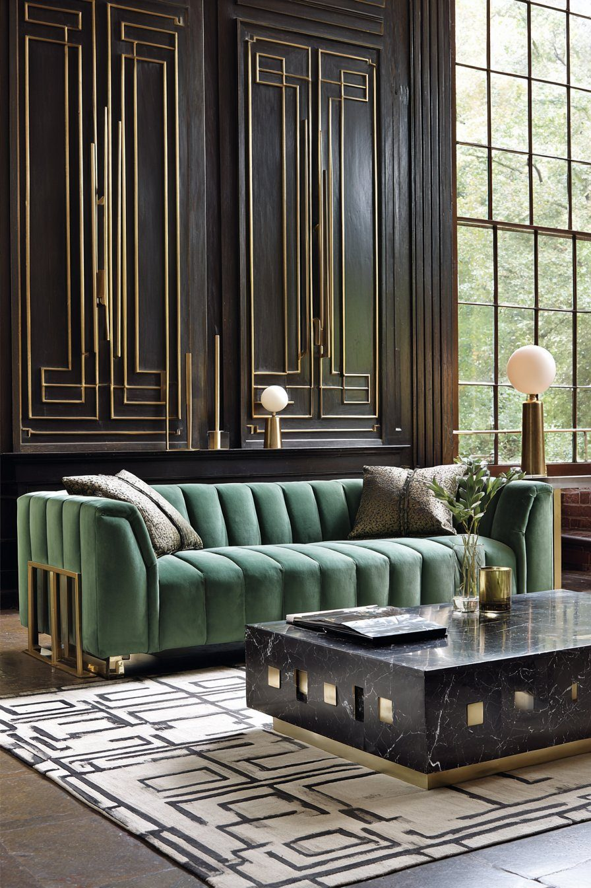

> TIP:QUICK: Pair emerald velvet with brass cushions and a geometric rug for the full formula.

## 2. Geometric Wallpaper

Geometric wallpaper is neo deco's signature wall. Fan, sunburst and chevron patterns in gold on teal, navy or black bring the 1920s into a modern room without a single piece of period furniture.

Use it on one feature wall and keep the rest of the room calm — solid furniture, plain ceiling, simple floor. The wallpaper is the pattern, so everything else should be the quiet background that lets it shine.

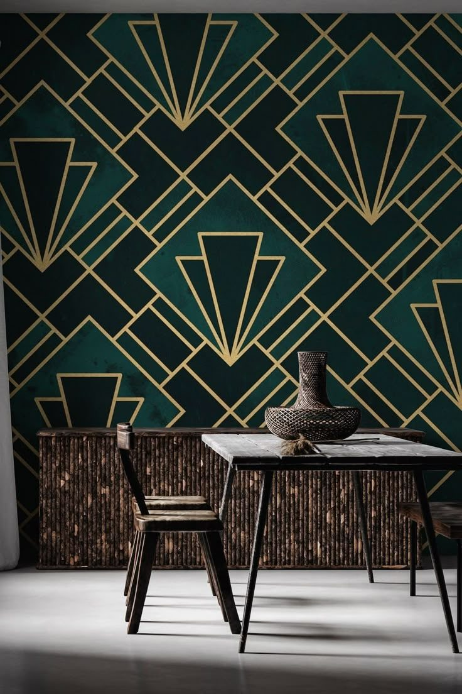

> TIP:CHECK: One feature wall; Solid furniture; Plain ceiling and floor

## 3. Arched Doorways

Arched doorways are the neo deco shape that changes how a home feels. A black and gold arch between rooms turns a plain opening into a portal, and the curve softens every straight line around it.

Paint the arch trim in black with gold inlay, or keep it simple in the wall color with a brass threshold. Either way, the arch should be the only curve in the hallway, so it reads as architecture rather than decoration.

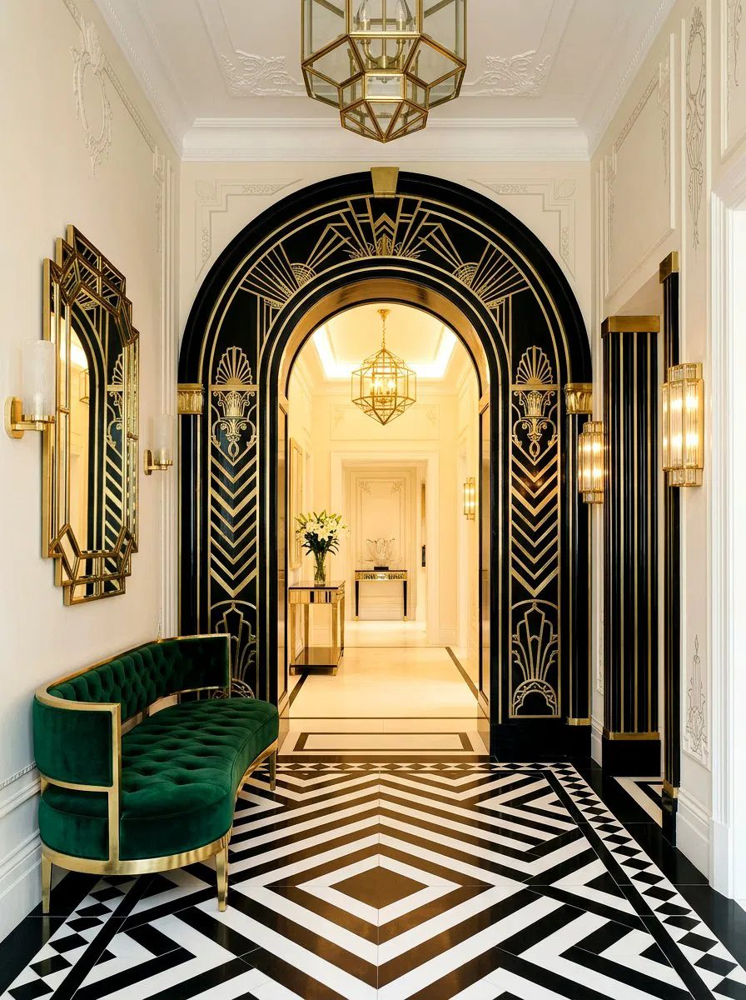

> TIP:GUIDE: Arch trim: black with gold inlay | Threshold: brass | Surroundings: straight lines only

## 4. A Statement Deco Bedroom

A statement deco bedroom channels Gatsby glamour without the costume. A scalloped headboard, mirrored bedside tables and a sunburst mirror above the bed create a room that feels like a hotel suite — and it sleeps just as well as a plain one.

Keep the palette to two jewel tones and gold: emerald and navy, say, or sapphire and burgundy. The bedding should be plain velvet or satin in one of those tones, so the furniture and mirrors carry the pattern.

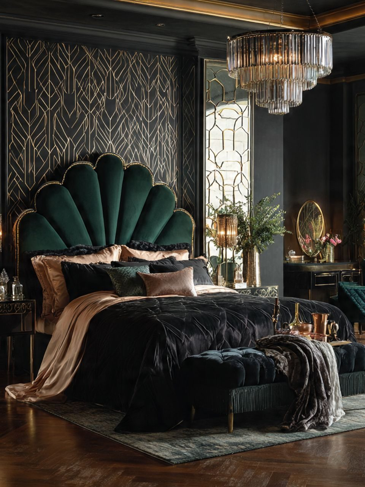

> TIP:QUICK: Limit the bedroom to two jewel tones plus gold for a hotel-suite feel.

## 5. A Sunburst Headboard

A sunburst headboard brings the deco fan motif to the bed itself. Radiating lines in brass or gold on a teal or navy ground make the headboard the room's artwork, and it works with the simplest bedding.

Pair it with plain bedding in the headboard's background color and one brass lamp per side. The sunburst is already doing the pattern work, so the rest of the bed wall should stay quiet.

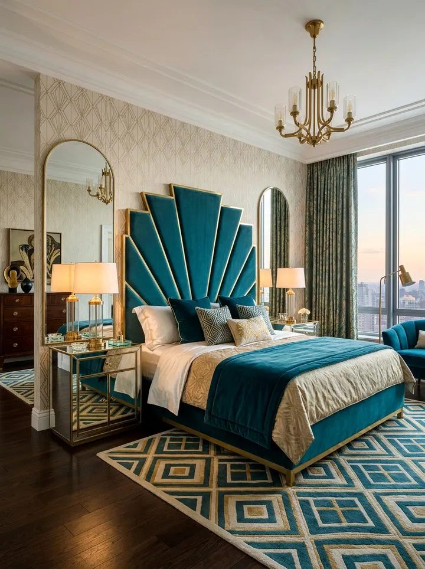

> TIP:CHECK: Headboard: sunburst fan | Bedding: background color | Lamps: one brass per side

## 6. A Marble and Brass Kitchen

A marble and brass kitchen is neo deco at its most practical. A green marble island, brass hardware and fluted cabinet fronts bring the glamour into the room that works hardest, and the materials are tough enough to take daily use.

Keep the upper cabinets plain and the worktops a single stone so the island stays the star. Brass taps and handles repeat the metal in small doses, and the geometry comes from the cabinet fronts rather than a busy backsplash.

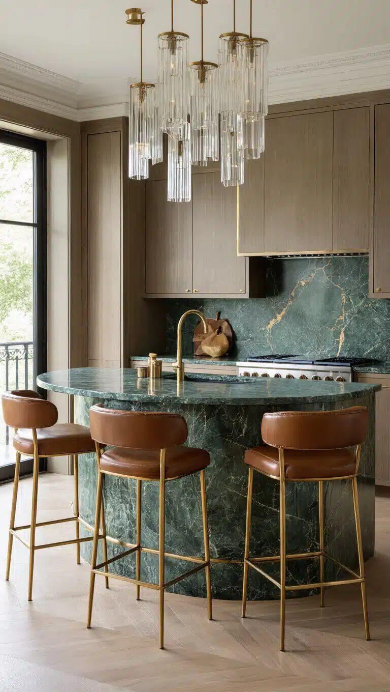

> TIP:GUIDE: Island: green marble | Hardware: brass | Cabinets: fluted fronts, plain uppers

## 7. A Deco Bathroom

A deco bathroom turns the smallest room into the most glamorous. Black marble, a gold vessel sink and a stepped mirror make a powder-room-sized space feel like a speakeasy, and the dark palette actually suits small rooms because it blurs the edges.

Use large-format tiles to keep the grout lines minimal, and add one strong light source — a pair of sconces flanking the mirror. The gold fixtures should be the only metal in the room, so the palette stays disciplined.

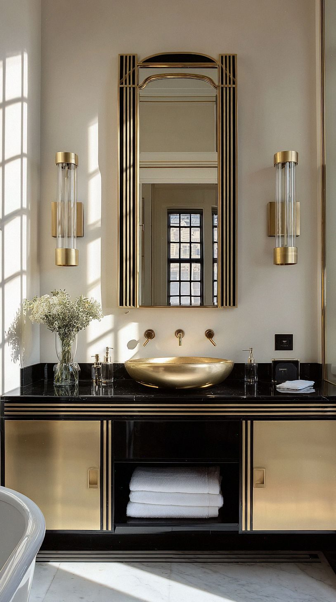

> TIP:QUICK: Use large tiles to minimize grout lines and let the gold fixtures shine.

## 8. A Sunburst Mirror

A sunburst mirror above the fireplace is the neo deco living room centerpiece. The radiating rays draw the eye up, the gold frame catches the firelight, and the symmetry of the mantel below completes the composition.

Center it precisely over the mantel and flank it with matching sconces or vases. Symmetry is the whole point of this look — if the mirror is off-center by even an inch, the room will feel wrong.

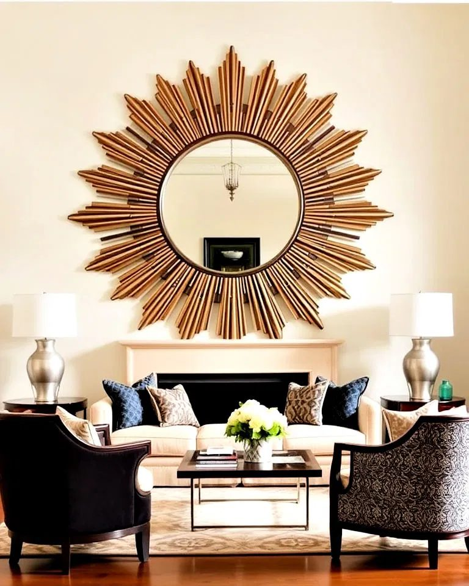

> TIP:CHECK: Centered over the mantel; Matching sconces each side; Nothing else on the mantel

## 9. An Emerald Dining Room

An emerald dining room makes every dinner feel like an occasion. Deep green walls, velvet dining chairs and brass details create a room that glows in candlelight, and the color is dark enough to feel intimate without feeling small.

Keep the table dark wood or black lacquer and the lighting low and warm. A single chandelier with crystal or glass drops is the room's jewelry, and it should hang low enough to light the table rather than the ceiling.

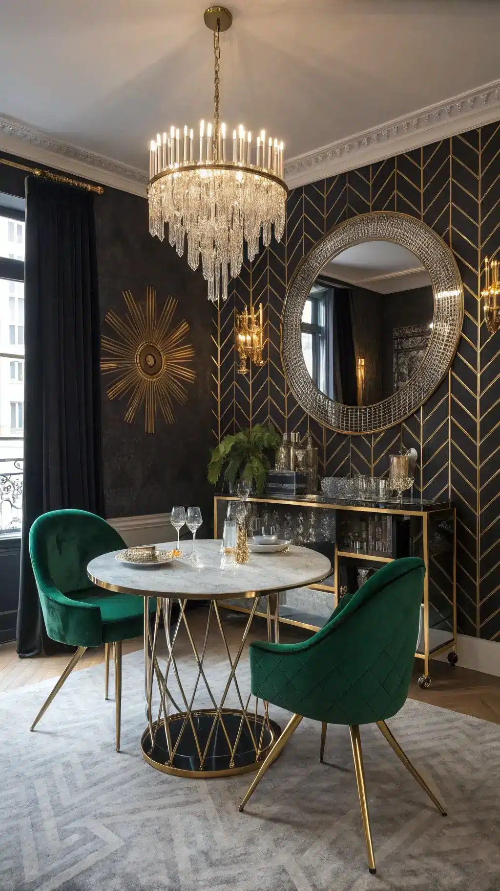

> TIP:GUIDE: Walls: deep emerald | Chairs: velvet | Light: low warm chandelier

## 10. Fluted Wall Panels

Fluted wall panels add deco texture without pattern. Vertical ridges in wood or plaster catch light and shadow, giving a plain wall a rhythm that feels both modern and 1920s at once.

Use them on one wall — behind the sofa is the classic spot — and keep the furniture in front of them simple. A white sofa against pale fluted panels is the quiet version; dark wood panels behind a velvet sofa is the dramatic one.

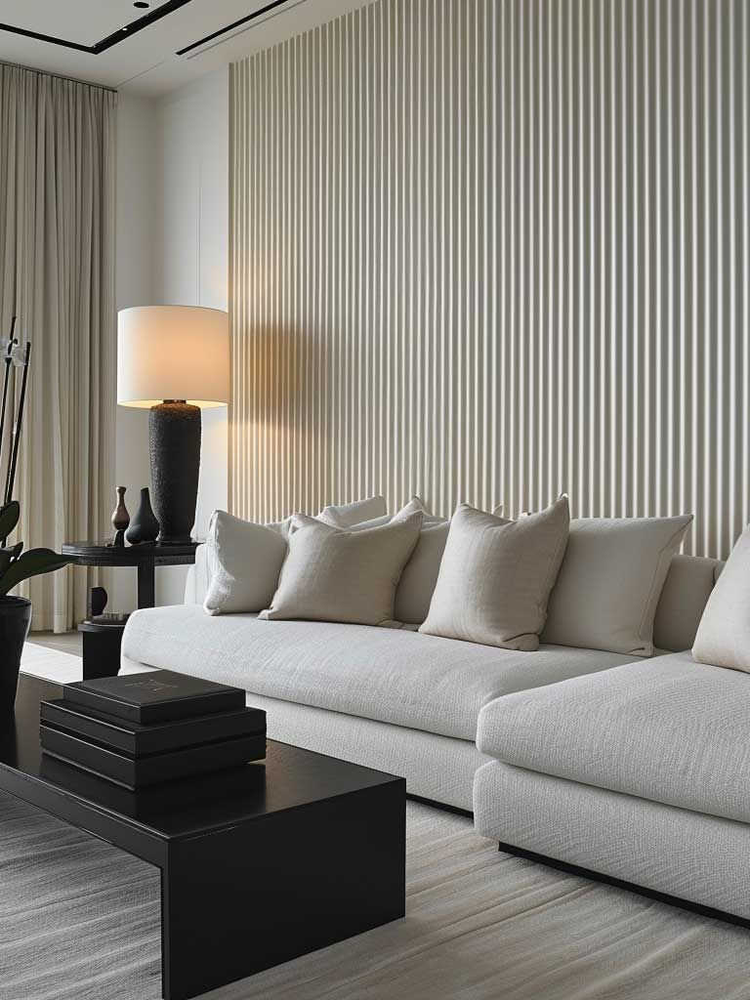

> TIP:QUICK: Panel one wall behind the sofa and keep the furniture in front simple.

## 11. A Globe Chandelier

A globe chandelier is the neo deco light that works in any room. Brass arms and glass globes give the 1920s shape in a modern, clean form, and the warm light flatters velvet and marble alike.

Hang it at the right height — low enough to be seen, high enough to walk under — and let it be the only statement light in the room. Table lamps and sconces should be simple and small, so the chandelier keeps the spotlight.

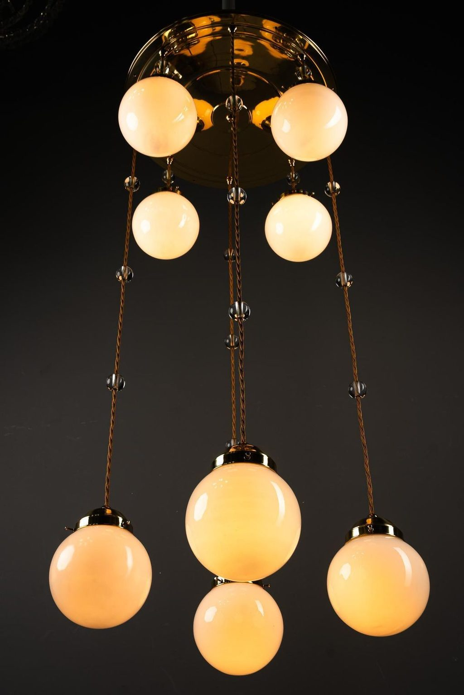

> TIP:CHECK: One statement light per room; Table lamps simple; Warm bulbs throughout

## 12. A Deco Entryway

A deco entryway sets the tone before anyone reaches the living room. A fan mirror, a console with a stepped or fluted front, and a single brass lamp create a first impression that is pure glamour.

Keep the entryway palette the same as the living room's so the house feels continuous. The mirror should reflect the door or a window, not a blank wall, so it doubles the light as well as the style.

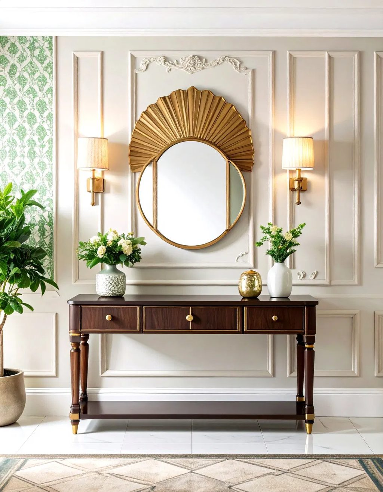

> TIP:GUIDE: Mirror: fan shape | Console: stepped or fluted front | Lamp: one brass

## 13. A Black Lacquer Armoire

A black lacquer armoire is neo deco furniture at its boldest. The high-gloss finish reflects the room, the chrome details catch the light, and the piece reads as both storage and sculpture.

Place it against a pale wall so the black lacquer stands out, and keep the top clear except for one object — a vase, a clock, a small sculpture. The armoire is already a statement, so it does not need company.

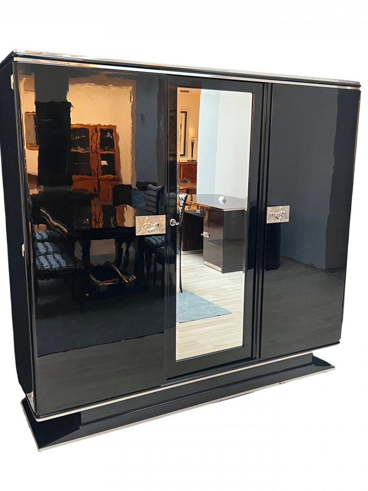

> TIP:QUICK: Place black lacquer against a pale wall and keep the top nearly empty.

## 14. A Deco Home Office

A deco home office makes work feel like a pleasure. A walnut desk, an emerald chair and brass desk accessories bring the glamour to the smallest room in the house, and the dark palette helps focus.

Keep the desk surface clear except for the work at hand, and store everything else in closed drawers. The office should feel like a study from a 1920s film — ordered, rich and slightly theatrical.

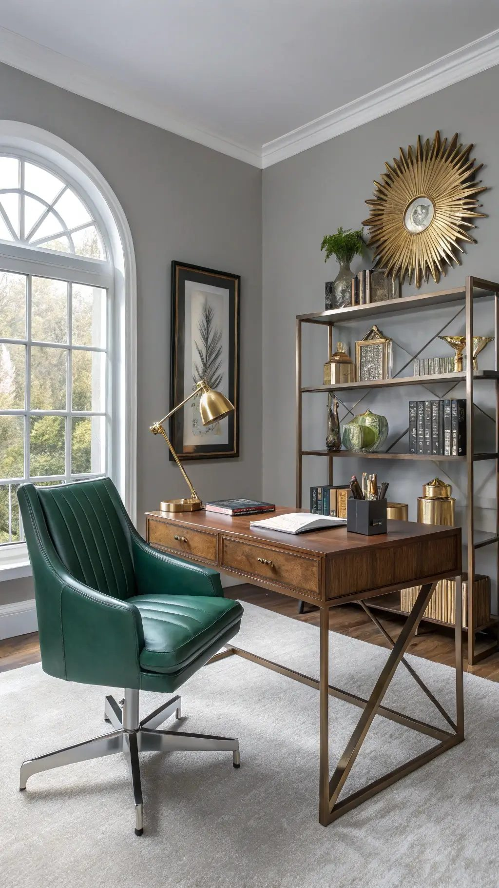

> TIP:CHECK: Desk: walnut | Chair: emerald velvet | Accessories: brass, minimal

## 15. Fan and Scallop Tile

Fan and scallop tile is the neo deco bathroom's secret weapon. The shell-shaped tiles in blue, cream and terracotta create a wall of pattern that feels handcrafted, and the shape is pure Art Deco.

Use the scallop tile on one wall — behind the vanity is the classic spot — and keep the other walls plain. The tiles are the pattern, so the fixtures should be simple brass and the mirror plain.

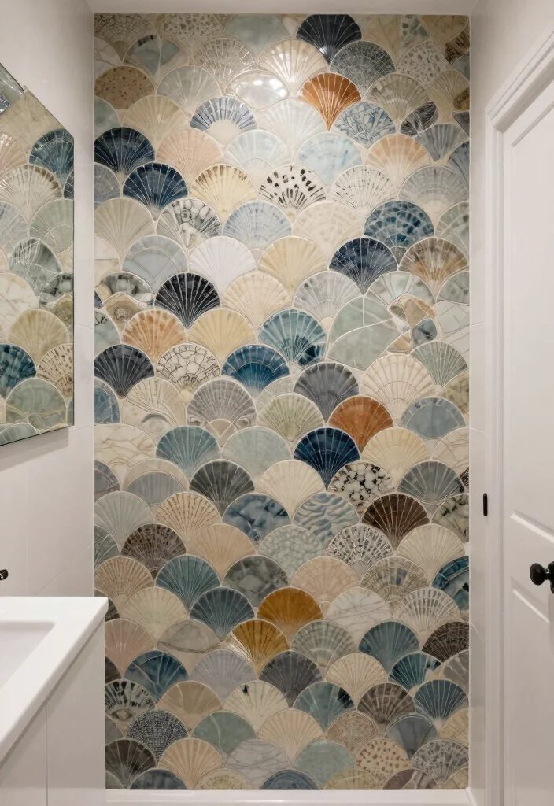

> TIP:GUIDE: Tile wall: behind the vanity | Other walls: plain | Fixtures: simple brass

## 16. Sapphire Blue Walls

Sapphire blue walls are the boldest neo deco move, and the most rewarding. Deep blue with gold trim, a crystal chandelier and velvet seating create a room that feels like a jewel box — dramatic in the evening, rich in daylight.

Balance the blue with warm wood floors and a pale rug, so the room does not go cold. Gold trim on the wall panels is the deco touch that stops the blue from feeling like just a painted room.

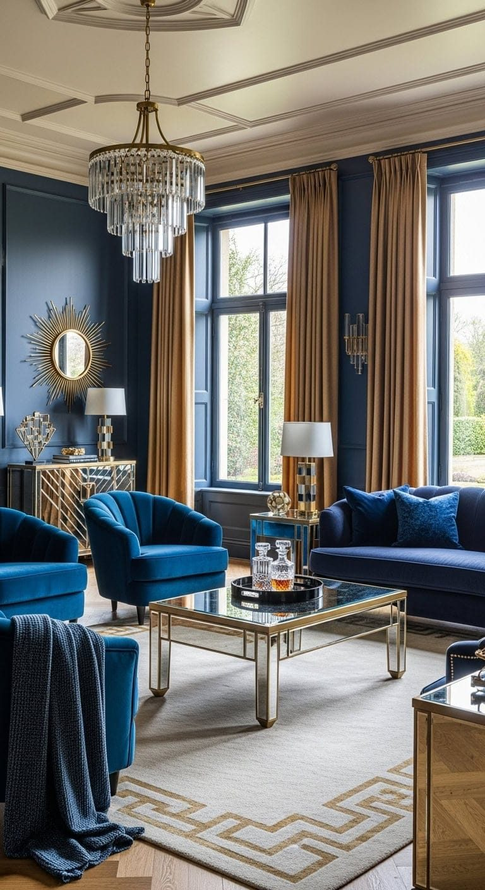

> TIP:QUICK: Balance sapphire walls with warm wood floors and a pale rug.

## 17. Black Lacquer Furniture

Black lacquer furniture brings deco drama to any room. A console with mirrored cabinets, a lacquered sideboard or a glossy coffee table reflects light and color around the room, doubling the glamour without adding clutter.

Use one lacquered piece per room and let it be the dark anchor. Pair it with brass and a jewel tone — emerald, sapphire or burgundy — and the piece will look expensive even when it is not.

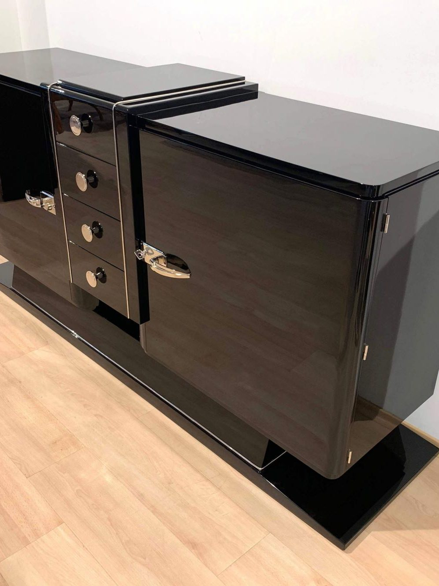

> TIP:CHECK: One lacquered piece per room; Brass accents; One jewel tone alongside

## 18. A Teal Velvet Sofa

A teal velvet sofa is the softer sibling of the emerald one. The blue-green reads as both jewel-toned and calm, and it pairs beautifully with gold, brass and the geometric patterns that define neo deco.

Style it with a sunburst mirror above and patterned cushions in gold and navy. The sofa's color is the room's jewel tone, so the rug should be a quiet geometric in black and cream rather than a second loud color.

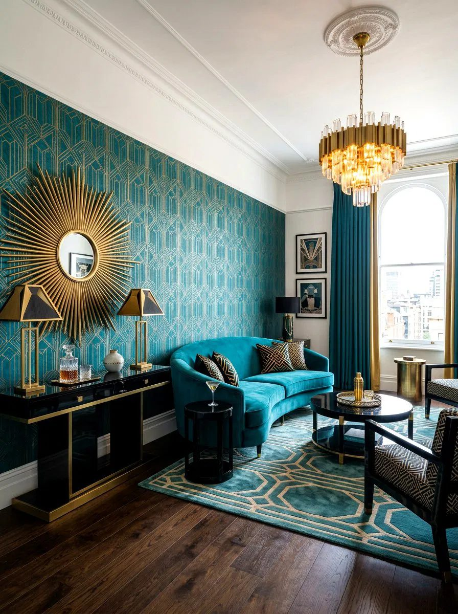

> TIP:GUIDE: Sofa: teal velvet | Mirror: sunburst | Rug: quiet black-and-cream geometry

## 19. A Symmetrical Dining Room

A symmetrical dining room is neo deco's purest expression. Matching chairs, a centered chandelier and a fan-wallpaper wall behind the sideboard create a room that feels ordered, formal and deeply glamorous.

Symmetry demands discipline: the chairs must match, the art must be centered and the table must be exactly in the middle. The payoff is a room that photographs beautifully and feels calm despite its drama.

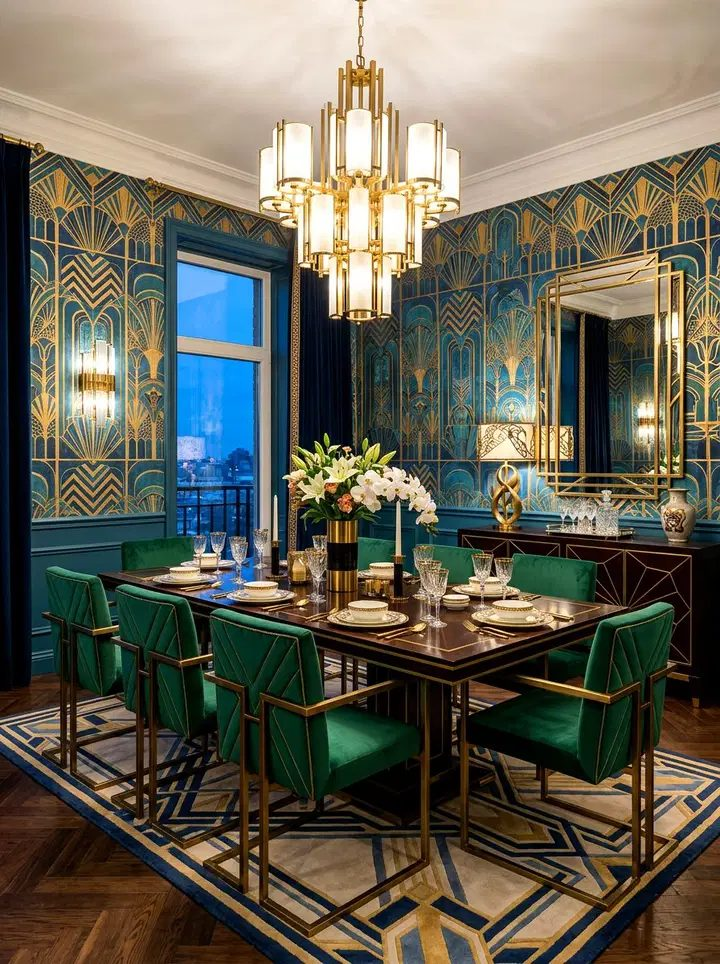

> TIP:QUICK: Center everything — the table, the chandelier and the art — or the symmetry fails.

## 20. A Deco Dining Chandelier

A deco dining chandelier turns the table into a stage. Gold bars, glass drops and a low hang create a pool of warm light over the meal, and the fixture itself is the room's sculpture.

Hang the chandelier about 30 inches above the table so it lights the plates without blocking the view across it. The chairs should be velvet in a jewel tone, and the table dark wood or black lacquer to complete the scene.

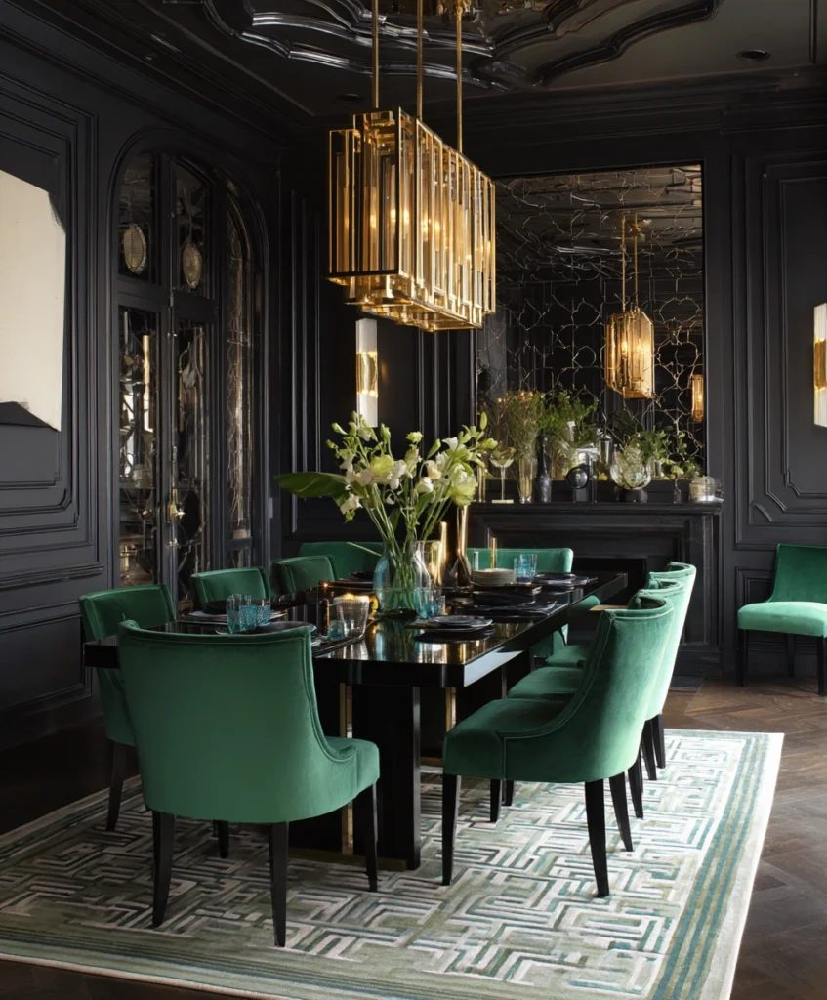

> TIP:CHECK: Hang 30 inches above the table; Velvet chairs; Dark wood or lacquer table

## 21. Jewel-Tone Layering

Jewel-tone layering is how neo deco avoids feeling like a theme park. Emerald, sapphire and burgundy in one room work when they are layered by size: the sofa in the largest tone, the cushions in the second, and a throw or artwork in the third.

Keep the walls and the rug neutral — deep teal walls with a black-and-gold geometric rug, for example — so the jewel tones sit on a calm ground. Brass is the thread that ties the layers together.

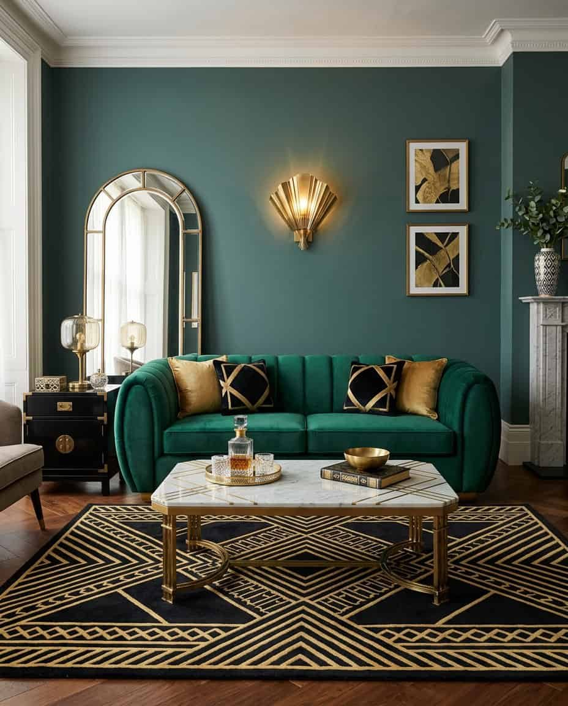

> TIP:GUIDE: Largest tone: the sofa | Second: cushions | Third: throw or art

## 22. A Geometric Mirror Entryway

A geometric mirror entryway makes the smallest space the most dramatic. A stepped, fan-shaped mirror over a black and gold console turns a hallway into a deco set piece, and the mirror doubles the light.

Keep the console's styling minimal — one lamp, one object — so the mirror's geometry stays the focus. The wall behind should be a single color or a subtle geometric wallpaper, never a competing pattern.

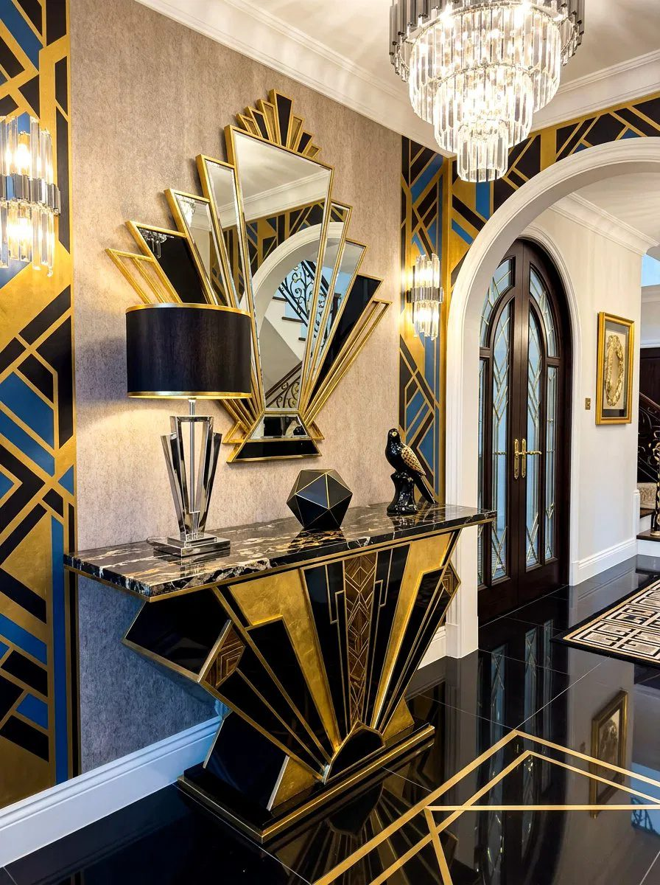

> TIP:QUICK: Style the console with one lamp and one object so the mirror owns the wall.

## 23. A Deep Blue and Gold Living Room

A deep blue and gold living room is neo deco's most classic combination. Navy walls with gold trim, a blue velvet sofa and brass details create a room that feels both regal and livable, especially with an arched window letting in daylight.

Add a patterned rug in blue and gold to tie the floor to the walls, and keep the wood warm — walnut or dark oak — so the blue does not turn cold. The gold should appear in at least three places to feel intentional.

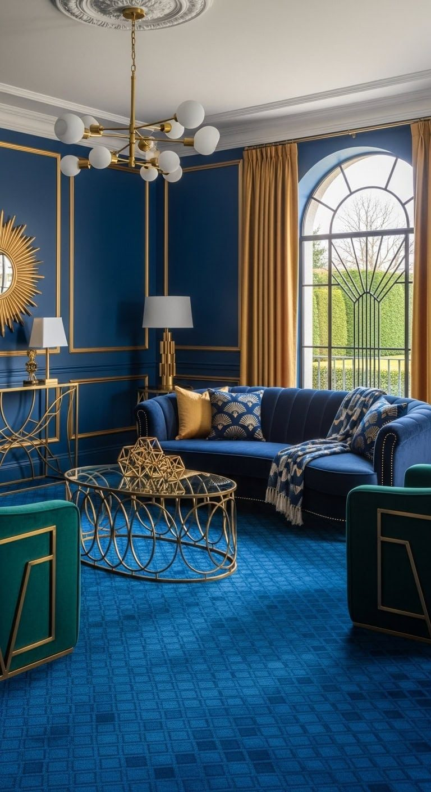

> TIP:CHECK: Gold in three places; Warm wood floors; Patterned rug tying floor to walls

## 24. Velvet Dining Chairs

Velvet dining chairs are the fastest way to give a dining room its deco credentials. Teal or emerald velvet with brass legs around a dark table turns an ordinary dining set into a glamorous one, and the chairs are comfortable enough for long dinners.

Keep the table simple — dark wood or black lacquer — and the lighting warm. The chairs are the color and the texture, so the tableware should be plain white or cream with brass flatware.

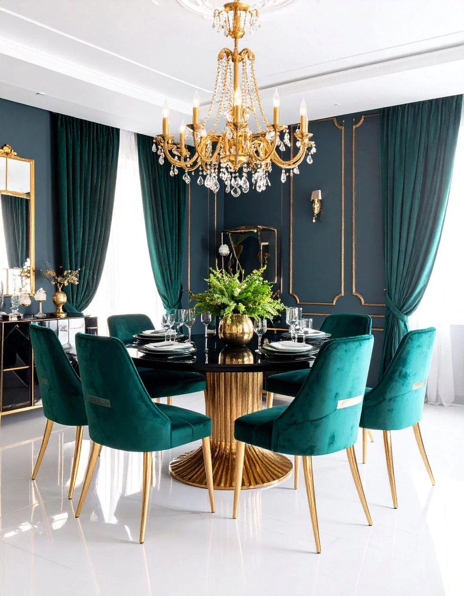

> TIP:GUIDE: Chairs: teal or emerald velvet | Legs: brass | Tableware: plain white

## 25. A Patterned Tile Floor

A patterned tile floor is the deco bathroom's foundation. Black and gold geometric tiles underfoot turn the smallest room into a jewel box, and the pattern is underfoot where it can be bold without overwhelming the eye.

Keep the walls simple — black subway tile with gold grout, or plain plaster — so the floor is the pattern. The vanity should be black with brass fixtures, and the mirror stepped or arched to echo the floor's geometry.

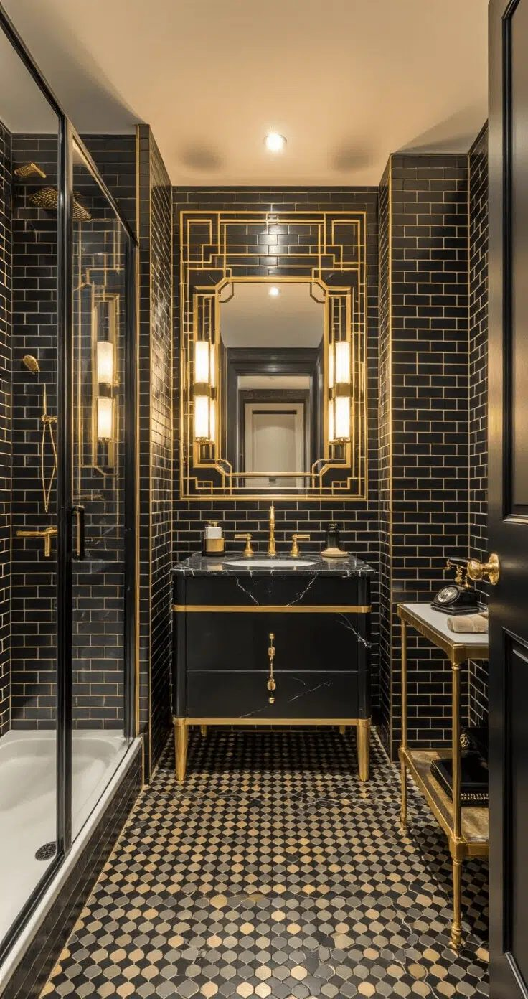

> TIP:QUICK: Keep the walls simple so the patterned floor is the room's one pattern.

## 26. An Arched Kitchen Pass-Through

An arched kitchen pass-through turns a plain opening into the home's best feature. Green double doors with gold inlay and glass panels frame the kitchen beyond, and the arch itself becomes the room's architecture.

Use the pass-through as the kitchen's front door: keep the view through it tidy, with the island or the prettiest cabinets in sight. The doors can stay open most of the time — the arch does the work even when they are.

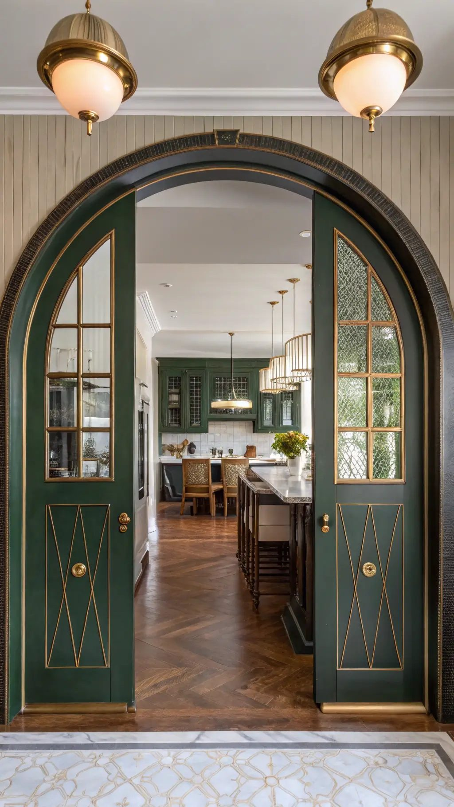

> TIP:CHECK: Keep the view through the arch tidy; Doors open most of the time; Gold inlay on the doors

## 27. A Black and Gold Deco Living Room

A black and gold deco living room is the most dramatic version of the style. Black walls with gold geometric panels, an emerald velvet sofa and brass details create a room that feels like a private club — intimate, glamorous and unforgettable.

Light it warmly and generously, because black walls absorb light. A geometric chandelier, table lamps and sconces together will keep the room glowing rather than gloomy, and the gold will catch every one of them.

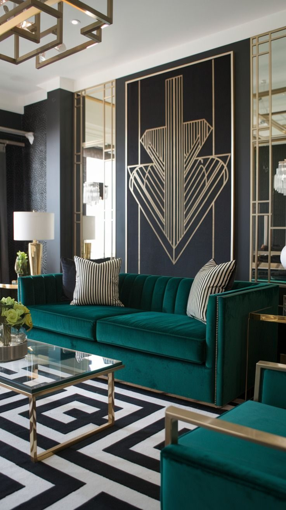

> TIP:GUIDE: Walls: black with gold panels | Sofa: emerald velvet | Light: chandelier plus lamps and sconces

## 28. A Curved Sofa with a Fluted Wall

A curved sofa against a fluted wall is neo deco's quietest luxury. The curve of the sofa and the vertical ridges of the wall create a rhythm of lines that feels both modern and 1920s, without a single loud color.

Keep the palette warm and neutral — cream, taupe and dark wood — and let the shapes do the talking. One dark accent, a black coffee table or a charcoal chair, gives the room the contrast it needs.

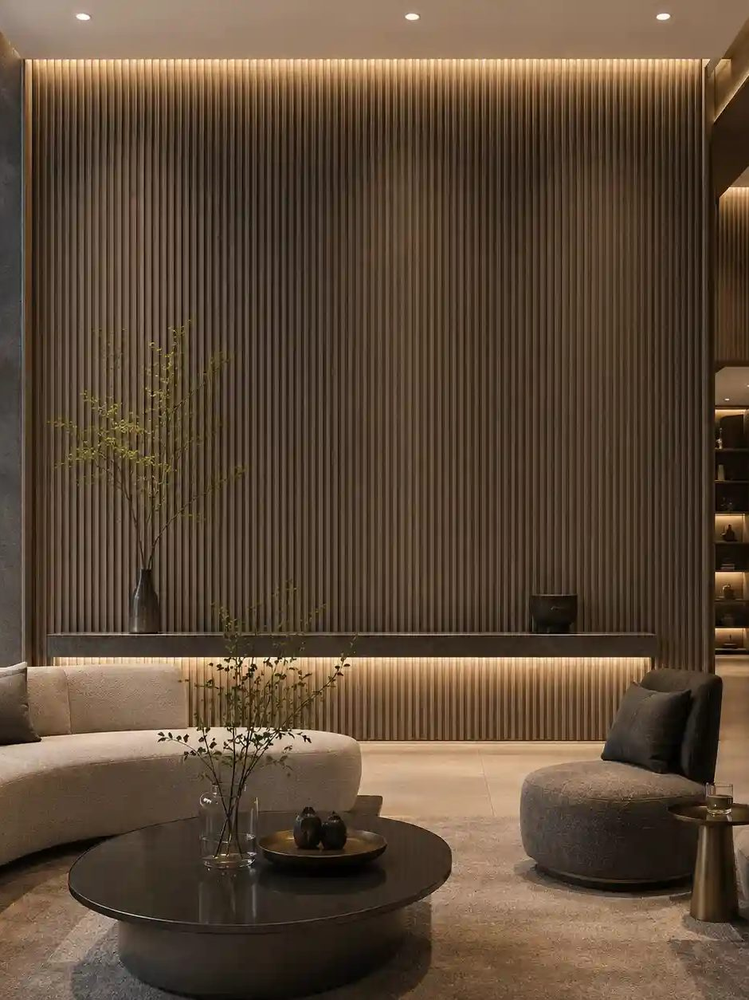

> TIP:QUICK: Keep the palette neutral and let the curve and the flutes do the talking.

## 29. A Deco Powder Room

A deco powder room is the easiest place to go all in, because it is tiny. Black and gold fan wallpaper, a gold-framed mirror and a marble vanity turn a room guests use for two minutes into the one they talk about for weeks.

Small rooms can take the boldest wallpaper in the shop — one or two rolls cover the whole space. Keep the floor a simple black-and-white geometric tile and the fixtures brass, and the powder room will feel like a jewel box.

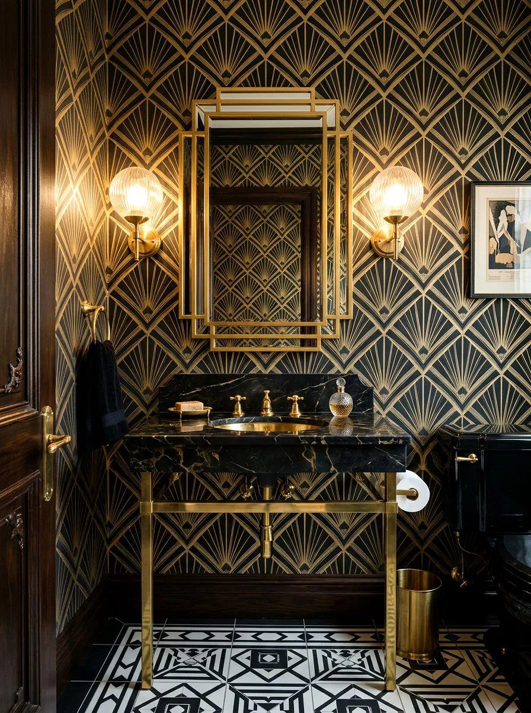

> TIP:CHECK: Boldest wallpaper in the shop; Floor: simple black-and-white tile; Fixtures: brass

## 30. A Cobalt Blue Sectional

A cobalt blue sectional brings neo deco's boldest color to the biggest seat in the house. The deep blue velvet reads as both regal and modern, and it pairs beautifully with gold-framed art and a glass coffee table.

Style it with cushions in the room's second jewel tone — emerald or burgundy — and a rug in a quiet geometric. The sectional is the room's color statement, so the walls should be a deep navy or charcoal that lets the blue glow.

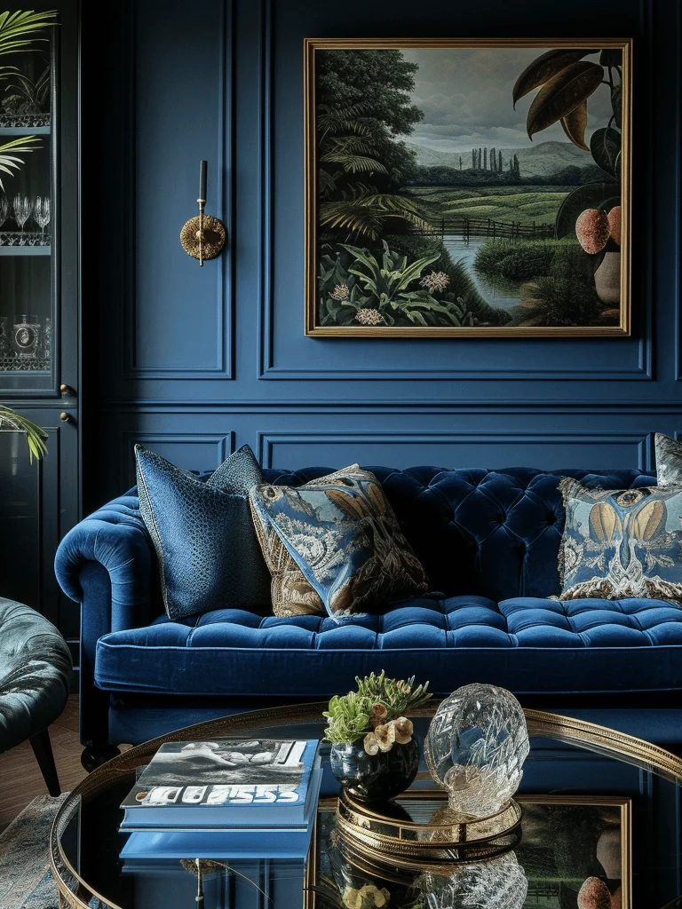

> TIP:GUIDE: Sectional: cobalt velvet | Cushions: second jewel tone | Walls: deep navy or charcoal

## Takeaway

- Neo deco works when you commit to the formula and then stop.
- One jewel tone, one geometric pattern and one brass accent per room, repeated with discipline, and the house feels glamorous without feeling like a set.
- Start with the living room — our [30 Neo Deco Living Room Ideas for a Bold, Modern Space](/posts/neo-deco-living-room/) goes deep on sofas, lighting and layouts for that one room — and let the style spread one room at a time.

## Frequently Asked Questions

### What is neo deco?

Neo deco is a modern take on 1920s Art Deco: geometric patterns, rich jewel tones, brass, arches and bold symmetry, stripped back for contemporary life. It keeps the glamour — velvet, marble, gold — but pairs it with clean lines and simple furniture so the rooms feel livable, not museum-like.

### How is neo deco different from classic Art Deco?

Classic Art Deco is ornate and period-specific; neo deco keeps the motifs — fans, sunbursts, chevrons — but uses them sparingly on modern furniture and plain walls. The palette is the same jewel tones and gold, but the rooms are lighter, simpler and built for everyday living.

### What colors define neo deco?

Emerald, sapphire, cobalt and burgundy are the core jewel tones, paired with black, gold and brass. One jewel tone per room is the rule, with gold or brass as the metal and black or cream as the neutral that keeps the palette grounded.

### Can neo deco work in a small home?

Yes, and small rooms suit it well. A powder room takes the boldest fan wallpaper, a small living room takes one velvet sofa and a sunburst mirror, and the dark, glossy palette actually makes small spaces feel intentional rather than cramped.

### What is the easiest neo deco idea to start with?

A velvet sofa in a jewel tone or a sunburst mirror above the fireplace. Both are single purchases that change the room's character immediately, and everything else — cushions, rug, lighting — can follow the color they set. Choose the piece you will see first when you walk in, and let it set the palette for everything that follows.

### How much brass is too much in neo deco?

Brass should appear in three places per room: a light fixture, a piece of furniture hardware and one decorative object. More than that and the metal starts competing with the jewel tones instead of tying them together. Keep the brass finishes consistent — all polished or all brushed — so the three appearances read as one deliberate choice.

### Does neo deco suit modern furniture?

It suits it perfectly. The style is built on the contrast between deco motifs and clean modern lines: a curved velvet sofa against a plain wall, a geometric rug under a simple coffee table. The modern furniture keeps the glamour from feeling like a costume.

### How do I add neo deco without repainting?

Use a velvet sofa or chairs, a geometric rug, brass lighting and a sunburst mirror. These four pieces set the style without touching the walls, and removable fan wallpaper on one feature wall finishes the look for renters. Peel-and-stick fan wallpaper gives you the feature wall too, and it comes down cleanly when you move.
