# 30 Neutral Kitchen Decor Ideas for a Calm, Timeless Kitchen

Neutral kitchen decor ideas are the quiet luxury of home design: whites, creams, warm greys, soft beiges and natural wood, layered so the room feels calm instead of blank. A neutral kitchen never shouts, never dates, and lets the light, the texture and the things you actually use do the talking. This list gathers 30 neutral kitchen decor ideas, from white shaker cabinets with a wood island to a single linen curtain that softens the whole room.

The trick is layering, not matching. One white, one cream, one warm wood and one soft grey, repeated across cabinets, counters, textiles and open shelves, give you a kitchen that feels collected rather than colourless. If you love the same calm in the rest of the house, our [30 Neutral Bedroom Ideas](/posts/neutral-bedroom/) carries the palette into the bedroom, and for a warmer, rural take on the same colours, [30 Farmhouse Kitchen Ideas](/posts/farmhouse-kitchen/) shows the farmhouse version of this look.

## 1. White Shaker Cabinets with a Wood Island

White shaker cabinets and a warm wood island are the classic neutral kitchen pairing: the white keeps the room bright, the wood keeps it from feeling cold.

Choose an island wood that matches the floor rather than the cabinets, so the room reads as two warm tones and one bright one.

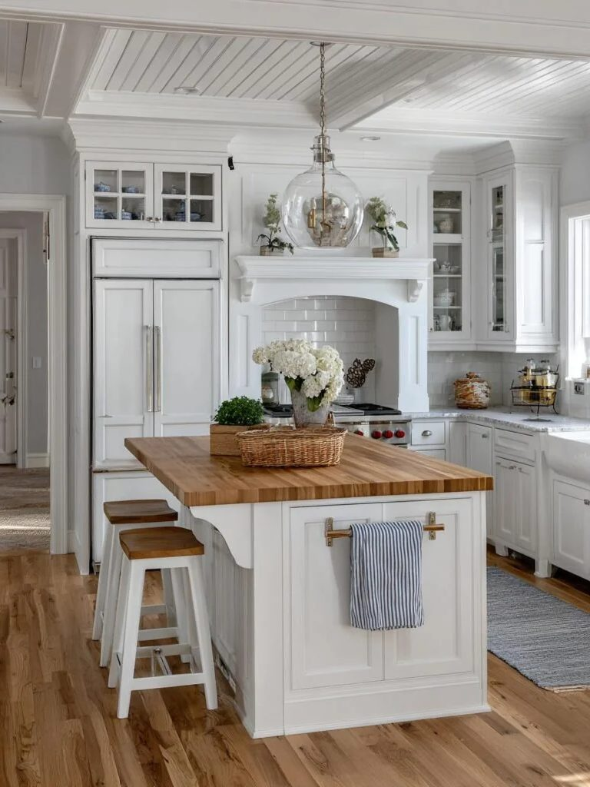

> TIP:QUICK: Match the island wood to the floor, not the cabinets, so the room reads as two warm tones and one bright one.

## 2. Cream Walls and Marble Counters

Cream walls soften the glare of white cabinets, and a marble counter with soft grey veining adds the only pattern the room needs.

Pick a marble with grey, not gold, veining so it stays inside the neutral palette, and seal it so coffee and wine never stain it.

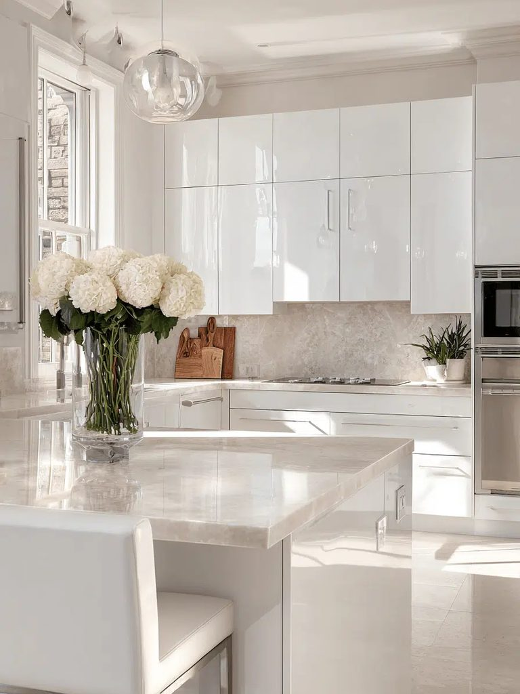

> TIP:CHECK: marble veining in grey, not gold; counters sealed against stains; cream walls, not stark white

## 3. Warm Grey Cabinets

Warm grey cabinets — greige, not blue-grey — give a neutral kitchen depth without any colour. They look beautiful against white walls and brass handles.

Test the grey on a large swatch in daylight, because a grey that looks warm in the shop can turn cold and blue under kitchen lighting.

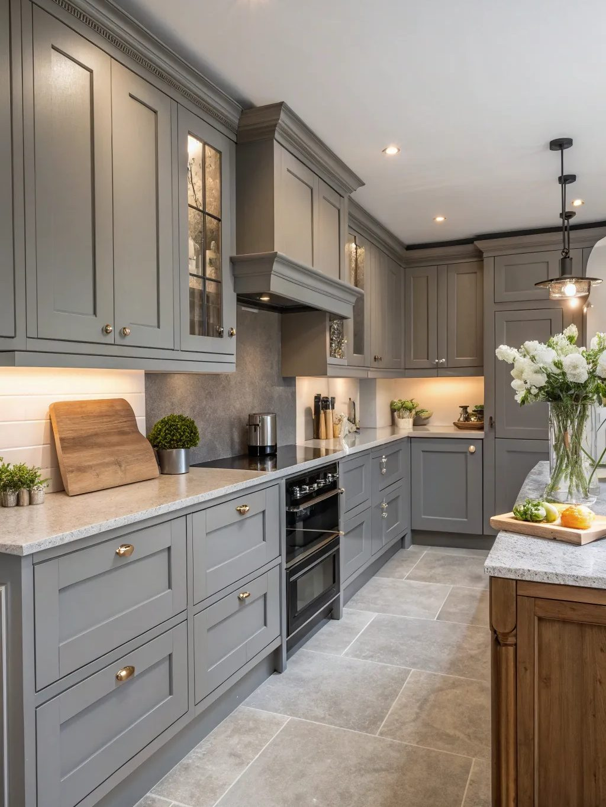

> TIP:GUIDE: Budget: from $80 for a tin of cabinet paint | Time: one weekend to paint | Skill: beginner

## 4. Open Shelving in a Cream Kitchen

Open shelves in a cream kitchen display white ceramics and glassware while adding warmth to a white wall. They make the kitchen feel lived in, not staged.

Keep the shelves to the dishes you use every day, so they stay tidy by habit, and leave one shelf half empty so the wall can breathe.

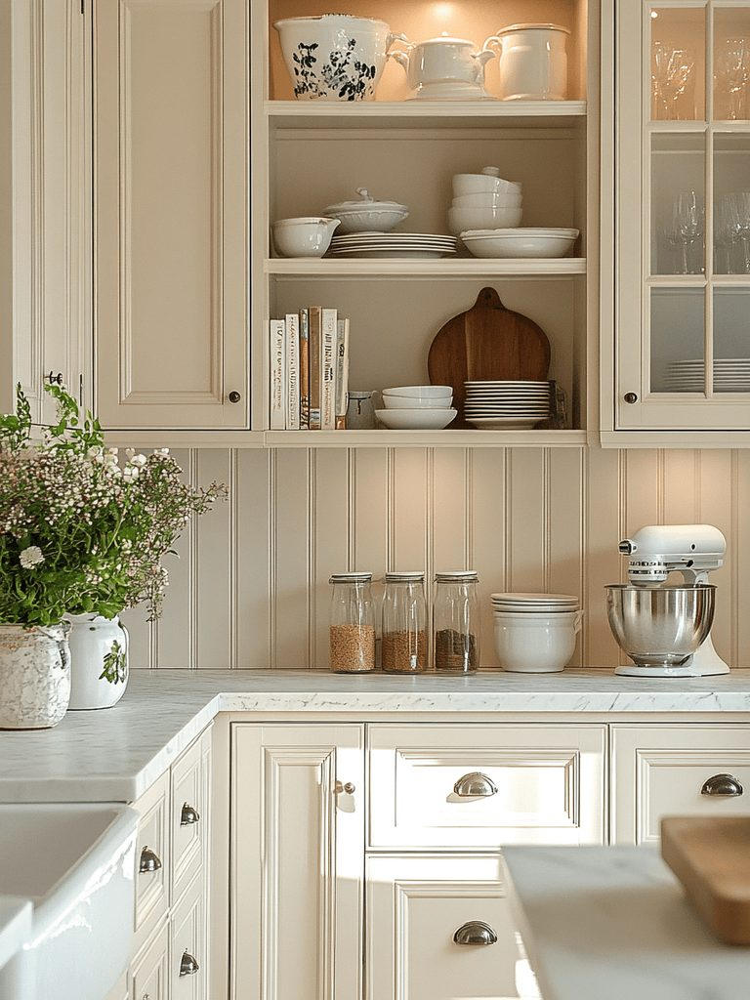

> TIP:QUICK: Keep open shelves to the dishes you use daily — they stay tidy by habit, not by effort.

## 5. A Beige and White Two-Tone Kitchen

Beige lower cabinets and white uppers give a neutral kitchen a grounded base and a light top, like a room wearing a pale shirt over dark trousers.

Keep the beige warm — a yellow or pink undertone — so the two tones feel related rather than like two different kitchens stacked up.

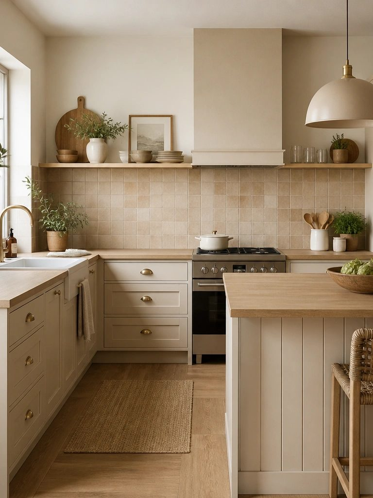

> TIP:CHECK: beige with a warm undertone; white uppers kept bright; one shared handle finish across both

## 6. A White Kitchen with Brass Accents

Brass handles, a brass tap and a brass pendant turn a plain white kitchen into something quietly luxurious, without adding a single colour.

Keep all the brass the same finish — unlacquered brass ages gracefully, polished brass stays bright — and mix only one brass tone per room.

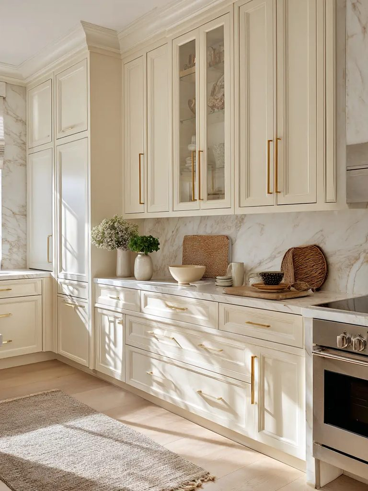

> TIP:GUIDE: Budget: from $60 for a set of brass handles | Time: one afternoon to swap | Skill: beginner

## 7. Soft Greige Walls

Greige walls — halfway between grey and beige — are the most forgiving neutral a kitchen can wear, hiding cooking marks and suiting every cabinet colour.

Paint a test patch beside the cabinets and live with it for a week, because greige changes with the light more than any other neutral.

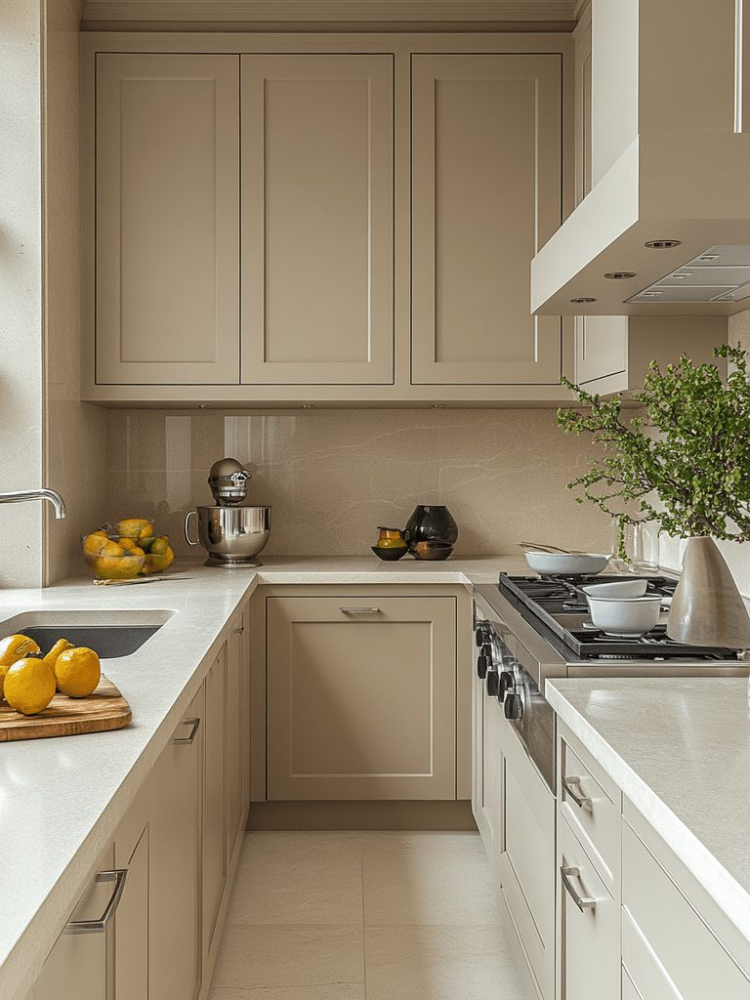

> TIP:QUICK: Live with a greige test patch for a week — it changes with the light more than any other neutral.

## 8. Butcher Block Counters

Butcher block counters bring a whole slab of warm wood into a white kitchen, and they age beautifully, picking up marks that tell the story of the room.

Oil the block once a month for the first year, and keep a chopping board by the sink so the counter is a worktop, not a cutting board.

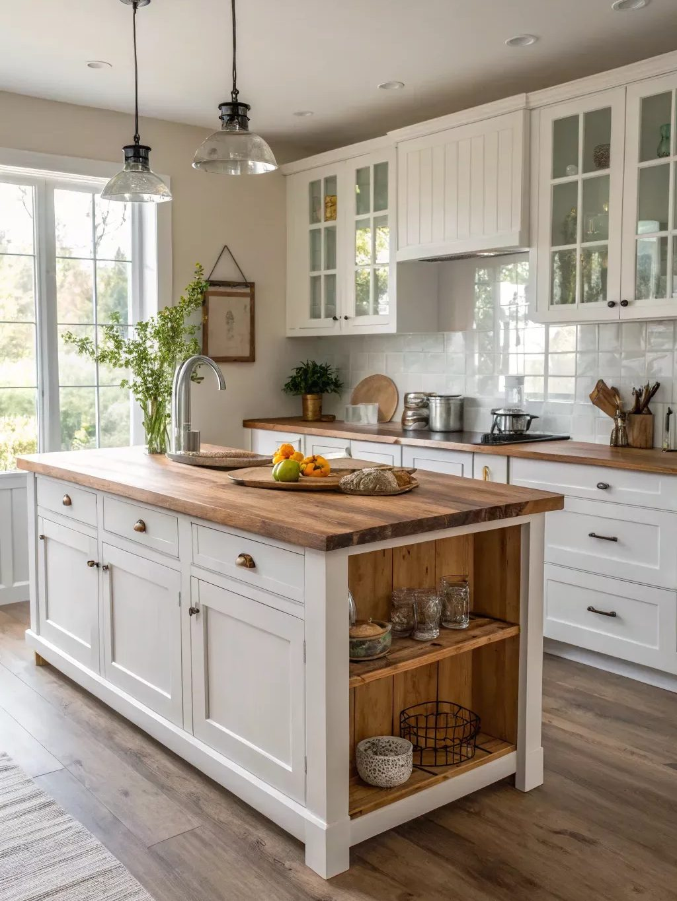

> TIP:CHECK: oil once a month in year one; a chopping board by the sink; trivets under hot pans

## 9. A Neutral Kitchen with Linen Curtains

Linen roman shades in natural or cream soften a kitchen window, filter the light and hide the view of the bins outside — all for the price of a tablecloth.

Hang the shade so it falls just below the sill, and let a sheer linen curtain soften the side window too.

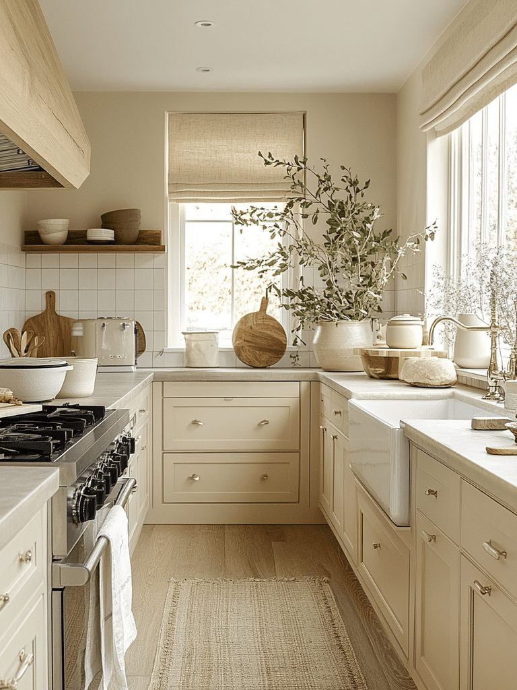

> TIP:GUIDE: Budget: from $30 for linen-look curtains | Time: twenty minutes to hang | Skill: beginner

## 10. A White Subway Tile Backsplash

White subway tile is the neutral kitchen's workhorse: bright, easy to clean, and cheap enough to tile the whole wall. Laid in a herringbone pattern it looks anything but plain.

Lay the tiles in herringbone or a vertical stack if you want the classic tile to feel new, and use a light grey grout so the pattern shows.

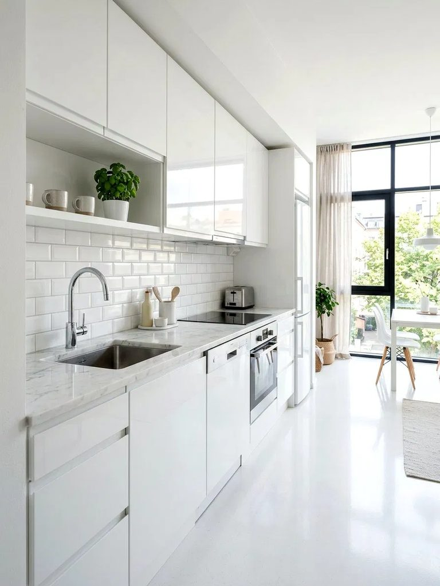

> TIP:QUICK: Lay white subway tile in herringbone and the classic tile suddenly looks new.

## 11. Light Wood Floors and White Cabinets

Pale wood floors under white cabinets make a small kitchen feel twice as big, because the eye reads the floor and the cabinets as one continuous light surface.

Choose a floor with a matte finish so it does not glare under the ceiling lights, and run the boards toward the window to stretch the room.

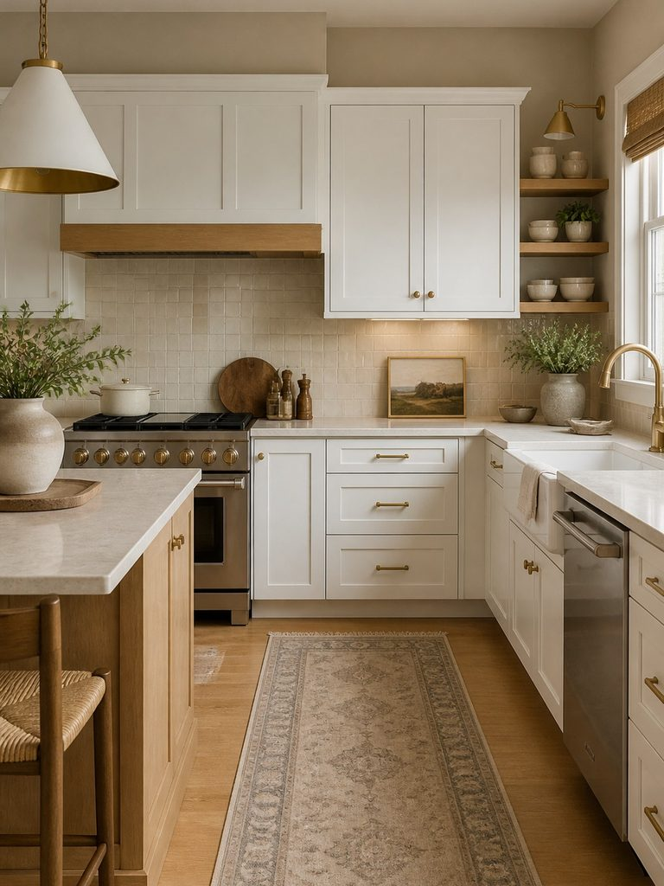

> TIP:CHECK: matte floor finish, no glare; boards run toward the window; one rug, not two, in the middle

## 12. A White Kitchen with Black Accents

A white kitchen with a few black touches — tap, handles, pendant, hood — gets the contrast of a monochrome kitchen without ever leaving the neutral palette.

Keep the black to three pieces at most, or the accents stop being accents and the kitchen starts looking like a chessboard.

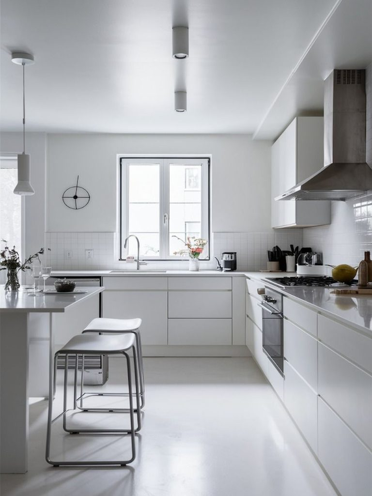

> TIP:GUIDE: Budget: from $40 for black handles | Time: one afternoon to swap | Skill: beginner

## 13. A Neutral Farmhouse Kitchen

A farmhouse kitchen in whites, creams and weathered wood is the warmest version of neutral: a Belfast sink, open shelves, a wooden table and linen everywhere.

Let one piece be the farmhouse star — the sink or the table — and keep the rest quiet, or the room tips from farmhouse into theme park.

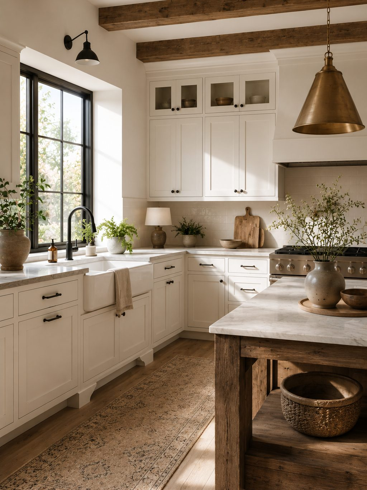

> TIP:QUICK: Let one piece be the farmhouse star — the sink or the table — and keep the rest quiet.

## 14. A White Kitchen with Woven Textures

Woven baskets, a rattan pendant and a jute rug add texture to a white kitchen without adding colour, and texture is what keeps neutrals from feeling flat.

Mix three weaves at most — rattan, jute and linen, say — and keep them all in the same honey tone so they read as one material family.

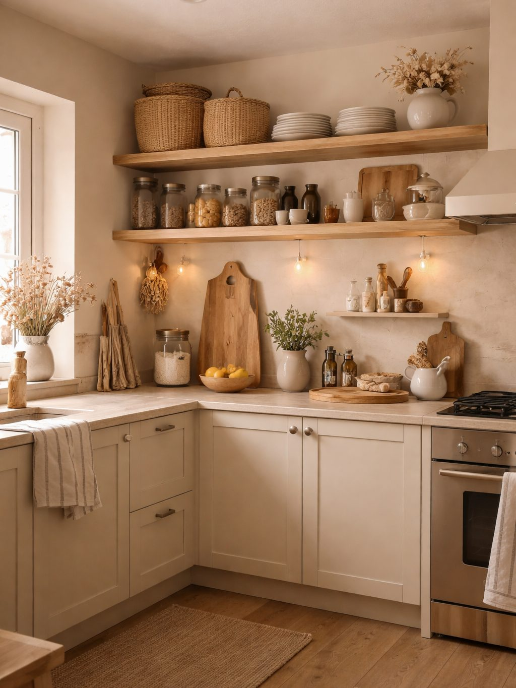

> TIP:CHECK: three weaves at most; one honey tone across them; baskets for storage, not display

## 15. A Taupe Kitchen Island

A taupe island in an otherwise white kitchen anchors the room like a piece of furniture, and taupe is warm enough to feel cosy next to white.

Paint the island two shades deeper than the walls so it reads as a deliberate piece, and repeat the taupe on one other thing — the stools or a shelf.

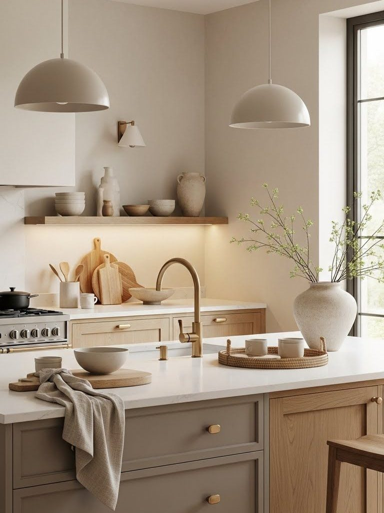

> TIP:GUIDE: Budget: from $60 for a tin of paint | Time: one weekend to paint | Skill: beginner

## 16. A White Farmhouse Sink with Brass Taps

A white farmhouse sink with a brass tap turns the most-used object in the kitchen into a design feature, and the deep basin hides the washing-up better than steel.

Match the tap to the handles, not the cabinets, so the metalwork reads as one finish across the room.

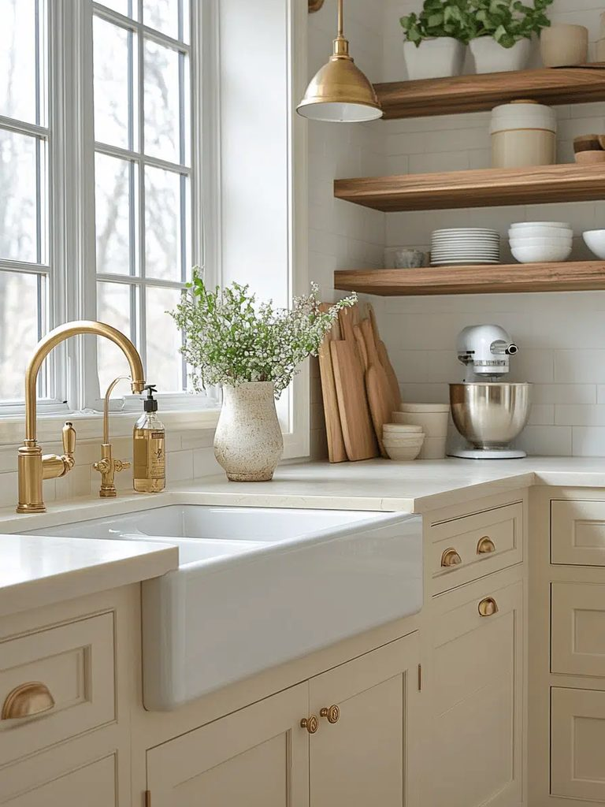

> TIP:QUICK: Match the tap to the handles, not the cabinets, so the metalwork reads as one finish.

## 17. A White and Wood Minimalist Kitchen

A minimalist kitchen in white and pale wood — flat cabinets, no handles, one open shelf — feels calm because there is nothing to look at except the materials.

Keep the counters almost clear: one board, one plant, one kettle. The moment a third object lands, the minimalism is gone.

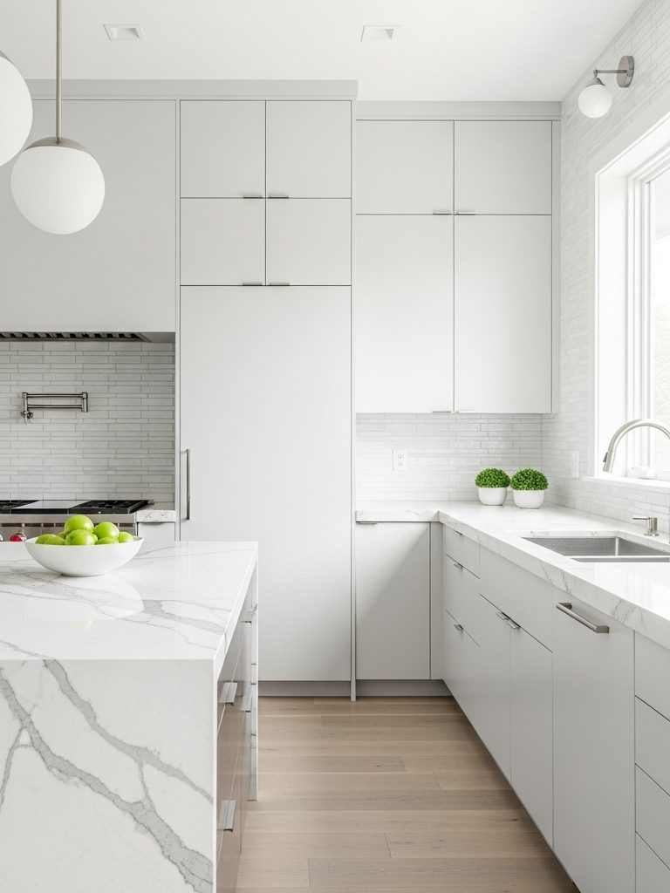

> TIP:CHECK: counters nearly clear; one board, one plant, one kettle; handles hidden or absent

## 18. A Soft Greige Kitchen with Greenery

A soft greige kitchen with a few green plants — potted herbs by the island, a leafy plant in a ceramic pot — gets its only colour from living things, which never clash with neutrals.

Keep the pots in one material, terracotta or white ceramic, so the plants are the colour and the pots are part of the palette.

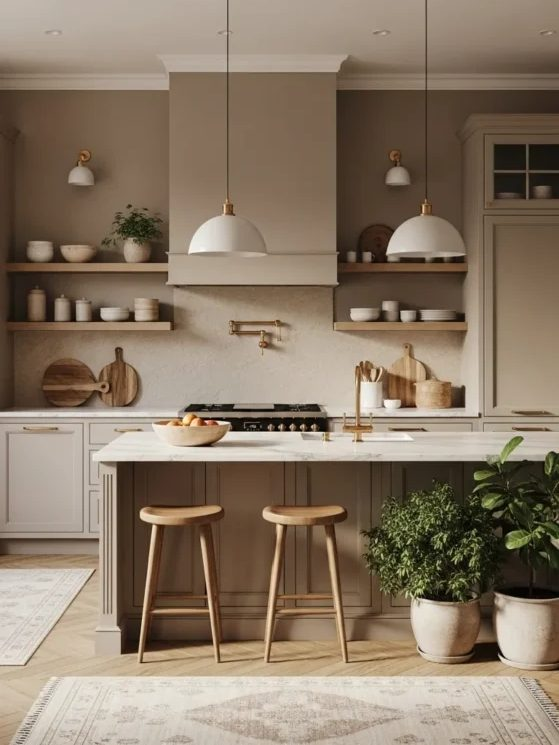

> TIP:GUIDE: Budget: under $30 for three herb pots | Time: twenty minutes to pot and place | Skill: beginner

## 19. A Neutral Kitchen with Open Shelves and Ceramics

Open shelves holding cream and white ceramics — bowls, jugs, plates — turn everyday dishes into the kitchen's decoration, and they cost nothing extra.

Stack plates by size and group bowls by colour, so the shelves look arranged rather than stored, and keep one shelf for glassware to catch the light.

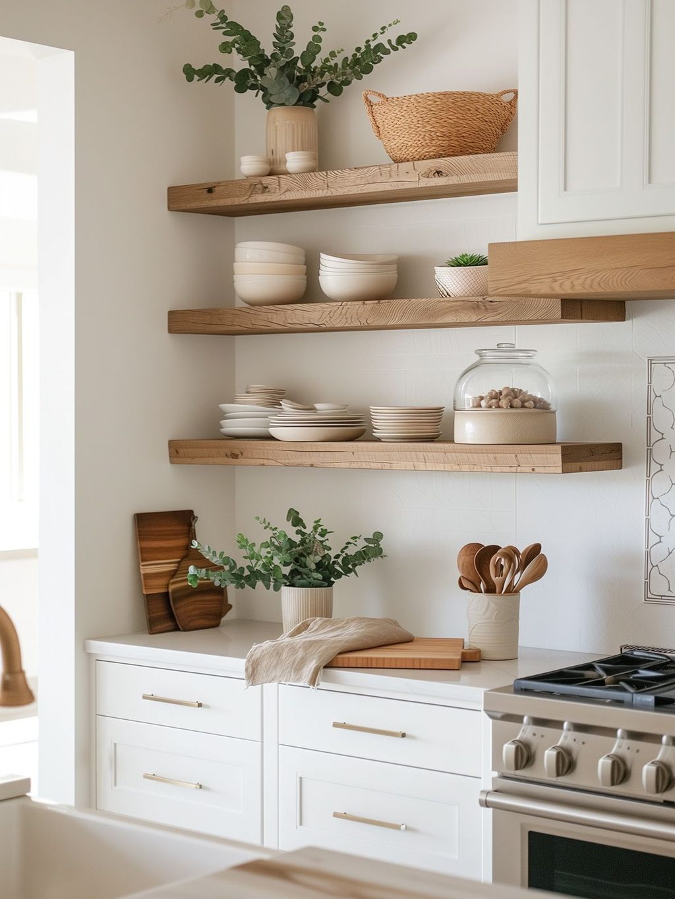

> TIP:QUICK: Group ceramics by colour on open shelves and everyday dishes become the decoration.

## 20. A White Kitchen with a Marble Island

A white kitchen with a white marble island is the most elegant neutral pairing there is: pale cabinets, cool stone, and nothing else competing for attention.

Keep the island marble the only stone in the room — a wooden chopping board and ceramic bowls — so the marble stays the star.

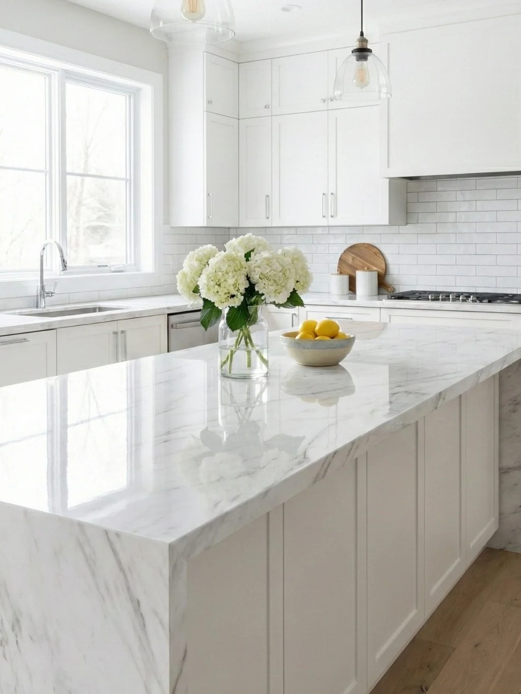

> TIP:CHECK: marble the only stone in the room; wooden boards and ceramic bowls; cabinets kept white

## 21. A White Kitchen with Rattan Pendants

Rattan pendants over a white island add warmth and shadow to a plain ceiling, and their woven pattern throws beautiful light across the counters at night.

Hang the pendants low enough to light the worktop — about 75 centimetres above it — and use warm bulbs so the light stays golden.

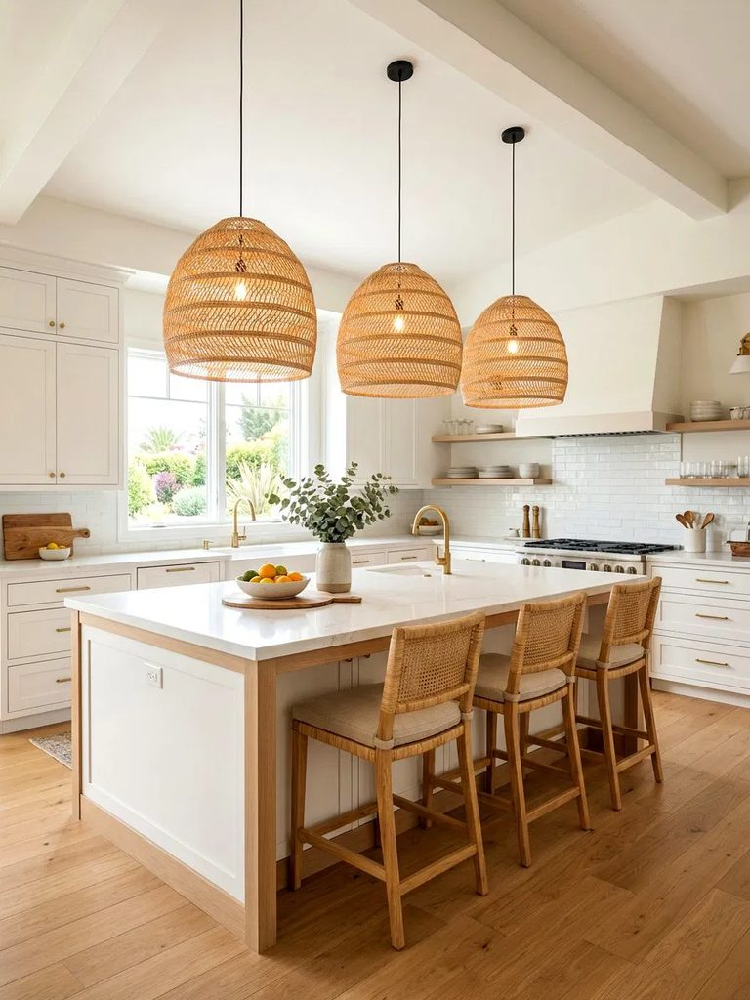

> TIP:GUIDE: Budget: from $50 per rattan pendant | Time: one hour to hang | Skill: intermediate

## 22. A Warm White Kitchen with Rattan Stools

Warm white cabinets and rattan bar stools make the island the social heart of the kitchen, and rattan is the friendliest texture a neutral palette can wear.

Choose stools with a back if people sit for more than ten minutes, and keep the rattan the same tone as the floor or the island.

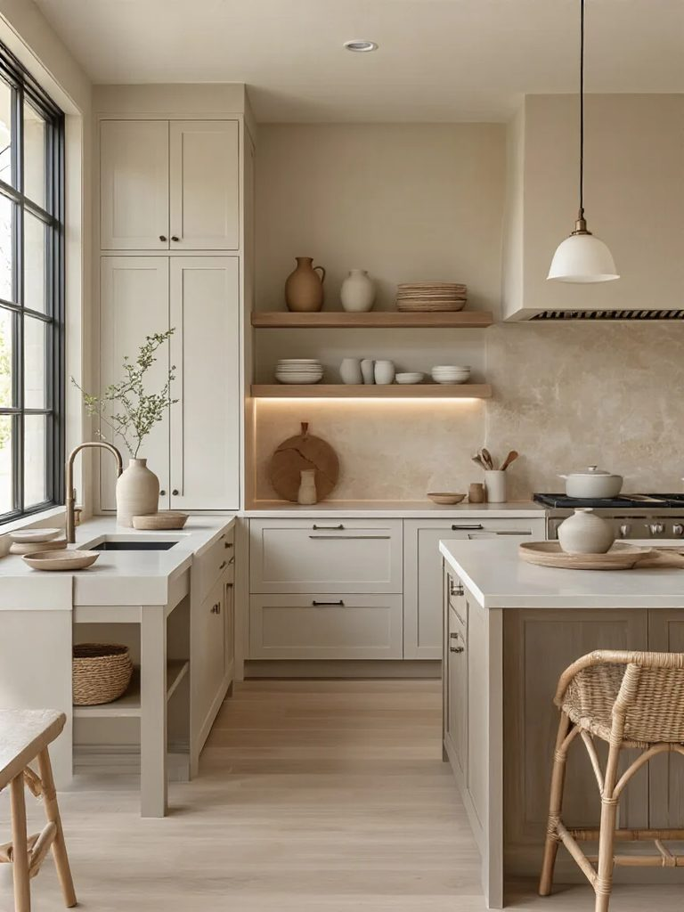

> TIP:QUICK: Stools with a back if anyone sits longer than ten minutes — backless stools are for perching, not dining.

## 23. A Neutral Galley Kitchen

A narrow galley kitchen in whites and pale wood feels wider than it is, because the light bounces down the whole run and nothing dark stops the eye.

Keep the far wall light and the floor pale, and put the one dark object — the oven or the tap — at the near end, so the room draws the eye through.

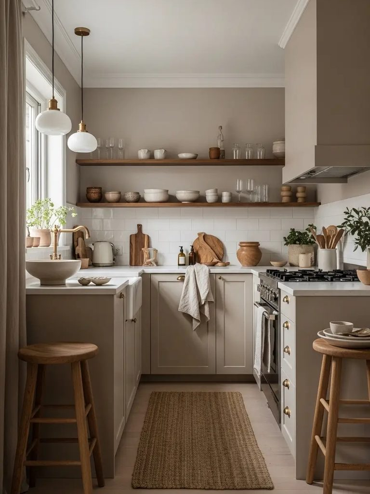

> TIP:CHECK: far wall light; floor pale; the one dark object at the near end

## 24. A Cream Kitchen with Vintage Touches

A cream kitchen with vintage touches — a dresser as a pantry, old brass, a enamel jug — feels collected over years rather than bought in a weekend.

Buy the vintage pieces one at a time from thrift shops, and keep them all in the same cream-and-brass palette so they look like a set.

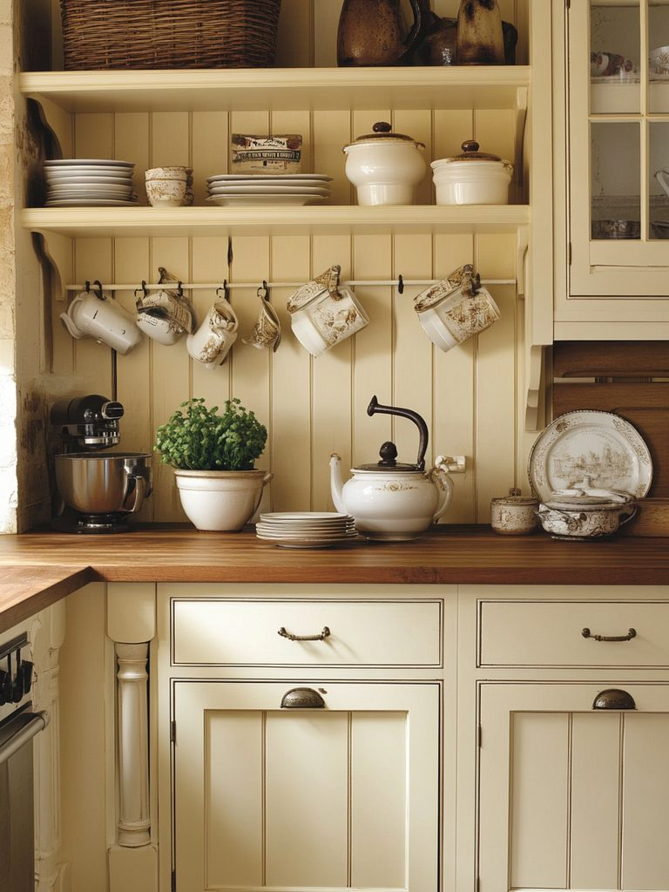

> TIP:GUIDE: Budget: from $20 per thrifted piece | Time: one afternoon of hunting | Skill: beginner

## 25. A White Kitchen with a Natural Stone Backsplash

A natural stone backsplash — limestone, travertine or marble — adds the texture of a quarry wall to a white kitchen, and every slab is different.

Seal the stone before you cook near it, because natural stone stains faster than tile, and wipe it down after every meal.

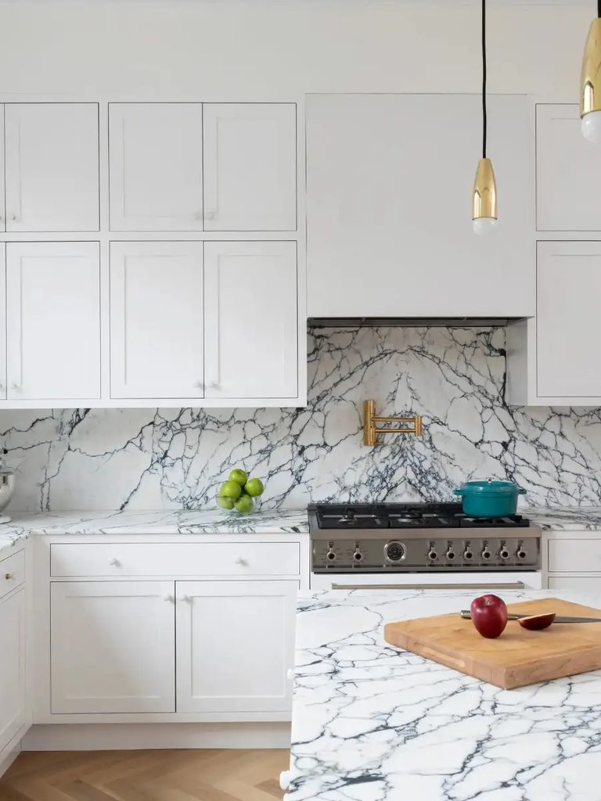

> TIP:QUICK: Seal a natural stone backsplash before you cook near it — it stains faster than tile.

## 26. A Neutral Kitchen with Glass-Front Cabinets

Glass-front cabinets in a white kitchen show off cream ceramics and glassware while keeping the dust off, and they make the wall feel lighter than solid doors.

Keep the contents to one colour family and leave a little space between groups, because a crowded glass cabinet looks like a shop window.

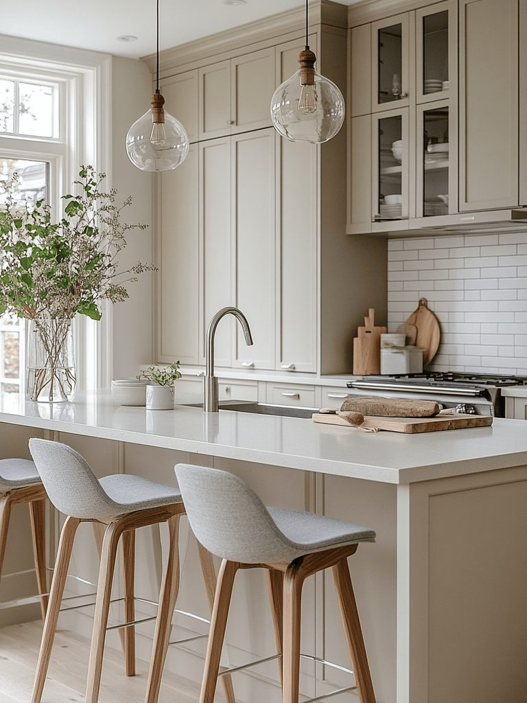

> TIP:CHECK: contents in one colour family; space between groups; glass kept clean inside and out

## 27. A Soft Grey and White Kitchen

Soft grey lower cabinets with white uppers and a white counter give a neutral kitchen a gentle two-tone look that never feels cold.

Choose a grey with a warm undertone and test it beside the white uppers in daylight, because a cool grey will make the white look yellow.

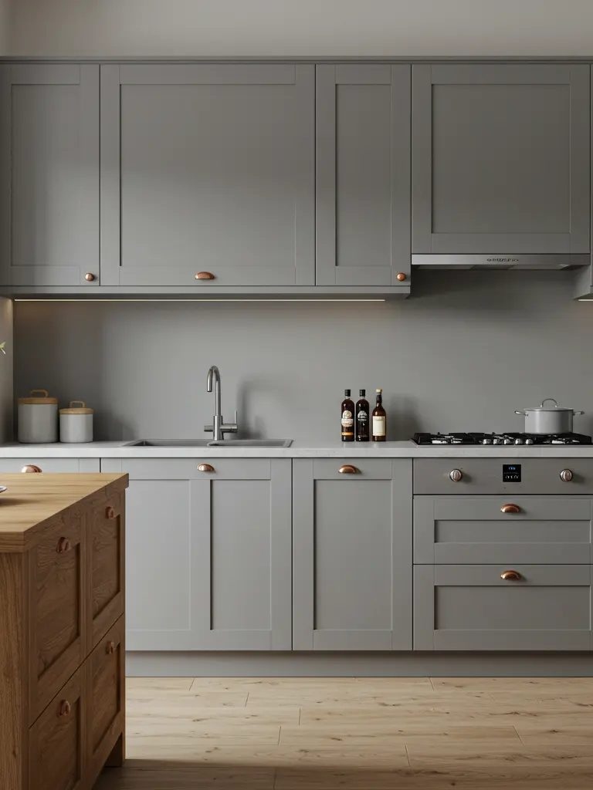

> TIP:GUIDE: Budget: from $80 for a tin of cabinet paint | Time: one weekend to paint | Skill: beginner

## 28. A Neutral Kitchen with a Cosy Breakfast Nook

A breakfast nook in creams and pale wood — a wooden table, linen-cushioned chairs, a vase of greenery — turns a corner of a neutral kitchen into the room's favourite seat.

Keep the cushions washable, because breakfast nooks get used every day, and add a rug under the table to mark the nook as its own corner.

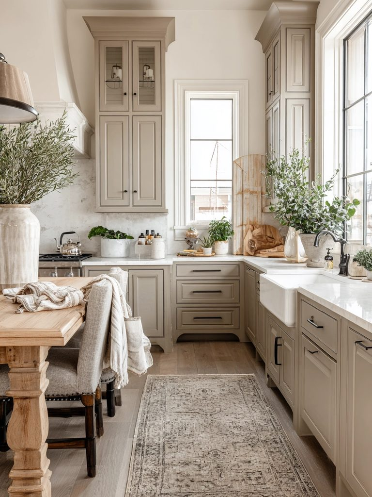

> TIP:QUICK: Keep the nook cushions washable — breakfast nooks get used every day.

## 29. A White Kitchen with Wood Ceiling Beams

Wood ceiling beams over a white kitchen add warmth overhead and draw the eye up, making a low ceiling feel taller and a plain room feel crafted.

Keep the beams the same wood tone as the floor or the island, so the room has one wood story running from floor to ceiling.

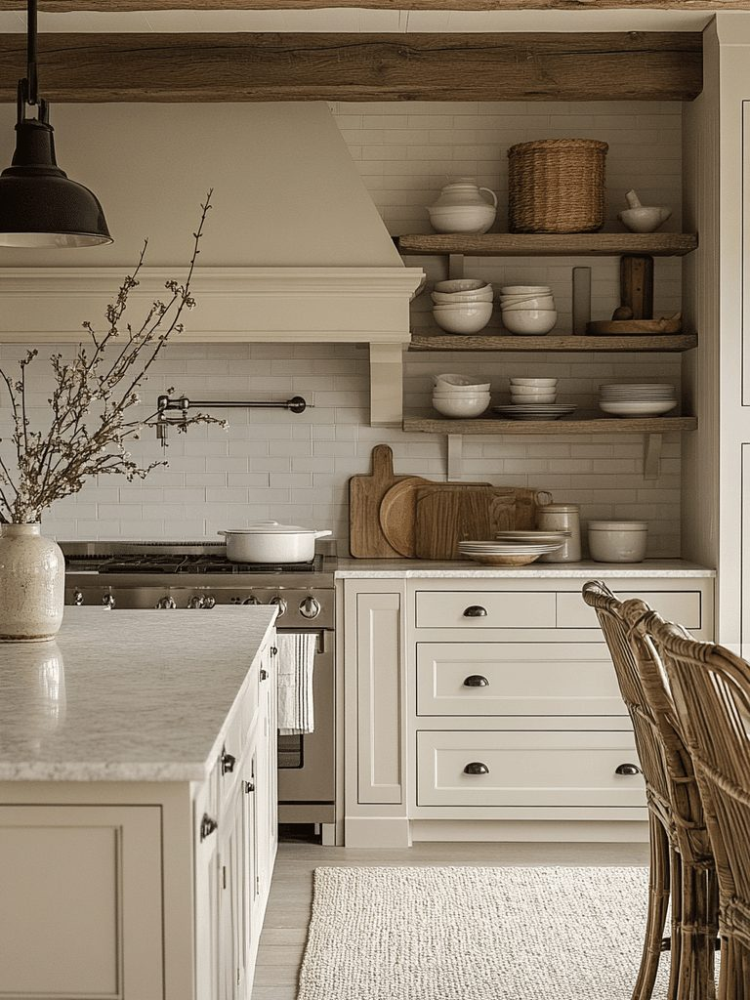

> TIP:CHECK: beams match the floor or island wood; one wood tone, floor to ceiling; beams kept slim, not chunky

## 30. A Neutral Kitchen with Layered Neutrals and Texture

Layer every neutral you own — white, cream, beige, greige, pale wood — with texture on top of texture: linen, wool, rattan, stone and wood, all in the same pale family.

Repeat each neutral at least twice in the room, so no single colour sits alone, and let texture do the work that colour does in other kitchens.

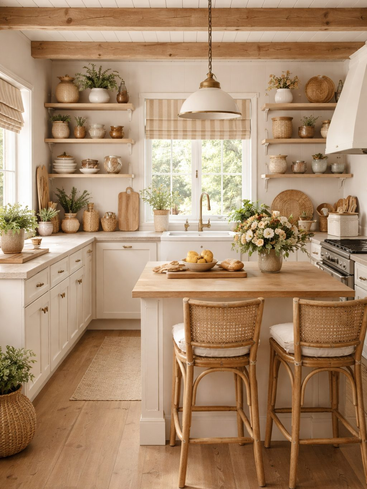

> TIP:GUIDE: Budget: from $50 for linen and rattan accents | Time: one afternoon to layer | Skill: beginner

## Takeaway

Start with the biggest surface — the cabinets or the walls — and pick one neutral for it, then layer the others in smaller doses: wood on the island, linen on the window, texture on the shelves. A calm kitchen is not an empty kitchen; it is a kitchen where every colour agrees with the next one. If the island is the heart of your neutral kitchen, dress it for the season with our [30 Christmas Island Centerpiece Ideas](/posts/christmas-island-centerpiece-ideas/), and for the warmer farmhouse version of this whole palette, [30 Farmhouse Kitchen Ideas](/posts/farmhouse-kitchen/) is the natural next read.

## Frequently Asked Questions

### What colours count as neutral in a kitchen?

White, cream, ivory, beige, taupe, greige, soft grey and natural wood all count as neutral, because none of them fights with the others. The rule is undertones: keep them all warm or all cool, and a room full of different neutrals will still feel calm and coherent.

### How do I keep a neutral kitchen from looking boring?

Layer texture instead of colour: linen curtains, a rattan pendant, a jute rug, a wooden chopping board and a marble counter all in the same pale family. Repeat each neutral twice, add one plant, and the room will feel rich rather than flat.

### What is the best neutral paint colour for a kitchen?

Warm white is the safest, because it suits every cabinet colour and never turns cold under kitchen lighting. If you want depth, a soft greige on the walls with white cabinets is the most forgiving combination, hiding cooking marks better than pure white.

### Can I mix warm and cool neutrals in a kitchen?

You can, but keep one side dominant: mostly warm neutrals with one cool grey counter, or mostly cool with one warm wood island. A room split evenly between warm and cool looks undecided, while a clear majority with one contrast looks deliberate.

### What flooring suits a neutral kitchen?

Pale wood is the classic choice, because it warms up white cabinets and suits every neutral wall colour. Large-format stone tiles in cream or soft grey work too, and both are easier to keep clean than dark floors, which show every crumb.

### How do I add contrast to a neutral kitchen without colour?

Use black or brass in small doses: a black tap, brass handles, a dark pendant or a charcoal oven. Three dark pieces at most is the rule — enough to anchor the room, not enough to break the calm palette.

### Are white kitchens still in style?

Yes, white kitchens remain the most popular choice because they suit every home, never date, and make small kitchens feel bigger. The current version is warmer than the stark white of a decade ago, with wood islands, brass accents and textured tiles softening it.

### What backsplash goes with a neutral kitchen?

White subway tile is the safest and cheapest, especially in herringbone or a vertical stack. For more texture, try natural stone, handmade-look tiles in cream, or a pale marble with grey veining — all of them stay inside the neutral palette.
