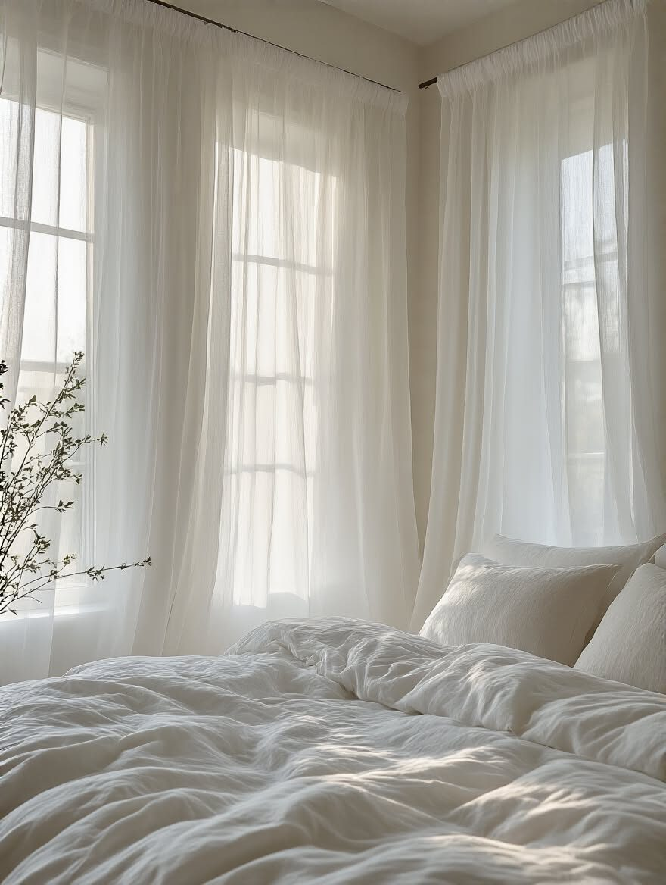
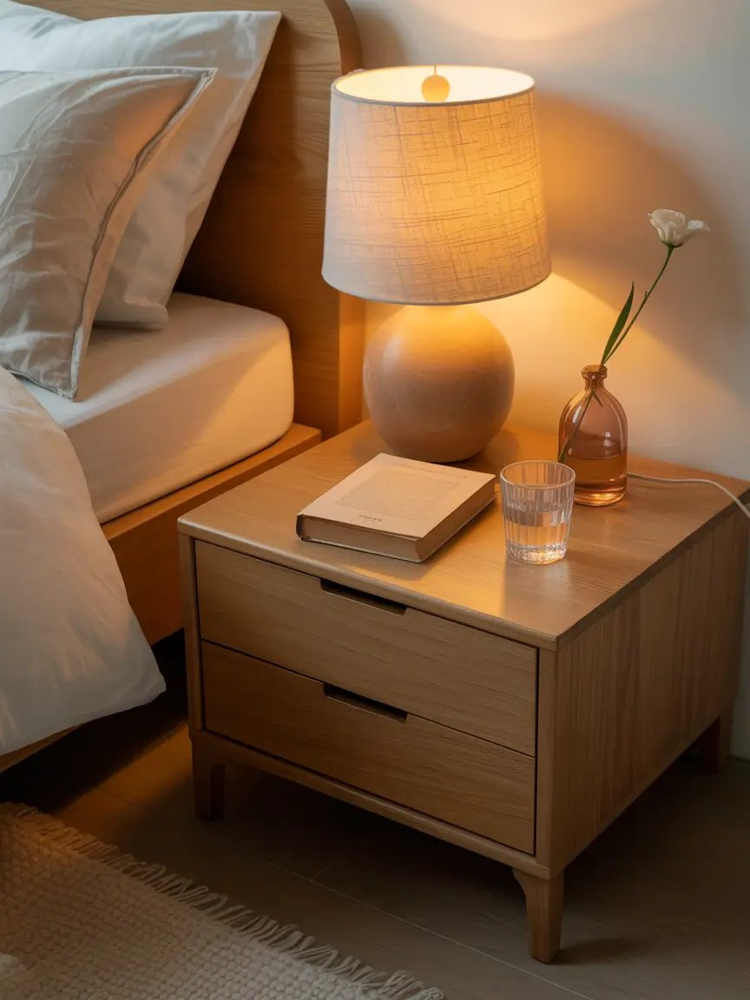
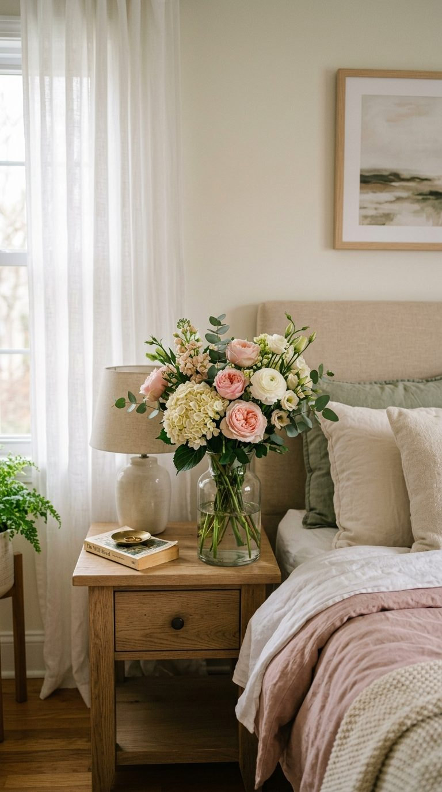
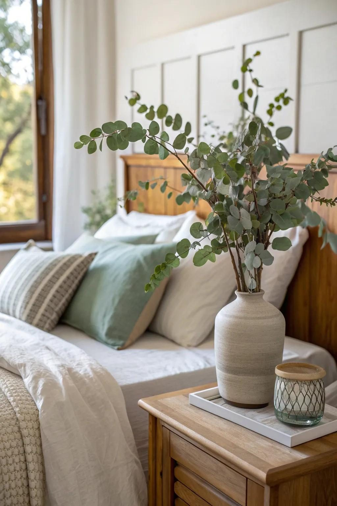
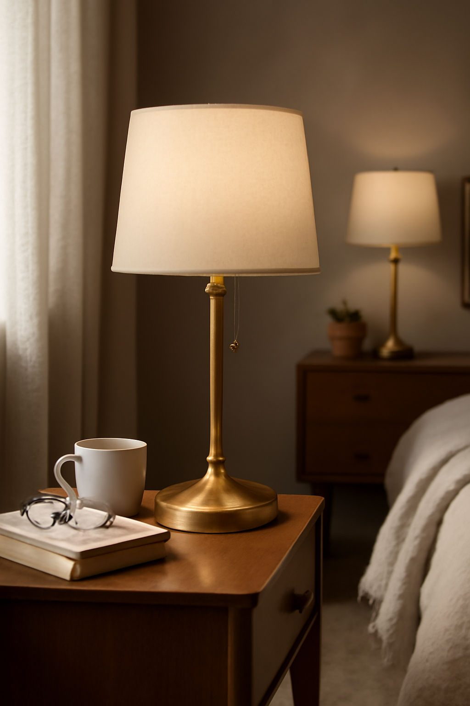
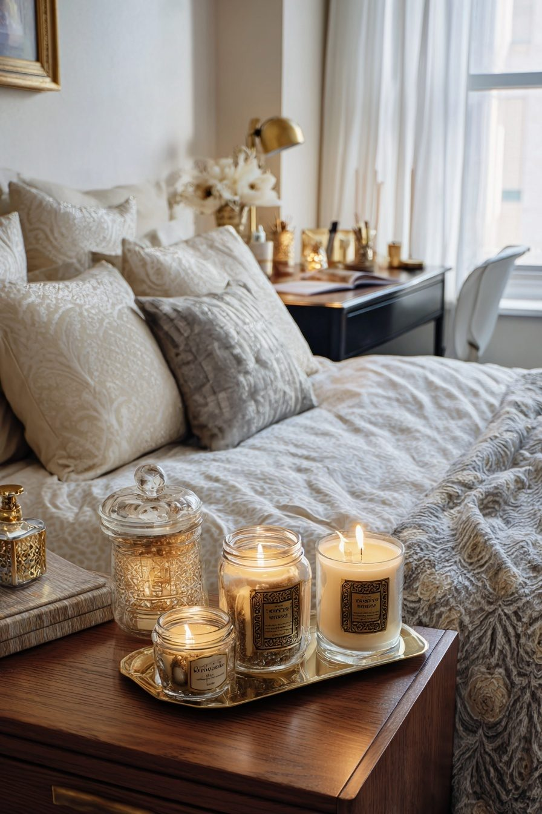
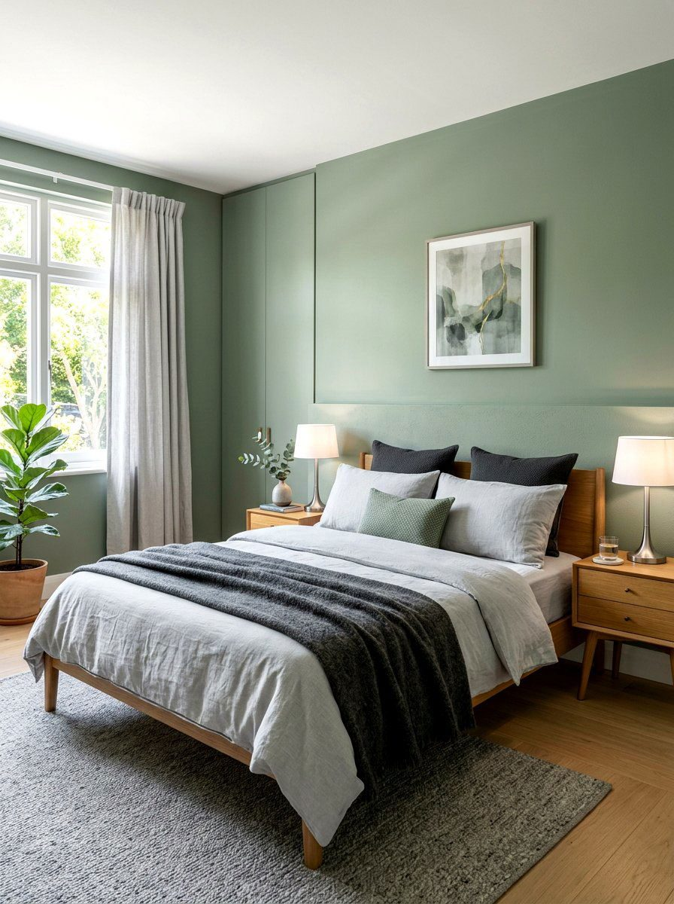
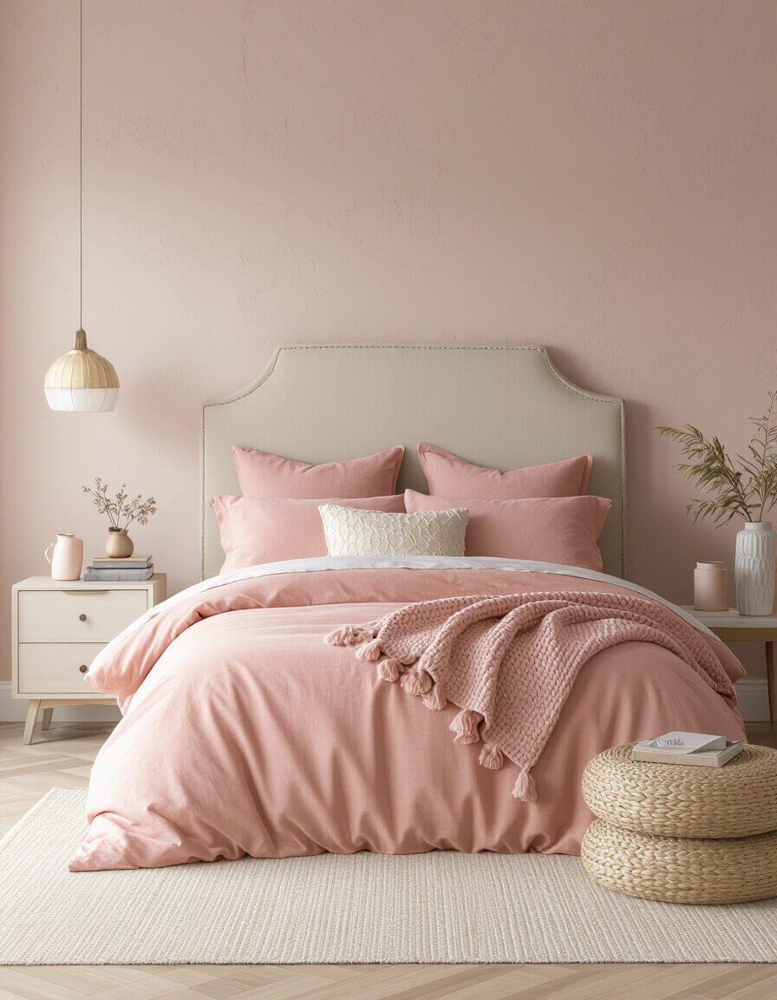
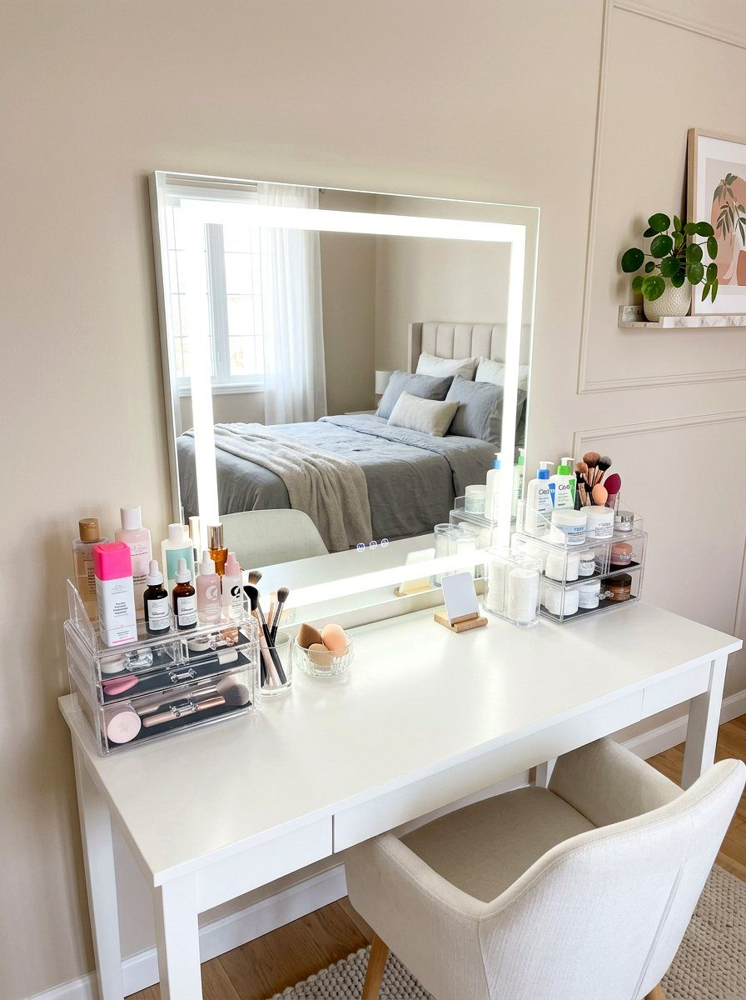

# 30 New Year Bedroom Decor Ideas for a Fresh Start

New year bedroom decor ideas are the gentlest way to begin January: nothing gets ripped out, nothing costs a fortune, and the room simply feels lighter when you walk into it. The new year is a natural moment to wash the bedding, clear the surfaces and let a little more light in, and a bedroom that starts the year calm tends to stay calm.

This list gathers 30 fresh-start ideas, from crisp white bedding and sheer curtains to a vision board wall and a tray of candles. Pick one or two to begin with — a fresh bed and a clear nightstand change the whole room — then add the smaller touches as the month goes on.

## 1. Crisp White Bedding Reset

Nothing says fresh start like a bed made with clean white sheets. Strip the bed completely, wash everything, and remake it with crisp white bedding and plump pillows. The blank canvas makes the whole room feel brighter, and it gives every other change on this list a clean background to sit against.

White bedding also makes it easy to spot what needs attention: a tired throw, a greyed pillowcase, a duvet that has lost its loft. Swap out whatever looks worn and keep the rest — the reset is about freshness, not buying a whole new set.

> TIP:QUICK: Wash the duvet and pillows too — a fresh bed starts with fresh fill, not just fresh sheets.

## 2. Fresh Linen Layers

Linen layers are the easiest way to make a bed look intentionally styled instead of simply made. Start with a fitted sheet, add a flat sheet folded back at the top, then a light duvet and a folded throw across the foot. Each layer adds texture without adding colour, so the bed stays calm.

Keep the palette to whites and soft neutrals so the layers read as texture rather than pattern. A linen duvet with a slightly rumpled finish looks relaxed and lived-in, which suits a bedroom far better than a stiff, hotel-flat make.

> TIP:CHECK: fitted sheet first; flat sheet folded back; throw across the foot

## 3. Sheer Curtains, Soft Morning Light

Heavy curtains make a bedroom feel closed in through the dark months, and January is the time to swap them for sheers. Sheer white curtains soften the window, filter the morning light and let the room wake up gently instead of in a glare.

Hang the sheers high and wide so the window looks bigger, and let them pool just slightly on the floor for a relaxed finish. If you still need darkness for sleeping, keep a simple blind behind them and open it fully each morning.

> TIP:GUIDE: Hang: high and wide, above the frame | Length: just kissing the floor | Behind: a simple blind for darkness

## 4. A Decluttered Nightstand

A nightstand collects chargers, books, glasses and half-finished cups faster than any surface in the house. The new year reset is simple: take everything off, wipe the surface, and put back only what you genuinely use at night — a lamp, a book, a glass of water and one small beautiful thing.

Give the rest a home elsewhere. Chargers go in a drawer, spare books go back on the shelf, and the nightstand becomes a calm surface you actually enjoy looking at when you wake up.

> TIP:QUICK: Put back only four things — a lamp, a book, water and one beautiful object.

## 5. Fresh Flowers on the Nightstand

A small vase of fresh flowers is the fastest way to make a bedroom feel alive in January. Choose whatever is in season where you live — roses, ranunculus, hydrangea or simple garden stems — and keep the bouquet small enough that it never crowds the lamp or the book.

Change the water every couple of days and trim the stems so the flowers last the week. A fresh bouquet on the nightstand is a small daily luxury, and it is the first thing you see when you wake up.

> TIP:CHECK: small vase, not a tall one; trim stems every two days; change the water often

## 6. Warm Fairy Lights

Warm fairy lights are not just for December — draped softly above the headboard, they give a bedroom a gentle evening glow all winter. Run them in a simple shape, like a triangle or a loose swag, and keep the rest of the wall bare so the lights are the feature.

Choose warm white bulbs rather than cool white, and put them on a timer so they switch on at dusk. The soft light makes the room feel cosy on dark January evenings without any extra lamps.

> TIP:GUIDE: Colour: warm white, never cool white | Shape: one simple swag or triangle | Timer: on at dusk, off at bedtime

## 7. Gold Accent Pillows

A pair of gold accent pillows is the easiest way to nod to New Year's Eve without keeping party decorations up. Gold-patterned cushions on a neutral bed add warmth and a little celebration, and they look just as good in February as they do on January 1st.

Keep the gold to the pillows and one small metallic accent, like a tray or a lamp base. Too much gold turns festive into fussy, but two pillows against white or cream bedding is exactly right.

> TIP:QUICK: Two gold pillows are enough — let the rest of the bed stay neutral.

## 8. Champagne Gold Bedding

Champagne gold bedding is the boldest idea on this list, and it works because gold is both festive and warm. A metallic gold duvet with matching pillow shams turns the bed into the centrepiece of the room, so keep everything around it quiet: plain walls, simple lamps and a pale rug.

This is a look to enjoy through the winter months, not just New Year's Eve. Pair it with white sheets underneath so the gold never feels heavy, and fold the duvet back to show a crisp white edge.

> TIP:CHECK: white sheets underneath; plain walls around it; fold the duvet back to show white

## 9. Fresh Eucalyptus on the Nightstand

Fresh eucalyptus is the January plant: silvery green, lightly scented and happy in a vase for weeks. A tall bunch in a ceramic vase on the nightstand adds height and colour to a pale bedroom, and the scent is gentle enough for a sleeping space.

Buy one generous bunch and split it between the nightstand and the dresser. As the stems dry they keep their colour, so the arrangement lasts well past the fresh flowers.

> TIP:GUIDE: Vase: tall ceramic, plain finish | Stems: one generous bunch, split in two | Life: lasts weeks, dries well

## 10. A Cozy Reading Nook Reset

A reading nook is the corner that makes a bedroom feel like a retreat rather than just a place to sleep. Pull the armchair near the window, add a floor lamp with a warm bulb, a soft throw over the arm and a small table for a cup of tea. A stack of books on the shelf finishes it.

The reset costs nothing if you already own the pieces — it is simply about giving the chair a purpose and keeping the corner clear. In January, a quiet place to read is the best new habit a bedroom can hold.

> TIP:QUICK: Chair near the window, warm lamp behind it, throw over the arm — the nook is done.

## 11. A New Bedside Lamp

A new lamp changes how a bedroom feels after dark more than almost anything else. Choose a warm-toned base — brass, ceramic or wood — with a simple fabric shade, and fit a warm white bulb. The lamp becomes the evening light source, so the ceiling light can stay off.

Matching lamps on both nightstands look tidy, but one beautiful lamp is enough if the budget only stretches that far. Keep the shade simple: a plain drum shade throws the softest light.

> TIP:CHECK: warm white bulb; plain drum shade; base that matches your wood tones

## 12. A Fresh Rug Under the Bed

A rug under the bed is the first thing your feet meet in the morning, and a fresh one changes the whole feeling of getting up. Choose a thick, textured rug in a pale neutral that extends past the sides and foot of the bed, so you step onto softness from every side.

January is a good time to size up: a rug that is too small makes the bed look stranded, while one that reaches past the bed anchors the whole room. Shake it out weekly and it will stay fresh for years.

> TIP:GUIDE: Size: extends past bed sides and foot | Colour: pale neutral, hides dust | Care: shake out weekly

## 13. A Scented Candle Corner

A small group of scented candles on a tray turns a nightstand or dresser into a little evening ritual. Choose one scent for the season — something soft and clean, like linen, cedar or white tea — and group two or three candles of different heights on a gold or wooden tray.

Light one candle in the evening as a signal that the day is winding down. Keep the tray tidy, trim the wicks, and never leave a candle burning when you leave the room or fall asleep.

> TIP:QUICK: One scent for the season, grouped on a tray — the ritual is the point.

## 14. New Artwork Above the Bed

A gallery wall above the bed is the fastest way to make a bedroom feel personal again. Mix framed prints, photos and small pieces you already own, keeping the frames in two or three finishes so the wall looks collected rather than matched.

Hang the arrangement so its centre sits just above eye level from the bed, and leave a little breathing room between frames. Start with the largest piece in the middle and build outward — the wall can grow over the year.

> TIP:CHECK: centre just above eye level; largest piece in the middle; two or three frame finishes

## 15. Plants by the Window

Plants on the windowsill bring a bedroom back to life after the bare weeks of winter. Group three or four pots of different heights on the sill — trailing plants at the edges, upright ones in the middle — and let the morning light do the rest.

Choose plants that suit your light: most bedrooms suit pothos, ferns and small succulents. Water little and often, wipe the leaves when they gather dust, and the sill becomes the greenest spot in the house.

> TIP:GUIDE: Group: three or four pots, mixed heights | Light: match the plant to your window | Water: little and often

## 16. Satin Pillowcases

Satin pillowcases are a small luxury that changes how a bed feels every single night. Swap your usual cotton cases for satin in a soft blush, cream or sage, and the bed instantly looks dressed up — the sheen catches the light even in a plain room.

Keep a spare set so one is always clean, and wash them on a gentle cycle in a laundry bag. Satin suits the new year perfectly: it is a small daily upgrade, not a big purchase.

> TIP:QUICK: Buy two sets — one on the bed, one in the wash, so the luxury never lapses.

## 17. A Vision Board Wall

A vision board turns a blank bedroom wall into a plan for the year. Pin photos, magazine cuttings, colour swatches and short notes to a large cork board, and hang it where you will see it every morning. The board should hold what you want the year to feel like, not a shopping list.

Keep it loose and let it grow: add things through January and take down anything that stops meaning something. A board that changes with you stays inspiring; a fixed one fades into wallpaper.

> TIP:CHECK: hang it where you see it each morning; mix photos, words and colours; update it monthly

## 18. A Chunky Knit Throw

A chunky knit throw draped over the foot of the bed is the cosiest layer a January bedroom can have. The thick, soft loops add texture to plain white bedding, and the throw is always within reach on a cold evening.

Choose cream or pale grey so it works with everything else in the room, and fold it loosely rather than smoothing it flat — the relaxed drape is part of the charm. A knit throw also hides a multitude of sins on a bed that was made in a hurry.

> TIP:GUIDE: Colour: cream or pale grey | Drape: loose fold, never flat | Spot: foot of the bed, always in reach

## 19. A Fresh Sage Accent Wall

A sage green accent wall is a calm, grown-up way to start the year with colour. Sage sits between grey and green, so it feels fresh without shouting, and it pairs beautifully with white bedding, light wood and the plants already on your windowsill.

Paint just the wall behind the bed and leave the rest of the room pale. One wall is enough to change the mood, and it is a weekend job that costs little more than a tin of paint and a brush.

> TIP:QUICK: Paint only the wall behind the bed — one wall changes the whole room.

## 20. A Mirror to Brighten the Room

A large mirror is the cheapest way to add light to a dark January bedroom. Lean a tall mirror against the wall opposite the window and it will bounce daylight across the room, making the space feel bigger and brighter without any new lighting.

Add two or three small round mirrors on the next wall for a collected look, and keep the glass clean — a dusty mirror reflects nothing. The mirror also gives you a full-length check before the day starts.

> TIP:CHECK: opposite the window for the most light; tall leaning mirror first; keep the glass clean

## 21. Fresh Linen Curtains

Linen curtains hang differently from every other fabric: they fall in soft, uneven folds that make a room feel relaxed and expensive at the same time. Swap heavy winter drapes for pale linen panels that filter the light and move gently when the window is open.

Let them fall to the floor and tie them back loosely during the day so the light pours in. Linen wrinkles, and that is the point — the creases are part of the look, so there is nothing to iron.

> TIP:GUIDE: Fabric: pale linen, unlined | Length: to the floor | Tie back: loosely, during the day

## 22. A Bedside Tea Tray

A tea tray on the bed turns the first morning of the year into a small celebration. Set a wooden tray with a cup of tea, something sweet and a few fresh flowers, and carry it to bed on New Year's Day — or any slow weekend morning after that.

Keep the tray itself simple wood or woven rattan so it suits the room when it is not in use. Hung on a hook or slipped under the bed, it is ready for the next slow morning.

> TIP:QUICK: Keep the tray ready under the bed — a slow morning should never need a search.

## 23. A Blush Colour Pop

Blush pink is the softest way to add colour to a fresh-start bedroom. A blush duvet and matching pillows against a pale blush wall make the whole room glow, and the colour stays gentle enough to live with all year, not just in January.

Keep the rest of the room neutral — cream rug, pale wood, white lamps — so the blush is the only colour doing the talking. One colour, used generously, looks far more intentional than five colours used sparingly.

> TIP:CHECK: blush on bed and wall; everything else neutral; one colour, used generously

## 24. A Clean Vanity Reset

A vanity is the bedroom's second most cluttered surface, and a January reset makes mornings easier. Clear everything off, wipe the top, and put back only what you use daily — skincare in a clear organiser, brushes in a cup, and a lighted mirror that actually lights your face.

Store the rest in drawers, grouped by type, so the surface stays clear. A clean vanity makes a five-minute morning routine feel calm instead of frantic, which is exactly the fresh start January promises.

> TIP:GUIDE: Top: daily items only | Storage: grouped by type, in drawers | Mirror: lighted, at face height

## 25. An Organised Open Wardrobe

An open wardrobe only works when it is organised, and January is the moment to make it so. Hang clothes by type and colour, fold knits in neat stacks, and keep shoes on the lowest shelf. The rail becomes part of the room's decoration instead of a mess to hide.

Edit as you organise: anything unworn for a year goes out, and the empty space that is left is the reward. A wardrobe with breathing room makes choosing an outfit the easiest part of the morning.

> TIP:QUICK: Hang by type and colour, fold knits in stacks, and let the empty space stay empty.

## 26. A Fresh-Start Letter Board

A letter board above the bed is a daily reminder you can change whenever the mood changes. Start the year with a short fresh-start message — something about waking up, deciding and having an amazing day — and swap the words when the season turns.

Keep the lettering simple and the board large enough to read from the door. Black felt with white letters is the classic look, and a wooden frame keeps it warm against a pale wall.

> TIP:CHECK: short message, large letters; wooden frame on a pale wall; swap the words seasonally

## 27. A New Year Toast Tray

A toast tray is the one idea on this list that belongs to New Year's Eve itself. Set a gold tray on the bed with a bottle of something sparkling, two flutes and a few black and gold balloons, and the bedroom becomes part of the celebration rather than a room you escape to.

Keep it for the night and clear it the next morning — the balloons come down, the tray goes back on the dresser, and the room is fresh again. The celebration stays a memory, not a mess.

> TIP:GUIDE: Tray: gold, on the bed | Drinks: one bottle, two flutes | Clear: balloons down next morning

## 28. A Spa Basket of Fresh Towels

A basket of freshly folded white towels gives a bedroom the calm of a good hotel. Fill a woven basket with clean white towels, roll or fold them neatly, and set it on a bench or the floor beside the bed where it is easy to reach.

The trick is keeping the basket full: fold towels straight from the laundry and the basket never empties. White towels also double as a colour reset — they cool down any room that feels too warm or busy.

> TIP:QUICK: Fold towels straight from the laundry so the basket never empties.

## 29. A New Year Planner on the Desk

A paper planner on the bedside desk makes January's plans feel real. Set out a desk calendar, an open journal and a pen, and keep the desk clear enough that planning is the easiest thing to do there. A cup of tea and a small succulent finish the corner.

Spend ten minutes each Sunday with the planner open: the week ahead, one thing to look forward to, and one small goal. The desk becomes the place where the year's plans quietly happen.

> TIP:CHECK: calendar, journal and pen out; desk otherwise clear; ten minutes every Sunday

## 30. A Eucalyptus Garland on the Headboard

A eucalyptus garland draped over the headboard is the freshest decoration a January bedroom can wear. Loop the greenery along the top of a wooden headboard, tuck in a string of warm fairy lights, and the bed becomes a little green archway that smells wonderful and lasts for weeks.

Fresh garlands dry gracefully, so this one stays up long after the holidays. When the leaves finally fade, replace the garland with a new bunch — the headboard is already dressed for it.

> TIP:GUIDE: Drape: along the top of the headboard | Lights: warm fairy lights tucked in | Life: dries gracefully, lasts weeks

## Takeaway

- The fresh start is mostly subtraction: clean bedding, clear surfaces and more light do more than any new purchase.
- Start with the bed and the nightstand, then add one personal touch — a vision board, a letter board or a gallery wall — so the room reflects the year you want.
- For more calm, neutral styling, see our [30 Neutral Bedroom Ideas for a Calm, Timeless Retreat](/posts/neutral-bedroom/), and for seasonal cosiness that carries through winter, see our [30 Winter Home Ideas for a Cozy, Snowy Season](/posts/winter-home/).

## Frequently Asked Questions

### How do I refresh my bedroom for the new year without redecorating?

Start with what you already own: wash all the bedding, clear every surface back to its essentials, and open the curtains wide. Then add one fresh touch, like flowers or a new lamp, and one personal touch, like a vision board. The room will feel new without a single coat of paint.

### What colours work best for a fresh-start bedroom?

Stick to pale, calm colours: white, cream, soft grey and sage green form a fresh base that feels clean all year. Add one gentle accent, like blush pink or warm gold, for New Year warmth. Avoid strong, dark colours in January, since they make a freshly cleaned room feel heavy again.

### How can I make my bedroom feel calmer in January?

Remove one thing from every surface before you add anything new. Clear nightstands, an empty stretch of dresser and a made bed instantly lower the visual noise. Then soften the light with sheer curtains or a warm lamp, and keep the palette pale. Calm comes from space and soft light, not from more decoration.

### What is the easiest new year bedroom update?

Fresh bedding is the easiest and most effective update: strip the bed, wash everything including the duvet, and remake it with clean white sheets and plumped pillows. It takes under an hour, costs nothing if you already own the linen, and the whole room feels brighter the moment you walk back in.

### How do I keep the new year look going past January?

Choose ideas that work all year, not just for the holiday: white bedding, plants, sheer curtains and a tidy nightstand never go out of season. Put the party pieces away, like balloons and banners, after New Year's Day. Then refresh one small thing each month, such as flowers or a new throw.

### Should I use gold in a new year bedroom?

Yes, in small doses. Gold pillows, a brass lamp or a gold tray add warmth and a festive note that suits New Year's Eve perfectly. Keep the gold to two or three accents and let the rest of the room stay pale and calm. Too much gold overwhelms a bedroom, but a little makes it glow.

### How do I style a vision board in the bedroom?

Hang a large cork board where you will see it each morning, such as above the desk or beside the bed. Fill it with photos, magazine cuttings, colour swatches and short written goals that show how you want the year to feel. Keep it loose, update it monthly, and take down anything that stops inspiring you.

### What lighting is best for a fresh bedroom in winter?

Layer warm light: sheer curtains let in soft daylight during the morning, while a warm white bedside lamp and a string of fairy lights carry the evening. Avoid cool white bulbs, which feel harsh in January. A dimmer or a simple timer helps the room glow gently from dusk until bedtime.
