# 30 New Year Living Room Decor Ideas for a Fresh Start

New year living room decor ideas are all about the reset: clearing the clutter of December, keeping the warm glow you love, and adding a few sparkling touches that carry the room into January. The best New Year rooms feel calm and fresh by day and festive by night, with gold and silver accents, soft winter layers and one or two party-ready details that make midnight feel special.

This list gathers 30 ideas that do exactly that, from balloon clusters and bar carts for the countdown to decluttered shelves, fresh flowers and a white and silver tree that stays up long after the party ends. Pick one idea per corner of the room, and the whole space will feel new without a single big purchase.

## 1. Gold Balloon Cluster over the Sofa

A cluster of clear balloons filled with gold confetti is the fastest way to make a living room feel like a party. Tie the bunch to a weight on the coffee table so it floats above the sofa, and let the strings fall in a loose spray — the confetti catches the light every time someone walks past.

Keep the rest of the room calm so the balloons do the talking. A few champagne flutes on the table and a small gold arrangement underneath are enough; the balloons are the decoration, not an addition to it.

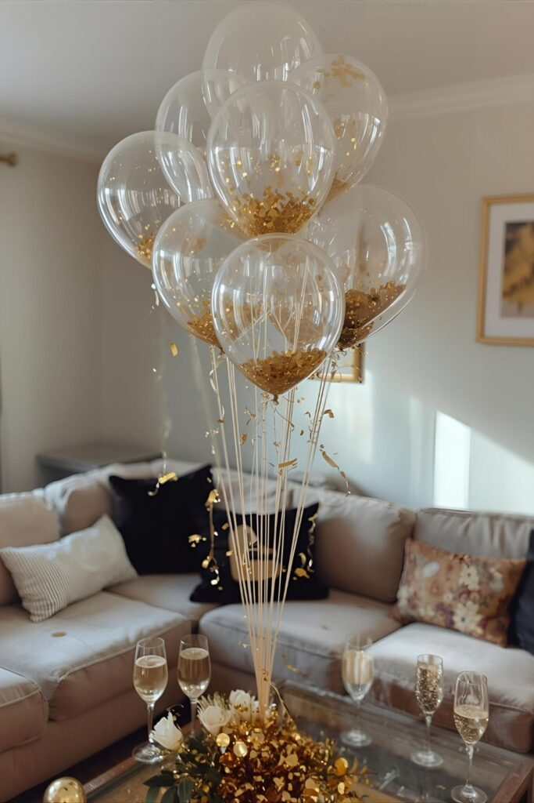

> TIP:QUICK: Tie the balloon bunch to a heavy weight on the coffee table so it floats safely above the sofa.

## 2. Black-and-Gold Glam Living Room

Black and gold is the most grown-up way to do New Year, and it works best when the black is soft — velvet, not gloss. A black velvet sofa with one gold sequin pillow, a dark tree dressed in gold baubles and a gold starburst on the wall give the room a midnight feel without a single bright color.

The trick is balance: for every dark surface, add something that reflects light. Gold ornaments, a sequin pillow and candlelight keep the black from feeling heavy, and the room stays glamorous rather than gloomy.

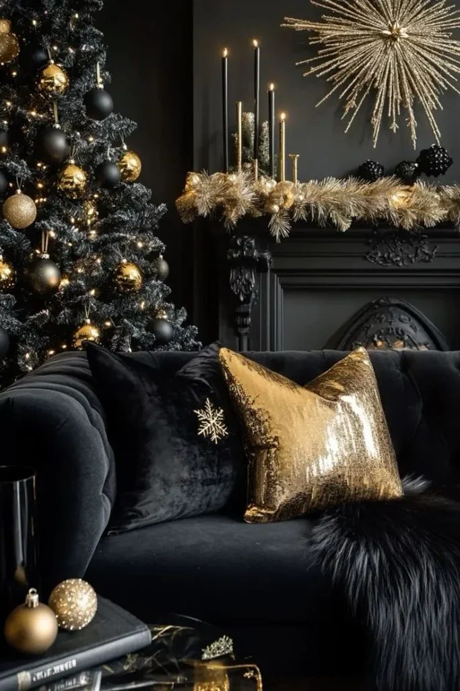

> TIP:CHECK: soft black velvet, not gloss; one gold sequin pillow; gold ornaments and candlelight to lift the dark

## 3. Gold and White Countdown Mantel

A gold and white mantel is the calmest countdown look on this list, and it suits rooms that already lean elegant. White flowers, gold vases and warm fairy lights run along the mantel, with stockings in soft metallic fabric hanging below for a quiet festive note.

Because the palette is so restrained, texture does the work: shiny baubles next to matte flowers, smooth glass next to rough greenery. Leave one clear focal point — a tall gold arrangement or a mirror — so the eye has somewhere to land.

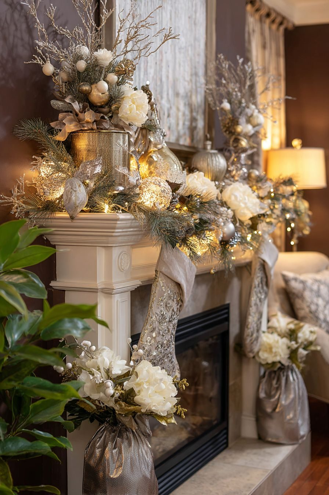

> TIP:GUIDE: Palette: gold and white only | Texture: shiny baubles beside matte flowers | Focal point: one tall gold arrangement

## 4. Gold and Silver Bauble Mantel Garland

If one mantel garland could carry the whole New Year, it would be this one: a thick green garland loaded with gold and silver baubles, draped over the mantel and spilling down both sides. The baubles do the decorating, so you need nothing else on the mantel at all.

Mix bauble finishes — shiny, matte and glitter — in roughly equal numbers, and tuck a string of warm lights deep inside the greenery so the whole garland glows from within. A lit fire below finishes the scene.

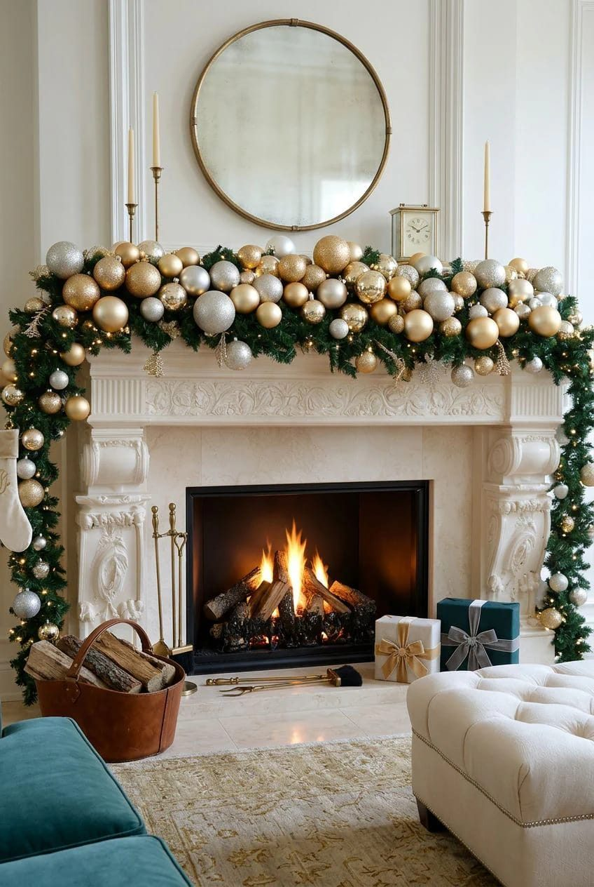

> TIP:QUICK: Mix shiny, matte and glitter baubles evenly, and tuck the lights deep inside the greenery.

## 5. Champagne Bar Cart, Party-Ready

A bar cart is the hardest-working piece of New Year furniture: it holds the drinks, the glasses and half the decorations. Dress a gold cart with a Happy New Year banner, gold star garland, disco balls and party hats, and it becomes the room's party corner all by itself.

Stock it in layers — bottles and an ice bucket on top, glasses and a shaker in the middle, spares below — and keep a small tray of flutes ready to grab. When midnight comes, everything you need is already in one place.

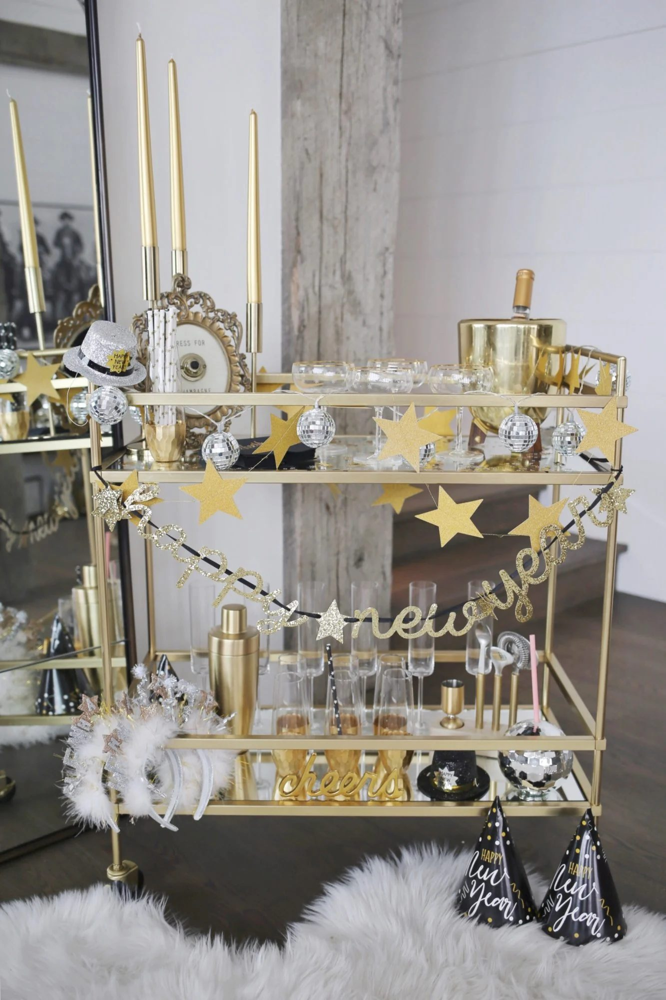

> TIP:CHECK: bottles and ice bucket on top; glasses and shaker in the middle; spares below

## 6. Gold Bar Cart with Champagne and Ice Bucket

A simpler bar cart suits a smaller room or a quieter party. A gold-framed cart with glass shelves, two bottles of champagne, an ice bucket and a row of coupe glasses looks polished without any extra decoration — the brass and glass do the work.

Set the cart against a plain wall with one framed print above it, and leave breathing room on each shelf. A crowded cart looks like storage; a cart with space between the pieces looks like a display.

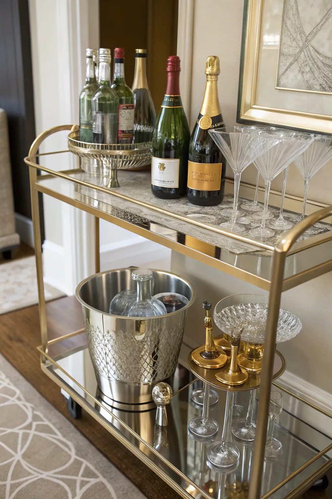

> TIP:GUIDE: Shelves: glass, with breathing room | Top: two bottles and an ice bucket | Wall: one framed print above

## 7. Candle Cluster Coffee Table Centerpiece

A cluster of candles on gold trays turns the coffee table into the warm center of the room. Mix heights — tall pillars, a gold candlestick and small votives — and group them on one or two trays so the arrangement reads as a single centerpiece rather than scattered candles.

White candles keep the look calm and let the gold holders shine. Light them an hour before guests arrive so the wax pool is already glowing, and keep the trays clear of anything flammable.

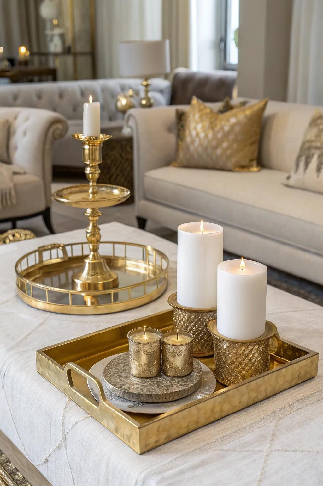

> TIP:QUICK: Mix three heights on one tray — tall pillars, a candlestick and small votives — and light them early.

## 8. Candlelit Mantel with Gold Ornaments and Greenery

Candlelight is what makes a New Year mantel feel magical rather than merely decorated. Gold candelabras at each end, a garland of greenery and gold ornaments between them, and a small wreath above the center turn a plain white mantel into the room's glowing heart.

Keep the candles at the ends and the greenery in the middle so nothing sits too close to a flame, and choose LED candles for the spots nearest the garland. The glow matters more than the flame.

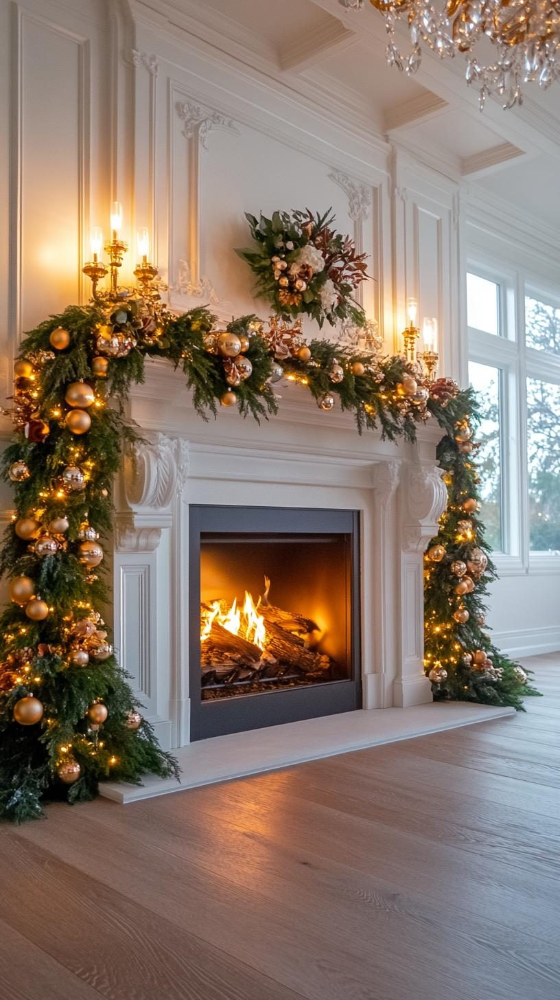

> TIP:CHECK: candelabras at the ends; greenery in the middle; LED candles nearest the garland

## 9. White Sofa with Gold Throw Pillows

Swapping in gold throw pillows is the easiest New Year refresh there is — no furniture moves, no redecorating, just two or three pillows. Gold patterned pillows on a white sofa read instantly festive, especially beside a white tree dressed in gold ornaments.

Choose pillows in the same gold family but different patterns — one metallic, one patterned, one plain — so the sofa looks styled rather than matched. A cream throw over one arm softens the shine.

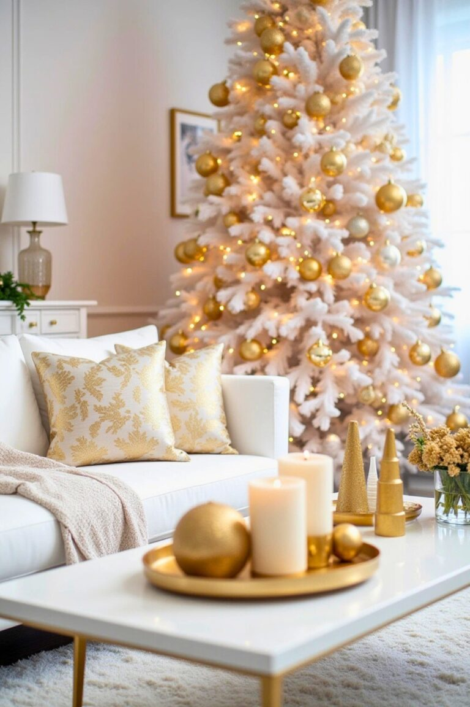

> TIP:GUIDE: Pillows: two or three, same gold family | Patterns: one metallic, one patterned, one plain | Throw: cream over one arm

## 10. Soft Gold-and-White Textiles Refresh

If gold sequins feel too party-like for January, go soft instead: mustard gold cushions, white faux fur pillows and a gold knit throw on a white sofa. The colors still say celebration, but the textures say cozy winter evening.

This is the refresh that survives the longest after New Year, because nothing about it is tied to the date. When the party is over, the throw and pillows simply become the room's winter look.

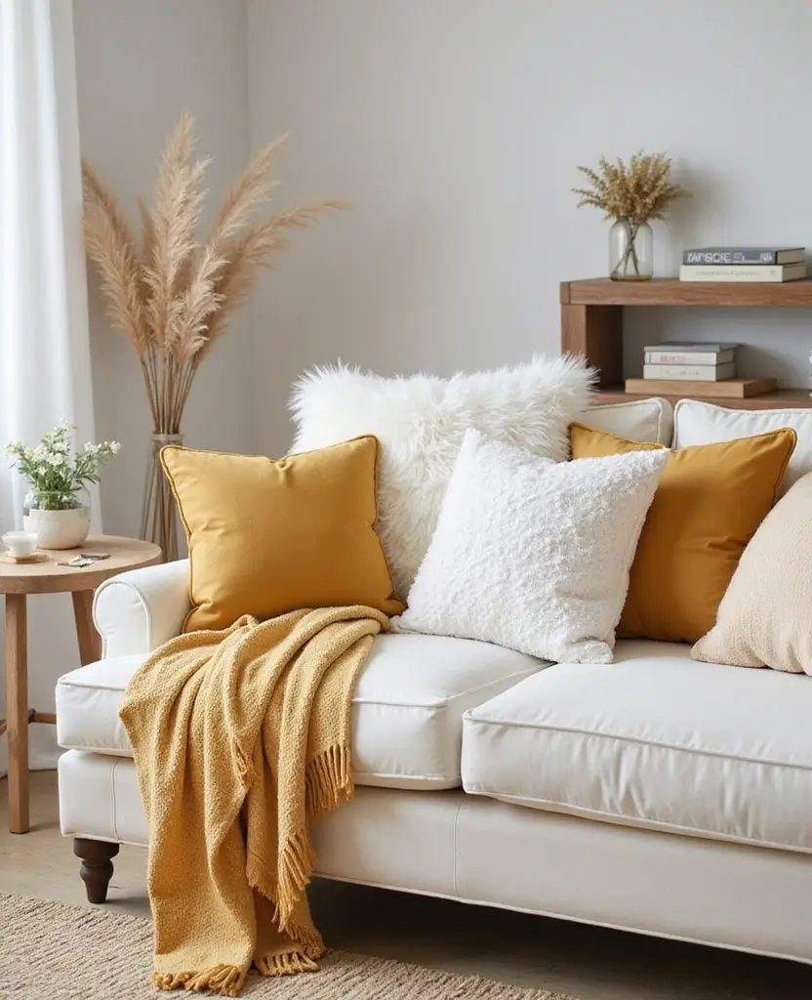

> TIP:QUICK: Swap sequins for soft textures — mustard cushions, faux fur pillows and a knit throw still read as gold.

## 11. Fresh-Start Decluttered Shelves

The fresh start begins with less, not more. Take everything off the shelves, keep only the pieces you genuinely love — a few books, one vase, one framed print per shelf — and leave real empty space between them. The room instantly feels calmer and bigger.

Work shelf by shelf and put the rest in a box out of sight for a month. If you do not miss anything in the box, it can leave the house; if you do, it earns its place back.

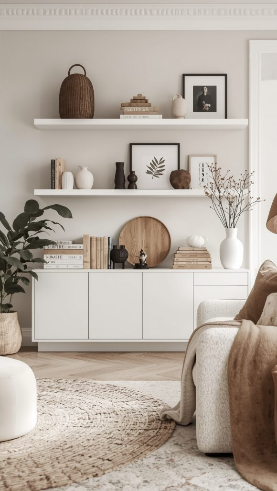

> TIP:CHECK: keep one vase, one print and a few books per shelf; leave real empty space; box the rest for a month

## 12. Gold-Framed Gallery Wall Refresh

January is the perfect month to finally hang the gallery wall. Mix gold and black frames in different sizes, keep the gaps even, and hang the whole arrangement above the sofa so it anchors the seating area. Landscapes, abstracts and small prints mix happily when the frames share a palette.

Lay the arrangement on the floor first and photograph it from above — it is far easier to shuffle frames on the floor than on the wall. Start hanging from the center and work outward.

> TIP:GUIDE: Frames: gold and black, mixed sizes | Gaps: even, about two inches | Start: hang from the center outward

## 13. Cozy Reading Nook Reset

A reading nook is the quiet corner that makes a fresh start feel real. A comfortable armchair by the window, a chunky knit throw, a small side table with a stack of books and a mug, and a floor lamp that pools light over the chair are all it needs.

Give the nook one job only: reading. No phone charger, no paperwork, no clutter — just the chair, the books and the light, so sitting down feels like a small ritual rather than another task.

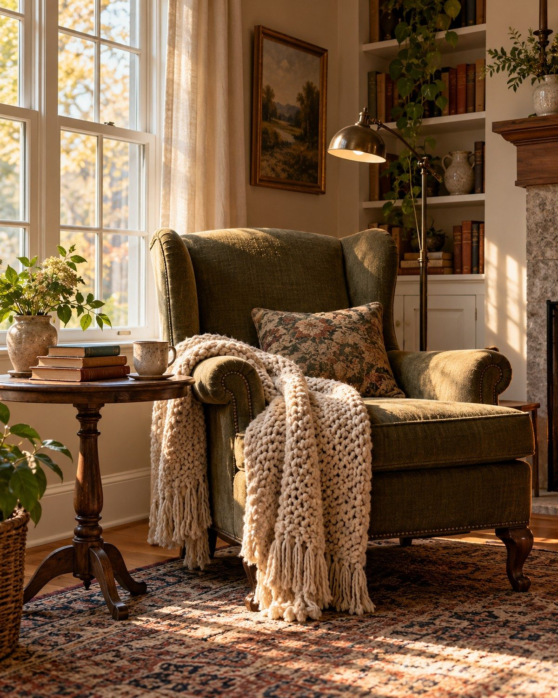

> TIP:QUICK: Give the nook one job only — chair, books and light, no chargers or paperwork allowed.

## 14. Fairy Lights in Glass Jars

Candles in glass jars are the coziest light a living room can have, and they are safer than open flames on a low table. Set pillar candles in large jars and tea lights in small ones along the coffee table, and let a string of fairy lights run along the mantel behind them.

The jars make the candlelight flicker and scatter, so a handful of small flames fills the whole room with warmth. Use unscented candles if you are mixing several, so the scents do not compete.

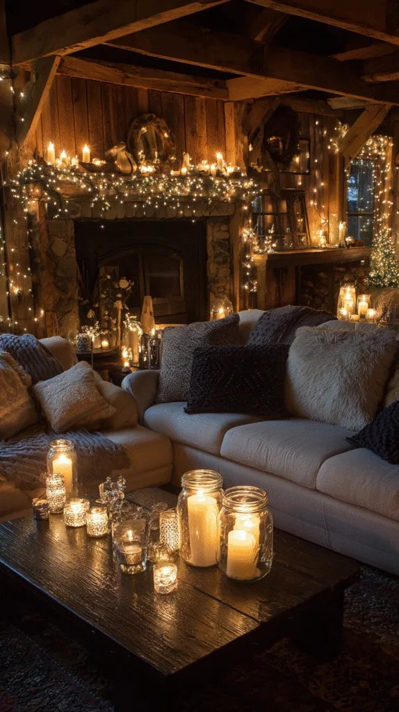

> TIP:CHECK: pillar candles in large jars; tea lights in small ones; unscented when mixing several

## 15. Curtain Lights Behind Sheer Drapes

Hanging fairy lights behind sheer curtains turns the whole window wall into a soft glow. The sheers diffuse the bulbs into a gentle shimmer, and the room feels warm even on the darkest January evening.

Use warm white lights, not cool white, and run the strands vertically so they fall like a curtain of light. Clip the wires to the curtain rod so they hang straight and stay hidden behind the fabric.

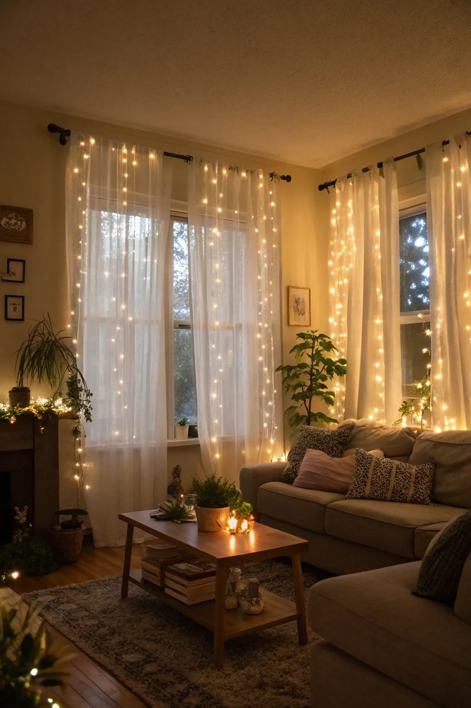

> TIP:GUIDE: Lights: warm white, never cool white | Hang: vertical strands behind the sheers | Fix: clip wires to the curtain rod

## 16. Paper Star Lanterns in the Window

Paper star lanterns are the prettiest January window dressing: they glow like stars, cost almost nothing, and look just as good in February as they did on New Year's Eve. Hang three at different heights in the window and let the snowy light behind them do the rest.

Pair them with a few small light-up houses on the sill and a folded knit throw, and the window becomes a little winter scene. They fold flat for storage, so they are easy to keep for next year.

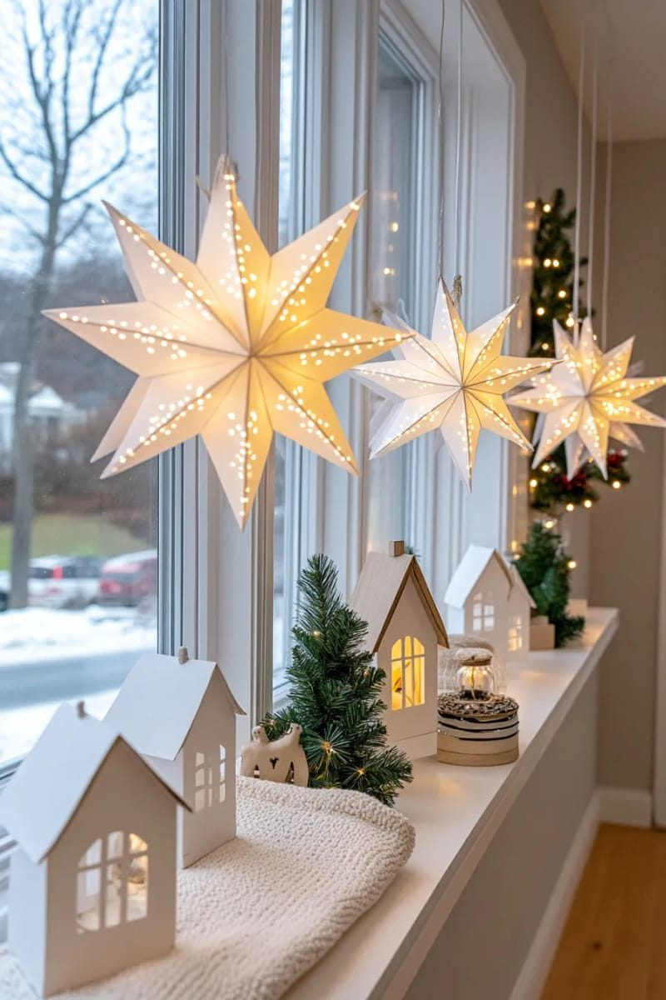

> TIP:QUICK: Hang three star lanterns at different heights so the window reads as a little winter scene.

## 17. Fresh Flowers in a Gold Vase

Fresh flowers are the clearest signal that the holidays are over and the new year has begun. A big bunch of white roses in a gold vase on the coffee table brings life back into a room that has spent a month looking at evergreen.

White flowers suit the season best — roses, ranunculus or paperwhites — because they read clean and calm against winter light. Change the water every other day and the bunch will last the whole first week of January.

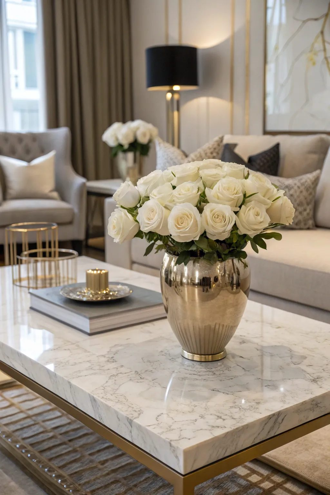

> TIP:CHECK: white roses, ranunculus or paperwhites; change the water every other day; one big bunch beats several small ones

## 18. Jewel-Tone Velvet Cushions

If gold feels too obvious, jewel tones are the richer alternative. Navy, emerald and ruby velvet cushions on a grey sofa bring depth and warmth to a winter room, and the velvet catches the light in a way flat fabric never does.

Keep the sofa itself neutral and let the cushions carry the color — three or four in different jewel tones, mixed with one plain cushion for rest. The look works just as well in February, long after the gold has gone back in the box.

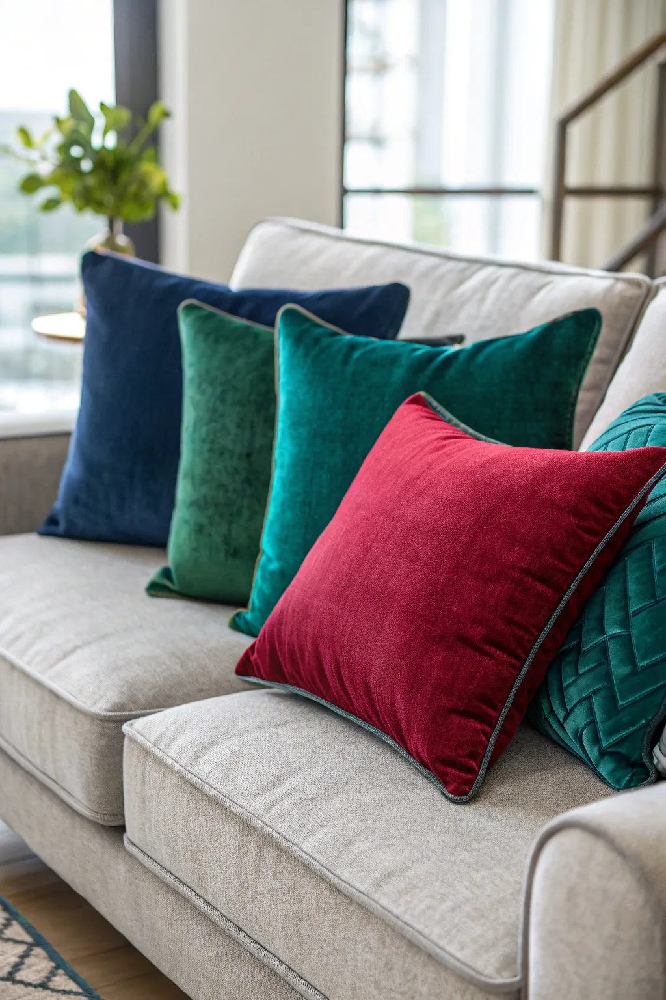

> TIP:GUIDE: Sofa: neutral grey | Cushions: three or four jewel tones | Mix: velvet with one plain cushion for rest

## 19. Mirrored Tray with Champagne Flutes

A mirrored tray is the smallest change with the biggest sparkle. Set four champagne flutes on a round mirrored tray with a gold rim, and place it on the coffee table or sideboard — the mirror doubles the light in the room and makes even an empty tray look dressed.

Keep the tray to one job: drinks. A tray that also holds remotes, keys and mail stops looking festive, so give everything else its own home before the party starts.

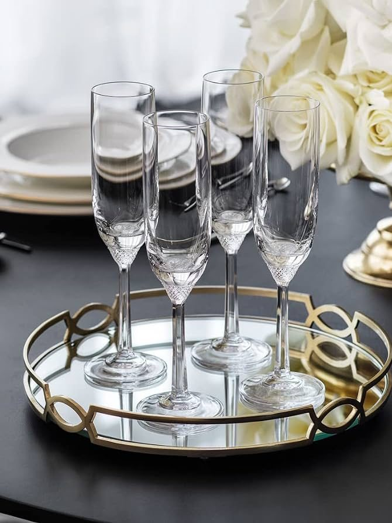

> TIP:QUICK: Give the mirrored tray one job — drinks only — so it keeps looking dressed all evening.

## 20. Winter Citrus Bowl Centerpiece

A bowl of oranges, lemons, pinecones and cinnamon sticks is the winter centerpiece that smells as good as it looks. The citrus brings fresh color to a dark January table, and the pinecones and greenery tie it back to the season without any glitter.

Build it in a wide, shallow bowl so the fruit sits in a single generous layer rather than a pile, and tuck the cinnamon sticks in last so they show. Replace any fruit that softens, and the bowl will last for weeks.

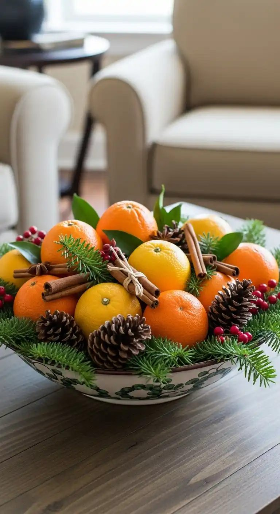

> TIP:CHECK: wide shallow bowl; fruit in one layer; cinnamon sticks tucked in last

## 21. Cozy Fireplace with a Fresh Greenery Garland

A simple greenery garland over the fireplace is all a January living room needs when the rest of the room is already warm. A few sprigs of pine or cedar with fairy lights, a gold vase of winter branches on the coffee table and soft throws on the sofa make the room feel finished without any party decoration.

This is the look to keep when the countdown is over: the garland stays, the balloons go, and the room settles into its winter self. Swap the gold vase for fresh greenery when the branches dry out.

> TIP:GUIDE: Garland: pine or cedar with fairy lights | Table: gold vase of winter branches | Keep: this look after the party ends

## 22. Gold Berry New Year Wreath

A gold berry wreath on the living room door or wall is the one piece of New Year decor that never looks like Christmas leftovers. Gold berries and glittery foliage read as celebration rather than holiday, so the wreath can stay up through all of January.

Hang it where the light hits it — opposite a window or beside a lamp — so the gold catches and glows. One wreath is enough; two in the same room start to compete.

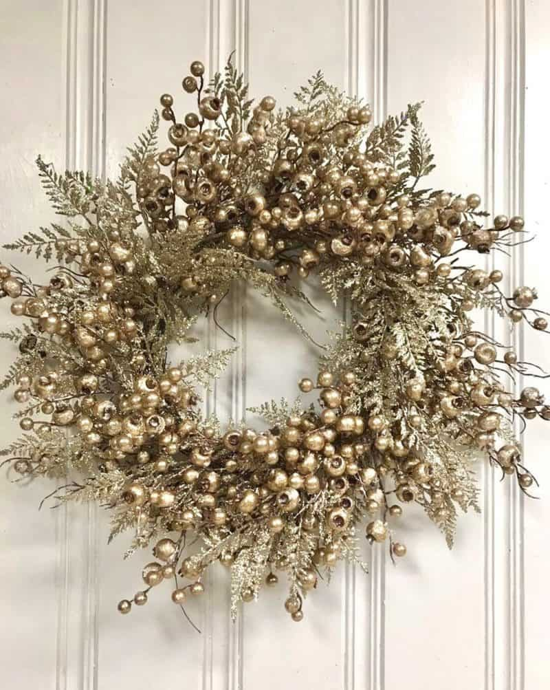

> TIP:QUICK: Hang the wreath where light hits it — opposite a window or beside a lamp — so the gold glows.

## 23. Countdown Clock in Gold Numbers

A clock made of large gold numbers is both decoration and the star of the countdown. Mount the numbers in a circle on the wall above the sideboard, ring them with fairy lights, and the whole room will be watching the wall as midnight approaches.

Keep the sideboard below it simple — a few candles, a small bowl of confetti, the champagne ready — so the clock stays the focus. After midnight, the numbers become a striking piece of wall art for the rest of the month.

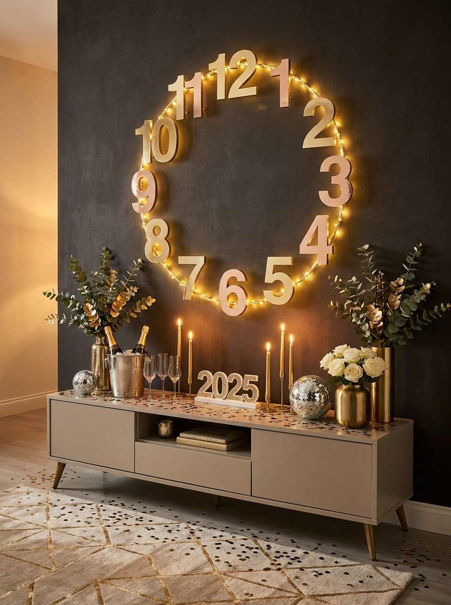

> TIP:CHECK: numbers in a circle; fairy lights ringing them; sideboard below kept simple

## 24. New Year Goals and Memories Wall

A goals and memories board turns one wall into the year's story. Stick favorite photos from the past year beside a few cards with your hopes for the next one, all on a framed corkboard where you will see it every day.

Keep it honest and small — a dozen photos and three or four goal cards, not a collage that covers the wall. Swap one photo a month as the year fills in, and the board grows with you.

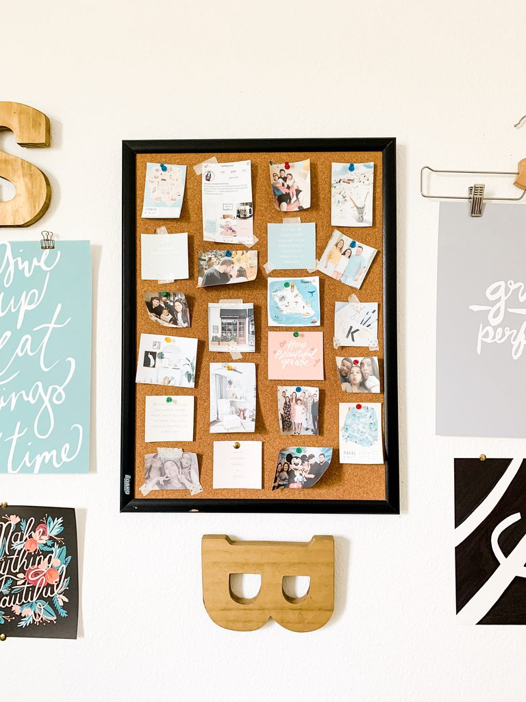

> TIP:GUIDE: Board: framed corkboard, seen daily | Content: a dozen photos, three or four goal cards | Update: swap one photo a month

## 25. Layered Rugs for Winter Warmth

Layering rugs is the quickest way to make a bare winter floor feel warm. A natural jute rug underneath and a patterned wool rug on top add texture, color and insulation in one move, and the layered edge gives the seating area a finished, collected look.

Size the top rug so it sits under the front legs of the sofa and the coffee table, with the jute showing as a border of a few inches all round. The two textures should contrast — flat jute below, soft wool above.

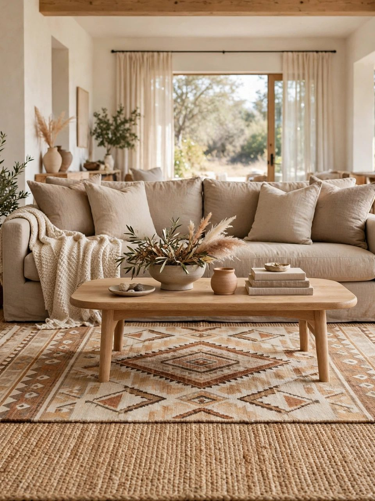

> TIP:QUICK: Let the jute show as a border of a few inches all round the patterned rug on top.

## 26. White and Silver Tree That Stays Up

A white and silver tree is the one Christmas tree that does not need to come down on New Year's Day. Without red or green anywhere, a flocked tree with white and silver ornaments reads as a winter tree, and it looks beautiful against January light for weeks.

Take off anything that says Christmas — ribbons, themed ornaments, the topper — and leave the white baubles and warm lights. When the branches start to look tired, that is the moment to pack it away.

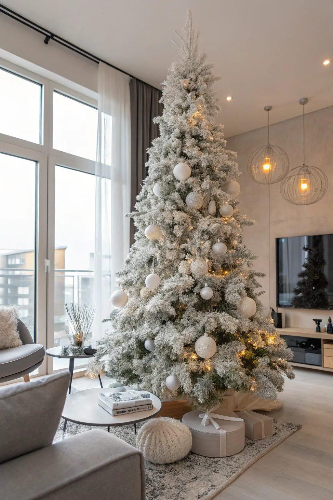

> TIP:CHECK: remove ribbons, themed ornaments and the topper; keep white baubles and warm lights; pack it away when branches tire

## 27. Entryway Console with a Gold Mirror

The entryway sets the tone before anyone reaches the living room, so give it the same fresh start. A console table with a gold-framed mirror, a vase of white flowers and a brass lamp makes guests feel welcomed, and the mirror bounces light into the hall.

Keep the console surface almost empty — one vase, one lamp, one small bowl for keys — so the mirror stays the star. A runner rug in soft neutrals finishes the welcome.

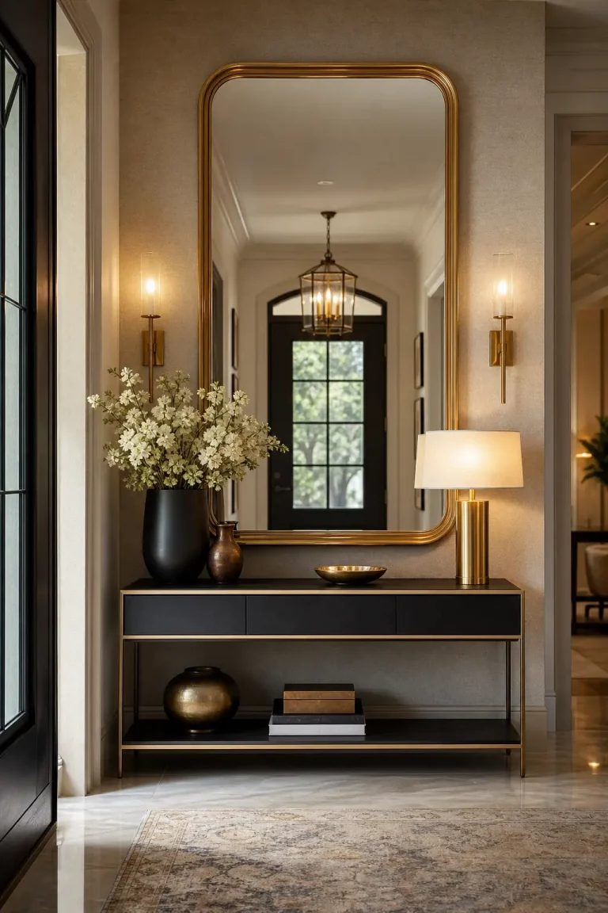

> TIP:GUIDE: Surface: one vase, one lamp, one bowl | Star: the gold mirror | Floor: a runner rug in soft neutrals

## 28. January Pillows and Blankets Refresh

The January pillow refresh is the softest reset on this list. Swap the party pillows for cream knit cushions, keep one gold sequin pillow for sparkle, and drape a chunky knit throw across the sofa so the room invites curling up rather than dressing up.

This is the version of the room you will actually live in all winter, so choose comfort over shine: soft fabrics, warm neutrals and one tray of ornaments left over from the party as a reminder of the night.

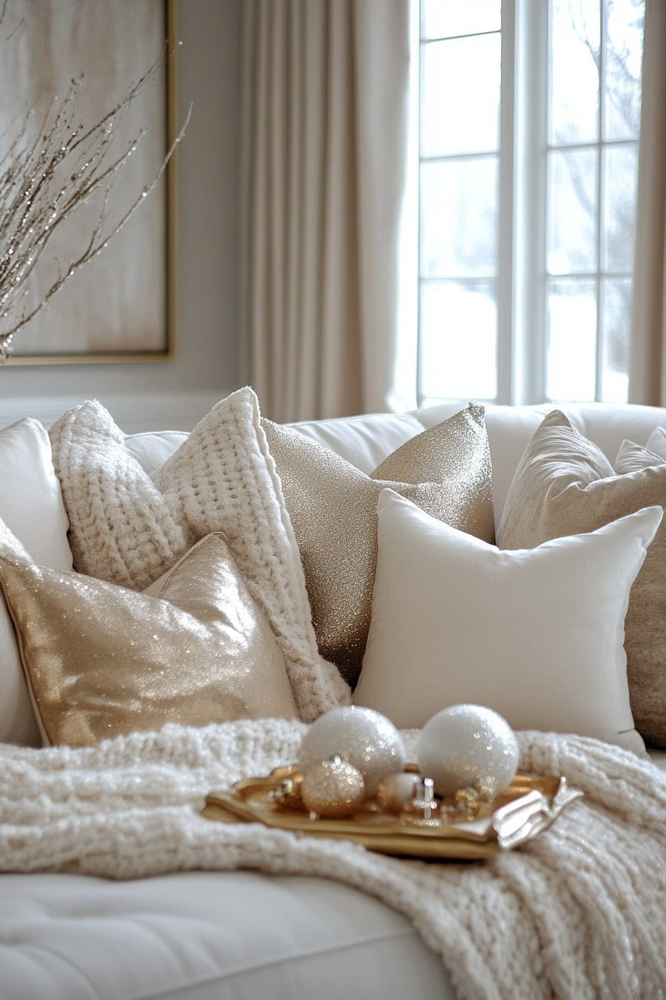

> TIP:QUICK: Keep one gold sequin pillow for sparkle and make everything else soft cream knit.

## 29. Warm Fairy Lights Across the Wall

A whole wall of fairy lights is the boldest way to keep the New Year glow going. Vertical strands of warm lights across a blank wall turn an ordinary evening into something special, and the light is soft enough to leave on all winter.

Hang the strands from the ceiling trim or a curtain rod so they fall straight, and keep the furniture below them simple — a sofa, a few cushions, a small side table. The wall is the decoration; the room just needs to stay out of its way.

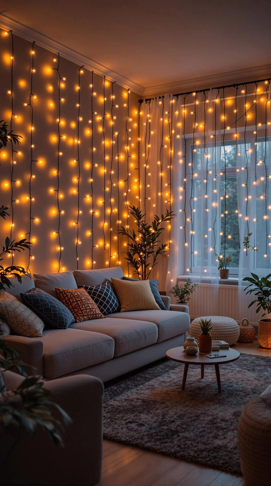

> TIP:CHECK: warm white strands, hung vertically; furniture below kept simple; the wall is the decoration

## 30. Gold Confetti Coffee Table

The last idea is the party itself, shrunk onto the coffee table: a glass bowl of gold confetti and fairy lights, two party hats, champagne flutes and a scatter of gold and silver balloons underneath. Everything a countdown needs, in one square foot.

Set it up an hour before midnight and clear it the next morning — the point is that it is temporary. Pack the hats and balloons away, keep the gold bowl, and the table is ready for its January life as a calm, clear surface.

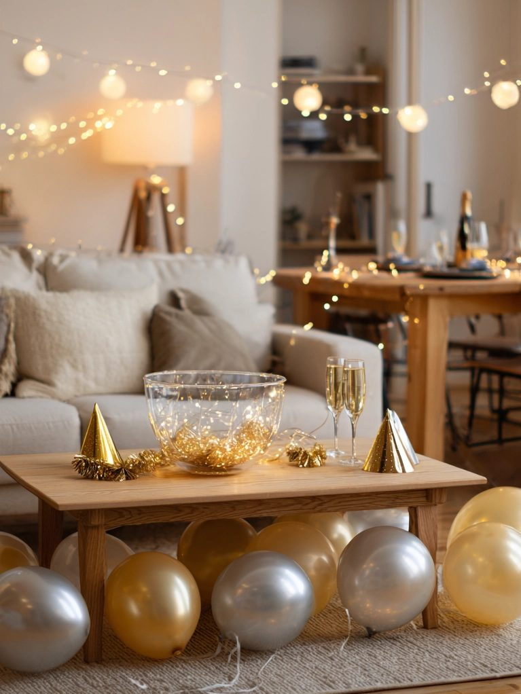

> TIP:GUIDE: Setup: one hour before midnight | Contents: confetti bowl, hats, flutes, balloons | Morning: pack the party away, keep the bowl

## Takeaway

- The New Year living room works in two acts: sparkle for the countdown, then calm for January — gold and lights for the night, soft textiles and clear surfaces for the weeks after.
- Start with the three cheapest moves: declutter the shelves, swap in gold pillows, and light the candles. If those three feel right, add a bar cart and a mantel garland.
- For the wider winter look once the party is over, our [30 Winter Home Ideas for a Cozy, Snowy Season](/posts/winter-home/) carries the same warmth through the whole house, and our [30 Winter Window Art Ideas for a Bright, Seasonal Home](/posts/winter-window-art/) keeps the windows glowing into February.

## Frequently Asked Questions

### How do I decorate my living room for New Year on a budget?

Start with what you already own: declutter the shelves, swap in gold or metallic cushions, and light candles you have at home. Add one low-cost statement, like a balloon cluster or a string of fairy lights, and keep the palette to gold and white so everything matches. Most of the ideas in this list need no new furniture at all.

### What colors work best for New Year living room decor?

Gold and white is the classic New Year pairing because it feels festive without shouting, and it works with almost any sofa color. Black and gold adds drama for an evening party, while silver and white keeps things calm and wintry for January. Pick one metallic and one neutral, then repeat them across the room.

### How can I make my living room feel fresh for January?

Clear the surfaces first: pack away themed Christmas pieces, thin the shelves to a few favorite objects, and open the curtains for daylight. Then add one fresh element, like white flowers or a new throw, so the room smells and feels new. A fresh start is mostly subtraction, not addition.

### Should I take the Christmas tree down before New Year?

Only if it is green and red. A white or flocked tree with white and silver ornaments reads as a winter tree and can stay up through January, which many households prefer. Remove ribbons, themed ornaments and the topper first, and take the tree down once the branches start to look tired.

### How do I keep party decor from looking messy the next day?

Give the party one zone — the bar cart or the coffee table — and keep the rest of the room as it was. Use trays to contain glasses, candles and confetti so nothing spreads across surfaces. In the morning, pack the hats and balloons away first, then clear the trays, and the room is calm again.

### What is the easiest New Year centerpiece for a coffee table?

A cluster of candles on a gold tray is the simplest and most reliable choice: mix tall pillars with small votives, keep the candles white, and add a few gold ornaments around the base. It takes five minutes to arrange, lights beautifully at midnight, and still looks right on an ordinary January evening.

### Can I reuse Christmas decorations for New Year?

Yes, if you edit them. Gold and silver baubles, fairy lights, greenery garlands and white candles all work for New Year without looking like leftovers. Remove anything red, themed or obviously Christmas — ribbons, character ornaments and Santa figures — and the remaining pieces become elegant New Year decor.

### How do I decorate a small living room for New Year?

Choose vertical and tabletop ideas instead of floor pieces: a mantel garland, fairy lights behind sheer curtains, a gold tray on the coffee table and a small bar cart in a corner. Skip the balloon floor clusters and large trees, keep surfaces clear, and let one metallic accent repeat so the small room feels styled rather than crowded.
