# 30 Stocking Hanging Ideas for a Cozy Christmas

Stocking hanging ideas do not have to start with a fireplace. If you have no mantel, or the mantel is already full, stockings can hang from a ladder, a row of hooks, a stair rail, a window or a freestanding stand — and the best spot is often the one you walk past every day. These 30 stocking hanging ideas cover every corner of the house, so every stocking gets a home and Santa never has to guess.

The rule for every spot is the same: hang the stocking where it can be seen, where it will not be knocked over, and where it is strong enough to hold a full stocking on Christmas morning. If you want the garland that ties the whole display together, our [30 Garland on Mantle Ideas for Every Season](/posts/garland-on-mantle/) shows how to run greenery along any shelf, rail or mantel.

## 1. Ladder with Knit Stockings and Fairy Lights

A wooden ladder is the classic no-mantel stocking solution, and it looks like it was always meant for the job. White and red knit stockings hang from the rungs on little hooks, fairy lights wind around the sides, and the whole ladder leans against the wall by the tree.

Lean the ladder at a slight angle so the stockings hang free of the wall, and put the heaviest stocking on the lowest rung. A ladder holds three or four stockings comfortably; for more, use two ladders or add a rail beside it.

> TIP:QUICK: Lean the ladder so stockings hang free of the wall — a ladder flat against the wall crushes the cuffs.

## 2. Ladder by the Christmas Tree

A ladder beside the Christmas tree keeps all the Christmas in one corner. Red stockings hang from the rungs, the tree glows beside it, and a basket of greenery sits at the foot of the ladder to hide the feet.

Match the ladder to the tree: a rustic ladder with a rustic tree, a white ladder with a white tree. Keep the ladder on the same side of the room as the tree so the eye reads them as one display.

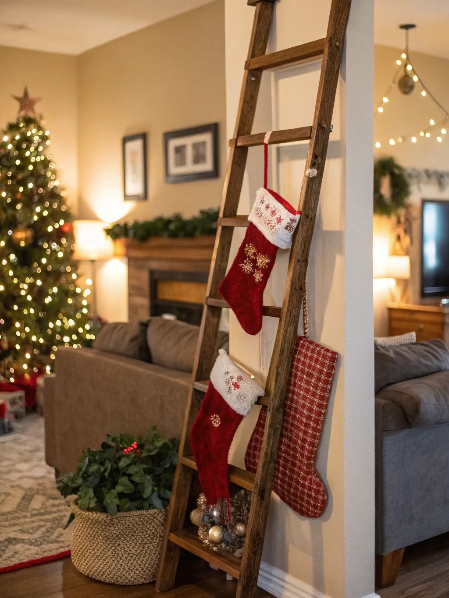

> TIP:CHECK: ladder and tree on the same side of the room; heaviest stocking lowest; greenery at the foot to hide the feet

## 3. Stone Fireplace with a Row of Stockings

A stone fireplace with a row of stockings is the traditional picture, and it still works beautifully. Red stockings hang in a neat row from a lit garland strung across the stone, with a framed picture above and a little snowman on the hearth.

On stone, use adhesive hooks or a tension rod across the firebox opening — never drill into the stone. Space the stockings evenly and keep the garland lights warm white so the stone glows.

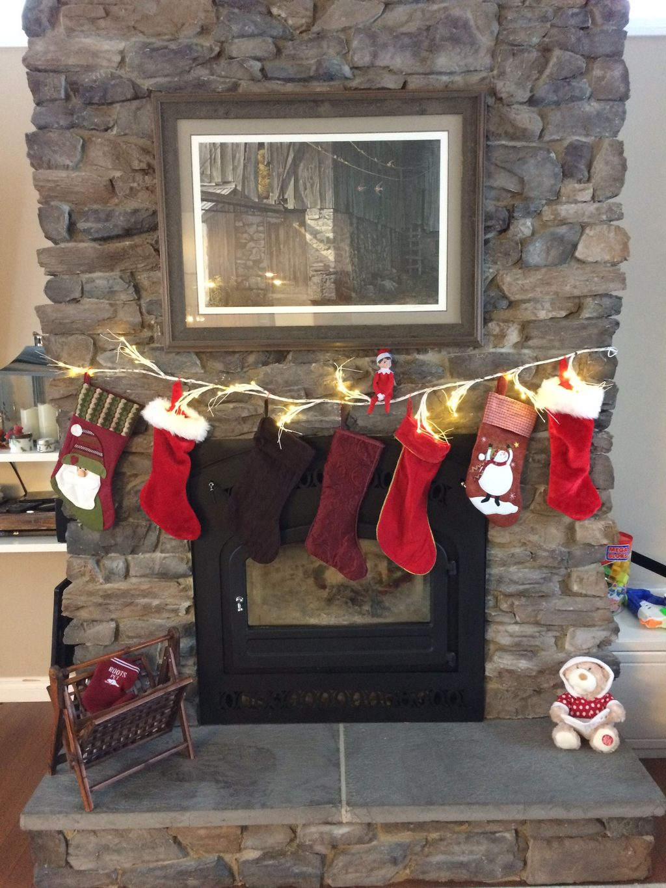

> TIP:GUIDE: Budget: under $20 for adhesive hooks and a garland | Time: thirty minutes to hang | Skill: beginner

## 4. Knit Stockings over a Roaring Fire

Cream knit stockings over a roaring fire are the coziest image in this list. Four matching stockings hang from the mantel shelf above a brick fireplace, the fire crackling below, and brass andirons catching the light.

Matching stockings look best in a row, and knit ones hold their shape when filled. If the fire is lit, hang the stockings from the shelf, not the firebox, and take them down before the fire is built up for the evening.

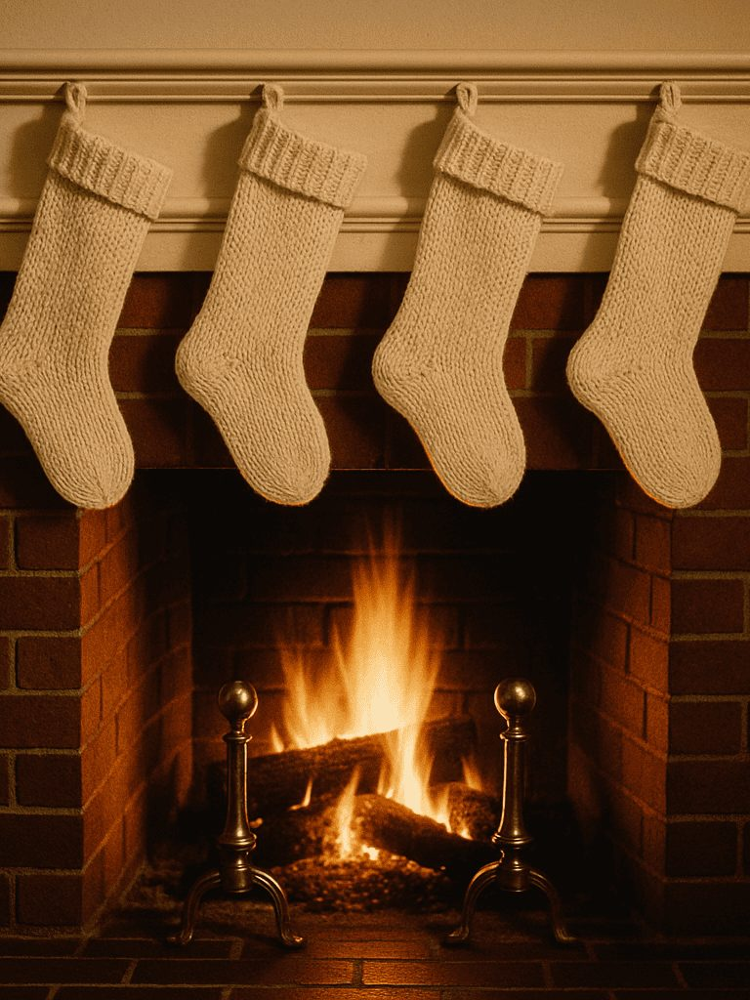

> TIP:QUICK: Hang stockings from the shelf, never the firebox — and take them down before building the fire up.

## 5. Stockings on a Freestanding Rail

A freestanding rail is the answer for a house with no mantel and no free wall. This black metal rail holds a row of colorful stockings on hooks, stands on its own feet, and can be moved to wherever the family gathers on Christmas Eve.

A rail is also the best choice for renters: no holes, no adhesive, nothing to repair in January. Choose a rail with feet wide enough that a row of full stockings cannot tip it forward.

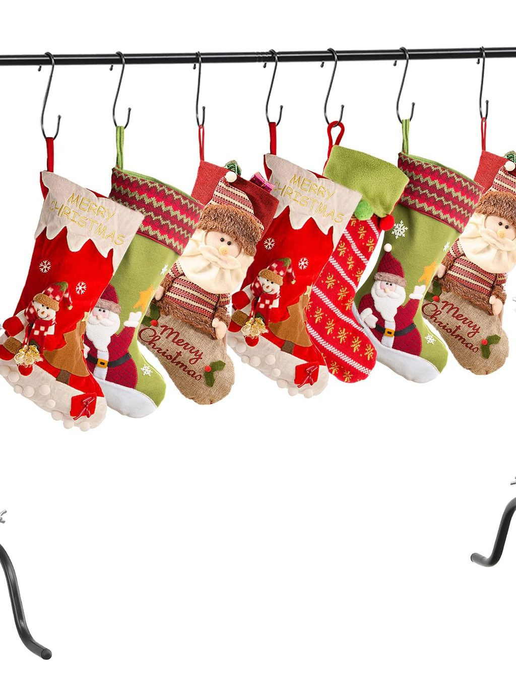

> TIP:CHECK: a rail with wide feet so full stockings cannot tip it; no holes and no adhesive — ideal for renters; folds away flat in January

## 6. Stocking Stand with Garland and Gifts

A stocking stand dressed with garland and gifts does double duty as a decoration and a display. Striped and Fair Isle stockings hang from the stand's arms, a garland runs across the top, and wrapped gifts wait at its feet.

Stands work best in a corner where they cannot be bumped. If you have small children, put the stand behind the sofa or in a corner, and hang the lightest stockings at child height so little hands can reach them.

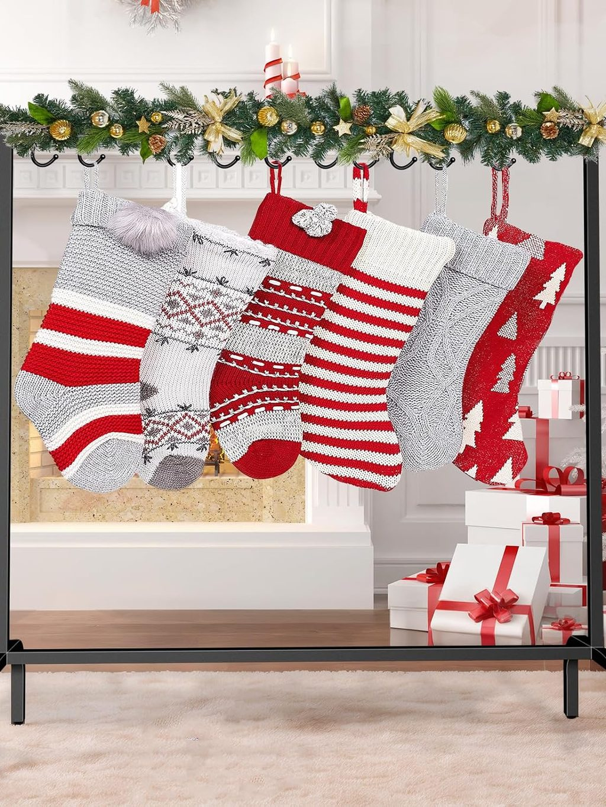

> TIP:GUIDE: Budget: $25–$50 for a freestanding stocking stand | Time: twenty minutes to assemble and style | Skill: beginner

## 7. White Stand by the Tree

A white stand by the tree is the tidiest stocking display here. Patterned stockings hang from its arms in front of the Christmas tree, with the mantel garland behind it, and nothing else competing for attention.

White stands disappear against a white wall, so the stockings look like they are floating. Put the stand where it catches the tree lights — the stockings will glow without any lights of their own.

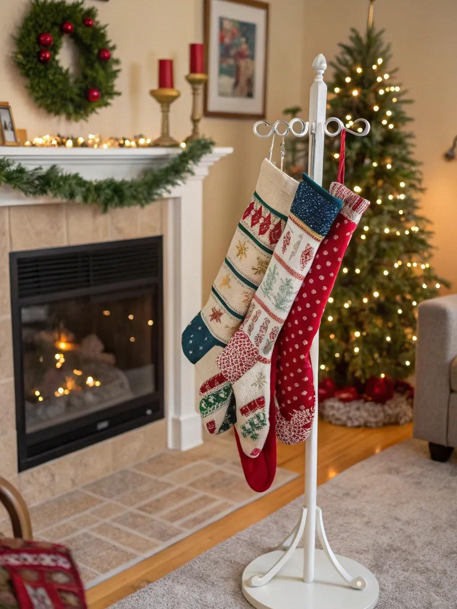

> TIP:QUICK: Place the stand where it catches the tree lights — the stockings glow with no lights of their own.

## 8. Stockings Along the Stair Garland

Stockings along the stair garland turn the staircase into the Christmas display. White and patterned stockings hang from a green garland running up the banister, one per spindle, with the stairs themselves doing the work of a mantel.

Hang one stocking per spindle so the spacing is even, and use ribbon loops rather than the stocking's own loop — ribbon is stronger and lets you set the exact height. Start at the bottom of the stairs so the first stocking is at eye level.

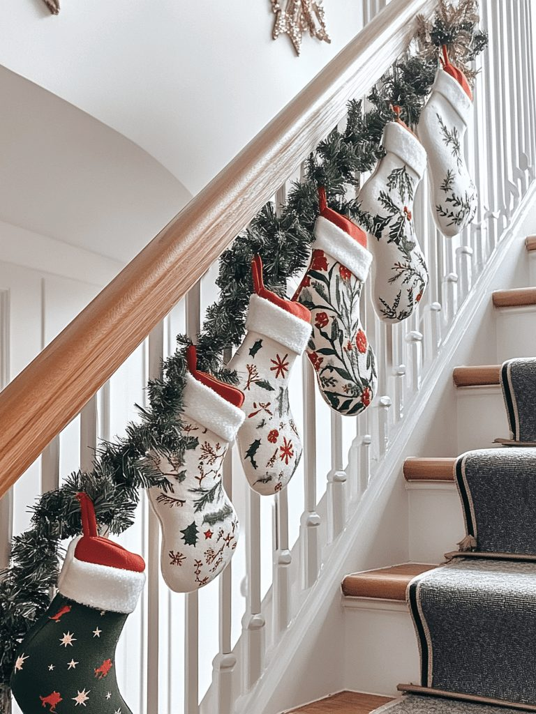

> TIP:CHECK: one stocking per spindle for even spacing; ribbon loops, stronger than the stocking's own loop; start at the bottom

## 9. Small Stockings on the Banister

Small stockings on the banister are the sweetest idea for a house full of children. Little red, green and white stockings hang from the newel posts and spindles, each one small enough for a child's hand to find on Christmas morning.

Small stockings are lighter, so they can hang from the garland itself with a simple hook. Give each child the stocking nearest their bedroom door, so the hunt on Christmas morning starts at the stairs.

> TIP:GUIDE: Budget: under $15 for small stockings and hooks | Time: twenty minutes to hang | Skill: beginner

## 10. Stockings Down the Stair Rail

Stockings down the stair rail look generous and a little bit grand. Red stockings with green cuffs hang in a row from a berry garland on a wooden rail, with the stairs carpeted and the hallway warm behind them.

A wooden rail takes hooks better than a painted one, so use small S-hooks over the rail rather than adhesive. Keep the stockings on the side of the rail facing the room, not the stairs, so they are seen from the hallway.

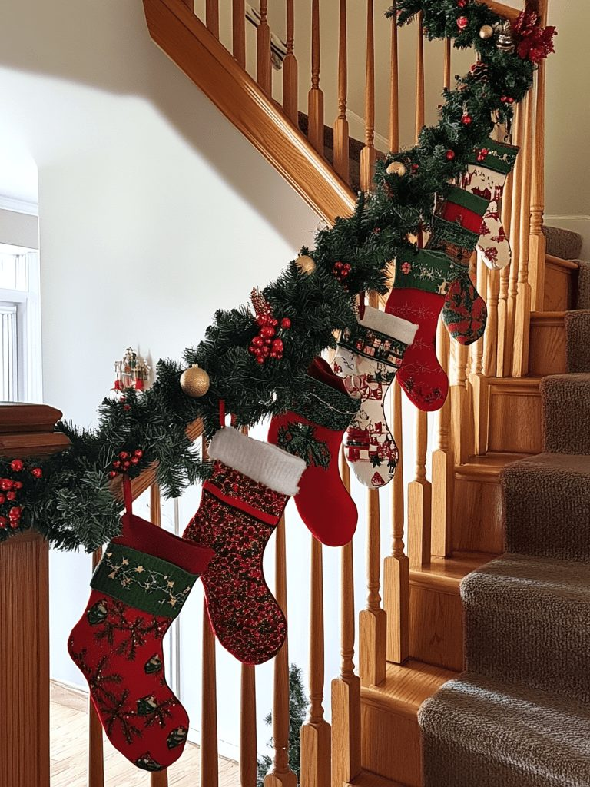

> TIP:QUICK: S-hooks over a wooden rail, stockings facing the room — they read from the hallway, not the stairs.

## 11. Velvet Stockings on the Staircase

Velvet stockings on the staircase feel luxurious, especially in deep red and green. They hang from a garland of red ribbon, pinecones and lanterns on the newel post, with candles glowing on the steps below.

Velvet is heavy when filled, so use wide ribbon loops and test the weight before Christmas Eve. A lantern on the newel post anchors the display and gives you a place for the garland to start.

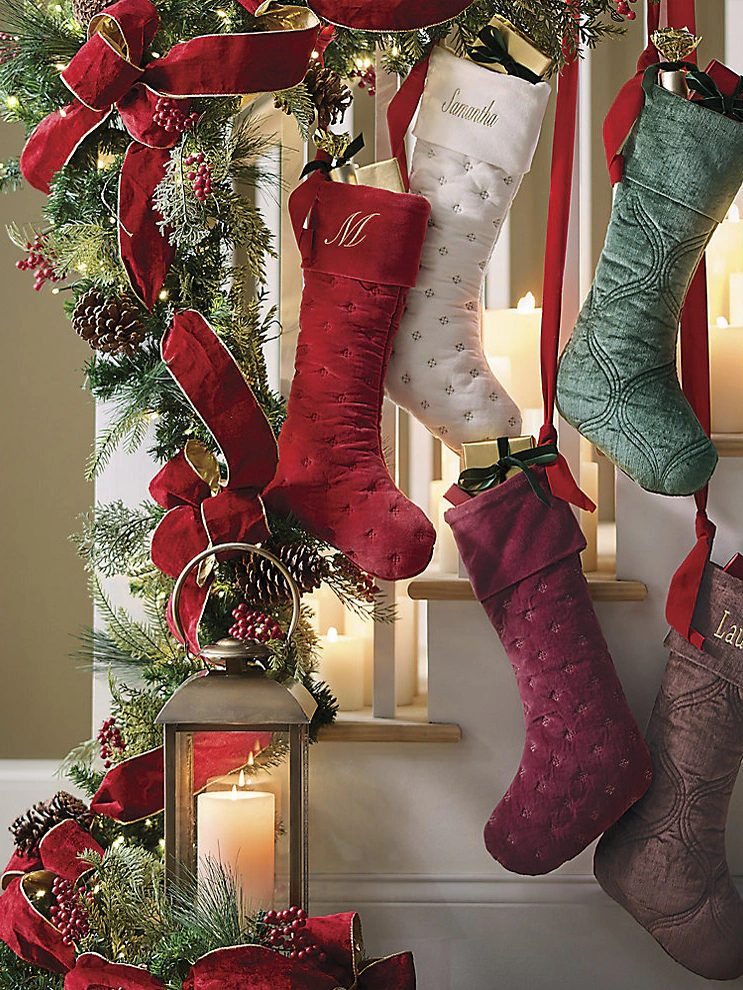

> TIP:CHECK: wide ribbon loops for heavy velvet; test the weight before Christmas Eve; a lantern anchors the newel post

## 12. A Full Staircase of Stockings

A full staircase of stockings is the showstopper: eight or nine stockings along a garland that runs the whole flight. Each one is different — red, green, cream, patterned — and the staircase looks like a Christmas card.

Count your spindles before you buy stockings, and hang the garland first, then the stockings. If the stairs are the main route through the house, hang the stockings on the side away from the handrail.

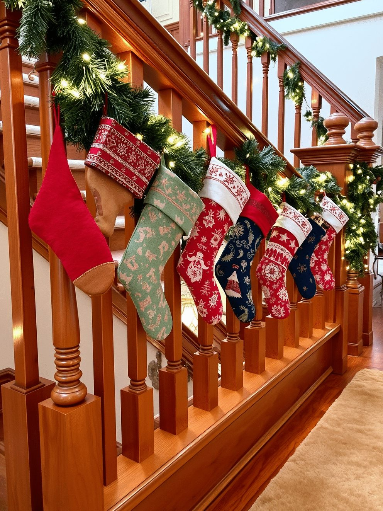

> TIP:GUIDE: Budget: $30–$60 for a full stair garland and stockings | Time: one hour to hang | Skill: beginner

## 13. Rustic Hooks on a Wood Wall

Rustic hooks on a wood wall are the simplest stocking display that still looks finished. Three knit stockings filled with gifts hang from iron hooks on a weathered wood wall, with candy canes and gift tags tucked into the cuffs.

Three hooks are enough for a small family, and the wood wall does the decorating for you. Fill the cuffs with a candy cane and a gift tag so the stockings look generous even before Christmas morning.

> TIP:QUICK: Fill the cuffs with a candy cane and a gift tag — the stockings look generous before they are even filled.

## 14. A Row of Hooks in the Hallway

A row of hooks in the hallway turns a plain wall into the stocking wall. Six colorful stockings hang from a wooden peg rail, each one different, with a Christmas tree just visible at the end of the hall.

A peg rail is the most flexible stocking spot in the house: add a hook when the family grows, move the rail when you move house. Hang it at adult chest height so the stockings clear the floor when full.

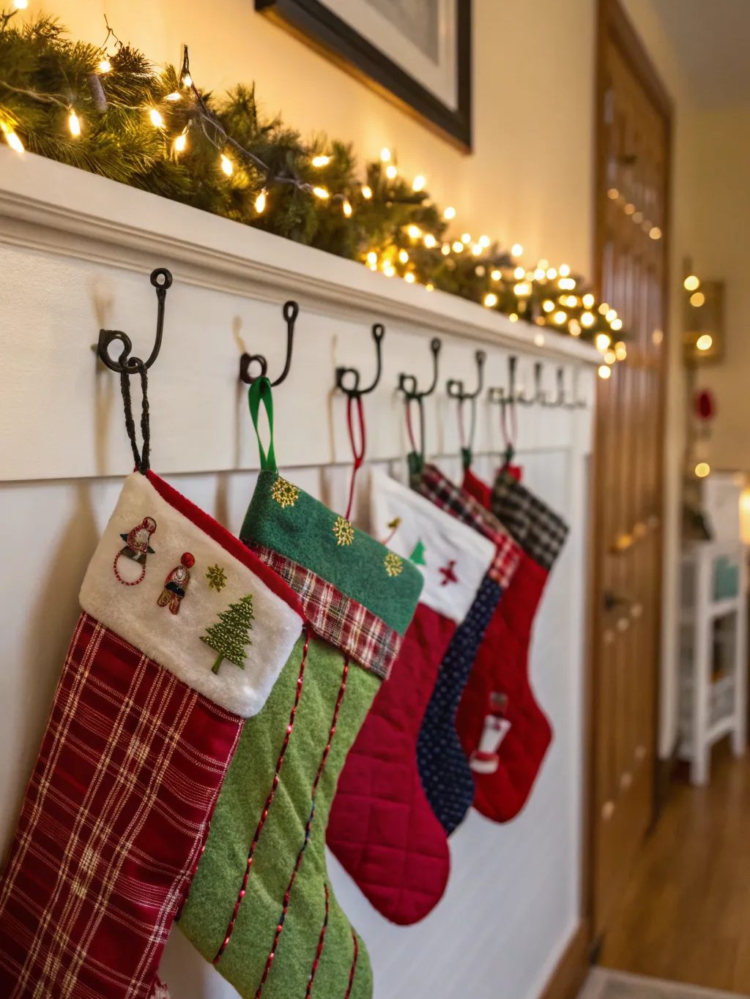

> TIP:CHECK: peg rail at adult chest height; full stockings must clear the floor; add a hook when the family grows

## 15. Pet Stockings on Wall Pegs

Pet stockings on wall pegs make sure the animals are not forgotten. Small burgundy and red stockings hang from pegs on a white wall, one for each pet, with a paw print stitched on the cuff.

Pet stockings are small and light, so a single peg each is plenty. Hang them lower than the family stockings — at a height where you can reach them easily with treats in hand on Christmas morning.

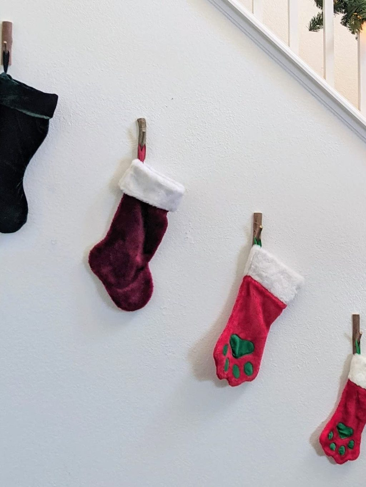

> TIP:GUIDE: Budget: under $10 for small pet stockings and pegs | Time: fifteen minutes to hang | Skill: beginner

## 16. Metal Stocking Holders on the Mantel

Metal stocking holders on the mantel are the classic solution for a mantel with no hooks. White and plaid stockings hang from heavy metal holders weighted to stay put, with a garland and ornaments along the shelf.

The holders must be heavy: a good one weighs at least a pound, and the stocking hangs from the front, not the back, so the weight pulls it onto the mantel instead of off it. Test with a full stocking before the big night.

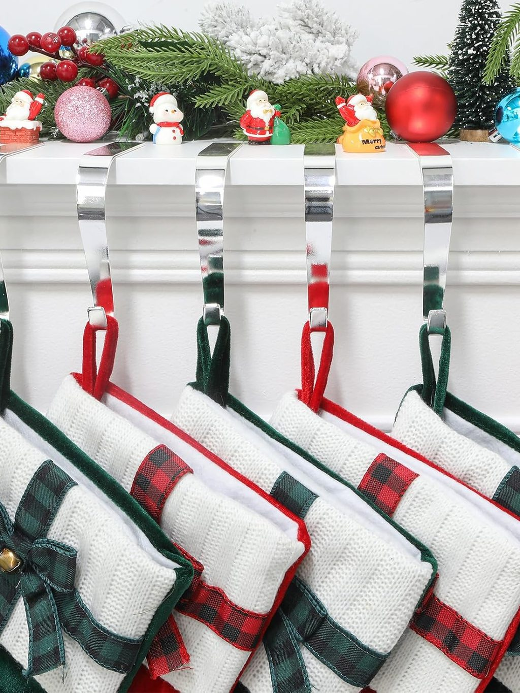

> TIP:QUICK: Holders must weigh at least a pound — hang the stocking from the front so the weight pulls it onto the mantel.

## 17. Mudroom Lockers with Stockings

Mudroom lockers with stockings give every family member a cubby and a stocking. White lockers with baskets above and wreaths on the doors hold one stocking each, and the mudroom becomes the Christmas morning meeting point.

This is the best idea for a big family: no arguing over whose stocking is whose, because each locker is labeled by its owner. Hang the stockings from the locker hooks, not the wreaths, so the wreaths stay put.

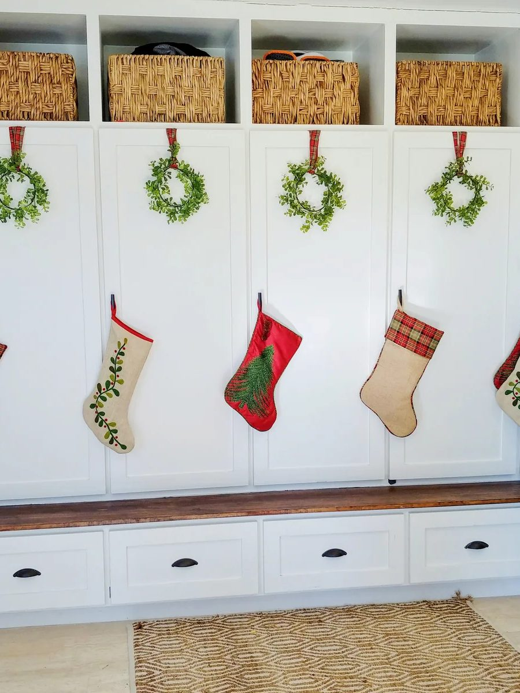

> TIP:CHECK: one stocking per locker, hung from the locker hook; each locker labeled by its owner; wreaths stay on the doors

## 18. Stockings Under Open Shelves

Stockings under open shelves use the kitchen or living room shelving you already have. Red and cream stockings hang from hooks screwed under the lowest shelf, with the shelves above dressed for Christmas and the tree glowing beside them.

Screw the hooks into the underside of the shelf, not the wall, so the stockings hang free and the shelf above stays usable. This is a good spot for the adults' stockings, away from small hands.

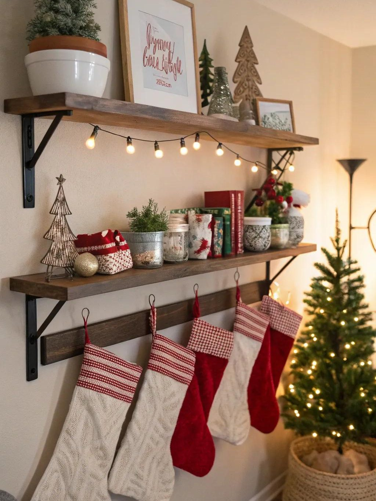

> TIP:GUIDE: Budget: under $10 for screw-in hooks | Time: twenty minutes to fit | Skill: beginner with a drill

## 19. Peg Rail with Knit Stockings

A peg rail with knit stockings is the farmhouse version of the hallway rail. Cream, red and green knit stockings hang from wooden pegs on a white wall, with a Christmas tree glowing at the end of the room.

Knit stockings stretch when filled, so hang them from the cuff loop and leave an inch of clearance below. A peg rail in the living room keeps the stockings where the family actually sits on Christmas morning.

> TIP:QUICK: Hang knit stockings from the cuff loop and leave an inch of clearance — knit stretches when filled.

## 20. Wall Shelf with Hooks Below

A wall shelf with hooks below is two decorations in one. The shelf holds a garland, candles and a framed print, and five knit stockings hang from hooks under it, over the sofa, where everyone can see them.

This is the idea to copy if your mantel is already full: the shelf does the mantel's job on any wall. Keep the shelf at a height where the stockings hang above the sofa back, not behind it.

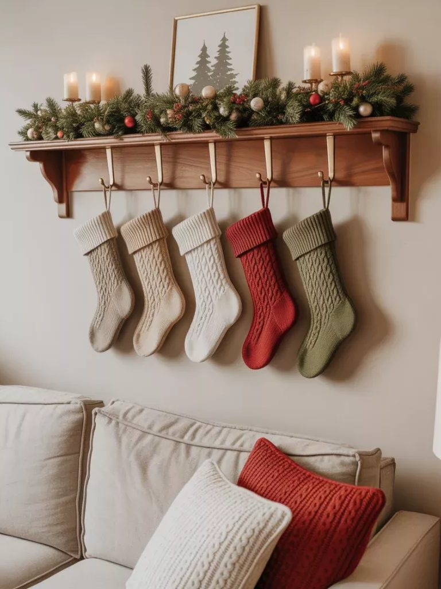

> TIP:CHECK: shelf high enough that stockings hang above the sofa back; garland on the shelf, stockings below; hooks screwed into the shelf, not the wall

## 21. Stockings on a Window Rail

Stockings on a window rail are the brightest idea here — literally. Colorful stockings with candy canes hang from a rail across a sunny window, and the daylight shines through the knit so the colors glow.

A window rail is a curtain rod with S-hooks, nothing more. Hang it inside the window frame so the stockings do not block the curtains, and keep the stockings short so they clear the sill.

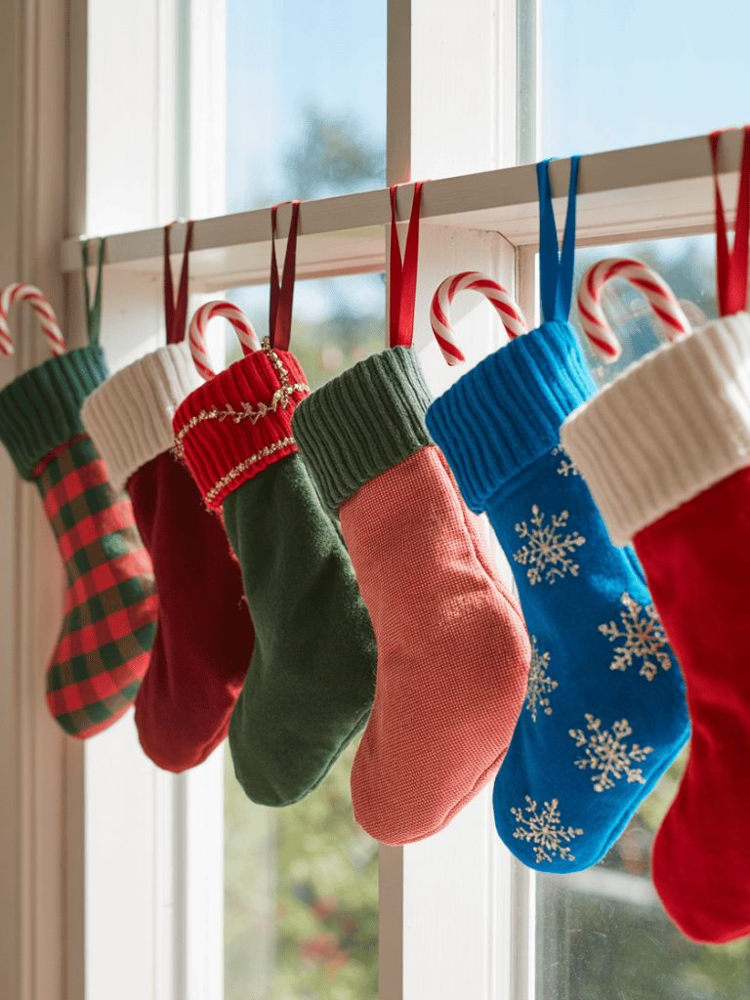

> TIP:GUIDE: Budget: under $15 for a rod and S-hooks | Time: fifteen minutes to hang | Skill: beginner

## 22. Stockings on a Line Across the Window

Stockings on a line across the window look like washing day at the North Pole. Knit stockings hang from a cord strung across a snowy window, with the winter light behind them and a little tree on the sill.

A line is the lightest-weight stocking display of all, so use small stockings and a cord rated for the weight. Tie the cord to the window latches or small adhesive hooks, and keep the stockings evenly spaced.

> TIP:QUICK: Small stockings only — a line cannot hold a full-size stocking; tie the cord to the window latches.

## 23. Mini Stockings in a Window Grid

Mini stockings in a window grid turn the window into an advent calendar. Twelve mini stockings and candy canes hang in a grid across a lit window at night, framed in garland, each one holding a tiny treat.

This is the best idea for counting down to Christmas: one mini stocking per day, or one per child per week. Number the stockings with gift tags so the countdown is part of the decoration.

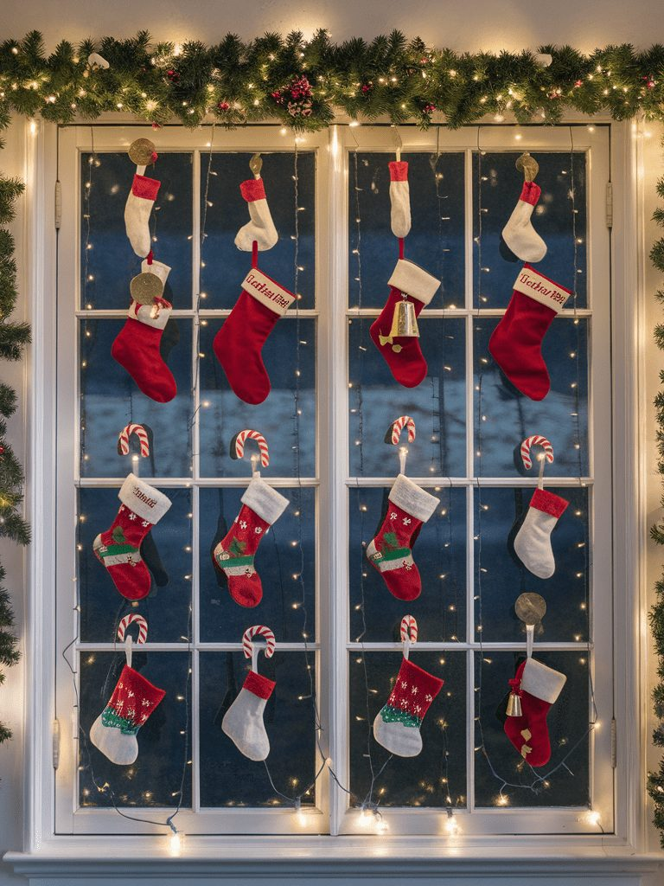

> TIP:CHECK: number the mini stockings with gift tags; one per day makes the window an advent calendar; tiny treats only

## 24. A Basket of Stockings Under the Tree

A basket of stockings under the tree is the zero-hanging solution. Knit stockings spill out of a wicker basket at the foot of the Christmas tree, ready to be grabbed, filled and hung on the night itself.

This is the answer for a house where nothing can be hung — a rental, a new build, a room with no rails. The basket holds the stockings until Christmas Eve, when they go on the bedposts or the tree.

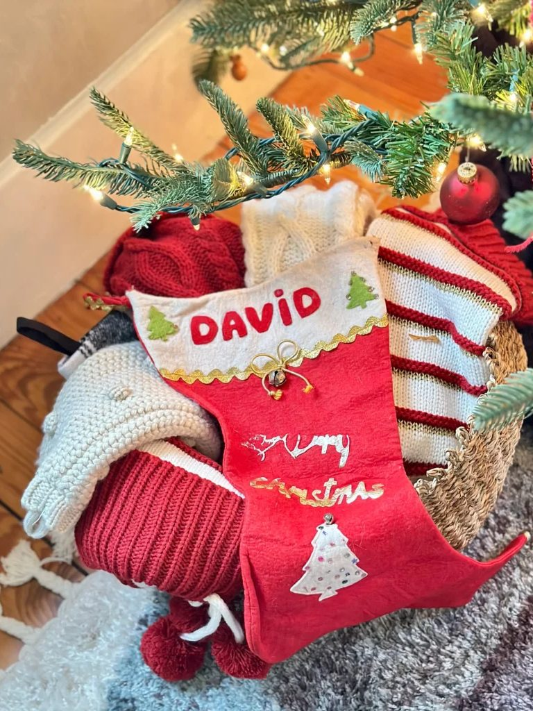

> TIP:GUIDE: Budget: free if you already own a basket | Time: five minutes to fill | Skill: beginner

## 25. Ladder with Felt Stockings and Lights

A ladder with felt stockings and fairy lights is the soft, handmade version of the ladder idea. White and red felt stockings with wooden buttons hang from a grey ladder wrapped in fairy lights, with a little tree beside it.

Felt stockings are lighter than knit, so they hang well from the rungs with a simple loop. The fairy lights do the decorating here, so keep the rest of the ladder bare and let the lights and stockings shine.

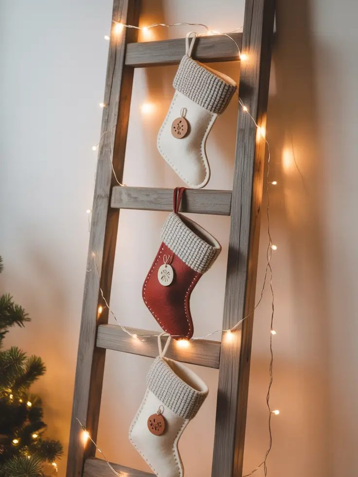

> TIP:QUICK: Felt stockings are light enough for a simple loop; fairy lights do the decorating, so keep the ladder bare.

## 26. Ladder with Plaid Stockings and Gifts

A ladder with plaid stockings and gifts is the farmhouse ladder. Red, green and cream plaid stockings hang from a wooden ladder above wrapped gifts, with a garland over the top and a basket of greenery at the foot.

Plaid stockings look best in a set of three with one plain cream stocking to break the pattern. Put the gifts at the foot of the ladder so the whole corner reads as one present pile.

> TIP:CHECK: three plaid stockings plus one plain cream to break the pattern; gifts at the foot of the ladder; a garland over the top to tie it together

## 27. Stocking Stand on a White Background

A stocking stand on a white background is the product shot that proves the point: a black metal stand holding six red and green stockings needs nothing else. It stands anywhere, holds a full row, and folds away in January.

This is the stand to buy if you want one stocking display that works in every house you ever live in. Look for one with a wide base and hooks that swivel, so the stockings hang straight.

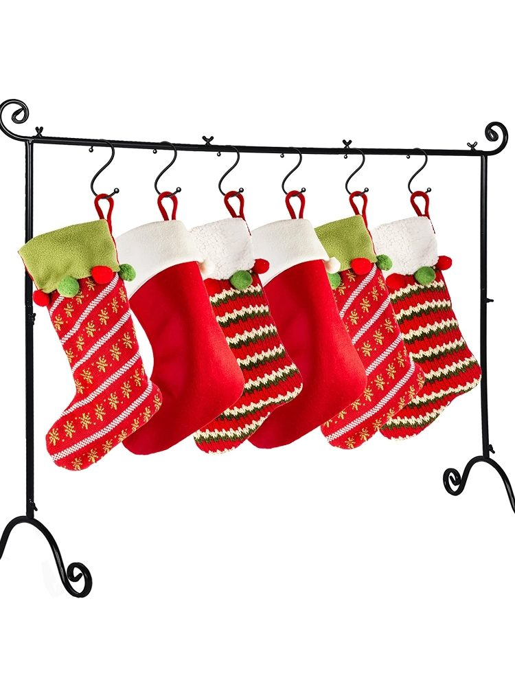

> TIP:GUIDE: Budget: $20–$40 for a folding stocking stand | Time: five minutes to set up | Skill: beginner

## 28. Wicker Stocking Basket with Fairy Lights

A wicker stocking basket with fairy lights is the basket idea dressed up. A woven stocking-shaped basket holds ornaments and fairy lights, with a cinnamon stick, a pinecone and holly tucked into the top.

The basket is the stocking here — fill it with small gifts and hang it from a hook by its handle. It works on a door, a wall peg or a ladder rung, and it is the only stocking that is also its own container.

> TIP:QUICK: Hang the basket by its handle from any hook — it is the only stocking that is also its own container.

## 29. Hanging Shelf with Three Stockings

A hanging shelf with three stockings is the small-space solution. A wooden shelf hangs from ropes on the wall, fairy lights run along its edge, and three stockings hang from hooks underneath, with gifts stacked on the table below.

A hanging shelf needs a solid wall fixing — a stud or a proper wall plug — because it carries the shelf, the stockings and the gifts. Hang it where the stockings can be reached without standing on furniture.

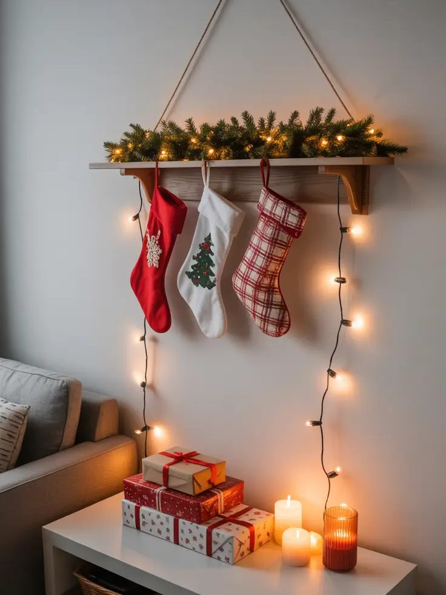

> TIP:CHECK: fix into a stud or a proper wall plug; hang it where stockings can be reached without a chair; keep the heaviest stocking on the lowest hook

## 30. Stockings in the Window and on the Sill

Stockings in the window and on the sill use the whole window as the display. Three stockings hang in the glass above, four more line up on the sill below, and the snowy garden outside does the rest.

This is the idea for a window that faces the street: the neighbors get the display too. Keep the stockings inside the glass so they stay dry, and use suction hooks if you do not want to drill the frame.

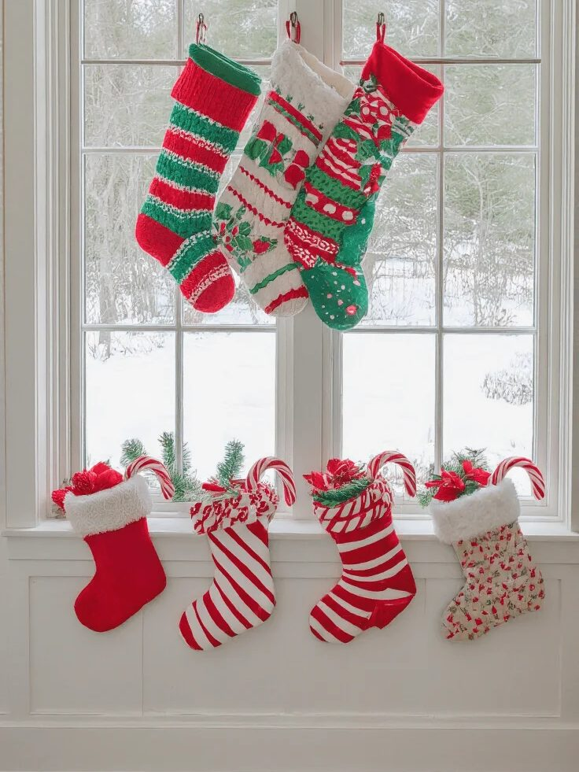

> TIP:GUIDE: Budget: under $10 for suction hooks | Time: fifteen minutes to hang | Skill: beginner

## Takeaway

Pick the spot first and the stockings second: a ladder for a home with no mantel, a stair rail for a house full of children, a peg rail for a hallway everyone passes, and a basket for a home where nothing can be hung. Whichever spot you choose, hang the stockings where they can be seen and where they will hold a full stocking on Christmas morning — and if you want the garland to go with them, our [30 Garland on Mantle Ideas for Every Season](/posts/garland-on-mantle/) shows how to run greenery along any rail, shelf or mantel.

## Frequently Asked Questions

### Where can I hang stockings if I have no fireplace?

Use a wooden ladder, a freestanding stocking stand, a peg rail on the wall, or the stair banister. All four hold a full row of stockings without a mantel, need no drilling, and can be moved or folded away in January. A ladder or stand is the easiest starting point.

### How do I hang stockings on a staircase?

Run a garland along the banister first, then hang one stocking per spindle from ribbon loops tied to the garland. Use S-hooks on a wooden rail or adhesive hooks on a painted one, and hang the stockings on the side facing the room.

### What is the best way to hang stockings without damaging walls?

Use adhesive hooks rated for at least three pounds, a freestanding stand, or a ladder leaned against the wall. Avoid nails in painted walls and never drill into stone. Always test one hook with a full stocking before Christmas Eve.

### How much weight can a stocking holder hold?

A good metal stocking holder weighs at least a pound and holds a stocking filled with small gifts, usually up to two or three pounds. Test it with the full stocking before the big night, and never hang a stocking from a lightweight decorative holder.

### Can I hang stockings on a window?

Yes — use a curtain rod with S-hooks inside the frame, a cord strung across the glass, or suction hooks on the pane. Keep the stockings short so they clear the sill, and use small stockings on a line, which cannot hold a full-size one.

### How do I hang stockings for a large family?

Use the staircase, a long peg rail, or mudroom lockers — all three scale to any number of stockings. Give each person their own hook or locker, label the stockings, and spread them across two spots rather than crowding one rail.

### What do I do with stockings after Christmas?

Empty them, fold knit stockings flat, and store them in a labeled box with tissue paper so the cuffs keep their shape. Felt stockings can be rolled, and stands and ladders fold flat. Keep the hooks up if you use the rail all year.

### Are stocking stands stable enough for full stockings?

A well-made stand with a wide base is stable for a row of full stockings, but test it before Christmas Eve by hanging the stockings filled with books of the same weight. Put the stand in a corner where it cannot be bumped, and keep the heaviest stocking lowest.
