# 30 Table Decor Ideas for Every Room

These table decor ideas work on every table in the house, from a long dining table to a small side table by the sofa. A table is the easiest place to change the mood of a room: one runner, one vase or one cluster of candles can make a plain surface feel finished, and most of these ideas take less than half an hour to put together.

The trick is to match the idea to the table. Dining tables suit long, low centrepieces that people can talk across. Coffee tables need low, grouped pieces that leave room for cups. Console and side tables suit one tall feature, like a vase or a lamp, with one or two small pieces beside it. Pick one idea below, try it on your table, and build from there.

## 1. White Linen Runner Dining Table

A white linen runner is the simplest way to dress a dining table, and it works in every season. Lay it down the centre of the table, over a bare wood top or a plain tablecloth, and let the ends hang just past the edge. The pale fabric brightens the whole room and gives everything placed on it a clean, calm background.

Style it with white flowers, tall taper candles in brass holders and simple white plates, as in the photo. Keep the centrepiece low in the middle so guests can see each other, and use linen napkins in the same white for a quiet, pulled-together look that suits both everyday meals and special dinners.

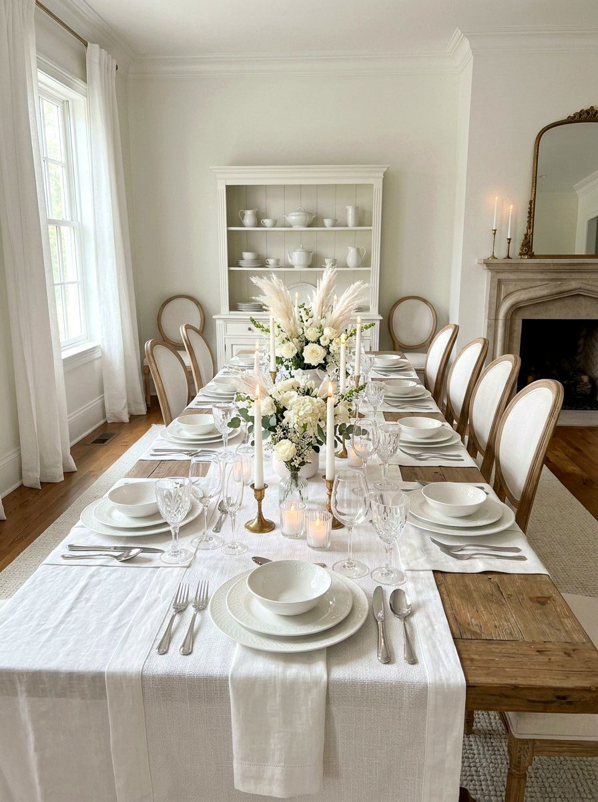

> TIP:QUICK: Iron the runner before laying it out — crisp linen reads far more elegant than wrinkled linen.

## 2. Greenery Garland Centerpiece

A loose garland of fresh greenery running down the centre of the table brings the garden indoors with almost no effort. Eucalyptus, ivy and soft fern fronds all work well, and the garland can drape over the ends of the table for a generous, abundant feel. It suits wood tables best, where the green stands out against the warm grain.

Tuck tall taper candles into the greenery at intervals, keeping the flames clear of any leaves. The candles add height and a warm glow in the evening, while the garland stays flat enough that plates and glasses still fit comfortably on either side.

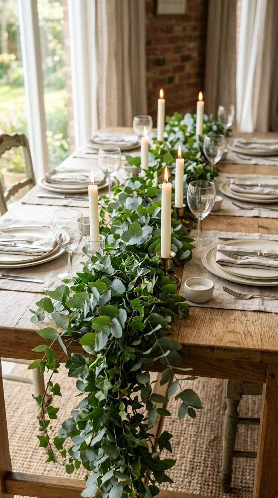

> TIP:CHECK: greenery kept clear of candle flames; garland flat enough for plates; ends draping evenly

## 3. Candle Cluster on a Coffee Table

A cluster of candles in different heights turns a coffee table into the warm heart of a living room. Mix tall tapers, chunky pillars and small votives, and group them tightly in the centre so they read as one arrangement rather than scattered candles. A few sprigs of baby's breath or dried flowers tucked between them softens the look.

Keep the cluster on a tray or a heat-safe mat so wax never reaches the tabletop, and leave space at the edges for cups and books. Light the candles in the evening and the whole room glows, which is why this is one of the easiest table decor ideas for a cosy night in.

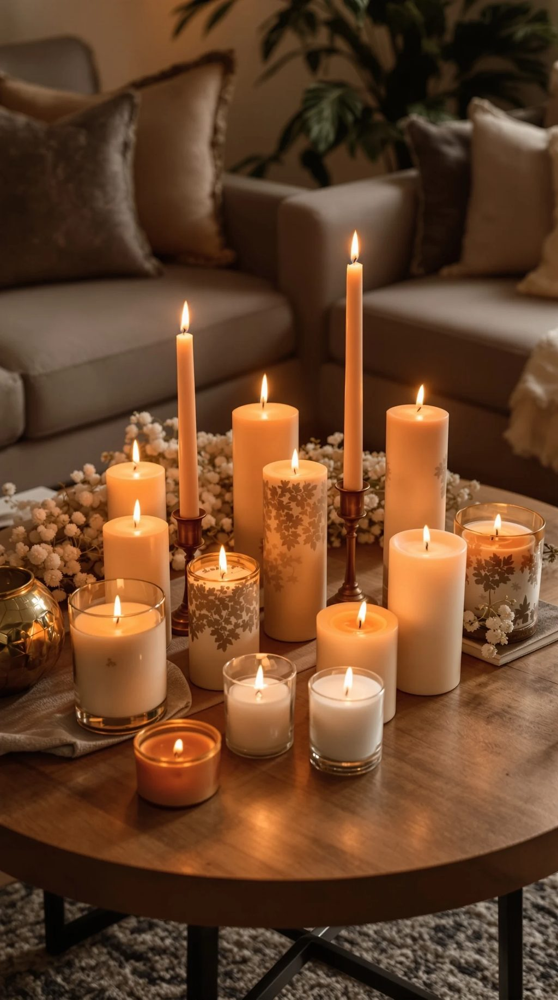

> TIP:GUIDE: Heights: mix tall tapers, pillars and votives | Base: tray or heat-safe mat | Space: leave room for cups

## 4. Fresh Flowers on a Console Table

A console table in a hallway or entryway needs one clear focal point, and a tall vase of fresh flowers is the classic choice. Pink tulips, as in the photo, bring colour into a pale hallway and look fresh against a round mirror hung above the table. The stems show through a clear glass vase, which adds to the natural, unforced feel.

Keep the rest of the table simple: a small tray, a stack of two books and a candle are enough. The flowers will need fresh water every couple of days, so choose a vase you can lift easily and refill without moving everything else on the table.

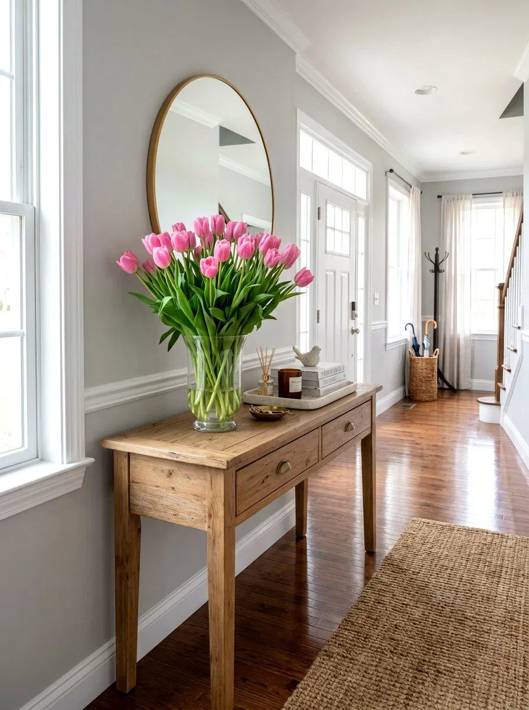

> TIP:QUICK: Trim the stems at an angle and change the water every two days to keep tulips standing tall.

## 5. Rustic Wooden Tray on a Coffee Table

A rustic wooden tray gathers small pieces into one tidy group and stops a coffee table from looking cluttered. Choose a tray with handles and a weathered finish, then fill it with a candle lantern, a pillar candle, a small vase of dried branches and a few pinecones. The tray keeps everything together and can be lifted off in one move when you need the table clear.

The mix of wood, glass and candlelight suits a pale sofa and soft cushions, and the pinecones add a woodland touch that works from autumn right through winter. Swap the pinecones for shells in summer and the same tray carries a whole new season.

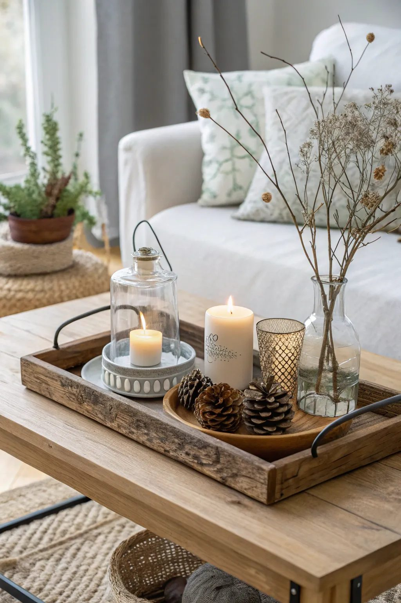

> TIP:CHECK: tray with handles for easy lifting; candle on a heat-safe base; dried branches kept clear of flames

## 6. Minimalist Ceramic Vase on a Side Table

A single ceramic vase on a side table is proof that one good piece is enough. Choose a vase with an interesting shape — a ribbed body, two small handles, a soft matte finish — and give it a few stems of white flowers and green leaves. The vase does the decorating, and the flowers just finish it.

Place it beside a lamp, as in the photo, with a small pillar candle in front. The lamp light catches the vase in the evening, and the whole arrangement stays calm and uncluttered. This is the idea to copy when a side table feels busy and you want it to breathe again.

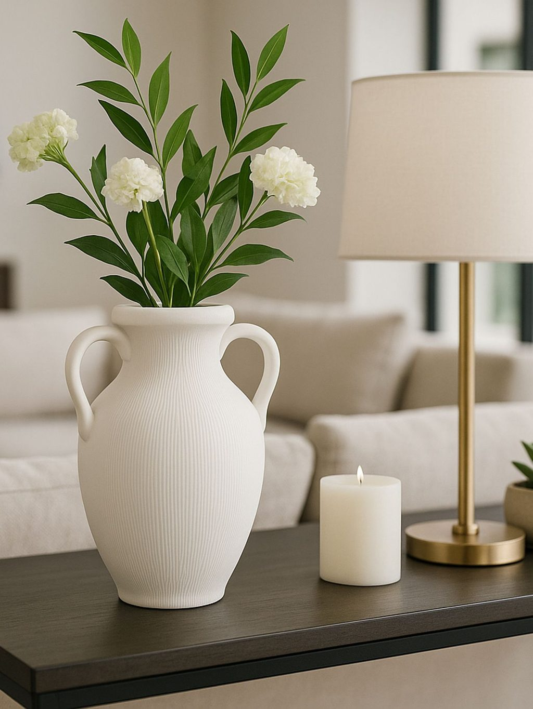

> TIP:GUIDE: Vase: one interesting shape, matte finish | Stems: three to five, white flowers | Partner: one lamp, one candle

## 7. Layered Books and Candles on a Coffee Table

Stacked books are the backbone of coffee table styling: they add height, they give smaller pieces a place to sit, and they make the table look lived in. Lay two or three books flat, then set a small vase and a candle on top. Add a second stack at the other end of the table and a tray of candles in the middle to balance the whole surface.

Keep the books in a similar colour family so the stacks read as intentional, and choose titles you actually enjoy — guests will pick them up. The candles should sit in holders or on the tray, never directly on a book cover, so the pages stay safe.

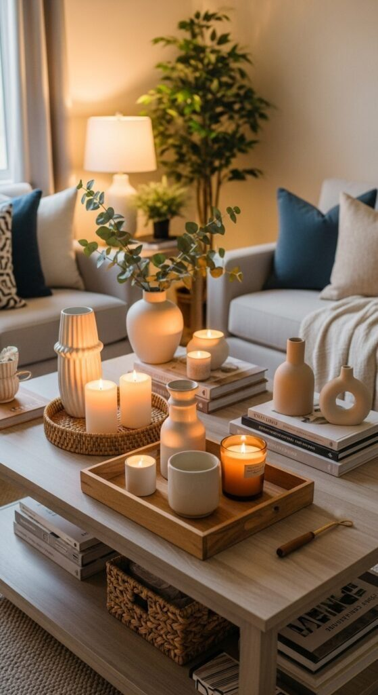

> TIP:QUICK: Stack books largest at the bottom and keep the top book flat so a candle can sit safely on it.

## 8. Pumpkin Vase Centerpiece

A hollowed pumpkin filled with autumn flowers is the friendliest centrepiece of the season. Use a pale pumpkin as the vase, fill it with dahlias, mums and a few sprigs of eucalyptus, and set it in the middle of a burlap runner. Small pumpkins and scattered autumn leaves around the base finish the scene without any extra effort.

This works best on a wood dining table, where the warm tones of the pumpkin and the runner suit the grain. The flowers will last several days if you keep a small jar of water hidden inside the pumpkin, and the whole arrangement can be composted when the season ends.

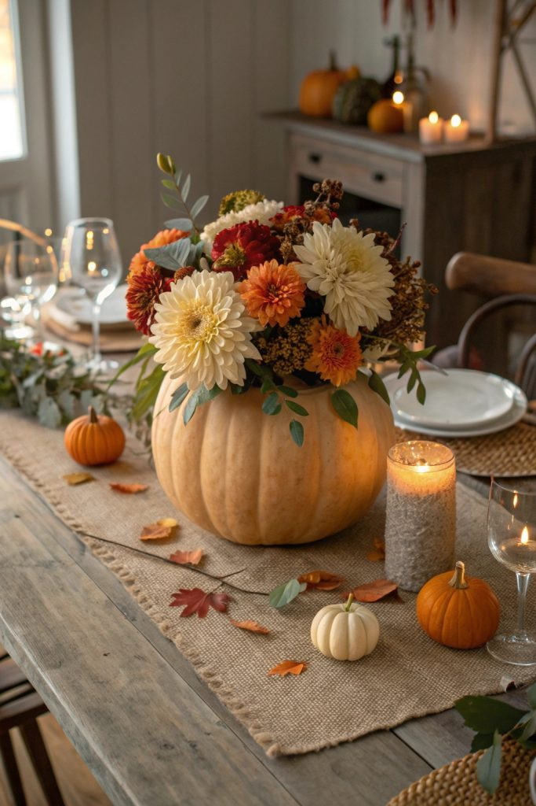

> TIP:CHECK: water jar hidden inside the pumpkin; small pumpkins as accents; runner protects the wood

## 9. Eucalyptus Runner Dining Table

A eucalyptus runner is a lighter, fresher cousin of the full greenery garland. Lay long sprigs of eucalyptus down the centre of the table, overlapping them so they form one continuous line, and add tall white candles at intervals. The silver-green leaves look beautiful against a pale wood table and a white room.

Set each place with a linen napkin and a single eucalyptus sprig on the plate to echo the runner. The whole look is calm and Scandinavian, and it suits spring and summer dinners best, when the fresh, clean scent of eucalyptus feels right with open windows.

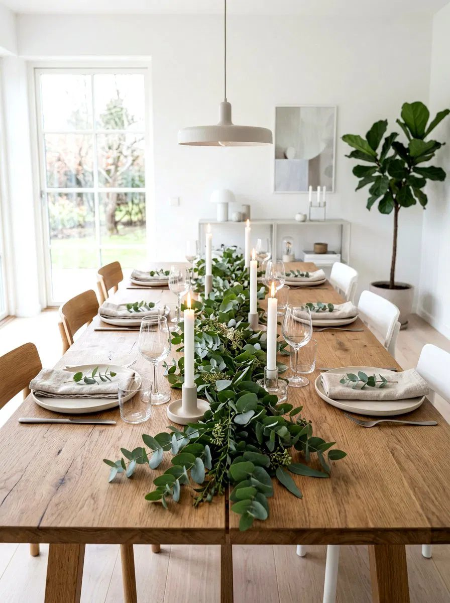

> TIP:GUIDE: Runner: overlapping eucalyptus sprigs, one continuous line | Candles: tall white tapers | Echo: one sprig on each plate

## 10. Gold Candle Holders on a Dining Table

Gold candle holders bring instant warmth and a little glamour to a dining table. Choose holders in different heights with a leaf or flame detail, as in the photo, and group three of them along the centre of the table. The gold catches the candlelight and the daylight alike, so the table glows even before the candles are lit.

Keep the rest of the setting simple so the gold stays the star: white plates, a woven placemat and a gold spoon or two are enough. Green leaves tucked at the base of the holders soften the metal and tie the arrangement back to the flowers at the end of the table.

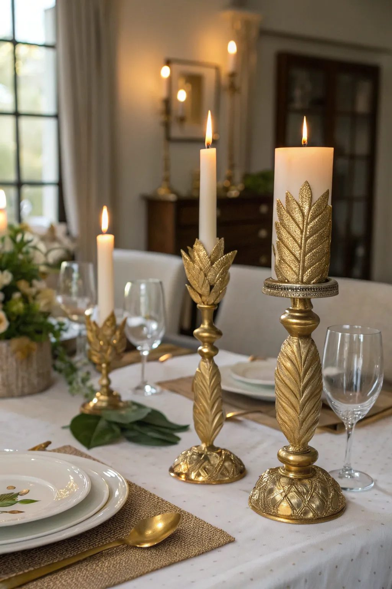

> TIP:QUICK: Group gold holders in threes at different heights — odd numbers always look more natural than pairs.

## 11. Coastal Shell Centerpiece

A coastal centrepiece brings the beach to a coffee table without a single nautical cliché. Fill a weathered wood tray with large shells, a piece of coral and a glass vase of sand, and set it on a pale coffee table in front of a blue and white sofa. The soft blues, sandy whites and warm coral tones do all the work.

Keep the tray low and wide so it reads as part of the table rather than a display, and leave a few shells loose on the table itself for a relaxed, collected feel. This is a good look for a bright living room, and it carries easily from spring through summer.

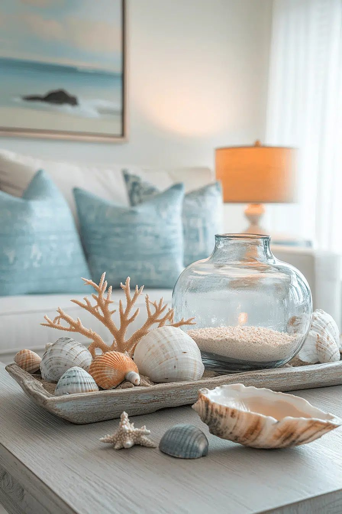

> TIP:CHECK: tray low and wide; shells in mixed sizes; a few loose on the table for a relaxed feel

## 12. Mason Jar Flowers on a Dining Table

Mason jars of wildflowers are the easiest farmhouse centrepiece there is. Fill four or five jars with daisies, lavender and whatever is in season, tie a little twine around each neck, and set them on a round wood slice in the middle of the table. The jars are cheap, the flowers are cheerful, and the whole thing takes ten minutes.

This suits a wood dining table in a bright kitchen or dining room, and it works for everyday meals as well as summer gatherings. When the flowers fade, the jars can hold candles instead, so the centrepiece never really leaves the table.

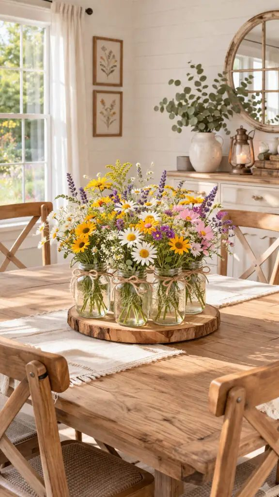

> TIP:GUIDE: Jars: four or five, mixed heights | Flowers: seasonal wildflowers | Base: round wood slice

## 13. Marble-Top Side Table

A marble-top side table is decor in itself, so it needs almost nothing on it. Choose a small round table with a veined marble top and a matching marble base, and set it beside a curved sofa or an armchair. One small bowl on top is enough — the marble pattern is the decoration, and anything more would fight with it.

The cool white stone suits pale, textured rooms, and the round shape softens a room full of straight lines. Keep the table clear of clutter and let it earn its place by the sofa, holding a cup of tea or a book while you sit nearby.

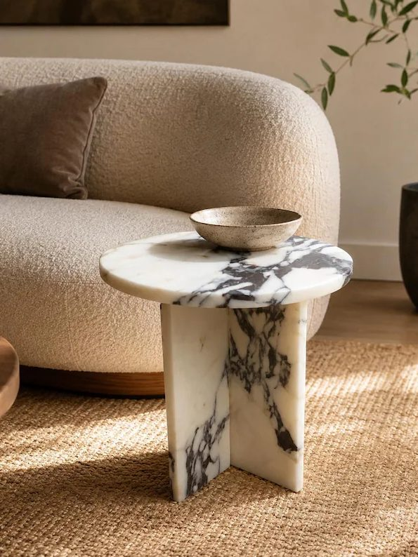

> TIP:QUICK: One small bowl is enough on a marble top — the veining is the decoration, so do not cover it.

## 14. Lantern Centerpiece on a Dining Table

A row of lanterns down the middle of a dining table gives the room a warm, sheltered glow. Mix lanterns in different sizes and finishes — weathered wood, black metal, aged tin — and fill each one with a pillar candle. Tuck greenery around their bases so the lanterns sit in a soft bed of leaves rather than on bare wood.

This centrepiece works beautifully in the evening, when the lantern glass throws the candlelight across the table. Keep the tallest lantern in the middle and the smaller ones toward the ends, and leave the place settings clear so the lanterns never block a guest's view.

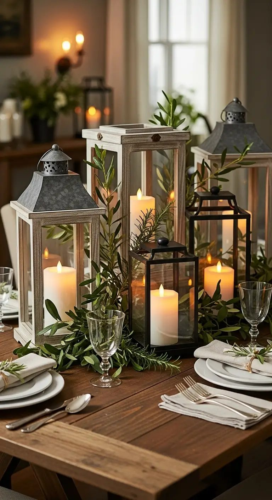

> TIP:CHECK: tallest lantern in the middle; greenery tucked around the bases; flames clear of leaves

## 15. Woven Placemats with Greenery

Woven placemats are the fastest way to add texture to a dining table, and they make every plate look considered. Choose round, chunky placemats in a natural straw colour, layer a smaller woven charger on top, and set a plain white plate in the centre. A sprig of greenery on each plate ties the place setting to the greenery running down the middle of the table.

The woven texture suits wood tables and linen runners, and the natural colour works with any plate colour you already own. Woven placemats wipe clean easily, so they are as practical as they are pretty for everyday family meals.

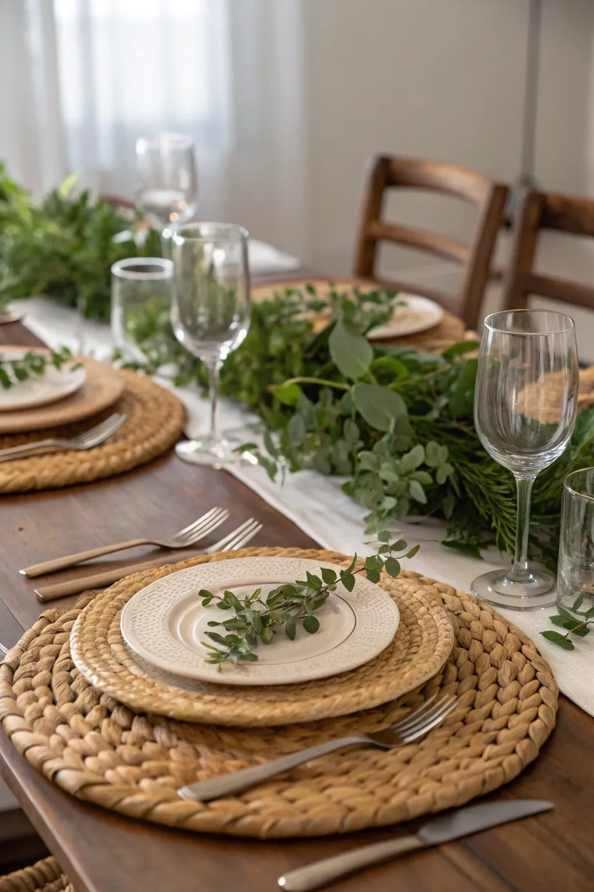

> TIP:GUIDE: Placemat: round, chunky weave, natural straw | Layer: woven charger, then white plate | Finish: one greenery sprig per plate

## 16. Sculptural Bowl on a Coffee Table

A large sculptural bowl is the anchor a coffee table needs. Choose a wide, shallow bowl in stone or concrete, fill it with decorative orbs — woven rattan balls, smooth stone spheres and a few dark wood ones — and set it in the centre of a round coffee table. The bowl gives the eye somewhere to rest, and the orbs add texture without any fuss.

Add a stack of two books beside the bowl and nothing else. The bowl is the statement, and the books keep the table from looking like a showroom. This idea suits a calm, neutral living room where one strong shape carries the whole table.

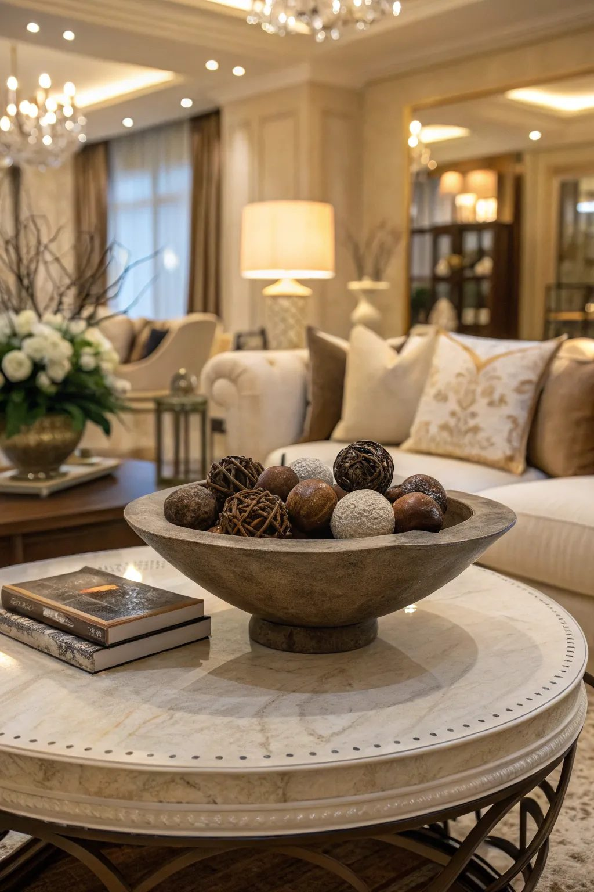

> TIP:QUICK: Fill the bowl with orbs in three textures — woven, smooth stone and dark wood — for a collected look.

## 17. Vintage Brass Candlesticks on a Console Table

A row of vintage brass candlesticks on a console table or sideboard brings old-world charm into a room in one move. Choose candlesticks in different heights, with turned stems and a warm aged patina, and group them on a brass tray at one end of the table. Add a small white vase and a couple of pillar candles to balance the other end.

The brass suits pale panelled walls and a framed print above the table, and the candlelight softens the metal beautifully in the evening. Do not polish the brass to a shine — the aged finish is what makes the group feel collected rather than new.

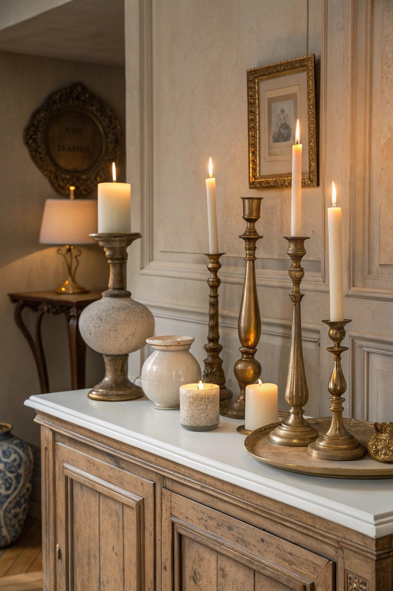

> TIP:CHECK: candlesticks in different heights; grouped on a tray; keep the aged patina, do not over-polish

## 18. Fresh Fruit Bowl Centerpiece

A bowl of fresh citrus is the brightest centrepiece a dining table can have, and it costs less than a bunch of flowers. Fill a wide wood bowl with lemons, oranges and limes, tuck in a few green leaves, and set it on a linen runner with white hydrangeas behind it. The yellow and green against the white flowers is cheerful, fresh and unmistakably summery.

The fruit doubles as a snack after the meal, and the bowl can be refilled all week. Keep the bowl low and wide so it never blocks conversation, and replace any fruit that starts to soften so the centrepiece always looks as fresh as it smells.

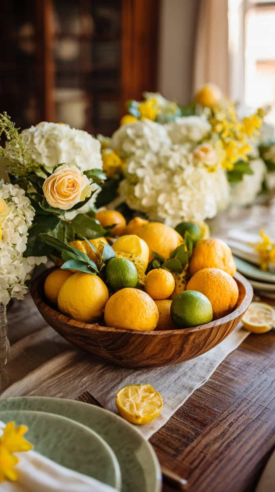

> TIP:GUIDE: Bowl: wide and low, wood | Fruit: lemons, oranges, limes with leaves | Refresh: replace soft fruit promptly

## 19. Boho Macrame Runner

A macrame runner brings handmade texture to a wood dining table and instantly sets a relaxed, boho mood. Choose a cream runner with a diamond pattern and a long tasselled fringe, and let it hang over the end of the table. The open weave lets the wood grain show through, so the table and the runner work together instead of hiding each other.

Style it with a small vase of dried flowers, a candle and a couple of tiny wood bottles, as in the photo. Keep the rest of the table bare — the runner is the decoration, and a few small pieces beside it are all it needs to feel finished.

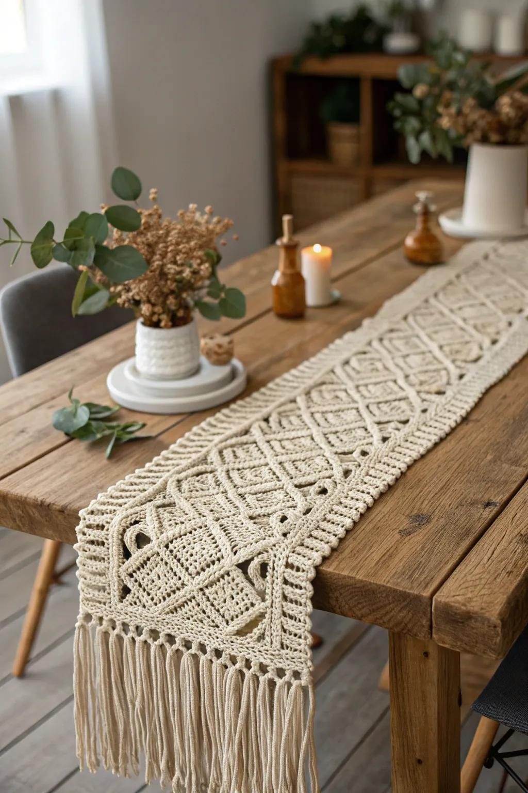

> TIP:QUICK: Let the runner hang past the table end so the tasselled fringe can be seen — that is half the charm.

## 20. Pillar Candles and Pinecones for Winter

Pillar candles and pinecones are the heart of winter table decor. Lay a bed of evergreen sprigs down the centre of the table, nestle pinecones of different sizes into the greenery, and set two tall pillar candles among them. Fairy lights in the background add a soft sparkle, and the whole table feels like a winter woodland.

Keep the candles tall and the greenery low so the flames stay clear of the branches, and use a white tablecloth or runner underneath to catch any fallen needles. This centrepiece carries easily from the first cold evening right through to the new year.

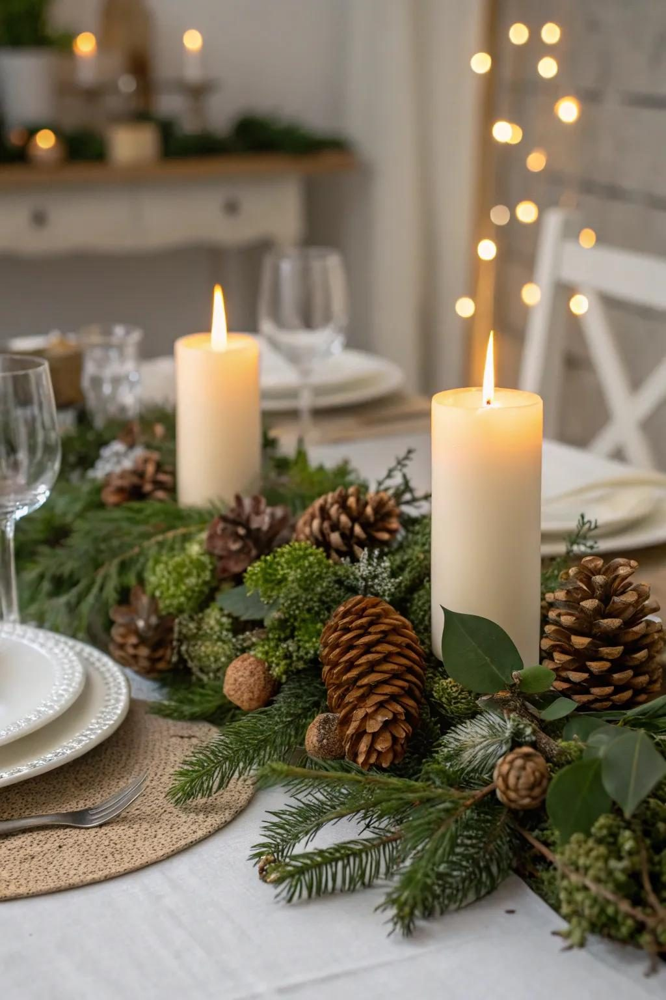

> TIP:CHECK: flames clear of greenery; pinecones in mixed sizes; runner underneath to catch needles

## 21. Glass Cloche Display on a Side Table

A glass cloche turns a small arrangement into a little world of its own. Set a moss nest with a few speckled eggs on a round wood slice, cover it with a glass dome, and place the whole display on a wood side table beside an armchair. A small vase of dried eucalyptus and a stack of books beside it complete a quiet, thoughtful corner.

The cloche protects the arrangement from dust and curious hands, and it makes even a simple nest look deliberate and special. Swap the contents with the seasons — pinecones in winter, shells in summer — and the same dome serves all year.

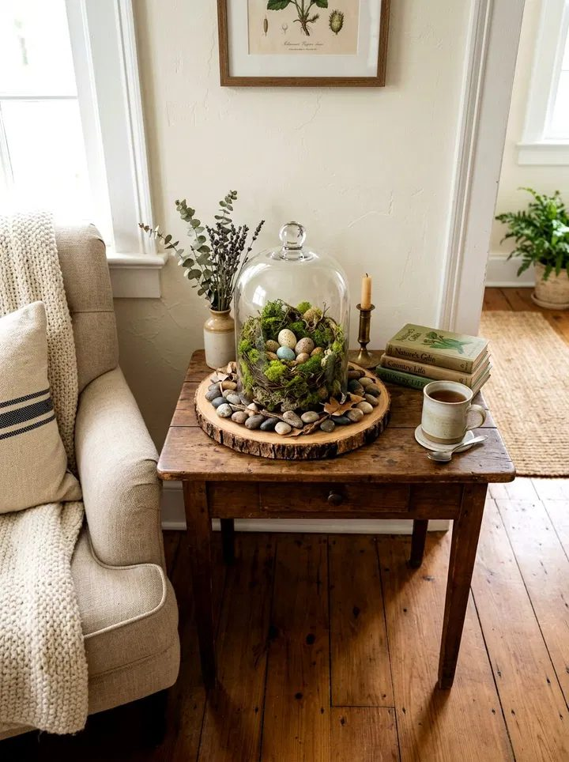

> TIP:GUIDE: Base: round wood slice | Inside: moss nest with speckled eggs | Swap: pinecones in winter, shells in summer

## 22. Terracotta Herb Centerpiece

Potted herbs in terracotta pots make a centrepiece that smells as good as it looks. Wrap each pot in a little burlap and twine, set three of them — rosemary, basil and thyme, for example — in a wood tray down the centre of the table, and let the green fill the space between the place settings. The tray keeps the soil off the table and makes the whole group easy to move.

This suits a bright dining room or a garden room, and the herbs can be snipped straight into the cooking. Water the pots in the tray and empty any extra water after half an hour so the roots never sit wet.

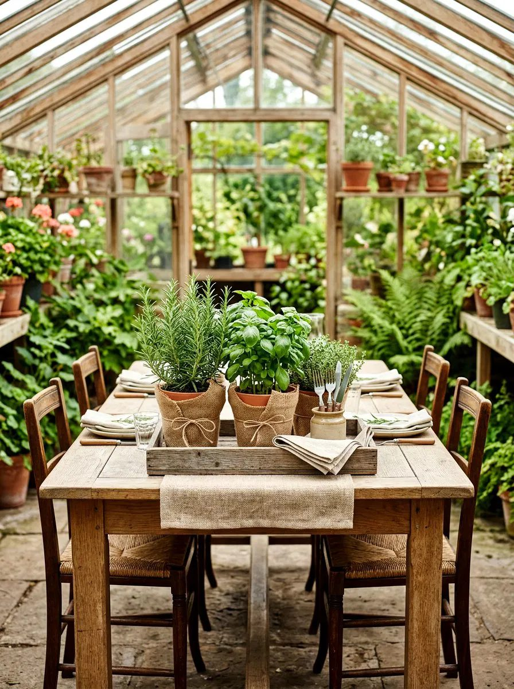

> TIP:QUICK: Snip herbs straight from the table into dinner — a centrepiece you can cook with is twice as useful.

## 23. Mirrored Console Table with Candlelight

A mirrored console table doubles the light in a room, and candlelight on it is twice as beautiful. Choose a console with mirrored drawers and a mirrored top, hang an ornate mirror above it, and style the surface with white roses in a tall vase, crystal candle holders and two mirrored trays. The reflections multiply every flame and flower, so a few pieces look like many.

Keep the trays tidy — mirrored surfaces show every speck of dust — and wipe the table with a dry cloth before guests arrive. The look is glamorous but calm, and it suits a living room or a bedroom dressing area equally well.

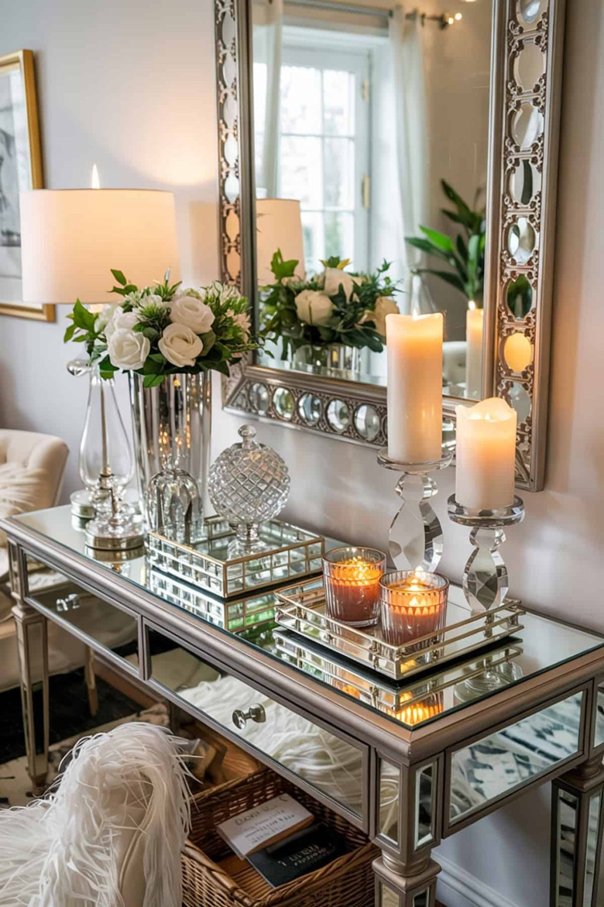

> TIP:CHECK: mirrored trays to contain the pieces; wipe the surface before guests arrive; reflections double the glow

## 24. Spring Tulip Arrangement

A row of potted tulips down the centre of a dining table is spring at its brightest. Use white pots and mix pink and red tulips, one pot per two place settings, so the colour runs the whole length of the table. Pink linen napkins and a light wood table keep the look fresh and cheerful, and the tulips will keep opening for days.

Unlike cut flowers, potted tulips can be planted outside once they finish, so the centrepiece lives on after the dinner. Water them lightly and keep them out of direct sun while they are on the table so the blooms last as long as possible.

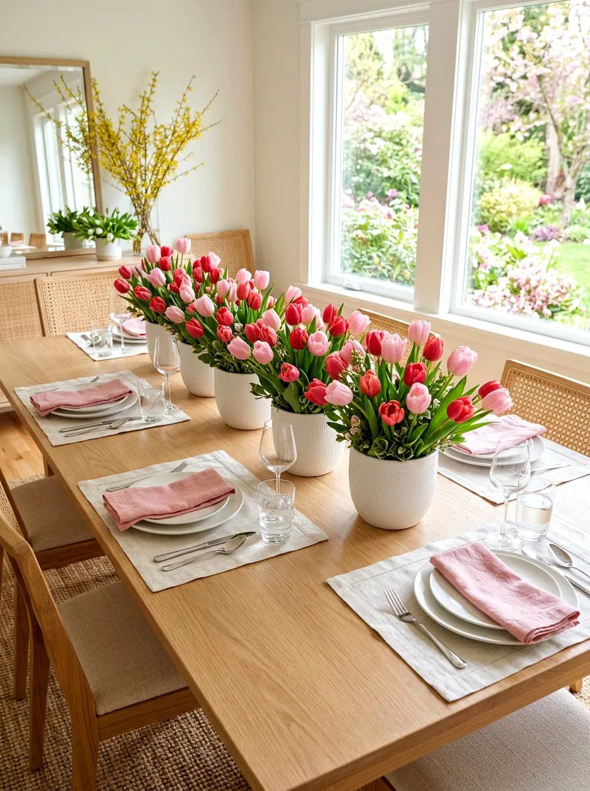

> TIP:GUIDE: Pots: white, one per two settings | Colours: pink and red tulips mixed | After: plant the bulbs outside

## 25. Black and White Modern Centerpiece

A black and white centrepiece is bold, graphic and surprisingly easy to live with. Set a black metal tray on a pale coffee table and fill it with black and white vases — a tall white textured vase, two black pierced vases and a white lidded jar — plus a small black cup and a decorative book. The strong contrast makes the tray the clear focal point of the room.

Keep the sofa and cushions pale so the black and white pieces stand out, and let one patterned cushion echo the monochrome palette. This is the idea to choose for a modern living room that needs one confident, uncluttered statement.

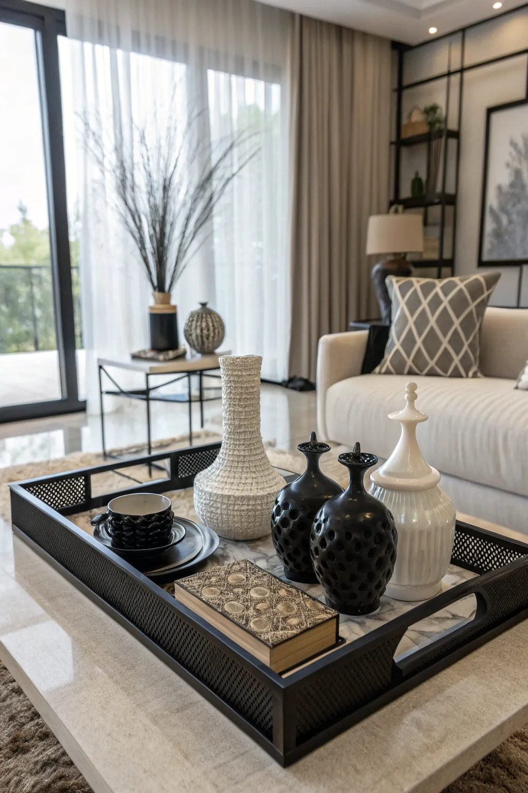

> TIP:QUICK: Keep the sofa pale so the black and white tray stands out as the one bold note in the room.

## 26. Wicker Basket Centerpiece

A wicker basket full of peonies is the sweetest centrepiece on this list. Set the basket on a wood cake stand in the middle of the dining table, fill it with pink peonies and green leaves, and let the basket handle arch above the flowers. The woven basket, the soft pink blooms and the wood stand together feel warm, country and completely unpretentious.

This works best in late spring, when peonies are in season, but any full, soft flower will do. Keep the basket low enough that guests can see over it, and put a folded cloth under the stand if the table is precious — the basket can leave a ring.

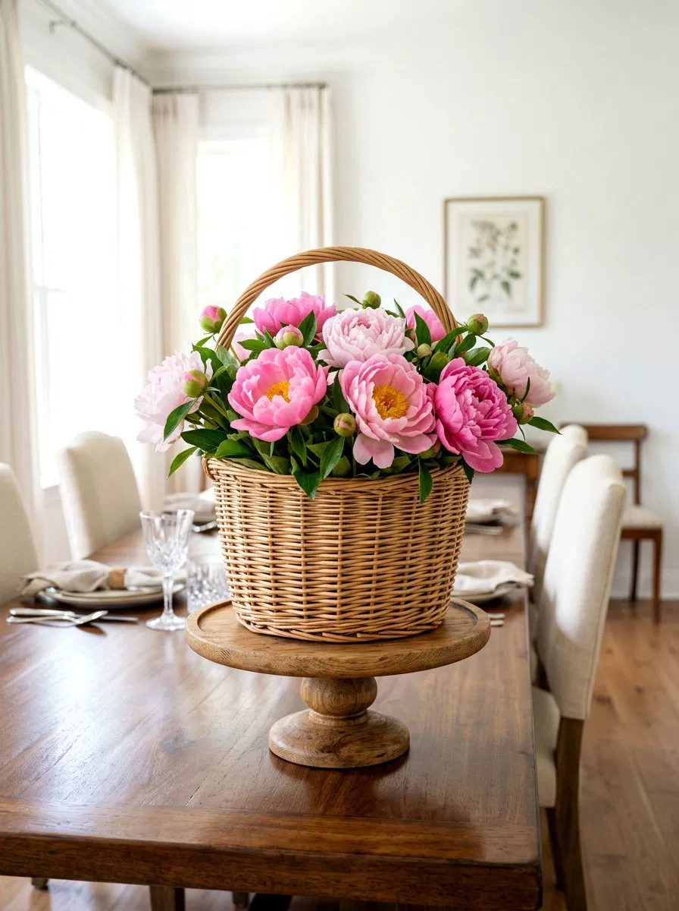

> TIP:CHECK: basket on a stand for height; blooms low enough to see over; cloth underneath to protect the table

## 27. Fairy Lights in a Mason Jar

A mason jar filled with fairy lights and dried petals is pure evening magic. Coil a short string of warm white lights inside the jar, add a handful of dried rose petals, tie twine around the neck and set the jar on the table as the sun goes down. The petals catch the light and the whole jar glows softly, like a lantern made of flowers.

Use battery lights with a timer so the jar switches itself off, and scatter a few petals on the table around the base. One jar is lovely on a small table; three in a row make a centrepiece for a dinner party, and they are safe to leave glowing all evening.

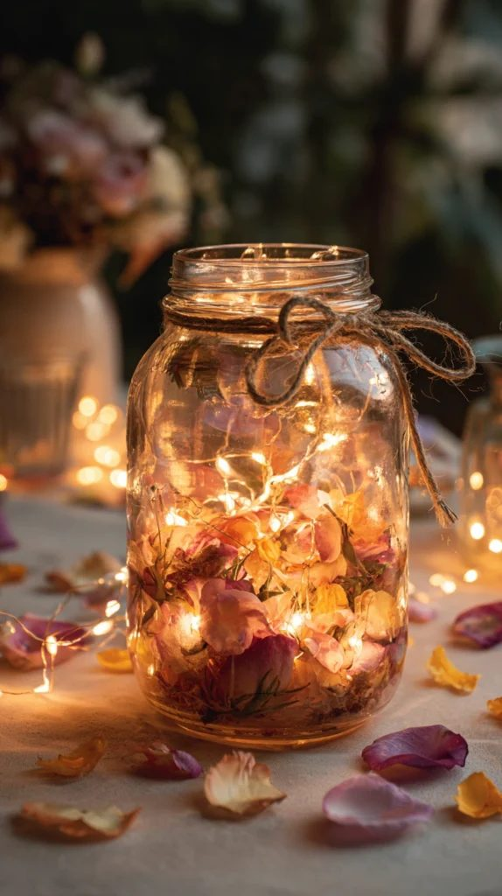

> TIP:GUIDE: Lights: warm white, battery, with a timer | Fill: dried rose petals | Scatter: a few petals around the base

## 28. Succulent Garden on a Coffee Table

A long trough of succulents turns a coffee table into a tiny garden. Choose a rectangular concrete or stone planter, fill it with pebbles and a mix of succulents in green, pink and deep red, and set it on a wood coffee table in front of the sofa. The different shapes and colours make the planter interesting from every seat in the room.

Succulents need very little water — a small drink every couple of weeks is plenty — and they love a bright spot near a window. Add a lantern and a book beside the planter, and the coffee table is finished without ever feeling crowded.

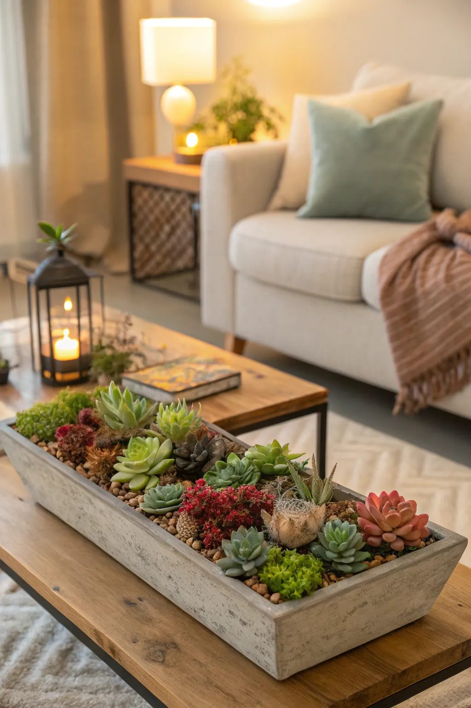

> TIP:QUICK: Water succulents sparingly, about once every two weeks, and give the planter a bright spot near a window.

## 29. Silver and White Candlelight

Silver candlesticks with white candles are the most elegant table decor idea here, and they suit any formal dinner. Group three silver candlesticks in different heights down the centre of a white-clothed table, add white flowers at one end and silver-patterned placemats under each plate. The silver catches the light and the white keeps the whole table calm and bright.

This is a look to save for special occasions, when the extra polish feels right. Polish the silver before the dinner, light the candles just before guests sit down, and let the candlelight do the rest — no other decoration is needed.

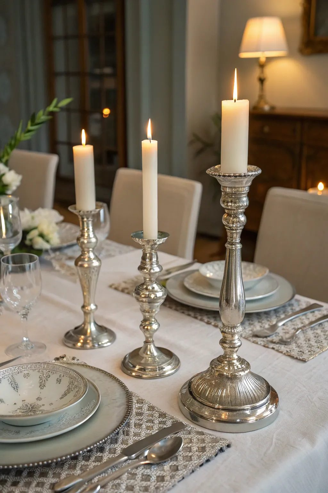

> TIP:CHECK: three candlesticks in different heights; polish the silver first; light the candles just before guests sit

## 30. Christmas Red and Green Table Setting

A classic red and green Christmas table never goes out of style. Layer green chargers, red dinner plates and smaller red salad plates, add holly-print napkins and green glasses, and run a garland of evergreen, red baubles and berries down the centre. Tall white candles in gold holders lift the whole setting and add a warm glow.

The key is balance: let the red and green share the table equally, with white in the tablecloth and the candles to rest the eye. This is the table to build for Christmas dinner itself, when the room is full and the table deserves to look its festive best.

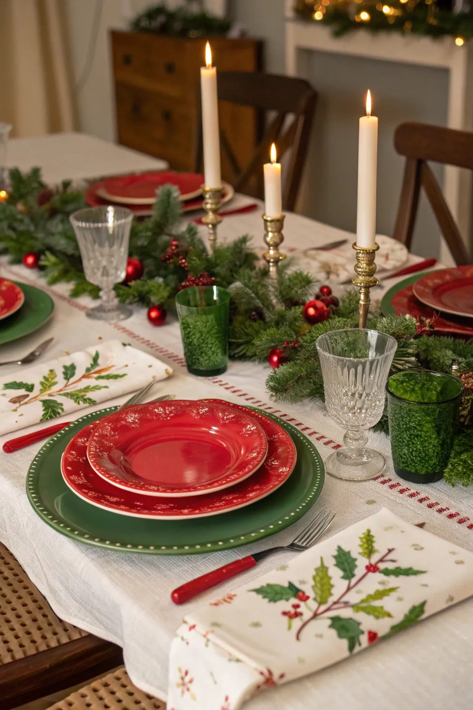

> TIP:GUIDE: Layers: green charger, red dinner plate, red salad plate | Centre: evergreen garland with red baubles | Balance: white cloth and candles

## Takeaway

- One good idea is enough: start with a single runner, tray or vase, and add pieces only until the table feels finished, never crowded.
- Match the idea to the table — long and low for dining, grouped and low for coffee tables, one tall feature for side and console tables.
- For festive tables, see our [Christmas table ideas](/posts/christmas-table/) and our [Christmas table decor ideas](/posts/christmas-table-decor-ideas/) to carry these same ideas into the holiday season.

## Frequently Asked Questions

### How do I choose table decor for a small room?

Start with one low centrepiece and leave most of the table surface clear, so the room feels open rather than crowded. A single vase, a small tray or a short runner gives the table a finished look without taking over. Pale colours and glass help too, because they reflect light and make a small room feel larger and calmer.

### What is the easiest table decor idea for beginners?

A tray is the easiest place to start, because it does the arranging for you. Set a wooden or mirrored tray on the table, add a candle, a small vase and one interesting object, and you are done. If it looks wrong, move one piece at a time until it feels balanced, then leave it alone and enjoy it.

### How many items should go on a coffee table?

Three to five items is a good rule for most coffee tables, grouped in odd numbers so the arrangement feels natural. A stack of books, a candle and a vase make a complete group, with a tray underneath to hold them together. Leave at least a third of the table clear for cups, remotes and everyday use.

### Can I mix candles and fresh flowers on one table?

Yes, as long as you keep the flames clear of leaves and petals. Set the candles in holders on a tray or at the ends of the table, and keep the flowers in the middle where they cannot touch a flame. Never leave lit candles unattended, and trim the flowers so nothing droops toward the heat.

### How do I change table decor with the seasons?

Swap one or two elements and leave the rest in place, so the change feels fresh without starting over. Pumpkins and pinecones suit autumn and winter, tulips and citrus suit spring, and shells and herbs suit summer. A neutral runner, tray or vase can stay all year while the seasonal pieces around it change.

### What size should a dining table centerpiece be?

A centrepiece should be low enough to talk across — usually under twelve inches tall — and no wider than a third of the table, so plates and glasses still fit comfortably. For a long table, use a runner or a row of small pieces instead of one large arrangement, and keep the tallest piece in the middle.

### How do I keep a decorated table practical for everyday use?

Use a tray to group the decor so it lifts off in one move when you need the table for a meal or work. Choose pieces that can stay put, like a vase or a bowl, and move the rest aside. A runner protects the surface, and washable placemats make everyday meals easy without clearing everything away.

### Where can I find more Christmas table decor ideas?

Our Christmas table articles cover festive settings in detail, including red and green tables, garlands and candlelit centrepieces for the holiday season. Start with the Christmas table ideas and the Christmas table decor ideas, then borrow one festive element — a garland, a lantern or a red charger — and add it to your everyday table.
