# 30 Valentine Mantel Decor Ideas for a Romantic Home

Valentine mantel decor is the fastest way to make a living room feel romantic: one shelf, a garland of hearts, a few candles, and the whole room softens. These 30 valentine mantel decor ideas cover every style, from rustic felt hearts and mason jar candles to marble mantels piled with roses, so you can pick one look or mix a few and have the mantel done in an afternoon.

The trick is layering: something tall at the back, something soft across the middle, and a little glow in front. If you love garlands on the mantel in every season, our [30 Garland on Mantle Ideas for Every Season](/posts/garland-on-mantle/) shows how the same shelf carries greenery, lights and swags all year round.

## 1. Felt Heart Garland and Candles

A felt heart garland is the classic Valentine mantel, and it works because the soft fabric hearts catch the candlelight instead of glaring. Here pink, red and white felt hearts hang in two swags across a white mantel, with pillar candles, a vase of pink carnations and a string of fairy lights behind them.

Drape the garland so it dips in the middle and rises at the ends, and let a few hearts hang lower than the rest for a handmade feel. Keep the candles in groups of three at different heights so the mantel glows instead of glaring.

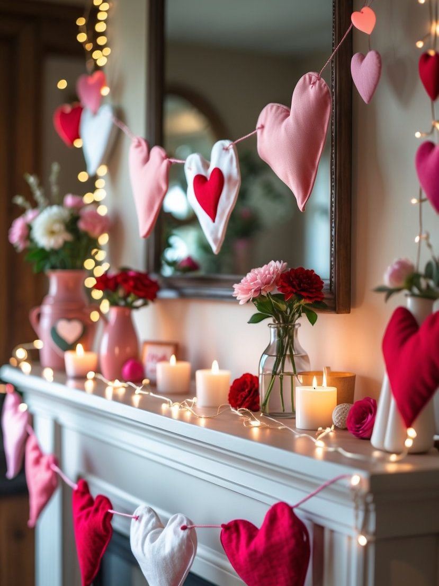

> TIP:QUICK: Hang the garland with small clear hooks so it dips in the middle — the sag is what makes it look soft, not sloppy.

## 2. Red and Pink Paper Heart Garland

Paper hearts are the cheapest way to fill a mantel, and a full garland of them looks far more generous than a single strand. This white fireplace wears red and pink paper hearts in long swags down both sides, with red roses, candles and framed photos on the shelf above.

Cut the hearts in three sizes and mix solid colors with patterned paper so the garland has rhythm. Let the ends trail down the sides of the fireplace instead of stopping at the corners, and the whole mantel looks taller.

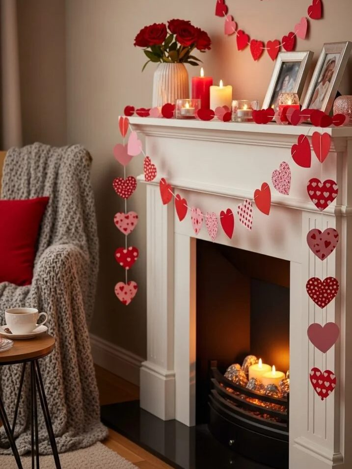

> TIP:CHECK: three sizes of hearts mixed together; solid and patterned paper alternating; garland ends trailing down both sides

## 3. Rustic Heart Garland and Greenery

A rustic mantel proves Valentine's Day does not have to be all pink satin. This whitewashed mantel pairs red and pink felt hearts with fresh greenery, mason jar candles and a wooden crate of candles on the hearth, so the romance feels farmhouse, not frilly.

The greenery is doing the heavy lifting here: it softens the white paint and gives the bright hearts something to sit against. Keep the jars at different heights and let a few vines trail onto the hearth.

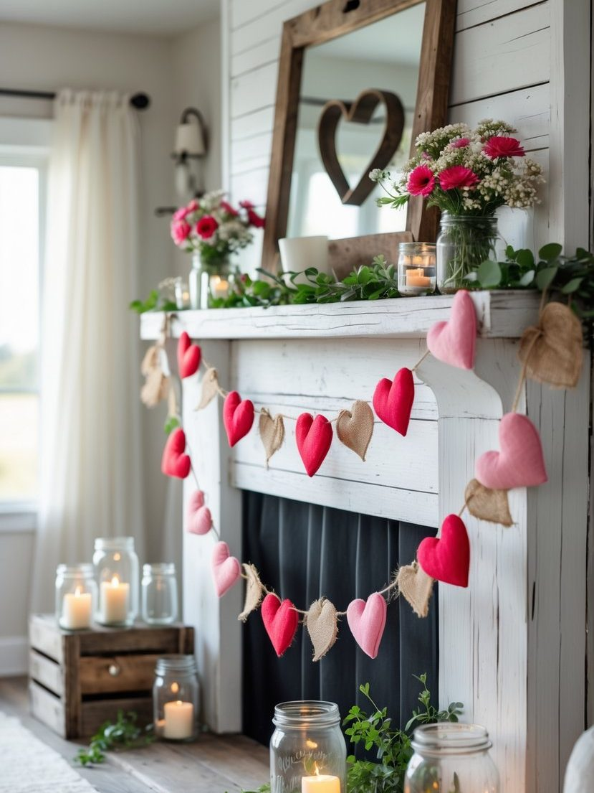

> TIP:GUIDE: Budget: under $25 for felt hearts and jars | Time: one hour to hang and style | Skill: beginner

## 4. Rose Bouquet and a Candlelit Mantel

Sometimes the mantel is the backdrop and the room does the talking. This living room keeps its white mantel simple — a heart garland and candles — and lets a big bouquet of pink roses on the coffee table carry the romance, with a knit throw and a cup of tea beside it.

If your mantel is small, steal this idea: decorate the table in front of the fireplace instead of cramming the shelf. The roses read as part of the mantel display from across the room, and nothing on the shelf is fighting for space.

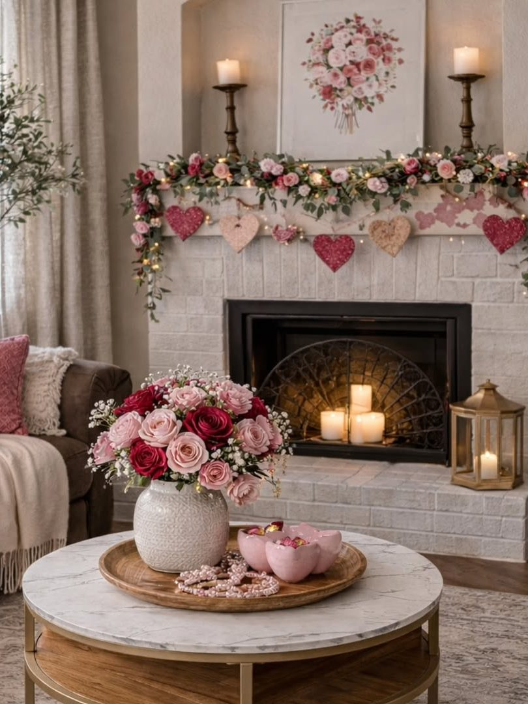

> TIP:QUICK: Style the coffee table as part of the mantel display — from across the room, the two read as one scene.

## 5. Rose Garland and Fairy Lights

A rose garland turns a plain white mantel into the centerpiece of the whole living room. Pink and red roses spill across the shelf with fairy lights woven through them, a glowing heart wreath above, and candles flickering in the firebox below.

Faux roses are the practical choice here: they hold their shape under the lights and you can reuse the garland next year. Weave the fairy lights through the stems first, then set the garland on the mantel so the bulbs peek out between the blooms.

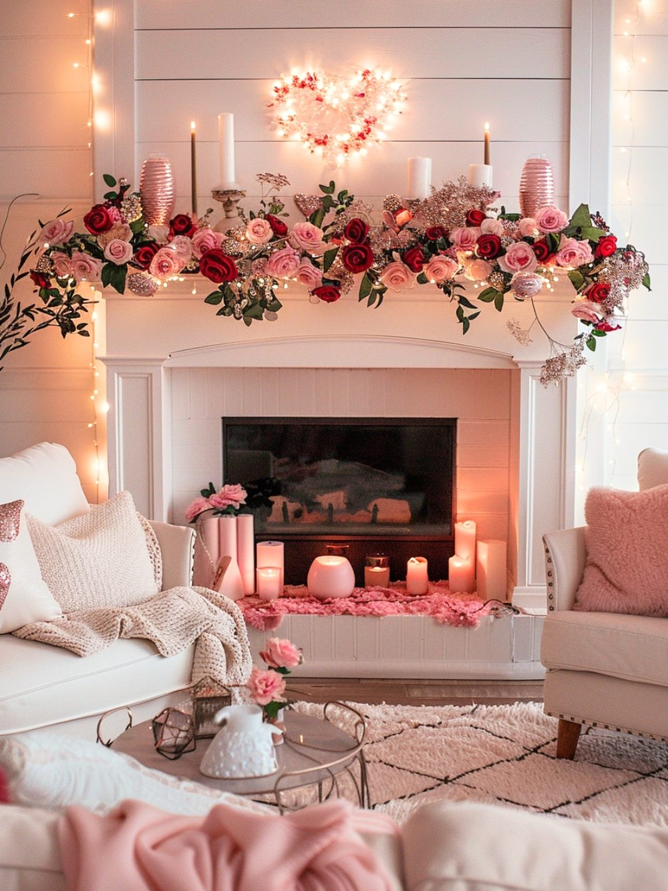

> TIP:CHECK: faux roses so the garland keeps its shape; fairy lights woven through before hanging; candles in the firebox for a second glow

## 6. Pillar Candles and Pink Roses

Pillar candles do more for a Valentine mantel than almost any decoration, because the light makes everything else look softer. This mantel groups white and pink pillars of different heights among pink roses, with a heart fairy light strung along the front edge.

Vary the candle heights by at least two inches between neighbors so the group reads as a skyline, not a fence. Battery pillars with a timer are the safe choice if the mantel sits above a real fire or small children can reach it.

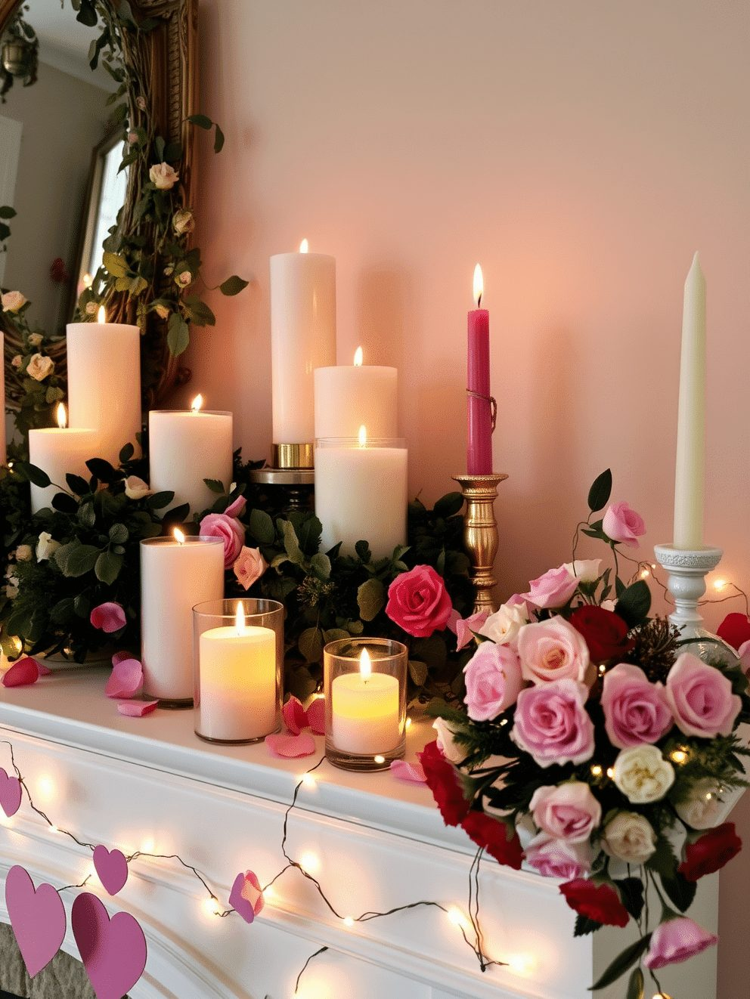

> TIP:GUIDE: Budget: $15–$30 for a set of battery pillars | Time: fifteen minutes to arrange | Skill: beginner

## 7. Marble Mantel with Roses and Petals

A marble mantel with roses and scattered petals is the most romantic look on this list, and it needs almost no structure. Pink and red roses fill silver vases along the shelf, pillar candles glow between them, and rose petals drift across the marble.

The trick is restraint everywhere else: no garland, no sign, no bunting, so the flowers and the stone do all the work. Use two vases of different heights and one low bowl of roses, and let the petals fall where they land.

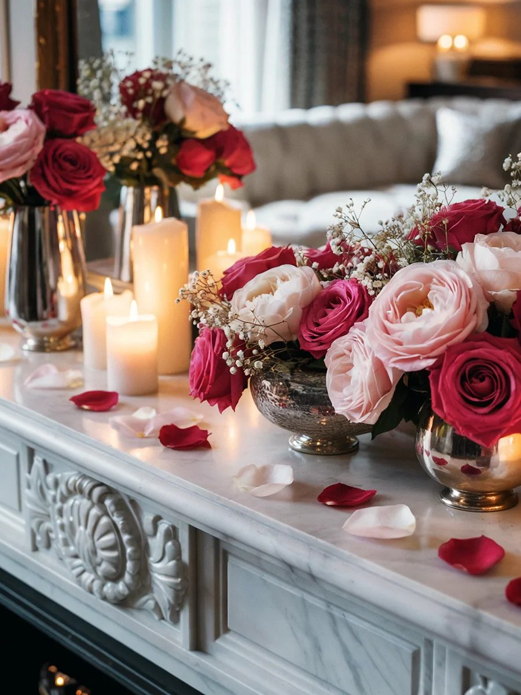

> TIP:QUICK: Skip the garland entirely — on marble, the roses and the stone are decoration enough.

## 8. White Roses and a Gilded Mirror

White roses against a gilded mirror is a quiet, grown-up Valentine look. Pale pink roses in tall glass vases stand on either side of the mirror, with candles in mercury glass holders and a few blush roses tucked along the shelf.

The mirror doubles the candles and the flowers, so the mantel looks twice as full as it is. Keep the palette to white, blush and gold, and let one deep pink rose in each vase be the only strong color.

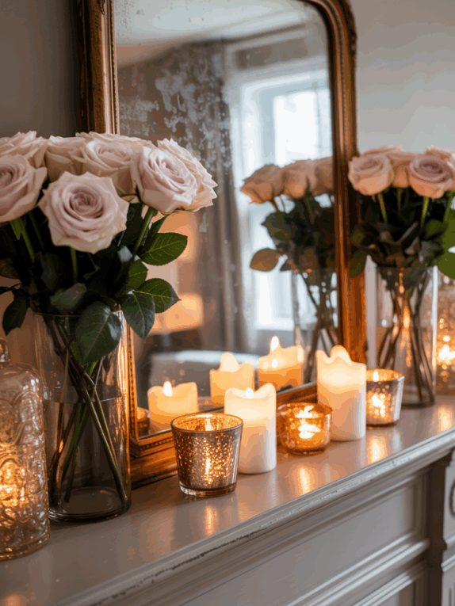

> TIP:CHECK: one deep pink rose per vase as the only strong color; candles in mercury glass to double the glow; mirror hung dead center

## 9. Heart Wreath and Lanterns

A heart-shaped wreath of red roses is the boldest thing you can hang above a mantel, and this stone fireplace proves it. The wreath anchors the whole wall, with a matching rose garland across the shelf, lanterns on the hearth and a bouquet on the coffee table.

Hang the wreath high enough that it clears the garland — at least six inches above the shelf — so the two do not blur into one red mass. Lanterns on the hearth balance the weight of the wreath above.

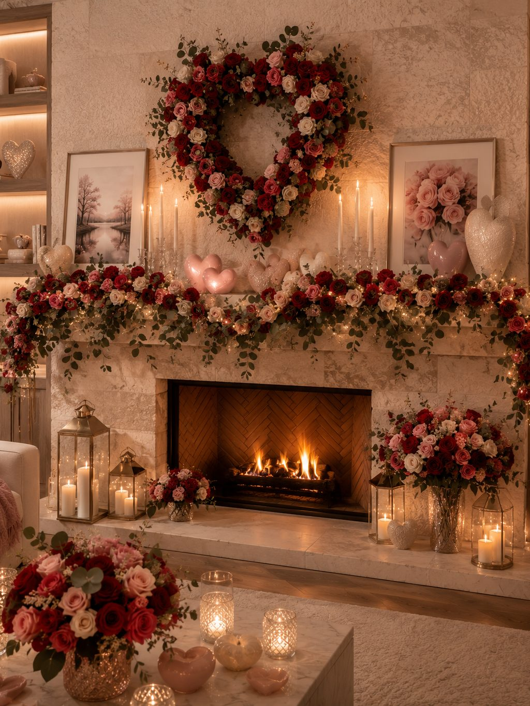

> TIP:GUIDE: Budget: $30–$50 for a faux rose heart wreath | Time: twenty minutes to hang and style | Skill: beginner

## 10. Lanterns and Blush Roses

Lanterns are the easiest way to get candlelight onto a mantel without a single open flame near the curtains. This stone mantel pairs black lanterns with blush roses and pillar candles, and the warm light makes the pale stone glow.

Use lanterns of two sizes and put the taller one at the end, so the mantel has a clear high point. Battery candles inside the lanterns give you the flicker with none of the worry, and they look real through the glass.

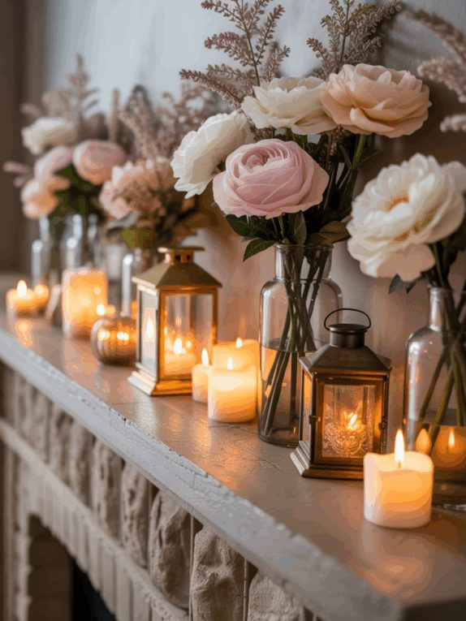

> TIP:QUICK: Two lantern sizes, taller one at the end — a clear high point keeps the mantel from looking flat.

## 11. Red Heart Bunting and Candles

Red felt heart bunting is the happiest look in this list, and it costs almost nothing. A string of red hearts runs across the white mantel, with red pillar candles, a basket holding a plush heart, and a few more hearts tucked onto the hearth.

Space the hearts about two inches apart so the bunting reads as a garland, not a solid band. If you sew, felt hearts take minutes each; if you do not, cut them from craft felt and glue the edges.

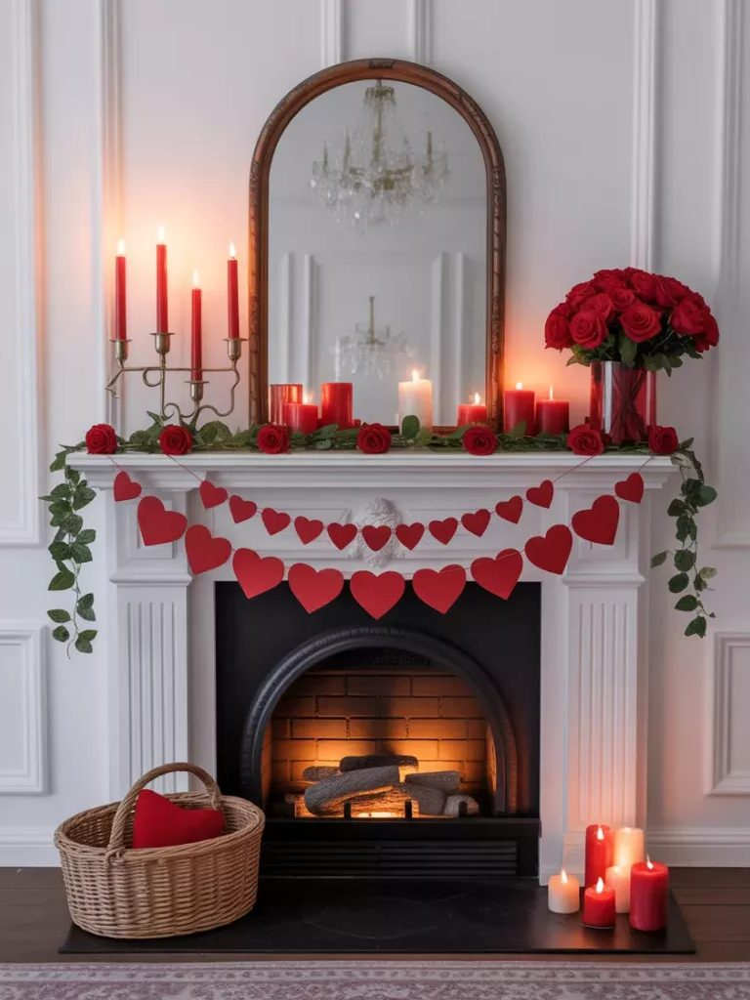

> TIP:CHECK: hearts spaced two inches apart; red candles in two heights; one soft toy heart on the hearth for charm

## 12. Velvet Hearts on a Wood Mantel

Velvet hearts on a dark wood mantel feel rich and old-fashioned in the best way. Burgundy velvet hearts hang in a swag across the carved wood, with candles, red roses and a small stack of books on the shelf, and a fire glowing below.

The dark wood needs the candles more than a white mantel does, so go generous with them — at least five across the shelf. Velvet reads best in warm light, so keep the bulbs warm white, never cool.

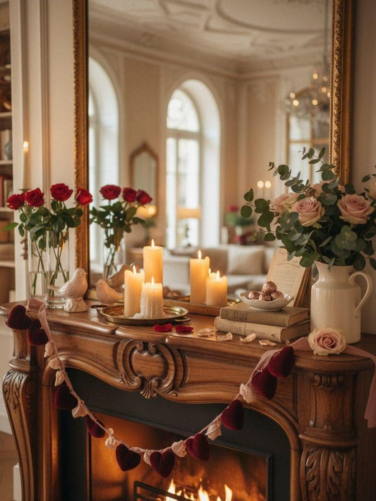

> TIP:GUIDE: Budget: under $20 for velvet hearts and ribbon | Time: thirty minutes to hang | Skill: beginner

## 13. Pink Felt Hearts and Eucalyptus

Eucalyptus is the fresh, modern answer to a Valentine mantel: green against pink felt hearts, with a pale wood mantel and a soft pink wall behind. The garland is mostly leaves, so the hearts read as accents instead of a flood of red.

Let the eucalyptus trail down one side longer than the other — the asymmetry is what makes it look styled rather than symmetrical. Tuck a few pink hearts into the leaves instead of hanging a separate garland.

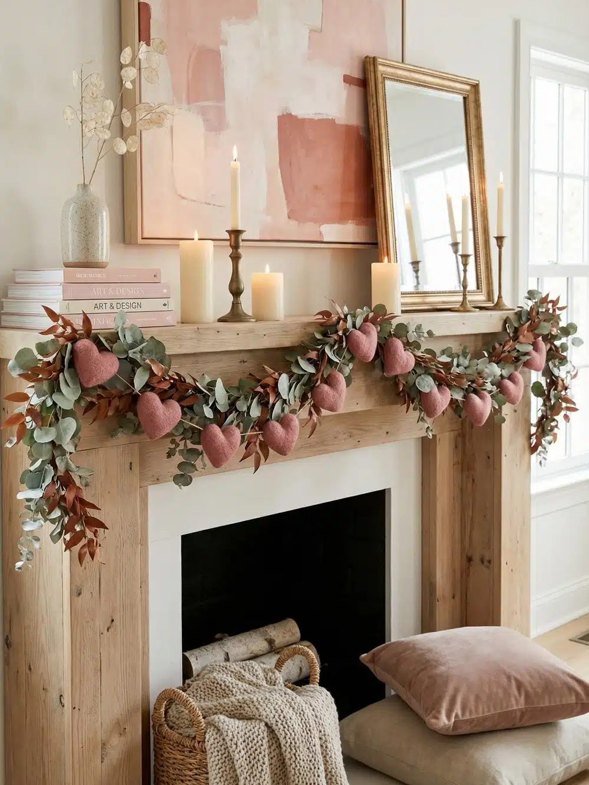

> TIP:QUICK: Trail the eucalyptus longer on one side — asymmetry looks styled, symmetry looks staged.

## 14. Pink Roses and Hanging Velvet Hearts

Hanging velvet hearts at different lengths turns the front of the mantel into the decoration. Pink and red velvet hearts dangle from ribbons below the shelf, with pink roses, candles and a lace runner on top, and a mirror catching all of it.

Hang the hearts from the shelf edge on ribbons of three different lengths, longest in the middle. Keep the top of the mantel calm — roses and candles only — so the eye drops to the hearts.

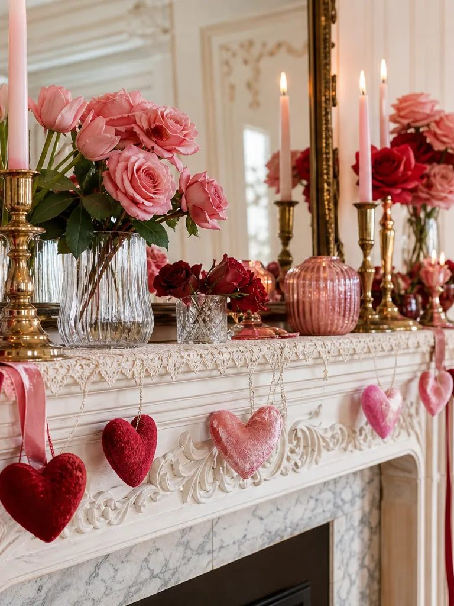

> TIP:CHECK: ribbons in three lengths, longest in the middle; top of the mantel kept calm; hearts hung from the shelf edge

## 15. Heart Wreath and LOVE Letters

A heart wreath above the mantel and big LOVE letters on the hearth make this the most Valentine-forward look on the list. The wreath is red and pink paper hearts, the letters are fabric-covered, and a felt heart garland ties the two together.

This is the one to pick if you want the room to read as Valentine's Day from the doorway. Keep everything else in the room neutral, because the mantel is already doing all the talking.

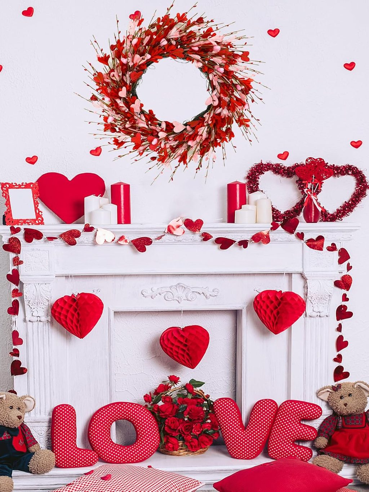

> TIP:GUIDE: Budget: under $40 for the wreath, letters and garland | Time: one hour to assemble | Skill: beginner

## 16. Valentine Heart Sign and Garland

A big pink Valentine sign over a wood plank wall is pure farmhouse Valentine. The heart sign hangs above the mantel with pink paper fans, LOVE letters and a pom-pom heart garland, and a small snowman figure adds a wink.

Farmhouse Valentine works when the pinks stay soft and the wood stays visible — too much hot pink and it tips into a party store. One hot pink accent, the LOVE letters here, is enough.

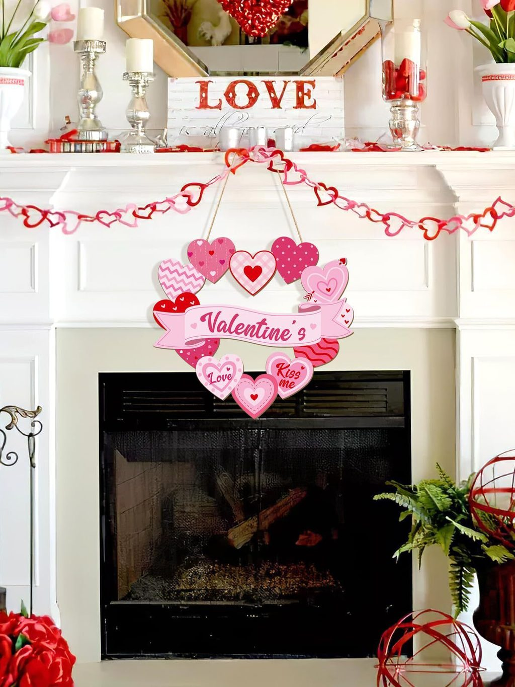

> TIP:QUICK: One hot pink accent only — soft pinks everywhere else keep a farmhouse mantel from looking like a party store.

## 17. Love Wreath and Gift Boxes

A floral wreath spelling Love is the centerpiece here, with pink gift boxes, yarn hearts and little houses arranged along the mantel and a felt heart garland below. It is the busiest look on the list, and it works because everything is the same soft pink.

When a mantel is this full, keep every item in the same color family and vary the shapes instead. The gift boxes, houses and hearts are all different silhouettes, but the single pink palette holds them together.

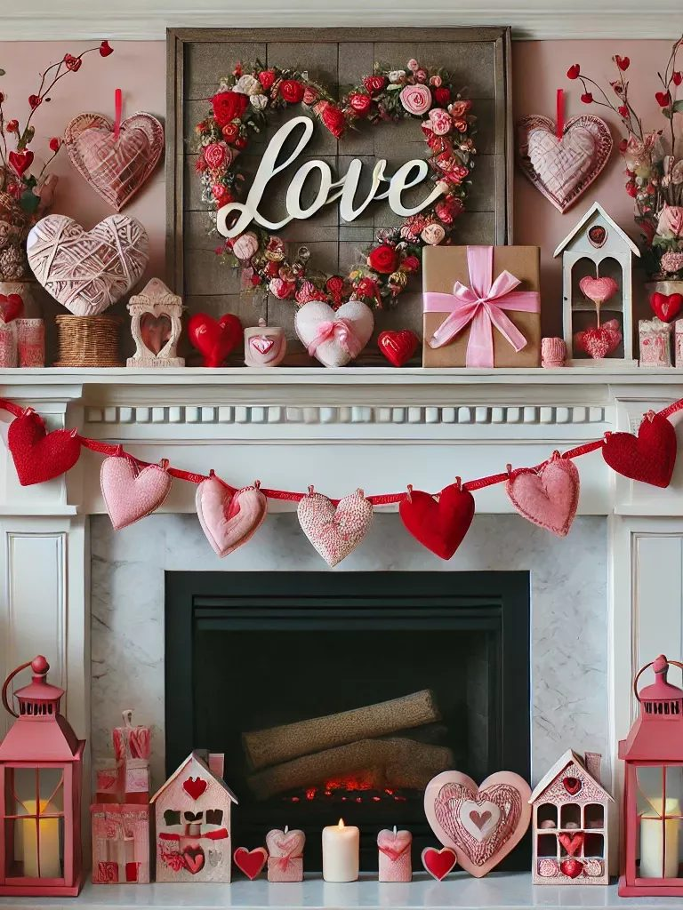

> TIP:CHECK: same soft pink throughout; different silhouettes for variety; one garland below to frame the shelf

## 18. Eucalyptus and Pink Rose Garland

Eucalyptus and pink roses are the calmest Valentine combination here. A long garland of eucalyptus and blush roses runs across a white mantel under a big mirror, with candles in the firebox and a knit pouf on the floor beside it.

This is the mantel to copy if you want Valentine's Day to feel like spring, not a holiday aisle. Fresh eucalyptus lasts about two weeks indoors, so buy it the weekend before the day itself.

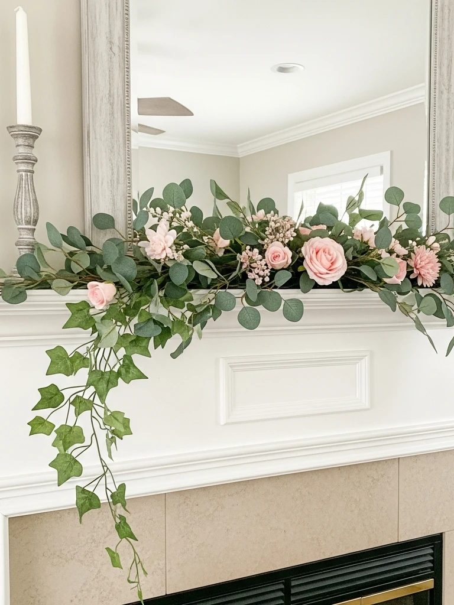

> TIP:GUIDE: Budget: $20–$35 for fresh eucalyptus and roses | Time: thirty minutes to arrange | Skill: beginner

## 19. BE MINE Banner and Eucalyptus

A BE MINE banner in pink felt letters is the sweetest kind of Valentine sign — handmade-looking and impossible to misread. It hangs from a eucalyptus garland that trails down both sides of the fireplace, with a small heart wreath above and a gnome on the shelf.

Hang the banner from the garland itself, not the mantel, so the letters sit in front of the leaves. The trailing eucalyptus on both sides makes the fireplace look taller and frames the banner.

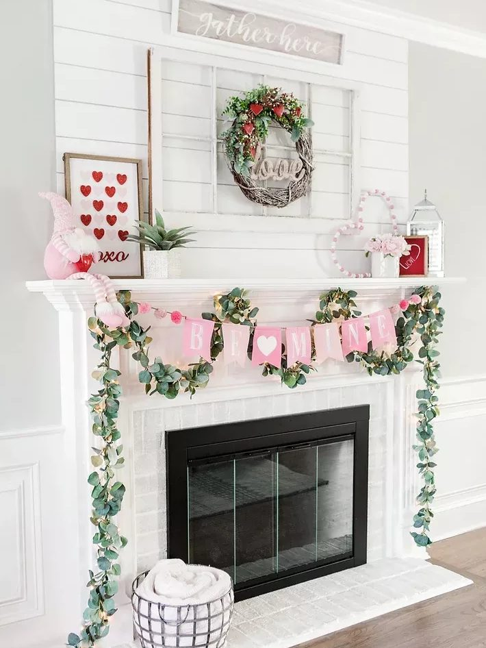

> TIP:QUICK: Hang the banner from the garland, not the mantel — the letters sit better in front of the leaves.

## 20. Blush Eucalyptus Garland

Blush eucalyptus and white roses on a wood mantel is Valentine's Day for people who do not like Valentine's Day decor. The garland is mostly dusty pink leaves and white blooms, with a single candle and a small vase, and the room stays calm.

This is the look to keep up past February 14th — nothing on it says Valentine except the blush tones. If your style is neutral, this is your mantel.

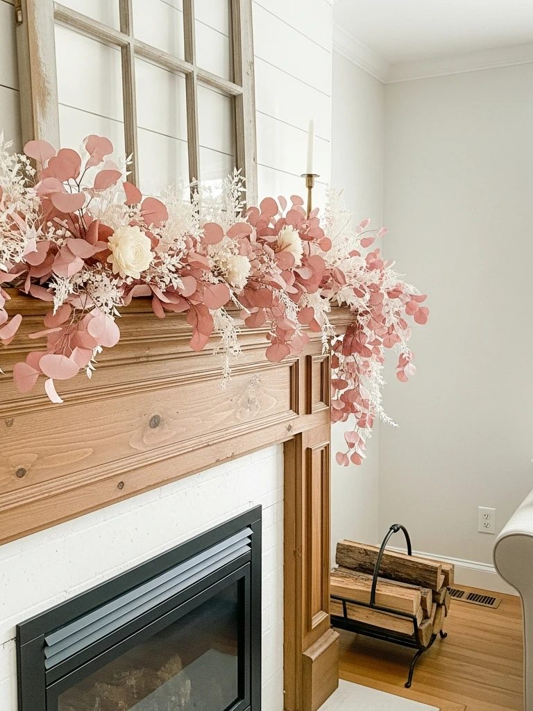

> TIP:CHECK: nothing on it says Valentine except the blush tones; leave it up past the 14th; fresh eucalyptus swapped in when it fades

## 21. LOVE Script and Pink Candles

A red LOVE script across the mantel, pink candles and red roses under a pink cloth make this the most theatrical look here. The pink tablecloth over the mantel shelf softens the wood, and the hearts hanging from it add one more layer.

The cloth is the trick: it turns an ordinary wooden mantel into a dressed one in seconds. Choose a cloth that pools slightly at the ends rather than one that ends exactly at the corners.

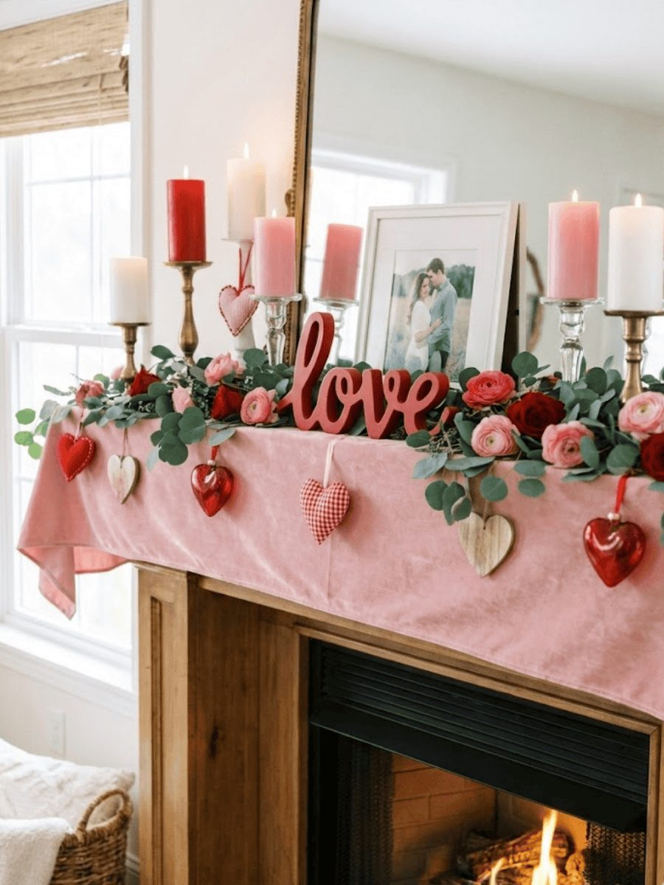

> TIP:GUIDE: Budget: under $30 for the cloth, script and candles | Time: twenty minutes to dress | Skill: beginner

## 22. Macrame Hearts and Eucalyptus

Macrame hearts and eucalyptus give a Valentine mantel a handmade, boho feel. Cream macrame hearts with tassels hang from a beaded garland across a white mantel, with a eucalyptus swag above and a birdcage and lantern on the shelf.

Macrame hearts are light, so hang them from the garland with thread rather than hooks — they will sit straighter. The tassels are the charm here, so let them hang free and do not trim them even.

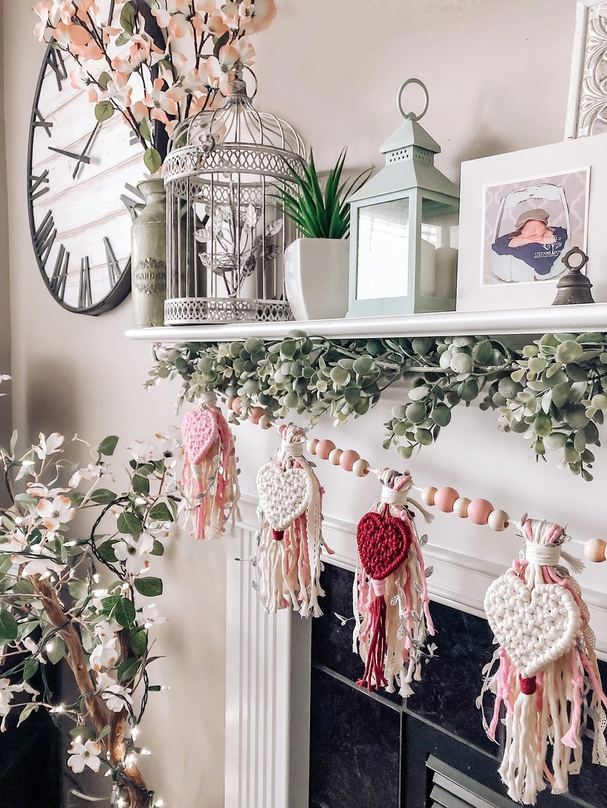

> TIP:QUICK: Hang macrame hearts with thread, not hooks — they sit straighter, and the tassels stay the star.

## 23. Vintage Roses and a Gilded Mirror

Dusty pink roses, a gilded mirror and old books make this the most vintage mantel on the list. The roses fill jars and vases across a carved stone mantel, candles burn in front of the mirror, and the whole scene looks like a French country house.

Vintage works when the roses look slightly wild, not arranged — let a few stems lean and a few petals drop. The mirror is essential: it reflects the candles and doubles the glow.

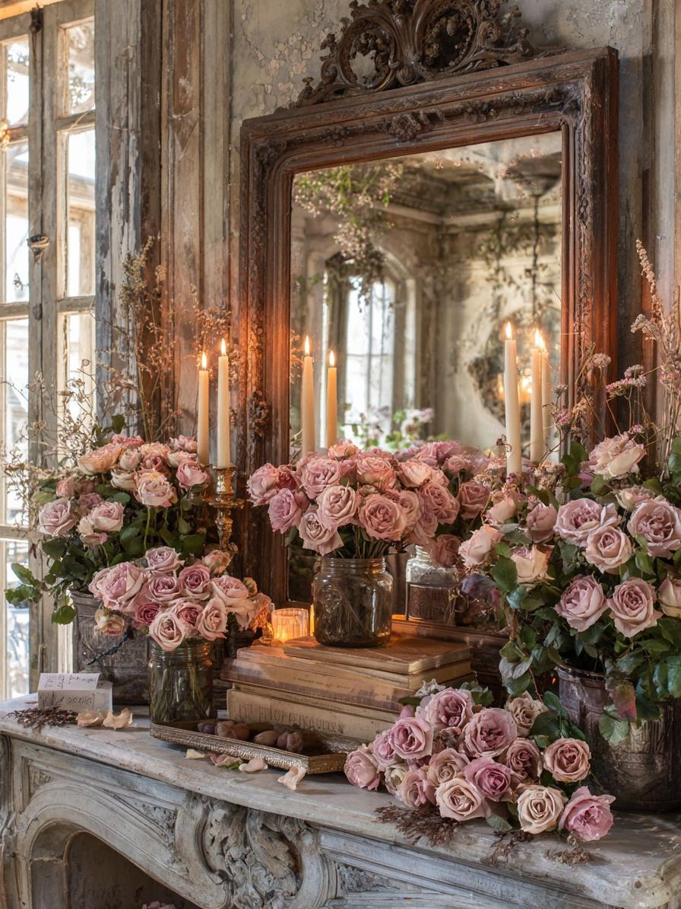

> TIP:CHECK: let a few stems lean and a few petals drop; the mirror doubles the candlelight; old books as risers

## 24. Marble Mantel with Pink Blooms

A marble mantel with pink blooms and a big mirror is the lightest, airiest look here. Pink and white flowers fill vases across the shelf, candles in glass holders glow between them, and the mirror opens the whole wall up.

Keep the flowers in the same pink family and let the white blooms be the contrast. One tall arrangement at each end and a low one in the middle gives the mantel its shape.

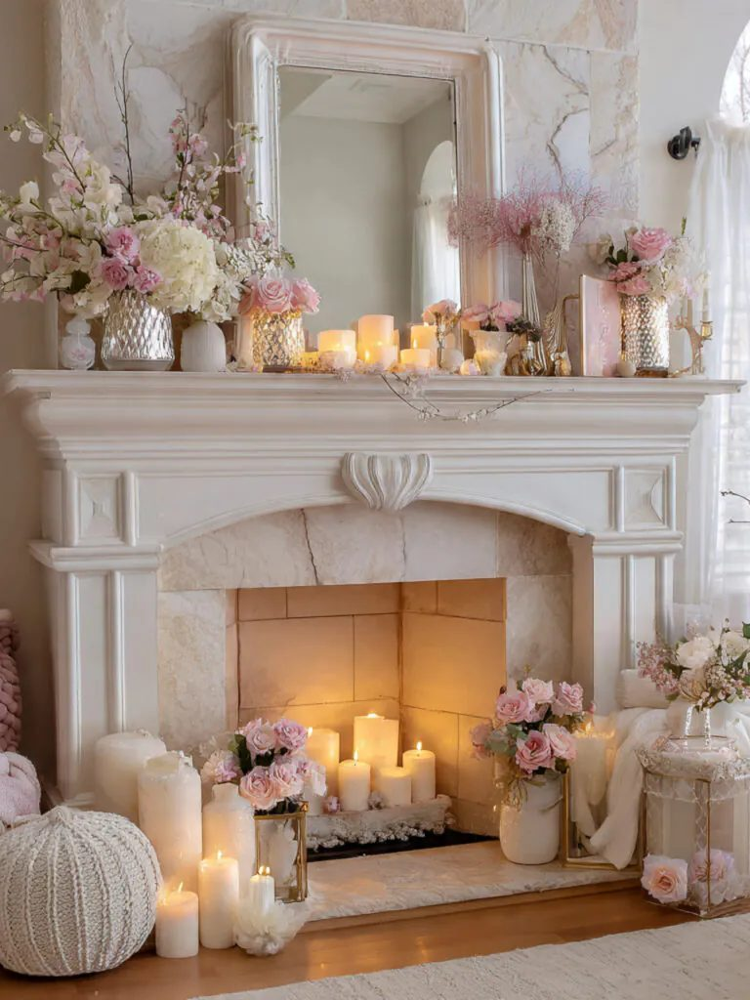

> TIP:GUIDE: Budget: $25–$40 for fresh flowers and vases | Time: twenty minutes to arrange | Skill: beginner

## 25. Metallic Heart Garland

A metallic heart garland in rose gold and silver is the glamorous option. The puffy hearts catch the light above a mantel dressed with candles, roses and a vase of pink blooms, and the whole thing shimmers without a single fairy light.

Metallic hearts need warm candlelight to shine — cool white light makes them look flat. Put the garland high, near the top of the wall, so it catches the light from the candles below.

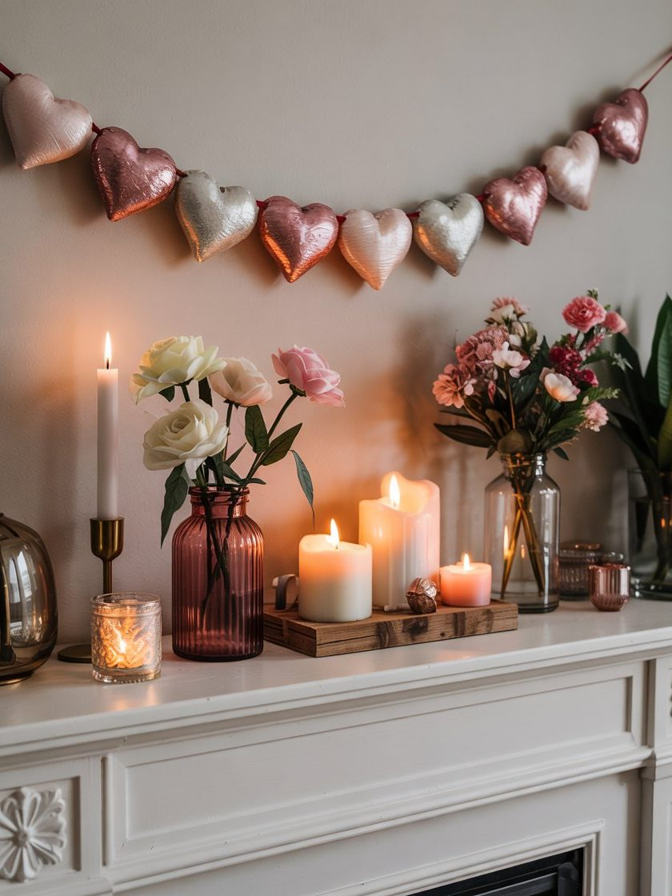

> TIP:QUICK: Put the garland high so it catches the candlelight — metallic hearts go flat under cool white light.

## 26. Red Heart Bunting and Rose Bouquets

Red heart bunting and big rose bouquets are the classic romantic mantel, done generously. A red and white heart garland runs across the shelf, a huge bouquet of red and white roses stands in a white urn, and candles line up on either side.

The bouquet is the investment here — one big arrangement beats three small ones. Keep the garland simple so it frames the flowers instead of competing with them.

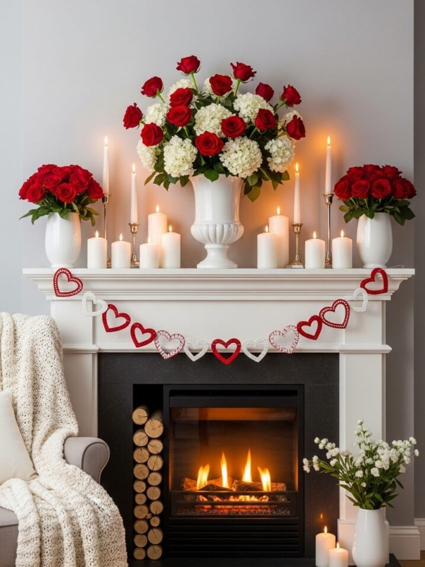

> TIP:CHECK: one big bouquet beats three small ones; a simple garland frames it; candles in matching heights on both sides

## 27. Red Hearts and White Roses

Red felt hearts, white roses and red candles on a white mantel with a gold mirror is the most traditional look on the list. The heart garland dips low across the shelf, the roses and candles stand tall behind it, and the mirror makes the room feel twice as big.

Traditional works when the red is the same red everywhere — match the hearts, the candles and the roses to one shade. Two reds that almost match will fight; one red, repeated, looks deliberate.

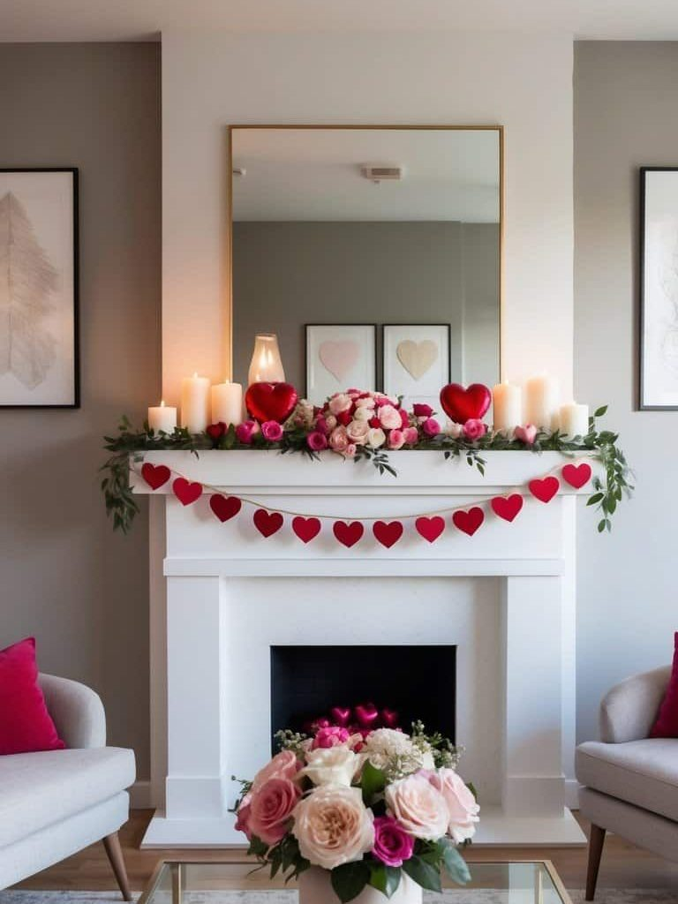

> TIP:GUIDE: Budget: $20–$35 for the garland, candles and roses | Time: thirty minutes to style | Skill: beginner

## 28. Red Velvet Hearts and Roses

Red velvet hearts and red roses against an ornate gold mirror is pure drama. The velvet hearts hang in a swag across the mirror, roses fill silver vases on the shelf, and candles burn along the front edge.

Velvet and gold need each other — the matte hearts make the gold look richer, and the gold makes the red look deeper. Keep the candles red too, so the whole mantel is one warm, glowing red.

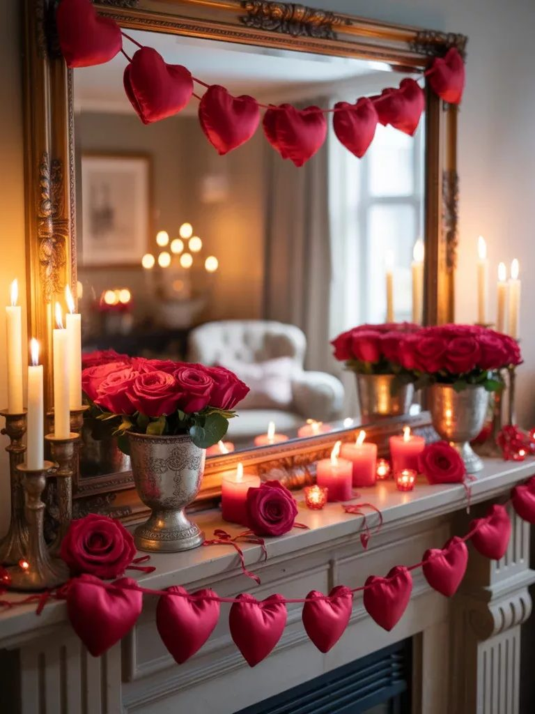

> TIP:QUICK: Velvet hearts against a gold mirror — the matte and the shine make each other look richer.

## 29. Burlap Hearts and Candlelight

Burlap hearts and candlelight make a rustic Valentine mantel that feels warm rather than sweet. Burlap heart bunting hangs across a white mantel, red roses and candles stand on the shelf, and more candles glow inside the firebox on an old suitcase.

The firebox candles are the clever part: they give you a fire glow without lighting a fire. Put them on a tray or an old suitcase so they look placed, not forgotten.

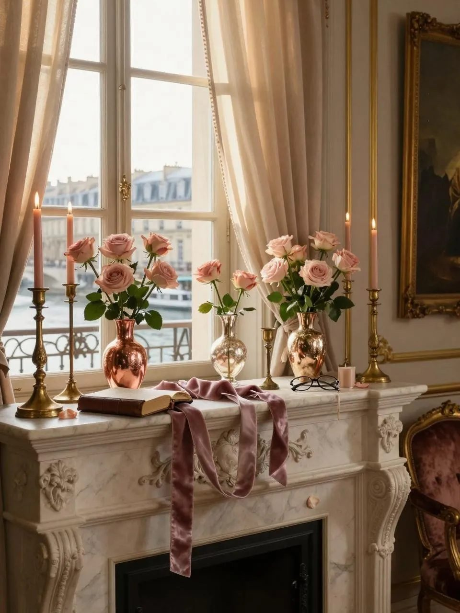

> TIP:CHECK: candles in the firebox on a tray for a fire glow without a fire; burlap softens the white mantel; one plush heart on the hearth for charm

## 30. Heart Wreath and Heart Pillows

A heart wreath over a pink wall, heart cushions on the chair and a mantel full of red candles is Valentine's Day as a whole room. The wreath hangs in a round mirror, the garland runs across the shelf, and a basket of throws sits beside the fire.

When the whole room joins in, keep the mantel itself simple — garland, candles, done. The cushions and the wreath carry the theme, so the mantel does not have to shout.

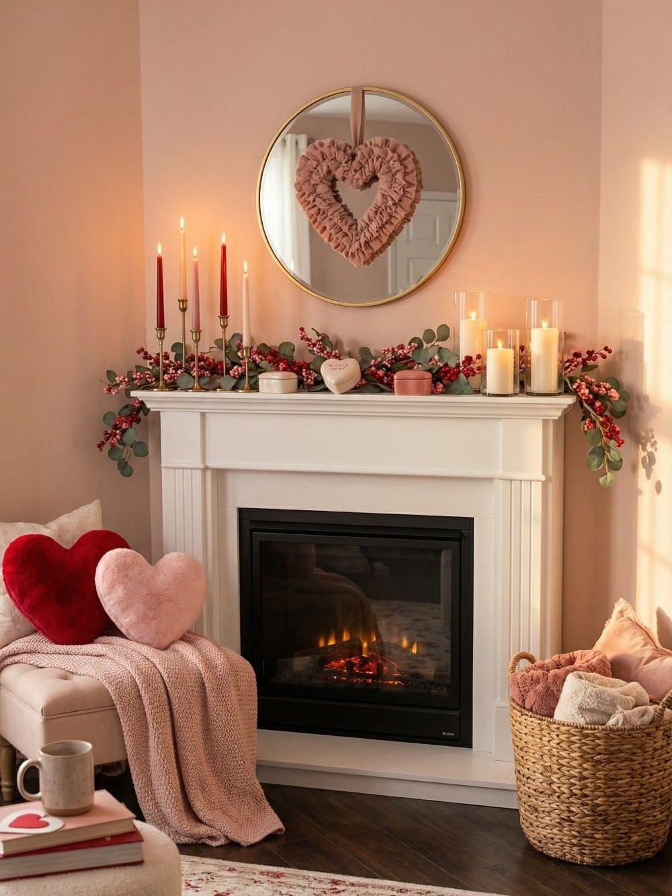

> TIP:GUIDE: Budget: under $50 for the wreath, garland and cushions | Time: one hour to dress the room | Skill: beginner

## Takeaway

- Start with one garland and one group of candles — that is a finished Valentine mantel.
- Then add roses if you want romance, a sign if you want a message, or lanterns if you want glow, and stop the moment the shelf looks full from the doorway.
- If you want the garland to work beyond February, our [30 Garland on Mantle Ideas for Every Season](/posts/garland-on-mantle/) shows the same shelf dressed for every season of the year.

## Frequently Asked Questions

### How do I decorate my mantel for Valentine's Day?

Start with a heart garland across the shelf, add candles in groups of three at different heights, and finish with roses or a small sign. Keep the palette to red, pink and white with one green accent, and step back to check the mantel from the doorway before adding anything else.

### What colors work best for a Valentine mantel?

Red, pink and white are the classic trio, with blush and burgundy as softer options and gold as the metallic accent. Eucalyptus or another green softens the pinks, while a white mantel makes every color look brighter. Avoid cool white light, which flattens reds.

### How do I hang a garland on my mantel without damaging it?

Use small clear Command hooks or removable adhesive hooks rated for the garland's weight, two or three across the shelf. For a swag, hook the ends and let the middle dip naturally. Never use nails in a painted mantel, and test one hook first.

### Can I use real candles on a Valentine mantel?

Yes, if the mantel is clear of garlands, paper and fabric above the flames, and you never leave them burning unattended. Battery pillar candles with timers are the safer choice above a working fireplace, and they look convincing through glass holders and lanterns.

### How do I make a small mantel look romantic?

Go vertical instead of wide: a tall vase of roses at one end, a stack of books at the other, and a short heart garland across the front. A mirror above doubles the display, and three candles of different heights give glow without clutter.

### What should I put on the hearth for Valentine's Day?

Lanterns, a basket of throws, a small bouquet, or candles in the firebox all work on the hearth. Keep the hearth to one or two items so it frames the mantel rather than competing with it, and keep anything flammable away from a lit fire.

### When should I put up Valentine mantel decor?

Most people decorate in the last week of January, right after the Christmas decor comes down. Fresh flowers and eucalyptus should wait until the weekend before Valentine's Day, while garlands, signs and faux roses can go up as early as you like.

### How do I store Valentine mantel decor after February?

Wrap garlands around a piece of cardboard so they do not tangle, keep felt hearts in a labeled box with tissue paper, and store candles upright in a cool place. Faux roses last for years if kept out of sunlight, so the whole mantel can be reused next February.
