# 30 Winter Window Art Ideas for a Bright, Seasonal Home

Winter window art turns the coldest glass in the house into the brightest decoration: snowflake decals catch the daylight, fairy lights glow after dark, and a paper village on the sill makes the whole window look like a storybook. These 30 winter window art ideas cover decals, painted glass, paper snowflakes, wreaths and light displays, so there is a look for every window and every skill level.

Most of these ideas need nothing more than paper, static cling or a string of lights, and all of them come off in January without a trace. If you want the rest of the house to feel as seasonal as the windows, our [30 Winter Home Ideas for a Cozy Season](/posts/winter-home/) carries the same warmth through every room.

## 1. Snowflakes on a Frosty Window

Snowflake decals on a frosty window are the simplest winter window art there is: white vinyl flakes in every size, stuck to the glass in a loose scatter, with the snowy garden outside doing the rest.

Static cling decals need no adhesive and peel off clean in January, which is why they are the best first window project. Scatter the big flakes at the corners and the small ones toward the middle, and leave some glass clear so the room still gets its daylight.

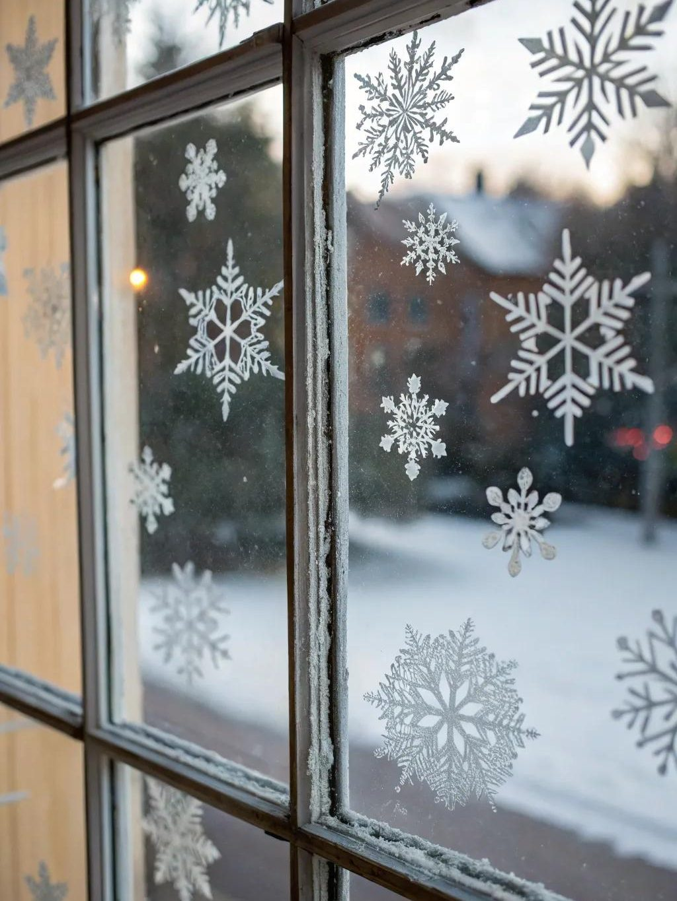

> TIP:QUICK: Static cling, not adhesive — the decals peel off clean in January and can be reused next winter.

## 2. Hanging Paper Snowflakes

Paper snowflakes hanging on threads turn a plain window into a snowfall that never melts. White and silver flakes in different sizes hang at different heights in front of the glass, catching the light from outside.

Cut the flakes from plain white paper and hang them on clear thread so they seem to float. Hang the biggest flakes lowest, where they catch the eye, and the smallest ones high, where they catch the light.

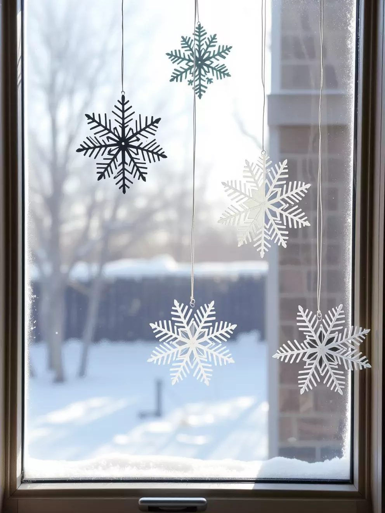

> TIP:CHECK: clear thread so the flakes seem to float; biggest flakes lowest; smallest ones high where they catch the light

## 3. Paper Snowflakes at Dusk

Paper snowflakes at dusk, with fairy lights behind them, are the most magical window on this list. The flakes glow white against the darkening sky, the lights twinkle behind the glass, and the whole window looks lit from within.

Put the fairy lights on the inside of the window and the flakes on the glass itself, so the lights shine through the paper. Warm white lights suit snowflakes best; cool white makes them look blue.

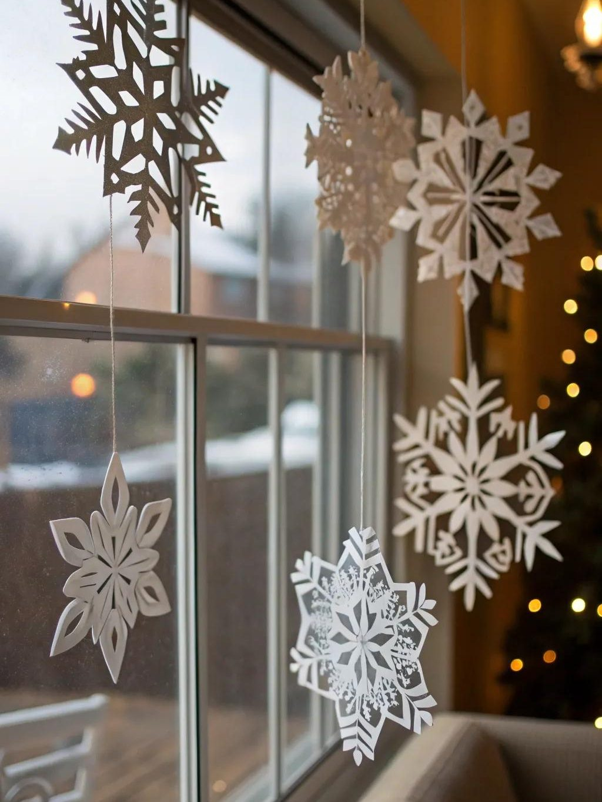

> TIP:GUIDE: Budget: under $10 for paper and a string of lights | Time: one hour to cut and hang | Skill: beginner

## 4. Garland-Framed Window with Ornaments

A garland-framed window with ornaments is Christmas in a frame. Green garland runs around the window with red baubles and lights, paper stars and ornaments hang in the glass, and the lit tree glows behind the curtains.

Frame the window on the outside of the glass so the garland does not block the light. Hang the ornaments from the top of the frame on different lengths of thread, so they sit at different heights in the window.

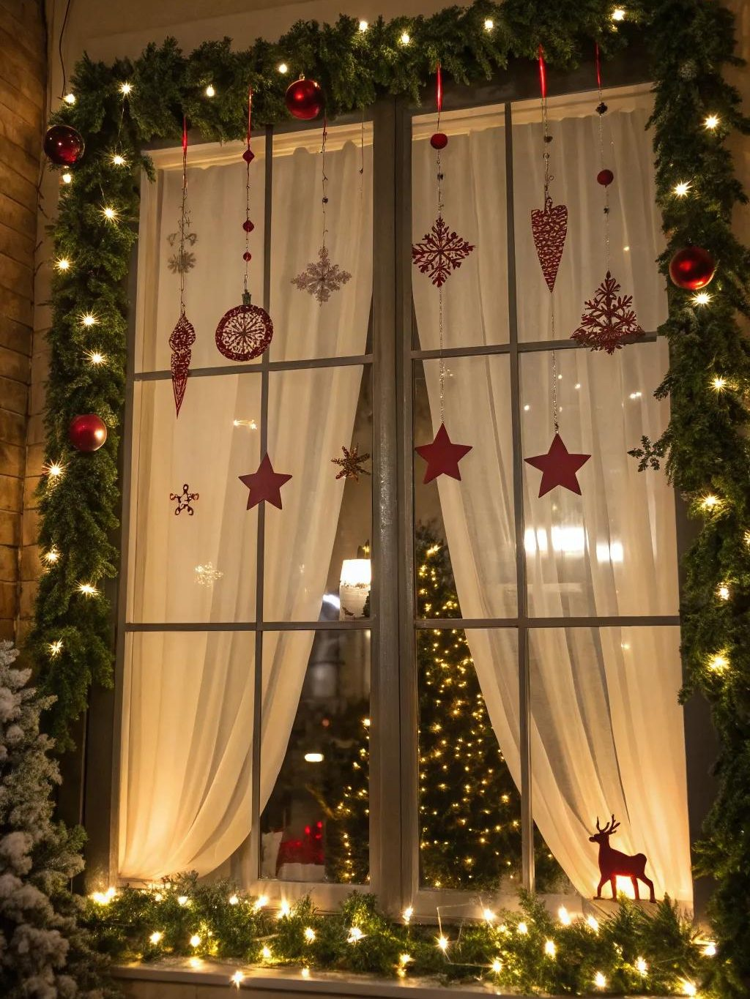

> TIP:QUICK: Frame the window from the outside of the glass so the garland never blocks the light.

## 5. Lit Snowflakes and Stars

Lit snowflakes and stars make a window glow like a lantern. Snowflake decals, glowing stars and small lit Christmas trees fill the panes, with a garland and pinecones along the top and a little house glowing on the sill.

This is the window to copy if your window faces the street: it is as beautiful from outside as from inside. Use battery fairy lights on the sill so there are no cords trailing across the room.

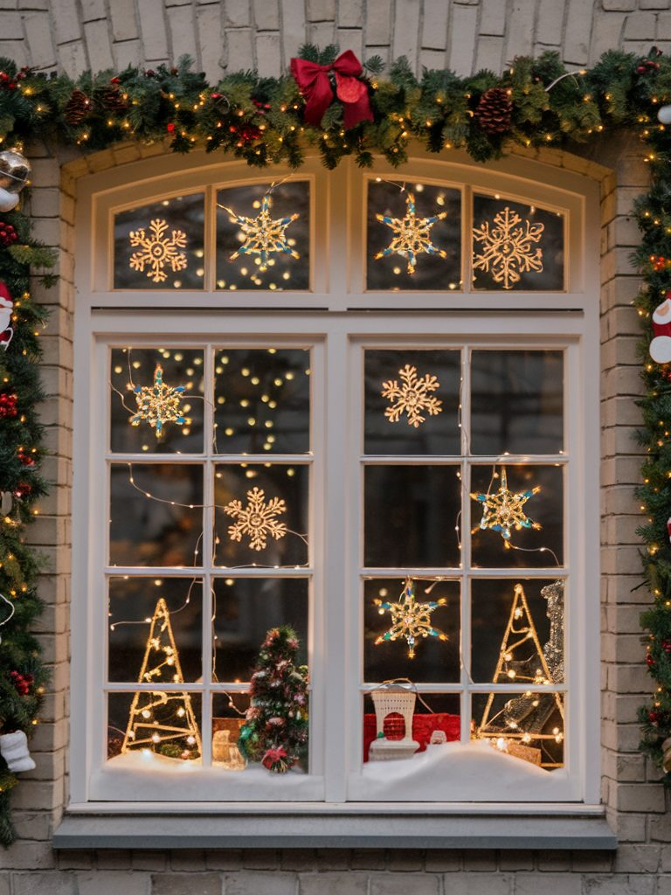

> TIP:CHECK: lit decals face the street too; this window is as beautiful from outside as from inside; battery lights on the sill, no cords

## 6. Fairy Lights Around the Window

Fairy lights around the window frame are the easiest light display on this list, and they change the whole room after dark. Warm lights run around the frame, a wreath hangs in the glass, and a small tree and candles sit on the sill.

Run the lights around the inside edge of the frame and hide the battery pack behind the curtain. One string is enough for a single window; two looks crowded, and the wreath needs its own space.

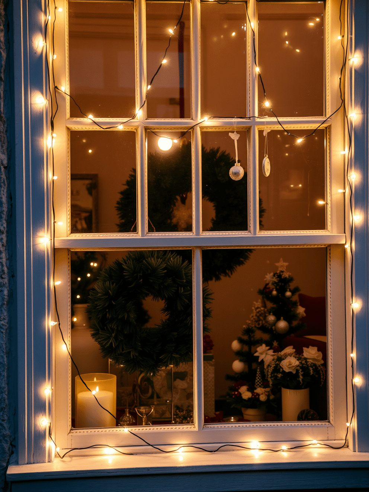

> TIP:GUIDE: Budget: $10–$20 for a battery string of fairy lights | Time: fifteen minutes to hang | Skill: beginner

## 7. Star Lights and a Christmas Tree

Star lights and a Christmas tree beside the window make the corner of the room glow. Glowing stars hang in the glass, the tree stands beside it covered in lights, and the whole corner feels like the inside of a snow globe.

Hang the stars at different heights on clear thread, and keep the tree lights warm white to match. If the window is tall, hang one big star low in the middle — it becomes the focal point the eye finds first.

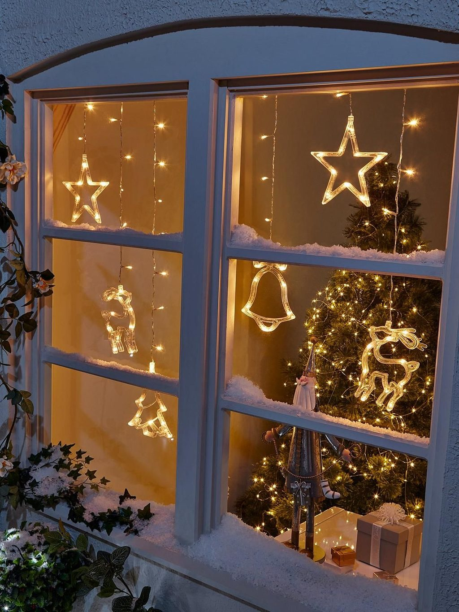

> TIP:QUICK: One big star low in the middle becomes the focal point the whole window hangs around.

## 8. Reindeer Silhouettes and Stars

Reindeer and tree silhouettes against a glowing window are the most storybook look here. Black paper deer and pines stand on the sill in front of warm light, with paper stars scattered across the glass above them.

Silhouettes work because of the backlight: put a warm lamp or a string of lights behind them, not in front. Cut the shapes from black card so the edges stay crisp, and keep the glass behind them clear of decals.

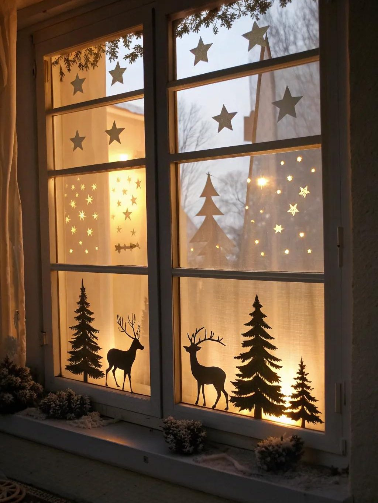

> TIP:CHECK: backlight is everything; put the warm light behind the silhouettes, never in front; black card for crisp edges

## 9. A Paper Village on the Sill

A paper village on the sill is the window display children remember. White paper houses and little trees stand in a row of fake snow on the windowsill, with star lights hanging in the glass above them.

Paper houses are easy to cut from card and fold into shape, and a row of them costs almost nothing. Put the tallest house in the middle and the trees at the ends, and sprinkle the fake snow thickly at the front.

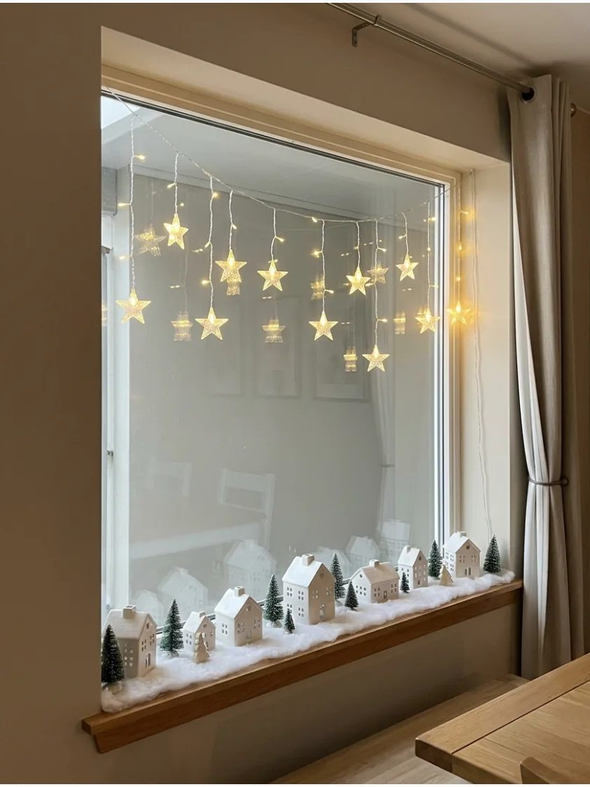

> TIP:GUIDE: Budget: under $10 for card, fake snow and lights | Time: one hour to cut and build | Skill: beginner

## 10. Christmas Lights Outside the Window

Christmas lights outside the window turn the house into the decoration. Colorful strings outline the windows and run along the eaves, glowing against the snow while the inside of the house stays calm.

Outdoor lights belong on a timer so they switch themselves off at bedtime. Clip them to the window frame with outdoor clips, never nails, and keep the plugs under cover so the snow cannot reach them.

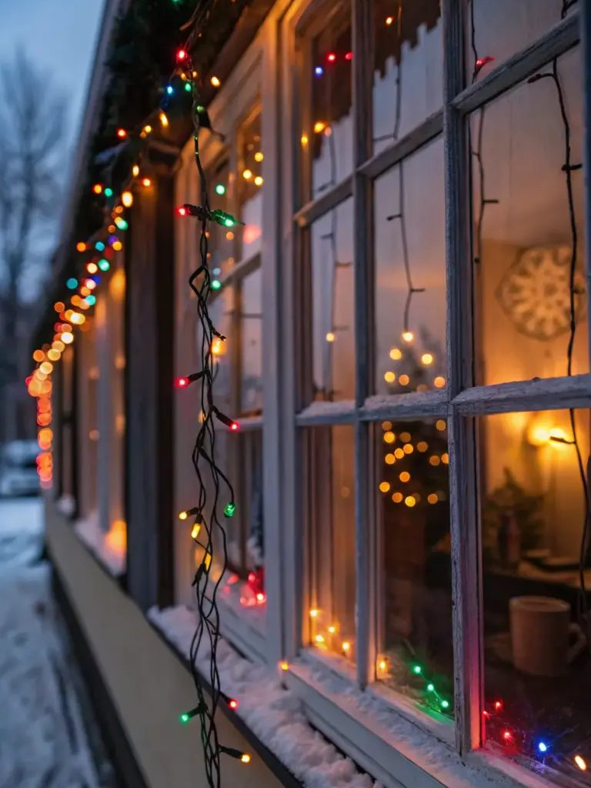

> TIP:QUICK: Outdoor clips, never nails; a timer so the lights switch themselves off at bedtime.

## 11. Star Lights Behind the Sofa

Star lights behind the sofa make the living room window the evening's entertainment. Hanging star lights fill the window, a garland runs along the top, and little bottlebrush trees stand on the sill below.

This is the window to light first when guests arrive: it is behind the sofa, so it glows over the whole room. Use a timer plug so the lights come on at dusk without anyone touching them.

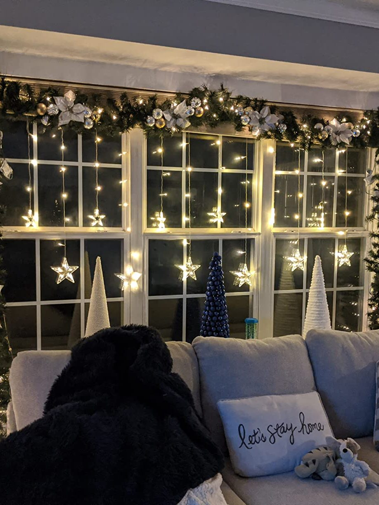

> TIP:CHECK: hang the stars behind the sofa; the glow falls over the whole room; a timer plug switches them on at dusk

## 12. Stained-Glass Tree in the Window

A stained-glass Christmas tree in the window is the most jewel-like look here. Colored glass pieces form a tree with ornaments and a star, glowing blue and green in the daylight with gold curtains on either side.

Real stained glass is an investment, but a stained-glass-look window film gives the same glow for a fraction of the price. Apply the film to a clean window with soapy water and a squeegee, and it peels off in spring.

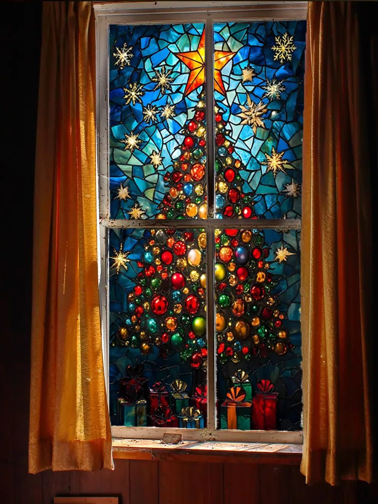

> TIP:GUIDE: Budget: $15–$30 for stained-glass-look window film | Time: thirty minutes to apply | Skill: beginner

## 13. Character Window Clings

Character window clings are the most fun window in this list, and the one children love most. Santa, a snowman, a reindeer and a house cover the window in bright colors, with snowflakes scattered between them.

Clings are the best window art for a child's bedroom: they stick without glue, peel off without a mark, and can be moved around the glass a hundred times. Let the children place them — the slightly crooked arrangement is the charm.

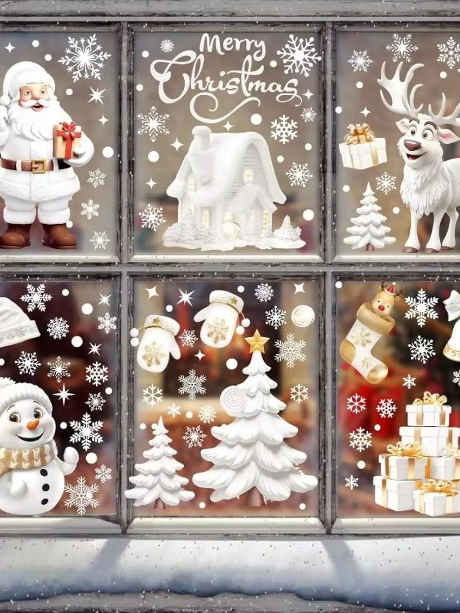

> TIP:QUICK: Let children place the clings themselves — the slightly crooked arrangement is the charm.

## 14. Wreath and Candles in the Window

A wreath and candles in the window is the classic Christmas window, and it never fails. A green wreath with a red bow hangs in the glass, candles glow on the sill below, and snow-covered trees stand outside.

Hang the wreath from a ribbon over the top of the window frame so there is no hook in the glass. Battery candles on the sill give the glow without the risk, and they look real from the street.

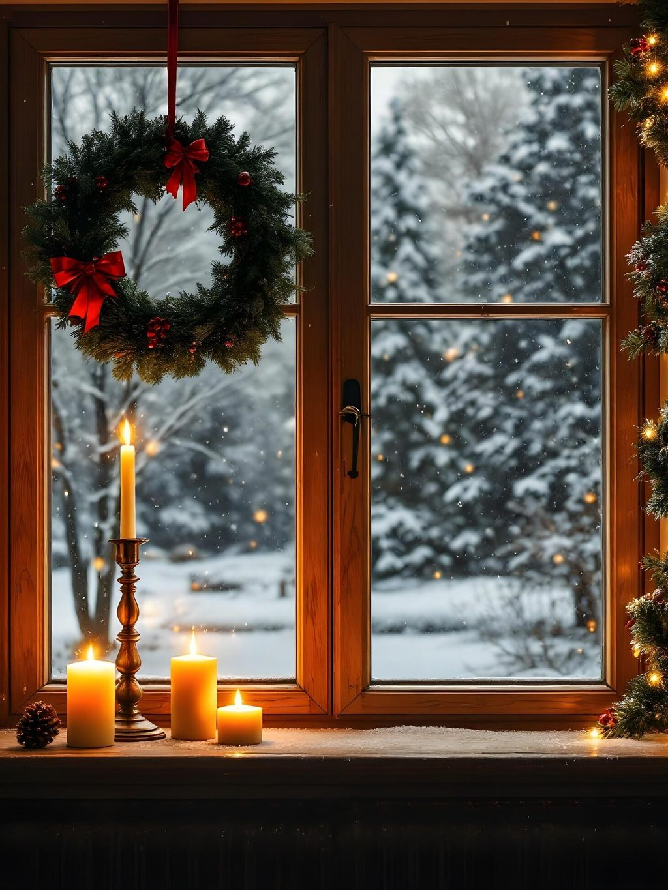

> TIP:CHECK: hang the wreath from a ribbon over the frame; no hook in the glass; battery candles on the sill

## 15. Red Berry Wreath in a Snowy Window

A red berry wreath in a snowy window is the boldest wreath here. Red baubles, pinecones and berries fill a green wreath hanging in dark wood-framed glass, with candles and a red scarf on the sill below.

Red against snow is the strongest color contrast in winter decorating, so this wreath reads from the street. Keep the sill simple — candles and one red accent — so the wreath stays the star.

> TIP:GUIDE: Budget: $25–$45 for a berry wreath and candles | Time: twenty minutes to hang | Skill: beginner

## 16. Snowflakes and Pinecones on the Sill

Snowflakes and pinecones on the sill make a window display that smells like Christmas. Hanging snowflakes fill the glass, pinecones and garland run along the sill, and fairy lights twinkle behind it all.

Pinecones are free if you gather them, and a quick bake in the oven dries them and opens them up. Spray them lightly gold for a festive touch, or leave them natural for a woodland look.

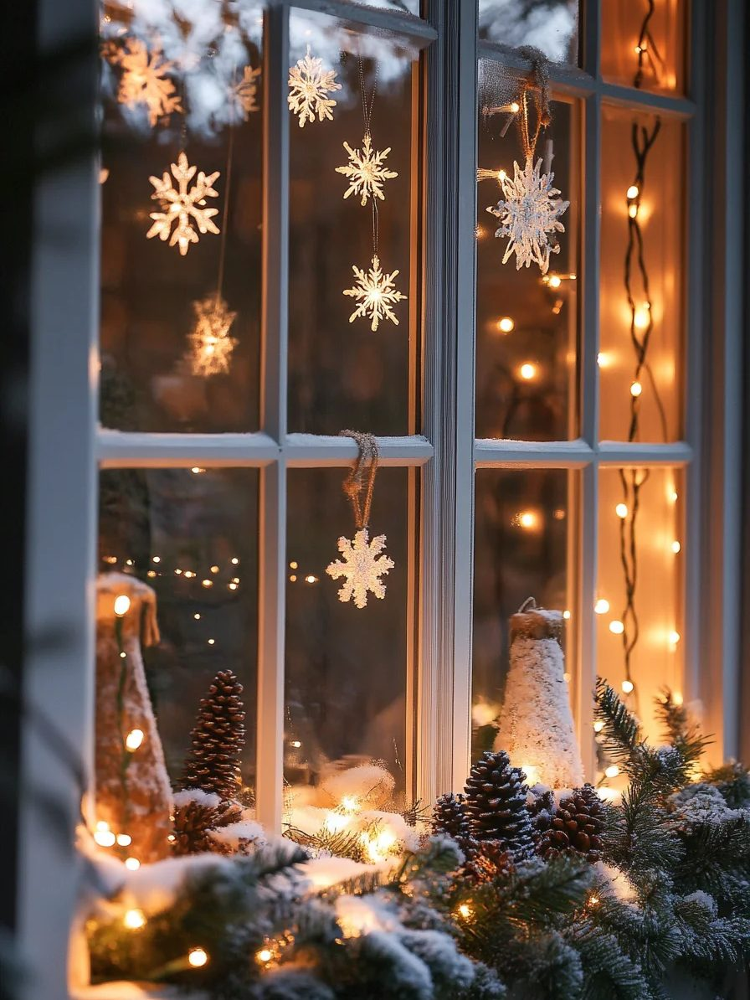

> TIP:QUICK: Gather pinecones free and bake them dry — a light gold spray makes them festive, natural keeps them woodland.

## 17. Snowflake Decals and Hanging Ornaments

Snowflake decals and hanging ornaments fill this window from top to bottom. Big decals cover the glass, small wooden ornaments hang on threads in front of them, and fairy lights frame the whole window.

Mix two kinds of decoration — flat decals on the glass and hanging ornaments in front of it — and the window gains depth. Keep the hanging ornaments small so they do not block the light.

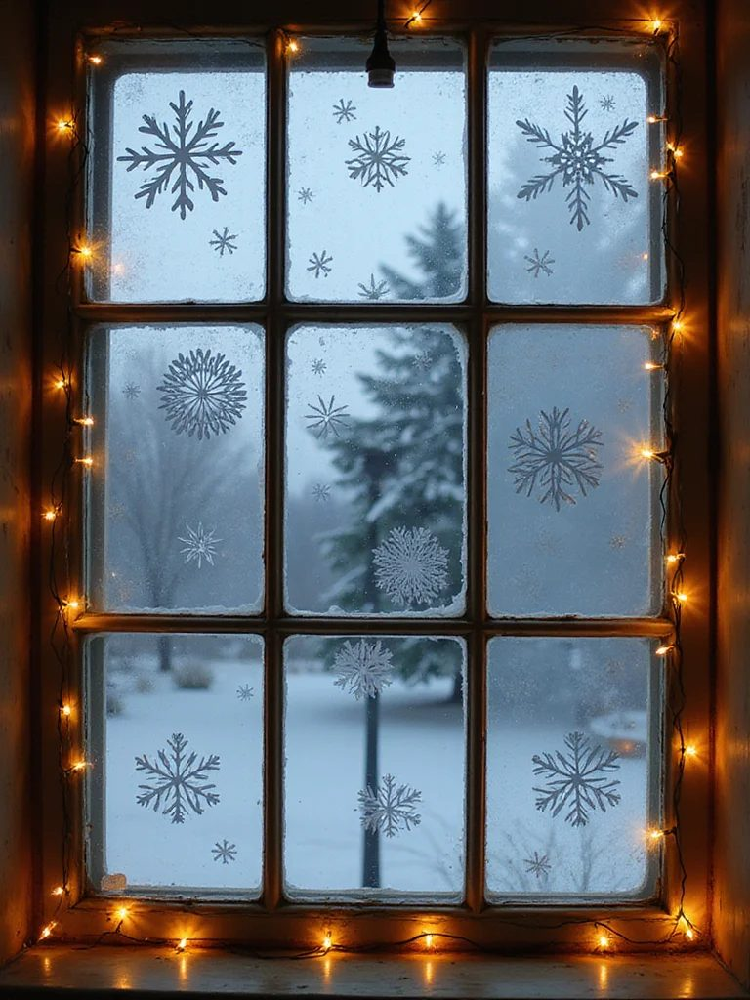

> TIP:CHECK: flat decals on the glass plus hanging ornaments in front; the mix gives the window depth; keep hanging ornaments small so they do not block the light

## 18. Frosted Snowflakes Glowing at Night

Frosted snowflakes glowing at night are the most dramatic window here. The decals catch the orange light from inside and the blue of the night outside, so the whole window glows in two colors at once.

This look depends on the light inside the room, so put a warm lamp near the window and turn the overhead light off. The contrast between the warm room and the cold night is what makes the flakes glow.

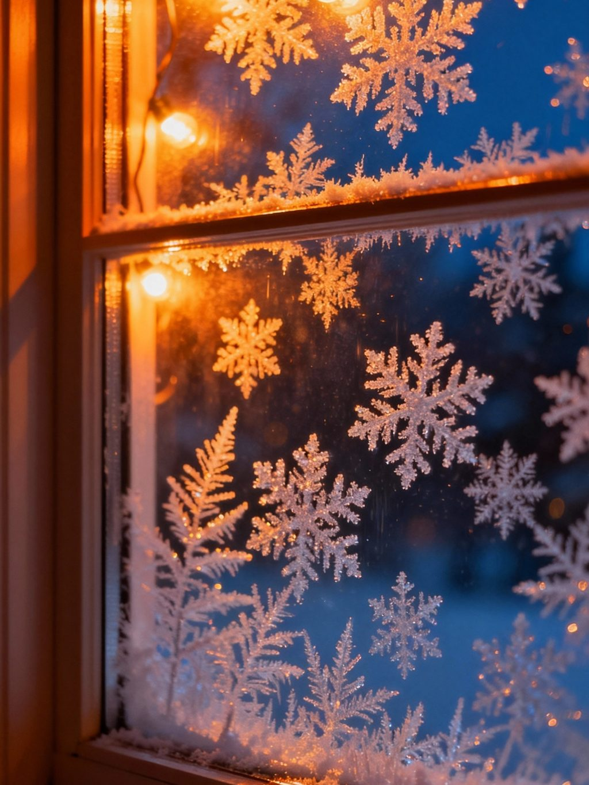

> TIP:GUIDE: Budget: under $10 for frosted snowflake decals | Time: fifteen minutes to stick | Skill: beginner

## 19. Giant Paper Snowflakes

Giant paper snowflakes are the boldest paper idea on this list. Oversized white flakes hang in the window with fairy lights, so big they cover half the glass, and the whole window reads as a snowstorm frozen mid-air.

Cut giant flakes from a full sheet of paper and hang only three or four — more than that and the window goes dark. The size is the point, so do not be shy: a flake should be as wide as your hand span.

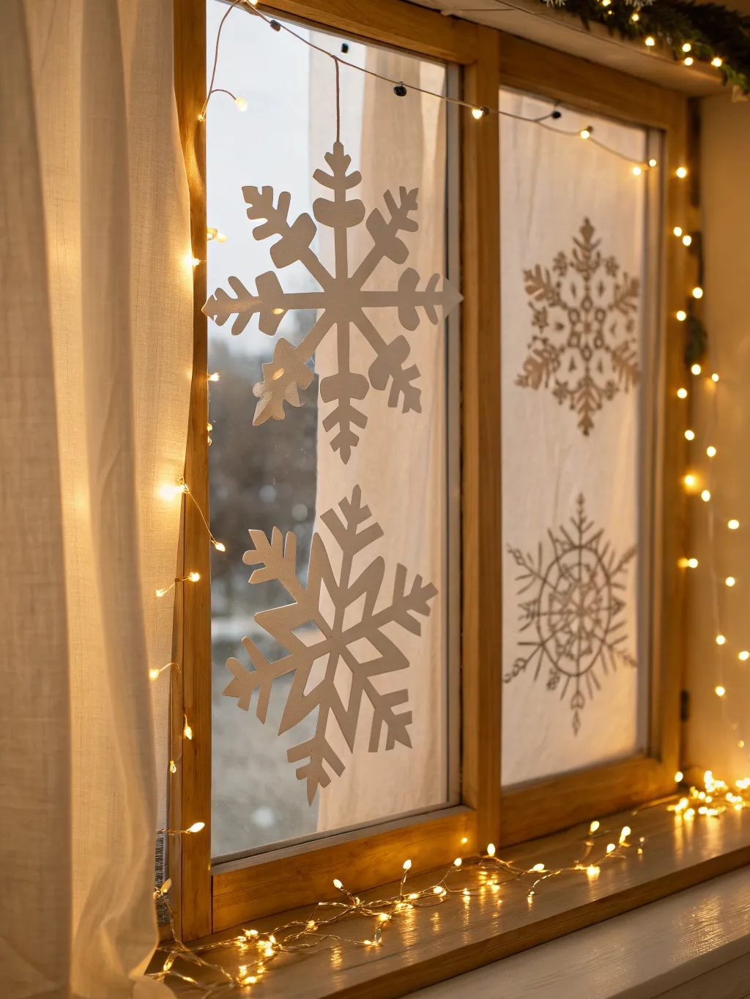

> TIP:QUICK: Three or four giant flakes only — more than that and the window goes dark; a flake as wide as your hand span.

## 20. A Lit Village Behind the Window

A lit village behind the window is the window as a dollhouse. A miniature village with tiny houses, trees and lights fills the window from behind the glass, with fairy lights strung above it like stars.

Build the village on a board that fits the sill, so it lifts out in one piece in January. Battery fairy lights keep the cords away, and a little fake snow hides the edges of the board.

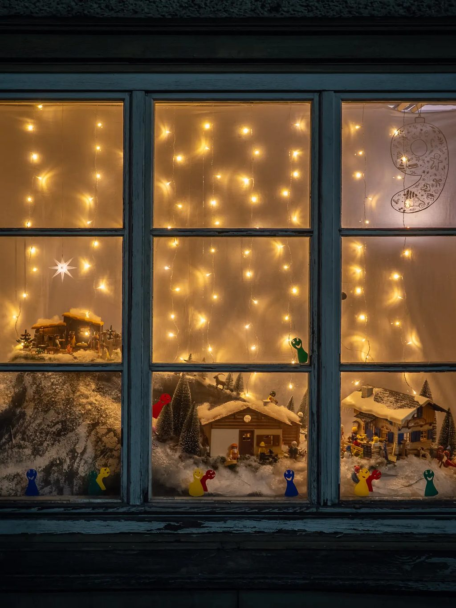

> TIP:CHECK: build the village on a board that lifts out in one piece; battery lights keep cords away; fake snow hides the edges

## 21. Paper Village and Trees on the Sill

A paper village and trees on the sill is the quieter version of the village window. White paper houses and trees glow softly on the sill, with star lights in the glass above and fairy lights along the frame.

White paper glows when it is backlit, so put a string of lights behind the houses, not in front. The houses themselves can be cut from cereal boxes and painted white — nobody will know.

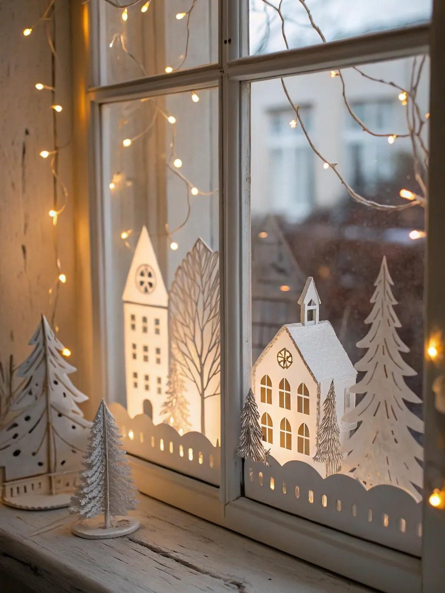

> TIP:GUIDE: Budget: free if you reuse card and boxes | Time: one hour to cut and build | Skill: beginner

## 22. Painted Village Window

A painted village window is the most artistic idea here. A snowy village with lit windows is painted right onto the glass, with garland and ornaments around the frame and little figures in the snow below.

Window paint and chalk markers wash off with warm water, so a painted window is not a commitment. Sketch the village on paper first, then copy it onto the glass in sections, and outline the windows last so they glow.

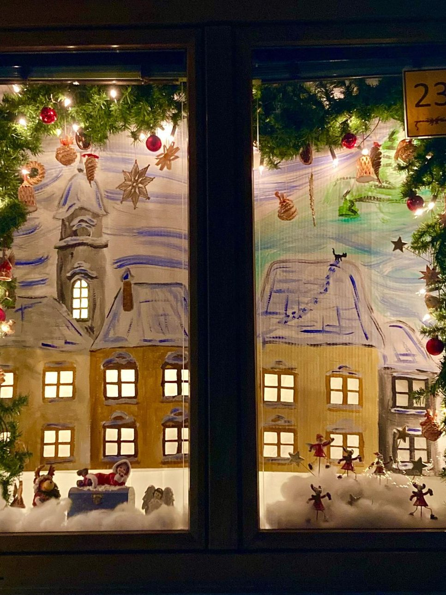

> TIP:QUICK: Sketch the village on paper first, then copy it onto the glass in sections — chalk markers wash off with warm water.

## 23. A Miniature Village in the Window

A miniature village in the window is the collector's version: tiny houses with red roofs, snowy trees and little figures arranged behind the glass like a museum display.

This is the window to build slowly, one house a year, until the village is complete. Keep the houses in a labeled box between Christmases, wrapped in tissue, and the village will last for decades.

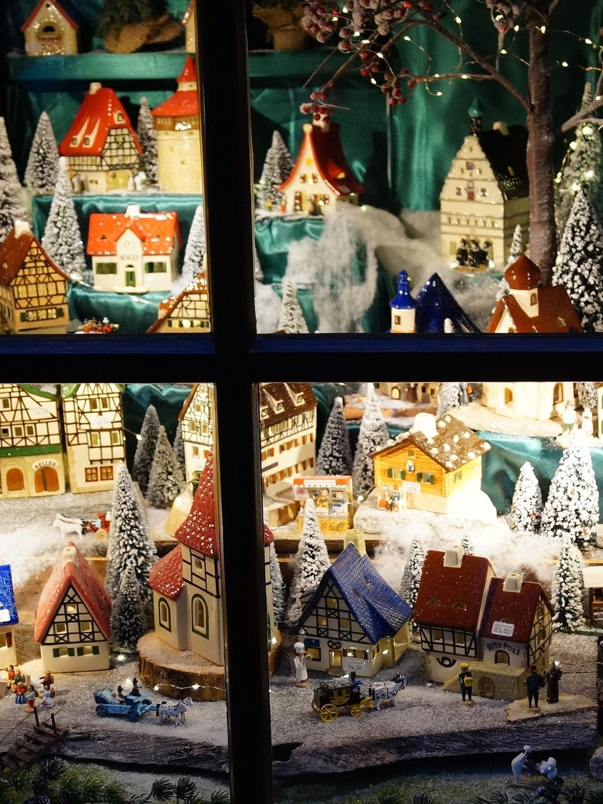

> TIP:CHECK: build it one house a year; wrap each house in tissue and label the box; the village lasts decades

## 24. Stained-Glass Tree at Night

A stained-glass tree at night glows like a jewel box. The tree's colored panes catch the light from inside the house, and against the dark night sky it looks like a lantern hanging in the window.

Stained glass needs light from behind to shine, so put a lamp near the window after dark. In daylight the colors are soft; at night, with the room lit, the tree is at its best.

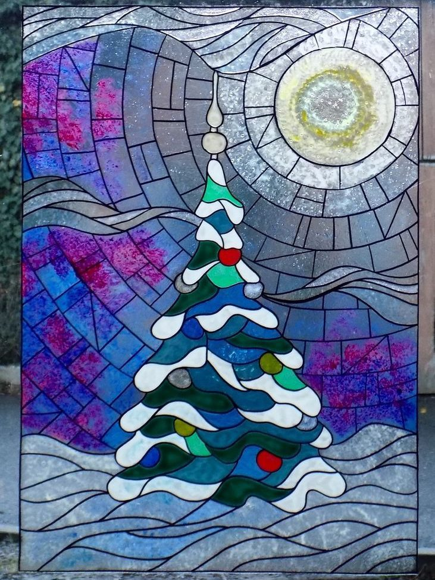

> TIP:GUIDE: Budget: $20–$40 for a stained-glass tree panel | Time: ten minutes to hang | Skill: beginner

## 25. Elf, Santa and Reindeer Clings

Elf, Santa and reindeer clings with snowflakes are the cheerful window for a family room. The characters peek in from the edges of the glass, snowflakes fill the middle, and the whole window looks like a Christmas card.

Put the characters at the edges and the snowflakes in the middle, so the window still lets the light through. Clings on the inside of the glass last longer than clings on the outside, where the weather gets them.

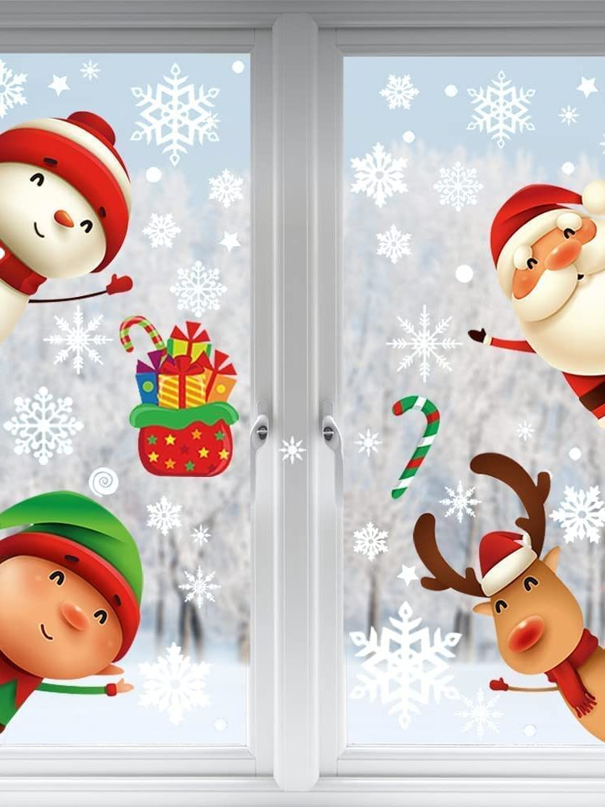

> TIP:QUICK: Characters at the edges, snowflakes in the middle — the window still lets the light through.

## 26. Snowman and Reindeer Clings

Snowman and reindeer clings looking out over a snowy yard are the friendliest window here. A smiling snowman and a reindeer with a red nose peer in from the glass, with snowflakes and a little Christmas sign between them.

This is the window for the room children play in: the clings are at their eye level, not adult eye level. Hang them low, where small hands can reach them and move them around.

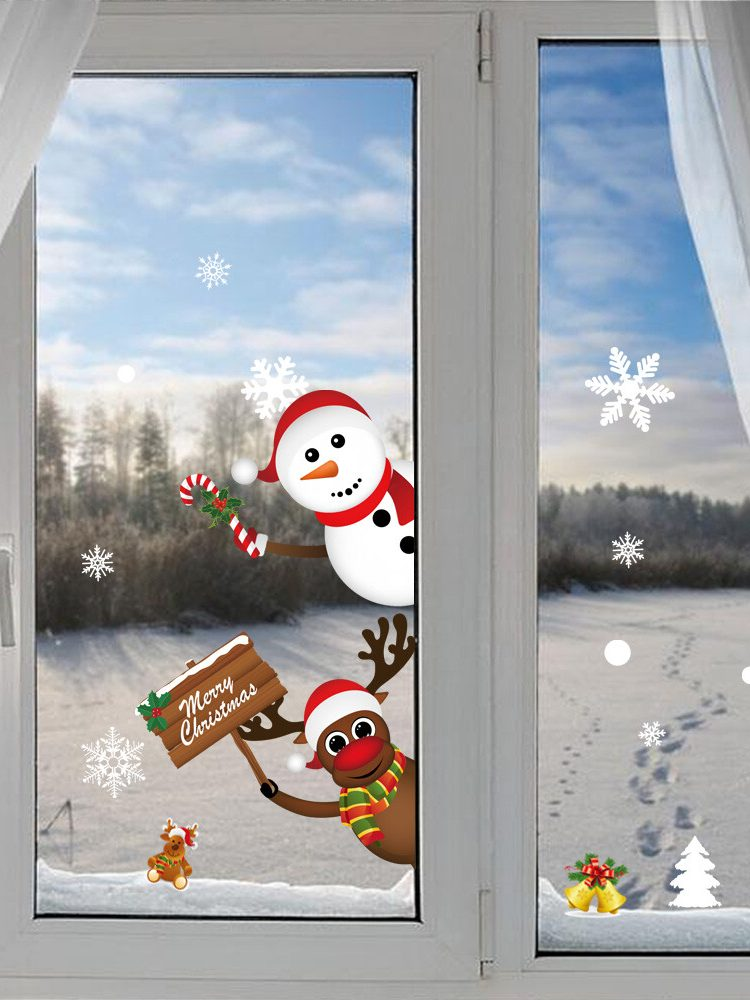

> TIP:CHECK: hang the clings at children's eye level, not adult; small hands should be able to reach and move them; clings on the inside last longer

## 27. Twin Wreaths and Candles

Twin wreaths and candles make a double window look like a pair of pictures. Two matching wreaths with red bows hang in the two panes, with rows of candles on the sill below and snowflakes on the glass above.

Matching wreaths need to be the same size and hung at the same height, or the pair looks off. Measure from the sill, not the top of the frame, so the wreaths sit level even if the window is not.

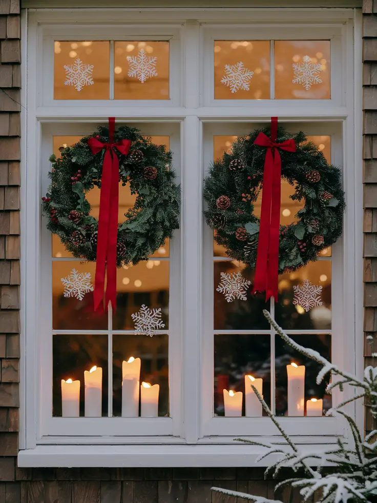

> TIP:GUIDE: Budget: $30–$50 for two matching wreaths and candles | Time: twenty minutes to hang | Skill: beginner

## 28. Candles in Two Tall Windows

Candles in two tall windows fill a whole wall with light. Rows of pillar candles stand on both sills, lit wreaths hang in the glass above, and the sofa below catches the glow.

This is the window for a dark living room: the candles do the work of a lamp. Use battery candles on the sills — a room full of real flames on two windowsills is a risk not worth taking.

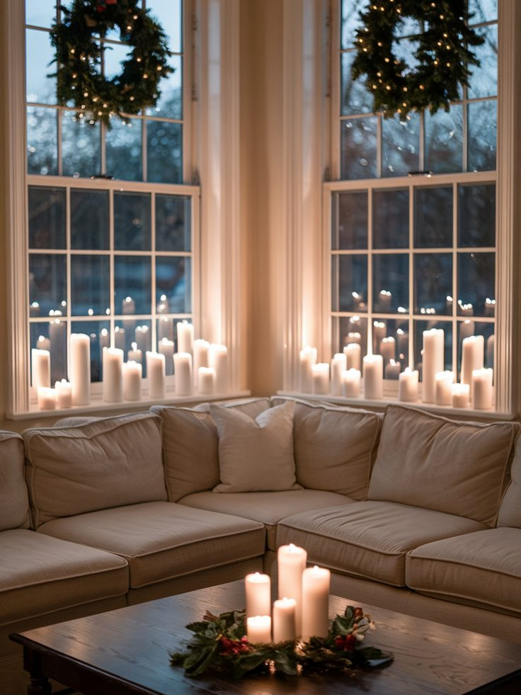

> TIP:QUICK: Battery candles on the sills — a room full of real flames on two windowsills is a risk not worth taking.

## 29. Holly Wreath and Candles

A holly wreath and candles is the traditional English Christmas window. A holly wreath with red berries hangs in the glass, candles glow on the sill below, and the whole window smells faintly of pine and wax.

Holly dries out fast indoors, so buy the wreath the week you hang it and mist it lightly every couple of days. Faux holly looks just as good from the street and lasts for years.

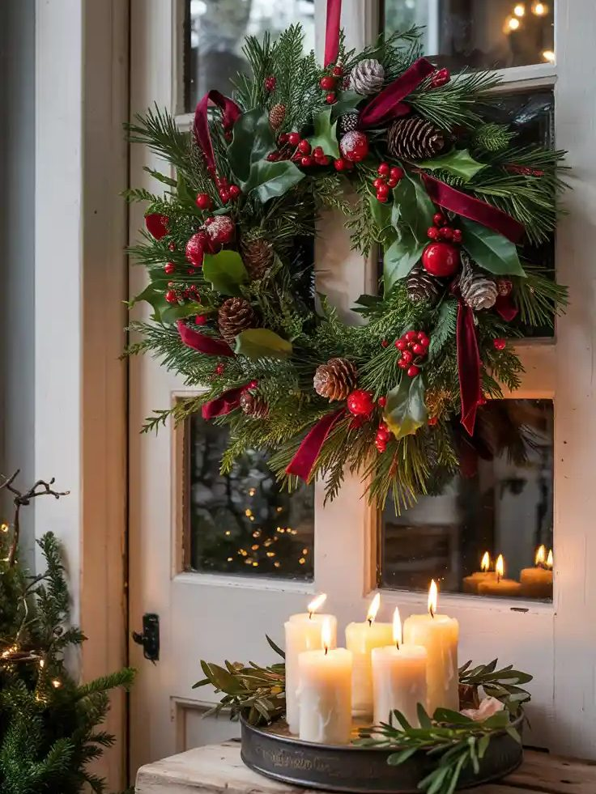

> TIP:CHECK: mist real holly lightly every couple of days; faux holly looks as good from the street; faux lasts for years

## 30. Hanging Snowflakes and Baubles

Hanging snowflakes and baubles make the window shimmer. White paper snowflakes and silver baubles hang on threads in the glass, with garland and fairy lights along the sill below.

Silver baubles catch the light and throw it around the room, so this window sparkles even on a grey day. Hang the baubles at different heights from the snowflakes so the two do not tangle.

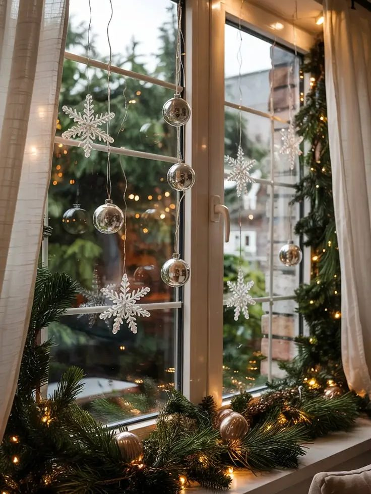

> TIP:GUIDE: Budget: under $15 for baubles, paper and thread | Time: thirty minutes to hang | Skill: beginner

## Takeaway

Start with the window you see most — the living room or the kitchen — and give it one idea: snowflake decals for daylight, fairy lights for evenings, or a wreath for the street. Then add a second window only if the first one makes you smile every time you pass it. If you want the rest of the house to match the windows, our [30 Winter Home Ideas for a Cozy Season](/posts/winter-home/) carries the same warmth through every room.

## Frequently Asked Questions

### What is the easiest winter window art for beginners?

Static cling snowflake decals are the easiest: peel, stick, and move them until they look right. They need no tools, no adhesive and no cleanup, they come off clean in January, and a pack costs less than ten dollars for a whole window.

### How do I make paper snowflakes for my windows?

Fold a square of white paper into triangles, cut small triangles and curves from the edges, then unfold it. Hang the flakes on clear thread at different heights, or stick them to the glass with a dot of removable putty. Thinner paper cuts more easily.

### Are window decals safe for my windows?

Static cling decals are safe on any glass and leave no residue. Adhesive decals can leave marks on older windows, so test one in a corner first. Never put decals on a window with a heated film, and avoid suction hooks on double glazing seals.

### How do I hang a wreath in a window?

Hang it from a ribbon looped over the top of the window frame, or from a suction hook rated for the wreath's weight. A ribbon over the frame needs no holes at all, and it lets you set the exact height so the wreath sits in the middle of the glass.

### What lights are best for a Christmas window?

Warm white battery fairy lights are the best choice: no cords, no plugs near the glass, and a timer switches them off. Curtain lights give an even glow across a wide window, while a single string is enough for a small one.

### How do I stop window art from blocking the light?

Keep the center of the glass clear and decorate the edges and corners instead. Use translucent materials like tissue paper and static cling, hang ornaments on thread rather than sticking them flat, and limit large pieces to three or four per window.

### Can I paint directly on my windows for Christmas?

Yes, with window paint or chalk markers, both of which wash off with warm water and a cloth. Sketch the design on paper first, paint in sections, and avoid the window seals and frames. Never use acrylic or spray paint, which will not come off.

### When should I take winter window art down?

Take paper snowflakes and decals down in early January, before the winter sun bakes them onto the glass. Wreaths and lights can stay until the end of January, and paper villages should be stored flat in a labeled box for next year.
